# NVM Technology Atlas

Research Revision: 2026-09-10

Choose a topic to explore IP cell principles, technology lineage, foundry processes or storage physics. Each study connects diagrams and operating conditions to public sources.

## Storage Physics

Charge, conductive structure, magnetization, ion distribution, crystal phase and polarization determine the physical mechanism. OTP is not one physics: floating-gate OTP stores charge; AntiFuse OTP forms a dielectric path. Study conventional standalone EEPROM separately from embedded MTP IP; within MTP IP, distinguish foundry double-poly EEPROM and third-party single-poly routes. NOR and NAND still describe array organization.

## Commercial Maturity

Volume production, completed qualification, research demonstrations, and development plans must be tied to a named company, process node, version, and application. Finding one MRAM product in volume production does not establish the same maturity for every SOT-MRAM implementation.

## System Role

SCM describes an application role that addresses the gap between memory and storage; it is not another bitcell type. Application, access semantics, persistence through power loss, and current supply status must be explained separately.

## Named IP Cells and Operating Principles

### NeoBit: Floating-Gate OTP Cell

eMemory

Follow the series select transistor and p-type floating-gate storage transistor as electron injection changes read current. Then distinguish normal OTP operation from the physical possibility of ultraviolet erasure.

NeoBit — Cell Structure

Series pMOS selector and pMOS floating-gate cell. Historical section: n-well in p substrate, p+ source/shared region/drain, separate select gate and p+ FG; no FG wire or stacked control gate. Dielectric isolates FG. The historical p+ model adds electron–hole recombination leaving localized negative ionic charge; stored Q− is not entirely free electrons.

- e− / h+ · Blue indicates electrons; red indicates holes. Arrows follow carriers.
- I · Green arrows show conventional current, opposite to electrons and aligned with holes.
- Bias · Only operating roles are shown; terminal voltages and pulse specifications are not supplied.
- Scale · Geometry and dielectrics are enlarged for readability, not a process layout.
- FG / Q− · FG has no DC terminal. Q− follows the historical p+ charge model, including localized negative ionic charge.
- UV* · The 2021 brief lists UV erase. Normal OTP lacks electrical erase; UV access depends on implementation and package.

- [ip-neobit: NeoBit Technical Principles](https://www.ememory.com.tw/en-US/Products/OTP/NeoBit)
- [ip-neobit-pat: Historical NeoBit Charge-Retention Patent](https://patents.google.com/patent/US6914825B2/en)
- [ip-neobit-link: Official NeoBit-to-Patent Link](https://www.ememory.com.tw/en-US/News/News?guid=19081915004414)
- [ip-neobit-uv: Published NeoBit UV-Erase Boundary](https://www.ememory.com.tw/Content/Upload/files/Product%20Brief/07_NeoBit%C2%AE%E2%80%93%20Most%20Widely%20Used%20OTP%20Solution_20210330.pdf)
- [ip-neobit-pgm-pat: Series-PMOS Embedded EPROM Write-Bias Patent](https://patents.google.com/patent/US6678190B2/en)
- [ip-neobit-io-pat: I/O-Device Single-Poly NVM Patent](https://patents.google.com/patent/US6920067B2/en)
- [ip-neobit-eetimes-2003: EE Times: 0.35 µm NeoBit Programs at 6–6.5 V](https://www.eetimes.com/flash-maker-ememory-gaining-foundry-converts-2/)
- [ip-neobit-io-pgm-author: Author-Defined Architecture Teaching Values: I/O PMOS Floating-Gate OTP Program Voltages](https://patents.google.com/patent/US6920067B2/en)

#### NeoBit — Program

Carriers: accelerated holes create electron–hole pairs; some hot electrons enter FG through oxide.

Hot-hole-induced electron injection

**1. Initial State**

State: Initial: less stored negative FG charge; p-channel is not in its programmed conductive state.

Stimulus: Retain the stored state before the operation.

Initial: less stored negative FG charge; p-channel is not in its programmed conductive state.

**2. Apply Conditions**

State: Stimulus: select pMOS and establish a lateral channel field; coupling shifts FG potential.

Stimulus: Stimulus: select pMOS and establish a lateral channel field; coupling shifts FG potential.

Stimulus: select pMOS and establish a lateral channel field; coupling shifts FG potential.

**3. Carrier Motion**

State: Carriers: accelerated holes create electron–hole pairs; some hot electrons enter FG through oxide.

Stimulus: Maintain the operating conditions and observe the carrier or sensing path.

Carriers: accelerated holes create electron–hole pairs; some hot electrons enter FG through oxide.

**4. Retained Result**

State: Hold: Q− remains after the pulse; the p-channel conducts more readily at specified read bias.

Stimulus: Return to retention conditions after the operation.

Hold: Q− remains after the pulse; the p-channel conducts more readily at specified read bias.

- e− / h+ · Blue indicates electrons; red indicates holes. Arrows follow carriers.
- I · Green arrows show conventional current, opposite to electrons and aligned with holes.
- Bias · Only operating roles are shown; terminal voltages and pulse specifications are not supplied.
- Scale · Geometry and dielectrics are enlarged for readability, not a process layout.
- FG / Q− · FG has no DC terminal. Q− follows the historical p+ charge model, including localized negative ionic charge.
- UV* · The 2021 brief lists UV erase. Normal OTP lacks electrical erase; UV access depends on implementation and package.

Do not draw oxide rupture, a permanent filament or nMOS CHE; do not invent voltages or universal current p+ doping. SL, SG/WL, BL and NW; FG floats. SG is separate from FG; capacitive BL coupling is not a DC connection.

- [ip-neobit: NeoBit Technical Principles](https://www.ememory.com.tw/en-US/Products/OTP/NeoBit)
- [ip-neobit-pat: Historical NeoBit Charge-Retention Patent](https://patents.google.com/patent/US6914825B2/en)
- [ip-neobit-link: Official NeoBit-to-Patent Link](https://www.ememory.com.tw/en-US/News/News?guid=19081915004414)
- [ip-neobit-uv: Published NeoBit UV-Erase Boundary](https://www.ememory.com.tw/Content/Upload/files/Product%20Brief/07_NeoBit%C2%AE%E2%80%93%20Most%20Widely%20Used%20OTP%20Solution_20210330.pdf)
- [ip-neobit-pgm-pat: Series-PMOS Embedded EPROM Write-Bias Patent](https://patents.google.com/patent/US6678190B2/en)
- [ip-neobit-io-pat: I/O-Device Single-Poly NVM Patent](https://patents.google.com/patent/US6920067B2/en)
- [ip-neobit-eetimes-2003: EE Times: 0.35 µm NeoBit Programs at 6–6.5 V](https://www.eetimes.com/flash-maker-ememory-gaining-foundry-converts-2/)
- [ip-neobit-io-pgm-author: Author-Defined Architecture Teaching Values: I/O PMOS Floating-Gate OTP Program Voltages](https://patents.google.com/patent/US6920067B2/en)

#### NeoBit — Erase Boundary

The normal OTP interface lacks electrical erase. This does not imply physical irreversibility: the 2021 brief lists UV erase, subject to implementation and package.

Normal OTP operating boundary

**1. Programmed State**

State: After programming: FG retains Q−.

Stimulus: Retain the stored state before the operation.

After programming: FG retains Q−.

**2. Normal Operating Boundary**

State: Boundary: normal OTP operation provides no electrical erase path.

Stimulus: Boundary: normal OTP operation provides no electrical erase path.

Boundary: normal OTP operation provides no electrical erase path.

**3. Historical UV Boundary**

State: Historical exception: UV erase was published; package support is not implied.

Stimulus: No normal electrical erase stimulus; this frame explains the operating boundary.

Historical exception: UV erase was published; package support is not implied.

- e− / h+ · Blue indicates electrons; red indicates holes. Arrows follow carriers.
- I · Green arrows show conventional current, opposite to electrons and aligned with holes.
- Bias · Only operating roles are shown; terminal voltages and pulse specifications are not supplied.
- Scale · Geometry and dielectrics are enlarged for readability, not a process layout.
- FG / Q− · FG has no DC terminal. Q− follows the historical p+ charge model, including localized negative ionic charge.
- UV* · The 2021 brief lists UV erase. Normal OTP lacks electrical erase; UV access depends on implementation and package.

Do not draw oxide rupture, a permanent filament or nMOS CHE; do not invent voltages or universal current p+ doping. SL, SG/WL, BL and NW; FG floats. SG is separate from FG; capacitive BL coupling is not a DC connection.

- [ip-neobit: NeoBit Technical Principles](https://www.ememory.com.tw/en-US/Products/OTP/NeoBit)
- [ip-neobit-pat: Historical NeoBit Charge-Retention Patent](https://patents.google.com/patent/US6914825B2/en)
- [ip-neobit-link: Official NeoBit-to-Patent Link](https://www.ememory.com.tw/en-US/News/News?guid=19081915004414)
- [ip-neobit-uv: Published NeoBit UV-Erase Boundary](https://www.ememory.com.tw/Content/Upload/files/Product%20Brief/07_NeoBit%C2%AE%E2%80%93%20Most%20Widely%20Used%20OTP%20Solution_20210330.pdf)
- [ip-neobit-pgm-pat: Series-PMOS Embedded EPROM Write-Bias Patent](https://patents.google.com/patent/US6678190B2/en)
- [ip-neobit-io-pat: I/O-Device Single-Poly NVM Patent](https://patents.google.com/patent/US6920067B2/en)
- [ip-neobit-eetimes-2003: EE Times: 0.35 µm NeoBit Programs at 6–6.5 V](https://www.eetimes.com/flash-maker-ememory-gaining-foundry-converts-2/)
- [ip-neobit-io-pgm-author: Author-Defined Architecture Teaching Values: I/O PMOS Floating-Gate OTP Program Voltages](https://patents.google.com/patent/US6920067B2/en)

#### NeoBit — Read

Sense output current while preserving the stored state; the macro defines logic coding.

Channel-current sensing

**1. Retained State**

State: Hold: FG charge is unchanged before reading.

Stimulus: Retain the stored state before the operation.

Hold: FG charge is unchanged before reading.

**2. Select the Cell**

State: Stimulus: select the cell with low-field read conditions.

Stimulus: Stimulus: select the cell with low-field read conditions.

Stimulus: select the cell with low-field read conditions.

**3. Sense the Path**

State: Path: holes flow along the p-channel; FG charge is not discharged into BL.

Stimulus: Maintain the operating conditions and observe the carrier or sensing path.

Path: holes flow along the p-channel; FG charge is not discharged into BL.

**4. Compare the Result**

State: Result: sense channel current; the macro defines the 0/1 mapping.

Stimulus: Return to retention conditions after the operation.

Result: sense channel current; the macro defines the 0/1 mapping.

- e− / h+ · Blue indicates electrons; red indicates holes. Arrows follow carriers.
- I · Green arrows show conventional current, opposite to electrons and aligned with holes.
- Bias · Only operating roles are shown; terminal voltages and pulse specifications are not supplied.
- Scale · Geometry and dielectrics are enlarged for readability, not a process layout.
- FG / Q− · FG has no DC terminal. Q− follows the historical p+ charge model, including localized negative ionic charge.
- UV* · The 2021 brief lists UV erase. Normal OTP lacks electrical erase; UV access depends on implementation and package.

Do not draw oxide rupture, a permanent filament or nMOS CHE; do not invent voltages or universal current p+ doping. SL, SG/WL, BL and NW; FG floats. SG is separate from FG; capacitive BL coupling is not a DC connection.

- [ip-neobit: NeoBit Technical Principles](https://www.ememory.com.tw/en-US/Products/OTP/NeoBit)
- [ip-neobit-pat: Historical NeoBit Charge-Retention Patent](https://patents.google.com/patent/US6914825B2/en)
- [ip-neobit-link: Official NeoBit-to-Patent Link](https://www.ememory.com.tw/en-US/News/News?guid=19081915004414)
- [ip-neobit-uv: Published NeoBit UV-Erase Boundary](https://www.ememory.com.tw/Content/Upload/files/Product%20Brief/07_NeoBit%C2%AE%E2%80%93%20Most%20Widely%20Used%20OTP%20Solution_20210330.pdf)
- [ip-neobit-pgm-pat: Series-PMOS Embedded EPROM Write-Bias Patent](https://patents.google.com/patent/US6678190B2/en)
- [ip-neobit-io-pat: I/O-Device Single-Poly NVM Patent](https://patents.google.com/patent/US6920067B2/en)
- [ip-neobit-eetimes-2003: EE Times: 0.35 µm NeoBit Programs at 6–6.5 V](https://www.eetimes.com/flash-maker-ememory-gaining-foundry-converts-2/)
- [ip-neobit-io-pgm-author: Author-Defined Architecture Teaching Values: I/O PMOS Floating-Gate OTP Program Voltages](https://patents.google.com/patent/US6920067B2/en)

#### IP Cell Tradeoffs

A floating-gate OTP stores its state in charge. The selector controls access, while programming moves the storage transistor to another sensed state. An interface without electrical erase is a different OTP design path from an irreversible dielectric change. Public NeoBit principles describe two series p-MOSFETs and CHEI. For architecture teaching, this page assumes about 6.5 V PGM for a 3.3 V I/O PMOS cell and 7.5 V for a 5 V cell, with a higher n-type Vpgm in the same-node comparison. These are author-defined teaching values, not specifications for current NeoBit macros. The linked patent supports PMOS/I/O-device embodiments but does not provide this exact voltage pairing; the values must not be transferred to core-GOX-breakdown AntiFuse.

### NeoFuse: Gate-Dielectric Antifuse OTP Cell

eMemory

Start at the n-type cell's gate dielectric and follow high-field defect creation, changes in effective tunneling distance and the gate current used for sensing.

NeoFuse — Cell Structure

Storage uses an nFET gate dielectric and gate-current sensing. Published 3T adds regulation; show selection, regulation and antifuse functions with conceptual connectivity. The programmed dielectric-defect state persists; data is not an FG electron count.

- e− / h+ · Blue indicates electrons; red indicates holes. Arrows follow carriers.
- I · Green arrows show conventional current, opposite to electrons and aligned with holes.
- Bias · Only operating roles are shown; terminal voltages and pulse specifications are not supplied.
- Scale · Geometry and dielectrics are enlarged for readability, not a process layout.
- DT / 3T · DT describes direct tunneling through a shorter effective barrier after defect generation. SEL/REG are published functions; the related patent is not a verified current NeoFuse netlist.

- [ip-neofuse: NeoFuse Technical Principles](https://www.ememory.com.tw/en-US/Products/OTP/NeoFuse)
- [ip-neofuse-dt: Quantum Tunneling Mechanism in NeoFuse](https://www.chipestimate.com/Quantum-Tunneling-Mechanism-in-NeoFuse/eMemory/Technical-Article/2021/01/19)
- [ip-neofuse-3t: Named NeoFuse Three-Transistor Architecture](https://www.ememory.com.tw/en-US/News/2024-12-09/Powering-the-NVM-and-Embedded-Chip-Security-Technologies)
- [ip-neofuse-pat: eMemory Three-Transistor Fin Antifuse Application Publication (A1)](https://patents.google.com/patent/US20250024668A1/en)
- [ip-neofuse-9v-2016: Named example: 0.18 µm 1.8 V NeoFuse core sustains 9 V during program](https://www.ememory.com.tw/en-US/News/2016-01-14/eMemory%E2%80%99s-NeoFuse-Technology-A-Major-Advance-in-Automotive-Panel-Driver-IC)

#### NeoFuse — Program

Carriers: defects shorten the effective barrier; electrons tunnel across it.

High-field defect generation and enhanced tunneling

**1. Initial State**

State: Initial: few dielectric defects and low gate current.

Stimulus: Retain the stored state before the operation.

Initial: few dielectric defects and low gate current.

**2. Apply Conditions**

State: Stimulus: selection/regulation establishes high dielectric field.

Stimulus: Stimulus: selection/regulation establishes high dielectric field.

Stimulus: selection/regulation establishes high dielectric field.

**3. Carrier Motion**

State: Carriers: defects shorten the effective barrier; electrons tunnel across it.

Stimulus: Maintain the operating conditions and observe the carrier or sensing path.

Carriers: defects shorten the effective barrier; electrons tunnel across it.

**4. Retained Result**

State: Hold: the defect state remains after stress removal.

Stimulus: Return to retention conditions after the operation.

Hold: the defect state remains after stress removal.

- e− / h+ · Blue indicates electrons; red indicates holes. Arrows follow carriers.
- I · Green arrows show conventional current, opposite to electrons and aligned with holes.
- Bias · Only operating roles are shown; terminal voltages and pulse specifications are not supplied.
- Scale · Geometry and dielectrics are enlarged for readability, not a process layout.
- DT / 3T · DT describes direct tunneling through a shorter effective barrier after defect generation. SEL/REG are published functions; the related patent is not a verified current NeoFuse netlist.

No thick metallic short or FG storage; the damaged high-k/interfacial sublayer of current advanced processes is unverified. Antifuse gate AF, underlying Si, selection/regulation controls and BL; storage dielectric lies between AF and Si, not in the selector oxide.

- [ip-neofuse: NeoFuse Technical Principles](https://www.ememory.com.tw/en-US/Products/OTP/NeoFuse)
- [ip-neofuse-dt: Quantum Tunneling Mechanism in NeoFuse](https://www.chipestimate.com/Quantum-Tunneling-Mechanism-in-NeoFuse/eMemory/Technical-Article/2021/01/19)
- [ip-neofuse-3t: Named NeoFuse Three-Transistor Architecture](https://www.ememory.com.tw/en-US/News/2024-12-09/Powering-the-NVM-and-Embedded-Chip-Security-Technologies)
- [ip-neofuse-pat: eMemory Three-Transistor Fin Antifuse Application Publication (A1)](https://patents.google.com/patent/US20250024668A1/en)
- [ip-neofuse-9v-2016: Named example: 0.18 µm 1.8 V NeoFuse core sustains 9 V during program](https://www.ememory.com.tw/en-US/News/2016-01-14/eMemory%E2%80%99s-NeoFuse-Technology-A-Major-Advance-in-Automotive-Panel-Driver-IC)

#### NeoFuse — Erase Boundary

Normal operation has no defect-repair erase step; reducing bias does not restore the initial dielectric.

Normal OTP operating boundary

**1. Programmed State**

State: After programming: the defect state has changed.

Stimulus: Retain the stored state before the operation.

After programming: the defect state has changed.

**2. Normal Operating Boundary**

State: Boundary: ordinary bias does not repair the dielectric.

Stimulus: Boundary: ordinary bias does not repair the dielectric.

Boundary: ordinary bias does not repair the dielectric.

**3. Persistent State**

State: Result: normal use retains the OTP state.

Stimulus: No normal electrical erase stimulus; this frame explains the operating boundary.

Result: normal use retains the OTP state.

- e− / h+ · Blue indicates electrons; red indicates holes. Arrows follow carriers.
- I · Green arrows show conventional current, opposite to electrons and aligned with holes.
- Bias · Only operating roles are shown; terminal voltages and pulse specifications are not supplied.
- Scale · Geometry and dielectrics are enlarged for readability, not a process layout.
- DT / 3T · DT describes direct tunneling through a shorter effective barrier after defect generation. SEL/REG are published functions; the related patent is not a verified current NeoFuse netlist.

No thick metallic short or FG storage; the damaged high-k/interfacial sublayer of current advanced processes is unverified. Antifuse gate AF, underlying Si, selection/regulation controls and BL; storage dielectric lies between AF and Si, not in the selector oxide.

- [ip-neofuse: NeoFuse Technical Principles](https://www.ememory.com.tw/en-US/Products/OTP/NeoFuse)
- [ip-neofuse-dt: Quantum Tunneling Mechanism in NeoFuse](https://www.chipestimate.com/Quantum-Tunneling-Mechanism-in-NeoFuse/eMemory/Technical-Article/2021/01/19)
- [ip-neofuse-3t: Named NeoFuse Three-Transistor Architecture](https://www.ememory.com.tw/en-US/News/2024-12-09/Powering-the-NVM-and-Embedded-Chip-Security-Technologies)
- [ip-neofuse-pat: eMemory Three-Transistor Fin Antifuse Application Publication (A1)](https://patents.google.com/patent/US20250024668A1/en)
- [ip-neofuse-9v-2016: Named example: 0.18 µm 1.8 V NeoFuse core sustains 9 V during program](https://www.ememory.com.tw/en-US/News/2016-01-14/eMemory%E2%80%99s-NeoFuse-Technology-A-Major-Advance-in-Automotive-Panel-Driver-IC)

#### NeoFuse — Read

Sense output current while preserving the stored state; the macro defines logic coding.

Gate-current sensing

**1. Retained State**

State: Compare: initial and programmed states have different defect densities.

Stimulus: Retain the stored state before the operation.

Compare: initial and programmed states have different defect densities.

**2. Select the Cell**

State: Stimulus: use read conditions below programming stress.

Stimulus: Stimulus: use read conditions below programming stress.

Stimulus: use read conditions below programming stress.

**3. Sense the Path**

State: Path: sense gate current; Si-to-AF electrons oppose conventional current.

Stimulus: Maintain the operating conditions and observe the carrier or sensing path.

Path: sense gate current; Si-to-AF electrons oppose conventional current.

**4. Compare the Result**

State: Result: compare with a current reference without resetting defects.

Stimulus: Return to retention conditions after the operation.

Result: compare with a current reference without resetting defects.

- e− / h+ · Blue indicates electrons; red indicates holes. Arrows follow carriers.
- I · Green arrows show conventional current, opposite to electrons and aligned with holes.
- Bias · Only operating roles are shown; terminal voltages and pulse specifications are not supplied.
- Scale · Geometry and dielectrics are enlarged for readability, not a process layout.
- DT / 3T · DT describes direct tunneling through a shorter effective barrier after defect generation. SEL/REG are published functions; the related patent is not a verified current NeoFuse netlist.

No thick metallic short or FG storage; the damaged high-k/interfacial sublayer of current advanced processes is unverified. Antifuse gate AF, underlying Si, selection/regulation controls and BL; storage dielectric lies between AF and Si, not in the selector oxide.

- [ip-neofuse: NeoFuse Technical Principles](https://www.ememory.com.tw/en-US/Products/OTP/NeoFuse)
- [ip-neofuse-dt: Quantum Tunneling Mechanism in NeoFuse](https://www.chipestimate.com/Quantum-Tunneling-Mechanism-in-NeoFuse/eMemory/Technical-Article/2021/01/19)
- [ip-neofuse-3t: Named NeoFuse Three-Transistor Architecture](https://www.ememory.com.tw/en-US/News/2024-12-09/Powering-the-NVM-and-Embedded-Chip-Security-Technologies)
- [ip-neofuse-pat: eMemory Three-Transistor Fin Antifuse Application Publication (A1)](https://patents.google.com/patent/US20250024668A1/en)
- [ip-neofuse-9v-2016: Named example: 0.18 µm 1.8 V NeoFuse core sustains 9 V during program](https://www.ememory.com.tw/en-US/News/2016-01-14/eMemory%E2%80%99s-NeoFuse-Technology-A-Major-Advance-in-Automotive-Panel-Driver-IC)

#### IP Cell Tradeoffs

The storage event changes dielectric conduction. An ideal short does not explain the ultrathin-dielectric physics. Selection and regulation transistors support array operation; defects and tunneling in the storage region create the programmed read-current difference.

### Kilopass XPM: Historical 2T Antifuse

Kilopass; acquired by Synopsys in 2018

The original patent explicitly names XPM and distinguishes the storage MOS from the select MOS.

Kilopass XPM — Cell Structure

Original patent Figure 1 describes XPM as storage MOS M0 plus select MOS M1. WLP drives the storage gate, WLR selects M1, and BL senses current. The enlarged M0 region shows function without inventing a second diffusion or an intermediate sense terminal.

- e− · Blue dots are mobile electrons and blue arrows follow electron flow; they are not charge retained inside the gate.
- I · Green denotes conventional current, opposite to electrons. The illustrated branch fixes positive gate bias and a low BL.
- OTP · The local orange path indicates conductive oxide state; normal operation has no electrical erase.
- I_L / I_H · Short/long bars illustrate low/high read-current comparison, not measured values or fixed logic coding.
- Geometry · Historical public-source functional reconstruction, not a scale section or current layout; terminal biases are not process operating specifications.
- M0 / M1 · M0 stores and M1 selects. No sense output absent from the original is added at their internal node.

- [ip-kilopass-xpm-2007: Historical Kilopass XPM 2T Patent Diagram](https://patents.google.com/patent/WO2007090089A2/en)
- [ip-kilopass-2t-2012: Kilopass 130/110 nm XPM and Gusto 2T Announcement](https://www.design-reuse.com/news/202521997-kilopass-nvm-ip-cores-first-to-deliver-footprint-and-pin-compatibility-across-eight-top-tier-silicon-foundries-for-the-130-110nm-process-node/)

#### Kilopass XPM — Program

Local M0 oxide breakdown creates a conductive path; electrons are illustrated from BL through M1 and silicon toward positive WLP.

Gate-Oxide Breakdown

**1. Initial State**

State: Gate oxide is intact; M0 has low gate-to-silicon leakage and M1 is not yet selected.

Stimulus: The present operation has not yet applied a stimulus.

Gate oxide is intact; M0 has low gate-to-silicon leakage and M1 is not yet selected.

**2. Establish Program Field**

State: Apply positive programming bias at WLP, select M1 through WLR, and hold BL low to stress M0 gate oxide.

Stimulus: Apply positive programming bias at WLP, select M1 through WLR, and hold BL low to stress M0 gate oxide.

Apply positive programming bias at WLP, select M1 through WLR, and hold BL low to stress M0 gate oxide.

**3. Oxide Breakdown**

State: Local M0 oxide breakdown creates a conductive path; electrons are illustrated from BL through M1 and silicon toward positive WLP.

Stimulus: Apply positive programming bias at WLP, select M1 through WLR, and hold BL low to stress M0 gate oxide.

Local M0 oxide breakdown creates a conductive path; electrons are illustrated from BL through M1 and silicon toward positive WLP.

**4. Retained Result**

State: After the pulse, the oxide conductance difference persists; the stored quantity is the oxide state.

Stimulus: Remove programming bias.

After the pulse, the oxide conductance difference persists; the stored quantity is the oxide state.

- e− · Blue dots are mobile electrons and blue arrows follow electron flow; they are not charge retained inside the gate.
- I · Green denotes conventional current, opposite to electrons. The illustrated branch fixes positive gate bias and a low BL.
- OTP · The local orange path indicates conductive oxide state; normal operation has no electrical erase.
- I_L / I_H · Short/long bars illustrate low/high read-current comparison, not measured values or fixed logic coding.
- Geometry · Historical public-source functional reconstruction, not a scale section or current layout; terminal biases are not process operating specifications.
- M0 / M1 · M0 stores and M1 selects. No sense output absent from the original is added at their internal node.

Uses Figure 1 explicitly named XPM in the 2007 patent and the 2012 product announcement. Later self-sensing, latch and 3T drawings are excluded. Positive WLP and low BL define this nMOS teaching branch; read uses lower stress without implementation voltages. Acquisition announcements establish portfolio continuity; current 1T/2T or advanced-process articles do not prove this section is retained at every node.

- [ip-kilopass-xpm-2007: Historical Kilopass XPM 2T Patent Diagram](https://patents.google.com/patent/WO2007090089A2/en)
- [ip-kilopass-2t-2012: Kilopass 130/110 nm XPM and Gusto 2T Announcement](https://www.design-reuse.com/news/202521997-kilopass-nvm-ip-cores-first-to-deliver-footprint-and-pin-compatibility-across-eight-top-tier-silicon-foundries-for-the-130-110nm-process-node/)
- [ip-lineage-kilopass-2018: Synopsys Acquisition of Kilopass](https://news.synopsys.com/2018-01-10-Synopsys-Expands-DesignWare-IP-Portfolio-with-Acquisition-of-Kilopass-Technology)
- [ip-synopsys-otp-current: Synopsys OTP NVM 1T/2T Portfolio](https://www.synopsys.com/articles/non-volatile-memory.html)
- [ip-synopsys-advanced-otp: Synopsys Advanced-Process OTP Reliability and Sensing](https://www.synopsys.com/articles/reliable-secure-otp-ip.html)

#### Kilopass XPM — Erase Boundary

Normal OTP provides no electrical erase; an ordinary reverse operation cannot restore the unprogrammed cell.

Normal OTP Operating Boundary

**1. Programmed State**

State: The programmed local oxide conduction state remains.

Stimulus: The present operation has not yet applied a stimulus.

The programmed local oxide conduction state remains.

**2. Normal Operating Boundary**

State: The normal OTP interface has no electrical erase procedure that repairs gate oxide.

Stimulus: No normal electrical erase stimulus.

The normal OTP interface has no electrical erase procedure that repairs gate oxide.

**3. Persistent State**

State: The original cell remains programmed; spare bits, remapping or eMTP emulated updates are system methods.

Stimulus: No normal electrical erase stimulus.

The original cell remains programmed; spare bits, remapping or eMTP emulated updates are system methods.

- e− · Blue dots are mobile electrons and blue arrows follow electron flow; they are not charge retained inside the gate.
- I · Green denotes conventional current, opposite to electrons. The illustrated branch fixes positive gate bias and a low BL.
- OTP · The local orange path indicates conductive oxide state; normal operation has no electrical erase.
- I_L / I_H · Short/long bars illustrate low/high read-current comparison, not measured values or fixed logic coding.
- Geometry · Historical public-source functional reconstruction, not a scale section or current layout; terminal biases are not process operating specifications.
- M0 / M1 · M0 stores and M1 selects. No sense output absent from the original is added at their internal node.

Uses Figure 1 explicitly named XPM in the 2007 patent and the 2012 product announcement. Later self-sensing, latch and 3T drawings are excluded. Positive WLP and low BL define this nMOS teaching branch; read uses lower stress without implementation voltages. Acquisition announcements establish portfolio continuity; current 1T/2T or advanced-process articles do not prove this section is retained at every node.

- [ip-kilopass-xpm-2007: Historical Kilopass XPM 2T Patent Diagram](https://patents.google.com/patent/WO2007090089A2/en)
- [ip-kilopass-2t-2012: Kilopass 130/110 nm XPM and Gusto 2T Announcement](https://www.design-reuse.com/news/202521997-kilopass-nvm-ip-cores-first-to-deliver-footprint-and-pin-compatibility-across-eight-top-tier-silicon-foundries-for-the-130-110nm-process-node/)
- [ip-lineage-kilopass-2018: Synopsys Acquisition of Kilopass](https://news.synopsys.com/2018-01-10-Synopsys-Expands-DesignWare-IP-Portfolio-with-Acquisition-of-Kilopass-Technology)
- [ip-synopsys-otp-current: Synopsys OTP NVM 1T/2T Portfolio](https://www.synopsys.com/articles/non-volatile-memory.html)
- [ip-synopsys-advanced-otp: Synopsys Advanced-Process OTP Reliability and Sensing](https://www.synopsys.com/articles/reliable-secure-otp-ip.html)

#### Kilopass XPM — Read

The sense amplifier compares low/high BL current. The macro defines 0/1 coding; read does not repair the oxide.

Oxide-Conduction Current Sensing

**1. Retained State**

State: The illustrated programmed cell retains its conductive oxide state without a read stimulus.

Stimulus: The present operation has not yet applied a stimulus.

The illustrated programmed cell retains its conductive oxide state without a read stimulus.

**2. Establish Read Conditions**

State: WLR selects M1; WLP and BL establish lower-stress read conditions.

Stimulus: WLR selects M1; WLP and BL establish lower-stress read conditions.

WLR selects M1; WLP and BL establish lower-stress read conditions.

**3. Sense the Path**

State: For the illustrated positive WLP and low BL, conventional current flows through oxide, silicon and M1 toward BL; electrons move oppositely.

Stimulus: WLR selects M1; WLP and BL establish lower-stress read conditions.

For the illustrated positive WLP and low BL, conventional current flows through oxide, silicon and M1 toward BL; electrons move oppositely.

**4. Compare the Result**

State: The sense amplifier compares low/high BL current. The macro defines 0/1 coding; read does not repair the oxide.

Stimulus: Complete sensing and interpret using macro logic.

The sense amplifier compares low/high BL current. The macro defines 0/1 coding; read does not repair the oxide.

- e− · Blue dots are mobile electrons and blue arrows follow electron flow; they are not charge retained inside the gate.
- I · Green denotes conventional current, opposite to electrons. The illustrated branch fixes positive gate bias and a low BL.
- OTP · The local orange path indicates conductive oxide state; normal operation has no electrical erase.
- I_L / I_H · Short/long bars illustrate low/high read-current comparison, not measured values or fixed logic coding.
- Geometry · Historical public-source functional reconstruction, not a scale section or current layout; terminal biases are not process operating specifications.
- M0 / M1 · M0 stores and M1 selects. No sense output absent from the original is added at their internal node.

Uses Figure 1 explicitly named XPM in the 2007 patent and the 2012 product announcement. Later self-sensing, latch and 3T drawings are excluded. Positive WLP and low BL define this nMOS teaching branch; read uses lower stress without implementation voltages. Acquisition announcements establish portfolio continuity; current 1T/2T or advanced-process articles do not prove this section is retained at every node.

- [ip-kilopass-xpm-2007: Historical Kilopass XPM 2T Patent Diagram](https://patents.google.com/patent/WO2007090089A2/en)
- [ip-kilopass-2t-2012: Kilopass 130/110 nm XPM and Gusto 2T Announcement](https://www.design-reuse.com/news/202521997-kilopass-nvm-ip-cores-first-to-deliver-footprint-and-pin-compatibility-across-eight-top-tier-silicon-foundries-for-the-130-110nm-process-node/)
- [ip-lineage-kilopass-2018: Synopsys Acquisition of Kilopass](https://news.synopsys.com/2018-01-10-Synopsys-Expands-DesignWare-IP-Portfolio-with-Acquisition-of-Kilopass-Technology)
- [ip-synopsys-otp-current: Synopsys OTP NVM 1T/2T Portfolio](https://www.synopsys.com/articles/non-volatile-memory.html)
- [ip-synopsys-advanced-otp: Synopsys Advanced-Process OTP Reliability and Sensing](https://www.synopsys.com/articles/reliable-secure-otp-ip.html)

#### IP Cell Tradeoffs

Learn the two transistor roles and the original XPM evidence; acquisition does not prove one cell is retained at every node.

### Sidense 1T-Fuse: Split-Channel Antifuse

Sidense; acquired by Synopsys in 2017

One gate spans thick and thin oxide; persistent conduction through the thin region creates the OTP state.

Sidense 1T-Fuse — Cell Structure

Following original-author Figure 2 from 2007, one continuous poly gate connects to WL and the sole N+ diffusion connects to BL. Thick I/O oxide lies near BL; thin core oxide lies farther away. Breakdown links the gate to the channel through the thin region. Thicknesses and paths are enlarged for readability.

- e− · Blue dots are mobile electrons and blue arrows follow electron flow; they are not charge retained inside the gate.
- I · Green denotes conventional current, opposite to electrons. The illustrated branch fixes positive gate bias and a low BL.
- OTP · The local orange path indicates conductive oxide state; normal operation has no electrical erase.
- I_L / I_H · Short/long bars illustrate low/high read-current comparison, not measured values or fixed logic coding.
- Geometry · Historical public-source functional reconstruction, not a scale section or current layout; terminal biases are not process operating specifications.
- WL / BL · WL connects to one poly gate and BL to the sole N+ diffusion. Only the thin core oxide is shown breaking down. Horizontal carrier paths are offset for readability from the under-gate surface channel; they do not indicate conduction through the p-type bulk.

- [ip-sidense-cell-2007: Sidense 1T-Fuse Original-Author Cell Section](https://www.chipestimate.com/1T-OTP-Memory-Delivering-Quality-and-Reliability/Sidense-a-part-of-Synopsys/Technical-Article/2007/12/18)
- [ip-sidense-irreversible-2017: Sidense 1T-Fuse Irreversibility and eMTP Boundary](https://www.chipestimate.com/Enabling-Secure-Semiconductor-Supply-Chain-Management/Sidense-a-part-of-Synopsys/Technical-Article/2017/09/05)
- [ip-sidense-patent-2006: Historical Sidense Split-Channel Antifuse Patent](https://patents.google.com/patent/US20060244099A1/en)

#### Sidense 1T-Fuse — Program

The thin core oxide locally breaks down. Electrons travel from BL diffusion through the channel and the thin region toward WL; the thick oxide remains intact.

Gate-Oxide Breakdown

**1. Initial State**

State: Both thick and thin oxide beneath the single gate are intact; WL-to-BL leakage is initially low.

Stimulus: The present operation has not yet applied a stimulus.

Both thick and thin oxide beneath the single gate are intact; WL-to-BL leakage is initially low.

**2. Establish Program Field**

State: For the illustrated n-type teaching bias, raise WL and hold BL low. The thick region controls the channel while the thin region experiences stronger oxide field.

Stimulus: For the illustrated n-type teaching bias, raise WL and hold BL low. The thick region controls the channel while the thin region experiences stronger oxide field.

For the illustrated n-type teaching bias, raise WL and hold BL low. The thick region controls the channel while the thin region experiences stronger oxide field.

**3. Oxide Breakdown**

State: The thin core oxide locally breaks down. Electrons travel from BL diffusion through the channel and the thin region toward WL; the thick oxide remains intact.

Stimulus: For the illustrated n-type teaching bias, raise WL and hold BL low. The thick region controls the channel while the thin region experiences stronger oxide field.

The thin core oxide locally breaks down. Electrons travel from BL diffusion through the channel and the thin region toward WL; the thick oxide remains intact.

**4. Retained Result**

State: After programming bias is removed, the thin region retains persistent conduction rather than charge stored inside the gate.

Stimulus: Remove programming bias.

After programming bias is removed, the thin region retains persistent conduction rather than charge stored inside the gate.

- e− · Blue dots are mobile electrons and blue arrows follow electron flow; they are not charge retained inside the gate.
- I · Green denotes conventional current, opposite to electrons. The illustrated branch fixes positive gate bias and a low BL.
- OTP · The local orange path indicates conductive oxide state; normal operation has no electrical erase.
- I_L / I_H · Short/long bars illustrate low/high read-current comparison, not measured values or fixed logic coding.
- Geometry · Historical public-source functional reconstruction, not a scale section or current layout; terminal biases are not process operating specifications.
- WL / BL · WL connects to one poly gate and BL to the sole N+ diffusion. Only the thin core oxide is shown breaking down. Horizontal carrier paths are offset for readability from the under-gate surface channel; they do not indicate conduction through the p-type bulk.

The section follows the product article’s n-type structure. Positive WL and low BL define the teaching bias from which directions are inferred. Detailed voltages from the historical p-type patent example are excluded. Split channel means neither two separate gates nor a floating gate. Acquisition announcements establish portfolio continuity; current 1T/2T or advanced-process articles do not prove this section is retained at every node.

- [ip-sidense-cell-2007: Sidense 1T-Fuse Original-Author Cell Section](https://www.chipestimate.com/1T-OTP-Memory-Delivering-Quality-and-Reliability/Sidense-a-part-of-Synopsys/Technical-Article/2007/12/18)
- [ip-sidense-irreversible-2017: Sidense 1T-Fuse Irreversibility and eMTP Boundary](https://www.chipestimate.com/Enabling-Secure-Semiconductor-Supply-Chain-Management/Sidense-a-part-of-Synopsys/Technical-Article/2017/09/05)
- [ip-sidense-patent-2006: Historical Sidense Split-Channel Antifuse Patent](https://patents.google.com/patent/US20060244099A1/en)
- [ip-lineage-sidense-2017: Synopsys Acquisition of Sidense](https://news.synopsys.com/2017-10-17-Synopsys-Expands-DesignWare-IP-Portfolio-with-Acquisition-of-Sidense-Corporation)
- [ip-synopsys-otp-current: Synopsys OTP NVM 1T/2T Portfolio](https://www.synopsys.com/articles/non-volatile-memory.html)
- [ip-synopsys-advanced-otp: Synopsys Advanced-Process OTP Reliability and Sensing](https://www.synopsys.com/articles/reliable-secure-otp-ip.html)

#### Sidense 1T-Fuse — Erase Boundary

Normal OTP provides no electrical erase; an ordinary reverse operation cannot restore the unprogrammed cell.

Normal OTP Operating Boundary

**1. Programmed State**

State: The programmed local oxide conduction state remains.

Stimulus: The present operation has not yet applied a stimulus.

The programmed local oxide conduction state remains.

**2. Normal Operating Boundary**

State: The normal OTP interface has no electrical erase procedure that repairs gate oxide.

Stimulus: No normal electrical erase stimulus.

The normal OTP interface has no electrical erase procedure that repairs gate oxide.

**3. Persistent State**

State: The original cell remains programmed; spare bits, remapping or eMTP emulated updates are system methods.

Stimulus: No normal electrical erase stimulus.

The original cell remains programmed; spare bits, remapping or eMTP emulated updates are system methods.

- e− · Blue dots are mobile electrons and blue arrows follow electron flow; they are not charge retained inside the gate.
- I · Green denotes conventional current, opposite to electrons. The illustrated branch fixes positive gate bias and a low BL.
- OTP · The local orange path indicates conductive oxide state; normal operation has no electrical erase.
- I_L / I_H · Short/long bars illustrate low/high read-current comparison, not measured values or fixed logic coding.
- Geometry · Historical public-source functional reconstruction, not a scale section or current layout; terminal biases are not process operating specifications.
- WL / BL · WL connects to one poly gate and BL to the sole N+ diffusion. Only the thin core oxide is shown breaking down. Horizontal carrier paths are offset for readability from the under-gate surface channel; they do not indicate conduction through the p-type bulk.

The section follows the product article’s n-type structure. Positive WL and low BL define the teaching bias from which directions are inferred. Detailed voltages from the historical p-type patent example are excluded. Split channel means neither two separate gates nor a floating gate. Acquisition announcements establish portfolio continuity; current 1T/2T or advanced-process articles do not prove this section is retained at every node.

- [ip-sidense-cell-2007: Sidense 1T-Fuse Original-Author Cell Section](https://www.chipestimate.com/1T-OTP-Memory-Delivering-Quality-and-Reliability/Sidense-a-part-of-Synopsys/Technical-Article/2007/12/18)
- [ip-sidense-irreversible-2017: Sidense 1T-Fuse Irreversibility and eMTP Boundary](https://www.chipestimate.com/Enabling-Secure-Semiconductor-Supply-Chain-Management/Sidense-a-part-of-Synopsys/Technical-Article/2017/09/05)
- [ip-sidense-patent-2006: Historical Sidense Split-Channel Antifuse Patent](https://patents.google.com/patent/US20060244099A1/en)
- [ip-lineage-sidense-2017: Synopsys Acquisition of Sidense](https://news.synopsys.com/2017-10-17-Synopsys-Expands-DesignWare-IP-Portfolio-with-Acquisition-of-Sidense-Corporation)
- [ip-synopsys-otp-current: Synopsys OTP NVM 1T/2T Portfolio](https://www.synopsys.com/articles/non-volatile-memory.html)
- [ip-synopsys-advanced-otp: Synopsys Advanced-Process OTP Reliability and Sensing](https://www.synopsys.com/articles/reliable-secure-otp-ip.html)

#### Sidense 1T-Fuse — Read

Compare low/high current along the WL/BL path. The macro defines logic coding and normal read preserves the state.

Oxide-Conduction Current Sensing

**1. Retained State**

State: The illustrated programmed thin region retains its conductive state without stimulus.

Stimulus: The present operation has not yet applied a stimulus.

The illustrated programmed thin region retains its conductive state without stimulus.

**2. Establish Read Conditions**

State: Use lower-stress bias for channel access and sensing. This figure uses the positive-WL, low-BL n-type teaching direction.

Stimulus: Use lower-stress bias for channel access and sensing. This figure uses the positive-WL, low-BL n-type teaching direction.

Use lower-stress bias for channel access and sensing. This figure uses the positive-WL, low-BL n-type teaching direction.

**3. Sense the Path**

State: Conventional current leaves WL through the thin-oxide breakdown path, channel and BL diffusion; electrons move from BL toward WL.

Stimulus: Use lower-stress bias for channel access and sensing. This figure uses the positive-WL, low-BL n-type teaching direction.

Conventional current leaves WL through the thin-oxide breakdown path, channel and BL diffusion; electrons move from BL toward WL.

**4. Compare the Result**

State: Compare low/high current along the WL/BL path. The macro defines logic coding and normal read preserves the state.

Stimulus: Complete sensing and interpret using macro logic.

Compare low/high current along the WL/BL path. The macro defines logic coding and normal read preserves the state.

- e− · Blue dots are mobile electrons and blue arrows follow electron flow; they are not charge retained inside the gate.
- I · Green denotes conventional current, opposite to electrons. The illustrated branch fixes positive gate bias and a low BL.
- OTP · The local orange path indicates conductive oxide state; normal operation has no electrical erase.
- I_L / I_H · Short/long bars illustrate low/high read-current comparison, not measured values or fixed logic coding.
- Geometry · Historical public-source functional reconstruction, not a scale section or current layout; terminal biases are not process operating specifications.
- WL / BL · WL connects to one poly gate and BL to the sole N+ diffusion. Only the thin core oxide is shown breaking down. Horizontal carrier paths are offset for readability from the under-gate surface channel; they do not indicate conduction through the p-type bulk.

The section follows the product article’s n-type structure. Positive WL and low BL define the teaching bias from which directions are inferred. Detailed voltages from the historical p-type patent example are excluded. Split channel means neither two separate gates nor a floating gate. Acquisition announcements establish portfolio continuity; current 1T/2T or advanced-process articles do not prove this section is retained at every node.

- [ip-sidense-cell-2007: Sidense 1T-Fuse Original-Author Cell Section](https://www.chipestimate.com/1T-OTP-Memory-Delivering-Quality-and-Reliability/Sidense-a-part-of-Synopsys/Technical-Article/2007/12/18)
- [ip-sidense-irreversible-2017: Sidense 1T-Fuse Irreversibility and eMTP Boundary](https://www.chipestimate.com/Enabling-Secure-Semiconductor-Supply-Chain-Management/Sidense-a-part-of-Synopsys/Technical-Article/2017/09/05)
- [ip-sidense-patent-2006: Historical Sidense Split-Channel Antifuse Patent](https://patents.google.com/patent/US20060244099A1/en)
- [ip-lineage-sidense-2017: Synopsys Acquisition of Sidense](https://news.synopsys.com/2017-10-17-Synopsys-Expands-DesignWare-IP-Portfolio-with-Acquisition-of-Sidense-Corporation)
- [ip-synopsys-otp-current: Synopsys OTP NVM 1T/2T Portfolio](https://www.synopsys.com/articles/non-volatile-memory.html)
- [ip-synopsys-advanced-otp: Synopsys Advanced-Process OTP Reliability and Sensing](https://www.synopsys.com/articles/reliable-secure-otp-ip.html)

#### IP Cell Tradeoffs

The thick region controls access and the thin region stores conductance; split channel means neither two gates nor a floating gate.

### CFX OTP: Gate-Oxide Breakdown Teaching Case

Chuangfeixin CFX

CFX publicly lists Anti-fuse, eFuse and floating-gate OTP. This unit teaches only the Semi IP Hub named HV-macro gate-to-substrate oxide breakdown and marks the irreversible OTP limit.

CFX OTP (Gate-Oxide Breakdown Teaching Case)

CFX publicly lists Anti-fuse, eFuse, and floating-gate OTP. This drawing teaches only the Semi IP Hub named HV-macro gate-oxide breakdown and does not represent every SKU.

- Dielectric · Pale yellow marks a dielectric; thickness and material are unspecified.
- Channel / Well · Blue-gray marks a silicon channel or well function, not a metrology cross-section.
- Bias / I · Green arrows denote bias or conventional current direction.
- BD · The orange polyline marks a conduction path after dielectric breakdown.

- [ip-cfx-otpip: Chuangfeixin OTP IP](https://www.chuangfeixin.com/otpip)
- [ip-cfx-news-routes: CFX: Three OTP Routes](https://www.chuangfeixin.com/newsinfo/8119214.html)
- [ip-cfx-semiiphub: Semi IP Hub: CFX Gate-Oxide Breakdown](https://semiiphub.com/vendor/cfx-semiconductor/)

#### CFX OTP (Gate-Oxide Breakdown Teaching Case) — Write

Establish the programmed state by the published mechanism without splicing unpublished bias tables.

A high-voltage pulse permanently conducts the gate-to-substrate oxide.

**1. Intact Gate Oxide**

State: Insulating

Stimulus: Bias zero

This teaching case matches only the Semi IP Hub gate-oxide-breakdown narrative.

**2. High-Voltage Pulse from Gate to Substrate**

State: Breaking down

Stimulus: HV pulse

CFX also has eFuse and floating-gate OTP, which are not drawn in this frame.

**3. The Oxide Leaves a Permanent Conduction Path**

State: Programmed

Stimulus: Pulse removed

OTP has no electrical erase back to insulation.

- Dielectric · Pale yellow marks a dielectric; thickness and material are unspecified.
- Channel / Well · Blue-gray marks a silicon channel or well function, not a metrology cross-section.
- Bias / I · Green arrows denote bias or conventional current direction.
- BD · The orange polyline marks a conduction path after dielectric breakdown.

If the target macro is eFuse or floating-gate OTP, open a separate unit; do not reuse this drawing.

- [ip-cfx-otpip: Chuangfeixin OTP IP](https://www.chuangfeixin.com/otpip)
- [ip-cfx-news-routes: CFX: Three OTP Routes](https://www.chuangfeixin.com/newsinfo/8119214.html)
- [ip-cfx-semiiphub: Semi IP Hub: CFX Gate-Oxide Breakdown](https://semiiphub.com/vendor/cfx-semiconductor/)

#### CFX OTP (Gate-Oxide Breakdown Teaching Case) — Erase / Restore Limit

OTP has no electrical erase back to the initial state; this section only marks the restore limit.

A high-voltage pulse permanently conducts the gate-to-substrate oxide.

**1. A Broken-Down Cell Cannot Be Electrically Restored**

State: Permanently conducting

Stimulus: No erase command

An OTP cell has no electrical cycle back to an intact oxide.

**2. The Host Must Not Send an Erase Pulse**

State: Still conducting

Stimulus: Operation refused

If rewrite is required, use an MTP or eFlash unit instead.

**3. The State Can Only Be Read**

State: OTP final state

Stimulus: Bias zero

The three OTP routes still must be checked separately during selection.

- Dielectric · Pale yellow marks a dielectric; thickness and material are unspecified.
- Channel / Well · Blue-gray marks a silicon channel or well function, not a metrology cross-section.
- Bias / I · Green arrows denote bias or conventional current direction.
- BD · The orange polyline marks a conduction path after dielectric breakdown.

If the target macro is eFuse or floating-gate OTP, open a separate unit; do not reuse this drawing.

- [ip-cfx-otpip: Chuangfeixin OTP IP](https://www.chuangfeixin.com/otpip)
- [ip-cfx-news-routes: CFX: Three OTP Routes](https://www.chuangfeixin.com/newsinfo/8119214.html)
- [ip-cfx-semiiphub: Semi IP Hub: CFX Gate-Oxide Breakdown](https://semiiphub.com/vendor/cfx-semiconductor/)

#### CFX OTP (Gate-Oxide Breakdown Teaching Case) — Read

Sense the retained state under product read conditions, then latch and isolate.

A high-voltage pulse permanently conducts the gate-to-substrate oxide.

**1. Intact and Broken-Down Are Alternative Initial States**

State: Already conducting or insulating

Stimulus: Read bias is product-defined

Read does not use program-level high voltage.

**2. Sense Conduction at Small Bias**

State: Reading

Stimulus: Small bias

A conducting cell draws larger current.

**3. Latch then Isolate**

State: State retained

Stimulus: Bias zero

Actual read time and window are defined by the macro.

- Dielectric · Pale yellow marks a dielectric; thickness and material are unspecified.
- Channel / Well · Blue-gray marks a silicon channel or well function, not a metrology cross-section.
- Bias / I · Green arrows denote bias or conventional current direction.
- BD · The orange polyline marks a conduction path after dielectric breakdown.

If the target macro is eFuse or floating-gate OTP, open a separate unit; do not reuse this drawing.

- [ip-cfx-otpip: Chuangfeixin OTP IP](https://www.chuangfeixin.com/otpip)
- [ip-cfx-news-routes: CFX: Three OTP Routes](https://www.chuangfeixin.com/newsinfo/8119214.html)
- [ip-cfx-semiiphub: Semi IP Hub: CFX Gate-Oxide Breakdown](https://semiiphub.com/vendor/cfx-semiconductor/)

#### IP Cell Tradeoffs

One vendor can license more than one OTP physics. Check whether the target macro is oxide breakdown, a fuse or a floating gate. This drawing covers only the published gate-oxide-breakdown account.

### Attopsemi I-fuse: Heat-Assisted Electromigration OTP

Attopsemi

I-fuse is a poly / metal-gate / metal fuse. Programming uses heat-assisted electromigration to raise resistance while staying below thermal runaway and explosive rupture.

Attopsemi I-fuse OTP

A poly / metal-gate / metal fuse. Heat-assisted electromigration changes resistance while staying below thermal runaway and explosive rupture.

- Dielectric · Pale yellow marks a dielectric; thickness and material are unspecified.
- Channel / Well · Blue-gray marks a silicon channel or well function, not a metrology cross-section.
- Bias / I · Green arrows denote bias or conventional current direction.
- Fuse · The orange path marks a high-R fuse after electromigration, not an explosive gap.

- [ip-attop-home: Attopsemi Home](https://www.attopsemi.com/)
- [ip-attop-ifuse: Attopsemi I-fuse Technology](https://www.attopsemi.com/ifuse-technology/)

#### Attopsemi I-fuse OTP — Write

Establish the programmed state by the published mechanism without splicing unpublished bias tables.

Local heating accelerates metal-atom migration and raises fuse resistance.

**1. Low-Resistance Fuse Initial State**

State: Continuous fuse

Stimulus: Bias zero

I-fuse is a fuse, not a MOS oxide.

**2. Heat-Assisted Electromigration below Thermal Runaway**

State: Migrating

Stimulus: Program current heating

The vendor explicitly excludes explosive rupture and AntiFuse.

**3. Fuse Resistance Rises and Is Retained**

State: High-R state

Stimulus: Current removed

Poly, metal-gate, and metal fuses belong to this family; this drawing does not pick one cross-section.

- Dielectric · Pale yellow marks a dielectric; thickness and material are unspecified.
- Channel / Well · Blue-gray marks a silicon channel or well function, not a metrology cross-section.
- Bias / I · Green arrows denote bias or conventional current direction.
- Fuse · The orange path marks a high-R fuse after electromigration, not an explosive gap.

I-fuse is neither AntiFuse nor conventional explosive eFuse.

- [ip-attop-home: Attopsemi Home](https://www.attopsemi.com/)
- [ip-attop-ifuse: Attopsemi I-fuse Technology](https://www.attopsemi.com/ifuse-technology/)

#### Attopsemi I-fuse OTP — Erase / Restore Limit

OTP has no electrical erase back to the initial state; this section only marks the restore limit.

Local heating accelerates metal-atom migration and raises fuse resistance.

**1. A High-R Fuse Cannot Be Electrically Restored**

State: High R

Stimulus: No erase current

An OTP fuse has no electrical cycle back to low R.

**2. Do Not Apply Reverse Blow**

State: Still high R

Stimulus: Operation refused

This is not a rewritable MTP.

**3. The Final State Can Only Be Read**

State: OTP final state

Stimulus: Bias zero

The physics boundary versus conventional explosive eFuse must be kept.

- Dielectric · Pale yellow marks a dielectric; thickness and material are unspecified.
- Channel / Well · Blue-gray marks a silicon channel or well function, not a metrology cross-section.
- Bias / I · Green arrows denote bias or conventional current direction.
- Fuse · The orange path marks a high-R fuse after electromigration, not an explosive gap.

I-fuse is neither AntiFuse nor conventional explosive eFuse.

- [ip-attop-home: Attopsemi Home](https://www.attopsemi.com/)
- [ip-attop-ifuse: Attopsemi I-fuse Technology](https://www.attopsemi.com/ifuse-technology/)

#### Attopsemi I-fuse OTP — Read

Sense the retained state under product read conditions, then latch and isolate.

Local heating accelerates metal-atom migration and raises fuse resistance.

**1. Low R and High R Are Alternative Initial States**

State: Existing resistance

Stimulus: Small sense current

Sense current is far below program current.

**2. Compare Fuse Resistance**

State: Reading

Stimulus: Small bias

Sense circuits distinguish high R from low R.

**3. Latch then Remove Current**

State: Resistance retained

Stimulus: Bias zero

Read must not drive the fuse near thermal runaway.

- Dielectric · Pale yellow marks a dielectric; thickness and material are unspecified.
- Channel / Well · Blue-gray marks a silicon channel or well function, not a metrology cross-section.
- Bias / I · Green arrows denote bias or conventional current direction.
- Fuse · The orange path marks a high-R fuse after electromigration, not an explosive gap.

I-fuse is neither AntiFuse nor conventional explosive eFuse.

- [ip-attop-home: Attopsemi Home](https://www.attopsemi.com/)
- [ip-attop-ifuse: Attopsemi I-fuse Technology](https://www.attopsemi.com/ifuse-technology/)

#### IP Cell Tradeoffs

Keep I-fuse separate from AntiFuse and from conventional explosive eFuse. The stored quantity is fuse resistance, not whether a MOS gate oxide has broken down.

### Floadia LEE Fuse ZA: Anti-Fuse OTP

Floadia

Zero extra-mask Anti-fuse OTP. The teaching drawing shows a dielectric changing from insulation to permanent conduction and does not locate the breakdown site in a gate or capacitor.

Floadia LEE Fuse ZA OTP

Anti-fuse OTP with zero extra mask. The teaching drawing shows dielectric isolation then conduction and does not locate the breakdown site in a gate or capacitor.

- Dielectric · Pale yellow marks a dielectric; thickness and material are unspecified.
- Channel / Well · Blue-gray marks a silicon channel or well function, not a metrology cross-section.
- Bias / I · Green arrows denote bias or conventional current direction.
- BD · The orange polyline marks a conduction path after dielectric breakdown.

- [ip-floadia-za: Floadia LEE Fuse ZA](https://floadia.com/product/lee-fuse-za/)

#### Floadia LEE Fuse ZA OTP — Write

Establish the programmed state by the published mechanism without splicing unpublished bias tables.

A single high-voltage event permanently conducts the dielectric.

**1. Intact Anti-Fuse Dielectric**

State: Insulating

Stimulus: Bias zero

The product name is LEE Fuse ZA.

**2. High Voltage Breaks Down the Dielectric**

State: Breaking down

Stimulus: HV

Zero extra mask is the integration claim; the breakdown site is unpublished.

**3. Leave a Permanent Conduction Path**

State: Programmed

Stimulus: High voltage removed

A DRAM 1xnm production track cannot be extrapolated as the same cross-section on every logic node.

- Dielectric · Pale yellow marks a dielectric; thickness and material are unspecified.
- Channel / Well · Blue-gray marks a silicon channel or well function, not a metrology cross-section.
- Bias / I · Green arrows denote bias or conventional current direction.
- BD · The orange polyline marks a conduction path after dielectric breakdown.

The product name is LEE Fuse ZA; a page typo of LEE Flash ZA does not change the mechanism class.

- [ip-floadia-za: Floadia LEE Fuse ZA](https://floadia.com/product/lee-fuse-za/)

#### Floadia LEE Fuse ZA OTP — Erase / Restore Limit

OTP has no electrical erase back to the initial state; this section only marks the restore limit.

A single high-voltage event permanently conducts the dielectric.

**1. A Broken-Down Cell Has No Electrical Erase**

State: Permanently conducting

Stimulus: No erase command

Anti-fuse OTP is kept separate from LEE Flash ZT/G1/G2.

**2. Refuse the Erase Operation**

State: Still conducting

Stimulus: Operation refused

A page typo of LEE Flash ZA does not turn this unit into eFlash.

**3. The Final State Can Only Be Read**

State: OTP final state

Stimulus: Bias zero

180 nm to sub-10 nm is a vendor node narrative.

- Dielectric · Pale yellow marks a dielectric; thickness and material are unspecified.
- Channel / Well · Blue-gray marks a silicon channel or well function, not a metrology cross-section.
- Bias / I · Green arrows denote bias or conventional current direction.
- BD · The orange polyline marks a conduction path after dielectric breakdown.

The product name is LEE Fuse ZA; a page typo of LEE Flash ZA does not change the mechanism class.

- [ip-floadia-za: Floadia LEE Fuse ZA](https://floadia.com/product/lee-fuse-za/)

#### Floadia LEE Fuse ZA OTP — Read

Sense the retained state under product read conditions, then latch and isolate.

A single high-voltage event permanently conducts the dielectric.

**1. Insulation and Conduction Are Alternative Initial States**

State: Existing state

Stimulus: Read bias is product-defined

Read does not use program-level high voltage.

**2. Sense at Small Bias**

State: Reading

Stimulus: Small bias

A conducting cell draws larger current.

**3. Latch then Isolate**

State: State retained

Stimulus: Bias zero

Actual specifications follow the licensed target version.

- Dielectric · Pale yellow marks a dielectric; thickness and material are unspecified.
- Channel / Well · Blue-gray marks a silicon channel or well function, not a metrology cross-section.
- Bias / I · Green arrows denote bias or conventional current direction.
- BD · The orange polyline marks a conduction path after dielectric breakdown.

The product name is LEE Fuse ZA; a page typo of LEE Flash ZA does not change the mechanism class.

- [ip-floadia-za: Floadia LEE Fuse ZA](https://floadia.com/product/lee-fuse-za/)

#### IP Cell Tradeoffs

The product name is LEE Fuse ZA. If a page writes LEE Flash ZA, the cell remains Anti-fuse OTP and must not be read as the rewritable charge cells in LEE Flash ZT, G1 or G2.

### NeoEE: FN/FN Single-Poly MTP

eMemory

Follow the control-coupling region, floating node and tunneling region as FN transport stores and removes electrons. A read transistor then senses the stored state.

#### Floating-Gate MTP in This Chapter: PGM / ERS Cycle

The same storage cell supports programming, electrical erase and subsequent programming. ERS restores a window suitable for another program operation; it does not require every carrier to disappear. Whether the host issues a separate erase command depends on the macro or component interface.

PGM → ERS → PGM

Initial: FG retains programmed charge.

FN — Carriers: electrons leave FG by FN tunneling into a MOS receiving region.

Result: reduced FG charge permits another program cycle.

After the prescribed pulse or internal update cycle completes, use the specified read/verify criteria to confirm the target state before accepting new data. Do not invent a universal verification threshold, pulse count or completion time.

The official NeoEE page describes page/word operation units and a byte-write function. Verify the exact macro’s erase unit rather than inferring it from the host write size.

This sequence explains state reuse, not unlimited endurance. Qualify cycling, retention, disturb and interrupted-update behavior for the target product; do not merge maxima or bias recipes from different implementations.

- [ip-neoee: NeoEE Technical Principles](https://www.ememory.com.tw/en-US/Products/MTP/NeoEE)
- [ip-neoee-history: Historical NeoEE Conceptual Cell](https://www.chipestimate.com/Value-Propositions-that-NeoEETM-Technology-can-Delivery/eMemory/Technical-Article/2010/10/19)

NeoEE — Cell Structure

Single-poly FG with capacitive-coupling MOS structures and selectors. Coupling and tunneling are functional roles; public evidence does not fix the device count or p/n arrangement. After high-field removal, isolated FG charge shifts the read-channel threshold.

- e− / h+ · Blue indicates electrons; red indicates holes. Arrows follow carriers.
- I · Green arrows show conventional current, opposite to electrons and aligned with holes.
- Bias · Only operating roles are shown; terminal voltages and pulse specifications are not supplied.
- Scale · Geometry and dielectrics are enlarged for readability, not a process layout.
- FG / Q− · FG is an isolated floating gate; blue minus signs indicate stored electrons.
- C / T / S / R · Coupling, tunneling, selection and read roles; not official pins or a fixed device count. T groups the MOS tunneling regions used by the operations, without asserting one physical terminal. No charge-to-ON/OFF polarity is assigned.

- [ip-neoee: NeoEE Technical Principles](https://www.ememory.com.tw/en-US/Products/MTP/NeoEE)
- [ip-neoee-history: Historical NeoEE Conceptual Cell](https://www.chipestimate.com/Value-Propositions-that-NeoEETM-Technology-can-Delivery/eMemory/Technical-Article/2010/10/19)

#### NeoEE — Program

Carriers: electrons enter FG from a MOS tunneling region by FN tunneling.

FN

**1. Initial State**

State: Initial: FG is shown with fewer electrons.

Stimulus: Retain the stored state before the operation.

Initial: FG is shown with fewer electrons.

**2. Apply Conditions**

State: Stimulus: coupling and tunneling terminals establish oxide field.

Stimulus: Stimulus: coupling and tunneling terminals establish oxide field.

Stimulus: coupling and tunneling terminals establish oxide field.

**3. Carrier Motion**

State: Carriers: electrons enter FG from a MOS tunneling region by FN tunneling.

Stimulus: Maintain the operating conditions and observe the carrier or sensing path.

Carriers: electrons enter FG from a MOS tunneling region by FN tunneling.

**4. Retained Result**

State: Hold: field removal leaves increased FG charge.

Stimulus: Return to retention conditions after the operation.

Hold: field removal leaves increased FG charge.

- e− / h+ · Blue indicates electrons; red indicates holes. Arrows follow carriers.
- I · Green arrows show conventional current, opposite to electrons and aligned with holes.
- Bias · Only operating roles are shown; terminal voltages and pulse specifications are not supplied.
- Scale · Geometry and dielectrics are enlarged for readability, not a process layout.
- FG / Q− · FG is an isolated floating gate; blue minus signs indicate stored electrons.
- C / T / S / R · Coupling, tunneling, selection and read roles; not official pins or a fixed device count. T groups the MOS tunneling regions used by the operations, without asserting one physical terminal. No charge-to-ON/OFF polarity is assigned.

Exclude the historical CHE/FN branch; do not assert exactly two physical capacitors or that more electrons always mean ON. C, T, R and S denote coupling, tunneling, read-channel and selection functions, not official pins. Shared FG has no external supply connection.

- [ip-neoee: NeoEE Technical Principles](https://www.ememory.com.tw/en-US/Products/MTP/NeoEE)
- [ip-neoee-history: Historical NeoEE Conceptual Cell](https://www.chipestimate.com/Value-Propositions-that-NeoEETM-Technology-can-Delivery/eMemory/Technical-Article/2010/10/19)

#### NeoEE — Erase

An FN charge-removal path enables electrical rewriting; dielectric wear and macro conditions limit cycling.

FN

**1. Programmed State**

State: Initial: FG retains programmed charge.

Stimulus: Retain the stored state before the operation.

Initial: FG retains programmed charge.

**2. Switch Terminal Conditions**

State: Stimulus: switch terminal conditions to establish charge-removal field.

Stimulus: Stimulus: switch terminal conditions to establish charge-removal field.

Stimulus: switch terminal conditions to establish charge-removal field.

**3. Remove Electrons**

State: Carriers: electrons leave FG by FN tunneling into a MOS receiving region.

Stimulus: Maintain the operating conditions and observe the carrier or sensing path.

Carriers: electrons leave FG by FN tunneling into a MOS receiving region.

**4. Ready to Reprogram**

State: Result: reduced FG charge permits another program cycle.

Stimulus: Return to retention conditions after the operation.

Result: reduced FG charge permits another program cycle.

- e− / h+ · Blue indicates electrons; red indicates holes. Arrows follow carriers.
- I · Green arrows show conventional current, opposite to electrons and aligned with holes.
- Bias · Only operating roles are shown; terminal voltages and pulse specifications are not supplied.
- Scale · Geometry and dielectrics are enlarged for readability, not a process layout.
- FG / Q− · FG is an isolated floating gate; blue minus signs indicate stored electrons.
- C / T / S / R · Coupling, tunneling, selection and read roles; not official pins or a fixed device count. T groups the MOS tunneling regions used by the operations, without asserting one physical terminal. No charge-to-ON/OFF polarity is assigned.

Exclude the historical CHE/FN branch; do not assert exactly two physical capacitors or that more electrons always mean ON. C, T, R and S denote coupling, tunneling, read-channel and selection functions, not official pins. Shared FG has no external supply connection.

- [ip-neoee: NeoEE Technical Principles](https://www.ememory.com.tw/en-US/Products/MTP/NeoEE)
- [ip-neoee-history: Historical NeoEE Conceptual Cell](https://www.chipestimate.com/Value-Propositions-that-NeoEETM-Technology-can-Delivery/eMemory/Technical-Article/2010/10/19)

#### NeoEE — Read

Sense output current while preserving the stored state; the macro defines logic coding.

Channel-current sensing

**1. Retained State**

State: Hold: two FG charge states create different thresholds.

Stimulus: Retain the stored state before the operation.

Hold: two FG charge states create different thresholds.

**2. Select the Cell**

State: Stimulus: selectors enable the read channel.

Stimulus: Stimulus: selectors enable the read channel.

Stimulus: selectors enable the read channel.

**3. Sense the Path**

State: Path: sense channel conductance without FN charge transfer.

Stimulus: Maintain the operating conditions and observe the carrier or sensing path.

Path: sense channel conductance without FN charge transfer.

**4. Compare the Result**

State: Result: compare against a reference while preserving FG charge.

Stimulus: Return to retention conditions after the operation.

Result: compare against a reference while preserving FG charge.

- e− / h+ · Blue indicates electrons; red indicates holes. Arrows follow carriers.
- I · Green arrows show conventional current, opposite to electrons and aligned with holes.
- Bias · Only operating roles are shown; terminal voltages and pulse specifications are not supplied.
- Scale · Geometry and dielectrics are enlarged for readability, not a process layout.
- FG / Q− · FG is an isolated floating gate; blue minus signs indicate stored electrons.
- C / T / S / R · Coupling, tunneling, selection and read roles; not official pins or a fixed device count. T groups the MOS tunneling regions used by the operations, without asserting one physical terminal. No charge-to-ON/OFF polarity is assigned.

Exclude the historical CHE/FN branch; do not assert exactly two physical capacitors or that more electrons always mean ON. C, T, R and S denote coupling, tunneling, read-channel and selection functions, not official pins. Shared FG has no external supply connection.

- [ip-neoee: NeoEE Technical Principles](https://www.ememory.com.tw/en-US/Products/MTP/NeoEE)
- [ip-neoee-history: Historical NeoEE Conceptual Cell](https://www.chipestimate.com/Value-Propositions-that-NeoEETM-Technology-can-Delivery/eMemory/Technical-Article/2010/10/19)

#### IP Cell Tradeoffs

Both update directions use tunneling, but field direction, selection and biased regions must still be distinguished. Single poly describes layer count; the division of work among coupling, tunneling and read devices explains this IP's update path.

### NeoMTP: CHI/FN Single-Poly MTP

eMemory

Compare hot-carrier programming of the p-type floating-gate cell with FN electron transfer toward a dedicated erase gate. Both operations act on the same storage node.

#### Floating-Gate MTP in This Chapter: PGM / ERS Cycle

The same storage cell supports programming, electrical erase and subsequent programming. ERS restores a window suitable for another program operation; it does not require every carrier to disappear. Whether the host issues a separate erase command depends on the macro or component interface.

PGM → ERS → PGM

Initial: FG retains programmed negative charge.

FN — Carriers: electrons tunnel from FG toward EG by FN.

Result: reduced FG electrons turn the p-channel off at specified read bias.

After the prescribed pulse or internal update cycle completes, use the specified read/verify criteria to confirm the target state before accepting new data. Do not invent a universal verification threshold, pulse count or completion time.

Selection and update granularity follow the named array and interface. Cell-level reversibility does not establish byte, word, page or block command granularity.

This sequence explains state reuse, not unlimited endurance. Qualify cycling, retention, disturb and interrupted-update behavior for the target product; do not merge maxima or bias recipes from different implementations.

- [ip-neomtp: NeoMTP Technical Principles](https://www.ememory.com.tw/en-US/Products/MTP/NeoMTP)
- [ip-neomtp-pat: Related pMOS and Edge-Erase-Gate Patent](https://patents.google.com/patent/US20030235082A1/en)
- [ip-neobit: NeoBit Technical Principles](https://www.ememory.com.tw/en-US/Products/OTP/NeoBit)

NeoMTP — Cell Structure

Single-poly p-type FG-MOSFET related to NeoBit, with an additional erase gate EG. Dielectric separates EG and FG; they are not shorted. Dielectric isolates FG charge; EG provides an FN exit under erase conditions.

- e− / h+ · Blue indicates electrons; red indicates holes. Arrows follow carriers.
- I · Green arrows show conventional current, opposite to electrons and aligned with holes.
- Bias · Only operating roles are shown; terminal voltages and pulse specifications are not supplied.
- Scale · Geometry and dielectrics are enlarged for readability, not a process layout.
- FG / Q− · FG is an isolated floating gate; blue minus signs indicate stored electrons.
- EG / SL / SG / BL / NW · EG is the published erase function; the remaining labels are pMOS teaching terminals. EG geometry/materials are not a current layout; its arrow expresses the FG-to-EG FN path.

- [ip-neomtp: NeoMTP Technical Principles](https://www.ememory.com.tw/en-US/Products/MTP/NeoMTP)
- [ip-neomtp-pat: Related pMOS and Edge-Erase-Gate Patent](https://patents.google.com/patent/US20030235082A1/en)
- [ip-neobit: NeoBit Technical Principles](https://www.ememory.com.tw/en-US/Products/OTP/NeoBit)

#### NeoMTP — Program

Carriers: hot holes induce hot electrons, which cross oxide into FG.

Hot-hole-induced electron injection

**1. Initial State**

State: Initial: less FG charge; p-channel is in the erased state.

Stimulus: Retain the stored state before the operation.

Initial: less FG charge; p-channel is in the erased state.

**2. Apply Conditions**

State: Stimulus: selection establishes a lateral channel field.

Stimulus: Stimulus: selection establishes a lateral channel field.

Stimulus: selection establishes a lateral channel field.

**3. Carrier Motion**

State: Carriers: hot holes induce hot electrons, which cross oxide into FG.

Stimulus: Maintain the operating conditions and observe the carrier or sensing path.

Carriers: hot holes induce hot electrons, which cross oxide into FG.

**4. Retained Result**

State: Hold: negative FG charge remains; p-channel conducts at read bias.

Stimulus: Return to retention conditions after the operation.

Hold: negative FG charge remains; p-channel conducts at read bias.

- e− / h+ · Blue indicates electrons; red indicates holes. Arrows follow carriers.
- I · Green arrows show conventional current, opposite to electrons and aligned with holes.
- Bias · Only operating roles are shown; terminal voltages and pulse specifications are not supplied.
- Scale · Geometry and dielectrics are enlarged for readability, not a process layout.
- FG / Q− · FG is an isolated floating gate; blue minus signs indicate stored electrons.
- EG / SL / SG / BL / NW · EG is the published erase function; the remaining labels are pMOS teaching terminals. EG geometry/materials are not a current layout; its arrow expresses the FG-to-EG FN path.

Do not draw injected holes in FG or substitute conventional nMOS CHE; historical edge n+ EG requires separate attribution. SL, SG, BL and well contact follow the pMOS concept; EG is a published erase terminal. Current EG doping, geometry and voltages are not fully disclosed. These are teaching terminals, not an official pin table.

- [ip-neomtp: NeoMTP Technical Principles](https://www.ememory.com.tw/en-US/Products/MTP/NeoMTP)
- [ip-neomtp-pat: Related pMOS and Edge-Erase-Gate Patent](https://patents.google.com/patent/US20030235082A1/en)
- [ip-neobit: NeoBit Technical Principles](https://www.ememory.com.tw/en-US/Products/OTP/NeoBit)

#### NeoMTP — Erase

EG removes electrons for later reinjection; the OTP electrical-erase boundary does not apply.

FN

**1. Programmed State**

State: Initial: FG retains programmed negative charge.

Stimulus: Retain the stored state before the operation.

Initial: FG retains programmed negative charge.

**2. Switch Terminal Conditions**

State: Stimulus: EG erase conditions establish charge-removal field.

Stimulus: Stimulus: EG erase conditions establish charge-removal field.

Stimulus: EG erase conditions establish charge-removal field.

**3. Remove Electrons**

State: Carriers: electrons tunnel from FG toward EG by FN.

Stimulus: Maintain the operating conditions and observe the carrier or sensing path.

Carriers: electrons tunnel from FG toward EG by FN.

**4. Ready to Reprogram**

State: Result: reduced FG electrons turn the p-channel off at specified read bias.

Stimulus: Return to retention conditions after the operation.

Result: reduced FG electrons turn the p-channel off at specified read bias.

- e− / h+ · Blue indicates electrons; red indicates holes. Arrows follow carriers.
- I · Green arrows show conventional current, opposite to electrons and aligned with holes.
- Bias · Only operating roles are shown; terminal voltages and pulse specifications are not supplied.
- Scale · Geometry and dielectrics are enlarged for readability, not a process layout.
- FG / Q− · FG is an isolated floating gate; blue minus signs indicate stored electrons.
- EG / SL / SG / BL / NW · EG is the published erase function; the remaining labels are pMOS teaching terminals. EG geometry/materials are not a current layout; its arrow expresses the FG-to-EG FN path.

Do not draw injected holes in FG or substitute conventional nMOS CHE; historical edge n+ EG requires separate attribution. SL, SG, BL and well contact follow the pMOS concept; EG is a published erase terminal. Current EG doping, geometry and voltages are not fully disclosed. These are teaching terminals, not an official pin table.

- [ip-neomtp: NeoMTP Technical Principles](https://www.ememory.com.tw/en-US/Products/MTP/NeoMTP)
- [ip-neomtp-pat: Related pMOS and Edge-Erase-Gate Patent](https://patents.google.com/patent/US20030235082A1/en)
- [ip-neobit: NeoBit Technical Principles](https://www.ememory.com.tw/en-US/Products/OTP/NeoBit)

#### NeoMTP — Read

Sense output current while preserving the stored state; the macro defines logic coding.

Channel-current sensing

**1. Retained State**

State: Hold: retain the FG state before reading; charge level affects the p-channel.

Stimulus: Retain the stored state before the operation.

Hold: retain the FG state before reading; charge level affects the p-channel.

**2. Select the Cell**

State: Stimulus: apply read conditions; EG does not erase.

Stimulus: Stimulus: apply read conditions; EG does not erase.

Stimulus: apply read conditions; EG does not erase.

**3. Sense the Path**

State: Path: holes move along the p-channel without net FG charge transfer.

Stimulus: Maintain the operating conditions and observe the carrier or sensing path.

Path: holes move along the p-channel without net FG charge transfer.

**4. Compare the Result**

State: Result: compare channel current while retaining the stored state.

Stimulus: Return to retention conditions after the operation.

Result: compare channel current while retaining the stored state.

- e− / h+ · Blue indicates electrons; red indicates holes. Arrows follow carriers.
- I · Green arrows show conventional current, opposite to electrons and aligned with holes.
- Bias · Only operating roles are shown; terminal voltages and pulse specifications are not supplied.
- Scale · Geometry and dielectrics are enlarged for readability, not a process layout.
- FG / Q− · FG is an isolated floating gate; blue minus signs indicate stored electrons.
- EG / SL / SG / BL / NW · EG is the published erase function; the remaining labels are pMOS teaching terminals. EG geometry/materials are not a current layout; its arrow expresses the FG-to-EG FN path.

Do not draw injected holes in FG or substitute conventional nMOS CHE; historical edge n+ EG requires separate attribution. SL, SG, BL and well contact follow the pMOS concept; EG is a published erase terminal. Current EG doping, geometry and voltages are not fully disclosed. These are teaching terminals, not an official pin table.

- [ip-neomtp: NeoMTP Technical Principles](https://www.ememory.com.tw/en-US/Products/MTP/NeoMTP)
- [ip-neomtp-pat: Related pMOS and Edge-Erase-Gate Patent](https://patents.google.com/patent/US20030235082A1/en)
- [ip-neobit: NeoBit Technical Principles](https://www.ememory.com.tw/en-US/Products/OTP/NeoBit)

#### IP Cell Tradeoffs

CHI/FN is the operation-pair shorthand used here. eMemory describes programming as channel-hot-hole-induced hot-electron injection and labels it CHEI. The erase gate provides a separate electron exit, distinguishing this cell from NeoBit's normal OTP interface and NeoEE's FN/FN mechanism.

### YMC MTP: Program, Erase and Public Evidence

Yield Microelectronics (YMC)

YMC publicly identifies a logic-process MTP family. The CHI/BBHH sequence below is an independent mechanism illustration, not evidence that a current ymtp product uses BBHH. Separate product capability from an illustrative 1T1C model.

#### Floating-Gate MTP in This Chapter: PGM / ERS Cycle

The same storage cell supports programming, electrical erase and subsequent programming. ERS restores a window suitable for another program operation; it does not require every carrier to disappear. Whether the host issues a separate erase command depends on the macro or component interface.

PGM → ERS → PGM

FG holds net negative charge from programming.

Band-to-Band Carrier Generation Followed by Hot-Hole Injection into FG — Under this local field condition, a few red holes cross the dielectric into FG and reduce negative charge. Silicon BBT generation and subsequent dielectric injection each require suitable conditions; neither FN electron removal nor DAHHI avalanche generation is substituted.

Vth is lower and I_R is larger at the same read bias. This qualitative direction does not guarantee neutrality, a fixed endpoint or self-convergent erase.

After the prescribed pulse or internal update cycle completes, use the specified read/verify criteria to confirm the target state before accepting new data. Do not invent a universal verification threshold, pulse count or completion time.

Selection and update granularity follow the named array and interface. Cell-level reversibility does not establish byte, word, page or block command granularity.

The cited public product sources do not establish BBHH for a current ymtp version. The diagrams illustrate independent CHI/BBHH physics; obtain the target macro’s actual PGM/ERS mechanism, biases, granularity and cycling specification.

- [ymc-product: YMC: Logic-Process ymtp MTP IP](https://www.ymc.com.tw/index_en.php)
- [ymc-1t1c: YMC: 1T1C Core Technology](https://www.ymc.com.tw/upload/files/6423%E5%84%84%E8%80%8C%E5%BE%97%E4%B8%8A%E5%B8%82%E5%89%8D%E6%A5%AD%E7%B8%BE%E7%99%BC%E8%A1%A8%E6%9C%83_%E7%B0%A1%E5%A0%B10416(%E4%B8%8A).pdf#page=25)
- [physics-bbhh-fg: Wu et al.: BBHH and Floating-Gate Demonstration](https://pure.lib.cgu.edu.tw/en/publications/a-nand-type-flash-memory-using-impact-ionization-generated-substr/)
- [physics-btbt-carriers: Chu and Wu: BTBT Hot-Carrier Paths](https://doi.org/10.1109/55.823576)
- [physics-fg-hole-erase: IEEE: Hot-Hole Injection into a Floating Gate](https://ieeexplore.ieee.org/document/748914/)

Independent Mechanism Study: CHI / BBHH Equivalent 1T1C

One nMOS and one functional coupling capacitor share FG. Official information supports ymtp and the 1T1C family; this original equivalent drawing does not assert current product junctions, wells or dimensions. FG and CG have no DC short.

- FG / Cc / CG · FG is a floating gate with no DC terminal. Cc is a functional coupling capacitor; CG is its external control terminal.
- N+ / p / B · N+ denotes model source/drain regions, p the nMOS body, and B its terminal. Concentrations, well layout and dimensions are unspecified.
- S / D* · S is the model source. D* is the selected high-field end and model drain, not a ymtp macro-pin mapping.
- e− / h+ · Blue e− and arrows represent electrons; red h+ and arrows represent holes. Particle counts and animation speed are qualitative.
- I / I_R / Iref · Green I is conventional current, opposite to electron motion. I_R is read current and Iref is the sensing reference.
- BBT / BBHH · BBT is band-to-band tunneling in silicon. BBHH uses the resulting holes for hot-hole injection; crossing the dielectric is a subsequent step.
- Vth / QFG · Vth is the effective nMOS threshold and QFG is FG charge. The actual product defines biases, sensing margins and logic encoding.

- [ymc-product: YMC: Logic-Process ymtp MTP IP](https://www.ymc.com.tw/index_en.php)
- [ymc-1t1c: YMC: 1T1C Core Technology](https://www.ymc.com.tw/upload/files/6423%E5%84%84%E8%80%8C%E5%BE%97%E4%B8%8A%E5%B8%82%E5%89%8D%E6%A5%AD%E7%B8%BE%E7%99%BC%E8%A1%A8%E6%9C%83_%E7%B0%A1%E5%A0%B10416(%E4%B8%8A).pdf#page=25)
- [physics-bbhh-fg: Wu et al.: BBHH and Floating-Gate Demonstration](https://pure.lib.cgu.edu.tw/en/publications/a-nand-type-flash-memory-using-impact-ionization-generated-substr/)

#### CHI Program: Electrons Enter the Floating Gate

CG controls the channel through the coupling capacitor. Electrons accelerate near the model high-field end; a fraction crosses the dielectric, producing higher Vth and lower read current.

Channel Hot-Carrier Injection; Electrons Enter FG in This nMOS Model

**1. Form the Conducting Channel**

State: FG holds its initial charge.

Stimulus: CG couples through Cc; D* is above S.

CG and FG remain separated by the capacitor dielectric; an electron channel forms between the model source and drain.

**2. Accelerate Channel Electrons**

State: Electrons move from S through the channel toward D*.

Stimulus: The source/drain potential difference establishes a lateral field.

Blue arrows follow electrons; green arrows show conventional current in the opposite direction. Only a fraction acquires sufficient injection energy.

**3. Inject Energetic Electrons into FG**

State: Some high-field electrons have gained energy; local E⊥ points toward silicon at the injection region.

Stimulus: Channel acceleration combines with local E⊥ toward silicon, so the electron force is toward FG.

The local vertical field is an explicit injection condition, not implied by D* relative to S alone. Electrons cross the dielectric into FG and increase negative charge; this is neither oxide rupture nor a CG-to-FG DC connection.

**4. Retain More Negative Charge**

State: FG stores more electrons after injection.

Stimulus: Remove program stimulation; compare later under read conditions.

At the same read bias, the effective nMOS has higher Vth and smaller I_R: the sensed consequence of its charge state.

- FG / Cc / CG · FG is a floating gate with no DC terminal. Cc is a functional coupling capacitor; CG is its external control terminal.
- N+ / p / B · N+ denotes model source/drain regions, p the nMOS body, and B its terminal. Concentrations, well layout and dimensions are unspecified.
- S / D* · S is the model source. D* is the selected high-field end and model drain, not a ymtp macro-pin mapping.
- e− / h+ · Blue e− and arrows represent electrons; red h+ and arrows represent holes. Particle counts and animation speed are qualitative.
- I / I_R / Iref · Green I is conventional current, opposite to electron motion. I_R is read current and Iref is the sensing reference.
- BBT / BBHH · BBT is band-to-band tunneling in silicon. BBHH uses the resulting holes for hot-hole injection; crossing the dielectric is a subsequent step.
- Vth / QFG · Vth is the effective nMOS threshold and QFG is FG charge. The actual product defines biases, sensing margins and logic encoding.

An independent CHI / BBHH teaching model; cited sources do not establish BBHH in current YMC ymtp products. It uses an equivalent 1T1C and qualitative directions rather than a current version-specific cross-section or bias table. Independent original research supports BBHH physics; YMC FN/DAHHI patent variants retain their distinct mechanisms.

- [ymc-product: YMC: Logic-Process ymtp MTP IP](https://www.ymc.com.tw/index_en.php)
- [ymc-1t1c: YMC: 1T1C Core Technology](https://www.ymc.com.tw/upload/files/6423%E5%84%84%E8%80%8C%E5%BE%97%E4%B8%8A%E5%B8%82%E5%89%8D%E6%A5%AD%E7%B8%BE%E7%99%BC%E8%A1%A8%E6%9C%83_%E7%B0%A1%E5%A0%B10416(%E4%B8%8A).pdf#page=25)
- [ymc-pat-7423903: YMC: Historical Single-Floating-Gate Example](https://patents.google.com/patent/US7423903B2/en)
- [ymc-pat-dahhi: YMC: DAHCI Program and DAHHI Erase Variant](https://patents.google.com/patent/US20070158733A1/en)

#### BBHH Erase: Holes Reduce Negative FG Charge

A high-field region in silicon first produces electron/hole pairs. Some holes then cross the dielectric into FG. Silicon BBT and hot-carrier injection into FG are distinct physical steps.

Band-to-Band Carrier Generation Followed by Hot-Hole Injection into FG

**1. Establish the High-Field Junction**

State: FG holds net negative charge from programming.

Stimulus: D* is positive relative to B; FG is lower than D*. Injection also requires local E⊥ toward FG.

Terminal relationships describe the model junction condition but do not alone guarantee the local vertical field. E⊥ toward FG is a separate condition; D* is not a current ymtp terminal specification.

**2. Generate Holes by BBT in Silicon**

State: Band bending in the high-field region permits BBT.

Stimulus: A valence-band electron tunnels into the conduction band, leaving a hole.

Electrons are collected by the high-field junction while holes move toward the channel/body side. This tunneling occurs in silicon, not across the FG oxide.

**3. Inject Hot Holes into FG**

State: Some holes have gained energy; local E⊥ points toward FG at the injection region.

Stimulus: Lateral acceleration combines with local E⊥ toward FG; hole force follows the field.

Under this local field condition, a few red holes cross the dielectric into FG and reduce negative charge. Silicon BBT generation and subsequent dielectric injection each require suitable conditions; neither FN electron removal nor DAHHI avalanche generation is substituted.

**4. Reach a Lower-Threshold State**

State: FG holds less net negative charge.

Stimulus: End erase stimulation and return to read conditions.

Vth is lower and I_R is larger at the same read bias. This qualitative direction does not guarantee neutrality, a fixed endpoint or self-convergent erase.

- FG / Cc / CG · FG is a floating gate with no DC terminal. Cc is a functional coupling capacitor; CG is its external control terminal.
- N+ / p / B · N+ denotes model source/drain regions, p the nMOS body, and B its terminal. Concentrations, well layout and dimensions are unspecified.
- S / D* · S is the model source. D* is the selected high-field end and model drain, not a ymtp macro-pin mapping.
- e− / h+ · Blue e− and arrows represent electrons; red h+ and arrows represent holes. Particle counts and animation speed are qualitative.
- I / I_R / Iref · Green I is conventional current, opposite to electron motion. I_R is read current and Iref is the sensing reference.
- BBT / BBHH · BBT is band-to-band tunneling in silicon. BBHH uses the resulting holes for hot-hole injection; crossing the dielectric is a subsequent step.
- Vth / QFG · Vth is the effective nMOS threshold and QFG is FG charge. The actual product defines biases, sensing margins and logic encoding.

An independent CHI / BBHH teaching model; cited sources do not establish BBHH in current YMC ymtp products. It uses an equivalent 1T1C and qualitative directions rather than a current version-specific cross-section or bias table. Independent original research supports BBHH physics; YMC FN/DAHHI patent variants retain their distinct mechanisms.

- [ymc-product: YMC: Logic-Process ymtp MTP IP](https://www.ymc.com.tw/index_en.php)
- [ymc-1t1c: YMC: 1T1C Core Technology](https://www.ymc.com.tw/upload/files/6423%E5%84%84%E8%80%8C%E5%BE%97%E4%B8%8A%E5%B8%82%E5%89%8D%E6%A5%AD%E7%B8%BE%E7%99%BC%E8%A1%A8%E6%9C%83_%E7%B0%A1%E5%A0%B10416(%E4%B8%8A).pdf#page=25)
- [physics-bbhh-fg: Wu et al.: BBHH and Floating-Gate Demonstration](https://pure.lib.cgu.edu.tw/en/publications/a-nand-type-flash-memory-using-impact-ionization-generated-substr/)
- [physics-btbt-carriers: Chu and Wu: BTBT Hot-Carrier Paths](https://doi.org/10.1109/55.823576)
- [physics-fg-hole-erase: IEEE: Hot-Hole Injection into a Floating Gate](https://ieeexplore.ieee.org/document/748914/)

#### Read: Translate FG Charge into a Current Difference

A and B are fixed alternative initial states, not sequential updates. At the same read bias, A has more negative charge, higher Vth and smaller current; B has the opposite. Reading preserves either state.

nMOS Threshold Modulation and Reference-Current Sensing

**1. Apply the Same Read Conditions**

State: A and B are two separately established alternative initial states.

Stimulus: CG couples a control potential; S/D* provide the same sensing conditions.

All four frames retain the same two-state comparison. There is no A-to-B program or erase and no carrier transfer across the dielectric.

**2. Alternative State A: Lower Read Current**

State: Before reading, A already has more negative charge and higher Vth.

Stimulus: Apply the same read bias used for B while retaining A charge.

This is an independent read example for A. Higher Vth gives smaller I_R; reading does not add FG electrons.

**3. Alternative State B: Higher Read Current**

State: Before reading, B already has less negative charge and lower Vth.

Stimulus: Apply the same read bias used for A while retaining B charge.

B is an alternative example, not a conversion from A in the previous frame. Lower Vth gives larger I_R; the green arrow denotes conventional current.

**4. Sense the Existing State with Iref**

State: A and B retain their respective charge and produce different read currents.

Stimulus: The sensing circuit compares I_R with Iref without updating FG.

Iref must separate the states with adequate margin; the comparison is unchanged from earlier frames. Process, temperature and usage history affect the window; product specifications define margins and 0/1 encoding.

- FG / Cc / CG · FG is a floating gate with no DC terminal. Cc is a functional coupling capacitor; CG is its external control terminal.
- N+ / p / B · N+ denotes model source/drain regions, p the nMOS body, and B its terminal. Concentrations, well layout and dimensions are unspecified.
- S / D* · S is the model source. D* is the selected high-field end and model drain, not a ymtp macro-pin mapping.
- e− / h+ · Blue e− and arrows represent electrons; red h+ and arrows represent holes. Particle counts and animation speed are qualitative.
- I / I_R / Iref · Green I is conventional current, opposite to electron motion. I_R is read current and Iref is the sensing reference.
- BBT / BBHH · BBT is band-to-band tunneling in silicon. BBHH uses the resulting holes for hot-hole injection; crossing the dielectric is a subsequent step.
- Vth / QFG · Vth is the effective nMOS threshold and QFG is FG charge. The actual product defines biases, sensing margins and logic encoding.

An independent CHI / BBHH teaching model; cited sources do not establish BBHH in current YMC ymtp products. It uses an equivalent 1T1C and qualitative directions rather than a current version-specific cross-section or bias table. Independent original research supports BBHH physics; YMC FN/DAHHI patent variants retain their distinct mechanisms.

- [ymc-product: YMC: Logic-Process ymtp MTP IP](https://www.ymc.com.tw/index_en.php)
- [ymc-1t1c: YMC: 1T1C Core Technology](https://www.ymc.com.tw/upload/files/6423%E5%84%84%E8%80%8C%E5%BE%97%E4%B8%8A%E5%B8%82%E5%89%8D%E6%A5%AD%E7%B8%BE%E7%99%BC%E8%A1%A8%E6%9C%83_%E7%B0%A1%E5%A0%B10416(%E4%B8%8A).pdf#page=25)
- [ymc-pat-dahhi: YMC: DAHCI Program and DAHHI Erase Variant](https://patents.google.com/patent/US20070158733A1/en)
- [physics-bbhh-fg: Wu et al.: BBHH and Floating-Gate Demonstration](https://pure.lib.cgu.edu.tw/en/publications/a-nand-type-flash-memory-using-impact-ionization-generated-substr/)

#### IP Cell Tradeoffs

This is the CHI/BBHH mechanism model selected for this course. Public YMC material supports its logic-process MTP IP positioning; independent primary research supports the BBHH physics. The figure is not identified as a complete cross-section of a current ymtp version. FN, drain-avalanche hot-hole injection and band-to-band hot-hole injection are distinct paths, even when related patents share an assignee.

### AEON: An Impinj-Origin FN/FN MTP Family

Impinj → Virage Logic → Synopsys

Follow the named 2009 AEON company account: electrons enter and leave FG by FN, then a read MOS senses the state. Business and brand succession have a separate timeline.

#### Floating-Gate MTP in This Chapter: PGM / ERS Cycle

The same storage cell supports programming, electrical erase and subsequent programming. ERS restores a window suitable for another program operation; it does not require every carrier to disappear. Whether the host issues a separate erase command depends on the macro or component interface.

PGM → ERS → PGM

FG retains negative charge from the previous program operation.

FN — Erase is represented as electron removal, not neutralization by injected holes.

Electrical erase and reprogramming enable MTP. Particle counts do not imply endurance, speed or retention specifications.

After the prescribed pulse or internal update cycle completes, use the specified read/verify criteria to confirm the target state before accepting new data. Do not invent a universal verification threshold, pulse count or completion time.

Selection and update granularity follow the named array and interface. Cell-level reversibility does not establish byte, word, page or block command granularity.

This sequence explains state reuse, not unlimited endurance. Qualify cycling, retention, disturb and interrupted-update behavior for the target product; do not merge maxima or bias recipes from different implementations.

- [aeon-impinj-2007: Impinj AEON/MTP Floating-Gate Announcement](https://www.impinj.com/about-us/news-room/2007/impinj-delivers-reprogrammable-nonvolatile-memory-ip-breakthrough---aeonmtp-worlds-first-25v-floatin)
- [aeon-virage-fn-2009: Virage Logic AEON MTP Program/Erase and Monitoring](https://www.chipestimate.com/Auto-Industry-Replaces-Fuse-Technology-with-Standard-CMOS-Based-MTP---Adds-Functionality-Testability-and-Reliability/Synopsys-formerly-Virage-Logic-products/Technical-Article/2009/06/30)

AEON MTP — Functional Cell Structure

Public FN/FN functional model: coupling role C, isolated floating gate FG, tunnel counterparts and a read MOS. Floating-gate product positioning and named FN program/erase evidence are attributed separately. This original functional reconstruction leaves undisclosed physical wiring unspecified.

- FG / e− · The brown FG is dielectric-isolated and has no external DC connection. Blue minus signs denote electrons; their count is qualitative.
- C / T_P / T_E · C denotes capacitive coupling. T_P and T_E denote program/erase tunnel counterparts. Reusing the enlarged window does not assert one physical terminal or a fixed device count.
- Si / Dielectric · Blue-gray regions represent silicon functions; pale yellow represents insulating dielectric. Doping, thickness, relative size and actual layout are unspecified.
- e− / E · Blue open arrows show electron motion. Brown arrows show the tunnel-region electric field E, opposite to electron force. Program adds FG electrons; erase removes them in this convention. No official 0/1 coding is assigned.
- A / B / I_R · A and B are functional read terminals, not official pins. The green arrow denotes conventional sensing current for A above B. MOS polarity is unspecified, so no carrier direction or fixed charge-to-ON/OFF relation is assigned.
- 2009 AEON / FN–FN · The model follows the named 2009 AEON company article. Business transfers and Synopsys branding form a separate timeline and do not prove identical internal cells across generations.

- [aeon-impinj-2007: Impinj AEON/MTP Floating-Gate Announcement](https://www.impinj.com/about-us/news-room/2007/impinj-delivers-reprogrammable-nonvolatile-memory-ip-breakthrough---aeonmtp-worlds-first-25v-floatin)
- [aeon-virage-fn-2009: Virage Logic AEON MTP Program/Erase and Monitoring](https://www.chipestimate.com/Auto-Industry-Replaces-Fuse-Technology-with-Standard-CMOS-Based-MTP---Adds-Functionality-Testability-and-Reliability/Synopsys-formerly-Virage-Logic-products/Technical-Article/2009/06/30)

#### AEON MTP — Program

FN program in the 2009 AEON company account: electrons cross dielectric into isolated FG.

FN

**1. Initial State**

State: FG holds less negative charge; this isolated charge controls the read MOS state.

Stimulus: Retention conditions; no FN high field has been established.

The initial charge is a relative illustration, not a claim that FG must be neutral.

**2. Establish the Tunnel Field**

State: Coupling and tunnel conditions establish a high field that can add electrons to FG.

Stimulus: Local E points from FG to T_P; electron force is opposite. No numerical biases are assigned.

Dielectric field enables FN; channel hot-electron injection is not substituted. C couples to FG through dielectric only.

**3. Tunnel Electrons Into FG**

State: Electrons tunnel from T_P through dielectric into FG by FN, increasing stored negative charge.

Stimulus: Maintain program field: blue arrows point toward FG; brown E arrows toward T_P.

FN crosses dielectric. No metallic short or external DC injection wire is drawn into FG.

**4. Retain the Programmed State**

State: After removing program stimulus, dielectric isolation retains the added FG charge.

Stimulus: Return to retention; FN and high-field arrows disappear.

The read device senses charge-dependent behavior. No fixed charge-to-ON or charge-to-logic-1 mapping is assumed.

- FG / e− · The brown FG is dielectric-isolated and has no external DC connection. Blue minus signs denote electrons; their count is qualitative.
- C / T_P / T_E · C denotes capacitive coupling. T_P and T_E denote program/erase tunnel counterparts. Reusing the enlarged window does not assert one physical terminal or a fixed device count.
- Si / Dielectric · Blue-gray regions represent silicon functions; pale yellow represents insulating dielectric. Doping, thickness, relative size and actual layout are unspecified.
- e− / E · Blue open arrows show electron motion. Brown arrows show the tunnel-region electric field E, opposite to electron force. Program adds FG electrons; erase removes them in this convention. No official 0/1 coding is assigned.
- A / B / I_R · A and B are functional read terminals, not official pins. The green arrow denotes conventional sensing current for A above B. MOS polarity is unspecified, so no carrier direction or fixed charge-to-ON/OFF relation is assigned.
- 2009 AEON / FN–FN · The model follows the named 2009 AEON company article. Business transfers and Synopsys branding form a separate timeline and do not prove identical internal cells across generations.

T_P/T_E are operating roles and must not be assumed to be one physical pin. MOS polarity, device count, wells, voltages and logic coding are unspecified. Do not substitute early Impinj hot-electron patents or the internal cell of every current Synopsys MTP product.

- [aeon-impinj-2007: Impinj AEON/MTP Floating-Gate Announcement](https://www.impinj.com/about-us/news-room/2007/impinj-delivers-reprogrammable-nonvolatile-memory-ip-breakthrough---aeonmtp-worlds-first-25v-floatin)
- [aeon-virage-fn-2009: Virage Logic AEON MTP Program/Erase and Monitoring](https://www.chipestimate.com/Auto-Industry-Replaces-Fuse-Technology-with-Standard-CMOS-Based-MTP---Adds-Functionality-Testability-and-Reliability/Synopsys-formerly-Virage-Logic-products/Technical-Article/2009/06/30)

#### AEON MTP — Erase

The same named source identifies FN erase; this model represents reverse updating by removing FG electrons.

FN

**1. Programmed State**

State: FG retains negative charge from the previous program operation.

Stimulus: Retention conditions; no erase high field is applied.

Reverse updating begins from the stored charge state.

**2. Establish Erase Conditions**

State: Erase conditions establish a local field that can remove electrons from FG.

Stimulus: Local E points from T_E to FG; electron force points from FG to T_E.

T_E denotes the erase tunnel counterpart. Its physical relationship to T_P is not fully disclosed by these sources.

**3. Tunnel Electrons Out of FG**

State: Electrons tunnel from FG through dielectric toward T_E by FN, reducing negative FG charge.

Stimulus: Maintain erase field; blue electron arrows oppose brown E arrows.

Erase is represented as electron removal, not neutralization by injected holes.

**4. Retain a Reprogrammable State**

State: After removing high field, FG retains its updated charge and can receive another FN program operation.

Stimulus: Return to retention; tunneling stops.

Electrical erase and reprogramming enable MTP. Particle counts do not imply endurance, speed or retention specifications.

- FG / e− · The brown FG is dielectric-isolated and has no external DC connection. Blue minus signs denote electrons; their count is qualitative.
- C / T_P / T_E · C denotes capacitive coupling. T_P and T_E denote program/erase tunnel counterparts. Reusing the enlarged window does not assert one physical terminal or a fixed device count.
- Si / Dielectric · Blue-gray regions represent silicon functions; pale yellow represents insulating dielectric. Doping, thickness, relative size and actual layout are unspecified.
- e− / E · Blue open arrows show electron motion. Brown arrows show the tunnel-region electric field E, opposite to electron force. Program adds FG electrons; erase removes them in this convention. No official 0/1 coding is assigned.
- A / B / I_R · A and B are functional read terminals, not official pins. The green arrow denotes conventional sensing current for A above B. MOS polarity is unspecified, so no carrier direction or fixed charge-to-ON/OFF relation is assigned.
- 2009 AEON / FN–FN · The model follows the named 2009 AEON company article. Business transfers and Synopsys branding form a separate timeline and do not prove identical internal cells across generations.

T_P/T_E are operating roles and must not be assumed to be one physical pin. MOS polarity, device count, wells, voltages and logic coding are unspecified. Do not substitute early Impinj hot-electron patents or the internal cell of every current Synopsys MTP product.

- [aeon-impinj-2007: Impinj AEON/MTP Floating-Gate Announcement](https://www.impinj.com/about-us/news-room/2007/impinj-delivers-reprogrammable-nonvolatile-memory-ip-breakthrough---aeonmtp-worlds-first-25v-floatin)
- [aeon-virage-fn-2009: Virage Logic AEON MTP Program/Erase and Monitoring](https://www.chipestimate.com/Auto-Industry-Replaces-Fuse-Technology-with-Standard-CMOS-Based-MTP---Adds-Functionality-Testability-and-Reliability/Synopsys-formerly-Virage-Logic-products/Technical-Article/2009/06/30)

#### AEON MTP — Read

Sense the read MOS under low stimulus; all frames retain the same charge without assigning p/n polarity or logic coding.

MOS current sensing

**1. Retain the Existing Charge**

State: All four frames preserve the same FG charge; reading is not a second program operation.

Stimulus: Sensing has not started.

Isolated charge affects MOS behavior. MOS polarity is unspecified, so no fixed ON/OFF mapping is imposed.

**2. Select and Apply Read Conditions**

State: Read terminals establish a small sensing potential difference while FG charge remains unchanged.

Stimulus: The model takes A above B; the green arrow is conventional current from A to B.

Read conditions do not establish an FN update field. A and B are teaching terminals, not a macro pin table.

**3. Sense the Channel Current**

State: The read path supplies I_R associated with the existing stored state.

Stimulus: Maintain read bias and measure sensing current.

Current flows through the read device, without transporting stored charge through FG or the tunnel dielectric.

**4. Compare and Preserve Data**

State: Compare I_R with a reference; FG charge still matches the first frame.

Stimulus: Sample the sensing result; read bias can then be removed.

Reference strategy, differential implementation and 0/1 coding belong to a specific macro. Automotive differential-cell options are not generalized to all AEON products.

- FG / e− · The brown FG is dielectric-isolated and has no external DC connection. Blue minus signs denote electrons; their count is qualitative.
- C / T_P / T_E · C denotes capacitive coupling. T_P and T_E denote program/erase tunnel counterparts. Reusing the enlarged window does not assert one physical terminal or a fixed device count.
- Si / Dielectric · Blue-gray regions represent silicon functions; pale yellow represents insulating dielectric. Doping, thickness, relative size and actual layout are unspecified.
- e− / E · Blue open arrows show electron motion. Brown arrows show the tunnel-region electric field E, opposite to electron force. Program adds FG electrons; erase removes them in this convention. No official 0/1 coding is assigned.
- A / B / I_R · A and B are functional read terminals, not official pins. The green arrow denotes conventional sensing current for A above B. MOS polarity is unspecified, so no carrier direction or fixed charge-to-ON/OFF relation is assigned.
- 2009 AEON / FN–FN · The model follows the named 2009 AEON company article. Business transfers and Synopsys branding form a separate timeline and do not prove identical internal cells across generations.

T_P/T_E are operating roles and must not be assumed to be one physical pin. MOS polarity, device count, wells, voltages and logic coding are unspecified. Do not substitute early Impinj hot-electron patents or the internal cell of every current Synopsys MTP product.

- [aeon-impinj-2007: Impinj AEON/MTP Floating-Gate Announcement](https://www.impinj.com/about-us/news-room/2007/impinj-delivers-reprogrammable-nonvolatile-memory-ip-breakthrough---aeonmtp-worlds-first-25v-floatin)
- [aeon-virage-fn-2009: Virage Logic AEON MTP Program/Erase and Monitoring](https://www.chipestimate.com/Auto-Industry-Replaces-Fuse-Technology-with-Standard-CMOS-Based-MTP---Adds-Functionality-Testability-and-Reliability/Synopsys-formerly-Virage-Logic-products/Technical-Article/2009/06/30)

#### IP Cell Tradeoffs

AEON is a named logic-process MTP family originating at Impinj. A 2009 Virage Logic company article explicitly supports FN program and erase. The diagram retains that physical scope through C, T_P, T_E and read-MOS roles, without assuming undisclosed p/n polarity, device count or current wiring.

### Actt LogicFlash MTP: Logic-Process MTP from the CMT Lineage

Actt (CMT lineage)

Actt acquired CMT in 2016. The current public MTP product is LogicFlash: logic-compatible, 0–1 extra mask, Flash-like byte program and sector/chip erase. The storage-node material is unpublished.

#### Public Interface-Level MTP: PGM / ERS Cycle

The same storage cell supports programming, electrical erase and subsequent programming. ERS restores a window suitable for another program operation. Whether the host issues a separate erase command depends on the macro interface.

PGM → ERS → PGM

Programmed

Public evidence stops at a Flash-class PGM/ERS interface and does not specify FN, HCI, or a trap layer. — CMT lineage explains origin and adds no physics.

CMT lineage explains origin and adds no physics.

After the prescribed pulse or internal update cycle completes, use the specified read/verify criteria to confirm the target state before accepting new data. Do not invent a universal verification threshold, pulse count or completion time.

The public page lists byte PGM and sector/chip ERS. Confirm actual granularity on the target macro.

Up to 10k cycles is product-page narrative, not a guarantee in this drawing. The storage-node material is unpublished; do not splice bias or mask assumptions from other MTP cells.

- [ip-actt-envm: Actt eNVM Product Page](https://www.analogcircuit.cn/product/envm.html)
- [ip-actt-andes-cmt: Andes: Actt Acquired CMT](https://www.andestech.com/en/2016/08/30/andes-technology-and-actt-announce-strategic-partnership/)

Actt LogicFlash MTP (CMT Lineage)

A logic-process MTP macro. The public page guarantees Flash-like byte program and sector/chip erase, not the storage-node material. CMT is the 2016 acquisition lineage.

- Dielectric · Pale yellow marks a dielectric; thickness and material are unspecified.
- Channel / Well · Blue-gray marks a silicon channel or well function, not a metrology cross-section.
- Bias / I · Green arrows denote bias or conventional current direction.
- e− · Blue dots denote electrons; the count is qualitative.

- [ip-actt-envm: Actt eNVM Product Page](https://www.analogcircuit.cn/product/envm.html)
- [ip-actt-andes-cmt: Andes: Actt Acquired CMT](https://www.andestech.com/en/2016/08/30/andes-technology-and-actt-announce-strategic-partnership/)

#### Actt LogicFlash MTP (CMT Lineage) — Write

Establish the programmed state by the published mechanism without splicing unpublished bias tables.

Public evidence stops at a Flash-class PGM/ERS interface and does not specify FN, HCI, or a trap layer.

**1. Before Select: Reusable MTP Macro**

State: Empty node

Stimulus: Bias zero

The vendor proves Flash-like byte program, not a cell cross-section.

**2. Host Issues a Program Command**

State: Programming

Stimulus: Internal HV from the macro

The drawing marks the interface command and does not invent an FN or HCI path.

**3. Retain the Programmed State after Verify**

State: Programmed state retained

Stimulus: Command removed

10k cycles is a product-page ceiling narrative, not a guarantee in this drawing.

- Dielectric · Pale yellow marks a dielectric; thickness and material are unspecified.
- Channel / Well · Blue-gray marks a silicon channel or well function, not a metrology cross-section.
- Bias / I · Green arrows denote bias or conventional current direction.
- e− · Blue dots denote electrons; the count is qualitative.

SuperMTP is marked under development on the vendor page and is not used in this unit’s operation drawings.

- [ip-actt-envm: Actt eNVM Product Page](https://www.analogcircuit.cn/product/envm.html)
- [ip-actt-andes-cmt: Andes: Actt Acquired CMT](https://www.andestech.com/en/2016/08/30/andes-technology-and-actt-announce-strategic-partnership/)

#### Actt LogicFlash MTP (CMT Lineage) — Erase / Restore Limit

Electrically erase by the published mechanism so the cell returns to a reprogrammable window.

Public evidence stops at a Flash-class PGM/ERS interface and does not specify FN, HCI, or a trap layer.

**1. Start Erase from a Programmed State**

State: Programmed

Stimulus: Bias zero

Public erase granularity is sector or chip, not a proven bit-level erase.

**2. Host Issues an Erase Command**

State: Erasing

Stimulus: Sector / chip ERS

The storage-node material remains unpublished.

**3. Return to a Reprogrammable Window after Verify**

State: Erased

Stimulus: Command removed

CMT lineage explains origin and adds no physics.

- Dielectric · Pale yellow marks a dielectric; thickness and material are unspecified.
- Channel / Well · Blue-gray marks a silicon channel or well function, not a metrology cross-section.
- Bias / I · Green arrows denote bias or conventional current direction.
- e− · Blue dots denote electrons; the count is qualitative.

SuperMTP is marked under development on the vendor page and is not used in this unit’s operation drawings.

- [ip-actt-envm: Actt eNVM Product Page](https://www.analogcircuit.cn/product/envm.html)
- [ip-actt-andes-cmt: Andes: Actt Acquired CMT](https://www.andestech.com/en/2016/08/30/andes-technology-and-actt-announce-strategic-partnership/)

#### Actt LogicFlash MTP (CMT Lineage) — Read

Sense the retained state under product read conditions, then latch and isolate.

Public evidence stops at a Flash-class PGM/ERS interface and does not specify FN, HCI, or a trap layer.

**1. Select a Retained Programmed or Erased State**

State: Existing charge; unknown material

Stimulus: Read bias is product-defined

Read does not invent a carrier mechanism in this drawing.

**2. Sense Channel Current**

State: Reading

Stimulus: Small-bias sense

Current difference is decoded by the product sense circuit.

**3. Latch then Isolate**

State: State retained

Stimulus: Selection removed

Read-disturb limits must be checked on the target macro.

- Dielectric · Pale yellow marks a dielectric; thickness and material are unspecified.
- Channel / Well · Blue-gray marks a silicon channel or well function, not a metrology cross-section.
- Bias / I · Green arrows denote bias or conventional current direction.
- e− · Blue dots denote electrons; the count is qualitative.

SuperMTP is marked under development on the vendor page and is not used in this unit’s operation drawings.

- [ip-actt-envm: Actt eNVM Product Page](https://www.analogcircuit.cn/product/envm.html)
- [ip-actt-andes-cmt: Andes: Actt Acquired CMT](https://www.andestech.com/en/2016/08/30/andes-technology-and-actt-announce-strategic-partnership/)

#### IP Cell Tradeoffs

CMT is a lineage name, not a current SKU. SuperMTP is marked under development and is not used here. Public evidence stops at the interface and update granularity; do not invent FN or HCI.

### NSCore TwinBit: Pch Schottky MTP

NSCore

TwinBit Gen-2 uses a Pch Schottky storage device with zero extra mask. Program is hot hole; erase is hot electron. Sibling PermSRAM is OTP and is not drawn in this unit.

#### TwinBit MTP: Hot-Hole Program / Hot-Electron Erase

The same Schottky storage cell supports programming, electrical erase and subsequent programming. Erase uses hot electrons to compensate or remove the hot-hole effect and restore a reprogrammable window.

PGM → ERS → PGM

Programmed

Program by hot hole; erase by hot electron. — 40–22 nm is a vendor node narrative, not a measurement in this drawing.

40–22 nm is a vendor node narrative, not a measurement in this drawing.

After the prescribed pulse or internal update cycle completes, use the specified read/verify criteria to confirm the target state before accepting new data. Do not invent a universal verification threshold, pulse count or completion time.

Selection and update granularity follow the named array and interface. Cell-level reversibility does not establish bit-level host commands.

40–22 nm and zero extra mask are vendor node narratives. No bias table is published. Gen-1 CMOS NMOS pairs are not mixed into the Gen-2 Schottky cross-section.

- [ip-nscore-products: NSCore Products](https://www.nscore.com/products/)
- [ip-nscore-twinbit-g2: NSCore TwinBit Gen-2](https://www.nscore.com/products/twinbit-gen2/)

NSCore TwinBit MTP

Gen-2 uses a Pch Schottky transistor as the storage device with zero extra mask. PermSRAM is a sibling OTP that traps hot carriers in a SiN spacer and is not drawn here.

- Dielectric · Pale yellow marks a dielectric; thickness and material are unspecified.
- Channel / Well · Blue-gray marks a silicon channel or well function, not a metrology cross-section.
- Bias / I · Green arrows denote bias or conventional current direction.
- h+ · Red dots denote hot holes; the count is qualitative.
- e− · Blue dots denote hot electrons; the count is qualitative.

- [ip-nscore-products: NSCore Products](https://www.nscore.com/products/)
- [ip-nscore-twinbit-g2: NSCore TwinBit Gen-2](https://www.nscore.com/products/twinbit-gen2/)

#### NSCore TwinBit MTP — Write

Establish the programmed state by the published mechanism without splicing unpublished bias tables.

Program by hot hole; erase by hot electron.

**1. Pch Schottky Initial State**

State: Unprogrammed

Stimulus: Bias zero

Gen-2 is published as Pch Schottky with zero extra mask.

**2. Hot-Hole Program**

State: Programming

Stimulus: Channel hot-hole injection

Arrows show hot-hole direction, not a bias table.

**3. Retain the Threshold Shift from Hot Holes**

State: Programmed

Stimulus: Bias removed

The PermSRAM SiN spacer is not drawn.

- Dielectric · Pale yellow marks a dielectric; thickness and material are unspecified.
- Channel / Well · Blue-gray marks a silicon channel or well function, not a metrology cross-section.
- Bias / I · Green arrows denote bias or conventional current direction.
- h+ · Red dots denote hot holes; the count is qualitative.
- e− · Blue dots denote hot electrons; the count is qualitative.

TwinBit is not drawn as PermSRAM spacer trapping, and bias numbers are unspecified.

- [ip-nscore-products: NSCore Products](https://www.nscore.com/products/)
- [ip-nscore-twinbit-g2: NSCore TwinBit Gen-2](https://www.nscore.com/products/twinbit-gen2/)

#### NSCore TwinBit MTP — Erase / Restore Limit

Electrically erase by the published mechanism so the cell returns to a reprogrammable window.

Program by hot hole; erase by hot electron.

**1. Start from the Hot-Hole Programmed State**

State: Programmed

Stimulus: Bias zero

TwinBit is electrically erasable and is kept separate from OTP PermSRAM.

**2. Hot-Electron Erase**

State: Erasing

Stimulus: Hot electrons compensate or remove the hole effect

The published statement is erase by hot electron.

**3. Return to a Reprogrammable State**

State: Erased

Stimulus: Bias removed

40–22 nm is a vendor node narrative, not a measurement in this drawing.

- Dielectric · Pale yellow marks a dielectric; thickness and material are unspecified.
- Channel / Well · Blue-gray marks a silicon channel or well function, not a metrology cross-section.
- Bias / I · Green arrows denote bias or conventional current direction.
- h+ · Red dots denote hot holes; the count is qualitative.
- e− · Blue dots denote hot electrons; the count is qualitative.

TwinBit is not drawn as PermSRAM spacer trapping, and bias numbers are unspecified.

- [ip-nscore-products: NSCore Products](https://www.nscore.com/products/)
- [ip-nscore-twinbit-g2: NSCore TwinBit Gen-2](https://www.nscore.com/products/twinbit-gen2/)

#### NSCore TwinBit MTP — Read

Sense the retained state under product read conditions, then latch and isolate.

Program by hot hole; erase by hot electron.

**1. The Same Schottky Cell Awaits Read**

State: Existing threshold

Stimulus: Read bias is product-defined

Read does not repeat hot-carrier program.

**2. Sense Channel Current**

State: Reading

Stimulus: Small bias

Threshold shift changes current.

**3. Latch then Deselect**

State: State retained

Stimulus: Bias zero

The read window is set by supplier conditions.

- Dielectric · Pale yellow marks a dielectric; thickness and material are unspecified.
- Channel / Well · Blue-gray marks a silicon channel or well function, not a metrology cross-section.
- Bias / I · Green arrows denote bias or conventional current direction.
- h+ · Red dots denote hot holes; the count is qualitative.
- e− · Blue dots denote hot electrons; the count is qualitative.

TwinBit is not drawn as PermSRAM spacer trapping, and bias numbers are unspecified.

- [ip-nscore-products: NSCore Products](https://www.nscore.com/products/)
- [ip-nscore-twinbit-g2: NSCore TwinBit Gen-2](https://www.nscore.com/products/twinbit-gen2/)

#### IP Cell Tradeoffs

TwinBit and PermSRAM share a vendor, not a cell physics. Do not draw OTP SiN-spacer hot-carrier trapping as the MTP erase path.

### Floadia LEE Flash ZT: FN Floating-Gate MTP

Floadia

Zero extra-mask floating-gate MTP. The vendor states both program and erase use FN; news names the storage node as a floating gate.

#### LEE Flash ZT: FN / FN Cycle

The same floating-gate cell supports programming, electrical erase and subsequent programming. Both directions use FN, not hot-carrier program.

PGM → ERS → PGM

Programmed

Electrons enter and leave the floating gate by FN tunneling. — Zero extra mask is an integration claim, not a cross-section proof.

Zero extra mask is an integration claim, not a cross-section proof.

After the prescribed pulse or internal update cycle completes, use the specified read/verify criteria to confirm the target state before accepting new data. Do not invent a universal verification threshold, pulse count or completion time.

Selection and update granularity follow the named array and interface. Cell-level reversibility does not establish byte, word, page or block command granularity.

Cycle-count copy on the page conflicts with itself; neither 10K nor >100k is treated as a guarantee. Poly count and well structure remain unpublished.

- [ip-floadia-zt: Floadia LEE Flash ZT](https://floadia.com/product/lee-flash-zt/)
- [ip-floadia-zt-news: Floadia ZT News: Floating Gate](https://floadia.com/news/422/)

Floadia LEE Flash ZT MTP

Zero extra-mask floating-gate MTP; program and erase use FN. The teaching drawing shows only an equivalent FG and coupling terminal.

- Dielectric · Pale yellow marks a dielectric; thickness and material are unspecified.
- Channel / Well · Blue-gray marks a silicon channel or well function, not a metrology cross-section.
- Bias / I · Green arrows denote bias or conventional current direction.
- e− · Blue dots denote electrons; the count is qualitative.

- [ip-floadia-zt: Floadia LEE Flash ZT](https://floadia.com/product/lee-flash-zt/)
- [ip-floadia-zt-news: Floadia ZT News: Floating Gate](https://floadia.com/news/422/)

#### Floadia LEE Flash ZT MTP — Write

Establish the programmed state by the published mechanism without splicing unpublished bias tables.

Electrons enter and leave the floating gate by FN tunneling.

**1. Floating-Gate Initial State**

State: Few electrons

Stimulus: Bias zero

ZT news names the storage node as a floating gate.

**2. FN Program: Electrons Enter FG**

State: Programming

Stimulus: FN tunneling

The vendor states both program and erase use FN.

**3. Electrons Remain on FG after Bias Removal**

State: Programmed

Stimulus: Bias zero

Cycle counts do not follow the page’s conflicting numbers.

- Dielectric · Pale yellow marks a dielectric; thickness and material are unspecified.
- Channel / Well · Blue-gray marks a silicon channel or well function, not a metrology cross-section.
- Bias / I · Green arrows denote bias or conventional current direction.
- e− · Blue dots denote electrons; the count is qualitative.

Cycle-count copy on the page conflicts with itself; no count is treated as a guarantee.

- [ip-floadia-zt: Floadia LEE Flash ZT](https://floadia.com/product/lee-flash-zt/)
- [ip-floadia-zt-news: Floadia ZT News: Floating Gate](https://floadia.com/news/422/)

#### Floadia LEE Flash ZT MTP — Erase / Restore Limit

Electrically erase by the published mechanism so the cell returns to a reprogrammable window.

Electrons enter and leave the floating gate by FN tunneling.

**1. Start with More Electrons on FG**

State: Programmed

Stimulus: Bias zero

Erase remains FN, not hot carrier.

**2. Reverse FN Removes Electrons from FG**

State: Erasing

Stimulus: Reverse FN

The teaching drawing does not specify well-potential numbers.

**3. FG Returns to a Reprogrammable Window**

State: Erased

Stimulus: Bias zero

Zero extra mask is an integration claim, not a cross-section proof.

- Dielectric · Pale yellow marks a dielectric; thickness and material are unspecified.
- Channel / Well · Blue-gray marks a silicon channel or well function, not a metrology cross-section.
- Bias / I · Green arrows denote bias or conventional current direction.
- e− · Blue dots denote electrons; the count is qualitative.

Cycle-count copy on the page conflicts with itself; no count is treated as a guarantee.

- [ip-floadia-zt: Floadia LEE Flash ZT](https://floadia.com/product/lee-flash-zt/)
- [ip-floadia-zt-news: Floadia ZT News: Floating Gate](https://floadia.com/news/422/)

#### Floadia LEE Flash ZT MTP — Read

Sense the retained state under product read conditions, then latch and isolate.

Electrons enter and leave the floating gate by FN tunneling.

**1. The Same FG Awaits Read**

State: Existing FG charge

Stimulus: Read bias is product-defined

Read does not use program-level FN.

**2. Turn on Coupling and Sense the Channel**

State: Reading

Stimulus: Small coupling potential

Channel current reflects FG charge.

**3. Latch then Isolate**

State: Charge retained

Stimulus: Bias zero

Automotive narrative must be checked against target product conditions.

- Dielectric · Pale yellow marks a dielectric; thickness and material are unspecified.
- Channel / Well · Blue-gray marks a silicon channel or well function, not a metrology cross-section.
- Bias / I · Green arrows denote bias or conventional current direction.
- e− · Blue dots denote electrons; the count is qualitative.

Cycle-count copy on the page conflicts with itself; no count is treated as a guarantee.

- [ip-floadia-zt: Floadia LEE Flash ZT](https://floadia.com/product/lee-flash-zt/)
- [ip-floadia-zt-news: Floadia ZT News: Floating Gate](https://floadia.com/news/422/)

#### IP Cell Tradeoffs

ZT is rewritable MTP, not LEE Fuse ZA Anti-fuse. Cycle-count copy on the page conflicts with itself; no count is treated as a common guarantee.

### Floadia LEE Flash G1: SONOS eFlash

Floadia

SONOS charge-trap eFlash with 2–3 extra masks and FN program/erase. O-N-O is a teaching stack, not a measured thickness.

#### LEE Flash G1: SONOS FN / FN Cycle

The same SONOS cell supports programming, electrical erase and subsequent programming. Electrons enter and leave the nitride trap layer by FN and restore a reprogrammable window.

PGM → ERS → PGM

Programmed

Electrons enter and leave the nitride trap layer by FN tunneling. — Mask count is integration cost, not an endurance guarantee.

Mask count is integration cost, not an endurance guarantee.

After the prescribed pulse or internal update cycle completes, use the specified read/verify criteria to confirm the target state before accepting new data. Do not invent a universal verification threshold, pulse count or completion time.

Selection and update granularity follow the named array and interface. Cell-level reversibility does not establish bit-level host commands.

Two to three extra masks are integration cost, not an endurance guarantee. Nitride thickness and the bias table are unpublished.

- [ip-floadia-g1: Floadia LEE Flash G1](https://floadia.com/product/lee-flash-g1/)

Floadia LEE Flash G1 eFlash

SONOS charge-trap eFlash; 2–3 extra masks; FN program/erase. O-N-O is a teaching stack, not a measured thickness.

- Dielectric · Pale yellow marks a dielectric; thickness and material are unspecified.
- Channel / Well · Blue-gray marks a silicon channel or well function, not a metrology cross-section.
- Bias / I · Green arrows denote bias or conventional current direction.
- SiN · Terracotta marks the nitride trap layer; thickness is unpublished.

- [ip-floadia-g1: Floadia LEE Flash G1](https://floadia.com/product/lee-flash-g1/)

#### Floadia LEE Flash G1 eFlash — Write

Establish the programmed state by the published mechanism without splicing unpublished bias tables.

Electrons enter and leave the nitride trap layer by FN tunneling.

**1. SONOS Trap-Layer Initial State**

State: Few trapped electrons

Stimulus: Bias zero

G1 is published as SONOS with 2–3 extra masks.

**2. FN Moves Electrons into the Nitride**

State: Programming

Stimulus: FN

Program and erase both use FN.

**3. Electrons Remain in the Trap Layer**

State: Programmed

Stimulus: Bias zero

O-N-O thickness is unpublished.

- Dielectric · Pale yellow marks a dielectric; thickness and material are unspecified.
- Channel / Well · Blue-gray marks a silicon channel or well function, not a metrology cross-section.
- Bias / I · Green arrows denote bias or conventional current direction.
- SiN · Terracotta marks the nitride trap layer; thickness is unpublished.

A BCD narrative cannot be extrapolated to every logic node.

- [ip-floadia-g1: Floadia LEE Flash G1](https://floadia.com/product/lee-flash-g1/)

#### Floadia LEE Flash G1 eFlash — Erase / Restore Limit

Electrically erase by the published mechanism so the cell returns to a reprogrammable window.

Electrons enter and leave the nitride trap layer by FN tunneling.

**1. Start from Trapped Electrons**

State: Programmed

Stimulus: Bias zero

Erase is not TwinBit hot-hole compensation.

**2. Reverse FN Removes Electrons from Nitride**

State: Erasing

Stimulus: Reverse FN

A BCD narrative cannot be extrapolated to every logic platform.

**3. Return to a Reprogrammable Trap Window**

State: Erased

Stimulus: Bias zero

Mask count is integration cost, not an endurance guarantee.

- Dielectric · Pale yellow marks a dielectric; thickness and material are unspecified.
- Channel / Well · Blue-gray marks a silicon channel or well function, not a metrology cross-section.
- Bias / I · Green arrows denote bias or conventional current direction.
- SiN · Terracotta marks the nitride trap layer; thickness is unpublished.

A BCD narrative cannot be extrapolated to every logic node.

- [ip-floadia-g1: Floadia LEE Flash G1](https://floadia.com/product/lee-flash-g1/)

#### Floadia LEE Flash G1 eFlash — Read

Sense the retained state under product read conditions, then latch and isolate.

Electrons enter and leave the nitride trap layer by FN tunneling.

**1. The Same SONOS Cell Awaits Read**

State: Existing trapped charge

Stimulus: Read bias is product-defined

Read does not use program-level FN.

**2. Sense Channel Current**

State: Reading

Stimulus: Small bias

Trapped charge shifts threshold.

**3. Latch then Isolate**

State: Charge retained

Stimulus: Bias zero

Read disturb must be checked on the target macro.

- Dielectric · Pale yellow marks a dielectric; thickness and material are unspecified.
- Channel / Well · Blue-gray marks a silicon channel or well function, not a metrology cross-section.
- Bias / I · Green arrows denote bias or conventional current direction.
- SiN · Terracotta marks the nitride trap layer; thickness is unpublished.

A BCD narrative cannot be extrapolated to every logic node.

- [ip-floadia-g1: Floadia LEE Flash G1](https://floadia.com/product/lee-flash-g1/)

#### IP Cell Tradeoffs

G1 is eFlash/SONOS, not zero-mask MTP ZT and not Anti-fuse ZA. A BCD narrative cannot be extrapolated to every logic node.

### Floadia LEE Flash G2: Sandwiched SONOS eFlash

Floadia

A SONOS storage cell sandwiched by switch transistors. The vendor’s main features and 55BCD example specify four extra masks; its cost section also states 4–5, so confirm the target platform. The vendor emphasizes VDD read without high voltage on diffusion terminals and marks ongoing development.

#### LEE Flash G2: Sandwiched SONOS Cycle

The same sandwiched SONOS cell supports programming, electrical erase and subsequent programming. Side switches select the cell; storage remains in the nitride trap layer.

PGM → ERS → PGM

Programmed

Program/erase still use charge trapping; read selects through side switches at VDD. — An in-development note is not a production guarantee.

An in-development note is not a production guarantee.

After the prescribed pulse or internal update cycle completes, use the specified read/verify criteria to confirm the target state before accepting new data. Do not invent a universal verification threshold, pulse count or completion time.

Selection and update granularity follow the named array and interface. Cell-level reversibility does not establish bit-level host commands.

The vendor marks ongoing development. VDD reading does not eliminate internal erase-voltage generation. Main features and the 55BCD example list four masks, while the same page’s cost section lists 4–5 without identifying a different configuration. Confirm the target platform; do not extrapolate to G1 or ZT.

- [ip-floadia-g2: Floadia LEE Flash G2](https://floadia.com/product/lee-flash-g2/)

Floadia LEE Flash G2 eFlash

A SONOS storage cell sandwiched by switch transistors; main features and the 55BCD example list 4 extra masks, while the cost section lists 4–5, requiring platform confirmation; read at VDD without high voltage on diffusion terminals.

- Dielectric · Pale yellow marks a dielectric; thickness and material are unspecified.
- Channel / Well · Blue-gray marks a silicon channel or well function, not a metrology cross-section.
- Bias / I · Green arrows denote bias or conventional current direction.
- SiN · Terracotta marks the nitride trap layer; thickness is unpublished.

- [ip-floadia-g2: Floadia LEE Flash G2](https://floadia.com/product/lee-flash-g2/)

#### Floadia LEE Flash G2 eFlash — Write

Establish the programmed state by the published mechanism without splicing unpublished bias tables.

Program/erase still use charge trapping; read selects through side switches at VDD.

**1. Sandwiched SONOS Cell with Side Switches Off**

State: Few trapped electrons

Stimulus: Switches off

G2 sandwiches SONOS between switch transistors.

**2. Apply FN Program through Side Switches**

State: Programming

Stimulus: Side switches on; FN

Main features and the 55BCD example list 4 masks; the cost section lists 4–5. Confirm the target platform.

**3. Turn Switches Off; Charge Remains in Nitride**

State: Programmed

Stimulus: Switches off

The vendor marks ongoing development.

- Dielectric · Pale yellow marks a dielectric; thickness and material are unspecified.
- Channel / Well · Blue-gray marks a silicon channel or well function, not a metrology cross-section.
- Bias / I · Green arrows denote bias or conventional current direction.
- SiN · Terracotta marks the nitride trap layer; thickness is unpublished.

The vendor marks ongoing development; this drawing teaches only the published structural principle.

- [ip-floadia-g2: Floadia LEE Flash G2](https://floadia.com/product/lee-flash-g2/)

#### Floadia LEE Flash G2 eFlash — Erase / Restore Limit

Electrically erase by the published mechanism so the cell returns to a reprogrammable window.

Program/erase still use charge trapping; read selects through side switches at VDD.

**1. The Sandwiched Cell Still Holds Trapped Charge**

State: Programmed

Stimulus: Switches off

Erase remains charge-trap physics, not a fuse.

**2. Reverse FN Erase through Side Switches**

State: Erasing

Stimulus: Side switches on; reverse FN

No high voltage on diffusion is a vendor read/logic claim; erase may still need internal HV generation.

**3. Turn Switches Off and Return to Reprogrammable**

State: Erased

Stimulus: Switches off

An in-development note is not a production guarantee.

- Dielectric · Pale yellow marks a dielectric; thickness and material are unspecified.
- Channel / Well · Blue-gray marks a silicon channel or well function, not a metrology cross-section.
- Bias / I · Green arrows denote bias or conventional current direction.
- SiN · Terracotta marks the nitride trap layer; thickness is unpublished.

The vendor marks ongoing development; this drawing teaches only the published structural principle.

- [ip-floadia-g2: Floadia LEE Flash G2](https://floadia.com/product/lee-flash-g2/)

#### Floadia LEE Flash G2 eFlash — Read

Sense the retained state under product read conditions, then latch and isolate.

Program/erase still use charge trapping; read selects through side switches at VDD.

**1. Select Side Switches before VDD Read**

State: Existing trapped charge

Stimulus: Prepare VDD read

The vendor emphasizes read at VDD.

**2. Side Switches Turn On at VDD and Sense**

State: Reading

Stimulus: VDD; switches on

Diffusion terminals do not take program-level high voltage.

**3. Latch then Turn Switches Off**

State: Charge retained

Stimulus: Switches off

Non-volatilized logic is product positioning, not proof of a generic standard-cell library.

- Dielectric · Pale yellow marks a dielectric; thickness and material are unspecified.
- Channel / Well · Blue-gray marks a silicon channel or well function, not a metrology cross-section.
- Bias / I · Green arrows denote bias or conventional current direction.
- SiN · Terracotta marks the nitride trap layer; thickness is unpublished.

The vendor marks ongoing development; this drawing teaches only the published structural principle.

- [ip-floadia-g2: Floadia LEE Flash G2](https://floadia.com/product/lee-flash-g2/)

#### IP Cell Tradeoffs

G2’s read claim is VDD plus side switches; it does not cancel charge-trap physics. An in-development note is not a production guarantee and is not a generic standard-cell library.

### SST SuperFlash: Three Generations of Split-Gate eFlash

SST / Microchip

DS00001425F describes three cell generations: the first two erase toward wordline poly, while the third adds dedicated erase and coupling gates.

#### Functional Program/Erase Cycle

SSI programming and FN erase illustrate repeatable charge updates; erase and select gates must be identified separately.

PGM → ERS → PGM

Programmed State Awaiting Erase

Program uses source-side injection (SSI) for high-efficiency hot-electron injection into FG; erase applies HV to dedicated Erase Gate (EG) via interpoly FN, separating select-gate and erase-gate functions. SG = 0 V is a teaching bias in this figure; actual values require the named macro specification. — The cell returns to a reprogrammable state; endurance and retention conditions require named-product evidence.

The cell returns to a reprogrammable state; endurance and retention conditions require named-product evidence.

After the specified erase pulse or on-chip auto-erase/verify algorithm completes, use PDK-specified read margins and sense amplifier references to confirm bit status; do not invent generic timing or pulse thresholds.

Verify against the named macro and host interface.

Bias, endurance, retention, update granularity and production qualification require a named product and version; this lesson does not invent undisclosed specifications.

- [ip-sst-home: SST Home and Services](https://www.sst.com/services/)
- [ip-sst-superflash: SST / Microchip SuperFlash Brochure DS00001425F](https://ww1.microchip.com/downloads/aemDocuments/documents/sst/product-documents/brochures/00001425F.pdf)
- [ip-sst-esf-generations: SST: SuperFlash Three-Generation Brochure DS00001425F](https://ww1.microchip.com/downloads/aemDocuments/documents/sst/product-documents/brochures/00001425F.pdf)

SST SuperFlash eFlash (ESF1 / ESF2 / ESF3)

SST SuperFlash split-gate evolution: ESF1 (non-self-aligned 2-gate), ESF2 (self-aligned 2-gate), ESF3 (self-aligned top-coupled 4-gate 5-terminal cell: SG+CG+FG+EG). Program uses source-side injection (SSI); erase uses interpoly FN to dedicated EG.

- Dielectric · Pale yellow marks a dielectric; thickness and material are unspecified.
- Channel / Well · Blue-gray marks a silicon channel or well function, not a metrology cross-section.
- Bias / I · Green arrows denote bias or conventional current direction.
- SG · Select gate (Wordline); selects reading separately from the erase-gate function; 0 V during erase is a teaching assumption.
- CG · Top control gate; provides high capacitive coupling to FG.
- EG · Dedicated erase gate; uses an erase bias for interpoly FN; actual values depend on the PDK.
- SSI · Source-side injection; efficient hot-electron injection at SG-FG gap.

- [ip-sst-home: SST Home and Services](https://www.sst.com/services/)
- [ip-sst-superflash: SST / Microchip SuperFlash Brochure DS00001425F](https://ww1.microchip.com/downloads/aemDocuments/documents/sst/product-documents/brochures/00001425F.pdf)
- [ip-sst-esf-generations: SST: SuperFlash Three-Generation Brochure DS00001425F](https://ww1.microchip.com/downloads/aemDocuments/documents/sst/product-documents/brochures/00001425F.pdf)

#### SST SuperFlash eFlash (ESF1 / ESF2 / ESF3) — Write

Establish the programmed state by the published mechanism without splicing unpublished bias tables.

Program uses source-side injection (SSI) for high-efficiency hot-electron injection into FG; erase applies HV to dedicated Erase Gate (EG) via interpoly FN, separating select-gate and erase-gate functions. SG = 0 V is a teaching bias in this figure; actual values require the named macro specification.

**1. ESF3 Cell Ready: SG, CG, FG and EG 4-Gate Topology**

State: FG Initial State

Stimulus: Bias zero

ESF3 self-aligned top-coupled cell features dedicated Erase Gate (EG), breaking ESF1/ESF2 scaling limits.

**2. Source-Side Injection (SSI) Injects Hot Electrons into FG**

State: Programming

Stimulus: SSI (CG/SL Bias)

A local source-side field injects electrons into FG; actual biases and injection efficiency depend on vendor documentation.

**3. Hot Electrons Stored on FG; Threshold Shifted**

State: Programmed State Retained

Stimulus: Bias zero

Floating-gate charge changes the effective threshold and read window; disturb margins require product evidence.

- Dielectric · Pale yellow marks a dielectric; thickness and material are unspecified.
- Channel / Well · Blue-gray marks a silicon channel or well function, not a metrology cross-section.
- Bias / I · Green arrows denote bias or conventional current direction.
- SG · Select gate (Wordline); selects reading separately from the erase-gate function; 0 V during erase is a teaching assumption.
- CG · Top control gate; provides high capacitive coupling to FG.
- EG · Dedicated erase gate; uses an erase bias for interpoly FN; actual values depend on the PDK.
- SSI · Source-side injection; efficient hot-electron injection at SG-FG gap.

The third generation uses dedicated erase and coupling gates; nodes, masks and operating voltages depend on vendor delivery and this diagram does not establish production status.

- [ip-sst-home: SST Home and Services](https://www.sst.com/services/)
- [ip-sst-superflash: SST / Microchip SuperFlash Brochure DS00001425F](https://ww1.microchip.com/downloads/aemDocuments/documents/sst/product-documents/brochures/00001425F.pdf)
- [ip-sst-esf-generations: SST: SuperFlash Three-Generation Brochure DS00001425F](https://ww1.microchip.com/downloads/aemDocuments/documents/sst/product-documents/brochures/00001425F.pdf)

#### SST SuperFlash eFlash (ESF1 / ESF2 / ESF3) — Erase / Restore Limit

Electrically erase by the published mechanism so the cell returns to a reprogrammable window.

Program uses source-side injection (SSI) for high-efficiency hot-electron injection into FG; erase applies HV to dedicated Erase Gate (EG) via interpoly FN, separating select-gate and erase-gate functions. SG = 0 V is a teaching bias in this figure; actual values require the named macro specification.

**1. Cell Holds Injected Charge: Ready for EG Erase**

State: Programmed State Awaiting Erase

Stimulus: Bias zero

ESF1/2 erase toward wordline poly; ESF3 introduces a dedicated Erase Gate (EG), separating selection and erase functions.

**2. EG Erase Bias: Interpoly FN Tunneling**

State: Erasing

Stimulus: EG: ERS; SG = 0 V (Teaching)

Electrons tunnel from FG tip to EG; SG = 0 V is a teaching setting illustrating separate selection and erase functions. The brochure does not provide this terminal-bias table; verify actual values for the named macro. The illustration does not establish reliability.

**3. FG Restored to Erased State: Ready for Rewriting**

State: Erased

Stimulus: Bias zero

The cell returns to a reprogrammable state; endurance and retention conditions require named-product evidence.

- Dielectric · Pale yellow marks a dielectric; thickness and material are unspecified.
- Channel / Well · Blue-gray marks a silicon channel or well function, not a metrology cross-section.
- Bias / I · Green arrows denote bias or conventional current direction.
- SG · Select gate (Wordline); selects reading separately from the erase-gate function; 0 V during erase is a teaching assumption.
- CG · Top control gate; provides high capacitive coupling to FG.
- EG · Dedicated erase gate; uses an erase bias for interpoly FN; actual values depend on the PDK.
- SSI · Source-side injection; efficient hot-electron injection at SG-FG gap.

The third generation uses dedicated erase and coupling gates; nodes, masks and operating voltages depend on vendor delivery and this diagram does not establish production status.

- [ip-sst-home: SST Home and Services](https://www.sst.com/services/)
- [ip-sst-superflash: SST / Microchip SuperFlash Brochure DS00001425F](https://ww1.microchip.com/downloads/aemDocuments/documents/sst/product-documents/brochures/00001425F.pdf)
- [ip-sst-esf-generations: SST: SuperFlash Three-Generation Brochure DS00001425F](https://ww1.microchip.com/downloads/aemDocuments/documents/sst/product-documents/brochures/00001425F.pdf)

#### SST SuperFlash eFlash (ESF1 / ESF2 / ESF3) — Read

Sense the retained state under product read conditions, then latch and isolate.

Program uses source-side injection (SSI) for high-efficiency hot-electron injection into FG; erase applies HV to dedicated Erase Gate (EG) via interpoly FN, separating select-gate and erase-gate functions. SG = 0 V is a teaching bias in this figure; actual values require the named macro specification.

**1. ESF3 Cell Awaits Read: 4-Gate Biases Ready**

State: Existing FG Charge

Stimulus: Core Logic Rail Ready

Read selects through wordline SG while CG provides optimal read bias.

**2. SG Turns On at Core Voltage to Sense Channel**

State: Reading

Stimulus: SG = VDD (Logic Level)

Channel is cut off if FG stores electrons and conducts if erased; sense amplifier reads data state.

**3. Data Latched: SG Turns Off to Return to Standby**

State: Data Latched

Stimulus: Bias zero

Offers ultra-low standby leakage, ideal for MCUs, smart cards, and automotive processors.

- Dielectric · Pale yellow marks a dielectric; thickness and material are unspecified.
- Channel / Well · Blue-gray marks a silicon channel or well function, not a metrology cross-section.
- Bias / I · Green arrows denote bias or conventional current direction.
- SG · Select gate (Wordline); selects reading separately from the erase-gate function; 0 V during erase is a teaching assumption.
- CG · Top control gate; provides high capacitive coupling to FG.
- EG · Dedicated erase gate; uses an erase bias for interpoly FN; actual values depend on the PDK.
- SSI · Source-side injection; efficient hot-electron injection at SG-FG gap.

The third generation uses dedicated erase and coupling gates; nodes, masks and operating voltages depend on vendor delivery and this diagram does not establish production status.

- [ip-sst-home: SST Home and Services](https://www.sst.com/services/)
- [ip-sst-superflash: SST / Microchip SuperFlash Brochure DS00001425F](https://ww1.microchip.com/downloads/aemDocuments/documents/sst/product-documents/brochures/00001425F.pdf)
- [ip-sst-esf-generations: SST: SuperFlash Three-Generation Brochure DS00001425F](https://ww1.microchip.com/downloads/aemDocuments/documents/sst/product-documents/brochures/00001425F.pdf)

#### IP Cell Tradeoffs

The third generation assigns separate gate functions. The 2018 brochure separates production from platform/design ranges; it does not establish cross-foundry 28nm production or a universal bias, oxide or FinFET recipe.

### Chingis pFusion: eFlash Technology Awaiting Verification

Chingis Technology

The named pFusion entry is retained; this review did not obtain readable vendor documentation sufficient to verify carriers, floating-gate structure or read/write polarity.

#### Functional Program/Erase Cycle

PGM/ERS/READ are functional illustrations only; carriers, floating-gate potential and threshold direction await primary documentation.

PGM → ERS → PGM

State B

Control commands change a schematic state and reading senses the retained state; the product implementation remains unverified. — The actual erase window and carrier mechanism require vendor documentation.

The actual erase window and carrier mechanism require vendor documentation.

After designated pulses or internal update cycles complete, verify the target state under specified read conditions before accepting new data; do not invent generic verification thresholds or timings.

Verify against the named macro and host interface.

Bias, endurance, retention, update granularity and production qualification require a named product and version; this lesson does not invent undisclosed specifications.

- [ip-chingis-pfusion: Chingis pFusion: Vendor Documentation Unverified](https://www.chingistek.com/)
- [ip-chingis-pm25: Chingis Pm25: Product Documentation Unverified](https://www.chingistek.com/)

Chingis pFusion: Rewritable-State Lesson

Abstract control, stored-state and sensing functions; no pFusion well, channel, floating-gate structure or carrier is specified.

- Q · Squares and Q labels represent abstract stored states without specifying carriers, wells or channels.
- Control / Sense · Connections represent control and sensing relationships, not physical materials or terminal wiring.
- ΔVFG = ΔQ / CΣ · Charge relation in a general floating-gate capacitor model; not evidence that pFusion uses that structure.

- [ip-chingis-pfusion: Chingis pFusion: Vendor Documentation Unverified](https://www.chingistek.com/)
- [ip-chingis-pm25: Chingis Pm25: Product Documentation Unverified](https://www.chingistek.com/)

#### Chingis pFusion: Rewritable-State Lesson — Write

Abstract storage and control functions; product structure, carriers and program/erase paths remain unverified.

Control commands change a schematic state and reading senses the retained state; the product implementation remains unverified.

**1. Initial Charge-State Illustration**

State: State A

Stimulus: Zero bias

Squares represent an abstract charge state without specifying charge sign.

**2. Program Command Adjusts Stored State**

State: Adjusting State

Stimulus: Program bias unverified

Vendor carrier and injection-mechanism evidence is unavailable, so no specific particle path is drawn.

**3. Remove Bias and Retain Schematic State**

State: State B

Stimulus: Zero bias

In a general floating-gate capacitor model, added positive charge raises potential at fixed coupling; this diagram does not assign that model or channel polarity to pFusion.

- Q · Squares and Q labels represent abstract stored states without specifying carriers, wells or channels.
- Control / Sense · Connections represent control and sensing relationships, not physical materials or terminal wiring.
- ΔVFG = ΔQ / CΣ · Charge relation in a general floating-gate capacitor model; not evidence that pFusion uses that structure.

This diagram does not reconstruct a product cross-section. A general floating-gate capacitor model gives ΔVFG = ΔQ / CΣ at fixed external biases and coupling; it does not establish a floating gate, carrier or read/write polarity for pFusion.

- [ip-chingis-pfusion: Chingis pFusion: Vendor Documentation Unverified](https://www.chingistek.com/)
- [ip-chingis-pm25: Chingis Pm25: Product Documentation Unverified](https://www.chingistek.com/)

#### Chingis pFusion: Rewritable-State Lesson — Erase / Restore Limit

Abstract storage and control functions; product structure, carriers and program/erase paths remain unverified.

Control commands change a schematic state and reading senses the retained state; the product implementation remains unverified.

**1. Retained Charge State**

State: State B

Stimulus: Zero bias

This is a teaching model of a rewritable charge state.

**2. Erase Command Adjusts Stored State**

State: Adjusting State

Stimulus: Erase bias unverified

No hole removal, electron injection, or unverified tunneling direction is assigned.

**3. Return to Schematic Initial State**

State: State A

Stimulus: Zero bias

The actual erase window and carrier mechanism require vendor documentation.

- Q · Squares and Q labels represent abstract stored states without specifying carriers, wells or channels.
- Control / Sense · Connections represent control and sensing relationships, not physical materials or terminal wiring.
- ΔVFG = ΔQ / CΣ · Charge relation in a general floating-gate capacitor model; not evidence that pFusion uses that structure.

This diagram does not reconstruct a product cross-section. A general floating-gate capacitor model gives ΔVFG = ΔQ / CΣ at fixed external biases and coupling; it does not establish a floating gate, carrier or read/write polarity for pFusion.

- [ip-chingis-pfusion: Chingis pFusion: Vendor Documentation Unverified](https://www.chingistek.com/)
- [ip-chingis-pm25: Chingis Pm25: Product Documentation Unverified](https://www.chingistek.com/)

#### Chingis pFusion: Rewritable-State Lesson — Read

Abstract storage and control functions; product structure, carriers and program/erase paths remain unverified.

Control commands change a schematic state and reading senses the retained state; the product implementation remains unverified.

**1. Retained Charge State Awaits Read**

State: State B

Stimulus: Prepare sensing

Sensing begins from the retained state.

**2. Sense at Small Bias**

State: Reading

Stimulus: Small read bias

Only the sensing flow is shown; no mapping from charge sign to channel current is assigned.

**3. Latch and Remove Read Stimulus**

State: State B Retained

Stimulus: Zero bias

The illustrated charge state remains unchanged; no product disturb or retention specification is asserted.

- Q · Squares and Q labels represent abstract stored states without specifying carriers, wells or channels.
- Control / Sense · Connections represent control and sensing relationships, not physical materials or terminal wiring.
- ΔVFG = ΔQ / CΣ · Charge relation in a general floating-gate capacitor model; not evidence that pFusion uses that structure.

This diagram does not reconstruct a product cross-section. A general floating-gate capacitor model gives ΔVFG = ΔQ / CΣ at fixed external biases and coupling; it does not establish a floating gate, carrier or read/write polarity for pFusion.

- [ip-chingis-pfusion: Chingis pFusion: Vendor Documentation Unverified](https://www.chingistek.com/)
- [ip-chingis-pm25: Chingis Pm25: Product Documentation Unverified](https://www.chingistek.com/)

#### IP Cell Tradeoffs

The earlier BBHH, FN, microamp and threshold-direction claims lacked verifiable primary evidence and have been withdrawn. The drawing retains functional states only, not a reconstructed vendor cross-section.

### IOTMemory SilvoFlash: Single-Supply Floating-Gate eFlash

IOTMemory Technology

The vendor technology page describes floating-gate NOR and single low-voltage reading; voltages and process versions must be tied to a named macro.

#### Functional Program/Erase Cycle

The functional sequence shows program, erase and reprogram; low external supply does not establish internal fields or carriers.

PGM → ERS → PGM

Programmed

Charge is retained on a floating gate; reading uses VDD and microscopic program/erase paths are unspecified. — Actual operating windows depend on the vendor macro.

Actual operating windows depend on the vendor macro.

After designated pulses or internal update cycles complete, verify the target state under specified read conditions before accepting new data; do not invent generic verification thresholds or timings.

Verify against the named macro and host interface.

Bias, endurance, retention, update granularity and production qualification require a named product and version; this lesson does not invent undisclosed specifications.

- [ip-iotmemory-silvoflash: IOTMemory: SilvoFlash Technology Overview](https://www.iotmemory.com/en/technology/4)
- [ip-iotmemory-silvofe: IOTMemory: SilvoFlash and SilvoFE Technology Navigation](https://www.iotmemory.com/en/technology/4)

IOTMemory SilvoFlash Native Low-Voltage eFlash

Floating-gate storage and single-low-supply reading illustrate public functions; layers are teaching abstractions, not a reconstructed patent cross-section.

- Dielectric · Pale yellow marks a dielectric; thickness and material are unspecified.
- Channel / Well · Blue-gray marks a silicon channel or well function, not a metrology cross-section.
- Bias / I · Green arrows denote bias or conventional current direction.
- VDD · The vendor describes single-supply reading; values depend on product conditions.
- e− · Blue dots denote stored electrons; count is qualitative.

- [ip-iotmemory-silvoflash: IOTMemory: SilvoFlash Technology Overview](https://www.iotmemory.com/en/technology/4)
- [ip-iotmemory-silvofe: IOTMemory: SilvoFlash and SilvoFE Technology Navigation](https://www.iotmemory.com/en/technology/4)

#### IOTMemory SilvoFlash Native Low-Voltage eFlash — Write

Establish the programmed state by the published mechanism without splicing unpublished bias tables.

Charge is retained on a floating gate; reading uses VDD and microscopic program/erase paths are unspecified.

**1. Floating-Gate Cell Awaits Program**

State: Initial State

Stimulus: Zero bias

The floating gate stores charge; counts are schematic.

**2. Program Command Changes FG Charge**

State: Programming

Stimulus: Program stimulus

Unverified carrier-injection paths and pump architecture are unspecified.

**3. Retain Charge after Bias Removal**

State: Programmed

Stimulus: Zero bias

The FG state is retained; counts are not measurements.

- Dielectric · Pale yellow marks a dielectric; thickness and material are unspecified.
- Channel / Well · Blue-gray marks a silicon channel or well function, not a metrology cross-section.
- Bias / I · Green arrows denote bias or conventional current direction.
- VDD · The vendor describes single-supply reading; values depend on product conditions.
- e− · Blue dots denote stored electrons; count is qualitative.

Single-supply reading depends on product conditions; no fixed voltage window, program/erase pump path, DDR5 adoption, or production node is inferred.

- [ip-iotmemory-silvoflash: IOTMemory: SilvoFlash Technology Overview](https://www.iotmemory.com/en/technology/4)
- [ip-iotmemory-silvofe: IOTMemory: SilvoFlash and SilvoFE Technology Navigation](https://www.iotmemory.com/en/technology/4)

#### IOTMemory SilvoFlash Native Low-Voltage eFlash — Erase / Restore Limit

Electrically erase by the published mechanism so the cell returns to a reprogrammable window.

Charge is retained on a floating gate; reading uses VDD and microscopic program/erase paths are unspecified.

**1. Retained Charge State**

State: Programmed

Stimulus: Zero bias

Begin with the teaching state containing stored charge.

**2. Erase Command Adjusts FG Charge**

State: Erasing

Stimulus: Erase stimulus

Tunneling paths and voltages are unspecified.

**3. Return to Reprogrammable State**

State: Erased

Stimulus: Zero bias

Actual operating windows depend on the vendor macro.

- Dielectric · Pale yellow marks a dielectric; thickness and material are unspecified.
- Channel / Well · Blue-gray marks a silicon channel or well function, not a metrology cross-section.
- Bias / I · Green arrows denote bias or conventional current direction.
- VDD · The vendor describes single-supply reading; values depend on product conditions.
- e− · Blue dots denote stored electrons; count is qualitative.

Single-supply reading depends on product conditions; no fixed voltage window, program/erase pump path, DDR5 adoption, or production node is inferred.

- [ip-iotmemory-silvoflash: IOTMemory: SilvoFlash Technology Overview](https://www.iotmemory.com/en/technology/4)
- [ip-iotmemory-silvofe: IOTMemory: SilvoFlash and SilvoFE Technology Navigation](https://www.iotmemory.com/en/technology/4)

#### IOTMemory SilvoFlash Native Low-Voltage eFlash — Read

Sense the retained state under product read conditions, then latch and isolate.

Charge is retained on a floating gate; reading uses VDD and microscopic program/erase paths are unspecified.

**1. VDD Read Supply Ready**

State: Retained State

Stimulus: Supply VDD

The vendor describes reading with VDD only; no numeric window is assigned here.

**2. Sense Channel with VDD**

State: Reading

Stimulus: Read supply VDD

Sense the retained FG state without claiming adoption in a particular end product.

**3. Latch and Return to Standby**

State: Data Latched

Stimulus: Remove read stimulus

The retained charge state is unchanged.

- Dielectric · Pale yellow marks a dielectric; thickness and material are unspecified.
- Channel / Well · Blue-gray marks a silicon channel or well function, not a metrology cross-section.
- Bias / I · Green arrows denote bias or conventional current direction.
- VDD · The vendor describes single-supply reading; values depend on product conditions.
- e− · Blue dots denote stored electrons; count is qualitative.

Single-supply reading depends on product conditions; no fixed voltage window, program/erase pump path, DDR5 adoption, or production node is inferred.

- [ip-iotmemory-silvoflash: IOTMemory: SilvoFlash Technology Overview](https://www.iotmemory.com/en/technology/4)
- [ip-iotmemory-silvofe: IOTMemory: SilvoFlash and SilvoFE Technology Navigation](https://www.iotmemory.com/en/technology/4)

#### IP Cell Tradeoffs

Public evidence supports a low single supply and floating gates, not the earlier single-poly, fixed 0.9–1.2V, DDR5 SPD production or specific tunneling-stack claims. Verify SilvoFE organization separately by version.

### Numem: Embedded STT-MRAM IP Cell

Numem

Connect foundry-standard STT-MRAM cells to embedded IP by identifying the magnetic junction, access transistor, bit line, source line and sensing path.

#### Erase Semantics: Direct Magnetic Overwrite, No Separate ERS

MRAM overwrites existing data by changing magnetic state, without a Flash-style erase-before-program step. Clearing to all zeros or ones is a series of target-state writes; the P/AP-to-data mapping is product-specific.

P ⇄ AP

P

MTJ free-layer magnetization stores information — Magnetization reaches AP; intermediate angle is schematic as torque surmounts the barrier.

Turn WL off and remove bias to retain the moment; the other drive overwrites the opposite data without a floating-gate erase step.

After the prescribed pulse or internal update cycle completes, use the specified read/verify criteria to confirm the target state before accepting new data. Do not invent a universal verification threshold, pulse count or completion time.

Selection and update granularity follow the named array and interface. Cell-level reversibility does not establish byte, word, page or block command granularity.

This sequence explains state reuse, not unlimited endurance. Qualify cycling, retention, disturb and interrupted-update behavior for the target product; do not merge maxima or bias recipes from different implementations.

- [ip-numem-current: Numem: Foundry STT-MRAM and Memory Architecture](https://www.numem.com/)
- [ip-numem-2019: Numem: First-Generation 22nm Embedded MRAM Presentation](https://web.archive.org/web/20240627014017/https://files.futurememorystorage.com/proceedings/2019/08-05-Monday/20190805_MRAMDD_EmbeddedMRAM_Hendrickson.pdf)
- [ip-stt-physics: Everspin: STT Family Physics](https://www.everspin.com/stt-mram-technology)

Numem MRAM IP: STT Teaching Reconstruction

FL/tunnel barrier/RL represent STT functions; A/B are teaching terminals. WL/BL/SL follow the 2019 Numem architecture without claiming a layer-to-line mapping.

- FL / RL · Free/reference layers; arrows are moments, not particle flow
- Ic / e− · Orange solid line: conventional current; blue dashed electrons flow oppositely
- A / B; BL* / SL* · A/B define drawing terminals; asterisks mean the actual layer-to-array-line mapping is not asserted
- WL; P / AP · Word-line selection; parallel low resistance / antiparallel high resistance
- τSTT · Spin-transfer torque; the intermediate arrow only illustrates reversal

- [ip-numem-current: Numem: Foundry STT-MRAM and Memory Architecture](https://www.numem.com/)
- [ip-numem-2019: Numem: First-Generation 22nm Embedded MRAM Presentation](https://web.archive.org/web/20240627014017/https://files.futurememorystorage.com/proceedings/2019/08-05-Monday/20190805_MRAMDD_EmbeddedMRAM_Hendrickson.pdf)
- [ip-stt-physics: Everspin: STT Family Physics](https://www.everspin.com/stt-mram-technology)

#### Numem MRAM IP: STT Teaching Reconstruction — Write

Write free-layer magnetization through spin-transfer torque.

MTJ free-layer magnetization stores information

**1. Initial AP State**

State: AP

Stimulus: WL off; drive zero

WL is off and the cell retains AP; this sequence writes P.

**2. Select and Apply Spin Drive**

State: Switching

Stimulus: WL on; bidirectional MTJ drive

WL turns on and spin-polarized current flows through MTJ, exerting switching torque with opposite electron motion.

**3. Free Layer Switches to P**

State: P

Stimulus: WL on; bidirectional MTJ drive

Magnetization reaches P; intermediate angle is schematic as torque surmounts the barrier.

**4. Remove Drive and Retain P**

State: P

Stimulus: WL off; drive zero

Turn WL off and remove bias to retain the moment; the other drive overwrites the opposite data without a floating-gate erase step.

- FL / RL · Free/reference layers; arrows are moments, not particle flow
- Ic / e− · Orange solid line: conventional current; blue dashed electrons flow oppositely
- A / B; BL* / SL* · A/B define drawing terminals; asterisks mean the actual layer-to-array-line mapping is not asserted
- WL; P / AP · Word-line selection; parallel low resistance / antiparallel high resistance
- τSTT · Spin-transfer torque; the intermediate arrow only illustrates reversal

This reconstructs the public Numem IP architecture for teaching. Current sources do not disclose materials, thicknesses, vertical order, write-terminal polarity, or logic encoding. Directions A/B mean two calibrated opposite drives. The 2019 forced-current read is not a specification for every product.

- [ip-numem-current: Numem: Foundry STT-MRAM and Memory Architecture](https://www.numem.com/)
- [ip-numem-2019: Numem: First-Generation 22nm Embedded MRAM Presentation](https://web.archive.org/web/20240627014017/https://files.futurememorystorage.com/proceedings/2019/08-05-Monday/20190805_MRAMDD_EmbeddedMRAM_Hendrickson.pdf)
- [ip-stt-physics: Everspin: STT Family Physics](https://www.everspin.com/stt-mram-technology)

#### Numem MRAM IP: STT Teaching Reconstruction — Reverse Overwrite

Use the opposite MTJ drive to overwrite magnetization.

MTJ free-layer magnetization stores information

**1. Initial P State**

State: P

Stimulus: WL off; drive zero

WL is off and the cell retains P; this sequence overwrites AP.

**2. Select and Apply Reverse Spin Drive**

State: Switching

Stimulus: WL on; bidirectional MTJ drive

WL turns on and spin-polarized current flows through MTJ, exerting switching torque with opposite electron motion.

**3. Free Layer Switches to AP**

State: AP

Stimulus: WL on; bidirectional MTJ drive

Magnetization reaches AP; intermediate angle is schematic as torque surmounts the barrier.

**4. Remove Drive and Retain AP**

State: AP

Stimulus: WL off; drive zero

Turn WL off and remove bias to retain the moment; the other drive overwrites the opposite data without a floating-gate erase step.

- FL / RL · Free/reference layers; arrows are moments, not particle flow
- Ic / e− · Orange solid line: conventional current; blue dashed electrons flow oppositely
- A / B; BL* / SL* · A/B define drawing terminals; asterisks mean the actual layer-to-array-line mapping is not asserted
- WL; P / AP · Word-line selection; parallel low resistance / antiparallel high resistance
- τSTT · Spin-transfer torque; the intermediate arrow only illustrates reversal

This reconstructs the public Numem IP architecture for teaching. Current sources do not disclose materials, thicknesses, vertical order, write-terminal polarity, or logic encoding. Directions A/B mean two calibrated opposite drives. The 2019 forced-current read is not a specification for every product.

- [ip-numem-current: Numem: Foundry STT-MRAM and Memory Architecture](https://www.numem.com/)
- [ip-numem-2019: Numem: First-Generation 22nm Embedded MRAM Presentation](https://web.archive.org/web/20240627014017/https://files.futurememorystorage.com/proceedings/2019/08-05-Monday/20190805_MRAMDD_EmbeddedMRAM_Hendrickson.pdf)
- [ip-stt-physics: Everspin: STT Family Physics](https://www.everspin.com/stt-mram-technology)

#### Numem MRAM IP: STT Teaching Reconstruction — Read

Select the same cell, sense its retained resistance with a small stimulus, then latch and isolate.

MTJ free-layer magnetization stores information

**1. Before Selection: P Is Retained**

State: P remains unchanged

Stimulus: WL off; read stimulus zero

The same cell starts in retained P with WL off; reading does not first reverse its moment.

**2. Low Bias Produces Sense Signal**

State: P remains unchanged

Stimulus: WL on; small read stimulus

A small sense voltage or current reads junction resistance; P state resistance is markedly lower than AP.

**3. Latch and Remove Read Stimulus**

State: P remains unchanged

Stimulus: WL off; read stimulus zero

After the sensor latches, WL turns off; free/reference layers remain P without a read-restore cycle.

- FL / RL · Free/reference layers; arrows are moments, not particle flow
- Ic / e− · Orange solid line: conventional current; blue dashed electrons flow oppositely
- A / B; BL* / SL* · A/B define drawing terminals; asterisks mean the actual layer-to-array-line mapping is not asserted
- WL; P / AP · Word-line selection; parallel low resistance / antiparallel high resistance
- τSTT · Spin-transfer torque; the intermediate arrow only illustrates reversal

This reconstructs the public Numem IP architecture for teaching. Current sources do not disclose materials, thicknesses, vertical order, write-terminal polarity, or logic encoding. Directions A/B mean two calibrated opposite drives. The 2019 forced-current read is not a specification for every product.

- [ip-numem-current: Numem: Foundry STT-MRAM and Memory Architecture](https://www.numem.com/)
- [ip-numem-2019: Numem: First-Generation 22nm Embedded MRAM Presentation](https://web.archive.org/web/20240627014017/https://files.futurememorystorage.com/proceedings/2019/08-05-Monday/20190805_MRAMDD_EmbeddedMRAM_Hendrickson.pdf)
- [ip-stt-physics: Everspin: STT Family Physics](https://www.everspin.com/stt-mram-technology)

#### IP Cell Tradeoffs

Numem can use foundry-standard STT cells while integrating its layout, circuits and memory architecture. Understand the two junction states and access/sense paths before considering macro behavior; a control-architecture improvement is not a new storage mechanism.

### GLOBALFOUNDRIES: 22FDX Embedded MRAM Cell

GLOBALFOUNDRIES

Use a publicly reported 22FDX research cell to examine 1T1MTJ, free and reference layers, and bidirectional switching under the source's current convention.

#### Erase Semantics: Direct Magnetic Overwrite, No Separate ERS

MRAM overwrites existing data by changing magnetic state, without a Flash-style erase-before-program step. Clearing to all zeros or ones is a series of target-state writes; the P/AP-to-data mapping is product-specific.

P ⇄ AP

P

P/AP magnetization and resistance in 1T1MTJ — Magnetization reaches AP; intermediate angle is schematic as torque surmounts the barrier.

Turn WL off and remove bias to retain the moment; the other drive overwrites the opposite data without a floating-gate erase step.

After the prescribed pulse or internal update cycle completes, use the specified read/verify criteria to confirm the target state before accepting new data. Do not invent a universal verification threshold, pulse count or completion time.

Selection and update granularity follow the named array and interface. Cell-level reversibility does not establish byte, word, page or block command granularity.

This sequence explains state reuse, not unlimited endurance. Qualify cycling, retention, disturb and interrupted-update behavior for the target product; do not merge maxima or bias recipes from different implementations.

- [ip-gf-platform: GF: 22FDX Embedded MRAM Platform](https://investors.gf.com/news-releases/news-release-details/globalfoundries-delivers-industrys-first-production-ready-emram)
- [ip-gf-cell-2024: GF Coauthored Research: 22FDX STT-MRAM Cells](https://pmc.ncbi.nlm.nih.gov/articles/PMC11409953/)

GF 22FDX eMRAM: Published Research Cell

The 2024 research uses CoFeB free/reference layers, a tunnel barrier, SAF pinning, and an access transistor. Their vertical placement here defines a drawing coordinate.

- FL / RL · Free/reference layers; arrows are moments, not particle flow
- Ic / e− · Orange solid line: conventional current; blue dashed electrons flow oppositely
- A / B; BL* / SL* · A/B define drawing terminals; asterisks mean the actual layer-to-array-line mapping is not asserted
- WL; P / AP · Word-line selection; parallel low resistance / antiparallel high resistance
- τSTT · Spin-transfer torque; the intermediate arrow only illustrates reversal

- [ip-gf-platform: GF: 22FDX Embedded MRAM Platform](https://investors.gf.com/news-releases/news-release-details/globalfoundries-delivers-industrys-first-production-ready-emram)
- [ip-gf-cell-2024: GF Coauthored Research: 22FDX STT-MRAM Cells](https://pmc.ncbi.nlm.nih.gov/articles/PMC11409953/)

#### GF 22FDX eMRAM: Published Research Cell — Write

Write free-layer magnetization through spin-transfer torque.

P/AP magnetization and resistance in 1T1MTJ

**1. Initial AP State**

State: AP

Stimulus: WL off; drive zero

WL is off and the cell retains AP; this sequence writes P.

**2. Select and Apply Spin Drive**

State: Switching

Stimulus: WL on; bidirectional MTJ drive

WL turns on; conventional current RL-to-FL applies STT, with opposite electron flow.

**3. Free Layer Switches to P**

State: P

Stimulus: WL on; bidirectional MTJ drive

Magnetization reaches P; intermediate angle is schematic as torque surmounts the barrier.

**4. Remove Drive and Retain P**

State: P

Stimulus: WL off; drive zero

Turn WL off and remove bias to retain the moment; the other drive overwrites the opposite data without a floating-gate erase step.

- FL / RL · Free/reference layers; arrows are moments, not particle flow
- Ic / e− · Orange solid line: conventional current; blue dashed electrons flow oppositely
- A / B; BL* / SL* · A/B define drawing terminals; asterisks mean the actual layer-to-array-line mapping is not asserted
- WL; P / AP · Word-line selection; parallel low resistance / antiparallel high resistance
- τSTT · Spin-transfer torque; the intermediate arrow only illustrates reversal

Polarity follows this paper: positive Ic flows RL-to-FL and writes P; reverse writes AP. This sign convention and recipe are not universal to MRAM. Obtain BL/SL layer mapping and values from the PDK; undisclosed barrier material and exact thicknesses are omitted.

- [ip-gf-platform: GF: 22FDX Embedded MRAM Platform](https://investors.gf.com/news-releases/news-release-details/globalfoundries-delivers-industrys-first-production-ready-emram)
- [ip-gf-cell-2024: GF Coauthored Research: 22FDX STT-MRAM Cells](https://pmc.ncbi.nlm.nih.gov/articles/PMC11409953/)

#### GF 22FDX eMRAM: Published Research Cell — Reverse Overwrite

Use the opposite MTJ drive to overwrite magnetization.

P/AP magnetization and resistance in 1T1MTJ

**1. Initial P State**

State: P

Stimulus: WL off; drive zero

WL is off and the cell retains P; this sequence overwrites AP.

**2. Select and Apply Reverse Spin Drive**

State: Switching

Stimulus: WL on; bidirectional MTJ drive

WL turns on; conventional current FL-to-RL applies STT, with opposite electron flow.

**3. Free Layer Switches to AP**

State: AP

Stimulus: WL on; bidirectional MTJ drive

Magnetization reaches AP; intermediate angle is schematic as torque surmounts the barrier.

**4. Remove Drive and Retain AP**

State: AP

Stimulus: WL off; drive zero

Turn WL off and remove bias to retain the moment; the other drive overwrites the opposite data without a floating-gate erase step.

- FL / RL · Free/reference layers; arrows are moments, not particle flow
- Ic / e− · Orange solid line: conventional current; blue dashed electrons flow oppositely
- A / B; BL* / SL* · A/B define drawing terminals; asterisks mean the actual layer-to-array-line mapping is not asserted
- WL; P / AP · Word-line selection; parallel low resistance / antiparallel high resistance
- τSTT · Spin-transfer torque; the intermediate arrow only illustrates reversal

Polarity follows this paper: positive Ic flows RL-to-FL and writes P; reverse writes AP. This sign convention and recipe are not universal to MRAM. Obtain BL/SL layer mapping and values from the PDK; undisclosed barrier material and exact thicknesses are omitted.

- [ip-gf-platform: GF: 22FDX Embedded MRAM Platform](https://investors.gf.com/news-releases/news-release-details/globalfoundries-delivers-industrys-first-production-ready-emram)
- [ip-gf-cell-2024: GF Coauthored Research: 22FDX STT-MRAM Cells](https://pmc.ncbi.nlm.nih.gov/articles/PMC11409953/)

#### GF 22FDX eMRAM: Published Research Cell — Read

Select the same cell, sense its retained resistance with a small stimulus, then latch and isolate.

P/AP magnetization and resistance in 1T1MTJ

**1. Before Selection: P Is Retained**

State: P remains unchanged

Stimulus: WL off; read stimulus zero

The same cell starts in retained P with WL off; reading does not first reverse its moment.

**2. Low Bias Produces Sense Current**

State: P remains unchanged

Stimulus: WL on; small read stimulus

WL enables a low-bias current through the MTJ/access device; P has greater current than AP at equal bias.

**3. Latch and Remove Read Stimulus**

State: P remains unchanged

Stimulus: WL off; read stimulus zero

After the sensor latches, WL turns off; free/reference layers remain P without a read-restore cycle.

- FL / RL · Free/reference layers; arrows are moments, not particle flow
- Ic / e− · Orange solid line: conventional current; blue dashed electrons flow oppositely
- A / B; BL* / SL* · A/B define drawing terminals; asterisks mean the actual layer-to-array-line mapping is not asserted
- WL; P / AP · Word-line selection; parallel low resistance / antiparallel high resistance
- τSTT · Spin-transfer torque; the intermediate arrow only illustrates reversal

Polarity follows this paper: positive Ic flows RL-to-FL and writes P; reverse writes AP. This sign convention and recipe are not universal to MRAM. Obtain BL/SL layer mapping and values from the PDK; undisclosed barrier material and exact thicknesses are omitted.

- [ip-gf-platform: GF: 22FDX Embedded MRAM Platform](https://investors.gf.com/news-releases/news-release-details/globalfoundries-delivers-industrys-first-production-ready-emram)
- [ip-gf-cell-2024: GF Coauthored Research: 22FDX STT-MRAM Cells](https://pmc.ncbi.nlm.nih.gov/articles/PMC11409953/)

#### IP Cell Tradeoffs

A foundry embedded macro joins the magnetic junction to logic processing, the access transistor and reliability conditions. This figure retains the named study's materials and polarity convention for step-by-step reading; those details do not automatically describe every current 22FDX memory version.

### Weebit Nano: Silicon-Oxide ReRAM IP Cell

Weebit Nano

Follow oxygen exchange, a defect-related conduction path and access-transistor current compliance in a public silicon-oxide research structure to understand embedded ReRAM SET, RESET and read.

#### Erase Semantics: RESET Followed by Another SET

RESET is the reverse data-state update from low to high resistance; a later SET restores low resistance. This is reversible resistance switching rather than Flash-style block erase. The circuit defines logical zero/one encoding.

SET → RESET → SET

LRS

Oxygen-ion exchange and an oxygen-vacancy conduction path — A high-resistance gap opens at the critical interface; RESET completes.

HRS remains after bias removal; interface defects remain in high-R distribution.

After the prescribed pulse or internal update cycle completes, use the specified read/verify criteria to confirm the target state before accepting new data. Do not invent a universal verification threshold, pulse count or completion time.

Selection and update granularity follow the named array and interface. Cell-level reversibility does not establish byte, word, page or block command granularity.

This sequence explains state reuse, not unlimited endurance. Qualify cycling, retention, disturb and interrupted-update behavior for the target product; do not merge maxima or bias recipes from different implementations.

- [ip-weebit-product: Weebit: OxRAM Cell Operation](https://www.weebit-nano.com/faq/how-does-weebit-reram-rram-work/)
- [ip-weebit-bitcell: Weebit: ReRAM Bitcell](https://www.weebit-nano.com/technology/reram-bitcell/)
- [ip-weebit-cell-2021: Weebit/CEA-Leti/Silvaco: Original Oxide ReRAM Model](https://www.weebit-nano.com/wp-content/uploads/2021/05/Weebit-nano_Silvaco_ReRAM-TCAD_Oxide-Based-Model_IMW_OxRAM_2021_published-on-IEEE_V3-1.pdf)

Weebit ReRAM IP: CEA Research Cell

Uses the coauthored CEA 130nm 1T1R: Ti top electrode, SiOx switching layer, and TiN bottom electrode. The access transistor selects and limits current.

- Ti / SiOx / TiN · Top electrode/switching oxide/bottom electrode, limited to the public CEA example
- O²− / VO · Filled blue circles are oxygen ions; open orange circles are vacancies, with no silver metal
- TE / BE; WL · Top/bottom electrodes and select gate; TE bias is referenced to BE
- Ic / e− · Conventional current and electrons flow oppositely; neither denotes oxygen motion

- [ip-weebit-product: Weebit: OxRAM Cell Operation](https://www.weebit-nano.com/faq/how-does-weebit-reram-rram-work/)
- [ip-weebit-bitcell: Weebit: ReRAM Bitcell](https://www.weebit-nano.com/technology/reram-bitcell/)
- [ip-weebit-cell-2021: Weebit/CEA-Leti/Silvaco: Original Oxide ReRAM Model](https://www.weebit-nano.com/wp-content/uploads/2021/05/Weebit-nano_Silvaco_ReRAM-TCAD_Oxide-Based-Model_IMW_OxRAM_2021_published-on-IEEE_V3-1.pdf)

#### Weebit ReRAM IP: CEA Research Cell — SET Write

Positive TE bias restores the conduction path and produces low resistance.

Oxygen-ion exchange and an oxygen-vacancy conduction path

**1. Initial High-R Gap**

State: HRS

Stimulus: WL off; TE bias zero

Start in high-R HRS with a localized insulating gap.

**2. Electric Field Drives Oxygen Migration**

State: Switching

Stimulus: WL on; positive TE bias

Positive voltage drifts oxygen ions, accumulating oxygen vacancies.

**3. Oxygen Vacancy Filament Connects**

State: LRS

Stimulus: WL on; positive TE bias

Conductive filament bridges top and bottom electrodes under compliance current.

**4. Remove Bias and Retain Low R**

State: LRS

Stimulus: WL off; TE bias zero

After removing bias and WL, the conductive filament is retained as LRS.

- Ti / SiOx / TiN · Top electrode/switching oxide/bottom electrode, limited to the public CEA example
- O²− / VO · Filled blue circles are oxygen ions; open orange circles are vacancies, with no silver metal
- TE / BE; WL · Top/bottom electrodes and select gate; TE bias is referenced to BE
- Ic / e− · Conventional current and electrons flow oppositely; neither denotes oxygen motion

This is the public Weebit/CEA-Leti/Silvaco research model, not a product recipe for every foundry node. SET: positive TE, O²− toward Ti. RESET: negative TE, oxygen returns into SiOx and recombines near the BE-side path. Forming is an initial condition, not every write.

- [ip-weebit-product: Weebit: OxRAM Cell Operation](https://www.weebit-nano.com/faq/how-does-weebit-reram-rram-work/)
- [ip-weebit-bitcell: Weebit: ReRAM Bitcell](https://www.weebit-nano.com/technology/reram-bitcell/)
- [ip-weebit-cell-2021: Weebit/CEA-Leti/Silvaco: Original Oxide ReRAM Model](https://www.weebit-nano.com/wp-content/uploads/2021/05/Weebit-nano_Silvaco_ReRAM-TCAD_Oxide-Based-Model_IMW_OxRAM_2021_published-on-IEEE_V3-1.pdf)

#### Weebit ReRAM IP: CEA Research Cell — Reverse RESET

Reverse TE bias interrupts the conduction path and produces high resistance.

Oxygen-ion exchange and an oxygen-vacancy conduction path

**1. Initial Vacancy Path Conducts**

State: LRS

Stimulus: WL off; TE bias zero

A vacancy path already exists; this operation changes LRS to HRS.

**2. Reverse Bias Returns Oxygen**

State: Switching

Stimulus: WL on; negative TE bias

Reverse bias drives oxygen ions back to recombine with vacancies.

**3. Critical Interface Filament Ruptures**

State: HRS

Stimulus: WL on; negative TE bias

A high-resistance gap opens at the critical interface; RESET completes.

**4. Remove Bias and Retain High R**

State: HRS

Stimulus: WL off; TE bias zero

HRS remains after bias removal; interface defects remain in high-R distribution.

- Ti / SiOx / TiN · Top electrode/switching oxide/bottom electrode, limited to the public CEA example
- O²− / VO · Filled blue circles are oxygen ions; open orange circles are vacancies, with no silver metal
- TE / BE; WL · Top/bottom electrodes and select gate; TE bias is referenced to BE
- Ic / e− · Conventional current and electrons flow oppositely; neither denotes oxygen motion

This is the public Weebit/CEA-Leti/Silvaco research model, not a product recipe for every foundry node. SET: positive TE, O²− toward Ti. RESET: negative TE, oxygen returns into SiOx and recombines near the BE-side path. Forming is an initial condition, not every write.

- [ip-weebit-product: Weebit: OxRAM Cell Operation](https://www.weebit-nano.com/faq/how-does-weebit-reram-rram-work/)
- [ip-weebit-bitcell: Weebit: ReRAM Bitcell](https://www.weebit-nano.com/technology/reram-bitcell/)
- [ip-weebit-cell-2021: Weebit/CEA-Leti/Silvaco: Original Oxide ReRAM Model](https://www.weebit-nano.com/wp-content/uploads/2021/05/Weebit-nano_Silvaco_ReRAM-TCAD_Oxide-Based-Model_IMW_OxRAM_2021_published-on-IEEE_V3-1.pdf)

#### Weebit ReRAM IP: CEA Research Cell — Read

Select the same cell, sense its retained resistance with a small stimulus, then latch and isolate.

Oxygen-ion exchange and an oxygen-vacancy conduction path

**1. Before Selection: Low-R Structure Is Retained**

State: LRS structure retained

Stimulus: WL off; TE bias zero

The same cell starts in retained LRS with selection off. HRS can follow the same read sequence.

**2. Sense the Path at Small Bias**

State: LRS structure retained

Stimulus: WL on; small positive TE bias

A small bias senses the conduction path; ILRS > IHRS at equal bias without altering the material resistance state.

**3. Latch and Isolate the Cell**

State: LRS structure retained

Stimulus: WL off; TE bias zero

After latching, remove bias and retain the original path; actual read-disturb limits remain supplier-specific.

- Ti / SiOx / TiN · Top electrode/switching oxide/bottom electrode, limited to the public CEA example
- O²− / VO · Filled blue circles are oxygen ions; open orange circles are vacancies, with no silver metal
- TE / BE; WL · Top/bottom electrodes and select gate; TE bias is referenced to BE
- Ic / e− · Conventional current and electrons flow oppositely; neither denotes oxygen motion

This is the public Weebit/CEA-Leti/Silvaco research model, not a product recipe for every foundry node. SET: positive TE, O²− toward Ti. RESET: negative TE, oxygen returns into SiOx and recombines near the BE-side path. Forming is an initial condition, not every write.

- [ip-weebit-product: Weebit: OxRAM Cell Operation](https://www.weebit-nano.com/faq/how-does-weebit-reram-rram-work/)
- [ip-weebit-bitcell: Weebit: ReRAM Bitcell](https://www.weebit-nano.com/technology/reram-bitcell/)
- [ip-weebit-cell-2021: Weebit/CEA-Leti/Silvaco: Original Oxide ReRAM Model](https://www.weebit-nano.com/wp-content/uploads/2021/05/Weebit-nano_Silvaco_ReRAM-TCAD_Oxide-Based-Model_IMW_OxRAM_2021_published-on-IEEE_V3-1.pdf)

#### IP Cell Tradeoffs

In this named research example, the storage medium, oxygen-exchange electrode and access transistor jointly shape switching. Current compliance and read stimulus are part of cell operation. Materials and recipes remain scoped to the cited implementation.

### Crossbar: Metallic-Path Embedded ReRAM Cell

Crossbar

Read Crossbar's public patent and historical embedded-macro materials through metallic-path extension, retraction and low-stimulus sensing.

#### Erase Semantics: RESET Followed by Another SET

RESET is the reverse data-state update from low to high resistance; a later SET restores low resistance. This is reversible resistance switching rather than Flash-style block erase. The circuit defines logical zero/one encoding.

SET → RESET → SET

LRS

Extension/retraction from an upper metal region changes interparticle tunneling — Metallic bridge ruptures or Schottky barrier widens, sharply increasing resistance.

HRS remains after bias removal. This is reverse RESET operation.

After the prescribed pulse or internal update cycle completes, use the specified read/verify criteria to confirm the target state before accepting new data. Do not invent a universal verification threshold, pulse count or completion time.

Selection and update granularity follow the named array and interface. Cell-level reversibility does not establish byte, word, page or block command granularity.

This sequence explains state reuse, not unlimited endurance. Qualify cycling, retention, disturb and interrupted-update behavior for the target product; do not merge maxima or bias recipes from different implementations.

- [ip-crossbar-macro: Crossbar: High-Performance ReRAM IP Brief](https://web.archive.org/web/20251111045329/https://www.crossbar-inc.com/assets/white-papers/High-Performance-Memory-Product-Brief.pdf)
- [ip-crossbar-2015: Crossbar: Original Embedded 1T1R and Metallic-Path Presentation](https://web.archive.org/web/20240712152921/https://files.futurememorystorage.com/proceedings/2015/20150812_S203A_Nazarian.pdf)
- [ip-crossbar-cell-2012: Crossbar: Intrinsic Programming Current Control for RRAM](https://patents.google.com/patent/US20120007035A1/en)

Crossbar ReRAM IP: Historical Patent Cell

Selects the Ag/amorphous-Si/p+ poly-Si embodiment of US20120007035A1; an access transistor represents the separately published embedded 1T1R integration.

- Ag / a-Si / p+ poly-Si · Silver top electrode/amorphous silicon/selected lower buffer-contact embodiment
- Ag · Purple region and dots denote metal region/particles without asserting each charge state
- TE / BE; WL · Top/bottom electrodes and select gate; 1T1R integration has a separate manufacturer source
- Ic / e− · Conventional current opposes electron motion; electrons may tunnel between neighboring particles

- [ip-crossbar-macro: Crossbar: High-Performance ReRAM IP Brief](https://web.archive.org/web/20251111045329/https://www.crossbar-inc.com/assets/white-papers/High-Performance-Memory-Product-Brief.pdf)
- [ip-crossbar-2015: Crossbar: Original Embedded 1T1R and Metallic-Path Presentation](https://web.archive.org/web/20240712152921/https://files.futurememorystorage.com/proceedings/2015/20150812_S203A_Nazarian.pdf)
- [ip-crossbar-cell-2012: Crossbar: Intrinsic Programming Current Control for RRAM](https://patents.google.com/patent/US20120007035A1/en)

#### Crossbar ReRAM IP: Historical Patent Cell — SET Write

Positive TE bias restores the conduction path and produces low resistance.

Extension/retraction from an upper metal region changes interparticle tunneling

**1. Initial High-R State**

State: HRS

Stimulus: WL off; TE bias zero

Start in the high-resistance HRS state.

**2. Positive Bias Drives Migration or Modulates Barrier**

State: Switching

Stimulus: WL on; positive TE bias

Positive bias oxidizes active metal anode or accumulates interface vacancies.

**3. Conductive Bridge Connects or Barrier Lowers**

State: LRS

Stimulus: WL on; positive TE bias

Nanobridge forms or Schottky barrier lowers, transitioning to low-resistance state.

**4. Remove Bias and Retain Low R**

State: LRS

Stimulus: WL off; TE bias zero

Turn selection off and remove bias to retain the low-R path.

- Ag / a-Si / p+ poly-Si · Silver top electrode/amorphous silicon/selected lower buffer-contact embodiment
- Ag · Purple region and dots denote metal region/particles without asserting each charge state
- TE / BE; WL · Top/bottom electrodes and select gate; 1T1R integration has a separate manufacturer source
- Ic / e− · Conventional current opposes electron motion; electrons may tunnel between neighboring particles

This is a published patent embodiment associated with historical embedded IP, not proof of current macro recipes or newly licensable nodes in 2026. The patent describes metal particles and interparticle tunneling; the path is not equated to a solid silver bridge or generic cathode-nucleated ECM.

- [ip-crossbar-macro: Crossbar: High-Performance ReRAM IP Brief](https://web.archive.org/web/20251111045329/https://www.crossbar-inc.com/assets/white-papers/High-Performance-Memory-Product-Brief.pdf)
- [ip-crossbar-2015: Crossbar: Original Embedded 1T1R and Metallic-Path Presentation](https://web.archive.org/web/20240712152921/https://files.futurememorystorage.com/proceedings/2015/20150812_S203A_Nazarian.pdf)
- [ip-crossbar-cell-2012: Crossbar: Intrinsic Programming Current Control for RRAM](https://patents.google.com/patent/US20120007035A1/en)

#### Crossbar ReRAM IP: Historical Patent Cell — Reverse RESET

Reverse TE bias interrupts the conduction path and produces high resistance.

Extension/retraction from an upper metal region changes interparticle tunneling

**1. Initial Conduction Path Is Low R**

State: LRS

Stimulus: WL off; TE bias zero

Start from the low-resistance metallic or barrier path.

**2. Reverse Bias Dissolves or Retracts Path**

State: Switching

Stimulus: WL on; negative TE bias

Reverse bias drives electrochemical dissolution or extracts interface vacancies.

**3. Insulating Gap Forms**

State: HRS

Stimulus: WL on; negative TE bias

Metallic bridge ruptures or Schottky barrier widens, sharply increasing resistance.

**4. Remove Bias and Retain High R**

State: HRS

Stimulus: WL off; TE bias zero

HRS remains after bias removal. This is reverse RESET operation.

- Ag / a-Si / p+ poly-Si · Silver top electrode/amorphous silicon/selected lower buffer-contact embodiment
- Ag · Purple region and dots denote metal region/particles without asserting each charge state
- TE / BE; WL · Top/bottom electrodes and select gate; 1T1R integration has a separate manufacturer source
- Ic / e− · Conventional current opposes electron motion; electrons may tunnel between neighboring particles

This is a published patent embodiment associated with historical embedded IP, not proof of current macro recipes or newly licensable nodes in 2026. The patent describes metal particles and interparticle tunneling; the path is not equated to a solid silver bridge or generic cathode-nucleated ECM.

- [ip-crossbar-macro: Crossbar: High-Performance ReRAM IP Brief](https://web.archive.org/web/20251111045329/https://www.crossbar-inc.com/assets/white-papers/High-Performance-Memory-Product-Brief.pdf)
- [ip-crossbar-2015: Crossbar: Original Embedded 1T1R and Metallic-Path Presentation](https://web.archive.org/web/20240712152921/https://files.futurememorystorage.com/proceedings/2015/20150812_S203A_Nazarian.pdf)
- [ip-crossbar-cell-2012: Crossbar: Intrinsic Programming Current Control for RRAM](https://patents.google.com/patent/US20120007035A1/en)

#### Crossbar ReRAM IP: Historical Patent Cell — Read

Select the same cell, sense its retained resistance with a small stimulus, then latch and isolate.

Extension/retraction from an upper metal region changes interparticle tunneling

**1. Before Selection: Low-R Structure Is Retained**

State: LRS structure retained

Stimulus: WL off; TE bias zero

The same cell starts in retained LRS with selection off. HRS can follow the same read sequence.

**2. Sense the Path at Small Bias**

State: LRS structure retained

Stimulus: WL on; small positive TE bias

A small bias senses the conduction path; ILRS > IHRS at equal bias without altering the material resistance state.

**3. Latch and Isolate the Cell**

State: LRS structure retained

Stimulus: WL off; TE bias zero

After latching, remove bias and retain the original path; actual read-disturb limits remain supplier-specific.

- Ag / a-Si / p+ poly-Si · Silver top electrode/amorphous silicon/selected lower buffer-contact embodiment
- Ag · Purple region and dots denote metal region/particles without asserting each charge state
- TE / BE; WL · Top/bottom electrodes and select gate; 1T1R integration has a separate manufacturer source
- Ic / e− · Conventional current opposes electron motion; electrons may tunnel between neighboring particles

This is a published patent embodiment associated with historical embedded IP, not proof of current macro recipes or newly licensable nodes in 2026. The patent describes metal particles and interparticle tunneling; the path is not equated to a solid silver bridge or generic cathode-nucleated ECM.

- [ip-crossbar-macro: Crossbar: High-Performance ReRAM IP Brief](https://web.archive.org/web/20251111045329/https://www.crossbar-inc.com/assets/white-papers/High-Performance-Memory-Product-Brief.pdf)
- [ip-crossbar-2015: Crossbar: Original Embedded 1T1R and Metallic-Path Presentation](https://web.archive.org/web/20240712152921/https://files.futurememorystorage.com/proceedings/2015/20150812_S203A_Nazarian.pdf)
- [ip-crossbar-cell-2012: Crossbar: Intrinsic Programming Current Control for RRAM](https://patents.google.com/patent/US20120007035A1/en)

#### IP Cell Tradeoffs

This figure follows the named patent's metal/amorphous-silicon model. Do not substitute another ECM cell's nucleation direction or an ideal continuous silver bridge. Evidence for the embedded macro and for the historical cell embodiment is identified separately.

### Everspin: pMTJ STT-MRAM Cell

Everspin Technologies

The vendor describes a perpendicular MTJ whose free-layer direction is set by polarized current through the junction.

#### State Update and Verification

Overwrite the P/AP state directly; current polarity and bit encoding follow the identified device.

P ⇄ AP

P

STT changes the free-layer moment; P/AP resistance distinguishes states — Magnetization reaches AP; intermediate angle is schematic as torque surmounts the barrier.

Turn WL off and remove bias to retain the moment; the other drive overwrites the opposite data without a floating-gate erase step.

Read and verify the target state under the identified device conditions; undisclosed pulses and thresholds are not invented.

Update granularity follows the identified array and interface, not this cell illustration.

Supports perpendicular MTJs and bidirectional STT; no dual-MgO stack, film thickness or universal thermal budget is established.

- [ip-everspin-pmtj: Everspin: STT-MRAM Technology](https://www.everspin.com/stt-mram-technology)
- [ip-everspin-product: Everspin: STT-MRAM Product Technology](https://www.everspin.com/stt-mram-technology)
- [ip-stt-physics: Everspin: STT Family Physics](https://www.everspin.com/stt-mram-technology)

Everspin pMTJ STT-MRAM Teaching Cell

Functional layers are teaching abstractions; materials, layer order, and patent mapping remain unverified and do not represent a vendor cell cross-section.

- FL / RL · Free and reference layers; arrows represent magnetic moments
- Barrier · Tunnel barrier; material and thickness are unspecified
- Ic / e− · Conventional current and electron flow have opposite directions

- [ip-everspin-pmtj: Everspin: STT-MRAM Technology](https://www.everspin.com/stt-mram-technology)
- [ip-everspin-product: Everspin: STT-MRAM Product Technology](https://www.everspin.com/stt-mram-technology)
- [ip-stt-physics: Everspin: STT Family Physics](https://www.everspin.com/stt-mram-technology)

#### Everspin pMTJ STT-MRAM Teaching Cell — Write

Write free-layer magnetization through spin-transfer torque.

STT changes the free-layer moment; P/AP resistance distinguishes states

**1. Initial AP State**

State: AP

Stimulus: WL off; drive zero

WL is off and the cell retains AP; this sequence writes P.

**2. Select and Apply Spin Drive**

State: Switching

Stimulus: WL on; bidirectional MTJ drive

WL turns on and spin-polarized current flows through MTJ, exerting switching torque with opposite electron motion.

**3. Free Layer Switches to P**

State: P

Stimulus: WL on; bidirectional MTJ drive

Magnetization reaches P; intermediate angle is schematic as torque surmounts the barrier.

**4. Remove Drive and Retain P**

State: P

Stimulus: WL off; drive zero

Turn WL off and remove bias to retain the moment; the other drive overwrites the opposite data without a floating-gate erase step.

- FL / RL · Free and reference layers; arrows represent magnetic moments
- Barrier · Tunnel barrier; material and thickness are unspecified
- Ic / e− · Conventional current and electron flow have opposite directions

The vendor supports pMTJ and bidirectional STT; the drawing does not assign dual MgO, material recipes, thicknesses, or a universal thermal budget.

- [ip-everspin-pmtj: Everspin: STT-MRAM Technology](https://www.everspin.com/stt-mram-technology)
- [ip-everspin-product: Everspin: STT-MRAM Product Technology](https://www.everspin.com/stt-mram-technology)
- [ip-stt-physics: Everspin: STT Family Physics](https://www.everspin.com/stt-mram-technology)

#### Everspin pMTJ STT-MRAM Teaching Cell — Reverse Overwrite

Use the opposite MTJ drive to overwrite magnetization.

STT changes the free-layer moment; P/AP resistance distinguishes states

**1. Initial P State**

State: P

Stimulus: WL off; drive zero

WL is off and the cell retains P; this sequence overwrites AP.

**2. Select and Apply Reverse Spin Drive**

State: Switching

Stimulus: WL on; bidirectional MTJ drive

WL turns on and spin-polarized current flows through MTJ, exerting switching torque with opposite electron motion.

**3. Free Layer Switches to AP**

State: AP

Stimulus: WL on; bidirectional MTJ drive

Magnetization reaches AP; intermediate angle is schematic as torque surmounts the barrier.

**4. Remove Drive and Retain AP**

State: AP

Stimulus: WL off; drive zero

Turn WL off and remove bias to retain the moment; the other drive overwrites the opposite data without a floating-gate erase step.

- FL / RL · Free and reference layers; arrows represent magnetic moments
- Barrier · Tunnel barrier; material and thickness are unspecified
- Ic / e− · Conventional current and electron flow have opposite directions

The vendor supports pMTJ and bidirectional STT; the drawing does not assign dual MgO, material recipes, thicknesses, or a universal thermal budget.

- [ip-everspin-pmtj: Everspin: STT-MRAM Technology](https://www.everspin.com/stt-mram-technology)
- [ip-everspin-product: Everspin: STT-MRAM Product Technology](https://www.everspin.com/stt-mram-technology)
- [ip-stt-physics: Everspin: STT Family Physics](https://www.everspin.com/stt-mram-technology)

#### Everspin pMTJ STT-MRAM Teaching Cell — Read

Select the same cell, sense its retained resistance with a small stimulus, then latch and isolate.

STT changes the free-layer moment; P/AP resistance distinguishes states

**1. Before Selection: P Is Retained**

State: P remains unchanged

Stimulus: WL off; read stimulus zero

The same cell starts in retained P with WL off; reading does not first reverse its moment.

**2. Low Bias Produces Sense Signal**

State: P remains unchanged

Stimulus: WL on; small read stimulus

A small sense voltage or current reads junction resistance; P state resistance is markedly lower than AP.

**3. Latch and Remove Read Stimulus**

State: P remains unchanged

Stimulus: WL off; read stimulus zero

After the sensor latches, WL turns off; free/reference layers remain P without a read-restore cycle.

- FL / RL · Free and reference layers; arrows represent magnetic moments
- Barrier · Tunnel barrier; material and thickness are unspecified
- Ic / e− · Conventional current and electron flow have opposite directions

The vendor supports pMTJ and bidirectional STT; the drawing does not assign dual MgO, material recipes, thicknesses, or a universal thermal budget.

- [ip-everspin-pmtj: Everspin: STT-MRAM Technology](https://www.everspin.com/stt-mram-technology)
- [ip-everspin-product: Everspin: STT-MRAM Product Technology](https://www.everspin.com/stt-mram-technology)
- [ip-stt-physics: Everspin: STT Family Physics](https://www.everspin.com/stt-mram-technology)

#### IP Cell Tradeoffs

Public evidence supports pMTJ and STT. This functional illustration does not reconstruct an undisclosed dual-MgO stack or film thermal budget.

### Avalanche: STT-MRAM Cell Concept

Avalanche Technology

The vendor identifies STT-MRAM technology; this source does not verify its internal film configuration.

#### State Update and Verification

A generic STT overwrite cycle illustrates updating; it is not a disclosed Avalanche internal sequence.

P ⇄ AP

P

STT changes the free-layer moment; reading senses MTJ resistance — Magnetization reaches AP; intermediate angle is schematic as torque surmounts the barrier.

Turn WL off and remove bias to retain the moment; the other drive overwrites the opposite data without a floating-gate erase step.

Read and verify the target state under the identified device conditions; undisclosed pulses and thresholds are not invented.

Update granularity follows the identified array and interface, not this cell illustration.

Supports the STT-MRAM positioning only; dual-SAF, dual barriers and a 50% improvement are unverified.

- [ip-avalanche-saf: Avalanche: STT-MRAM Company Overview](https://www.avalanche-technology.com/company/)
- [ip-stt-physics: Everspin: STT Family Physics](https://www.everspin.com/stt-mram-technology)

Avalanche STT-MRAM Functional Teaching Cell

Functional layers are teaching abstractions; materials, layer order, and patent mapping remain unverified and do not represent a vendor cell cross-section.

- FL / RL · Free and reference layers; arrows represent magnetic moments
- Barrier · Tunnel barrier; material and thickness are unspecified
- Ic / e− · Conventional current and electron flow have opposite directions

- [ip-avalanche-saf: Avalanche: STT-MRAM Company Overview](https://www.avalanche-technology.com/company/)
- [ip-stt-physics: Everspin: STT Family Physics](https://www.everspin.com/stt-mram-technology)

#### Avalanche STT-MRAM Functional Teaching Cell — Write

Write free-layer magnetization through spin-transfer torque.

STT changes the free-layer moment; reading senses MTJ resistance

**1. Initial AP State**

State: AP

Stimulus: WL off; drive zero

WL is off and the cell retains AP; this sequence writes P.

**2. Select and Apply Spin Drive**

State: Switching

Stimulus: WL on; bidirectional MTJ drive

WL turns on and spin-polarized current flows through MTJ, exerting switching torque with opposite electron motion.

**3. Free Layer Switches to P**

State: P

Stimulus: WL on; bidirectional MTJ drive

Magnetization reaches P; intermediate angle is schematic as torque surmounts the barrier.

**4. Remove Drive and Retain P**

State: P

Stimulus: WL off; drive zero

Turn WL off and remove bias to retain the moment; the other drive overwrites the opposite data without a floating-gate erase step.

- FL / RL · Free and reference layers; arrows represent magnetic moments
- Barrier · Tunnel barrier; material and thickness are unspecified
- Ic / e− · Conventional current and electron flow have opposite directions

The vendor source supports STT-MRAM positioning only; this drawing does not reconstruct dual-SAF or dual barriers or claim a quantitative improvement.

- [ip-avalanche-saf: Avalanche: STT-MRAM Company Overview](https://www.avalanche-technology.com/company/)
- [ip-stt-physics: Everspin: STT Family Physics](https://www.everspin.com/stt-mram-technology)

#### Avalanche STT-MRAM Functional Teaching Cell — Reverse Overwrite

Use the opposite MTJ drive to overwrite magnetization.

STT changes the free-layer moment; reading senses MTJ resistance

**1. Initial P State**

State: P

Stimulus: WL off; drive zero

WL is off and the cell retains P; this sequence overwrites AP.

**2. Select and Apply Reverse Spin Drive**

State: Switching

Stimulus: WL on; bidirectional MTJ drive

WL turns on and spin-polarized current flows through MTJ, exerting switching torque with opposite electron motion.

**3. Free Layer Switches to AP**

State: AP

Stimulus: WL on; bidirectional MTJ drive

Magnetization reaches AP; intermediate angle is schematic as torque surmounts the barrier.

**4. Remove Drive and Retain AP**

State: AP

Stimulus: WL off; drive zero

Turn WL off and remove bias to retain the moment; the other drive overwrites the opposite data without a floating-gate erase step.

- FL / RL · Free and reference layers; arrows represent magnetic moments
- Barrier · Tunnel barrier; material and thickness are unspecified
- Ic / e− · Conventional current and electron flow have opposite directions

The vendor source supports STT-MRAM positioning only; this drawing does not reconstruct dual-SAF or dual barriers or claim a quantitative improvement.

- [ip-avalanche-saf: Avalanche: STT-MRAM Company Overview](https://www.avalanche-technology.com/company/)
- [ip-stt-physics: Everspin: STT Family Physics](https://www.everspin.com/stt-mram-technology)

#### Avalanche STT-MRAM Functional Teaching Cell — Read

Select the same cell, sense its retained resistance with a small stimulus, then latch and isolate.

STT changes the free-layer moment; reading senses MTJ resistance

**1. Before Selection: P Is Retained**

State: P remains unchanged

Stimulus: WL off; read stimulus zero

The same cell starts in retained P with WL off; reading does not first reverse its moment.

**2. Low Bias Produces Sense Signal**

State: P remains unchanged

Stimulus: WL on; small read stimulus

A small sense voltage or current reads junction resistance; P state resistance is markedly lower than AP.

**3. Latch and Remove Read Stimulus**

State: P remains unchanged

Stimulus: WL off; read stimulus zero

After the sensor latches, WL turns off; free/reference layers remain P without a read-restore cycle.

- FL / RL · Free and reference layers; arrows represent magnetic moments
- Barrier · Tunnel barrier; material and thickness are unspecified
- Ic / e− · Conventional current and electron flow have opposite directions

The vendor source supports STT-MRAM positioning only; this drawing does not reconstruct dual-SAF or dual barriers or claim a quantitative improvement.

- [ip-avalanche-saf: Avalanche: STT-MRAM Company Overview](https://www.avalanche-technology.com/company/)
- [ip-stt-physics: Everspin: STT Family Physics](https://www.everspin.com/stt-mram-technology)

#### IP Cell Tradeoffs

The named IP entry retains general STT teaching. Dual-SAF, dual barriers, a 50% gain and radiation performance are not attributed to an unverified stack.

### Spin Memory: PSC MRAM Research Cell with an Enhancement Layer

Spin Memory

In US10468588B2 figure 3, a filter coupling layer connects the free layer and PSC layer, with a skyrmionic enhancement layer above the PSC layer.

#### State Update and Verification

Magnetic states can be overwritten; the lesson explains the disclosed stack without specifying commercial pulse widths.

P ⇄ AP

P

The patent embodiment uses PSC and enhancement functions to assist magnetic switching — Magnetization reaches AP; intermediate angle is schematic as torque surmounts the barrier.

Turn WL off and remove bias to retain the moment; the other drive overwrites the opposite data without a floating-gate erase step.

Read and verify the target state under the identified device conditions; undisclosed pulses and thresholds are not invented.

Update granularity follows the identified array and interface, not this cell illustration.

Limited to the PSC, coupling-layer and enhancement-layer embodiment; no sub-3ns, endurance or production guarantee.

- [ip-spinmem-psc: Spin Memory: PSC and Skyrmionic Enhancement Patent](https://patents.google.com/patent/US10468588B2/en)
- [ip-stt-physics: Everspin: STT Family Physics](https://www.everspin.com/stt-mram-technology)

Spin Memory PSC Published-Patent Functional Model

PSC, coupling and skyrmionic enhancement functions follow US10468588B2 Figure 3 and claims 1, 8 and 20; placement and thickness are teaching abstractions.

- PSC · Precessional spin-current function in the patent embodiment
- Coupling / Enhancement · Coupling and skyrmionic enhancement functions; not a scaled vendor cross-section
- FL / RL · Storage and reference moments; intermediate angles are only schematic

- [ip-spinmem-psc: Spin Memory: PSC and Skyrmionic Enhancement Patent](https://patents.google.com/patent/US10468588B2/en)
- [ip-stt-physics: Everspin: STT Family Physics](https://www.everspin.com/stt-mram-technology)

#### Spin Memory PSC Published-Patent Functional Model — Write

Write free-layer magnetization through spin-transfer torque.

The patent embodiment uses PSC and enhancement functions to assist magnetic switching

**1. Initial AP State**

State: AP

Stimulus: WL off; drive zero

WL is off and the cell retains AP; this sequence writes P.

**2. Select and Apply Spin Drive**

State: Switching

Stimulus: WL on; bidirectional MTJ drive

WL turns on and spin-polarized current flows through MTJ, exerting switching torque with opposite electron motion.

**3. Free Layer Switches to P**

State: P

Stimulus: WL on; bidirectional MTJ drive

Magnetization reaches P; intermediate angle is schematic as torque surmounts the barrier.

**4. Remove Drive and Retain P**

State: P

Stimulus: WL off; drive zero

Turn WL off and remove bias to retain the moment; the other drive overwrites the opposite data without a floating-gate erase step.

- PSC · Precessional spin-current function in the patent embodiment
- Coupling / Enhancement · Coupling and skyrmionic enhancement functions; not a scaled vendor cross-section
- FL / RL · Storage and reference moments; intermediate angles are only schematic

Limited to this patent embodiment; no generic in-plane polarizer, sub-3ns speed, endurance, or current production recipe is asserted.

- [ip-spinmem-psc: Spin Memory: PSC and Skyrmionic Enhancement Patent](https://patents.google.com/patent/US10468588B2/en)
- [ip-stt-physics: Everspin: STT Family Physics](https://www.everspin.com/stt-mram-technology)

#### Spin Memory PSC Published-Patent Functional Model — Reverse Overwrite

Use the opposite MTJ drive to overwrite magnetization.

The patent embodiment uses PSC and enhancement functions to assist magnetic switching

**1. Initial P State**

State: P

Stimulus: WL off; drive zero

WL is off and the cell retains P; this sequence overwrites AP.

**2. Select and Apply Reverse Spin Drive**

State: Switching

Stimulus: WL on; bidirectional MTJ drive

WL turns on and spin-polarized current flows through MTJ, exerting switching torque with opposite electron motion.

**3. Free Layer Switches to AP**

State: AP

Stimulus: WL on; bidirectional MTJ drive

Magnetization reaches AP; intermediate angle is schematic as torque surmounts the barrier.

**4. Remove Drive and Retain AP**

State: AP

Stimulus: WL off; drive zero

Turn WL off and remove bias to retain the moment; the other drive overwrites the opposite data without a floating-gate erase step.

- PSC · Precessional spin-current function in the patent embodiment
- Coupling / Enhancement · Coupling and skyrmionic enhancement functions; not a scaled vendor cross-section
- FL / RL · Storage and reference moments; intermediate angles are only schematic

Limited to this patent embodiment; no generic in-plane polarizer, sub-3ns speed, endurance, or current production recipe is asserted.

- [ip-spinmem-psc: Spin Memory: PSC and Skyrmionic Enhancement Patent](https://patents.google.com/patent/US10468588B2/en)
- [ip-stt-physics: Everspin: STT Family Physics](https://www.everspin.com/stt-mram-technology)

#### Spin Memory PSC Published-Patent Functional Model — Read

Select the same cell, sense its retained resistance with a small stimulus, then latch and isolate.

The patent embodiment uses PSC and enhancement functions to assist magnetic switching

**1. Before Selection: P Is Retained**

State: P remains unchanged

Stimulus: WL off; read stimulus zero

The same cell starts in retained P with WL off; reading does not first reverse its moment.

**2. Low Bias Produces Sense Signal**

State: P remains unchanged

Stimulus: WL on; small read stimulus

A small sense voltage or current reads junction resistance; P state resistance is markedly lower than AP.

**3. Latch and Remove Read Stimulus**

State: P remains unchanged

Stimulus: WL off; read stimulus zero

After the sensor latches, WL turns off; free/reference layers remain P without a read-restore cycle.

- PSC · Precessional spin-current function in the patent embodiment
- Coupling / Enhancement · Coupling and skyrmionic enhancement functions; not a scaled vendor cross-section
- FL / RL · Storage and reference moments; intermediate angles are only schematic

Limited to this patent embodiment; no generic in-plane polarizer, sub-3ns speed, endurance, or current production recipe is asserted.

- [ip-spinmem-psc: Spin Memory: PSC and Skyrmionic Enhancement Patent](https://patents.google.com/patent/US10468588B2/en)
- [ip-stt-physics: Everspin: STT Family Physics](https://www.everspin.com/stt-mram-technology)

#### IP Cell Tradeoffs

This is a specific patent embodiment with an enhancement layer. Read non-collinear texture and coupling together; a fixed in-plane polarizer, sub-3ns timing and endurance guarantees are not established.

### Crocus: Thermally Assisted Magnetic Memory Cell

Crocus Technology

US8717812B2 explains heating to unlock the storage layer, setting its magnetization and cooling to pin it again.

#### State Update and Verification

Heat above the storage-layer blocking temperature, apply the setting field, retain the field while cooling to pin the state, then read.

P ⇄ AP

Magnetic state locked

Heat above Tb to unlock the storage layer; an applied write field reverses it before cooling locks it — With storage unlocked, the applied write field sets the storage moment direction.

After pinning is restored, remove the field; the opposite field performs reverse overwrite.

Read and verify the target state under the identified device conditions; undisclosed pulses and thresholds are not invented.

Update granularity follows the identified array and interface, not this cell illustration.

Separate thermal selection from magnetic setting; this lesson uses field-assisted TAS, not ordinary STT or SOT. The patent also discusses thermally assisted STT variants.

- [ip-crocus-tas: Crocus: TAS-MRAM with Heating Elements and Thermal Barriers](https://patents.google.com/patent/US8717812B2/en)
- [ip-stt-physics: Everspin: STT Family Physics](https://www.everspin.com/stt-mram-technology)

Crocus TAS-MRAM Thermally Assisted Cell

Functional layers are teaching abstractions; materials, layer order, and patent mapping remain unverified and do not represent a vendor cell cross-section.

- Heating · Heating pulse raises temperature above blocking temperature Tb
- AFM (Tb) · Antiferromagnetic layer locks storage layer via exchange bias below Tb
- Hwrite / Storage FL · An applied write field orients thermally unlocked storage; remove the field after cooling locks it

- [ip-crocus-tas: Crocus: TAS-MRAM with Heating Elements and Thermal Barriers](https://patents.google.com/patent/US8717812B2/en)

#### Crocus TAS-MRAM Thermally Assisted Cell — Write

Heat above Tb, orient with an applied write field, cool to lock, then remove the field.

Heat above Tb to unlock the storage layer; an applied write field reverses it before cooling locks it

**1. Below Tb: Storage State Locked**

State: Magnetic state locked

Stimulus: Heating and write field off

Exchange bias locks the storage moment below Tb.

**2. Heat above Tb: Unlock Storage**

State: Thermally unlocked

Stimulus: Heating

Heating releases storage-layer pinning; this step does not represent STT switching.

**3. Applied Write Field Reverses Moment**

State: Thermally unlocked

Stimulus: Heating

With storage unlocked, the applied write field sets the storage moment direction.

**4. Cool and Lock with Write Field Held**

State: Magnetic state locked

Stimulus: Cooling; write field held

Stop heating and hold the write field while cooling below Tb to restore pinning.

**5. Remove Write Field; Retain State**

State: Magnetic state locked

Stimulus: Heating and write field off

After pinning is restored, remove the field; the opposite field performs reverse overwrite.

- Heating · Heating pulse raises temperature above blocking temperature Tb
- AFM (Tb) · Antiferromagnetic layer locks storage layer via exchange bias below Tb
- Hwrite / Storage FL · An applied write field orients thermally unlocked storage; remove the field after cooling locks it

This TAS teaching sequence abstracts heating and field functions; it does not reconstruct vendor layout or specify unverified temperature, timing, or write current.

- [ip-crocus-tas: Crocus: TAS-MRAM with Heating Elements and Thermal Barriers](https://patents.google.com/patent/US8717812B2/en)

#### Crocus TAS-MRAM Thermally Assisted Cell — Reverse Overwrite

Heat above Tb, orient with an applied write field, cool to lock, then remove the field.

Heat above Tb to unlock the storage layer; an applied write field reverses it before cooling locks it

**1. Below Tb: Storage State Locked**

State: Magnetic state locked

Stimulus: Heating and write field off

Exchange bias locks the storage moment below Tb.

**2. Heat above Tb: Unlock Storage**

State: Thermally unlocked

Stimulus: Heating

Heating releases storage-layer pinning; this step does not represent STT switching.

**3. Applied Write Field Reverses Moment**

State: Thermally unlocked

Stimulus: Heating

With storage unlocked, the applied write field sets the storage moment direction.

**4. Cool and Lock with Write Field Held**

State: Magnetic state locked

Stimulus: Cooling; write field held

Stop heating and hold the write field while cooling below Tb to restore pinning.

**5. Remove Write Field; Retain State**

State: Magnetic state locked

Stimulus: Heating and write field off

After pinning is restored, remove the field; the opposite field performs reverse overwrite.

- Heating · Heating pulse raises temperature above blocking temperature Tb
- AFM (Tb) · Antiferromagnetic layer locks storage layer via exchange bias below Tb
- Hwrite / Storage FL · An applied write field orients thermally unlocked storage; remove the field after cooling locks it

This TAS teaching sequence abstracts heating and field functions; it does not reconstruct vendor layout or specify unverified temperature, timing, or write current.

- [ip-crocus-tas: Crocus: TAS-MRAM with Heating Elements and Thermal Barriers](https://patents.google.com/patent/US8717812B2/en)

#### Crocus TAS-MRAM Thermally Assisted Cell — Read

Read the locked state at small bias.

Heat above Tb to unlock the storage layer; an applied write field reverses it before cooling locks it

**1. Locked State Awaits Read**

State: Magnetic state locked

Stimulus: Zero bias

Sense the retained resistance with small bias; do not unlock thermally or apply a write field.

**2. Sense MTJ at Small Bias**

State: Magnetic state locked

Stimulus: Small read bias

Sense the retained resistance with small bias; do not unlock thermally or apply a write field.

**3. Remove Read Bias**

State: Magnetic state locked

Stimulus: Zero bias

Sense the retained resistance with small bias; do not unlock thermally or apply a write field.

- Heating · Heating pulse raises temperature above blocking temperature Tb
- AFM (Tb) · Antiferromagnetic layer locks storage layer via exchange bias below Tb
- Hwrite / Storage FL · An applied write field orients thermally unlocked storage; remove the field after cooling locks it

This TAS teaching sequence abstracts heating and field functions; it does not reconstruct vendor layout or specify unverified temperature, timing, or write current.

- [ip-crocus-tas: Crocus: TAS-MRAM with Heating Elements and Thermal Barriers](https://patents.google.com/patent/US8717812B2/en)

#### IP Cell Tradeoffs

Hosted in the existing STT chapter for MRAM comparison, this field-assisted TAS lesson is not ordinary STT or SOT. Heating current must not be depicted as the state-setting STT; the patent also discusses thermally assisted STT variants.

### Panasonic: Ta2O5/TaOx ReRAM Research Cell

Panasonic / RAMXEED

The 2017 vendor paper explains resistance and retention using a Ta2O5/TaOx structure and an oxygen-related conductive-filament model.

#### State Update and Verification

SET and RESET reversibly update resistance; bias and verification windows follow the identified study or product.

SET → RESET → SET

LRS

An oxygen-related conductive filament changes resistance — A high-resistance gap opens at the critical interface; RESET completes.

HRS remains after bias removal; interface defects remain in high-R distribution.

Read and verify the target state under the identified device conditions; undisclosed pulses and thresholds are not invented.

Update granularity follows the identified array and interface, not this cell illustration.

Supports Ta2O5/TaOx and an oxygen-related filament model; the 40nm research vehicle does not establish every product or production node.

- [ip-panasonic-taox: Panasonic: High-Speed Low-Power ReRAM for Security LSIs](https://tech.panasonic.com/jp/phd/pdf/technology-journal/v6302/p0112.pdf)

Panasonic Bilayer Tantalum Oxide (Ta2O5/TaOx) ReRAM Cell

Ta2O5/TaOx and an oxygen-related filament follow the Panasonic technical paper; electrode materials and layer thicknesses are unspecified.

- TE / BE · Top and bottom electrodes; materials unspecified
- Ta2O5 / TaOx · Published-research tantalum-oxide bilayer; thicknesses not to scale
- O / VO · Oxygen and vacancies illustrate the filament model

- [ip-panasonic-taox: Panasonic: High-Speed Low-Power ReRAM for Security LSIs](https://tech.panasonic.com/jp/phd/pdf/technology-journal/v6302/p0112.pdf)

#### Panasonic Bilayer Tantalum Oxide (Ta2O5/TaOx) ReRAM Cell — SET Write

Positive TE bias restores the conduction path and produces low resistance.

An oxygen-related conductive filament changes resistance

**1. Initial High-R Gap**

State: HRS

Stimulus: WL off; TE bias zero

Start in high-R HRS with a localized insulating gap.

**2. Electric Field Drives Oxygen Migration**

State: Switching

Stimulus: WL on; positive TE bias

Positive voltage drifts oxygen ions, accumulating oxygen vacancies.

**3. Oxygen Vacancy Filament Connects**

State: LRS

Stimulus: WL on; positive TE bias

Conductive filament bridges top and bottom electrodes under compliance current.

**4. Remove Bias and Retain Low R**

State: LRS

Stimulus: WL off; TE bias zero

After removing bias and WL, the conductive filament is retained as LRS.

- TE / BE · Top and bottom electrodes; materials unspecified
- Ta2O5 / TaOx · Published-research tantalum-oxide bilayer; thicknesses not to scale
- O / VO · Oxygen and vacancies illustrate the filament model

Limited to the published research model; a 40nm research vehicle does not establish every product, production node, or cell recipe.

- [ip-panasonic-taox: Panasonic: High-Speed Low-Power ReRAM for Security LSIs](https://tech.panasonic.com/jp/phd/pdf/technology-journal/v6302/p0112.pdf)

#### Panasonic Bilayer Tantalum Oxide (Ta2O5/TaOx) ReRAM Cell — Reverse RESET

Reverse TE bias interrupts the conduction path and produces high resistance.

An oxygen-related conductive filament changes resistance

**1. Initial Vacancy Path Conducts**

State: LRS

Stimulus: WL off; TE bias zero

A vacancy path already exists; this operation changes LRS to HRS.

**2. Reverse Bias Returns Oxygen**

State: Switching

Stimulus: WL on; negative TE bias

Reverse bias drives oxygen ions back to recombine with vacancies.

**3. Critical Interface Filament Ruptures**

State: HRS

Stimulus: WL on; negative TE bias

A high-resistance gap opens at the critical interface; RESET completes.

**4. Remove Bias and Retain High R**

State: HRS

Stimulus: WL off; TE bias zero

HRS remains after bias removal; interface defects remain in high-R distribution.

- TE / BE · Top and bottom electrodes; materials unspecified
- Ta2O5 / TaOx · Published-research tantalum-oxide bilayer; thicknesses not to scale
- O / VO · Oxygen and vacancies illustrate the filament model

Limited to the published research model; a 40nm research vehicle does not establish every product, production node, or cell recipe.

- [ip-panasonic-taox: Panasonic: High-Speed Low-Power ReRAM for Security LSIs](https://tech.panasonic.com/jp/phd/pdf/technology-journal/v6302/p0112.pdf)

#### Panasonic Bilayer Tantalum Oxide (Ta2O5/TaOx) ReRAM Cell — Read

Select the same cell, sense its retained resistance with a small stimulus, then latch and isolate.

An oxygen-related conductive filament changes resistance

**1. Before Selection: Low-R Structure Is Retained**

State: LRS structure retained

Stimulus: WL off; TE bias zero

The same cell starts in retained LRS with selection off. HRS can follow the same read sequence.

**2. Sense the Path at Small Bias**

State: LRS structure retained

Stimulus: WL on; small positive TE bias

A small bias senses the conduction path; ILRS > IHRS at equal bias without altering the material resistance state.

**3. Latch and Isolate the Cell**

State: LRS structure retained

Stimulus: WL off; TE bias zero

After latching, remove bias and retain the original path; actual read-disturb limits remain supplier-specific.

- TE / BE · Top and bottom electrodes; materials unspecified
- Ta2O5 / TaOx · Published-research tantalum-oxide bilayer; thicknesses not to scale
- O / VO · Oxygen and vacancies illustrate the filament model

Limited to the published research model; a 40nm research vehicle does not establish every product, production node, or cell recipe.

- [ip-panasonic-taox: Panasonic: High-Speed Low-Power ReRAM for Security LSIs](https://tech.panasonic.com/jp/phd/pdf/technology-journal/v6302/p0112.pdf)

#### IP Cell Tradeoffs

Figures 2, 3 and 6 provide a named research model and observations. Materials, reliability and operating conditions remain specific to that study; they do not describe every Panasonic or RAMXEED product.

### TetraMem: Multi-Level Conductance RRAM Cell

TetraMem

The vendor describes multi-level RRAM for analog in-memory computing; conductance can illustrate stored weights.

#### State Update and Verification

Teaching steps change target conductance; the named implementation defines programming, verification and calibration.

Potentiation ⇄ Depression

Relative analog conductance

Adjustable analog conductance represents compute weights; microscopic carrier mechanism is unverified — The bar represents gradual adjustment of relative analog conductance; values are teaching coordinates, not measurements, bit precision, or a specific microscopic mechanism.

The bar represents gradual adjustment of relative analog conductance; values are teaching coordinates, not measurements, bit precision, or a specific microscopic mechanism.

Read and verify the target state under the identified device conditions; undisclosed pulses and thresholds are not invented.

Update granularity follows the identified array and interface, not this cell illustration.

Supports multi-level conductance and analog computing; no vacancy geometry, exact barrier or universal 256-level specification is established.

- [ip-tetramem-cim: TetraMem: Multi-Level RRAM Analog In-Memory Computing](https://tetramem.com/rebuilding-ai-hardware/)

TetraMem Analog Multi-Level Conductance Teaching Cell

Functional layers are teaching abstractions; materials, layer order, and patent mapping remain unverified and do not represent a vendor cell cross-section.

- Barrier / Oxide · Functional-layer abstraction; materials and layer order remain unverified
- Relative G · Relative analog conductance; bar and values are not measurements or precision specifications
- CIM · Conductance represents an analog compute weight

- [ip-tetramem-cim: TetraMem: Multi-Level RRAM Analog In-Memory Computing](https://tetramem.com/rebuilding-ai-hardware/)

#### TetraMem Analog Multi-Level Conductance Teaching Cell — Increase Conductance

Show gradual analog-conductance adjustment and reading without assigning a carrier mechanism.

Adjustable analog conductance represents compute weights; microscopic carrier mechanism is unverified

**1. Initial Analog Conductance**

State: Relative analog conductance

Stimulus: Zero bias

The bar represents gradual adjustment of relative analog conductance; values are teaching coordinates, not measurements, bit precision, or a specific microscopic mechanism.

**2. Pulses Gradually Adjust Conductance**

State: Relative analog conductance

Stimulus: Adjustment pulse; polarity unspecified

The bar represents gradual adjustment of relative analog conductance; values are teaching coordinates, not measurements, bit precision, or a specific microscopic mechanism.

**3. Reach Target Conductance**

State: Relative analog conductance

Stimulus: Adjustment pulse; polarity unspecified

The bar represents gradual adjustment of relative analog conductance; values are teaching coordinates, not measurements, bit precision, or a specific microscopic mechanism.

**4. Remove Bias and Retain Conductance**

State: Relative analog conductance

Stimulus: Zero bias

The bar represents gradual adjustment of relative analog conductance; values are teaching coordinates, not measurements, bit precision, or a specific microscopic mechanism.

- Barrier / Oxide · Functional-layer abstraction; materials and layer order remain unverified
- Relative G · Relative analog conductance; bar and values are not measurements or precision specifications
- CIM · Conductance represents an analog compute weight

The vendor supports multi-level RRAM and analog computing; relative conductance and functional layers do not establish bit precision, vacancy geometry, or vendor material stacks.

- [ip-tetramem-cim: TetraMem: Multi-Level RRAM Analog In-Memory Computing](https://tetramem.com/rebuilding-ai-hardware/)

#### TetraMem Analog Multi-Level Conductance Teaching Cell — Decrease Conductance

Show gradual analog-conductance adjustment and reading without assigning a carrier mechanism.

Adjustable analog conductance represents compute weights; microscopic carrier mechanism is unverified

**1. Initial Analog Conductance**

State: Relative analog conductance

Stimulus: Zero bias

The bar represents gradual adjustment of relative analog conductance; values are teaching coordinates, not measurements, bit precision, or a specific microscopic mechanism.

**2. Pulses Gradually Adjust Conductance**

State: Relative analog conductance

Stimulus: Adjustment pulse; polarity unspecified

The bar represents gradual adjustment of relative analog conductance; values are teaching coordinates, not measurements, bit precision, or a specific microscopic mechanism.

**3. Reach Target Conductance**

State: Relative analog conductance

Stimulus: Adjustment pulse; polarity unspecified

The bar represents gradual adjustment of relative analog conductance; values are teaching coordinates, not measurements, bit precision, or a specific microscopic mechanism.

**4. Remove Bias and Retain Conductance**

State: Relative analog conductance

Stimulus: Zero bias

The bar represents gradual adjustment of relative analog conductance; values are teaching coordinates, not measurements, bit precision, or a specific microscopic mechanism.

- Barrier / Oxide · Functional-layer abstraction; materials and layer order remain unverified
- Relative G · Relative analog conductance; bar and values are not measurements or precision specifications
- CIM · Conductance represents an analog compute weight

The vendor supports multi-level RRAM and analog computing; relative conductance and functional layers do not establish bit precision, vacancy geometry, or vendor material stacks.

- [ip-tetramem-cim: TetraMem: Multi-Level RRAM Analog In-Memory Computing](https://tetramem.com/rebuilding-ai-hardware/)

#### TetraMem Analog Multi-Level Conductance Teaching Cell — Read

Show gradual analog-conductance adjustment and reading without assigning a carrier mechanism.

Adjustable analog conductance represents compute weights; microscopic carrier mechanism is unverified

**1. Retained State Awaits Sensing**

State: Relative analog conductance

Stimulus: Zero bias

Small bias reads retained conductance; schematic G remains unchanged.

**2. Apply Small Read Bias**

State: Relative analog conductance

Stimulus: Small read bias

Small bias reads retained conductance; schematic G remains unchanged.

**3. Latch and Remove Bias**

State: Relative analog conductance

Stimulus: Zero bias

Small bias reads retained conductance; schematic G remains unchanged.

- Barrier / Oxide · Functional-layer abstraction; materials and layer order remain unverified
- Relative G · Relative analog conductance; bar and values are not measurements or precision specifications
- CIM · Conductance represents an analog compute weight

The vendor supports multi-level RRAM and analog computing; relative conductance and functional layers do not establish bit precision, vacancy geometry, or vendor material stacks.

- [ip-tetramem-cim: TetraMem: Multi-Level RRAM Analog In-Memory Computing](https://tetramem.com/rebuilding-ai-hardware/)

#### IP Cell Tradeoffs

The illustration shows multi-level updates, not disclosed vacancy positions, interface barriers, a universal 256-level guarantee or linearity of every pulse.

### 4DS Memory: PCMO Area-Based Interface-Switching Cell

4DS Memory

The vendor describes switching across the interface: oxygen entering lattice sites enables conduction, while depletion produces the higher-resistance state.

#### State Update and Verification

Pulses change interface oxygen occupancy: oxygen present corresponds to SET and oxygen depleted to RESET. Geometry and barrier drawings can only be qualitative teaching.

SET → RESET → SET

Schematic interface barrier

Interface oxygen distribution changes resistance; barrier shading is only a teaching analogy — Shading height represents qualitative interface-barrier modulation, not a metallic bridge, measured barrier, or vendor layer order.

Shading height represents qualitative interface-barrier modulation, not a metallic bridge, measured barrier, or vendor layer order.

Read and verify the target state under the identified device conditions; undisclosed pulses and thresholds are not invented.

Update granularity follows the identified array and interface, not this cell illustration.

The vendor describes SET when oxygen occupies sites and RESET on oxygen depletion; no exact stoichiometry, universal Schottky curve or forming-free guarantee is established.

- [ip-4ds-pcmo: 4DS: PCMO Area-Based Interface Switching](https://www.4dsmemory.com/technology/4ds-technology/)

4DS Memory Non-Filamentary Area-Dependent PCMO Cell

Functional layers are teaching abstractions; materials, layer order, and patent mapping remain unverified and do not represent a vendor cell cross-section.

- PCMO · Vendor-described interface-memory material; unverified chemical ratios are omitted
- Interface Barrier · Shading represents resistance change, not verified Schottky-barrier measurements
- O · Oxygen entering sites corresponds to SET; depletion corresponds to RESET; geometry is not to scale

- [ip-4ds-pcmo: 4DS: PCMO Area-Based Interface Switching](https://www.4dsmemory.com/technology/4ds-technology/)

#### 4DS Memory Non-Filamentary Area-Dependent PCMO Cell — SET Write

Show interface-barrier modulation and reading; values and geometry are teaching abstractions.

Interface oxygen distribution changes resistance; barrier shading is only a teaching analogy

**1. Initial Interface Resistance**

State: Schematic interface barrier

Stimulus: Zero bias

Shading height represents qualitative interface-barrier modulation, not a metallic bridge, measured barrier, or vendor layer order.

**2. Pulse Modulates Interface Barrier**

State: Schematic interface barrier

Stimulus: Adjustment pulse; polarity unspecified

Shading height represents qualitative interface-barrier modulation, not a metallic bridge, measured barrier, or vendor layer order.

**3. Reach Target Resistance**

State: Schematic interface barrier

Stimulus: Adjustment pulse; polarity unspecified

Shading height represents qualitative interface-barrier modulation, not a metallic bridge, measured barrier, or vendor layer order.

**4. Remove Bias and Retain Resistance**

State: Schematic interface barrier

Stimulus: Zero bias

Shading height represents qualitative interface-barrier modulation, not a metallic bridge, measured barrier, or vendor layer order.

- PCMO · Vendor-described interface-memory material; unverified chemical ratios are omitted
- Interface Barrier · Shading represents resistance change, not verified Schottky-barrier measurements
- O · Oxygen entering sites corresponds to SET; depletion corresponds to RESET; geometry is not to scale

The vendor describes SET on oxygen site occupancy and RESET on depletion; barrier shading is only a qualitative resistance analogy and does not establish Schottky curves, exact stoichiometry, or forming-free behavior.

- [ip-4ds-pcmo: 4DS: PCMO Area-Based Interface Switching](https://www.4dsmemory.com/technology/4ds-technology/)

#### 4DS Memory Non-Filamentary Area-Dependent PCMO Cell — Reverse RESET

Show interface-barrier modulation and reading; values and geometry are teaching abstractions.

Interface oxygen distribution changes resistance; barrier shading is only a teaching analogy

**1. Initial Interface Resistance**

State: Schematic interface barrier

Stimulus: Zero bias

Shading height represents qualitative interface-barrier modulation, not a metallic bridge, measured barrier, or vendor layer order.

**2. Pulse Modulates Interface Barrier**

State: Schematic interface barrier

Stimulus: Adjustment pulse; polarity unspecified

Shading height represents qualitative interface-barrier modulation, not a metallic bridge, measured barrier, or vendor layer order.

**3. Reach Target Resistance**

State: Schematic interface barrier

Stimulus: Adjustment pulse; polarity unspecified

Shading height represents qualitative interface-barrier modulation, not a metallic bridge, measured barrier, or vendor layer order.

**4. Remove Bias and Retain Resistance**

State: Schematic interface barrier

Stimulus: Zero bias

Shading height represents qualitative interface-barrier modulation, not a metallic bridge, measured barrier, or vendor layer order.

- PCMO · Vendor-described interface-memory material; unverified chemical ratios are omitted
- Interface Barrier · Shading represents resistance change, not verified Schottky-barrier measurements
- O · Oxygen entering sites corresponds to SET; depletion corresponds to RESET; geometry is not to scale

The vendor describes SET on oxygen site occupancy and RESET on depletion; barrier shading is only a qualitative resistance analogy and does not establish Schottky curves, exact stoichiometry, or forming-free behavior.

- [ip-4ds-pcmo: 4DS: PCMO Area-Based Interface Switching](https://www.4dsmemory.com/technology/4ds-technology/)

#### 4DS Memory Non-Filamentary Area-Dependent PCMO Cell — Read

Show interface-barrier modulation and reading; values and geometry are teaching abstractions.

Interface oxygen distribution changes resistance; barrier shading is only a teaching analogy

**1. Retained State Awaits Sensing**

State: Schematic interface barrier

Stimulus: Zero bias

Small bias senses retained interface resistance; the schematic barrier remains unchanged.

**2. Apply Small Read Bias**

State: Schematic interface barrier

Stimulus: Small read bias

Small bias senses retained interface resistance; the schematic barrier remains unchanged.

**3. Latch and Remove Bias**

State: Schematic interface barrier

Stimulus: Zero bias

Small bias senses retained interface resistance; the schematic barrier remains unchanged.

- PCMO · Vendor-described interface-memory material; unverified chemical ratios are omitted
- Interface Barrier · Shading represents resistance change, not verified Schottky-barrier measurements
- O · Oxygen entering sites corresponds to SET; depletion corresponds to RESET; geometry is not to scale

The vendor describes SET on oxygen site occupancy and RESET on depletion; barrier shading is only a qualitative resistance analogy and does not establish Schottky curves, exact stoichiometry, or forming-free behavior.

- [ip-4ds-pcmo: 4DS: PCMO Area-Based Interface Switching](https://www.4dsmemory.com/technology/4ds-technology/)

#### IP Cell Tradeoffs

Follow the vendor oxygen-occupancy description, rather than copying the vacancy direction of a filamentary model. Unverified stoichiometry, Schottky curves and forming-free guarantees are removed.

### Adesto: CBRAM Conductive-Bridge Memory

Adesto Technologies / Renesas

Vendor releases document historical CBRAM products and reliability research; forming and disrupting a bridge provide ECM-family teaching.

#### State Update and Verification

Metal-path formation and interruption illustrate reversible switching without asserting undisclosed metal species, voltages or currents.

SET → RESET → SET

LRS

Metal-bridge formation and dissolution illustrate the CBRAM family mechanism — Metallic bridge ruptures or Schottky barrier widens, sharply increasing resistance.

HRS remains after bias removal. This is reverse RESET operation.

Read and verify the target state under the identified device conditions; undisclosed pulses and thresholds are not invented.

Update granularity follows the identified array and interface, not this cell illustration.

Supports CBRAM and historical products; the announcement does not disclose a universal copper stack, 1µA, TΩ or current MCU integration.

- [ip-adesto-cbram: Adesto: CBRAM Reliability Research Announcement](https://www.renesas.com/en/about/newsroom/adesto-demonstrates-resistive-ram-technology-targeting-high-reliability-applications-such-automotive)

Adesto CBRAM Conductive-Bridge Teaching Cell

Functional layers are teaching abstractions; materials, layer order, and patent mapping remain unverified and do not represent a vendor cell cross-section.

- Active Metal · Active-metal function; no copper recipe is assigned
- Electrolyte · Functional illustration of the ion-transport medium
- Bridge · Bridge formation and dissolution; no current or resistance specification is assigned

- [ip-adesto-cbram: Adesto: CBRAM Reliability Research Announcement](https://www.renesas.com/en/about/newsroom/adesto-demonstrates-resistive-ram-technology-targeting-high-reliability-applications-such-automotive)

#### Adesto CBRAM Conductive-Bridge Teaching Cell — SET Write

Positive TE bias restores the conduction path and produces low resistance.

Metal-bridge formation and dissolution illustrate the CBRAM family mechanism

**1. Initial High-R State**

State: HRS

Stimulus: WL off; TE bias zero

Start in the high-resistance HRS state.

**2. Positive Bias Drives Migration or Modulates Barrier**

State: Switching

Stimulus: WL on; positive TE bias

Positive bias oxidizes active metal anode or accumulates interface vacancies.

**3. Conductive Bridge Connects or Barrier Lowers**

State: LRS

Stimulus: WL on; positive TE bias

Nanobridge forms or Schottky barrier lowers, transitioning to low-resistance state.

**4. Remove Bias and Retain Low R**

State: LRS

Stimulus: WL off; TE bias zero

Turn selection off and remove bias to retain the low-R path.

- Active Metal · Active-metal function; no copper recipe is assigned
- Electrolyte · Functional illustration of the ion-transport medium
- Bridge · Bridge formation and dissolution; no current or resistance specification is assigned

The vendor announcement supports CBRAM and historical products; this family-level model does not assign a copper/tungsten recipe, current, tera-ohm resistance, or current MCU integration.

- [ip-adesto-cbram: Adesto: CBRAM Reliability Research Announcement](https://www.renesas.com/en/about/newsroom/adesto-demonstrates-resistive-ram-technology-targeting-high-reliability-applications-such-automotive)

#### Adesto CBRAM Conductive-Bridge Teaching Cell — Reverse RESET

Reverse TE bias interrupts the conduction path and produces high resistance.

Metal-bridge formation and dissolution illustrate the CBRAM family mechanism

**1. Initial Conduction Path Is Low R**

State: LRS

Stimulus: WL off; TE bias zero

Start from the low-resistance metallic or barrier path.

**2. Reverse Bias Dissolves or Retracts Path**

State: Switching

Stimulus: WL on; negative TE bias

Reverse bias drives electrochemical dissolution or extracts interface vacancies.

**3. Insulating Gap Forms**

State: HRS

Stimulus: WL on; negative TE bias

Metallic bridge ruptures or Schottky barrier widens, sharply increasing resistance.

**4. Remove Bias and Retain High R**

State: HRS

Stimulus: WL off; TE bias zero

HRS remains after bias removal. This is reverse RESET operation.

- Active Metal · Active-metal function; no copper recipe is assigned
- Electrolyte · Functional illustration of the ion-transport medium
- Bridge · Bridge formation and dissolution; no current or resistance specification is assigned

The vendor announcement supports CBRAM and historical products; this family-level model does not assign a copper/tungsten recipe, current, tera-ohm resistance, or current MCU integration.

- [ip-adesto-cbram: Adesto: CBRAM Reliability Research Announcement](https://www.renesas.com/en/about/newsroom/adesto-demonstrates-resistive-ram-technology-targeting-high-reliability-applications-such-automotive)

#### Adesto CBRAM Conductive-Bridge Teaching Cell — Read

Select the same cell, sense its retained resistance with a small stimulus, then latch and isolate.

Metal-bridge formation and dissolution illustrate the CBRAM family mechanism

**1. Before Selection: Low-R Structure Is Retained**

State: LRS structure retained

Stimulus: WL off; TE bias zero

The same cell starts in retained LRS with selection off. HRS can follow the same read sequence.

**2. Sense the Path at Small Bias**

State: LRS structure retained

Stimulus: WL on; small positive TE bias

A small bias senses the conduction path; ILRS > IHRS at equal bias without altering the material resistance state.

**3. Latch and Isolate the Cell**

State: LRS structure retained

Stimulus: WL off; TE bias zero

After latching, remove bias and retain the original path; actual read-disturb limits remain supplier-specific.

- Active Metal · Active-metal function; no copper recipe is assigned
- Electrolyte · Functional illustration of the ion-transport medium
- Bridge · Bridge formation and dissolution; no current or resistance specification is assigned

The vendor announcement supports CBRAM and historical products; this family-level model does not assign a copper/tungsten recipe, current, tera-ohm resistance, or current MCU integration.

- [ip-adesto-cbram: Adesto: CBRAM Reliability Research Announcement](https://www.renesas.com/en/about/newsroom/adesto-demonstrates-resistive-ram-technology-targeting-high-reliability-applications-such-automotive)

#### IP Cell Tradeoffs

The release does not disclose a universal material recipe, switching current or exact resistance. The bridge drawing is not a specific Adesto product cross-section, and historical products do not establish current availability.

## IP Technology Lineage and Product Succession

Follow three IP families into the Synopsys portfolio through original cells, product announcements and succession events. Each lineage links to its cell lesson, followed by subsequent public products and the physical scope supported by sources.

### Kilopass XPM → Synopsys

XPM stores a one-time state in a gate-oxide antifuse. Its historical 2T cell separates the storage and selection MOS roles. XPM later joined Synopsys with other Kilopass products.

#### 2007-08-09 · Public Patent Identifies the Existing XPM 2T Cell

Figure 1 of WO2007090089A2 identifies the existing XPM with M0 for storage and M1 for selection. This is the structure reconstructed in the lesson.

- [ip-kilopass-xpm-2007: Historical Kilopass XPM 2T Patent Diagram](https://patents.google.com/patent/WO2007090089A2/en)

#### 2012-05-15 · XPM/Gusto Announcement Links 130/110 nm 2T Products

A Kilopass announcement names XPM, Gusto and 2T CMOS antifuse, linking the named historical products to the cell approach.

- [ip-kilopass-2t-2012: Kilopass 130/110 nm XPM and Gusto 2T Announcement](https://www.design-reuse.com/news/202521997-kilopass-nvm-ip-cores-first-to-deliver-footprint-and-pin-compatibility-across-eight-top-tier-silicon-foundries-for-the-130-110nm-process-node/)

#### 2018-01-10 · Synopsys Announces Its Kilopass Acquisition

The official announcement includes XPM, Gusto and SecretCode in the acquired portfolio and describes an expanded 1T/2T OTP offering.

- [ip-lineage-kilopass-2018: Synopsys Acquisition of Kilopass](https://news.synopsys.com/2018-01-10-Synopsys-Expands-DesignWare-IP-Portfolio-with-Acquisition-of-Kilopass-Technology)

As checked on 2026-09-10, Synopsys publicly lists a 1T/2T antifuse OTP portfolio. Its advanced-node article discusses cell sizing, analog supply and sensing, repair, ECC and controller design. These span cell and macro design; the article does not trace every current product to an original vendor cell.

The cell lesson uses the historical XPM 2T functional topology in patent Figure 1. It excludes the self-sensing node of Figure 2 and undisclosed current FinFET sections. Business succession and internal cell implementation have separate evidence scopes.

- [ip-kilopass-xpm-2007: Historical Kilopass XPM 2T Patent Diagram](https://patents.google.com/patent/WO2007090089A2/en)
- [ip-lineage-kilopass-2018: Synopsys Acquisition of Kilopass](https://news.synopsys.com/2018-01-10-Synopsys-Expands-DesignWare-IP-Portfolio-with-Acquisition-of-Kilopass-Technology)
- [ip-synopsys-otp-current: Synopsys OTP NVM 1T/2T Portfolio](https://www.synopsys.com/articles/non-volatile-memory.html)
- [ip-synopsys-advanced-otp: Synopsys Advanced-Process OTP Reliability and Sensing](https://www.synopsys.com/articles/reliable-secure-otp-ip.html)

### Sidense 1T-Fuse → Synopsys

1T-Fuse uses one continuous gate over thick and thin oxide, integrating channel selection and antifuse storage in a split-channel cell. This is the starting point for understanding the named Sidense 1T architecture.

#### 2007-12-18 · Original Author Publishes the 1T-Fuse Cell Section

Figure 2 in the Sidense author article shows thick/thin oxide, continuous poly and one BL diffusion. The lesson distinguishes its selection region from the persistent conduction region.

- [ip-sidense-cell-2007: Sidense 1T-Fuse Original-Author Cell Section](https://www.chipestimate.com/1T-OTP-Memory-Delivering-Quality-and-Reliability/Sidense-a-part-of-Synopsys/Technical-Article/2007/12/18)

#### 2017-09-05 · Technical Article Explains Persistent State and Emulated Updates

Thin-oxide conduction creates an irreversible 1T-Fuse cell state. Emulated MTP updates use multiple storage locations and management; they do not erase or repair the original antifuse.

- [ip-sidense-irreversible-2017: Sidense 1T-Fuse Irreversibility and eMTP Boundary](https://www.chipestimate.com/Enabling-Secure-Semiconductor-Supply-Chain-Management/Sidense-a-part-of-Synopsys/Technical-Article/2017/09/05)

#### 2017-10-17 · Synopsys Announces Its Sidense Acquisition

The official announcement names the single-transistor, split-channel 1T-Fuse technology, linking the original cell approach to the acquired portfolio.

- [ip-lineage-sidense-2017: Synopsys Acquisition of Sidense](https://news.synopsys.com/2017-10-17-Synopsys-Expands-DesignWare-IP-Portfolio-with-Acquisition-of-Sidense-Corporation)

Current Synopsys OTP material lists 1T and 2T offerings. Later design descriptions cover oxide-breakdown control, leakage and sensing, plus macro repair and ECC. Public material does not map every current node to the historical Sidense section.

The lesson retains the n-type structure and single BL diffusion shown by the original author in 2007; read arrows are inferred from that structure. It does not import p-type patent biases, extra terminals or undisclosed current macro wiring.

- [ip-sidense-cell-2007: Sidense 1T-Fuse Original-Author Cell Section](https://www.chipestimate.com/1T-OTP-Memory-Delivering-Quality-and-Reliability/Sidense-a-part-of-Synopsys/Technical-Article/2007/12/18)
- [ip-sidense-irreversible-2017: Sidense 1T-Fuse Irreversibility and eMTP Boundary](https://www.chipestimate.com/Enabling-Secure-Semiconductor-Supply-Chain-Management/Sidense-a-part-of-Synopsys/Technical-Article/2017/09/05)
- [ip-lineage-sidense-2017: Synopsys Acquisition of Sidense](https://news.synopsys.com/2017-10-17-Synopsys-Expands-DesignWare-IP-Portfolio-with-Acquisition-of-Sidense-Corporation)
- [ip-synopsys-otp-current: Synopsys OTP NVM 1T/2T Portfolio](https://www.synopsys.com/articles/non-volatile-memory.html)
- [ip-synopsys-advanced-otp: Synopsys Advanced-Process OTP Reliability and Sensing](https://www.synopsys.com/articles/reliable-secure-otp-ip.html)

### Impinj AEON → Virage Logic → Synopsys

AEON is a logic-process floating-gate MTP family originating at Impinj. Virage Logic acquired the business, which subsequently entered Synopsys with Virage Logic and continued in named AEON MTP ULP products.

#### 2007-09-26 · Impinj Announces Floating-Gate AEON/MTP

The company announcement names AEON/MTP and floating-gate transistors. Its specifications apply to that product announcement.

- [aeon-impinj-2007: Impinj AEON/MTP Floating-Gate Announcement](https://www.impinj.com/about-us/news-room/2007/impinj-delivers-reprogrammable-nonvolatile-memory-ip-breakthrough---aeonmtp-worlds-first-25v-floatin)

#### 2008-06-26 · Virage Logic Acquires Impinj Logic NVM IP Business

The SEC filing records completion of an asset purchase on this date; Impinj as a whole was not acquired.

- [aeon-transfer-2008: Virage Logic Filing on the Impinj NVM IP Business](https://www.sec.gov/Archives/edgar/data/1050776/000119312508145768/d8k.htm)

#### 2009-06-30 · Virage Logic Documents AEON FN Program and Erase

NVM manager Craig Zajac identifies FN for both operations in a company-authored article. This defines the cell lesson scope.

- [aeon-virage-fn-2009: Virage Logic AEON MTP Program/Erase and Monitoring](https://www.chipestimate.com/Auto-Industry-Replaces-Fuse-Technology-with-Standard-CMOS-Based-MTP---Adds-Functionality-Testability-and-Reliability/Synopsys-formerly-Virage-Logic-products/Technical-Article/2009/06/30)

#### 2010-09-02 · Synopsys Completes Its Virage Logic Acquisition

The completion announcement includes NVM in the added portfolio, bringing this succession chain into Synopsys.

- [aeon-transfer-2010: Synopsys Completes the Virage Logic Acquisition](https://news.synopsys.com/home?item=123195)

#### 2013-11-20 · Synopsys Announces DesignWare AEON MTP ULP

The announcement explicitly uses AEON branding, supporting product-family continuity without asserting identical internal wiring.

- [aeon-synopsys-2013: Synopsys DesignWare AEON MTP ULP Announcement](https://news.synopsys.com/2013-11-20-Synopsys-New-Ultra-Low-Power-Non-Volatile-Memory-IP-Cuts-Power-by-90-Percent-and-Size-in-Half)

The 2013 official announcement explicitly uses DesignWare AEON MTP ULP branding. As checked on 2026-09-10, the current Synopsys MTP ULP page describes single-poly, floating-gate and zero-mask-adder positioning. That is a check date, not a launch date or evidence of unchanged wiring across generations.

The named FN/FN basis is a 2009 article by a Virage Logic NVM manager. The diagrams use coupling, tunneling roles, FG and read MOS to explain electron entry and removal. Undisclosed device count, p/n polarity and pin arrangement remain unspecified.

- [aeon-impinj-2007: Impinj AEON/MTP Floating-Gate Announcement](https://www.impinj.com/about-us/news-room/2007/impinj-delivers-reprogrammable-nonvolatile-memory-ip-breakthrough---aeonmtp-worlds-first-25v-floatin)
- [aeon-virage-fn-2009: Virage Logic AEON MTP Program/Erase and Monitoring](https://www.chipestimate.com/Auto-Industry-Replaces-Fuse-Technology-with-Standard-CMOS-Based-MTP---Adds-Functionality-Testability-and-Reliability/Synopsys-formerly-Virage-Logic-products/Technical-Article/2009/06/30)
- [aeon-transfer-2008: Virage Logic Filing on the Impinj NVM IP Business](https://www.sec.gov/Archives/edgar/data/1050776/000119312508145768/d8k.htm)
- [aeon-transfer-2010: Synopsys Completes the Virage Logic Acquisition](https://news.synopsys.com/home?item=123195)
- [aeon-synopsys-2013: Synopsys DesignWare AEON MTP ULP Announcement](https://news.synopsys.com/2013-11-20-Synopsys-New-Ultra-Low-Power-Non-Volatile-Memory-IP-Cuts-Power-by-90-Percent-and-Size-in-Half)
- [aeon-synopsys-current: Synopsys Current MTP ULP NVM Product Page](https://www.synopsys.com/designware-ip/memories-logic-libraries/non-volatile-memory/mtp-rfid.html)

## eFuse: Permanent Conductance Programming

eFuse is suited to permanently storing small amounts of on-chip configuration, such as trim codes, repair addresses, and identification data. One-time programming means that each physical location supports an effective transition in only one irreversible direction; separate locations can be programmed in batches. Multiple programming commands to a macro do not make an individual fuse reversibly erasable and rewritable.

Maturity: Identified Implementation. IBM's 2007 technology review describes eFUSE evolution from 180 nm to 45 nm and applications in memory redundancy, chip identification, and analog trimming, establishing implementations in identified processes. This material also uses IBM and TSMC patents to explain polysilicon/silicide and metal-via structures.

The reviewed historical abstract does not enumerate product models or shipment volumes, so no named volume-production product is invented. A patent also does not establish that the same fuse macro can be used in any current TSMC node. Adoption requires qualification evidence for the specified process and IP version.

### Storage and Structure

A bit is stored as a difference in the resistance of a conductive path. An unprogrammed fuse typically has low resistance; a controlled current causes material migration or a break in a designated region, producing higher resistance. Logic 0/1 is defined by sensing and encoding. High resistance does not intrinsically correspond to a particular bit value, and the programmed state must not be assumed to be an ideal open circuit.

A polysilicon/silicide fuse has a narrow link between end contacts. A metal-via implementation places the region intended to change near an interconnect layer and via. Its equivalent circuit is a resistor whose state can change permanently, in series with a select or programming transistor and connected to a read sensor. Link dimensions, heat-flow paths, via placement, and peripheral drivers must be shown together; a broken line alone is insufficient.

### Operation

#### Program: Concentrate Current in a Controlled Region

Before: The conductor still has a continuous low-resistance path. The select transistor has not initiated programming, and the read bias is insufficient to induce the intended permanent material change.

Stimulus: Enable the selected driver and apply a programming current calibrated for both the device and pulse duration; keep unselected paths isolated. No process-independent voltage or current is specified here.

After: A high-resistance path forms at the narrowed region or near the via. Post-program sensing verifies that resistance has crossed the decision boundary, while allowing for residual conduction and drift over time.

Carriers travel along the conductor, while local current density and Joule heating increase the rate of material migration. US7417300B2 uses a narrowed geometry to control current crowding and address material backflow; US8847350B2 shapes current concentration through via contact placement. The teaching focus is permanent material redistribution and the final resistance distribution, rather than describing every mechanism as metal rupture.

#### Erase: No Reverse Recovery in Normal Operation

Before: The programmed conductor has material depletion, voids, or a changed conduction path. This is a structural state, not stored charge that can be moved back by changing a gate bias.

Stimulus: There is no specified normal electrical erase pulse that reconstructs the original low-resistance path. Additional high current may cause new damage and must not be treated as a RESET operation.

After: The original location remains consumed. If an application must modify logical data, the design must use reserved fresh locations, version encoding, or another rewritable memory.

Changing the data encoding or activating spare locations can change the information read by the system, but it does not restore the original fuse material. The number of available updates depends on reserved capacity and the protocol, not on the program/erase endurance of one bit. Test flows must also reserve sacrificial test cells rather than treating irreversible programming as a repeatedly recoverable functional test.

#### Read: Measure Resistance Without Reprogramming

Before: The selected fuse lies in either the low-resistance or programmed high-resistance distribution. The sensor has a reference current, reference resistance, or voltage decision threshold.

Stimulus: Establish a current path under read conditions far below the programming stress. The selector connects the specified fuse, and sensing measures current magnitude or a node's charging/discharging rate.

After: The low-resistance path conducts more readily than the high-resistance path. The sensor outputs the encoded bit, without requiring a change to the stored state during normal reading.

The required guarantee is that the high- and low-resistance distributions remain distinguishable across temperature, process variation, and time in service. Programmed resistance is not infinite, and unprogrammed resistance is not zero; series resistance from the select transistor and wiring affects the result. The readout must therefore be analyzed with its reference path, rather than judging read reliability solely from a gap in a microscope image.

### Selection and Variability

A transistor typically selects the cell's programming and read paths. The programming driver must withstand the pulse current, and supply or wiring drops must not leave distant cells underprogrammed; unselected cells must avoid additional stress on shared lines. A small fuse link therefore does not guarantee a small complete macro once drivers, sensing, and wiring are included.

Fuse width, silicide or metal thickness, via overlap, and the thermal environment change local current density. Programming pulses then translate those differences into a post-program resistance distribution. Measure the distributions before programming, after programming, after thermal treatment, and after read-life stress; examine material backflow, residual paths, and reference-sensing drift rather than reporting only an average programming success rate.

### Advantages and Tradeoffs

- A permanently retained physical state suits trim, identification, and repair settings that do not require reversal.
- Implementations can use appropriate polysilicon/silicide or metal-interconnect structures, allowing selection to match the available process.
- Readout can be reduced to resistance or current comparison and integrated with logic that loads configuration at power-up.
- The same physical location cannot be erased in normal operation; field updates require reserved locations and data-validity encoding.
- Programming current, supply drops, and select-transistor area may dominate the complete macro cost.
- Post-program resistance and long-term drift must be controlled; permanence must not be equated directly with security protection or unlimited retention.

### Four Layers of Limits

- Device: The physical limit is the window for reproducible material change: too little stress produces overlapping resistance distributions, while too much may damage neighboring structures. Any local geometry improvement must be demonstrated through sensing margin across process corners and after aging. No single minimum linewidth or programming current applies to every material.
- Array: Larger arrays require more decoding, programming-drive, and sensing resources. An individual resistor may shrink, but line drop, selected-cell isolation, reference matching, and test redundancy do not disappear with it. Effective density should be calculated as the number of reliable deliverable bits divided by the area of the complete macro.
- Process: Fuse materials and contacts must comply with the baseline process's thermal budget, interconnect reliability requirements, and layout rules. Deliberately induced local migration must not propagate into ordinary wiring failure. Via placement and neighboring structures are part of process integration and cannot be signed off through logic simulation alone.
- System: System limits include remaining programmable locations, the cost of irreversible misprogramming, and the supply's pulse capability. If many data updates are required, additional encoding and redundancy progressively consume capacity. Permanent records still require access permissions, fault handling, and update-transaction integrity.

### Fit and Misuse

Suitable for chip identification, analog trimming, manufacturing repair, and permanent options when programming is infrequent and the data lifecycle can be defined in advance. Before selecting it, establish the latest programming point, whether field appends are needed, the reserved bit count for each field, and whether the platform can provide the specified programming pulses and verification.

Not suitable as a direct store for frequently rewritten counters, logs, or user settings that must be freely reversible. Low-cost, large-capacity updatable storage requires comparison of complete macro and management costs. The word Fuse also does not make a resettable electronic fuse IC for power protection equivalent to this memory cell.

### Patent Study

- [US7417300B2](https://patents.google.com/patent/US7417300B2/en): Programming location and material backflow in a polysilicon/silicide fuse may leave resistance too low or unstable. The design must concentrate current density at an intended location while controlling the remaining post-program path so that the sensor can reliably distinguish the two states. Local narrowing within the fuse body changes current-crowding and material-migration conditions. When reading Figures 3 and 4A, first trace where current enters the narrowed region from the contacts, then examine how silicide migration, residual polysilicon, and material backflow affect programmed resistance. Claim Reading: Claim 1 defines a combination through specific fuse geometry and structural relationships. Map each actual limitation onto the drawings. An eFuse that uses electromigration is only a technology category; that description does not replace reading the claim's narrowing, terminal, and relative-position requirements. Limitations: This is a lesson on an engineering problem and structure. Patent-family deduplication, validity, legal status, and freedom-to-operate analysis have not been completed, nor has any current IBM product been shown to require this implementation.
- [US8847350B2](https://patents.google.com/patent/US8847350B2/en): Inadequate concentration of current in a metal/via structure can constrain the programming window and required current. Material movement must also avoid unintended conduction to neighboring structures. The problem spans interconnect geometry, the programmable region, and driver capability. A via that lands partly on the fuse, together with interconnects running in different directions, creates a region of local current concentration. Figure 1 identifies the upper and lower metals and the via; Figure 5A traces the complete current path from the select or programming transistor to the fuse. Claim Reading: Claim 1 centers on a specific arrangement of interconnects, the fuse, and the via contact region. Mark the via's partial overlap and its effect on the current path when reading it. The label metal fuse does not capture all of the patent's concrete limitations. Limitations: The patent supplies neither universal process design rules nor production reliability data. Publication alone is not used here to infer IP availability at a particular node, an actual license scope, or an infringement relationship.

### Check Your Understanding

If an OTP macro allows ten data appends, does each eFuse have ten program/erase cycles of endurance?

No. The appends may use ten groups of previously unprogrammed locations and version encoding; each fuse still supports only one irreversible transition. Record the system's update count, the capacity consumed per update, and the rewritability of an individual physical cell separately.

### Sources

- [ch-pat-efuse-poly: IBM: Locally Narrowed Electrical Fuse Patent US7417300B2](https://patents.google.com/patent/US7417300B2/en)
- [ch-pat-efuse-via: TSMC: Metal Via Fuse Patent US8847350B2](https://patents.google.com/patent/US8847350B2/en)
- [ch-maturity-ibm-efuse: IBM: eFUSE from Memory Redundancy to Autonomic Chips](https://research.ibm.com/publications/electrically-programmable-fuse-efuse-from-memory-redundancy-to-autonomic-chips)

## Antifuse: Permanent Conduction Through Dielectric Breakdown

Antifuse design aims to establish acceptable conduction first in a designated storage dielectric while keeping selectors, peripheral circuits, and half-selected cells functional; it does not rely on uncontrolled breakdown across the chip. Permanent data can support identification, trimming, code, or key storage. Security is separately determined by the readout interface, access controls, and protective design.

Maturity: In Volume Production. Synopsys' 2018 acquisition statement identifies Kilopass antifuse 1T/2T IP, including XPM, Gusto, and SecretCode, and reports aggregate cumulative shipments exceeding 10 billion units. The current OTP page separately lists advanced-node silicon validation and specific automotive qualifications, indicating continued commercial availability.

The historical shipment figure is an aggregate manufacturer statement and cannot be assigned to an individual macro or the 3 nm node. Silicon validation is not volume production, and N5A/N7A automotive qualifications are not common qualifications for every product.

### Storage and Structure

Before programming, the storage dielectric separates two electrodes and permits only very small leakage. Programming creates a permanent, detectable conduction path through a high electric field. Information resides in the conduction difference before and after breakdown, opposite to the typical eFuse transition from low to high resistance. Both can provide OTP, but their storage materials and programming conditions differ.

The teaching embodiment in US6667902B2 places a thin-dielectric storage element in series with a select transistor. The column line connects to one side of the storage element; the other side reaches the source line through the selected channel, while the row line controls the select gate. The equivalent circuit combines a dielectric element that changes from low leakage to conduction with a MOS device for current control and isolation. The storage layer must not be drawn as an ordinary gate-controlled switch.

### Operation

#### Program: Apply the Breakdown Field Only to the Selected Dielectric

Before: The storage dielectric is intact and the selected bit has low leakage. Other cells in the same row and column must remain unprogrammed.

Stimulus: In the early embodiment of US6667902B2, Figures 1/8 use a 2.5 V row-select line, a 0 V source line, and a 7 V selected column line. These values apply only to that structure and period, not to current product operation.

After: The thin dielectric develops detectable conduction. Program verification checks whether current reaches the specified window, rather than mistaking a slight leakage increase for sufficient programming.

The selected MOS provides a path that establishes a storage-layer field between the high-potential column line and a low-potential internal node. Programming is dielectric breakdown of the core-device gate oxide: Vpgm is set by that process oxide thickness and the allowed time-to-breakdown, typically several times core Vdd, not a node-independent 2.8–3.5 V. Public Kilopass teaching places program voltage near 8–9 V for a ~32 Å oxide and 5–6 V for ~20 Å. A named foundry example separately shows that a 1.8 V core must survive program stress well above Vdd; that is evidence of the stress class, not a universal Vpgm. This path is not I/O floating-gate hot-carrier injection, whose program window follows the I/O device (about 6.5 V PGM on 3.3 V PMOS and 7.5 V on 5 V PMOS; an NMOS floating-gate cell at the same node needs a higher Vpgm). This pairing is the author-defined architecture teaching assumption used on this page. The linked patent supports PMOS/I/O-device embodiments, not the exact 6.5 V/7.5 V pairing. It is not a specification for current NeoBit macros and must not be back-filled onto oxide-breakdown AntiFuse. Current must be controlled to protect the selector. Evolution from soft breakdown to stronger conduction is a distributed process, not the formation of an ideal metal wire with identical dimensions and resistance in every cell.

#### Erase: No Repair of the Broken-Down Dielectric in Normal Operation

Before: Permanent defects and a conduction path have changed the dielectric's insulating state.

Stimulus: There is no normal erase operation that fully reconstructs the original dielectric with reverse bias. Repeated high-field stress may worsen damage or change current and cannot be treated as qualified reverse programming.

After: The physical location remains programmed. Appending or correcting application data must consume a fresh location or use a separate rewritable storage region.

Resistive memories that also contain conductive paths may perform SET/RESET through controlled ion migration; antifuse OTP does not provide a product operating contract for reversible recovery. The ability to draw a conductive filament in both devices does not make their endurance, operating directions, or array requirements equivalent.

#### Read: Distinguish an Intact Dielectric from a Conductive Path

Before: An unprogrammed cell retains low leakage, while a programmed cell passes more current. The same selector and wiring participate in the actual readout.

Stimulus: In the early patent example above, the row line remains at 2.5 V, the selected column line changes to 1.5 V, and the source line is at 0 V. Read stress is lower than the programming condition.

After: Current flows from the column line through the established dielectric path and selected MOS to the source line. The sensor compares its magnitude and outputs a bit; an unprogrammed cell does not produce the same effective current.

The read criterion is the current distribution of each state under the actual read bias. Selector threshold, series resistance, dielectric leakage, and variation in programmed conduction all affect margin. Validate these over the specified temperature and time conditions rather than treating one high-current measurement immediately after programming as sufficient evidence of lifetime read reliability.

### Selection and Variability

A selected cell needs both a high column potential and a select path that establishes the low-side potential. Cells in the same row but another column, the same column but another row, and fully unselected cells see different fields, so each category needs its own bias table. Isolation requires more than turning off a row line. High-voltage level shifting, well isolation, and current limiting together allow the storage layer to break down before other devices are damaged.

Dielectric thickness, local defects, area, and field distribution produce statistical distributions of breakdown time and post-breakdown current. Research should report pulse amplitude/duration, current compliance, initial leakage, and the post-program verify threshold together, and examine accumulated half-select stress. Comparing typical programming voltage alone cannot establish yield or sensing margin.

### Advantages and Tradeoffs

- Permanent conduction provides one-time-programmable storage for identification and trim data written after manufacturing.
- Identified commercial IP is available in standard logic CMOS processes, although each process version still requires confirmation.
- Topologies such as 1T and 2T offer tradeoffs among capacity, area, selection capability, and operating conditions.
- No normal erase is available; misprogramming recovery and appended updates require reserved capacity and encoding from the outset.
- Programming depends on dielectric-breakdown distributions and requires high-field peripheral circuits, current limiting, and post-program sensing verification.
- Physical immutability does not imply that data cannot be read out. Security applications still need a separate threat model and product evidence.

### Four Layers of Limits

- Device: The usable window lies between reliably establishing sufficient conduction and avoiding unintended damage. Reducing storage area or changing the dielectric does not necessarily improve breakdown statistics and programmed current proportionally. Limits should be described by complete distributions, specified temperatures, and long-term sensing margin.
- Array: Density is jointly limited by selectors, high-voltage decoding, half-select isolation, wiring drops, and sensors. Theoretical cell area is not a substitute for complete macro efficiency. As an array grows, additional unselected leakage and accumulated programming stress must enter its failure-rate budget.
- Process: Availability in standard CMOS does not remove the need for qualification. A core-device gate-oxide AntiFuse works only when the storage oxide can form a controlled conduction path before the source/drain junction avalanches. That window typically opens on 1.8 V-class and thinner core oxides and continues into advanced logic; a 2.5 V-class thicker oxide often reaches junction breakdown first, so the bitcell fails before a usable antifuse path forms. Controlled breakdown of the storage dielectric, selector voltage tolerance, thick/thin oxide choices, and reliability tests must be reconfirmed for the foundry process version. Success at one node does not establish usable pulses at another.
- System: System bottlenecks often include the irreversible programming flow, remaining blank bits, and supply conditions during programming. For keys or boot settings, programming permissions, read isolation, lock state, and fault recovery must be validated separately from the storage physics. The OTP label does not replace system design.

### Fit and Misuse

Suitable for parameters determined after manufacturing and intended to remain permanent, chip IDs, code with a defined lifecycle, and security settings. Selection starts with the required update count, latest programming location, supply, read timing, and capacity, followed by verification of the identified macro's process, test modes, and qualifications.

Not suitable for unrestricted repeated overwrites without a redundancy plan. A system that must directly overwrite the same address or restore an old value should use electrically erasable storage or an upper-layer protocol for a bounded number of appends. High-field test results must not be equated with production yield or resistance to invasive attacks.

### Patent Study

- [US6667902B2](https://patents.google.com/patent/US6667902B2/en): Using ultrathin dielectric breakdown as readable memory requires sufficient conduction in selected cells while avoiding half-select misprogramming, selector damage, and excessive post-breakdown current. The ability to break down an individual device does not establish a reliable array. A half-transistor storage element works with a select transistor. Row-, column-, and source-line biases establish a high field across the storage dielectric. Reading lowers the column bias and distinguishes states through post-breakdown current; the figures show alternative cell and array arrangements. Claim Reading: Map the storage dielectric, its electrodes, and the select path onto the claim limitations, then use the Figure 1/8 biases to verify the selected path. The 7 V embodiment value is not the entire inventive concept, and half-select protection must not be omitted when describing the design as a breakdown-capable capacitor. Limitations: This patent supplies an early mechanism and bias lesson. The structures, voltage tolerance, verification algorithms, and qualifications of current Kilopass/Synopsys 1T or 2T IP require separate evidence and are not established directly by this patent.

### Check Your Understanding

Why is reducing the gate voltage of an unselected row insufficient to prove that an entire antifuse array is immune to half-select misprogramming?

Cells sharing a column or row, and internal floating nodes, can develop different storage-layer fields. Turning off a select MOS does not hold every node at zero potential. Each category's bias, leakage, and accumulated stress must be evaluated and then validated with the specified pulse sequence.

### Sources

- [ch-pat-antifuse: Kilopass: Ultrathin Dielectric Breakdown Cell Patent US6667902B2](https://patents.google.com/patent/US6667902B2/en)
- [ch-pat-kilopass-vpp-tox: Kilopass: Gate-Oxide Thickness Sets Program Voltage US6940751](https://patents.google.com/patent/US6940751B2/en)
- [ch-ememory-neofuse-9v-2016: eMemory named example: 0.18 µm 1.8 V NeoFuse core sustains 9 V during program](https://www.ememory.com.tw/en-US/News/2016-01-14/eMemory%E2%80%99s-NeoFuse-Technology-A-Major-Advance-in-Automotive-Panel-Driver-IC)
- [ch-pat-pmos-otp-6678190: eMemory: Series-PMOS Single-Poly Embedded EPROM Patent US6678190B2](https://patents.google.com/patent/US6678190B2/en)
- [ch-pat-io-nvm-6920067: eMemory: I/O-Device Single-Poly NVM Patent US6920067B2](https://patents.google.com/patent/US6920067B2/en)
- [ch-eetimes-neobit-2003: EE Times: Hsu on 0.35 µm NeoBit program at 6–6.5 V](https://www.eetimes.com/flash-maker-ememory-gaining-foundry-converts-2/)
- [ch-author-pmos-io-pgm: Author-Defined Architecture Teaching Values: I/O PMOS Floating-Gate OTP Program Voltages](https://patents.google.com/patent/US6920067B2/en)
- [ch-pat-pmos-vs-nmos-5761121: Ohsaki et al.: PMOS Single-Poly NVM Patent US5761121A](https://patents.google.com/patent/US5761121A/en)
- [ch-maturity-kilopass: Synopsys: 2018 Kilopass Acquisition and OTP Shipment Statement](https://news.synopsys.com/2018-01-10-Synopsys-Expands-DesignWare-IP-Portfolio-with-Acquisition-of-Kilopass-Technology)
- [ch-maturity-otp-current: Synopsys: Current Antifuse OTP NVM IP Product Page](https://www.synopsys.com/designware-ip/memories-logic-libraries/non-volatile-memory/otp.html)

## Conventional Standalone EEPROM: Local Windows and Fine Updates

This topic covers conventional standalone EEPROM: the array, voltage boosting, controller, and interface are packaged as a separate device accessed through a serial or parallel interface. Microchip 24LC256 is an identified I2C serial example. Foundry EEPROM macros and third-party MTP IP integrated within a chip are compared in the separate Embedded MTP IP topic.

#### Electrical Erase: The Complete PGM / ERS Cycle

The same storage cell supports programming, electrical erase and subsequent programming. ERS restores a window suitable for another program operation; it does not require every carrier to disappear. Whether the host issues a separate erase command depends on the macro or component interface.

PGM → ERS → PGM

The floating gate holds more electrons and the n-channel teaching example has an elevated threshold.

Change terminal potentials within the same identified local-window structure so that its field supports electron transfer out of the floating gate.

Fewer electrons remain and threshold voltage returns toward the erased range for reprogramming.

After the prescribed pulse or internal update cycle completes, use the specified read/verify criteria to confirm the target state before accepting new data. Do not invent a universal verification threshold, pulse count or completion time.

Selection and update granularity follow the named array and interface. Cell-level reversibility does not establish byte, word, page or block command granularity.

This sequence explains state reuse, not unlimited endurance. Qualify cycling, retention, disturb and interrupted-update behavior for the target product; do not merge maxima or bias recipes from different implementations.

- [ch-pat-eeprom-window: Hughes Aircraft Company: Local Tunnel-Window EEPROM Patent US4115914A](https://patents.google.com/patent/US4115914A/en)
- [ch-mtp-standalone-microchip: Microchip: 24AA256/24LC256/24FC256 Standalone Serial EEPROM Datasheet](https://ww1.microchip.com/downloads/aemDocuments/documents/MPD/ProductDocuments/DataSheets/24AA256-24LC256-24FC256-256K-I2C-Serial-EEPROM-DS20001203.pdf)

Maturity: Production Device. Microchip publicly offers the 24LC256 serial EEPROM and its full datasheet, covering packages, I2C, byte writes, a page buffer, and an internal high-voltage generator. This establishes a standalone product; the local-window teaching diagram is supported separately by a public patent.

The datasheet does not disclose the bitcell cross-section, polysilicon count, or precise tunneling terminals. US4115914A cannot be treated as the 24LC256 implementation. Capacity, endurance, and retention must follow the specified part and conditions.

### Storage and Structure

A floating gate is a conductive island surrounded by insulating layers, with no direct DC metal connection to it. Retained charge changes how the control gate acts on the channel, shifting the MOS threshold voltage. In a typical n-channel example, adding electrons makes conduction more difficult. Reading measures the channel; normal read operation does not require draining the stored electrons.

The teaching cross-section contains source, drain, channel, a localized thin tunneling window, floating gate, inter-gate dielectric, and control gate, with a selection function isolating unselected paths. US4115914A explains the local window and capacitive coupling; it is not a teardown of a current serial EEPROM.

### Operation

#### Program: Establish Stored Charge Through a Local Window

Before: The floating gate starts in a known charge range. The control electrode and terminal across the window determine its potential.

Stimulus: The local-window teaching example establishes a high field across the thin dielectric to transfer electrons into the floating gate. In the n-channel explanation, additional electrons raise threshold voltage.

After: Electrons remain on the insulated floating gate and change channel conduction. In a device, the internal controller executes the write sequence and the system checks completion as specified.

FN tunneling occurs at the thin dielectric's high-field region. The control gate acts through capacitive coupling and has no metal connection to the floating gate. Byte/page write commands are interface behavior and do not directly describe bare-cell bias voltages.

#### Erase: Reverse the Window Field to Remove Electrons

Before: The floating gate holds more electrons and the n-channel teaching example has an elevated threshold.

Stimulus: Change terminal potentials within the same identified local-window structure so that its field supports electron transfer out of the floating gate.

After: Fewer electrons remain and threshold voltage returns toward the erased range for reprogramming.

Separate physical erase from host commands. A 24LC256 write includes an internally timed erase/write cycle; the host does not directly apply bare-cell erase biases. Selection lines, shared terminals, and page organization determine the affected region, which the EEPROM label alone does not specify.

#### Read: Sense the Channel and Return Data Through the Interface

Before: Stored charge maps to distinguishable threshold ranges and address decoding selects the data.

Stimulus: Apply normal low-stress read biases and enable the selected path. Internal sensing and output control respond to the host read command.

After: The sensor distinguishes channel-current levels and the serial interface returns data while stored electrons remain on the floating gate.

The source-to-drain channel carries the read current; floating-gate electrons need not leave. Interface clock rate, serial transfer, and random/sequential access are device timing conditions, separate from bare-cell sensing time.

### Selection and Variability

The local window confines charge transfer while selection controls which storage path receives program, erase, or read biases. A standalone device also contains address decoding, page latches, voltage boosting, and command control. Byte-update costs require checking internal update granularity and page-boundary rules.

Floating-gate charge, coupling ratio, tunnel-oxide thickness, and interface defects determine threshold voltage and its drift. Traps accumulated through cycling change program/erase speed and retention. Studies should measure cycle count, temperature, retention time, and error criteria together. One product's typical cycle count cannot be combined with another product's best retention time to form a common limit.

### Advantages and Tradeoffs

- The same location can be electrically erased and reprogrammed for settings and calibration that need updates.
- A separate package and standard interface support reuse across host chips, with memory high-voltage control inside the device.
- Byte/page update behavior can be checked against a complete datasheet to establish a traceable update sequence.
- The external device consumes package, board, and interface resources; serial transfer adds end-to-end latency.
- Repeated tunneling accumulates dielectric defects, so endurance and retention require joint evaluation.
- Interface write size does not identify physical cell erase granularity; power-loss consistency still needs system design.

### Four Layers of Limits

- Device: The localized thin window must support tunneling while preserving long-term insulation. Defect accumulation, coupling ratio, and charge distributions determine the threshold window remaining after repeated operation.
- Array: Fine updates require selection, decoding, page latches, and high-voltage distribution. Page boundaries, internal erase/write units, and verification jointly limit update speed; one floating gate's area is an incomplete comparison.
- Process: A dedicated memory process controls the tunneling window, inter-gate dielectric, and high-voltage devices. Public teaching cross-sections explain principles; the stack and process conditions of a current part require separate manufacturer evidence.
- System: Serial transfer, internal erase/write busy time, write protection, and power-loss handling define system behavior. Budget lifetime cycles at the actual updated locations; important settings can use versions, checksums, and a controlled switchover.

### Fit and Misuse

Suitable for settings, calibration, product identification, and moderately updated state stored outside the host chip. Establish capacity, interface, page rules, write latency, and lifetime cycle demand before selecting a part and temperature grade.

Frequent high-throughput logging, large sequential data, and very low latency workloads may be constrained by interface and erase/write timing. For integration within the same chip, use the Embedded MTP IP topic's process routes.

### Patent Study

- [US4115914A](https://patents.google.com/patent/US4115914A/en): Nonvolatile charge requires good insulation for retention, while electrical erase needs a controlled path for electron transfer. Making the entire dielectric region too thin complicates retention and process control; making it uniformly too thick restricts charge transfer. A localized thinner tunneling window is placed between the floating gate and semiconductor, while other regions retain stronger isolation. Control-terminal coupling and the field across the window govern charge transfer. Figure 3i shows the cross-section formed by the process; Figure 6 traces the operating arrangement. Claim Reading: The localized thin-dielectric and memory-structure limitations in claims 2 and 9 map to three questions: where the window lies, which terminal it reaches, and how the remaining regions are insulated. The thin window is a concrete structural limitation and cannot be omitted while retaining only the functional statement that the device can be electrically erased. Limitations: The parent-application date is neither a complete historical determination of EEPROM's invention date nor a conclusion about the effective priority of all claims. This lesson does not infer that any current MTP product implements this patent.

### Check Your Understanding

Does 24LC256 page-write support prove its polysilicon count and local-window cross-section?

No. The datasheet establishes device interface behavior, update rules, and ratings. A bitcell cross-section needs separate implementation evidence. This topic uses US4115914A to explain a local window without assigning that patent to the 24LC256.

### Sources

- [ch-pat-eeprom-window: Hughes Aircraft Company: Local Tunnel-Window EEPROM Patent US4115914A](https://patents.google.com/patent/US4115914A/en)
- [ch-mtp-standalone-microchip: Microchip: 24AA256/24LC256/24FC256 Standalone Serial EEPROM Datasheet](https://ww1.microchip.com/downloads/aemDocuments/documents/MPD/ProductDocuments/DataSheets/24AA256-24LC256-24FC256-256K-I2C-Serial-EEPROM-DS20001203.pdf)

## Embedded MTP IP: Foundry Double-Poly and Third-Party Single-Poly

MTP IP provides rewritable nonvolatile storage inside the host chip, so selection centers on process and macro integration. Foundry double-poly EEPROM can be supplied through a dedicated NVM option; identified public evidence for third-party single-poly alternatives includes Synopsys MTP EEPROM and eMemory NeoEE/NeoMTP. This category is separate from packaged standalone EEPROM and does not merge SONOS Flash or antifuse OTP into floating-gate MTP.

#### Floating-Gate MTP in This Chapter: PGM / ERS Cycle

The same storage cell supports programming, electrical erase and subsequent programming. ERS restores a window suitable for another program operation; it does not require every carrier to disappear. Whether the host issues a separate erase command depends on the macro or component interface.

PGM → ERS → PGM

The floating node retains charge from the previous data state and the macro has selected the page, word, or block allowed to update.

The US5844271A teaching example transfers electrons from floating gate to source through FN tunneling. NeoMTP instead identifies an additional erase gate as its destination; NeoEE provides FN paths through MOS structures.

Charge decreases and the floating node returns to a state suitable for programming. Completion is determined by erase verification and the target macro specification.

After the prescribed pulse or internal update cycle completes, use the specified read/verify criteria to confirm the target state before accepting new data. Do not invent a universal verification threshold, pulse count or completion time.

Selection and update granularity follow the named array and interface. Cell-level reversibility does not establish byte, word, page or block command granularity.

This sequence explains state reuse, not unlimited endurance. Qualify cycling, retention, disturb and interrupted-update behavior for the target product; do not merge maxima or bias recipes from different implementations.

- [ch-pat-eeprom-singlepoly: Cypress Semiconductor: Buried-Control-Gate Single-Poly EEPROM Patent US5844271A](https://patents.google.com/patent/US5844271A/en)
- [ch-product-mtp: Synopsys: MTP EEPROM NVM IP for Analog and Mixed-Signal Processes](https://www.synopsys.com/resources/mtp-eeprom-nvm-ip-for-analog-and-mixed-signal-process-nodes-datasheet.html)
- [ch-mtp-synopsys: Synopsys: Single-Poly Floating-Gate MTP EEPROM IP](https://www.synopsys.com/designware-ip/memories-logic-libraries/non-volatile-memory/mtp-eeprom.html)
- [ch-mtp-ememory-neoee: eMemory: NeoEE Single-Poly Embedded EEPROM](https://www.ememory.com.tw/en-US/Products/MTP/NeoEE)
- [ch-mtp-ememory-neomtp: eMemory: NeoMTP Single-Poly p-Type Floating-Gate Principles](https://www.ememory.com.tw/en-US/Products/MTP/NeoMTP)
- [ch-mtp-xfab-xc06: X-FAB: Historical XC06 Double-Poly Embedded EEPROM Process Brief](https://www.fbe-asic.com/documents/is-xc06.pdf)
- [ch-mtp-ymc-product: Yield Microelectronics: Logic-Process Embedded MTP IP](https://www.ymc.com.tw/index_en.php)
- [ch-mtp-ymc-singlepoly: Yield Microelectronics: Single-Floating-Gate NVM Patent US7423903B2](https://patents.google.com/patent/US7423903B2/en)
- [ch-mtp-floadia-zt: Floadia: LEE Flash ZT Zero-Added-Mask MTP](https://floadia.com/product/lee-flash-zt/)
- [ch-mtp-floadia-zt-fg: Floadia and Maxchip: Public Floating-Gate LEE Flash ZT MTP Integration](https://floadia.com/news/422/)

Maturity: Commercial IP. Current Synopsys and eMemory product pages directly identify single-poly MTP/EEPROM IP. The 2003 X-FAB XC06 brief provides a historical foundry double-poly NVM example. YMC has a logic-process MTP offering and a separate single-poly patent; Floadia ZT has a public floating-gate/FN program-and-erase example.

Each product family requires its target process, macro revision, and qualification conditions. A YMC patent does not identify all current ymtp cells; the reviewed Floadia documents do not explicitly state polysilicon count. The historical X-FAB document does not establish current availability.

### Embedded MTP IP Integration Routes

#### Foundry Double-Poly EEPROM Option

X-FAB XC06 (historical 2003 example)

2: double-poly NVM stack

Separate polysilicon layers can form floating and control gates; the XC06 brief does not disclose the complete EEPROM cross-section.

Use the target foundry's EEPROM/NVM option and check the actual mask combination and memory specification.

The EEPROM macro defines program/erase mechanism, biases, and granularity; neither layer count nor a process brief is sufficient.

- [ch-mtp-xfab-xc06: X-FAB: Historical XC06 Double-Poly Embedded EEPROM Process Brief](https://www.fbe-asic.com/documents/is-xc06.pdf)

#### Third-Party Single-Poly MTP IP

Synopsys MTP EEPROM; eMemory NeoEE/NeoMTP

1: explicitly stated for the identified products

Capacitive coupling controls a floating node; control capacitors, storage transistors, and erase regions are vendor-specific.

Integrate on a specified logic, analog, or BCD platform. Zero added masks applies only to explicitly supported versions.

NeoEE uses FN program/erase; NeoMTP uses p-type storage and an erase gate. The reviewed Synopsys source does not disclose carrier paths.

- [ch-mtp-synopsys: Synopsys: Single-Poly Floating-Gate MTP EEPROM IP](https://www.synopsys.com/designware-ip/memories-logic-libraries/non-volatile-memory/mtp-eeprom.html)
- [ch-mtp-ememory-neoee: eMemory: NeoEE Single-Poly Embedded EEPROM](https://www.ememory.com.tw/en-US/Products/MTP/NeoEE)
- [ch-mtp-ememory-neomtp: eMemory: NeoMTP Single-Poly p-Type Floating-Gate Principles](https://www.ememory.com.tw/en-US/Products/MTP/NeoMTP)

### Single-Poly IP: Compare the Actual Mechanisms

#### Synopsys · MTP EEPROM IP

Single-poly

Floating gate

Program: PGM is supported; the reviewed product page does not disclose carrier paths or terminal biases.

Erase: Electrical ERS is supported; the reviewed product page does not disclose the microscopic erase path or terminal biases.

Specified standard-CMOS platforms; zero added masks; integrated high-voltage circuitry

Do not assign US5844271A or another vendor's carrier paths to this product.

- [ch-mtp-synopsys: Synopsys: Single-Poly Floating-Gate MTP EEPROM IP](https://www.synopsys.com/designware-ip/memories-logic-libraries/non-volatile-memory/mtp-eeprom.html)

#### eMemory · NeoEE

Single-poly

Floating gate; capacitive-coupling MOS devices and selectors

Program: FN transfer stores charge on the floating gate

Erase: FN transfer removes charge from the floating gate

Specified logic processes; zero added masks; integrated high-voltage and control circuits

Complete terminal biases and macro update units require the specified version.

- [ch-mtp-ememory-neoee: eMemory: NeoEE Single-Poly Embedded EEPROM](https://www.ememory.com.tw/en-US/Products/MTP/NeoEE)

#### eMemory · NeoMTP

Single-poly

p-type floating-gate MOSFET; additional erase gate

Program: Channel-hot-hole-induced hot-electron injection (manufacturer label: CHEI)

Erase: FN electron transfer from floating gate to erase gate

Specified logic/BCD platforms; zero-added-mask versions

Do not substitute an n-type storage transistor or source-erase diagram; use the macro's terminal specifications.

- [ch-mtp-ememory-neomtp: eMemory: NeoMTP Single-Poly p-Type Floating-Gate Principles](https://www.ememory.com.tw/en-US/Products/MTP/NeoMTP)

### Storage and Structure

This topic focuses on floating-gate embedded MTP/EEPROM IP. Charge remains on an insulated conductive floating node and alters channel conduction through capacitive coupling. n-type and p-type storage transistors have different read-state behavior: adding electrons makes the n-channel US5844271A example harder to turn on, while eMemory describes its p-type NeoMTP device as turning on after electron injection.

Compare two integration routes: foundry double-poly EEPROM options and third-party single-poly MTP IP. A double-poly stack can place control and floating gates in separate polysilicon layers; a single-poly solution uses capacitive-control regions and a floating node. The buried n-type control electrode in US5844271A is one identified teaching implementation, not the cell of every third-party product.

### Operation

#### Program: Establish the Identified Cell's Charge-Transfer Path

Before: The floating node starts in an identifiable charge state. Control capacitances, source/drain, wells, and selectors jointly establish the selected path.

Stimulus: The US5844271A teaching example combines buried-control coupling with drain-side channel hot-electron injection. NeoEE instead publicly describes FN programming. Each mechanism has its own structure and terminals; do not overlay their arrows on one generic cell.

After: Electrons remain on the floating node and alter the read conduction state. The target macro's controller manages pulses, verification, and retries.

Single-poly does not specify an injection mechanism. NeoMTP uses channel-hot-hole-induced hot-electron injection in a p-type device, distinct from the n-channel teaching example. Floadia ZT separately discloses FN programming. A low core supply does not eliminate internal voltage boosting or high fields.

#### ERS: Restore a State Suitable for Reprogramming

Before: The floating node retains charge from the previous data state and the macro has selected the page, word, or block allowed to update.

Stimulus: The US5844271A teaching example transfers electrons from floating gate to source through FN tunneling. NeoMTP instead identifies an additional erase gate as its destination; NeoEE provides FN paths through MOS structures.

After: Charge decreases and the floating node returns to a state suitable for programming. Completion is determined by erase verification and the target macro specification.

Polysilicon count cannot establish erase destination, polarity, or granularity. Capacitive-control regions and tunneling exits may differ. Changing a control voltage is not a direct metal connection that drains the floating gate. Dielectric defects still accumulate through cycling. Electron removal by FN and net-charge reduction by hot-hole injection are different mechanisms. The separate BBHH teaching model is not evidence that a current YMC product uses BBHH.

#### Read: Sense the Selected Channel Under Normal Bias

Before: Charge states correspond to distinguishable conduction ranges, with array selection and references established.

Stimulus: Apply normal read biases to the selected storage transistor and selectors, sensing a small current or voltage signal without initiating high-field program/erase.

After: The sensing circuit returns data while charge remains on the floating node. n-type and p-type conduction states and logical mappings are defined by their respective circuits.

Macro read behavior depends on the cell, coupling ratio, selectors, bitlines, references, and ECC. A public cross-section explains storage principles but does not replace macro timing, output protocol, or usable read margin.

### Selection and Variability

Single-poly shifts control requirements into capacitive coupling and layout while retaining selectors, well isolation, and controlled high-voltage distribution. Both foundry NVM options and third-party IP require selected, half-selected, and unselected operating conditions, update granularity, and disturb limits. Total area includes boosting, control, sensing, ECC, and redundancy.

Coupling ratio, oxide quality, channel type, charge-transfer mechanism, and cycling defects jointly govern distribution drift. FN and hot-carrier paths have different energy and stress conditions. Compare vendors at fixed capacity, temperature, cycle count, retention time, and error criteria instead of combining the best figures from unrelated macros.

### Advantages and Tradeoffs

- Stores updateable parameters within the same chip, reducing external memory interfaces and packaging needs.
- Third-party single-poly solutions can integrate with specified logic, analog, or BCD processes, with zero-added-mask options in identified products.
- Foundry NVM options and third-party IP offer distinct integration conditions that can be matched to update lifetime and available process resources.
- Single-poly does not eliminate area or qualification cost; coupling capacitors, isolation, and high-voltage peripherals still consume die resources.
- The MTP label can cover different carrier mechanisms, update granularities, and endurance; verify the specified macro.
- An IP listed by a foundry is not necessarily double-poly. Third-party licensed IP can appear in foundry catalogs, so technology origin needs separate checking.

### Four Layers of Limits

- Device: Coupling, tunneling or hot-carrier efficiency, and dielectric reliability limit the usable read window after repeated updates. n/p channel types and different erase destinations cannot share one universal operating limit.
- Array: Boosting, selectors, references, ECC, redundancy, and verification determine total macro area and usable throughput. Fine updates can reduce array efficiency; shared lines and half-select disturb constrain parallel program/erase.
- Process: Double-poly NVM options and single-poly logic integration have distinct masks, oxides, wells, thermal budgets, and model requirements. Zero added masks still requires memory qualification on the target process. Base-process poly count cannot substitute for the NVM-option stack.
- System: Update frequency, program/erase stalls, power budgets, and power-loss consistency jointly define usability. The host must honor macro busy states, locks, error handling, and test modes while budgeting cycles over product lifetime.

### Fit and Misuse

Suitable for analog trimming, PMIC settings, sensor parameters, and device configuration that require updates within the same chip. Fix the foundry process and use lifetime first, then compare foundry EEPROM options, third-party MTP macros, total area, and qualification conditions.

Do not substitute the MTP label for physical and macro documentation or treat it as RAM with unlimited rewrites. For a separate memory device, return to conventional EEPROM. Classify SONOS, embedded Flash, and antifuse by their respective storage mechanisms.

### Patent Study

- [US5844271A](https://patents.google.com/patent/US5844271A/en): Reducing the polysilicon layer count still requires effective floating-gate control, program/erase paths, and protection against leakage caused by overerase. Moving the control terminal into the substrate does not remove coupling, selection, or isolation requirements. A buried n-type region serves as the control electrode and a single polysilicon layer forms the floating gate. Thick/thin oxide regions and a separate selection region shape the channel. The specified operation uses channel hot-electron programming and FN electron transfer toward the source for erase, demonstrating that a single-poly structure can still provide capacitive control. Claim Reading: Read claim 1 by tracing the buried control electrode, floating gate, oxide-thickness relationships, and split region. Single-poly is a process-layer characteristic, not a substitute for the complete structure. It also does not make every logic-only MTP product the same combination of claim limitations. Limitations: No public evidence links current Synopsys MTP to this patent, so it is used only for structural teaching. Actual commercial implementation, node qualification, and reliability require independent evidence.

### Check Your Understanding

If two third-party MTP products are both single-poly, can both use the same n-channel hot-electron program and source-FN erase diagram?

No. NeoEE publicly describes FN charge transfer in both directions. NeoMTP describes a p-type floating-gate device, channel-hot-hole-induced hot-electron injection, and an erase-gate exit. Single-poly establishes layer count; a complete diagram must still match the identified cell, terminals, and operating conditions.

### Sources

- [ch-pat-eeprom-singlepoly: Cypress Semiconductor: Buried-Control-Gate Single-Poly EEPROM Patent US5844271A](https://patents.google.com/patent/US5844271A/en)
- [ch-product-mtp: Synopsys: MTP EEPROM NVM IP for Analog and Mixed-Signal Processes](https://www.synopsys.com/resources/mtp-eeprom-nvm-ip-for-analog-and-mixed-signal-process-nodes-datasheet.html)
- [ch-mtp-synopsys: Synopsys: Single-Poly Floating-Gate MTP EEPROM IP](https://www.synopsys.com/designware-ip/memories-logic-libraries/non-volatile-memory/mtp-eeprom.html)
- [ch-mtp-ememory-neoee: eMemory: NeoEE Single-Poly Embedded EEPROM](https://www.ememory.com.tw/en-US/Products/MTP/NeoEE)
- [ch-mtp-ememory-neomtp: eMemory: NeoMTP Single-Poly p-Type Floating-Gate Principles](https://www.ememory.com.tw/en-US/Products/MTP/NeoMTP)
- [ch-mtp-xfab-xc06: X-FAB: Historical XC06 Double-Poly Embedded EEPROM Process Brief](https://www.fbe-asic.com/documents/is-xc06.pdf)
- [ch-mtp-ymc-product: Yield Microelectronics: Logic-Process Embedded MTP IP](https://www.ymc.com.tw/index_en.php)
- [ch-mtp-ymc-singlepoly: Yield Microelectronics: Single-Floating-Gate NVM Patent US7423903B2](https://patents.google.com/patent/US7423903B2/en)
- [ch-mtp-floadia-zt: Floadia: LEE Flash ZT Zero-Added-Mask MTP](https://floadia.com/product/lee-flash-zt/)
- [ch-mtp-floadia-zt-fg: Floadia and Maxchip: Public Floating-Gate LEE Flash ZT MTP Integration](https://floadia.com/news/422/)

## NOR: Stacked-Gate and Split-Gate Code Storage

NOR supports code storage; execute-in-place still depends on interfaces, controllers and timing. A named SST brochure explains three split-gate generations, while SilvoFlash vendor material describes single-supply floating-gate technology. pFusion carriers and biases await primary documentation. Verify nodes, qualification and reliability separately for each architecture.

#### Electrical Erase: The Complete PGM / ERS Cycle

The same storage cell supports programming, electrical erase and subsequent programming. ERS restores a window suitable for another program operation; it does not require every carrier to disappear. Whether the host issues a separate erase command depends on the macro or component interface.

PGM → ERS → PGM

The floating gate retains programmed charge. Cells sharing an erase terminal generally need coordinated biasing.

The SuperFlash brochure describes FN tunneling from the floating gate to another gate. In contrast, the channel-erase example in US6232180B1 leaves the select gate, source, and drain floating and raises the p-well and deep n-well to 10–15 V.

Electrons leave the floating gate through the designated exit and threshold voltage falls. A separate selection channel can suppress some unselected conduction caused by overerase, but does not remove storage-layer reliability requirements.

After the prescribed pulse or internal update cycle completes, use the specified read/verify criteria to confirm the target state before accepting new data. Do not invent a universal verification threshold, pulse count or completion time.

Erase acts on the region defined by shared array controls, commonly a sector or block in the cited products. Preserve still-valid data before erasing; read or program granularity does not define erase granularity.

This sequence explains state reuse, not unlimited endurance. Qualify cycling, retention, disturb and interrupted-update behavior for the target product; do not merge maxima or bias recipes from different implementations.

- [ch-pat-nor-splitgate: Worldwide Semiconductor Manufacturing / TSMC: Split-Gate Flash Patent US6232180B1](https://patents.google.com/patent/US6232180B1/en)
- [ch-tech-superflash: SST / Microchip: SuperFlash Technology Brochure DS00001425F](https://ww1.microchip.com/downloads/aemDocuments/documents/sst/product-documents/brochures/00001425F.pdf)
- [ch-maturity-nor-product: Microchip: SST39SF020A Parallel Flash Product Page](https://www.microchip.com/en-us/product/SST39SF020A)
- [ch-tech-nand: Kioxia: NAND Flash Memory Fundamentals](https://www.kioxia.com/en-jp/rd/technology/nand-flash.html)

Maturity: In Volume Production. Microchip's SST39SF020A was listed as in production when reviewed, with a public summary specifying 2 Mb and a 4.5–5.5 V parallel flash interface. SST's SuperFlash technology brochure separately provides an identified technical lineage for split gates, source-side injection, and inter-gate FN erase, allowing commercial implementation evidence to be compared with the mechanism lesson.

A product's interface supply is not its internal cell bias. Typical endurance, retention, and generation figures in the 2018 brochure are not common guarantees for all NOR. The channel-erase table in US6232180B1 must not be applied to SuperFlash.

### Named eFlash IP: Compare the Actual Mechanisms

#### SST / Microchip · SST SuperFlash: Three Generations of Split-Gate eFlash

Follow the identified source; undisclosed layer counts are not specified.

DS00001425F describes three cell generations: the first two erase toward wordline poly, while the third adds dedicated erase and coupling gates.

Program: Source-side injection (SSI) programming

Erase: Interpoly FN erase; path depends on generation

The third generation assigns separate gate functions. The 2018 brochure separates production from platform/design ranges; it does not establish cross-foundry 28nm production or a universal bias, oxide or FinFET recipe.

Bias, endurance, retention, update granularity and production qualification require a named product and version; this lesson does not invent undisclosed specifications.

- [ch-tech-superflash: SST / Microchip: SuperFlash Technology Brochure DS00001425F](https://ww1.microchip.com/downloads/aemDocuments/documents/sst/product-documents/brochures/00001425F.pdf)

#### Chingis Technology · Chingis pFusion: eFlash Technology Awaiting Verification

Follow the identified source; undisclosed layer counts are not specified.

The named pFusion entry is retained; this review did not obtain readable vendor documentation sufficient to verify carriers, floating-gate structure or read/write polarity.

Program: Programming mechanism unverified

Erase: Erase mechanism unverified

The earlier BBHH, FN, microamp and threshold-direction claims lacked verifiable primary evidence and have been withdrawn. The drawing retains functional states only, not a reconstructed vendor cross-section.

Bias, endurance, retention, update granularity and production qualification require a named product and version; this lesson does not invent undisclosed specifications.

- [ip-chingis-pfusion: Chingis pFusion: Vendor Documentation Unverified](https://www.chingistek.com/)
- [ip-chingis-pm25: Chingis Pm25: Product Documentation Unverified](https://www.chingistek.com/)

#### IOTMemory · IOTMemory SilvoFlash: Single-Supply Floating-Gate eFlash

Follow the identified source; undisclosed layer counts are not specified.

The vendor technology page describes floating-gate NOR and single low-voltage reading; voltages and process versions must be tied to a named macro.

Program: Change floating-gate charge; carrier path undisclosed

Erase: Electrical erase; exact path undisclosed

Public evidence supports a low single supply and floating gates, not the earlier single-poly, fixed 0.9–1.2V, DDR5 SPD production or specific tunneling-stack claims. Verify SilvoFE organization separately by version.

Bias, endurance, retention, update granularity and production qualification require a named product and version; this lesson does not invent undisclosed specifications.

- [ip-iotmemory-silvoflash: IOTMemory: SilvoFlash Technology Overview](https://www.iotmemory.com/en/technology/4)
- [ip-iotmemory-silvofe: IOTMemory: SilvoFlash and SilvoFE Technology Navigation](https://www.iotmemory.com/en/technology/4)

### Storage and Structure

NOR describes array connectivity and access organization, not a unique storage material. This topic uses floating-gate NOR: charge changes cell threshold voltage, and the selected cell is sensed through the bitline and source path. Both stacked-gate and split-gate cells can serve NOR arrays, but their selection channels, programming efficiency, and erase control differ.

A stacked-gate example places the control gate, inter-gate dielectric, floating gate, and channel vertically above one another. A split-gate example assigns part of the channel to an independent selection function in series with the storage-region channel. The equivalent circuit must clearly show both channel segments and the shared bitline. NOR cells can each connect to the bitline, unlike a NAND string of series-connected cells, at the cost of higher contact and wiring overhead per cell.

### Operation

#### Program: Compare Channel Hot-Electron and Source-Side Injection

Before: The cell starts in an erased threshold range that permits programming. The selected storage and selection channels must establish the correct potential distribution.

Stimulus: A typical stacked-gate hot-electron example uses the lateral source-to-drain field; SuperFlash uses source-side injection. A separate, bounded embodiment in US6232180B1 specifies a 1.5–2 V select gate, 0 V drain, and 9–12 V source.

After: Electrons enter the floating gate and the threshold voltage of a typical n-channel storage region rises. Verify the read state after the pulse and keep unselected cells free from program disturb.

Source-side injection uses the potential drop at the boundary between the selection and storage regions to energize channel electrons, which are collected by the field toward the floating gate. Source/drain labels and biases must follow the original drawing; injection locations in different structures cannot be interchanged arbitrarily. Higher injection efficiency also does not eliminate the macro's need for voltage boosting, current limiting, or verification.

#### Erase: Follow the Structure's Electron Exit Path

Before: The floating gate retains programmed charge. Cells sharing an erase terminal generally need coordinated biasing.

Stimulus: The SuperFlash brochure describes FN tunneling from the floating gate to another gate. In contrast, the channel-erase example in US6232180B1 leaves the select gate, source, and drain floating and raises the p-well and deep n-well to 10–15 V.

After: Electrons leave the floating gate through the designated exit and threshold voltage falls. A separate selection channel can suppress some unselected conduction caused by overerase, but does not remove storage-layer reliability requirements.

Two split-gate implementations may have different erase barriers and charge exits, so their terminal voltages cannot be combined into one bias set. Erase scope depends on shared gates, wells, and array control. Updating a byte still requires the product's block-erase and data-preservation flow; fine-grained reading is not equivalent to fine-grained erase.

#### Read: Sense the Selected Cell's Channel Directly

Before: Different floating-gate charge states produce different conduction levels. Unselected cells on the same bitline must remain isolated.

Stimulus: Apply a read potential to the selected wordline or select gate and establish a small bitline bias. The US6232180B1 example uses Vcc at the select gate, 2 V at the drain, and 0 V at the source and wells.

After: Current flows through the selected cell's source-to-drain channel and, in a split-gate example, through the selection channel. The sensor distinguishes charge states from the current.

NOR does not require an entire string of storage cells to conduct before one cell can be read, which favors random access. An overerased stacked-gate cell that conducts while unselected can corrupt the shared bitline; a separate selection function helps shut off that path. Actual latency still includes wordlines, bitlines, sensing, and the external interface, not only individual-cell speed.

### Selection and Variability

NOR selects cells through wordlines and bitlines, and leakage from unselected rows directly affects sensing. A split gate adds a channel segment that can be turned off independently, addressing the selection problem associated with overerase. Programming, erase, and reading use different terminal combinations, so selected and unselected paths must be redrawn for each operation rather than inferring program/erase safety from a read circuit alone.

Floating-gate coupling, oxide thickness, and injection location change the threshold-voltage distribution. Cycling defects and erase nonuniformity widen it further. Split gates reduce certain array-leakage risks but do not eliminate charge-retention requirements, read disturb, or program/erase stress in the storage region. Comparisons must hold product generation, temperature, and cycling conditions constant.

### Advantages and Tradeoffs

- The array organization favors random reads and suits code and boot data.
- A split gate provides an additional selection function that can suppress unselected leakage caused by overerase.
- Identified production products and an established technical lineage allow selection against actual interface and update requirements.
- More cell contacts and wiring reduce density relative to NAND; complete cost must be compared at the required capacity.
- Erase granularity is usually larger than read granularity, so a small update may still require block-level relocation and data preservation.
- Additional gates, coupling, and high-voltage control increase process and peripheral costs; split gates do not provide a cost-free endurance improvement.

### Four Layers of Limits

- Device: Injection efficiency, tunnel-dielectric quality, and the threshold-voltage window jointly limit program/erase speed and lifetime. Shrinking a cell can increase sensitivity to coupling, short-channel effects, and electron count. A generation's typical endurance must not be treated as the physical limit of the NOR family.
- Array: Bitline contacts and wiring overhead constrain density, while long-line capacitance and leakage constrain sensing speed. Split gates can improve unselected-cell isolation, but erase control, references, and redundancy remain necessary. Comparisons should report capacity, array efficiency, and peripheral area.
- Process: Floating gates, inter-gate dielectric, and injection-region geometry require dedicated process control. Different split-gate generations and erase exits are not interchangeable modules. Integration into a logic process requires checking added masks, thermal budget, voltage-tolerant devices, and qualification data.
- System: Code-read performance depends on the interface, controller, cache, and package, and execute-in-place requires a complete timing contract. Data updates are constrained by block erase, read availability during programming, power-loss handling, and cycle budgets. The fastest quoted read time alone cannot determine the solution.

### Fit and Misuse

Suitable for boot code, firmware requiring predictable random reads, and resident code of moderate capacity. Execute-in-place must be matched to the processor bus, controller, cache, and actual worst-case access time. If firmware must be updated, additionally validate dual-image handling, erase granularity, and power-loss recovery.

For workloads prioritizing large sequential datasets and low cost per bit, compare against NAND's management cost and complete system performance. Frequent small overwrites should not be mapped directly to NOR block erases without first estimating write amplification, movement of retained data, and cycle consumption.

### Patent Study

- [US6232180B1](https://patents.google.com/patent/US6232180B1/en): A split-gate cell must combine efficient programming, controlled erase, and unselected-cell isolation. This patent places source-side injection and channel erase within a specific well and gate structure so that terminal roles support the different operations. During programming, a low select-gate potential and raised source produce source-side injection. During erase, source, drain, and select gate float while the p-well and deep n-well are raised, removing electrons through the channel side. Reading instead uses a Vcc select gate and low drain bias for sensing. Claim Reading: Read claims 4 and 6 together with the Figure 6 operating table to check the combination of wells, storage region, and selection region. Explicitly identify floating terminals and channel erase; the fact that both technologies use split gates does not permit substituting a SuperFlash inter-gate FN diagram. Limitations: The earliest assignee found is Worldwide Semiconductor Manufacturing; TSMC in an aggregated field does not erase that original record. This is a lesson on a specific operation and does not establish implementation correspondence with SST39SF020A or all split-gate NOR.

### Check Your Understanding

If two cells are both called split-gate NOR, can they share the same erase-bias table?

No. The SuperFlash brochure's example uses inter-gate FN tunneling, while US6232180B1 provides a channel-erase embodiment. Identify each electron exit, well, and floating terminal before citing its biases. A shared family name does not establish identical operation.

### Sources

- [ch-pat-nor-splitgate: Worldwide Semiconductor Manufacturing / TSMC: Split-Gate Flash Patent US6232180B1](https://patents.google.com/patent/US6232180B1/en)
- [ch-tech-superflash: SST / Microchip: SuperFlash Technology Brochure DS00001425F](https://ww1.microchip.com/downloads/aemDocuments/documents/sst/product-documents/brochures/00001425F.pdf)
- [ch-maturity-nor-product: Microchip: SST39SF020A Parallel Flash Product Page](https://www.microchip.com/en-us/product/SST39SF020A)
- [ch-tech-nand: Kioxia: NAND Flash Memory Fundamentals](https://www.kioxia.com/en-jp/rd/technology/nand-flash.html)
- [ip-chingis-pfusion: Chingis pFusion: Vendor Documentation Unverified](https://www.chingistek.com/)
- [ip-chingis-pm25: Chingis Pm25: Product Documentation Unverified](https://www.chingistek.com/)
- [ip-iotmemory-silvoflash: IOTMemory: SilvoFlash Technology Overview](https://www.iotmemory.com/en/technology/4)
- [ip-iotmemory-silvofe: IOTMemory: SilvoFlash and SilvoFE Technology Navigation](https://www.iotmemory.com/en/technology/4)

## SONOS and NROM: Charge Trapping in Insulating Layers

SONOS/MONOS describe material stacks or gate materials, while NROM refers to an implementation lineage that uses localized trapping and read direction. They are not directly interchangeable product names. Infineon's SONOS has production platforms, so the entire charge-trap family must not be labeled emerging. Its FN program/erase mechanism and reliability figures also must not be transferred to every NROM implementation.

#### Electrical Erase: The Complete PGM / ERS Cycle

The same storage cell supports programming, electrical erase and subsequent programming. ERS restores a window suitable for another program operation; it does not require every carrier to disappear. Whether the host issues a separate erase command depends on the macro or component interface.

PGM → ERS → PGM

Programmed charge occupies a trapping material such as nitride, shifting channel threshold voltage or a local barrier.

The cited Infineon 2T SONOS uses FN erase. In the separate US6664588B2 NROM example, band-to-band tunneling generates holes near the selected bit-line/channel junction; lateral acceleration and the gate field inject hot holes into the local nitride storage region.

The selected storage region returns toward its erase window for subsequent programming. In the NROM example, hole injection must overlap the programmed-electron region; residual electrons or excess holes can otherwise disturb the read threshold.

After the prescribed pulse or internal update cycle completes, use the specified read/verify criteria to confirm the target state before accepting new data. Do not invent a universal verification threshold, pulse count or completion time.

Selection and update granularity follow the named array and interface. Cell-level reversibility does not establish byte, word, page or block command granularity.

This sequence explains state reuse, not unlimited endurance. Qualify cycling, retention, disturb and interrupted-update behavior for the target product; do not merge maxima or bias recipes from different implementations.

- [ch-pat-sonos: NCR: SONOS Blocking-Oxide Patent WO1981000790A1](https://patents.google.com/patent/WO1981000790A1/en)
- [ch-pat-nrom: Saifun: Asymmetric Charge-Trapping Patent US5768192A](https://patents.google.com/patent/US5768192A/en)
- [ch-product-sonos: Infineon: SONOS Embedded Flash IP Solutions](https://www.infineon.com/products/memories/embedded-flash-ip-solutions)
- [op-pat-nrom-hhi: Saifun: Self-Aligned NROM Programming and Erasure Areas](https://patents.google.com/patent/US6664588B2/en)

Maturity: In Volume Production. Infineon publicly lists SONOS eFlash production at 130, 65, 55, 40, and 28 nm and explicitly describes a 2T cell with FN program/erase. Its MCU shipments and licensable macro information support classification as an established platform. Localized-charge NROM is treated separately here through Saifun's original patent, with its own evidence boundary.

The listed 25 ns, 100,000-cycle, and ten-year retention figures are not fully paired across all nodes, capacities, and temperatures, so they are not combined into one guarantee. SONOS production evidence does not automatically establish the same NROM specifications or current product status.

### Storage and Structure

Electrons remain in trapping centers within insulating materials such as silicon nitride, changing the potential seen by the channel and its threshold voltage. The trapping layer is not a conductive floating gate, and charge can have a spatial distribution. Channel-wide SONOS program/erase examples and localized NROM charge-trapping examples therefore require different operating and sensing explanations; simply recoloring a floating gate is not sufficient.

SONOS denotes silicon, oxide, nitride, oxide, and silicon in sequence. From channel toward gate, the stack contains a tunnel oxide, charge-trapping nitride, blocking oxide, and gate. Infineon's identified eFlash implementation adds a series MOS selector to form a 2T cell. NROM emphasizes charge localized near one terminal. Its equivalent model must preserve position along the channel instead of representing storage as one equipotential conductor.

### Operation

#### Program: Distinguish Tunneling Capture from Local Hot-Electron Injection

Before: The trapping layer has a known initial charge distribution. A channel-wide SONOS example controls the storage region as a whole; a localized example must also specify which end stores the charge.

Stimulus: Infineon's identified SONOS uses FN programming. In the localized example of Saifun's US5768192A, high gate and drain biases with the source at low potential establish hot-electron injection conditions.

After: Electrons remain in the trapping layer and raise the barrier in the corresponding channel region. SONOS represents data through distinguishable threshold-voltage windows; the localized example also uses charge position to influence reverse readout.

In a tunneling example, charge crosses the thin dielectric from the channel side and is then trapped. In a hot-electron example, carriers first gain energy near the drain, producing localized stored charge. An insulating trapping layer does not automatically equalize potentials and charge distributions as a conductor does. The product page does not disclose the complete film thicknesses and terminal biases, so this explanation remains at the verified mechanism level.

#### Erase: Follow the Trap Stack and Identified Mechanism

Before: Programmed charge occupies a trapping material such as nitride, shifting channel threshold voltage or a local barrier.

Stimulus: The cited Infineon 2T SONOS uses FN erase. In the separate US6664588B2 NROM example, band-to-band tunneling generates holes near the selected bit-line/channel junction; lateral acceleration and the gate field inject hot holes into the local nitride storage region.

After: The selected storage region returns toward its erase window for subsequent programming. In the NROM example, hole injection must overlap the programmed-electron region; residual electrons or excess holes can otherwise disturb the read threshold.

Read US6664588B2 Figures 8A and 9–11 as a named pocket-implant erase example. Do not attribute that structure to US5768192A or substitute the SONOS FN diagram for NROM hot-hole erase. The cited implementation defines selection, pulse verification and erase granularity.

#### Read: Sense the SONOS Window and the NROM Direction

Before: Stored SONOS charge changes threshold voltage. Localized NROM charge changes the channel barrier near a particular terminal.

Stimulus: The SONOS 2T example enables its selector and applies a read-gate bias. The localized US5768192A example reverses the direction relative to programming: the gate and original source are biased, while the original drain is held at low potential.

After: Source-to-drain channel current is sensed. Reverse reading positions charge originally near the programming drain where it controls the carrier-injection-end barrier more effectively, increasing its influence on the readout.

Read current travels through the channel; it does not empty all electrons from the nitride. A channel-wide threshold model explains many SONOS operations, but ignoring charge position in a localized cell can obscure why reverse reading works. Read direction must be labeled against the original programming terminals, rather than silently exchanging source and drain names in a drawing.

### Selection and Variability

In Infineon's 2T SONOS, a MOS selector is in series with the charge-trap storage transistor, separating isolation and storage functions. High-field program/erase also requires consideration of shared wordlines and wells. Localized-charge arrays must additionally manage direction, half-selection, and neighboring data states. Successful reverse reading of one cell does not establish reliable storage of two independent bits in a large array.

Trap density, energy levels, interface quality, and film thickness affect programming speed, detrapping, and retention. Localized charge also varies in lateral position and distribution width. Compare windows initially, after cycling, and after high-temperature retention. Extending the concept to storage at both ends requires measuring their interaction rather than simply counting an additional possible storage position.

### Advantages and Tradeoffs

- The insulating trapping layer offers structural and scaling choices distinct from a conductive floating gate.
- Identified SONOS embedded-memory production nodes and licensable macros exist; the technology cannot broadly be described as not yet commercial.
- Localized charge position can participate in information encoding and readout design, but additional bits require separate proof that their states remain distinguishable.
- Trap, interface, and blocking-layer quality jointly determine retention and endurance; charge-loss risk remains.
- Channel-wide tunneling and localized hot-electron operations cannot share unqualified bias or reliability data.
- Localized trapping increases sensitivity to position and interaction between terminals, requiring more detailed models and measurements.

### Four Layers of Limits

- Device: Program/erase speed and retention depend on the tunneling barrier, trap depth, and blocking layer. Charge that is easier to inject may also escape more readily. Cycling-induced defects change the window, while localized charge is additionally affected by short-channel behavior and lateral distribution. The SONOS name alone does not establish a fixed endurance ceiling.
- Array: Selectors and shared biases determine isolation, granularity, and effective density. Localized multibit implementations must keep spatially distinct states distinguishable while accounting for programming direction, half-selection, and neighbor interference. Two charge clusters in a cell illustration do not establish two reliable deliverable bits.
- Process: The upper/lower oxides, nitride, and interfaces must retain appropriate traps and barriers within the thermal budget. Changing the metal gate or blocking layer also changes field distribution. Production qualification for an embedded process belongs to a particular stack, node, and macro combination and cannot be extended to arbitrary charge-trap devices.
- System: The system must still budget program/erase latency, supply requirements, post-cycling retention, and ECC conditions. A macro family listing fast reads and long retention does not establish simultaneous operation at maximum temperature, maximum capacity, and maximum accumulated cycles. Obtain the fully paired conditions before committing to an application lifetime.

### Fit and Misuse

Suitable for embedded code and parameter storage where the identified process has qualification evidence. When selecting a solution such as Infineon SONOS, obtain the corresponding macro data for the node, capacity, temperature, and read/write requirements. NROM is also useful for understanding the principles and costs of localized charge, reverse reading, and spatial multibit encoding.

Do not treat SONOS, MONOS, NROM, and 3D NAND as one interchangeable cell. Requirements involving two-bit storage, very-high-temperature retention, or a specific cycling guarantee need complete product or measurement data for that implementation. The best figures from a different charge-trap family must not be used to fill missing evidence.

### Patent Study

- [WO1981000790A1](https://patents.google.com/patent/WO1981000790A1/en): Early charge-trap memories needed longer retention under practical program/erase conditions. If charge readily escapes toward the gate, simply thickening or changing the lower dielectric may not meet both programming-speed and retention requirements. A blocking oxide is inserted between the silicon-nitride trapping layer and the silicon gate, while a thin tunnel oxide remains below. Figure 1 distinguishes the lower barrier used for electron transfer from the upper barrier that suppresses escape, showing the different responsibilities of the stack's layers. Claim Reading: Claim 1 includes a particular stack and thickness relationships. For example, the early limitations of a 70–100 Å blocking oxide and a lower oxide no thicker than 15 Å must be labeled as conditions of this patent. The technical focus is on which layers tunnel, trap, and block, not on treating these values as modern design rules. Limitations: This patent is not the complete structure or operating specification of modern Infineon SONOS. It also does not provide common performance figures for all MONOS, NROM, or 3D NAND.
- [US5768192A](https://patents.google.com/patent/US5768192A/en): The effect of localized trapped charge on the channel depends on read direction. Reading in an unfavorable direction may weaken its control of current. Injection position and read terminals must be paired to distinguish data using the asymmetric charge distribution. High gate and drain biases inject hot electrons into the trapping layer near the drain. Reversing current direction during readout makes that localized charge control the channel injection barrier more effectively. Storage position and read direction therefore become part of data interpretation. Claim Reading: Read claims 1 and 23 by identifying the localized trapping region, programming direction, and reverse-read conditions in sequence. Extracting only the phrase silicon nitride stores charge misses the relevant combination. A single localized charge region also does not establish that the patent fully describes every two-ended, two-bit array. Limitations: The original publication names Saifun; later Spansion Israel metadata does not replace the original corporate record. This material uses the patent for localized programming and reverse reading. Two-bit erase, current products, and production reliability require separate evidence.

### Check Your Understanding

If a SONOS nitride layer is drawn as one continuous film, does that mean all its charge can freely equalize as it would on a metallic floating gate?

No. Nitride is an insulating trapping material, so charge can remain at different positions. Readout of a localized-charge cell consequently depends on charge position and read direction. Distinguish continuity of the material, localization of charge, and the way the full channel is sensed.

### Sources

- [ch-pat-sonos: NCR: SONOS Blocking-Oxide Patent WO1981000790A1](https://patents.google.com/patent/WO1981000790A1/en)
- [ch-pat-nrom: Saifun: Asymmetric Charge-Trapping Patent US5768192A](https://patents.google.com/patent/US5768192A/en)
- [ch-product-sonos: Infineon: SONOS Embedded Flash IP Solutions](https://www.infineon.com/products/memories/embedded-flash-ip-solutions)
- [op-pat-nrom-hhi: Saifun: Self-Aligned NROM Programming and Erasure Areas](https://patents.google.com/patent/US6664588B2/en)

## NAND: Planar Strings, Vertical Stacks, and Multilevel Storage

Series connection increases density by sharing contact overhead across cells, but reading one cell requires the other cells in its string to provide a conduction path. Planar feature shrink, additional 3D layers, and more bits per cell are distinct density axes, each with charge-window, process, and reliability costs. Page programming and block erase also make the controller an important part of usable storage.

#### Electrical Erase: The Complete PGM / ERS Cycle

The same storage cell supports programming, electrical erase and subsequent programming. ERS restores a window suitable for another program operation; it does not require every carrier to disappear. Whether the host issues a separate erase command depends on the macro or component interface.

PGM → ERS → PGM

Cells occupy different programmed threshold-voltage states. A block being reclaimed may still contain other pages whose data must be preserved.

Depending on the structure, raise the channel or well potential relative to the wordlines to establish an erase field that reduces stored electrons. The US7696559B2 example raises the common source line, holds the selected block's wordlines at 0 V, and leaves bitlines and selection-related terminals floating as specified in that embodiment.

The block's cells return to the erased window. The controller must first preserve still-valid pages elsewhere; rewriting a single bit is not a substitute for block erase.

After the prescribed pulse or internal update cycle completes, use the specified read/verify criteria to confirm the target state before accepting new data. Do not invent a universal verification threshold, pulse count or completion time.

Erase acts on the region defined by shared array controls, commonly a sector or block in the cited products. Preserve still-valid data before erasing; read or program granularity does not define erase granularity.

This sequence explains state reuse, not unlimited endurance. Qualify cycling, retention, disturb and interrupted-update behavior for the target product; do not merge maxima or bias recipes from different implementations.

- [ch-pat-nand-vertical: Toshiba: Columnar-Semiconductor Vertical NAND Patent US7696559B2](https://patents.google.com/patent/US7696559B2/en)
- [ch-tech-nand: Kioxia: NAND Flash Memory Fundamentals](https://www.kioxia.com/en-jp/rd/technology/nand-flash.html)
- [ch-tech-multilevel: Kioxia: Increasing Flash Capacity with Multilevel Cells](https://www.kioxia.com/en-jp/rd/technology/multi-level-cell.html)
- [ch-tech-retention: Kioxia: Data Retention in the Managed Flash Endurance and Reliability Series](https://americas.kioxia.com/content/dam/kioxia/en-us/business/memory/mlc-nand/asset/KIOXIA_NAND_Flash_Data_Retention_Technical_Brief.pdf)
- [ch-tech-ecc: Kioxia: NAND Error-Correction Code Technical Brief](https://www.kioxia.com/content/dam/kioxia/shared/business/memory/mlc-nand/asset/productbrief/KIOXIA_Understanding_ECC_Tech_Brief.pdf)
- [ch-tech-deepetch: Kioxia: Improving Memory-Hole Process Productivity with a New Etch Gas](https://www.kioxia.com/en-jp/rd/technology/topics/topics-62.html)
- [ch-paper-3dvariation: Y. Luo et al.: Early Retention Loss and Process Variation in 3D NAND](https://arxiv.org/abs/1807.05140)
- [ch-paper-readdisturb: Y. Cai et al.: Read-Disturb Errors in MLC NAND Flash](https://arxiv.org/abs/1805.03283)
- [ch-maturity-bics: Kioxia: BiCS FLASH Principles and Commercial Generations](https://www.kioxia.com/en-jp/rd/technology/bics-flash.html)

Maturity: Commercial Generations Established. Kioxia's fundamentals explanation records commercial planar 15 nm technology and BiCS FLASH generations: 48 layers in 2015, 96 layers in 2018, 112 layers in 2020, and 162 layers in 2022. This establishes 3D NAND as a mature commercial family and supports a historical comparison of planar scaling and vertical stacking.

This material deliberately uses verifiable commercial history rather than claiming the latest 2026 layer-count or product ranking. Layer count, bits per cell, capacity, and performance must be cited together for each generation. Sampling or announcing a new layer count is not automatically volume production.

### Storage and Structure

NAND data can still be retained by charge in a floating gate or dielectric trapping layer that changes threshold voltage. NAND itself describes an array organization with multiple cells connected in series. Storing N bits per cell requires 2 to the Nth power distinguishable states, such as eight for TLC and sixteen for QLC. More bits do not provide additional windows of unchanged width for free.

Planar NAND connects a row of memory transistors in series along the substrate, with string selectors, a bitline, and a source line at the ends. In 3D NAND, a vertical channel passes through multiple wordline layers, forming a cell at each intersection. BiCS illustrations show a storage film along the hole and a columnar channel. The equivalent circuit remains a string of wordline-controlled transistors. The early columnar-sidewall drawings in US7696559B2 are not substitutes for every modern gate-all-around cross-section.

### Operation

#### Program: Raise the Selected Wordline and Inhibit Other Channels

Before: The block starts in a programmable state, and the controller determines the page data. Bits on the same wordline may either require programming or need to remain unchanged.

Stimulus: Apply the programming potential to the selected wordline and appropriate pass potentials to other wordlines. Bitlines and selectors control each string's channel so that cells to be programmed see a larger tunneling field while inhibited cells see a reduced effective field.

After: Electrons enter the floating gate or trapping layer from the channel side, raising threshold voltage toward the target state. Multilevel storage requires controlled programming and read verification to maintain state separation, not a single arbitrarily high pulse.

The early US7696559B2 example uses Vpgm on the selected wordline and lower pass potentials on the others, with channel conditions inhibiting unwanted programming. Both planar and 3D implementations depend on the effective field across the storage layer, not merely the wordline-to-ground voltage. Specific channel boosting, pulse stepping, and selector timing require verification for each implementation.

#### Erase: Reset the Charge Window of a Shared Block

Before: Cells occupy different programmed threshold-voltage states. A block being reclaimed may still contain other pages whose data must be preserved.

Stimulus: Depending on the structure, raise the channel or well potential relative to the wordlines to establish an erase field that reduces stored electrons. The US7696559B2 example raises the common source line, holds the selected block's wordlines at 0 V, and leaves bitlines and selection-related terminals floating as specified in that embodiment.

After: The block's cells return to the erased window. The controller must first preserve still-valid pages elsewhere; rewriting a single bit is not a substitute for block erase.

Erase granularity follows shared wells, channels, and wordline-bias control, and differs from a read page or a host address. Planar floating-gate cells and modern 3D stacks may use different charge-removal or neutralization paths. This material preserves the boundary of the early embodiment and does not present one common-source bias as the erase specification of all NAND.

#### Read: Pass Unselected Cells and Sense the Selected Threshold

Before: The bitline is precharged or otherwise placed in a sensing condition, and the selectors at both string ends prepare a path. The selected cell may occupy one of several threshold-voltage states.

Stimulus: Use a decision potential on the selected wordline and pass potentials on unselected wordlines so that they conduct despite their stored states. Multilevel reading uses the corresponding reference conditions to identify the state interval.

After: If the selected cell conducts, the string permits a detectable bitline current or discharge; if it remains off, the path is blocked. Data mapping and any required ECC then recover the bits from the sensing results.

When one cell is read, the other storage cells still experience pass bias, so the absence of a program command does not mean zero read disturb. String resistance, wordline/bitline loading, and threshold-voltage distributions jointly affect readout. In US7696559B2, the selected 0 V condition belongs only to that early example; one fixed potential cannot distinguish all multilevel states.

### Selection and Variability

NAND selection has three levels: the block defines the shared control scope, the wordline identifies a position in the string, and bitlines with string selectors determine which strings are programmed or sensed. Half-select inhibition requires management of channel potential and pass stress. Unselected wordline potentials must enable the path without accumulating excessive disturb, so reporting only the selected wordline voltage is insufficient.

Planar scaling increases sensitivity to small charge losses and neighboring-cell coupling. 3D introduces hole-profile, layer-to-layer process, and channel differences. Abstracts of original measurement studies also identify early retention loss and retention interference. Narrower multilevel windows make these distribution differences more likely to cause errors, so analysis must include cycling, temperature, retention time, and ECC conditions together.

### Advantages and Tradeoffs

- Series connection shares contacts, supporting high density and large-capacity data storage.
- 3D stacking adds storage cells per unit planar area instead of relying only on lateral feature shrink.
- Multilevel storage adds bits per cell and can be combined with vertical stacking, at the cost of tighter windows and additional management.
- Page programming and block erase make small updates involve data movement, write amplification, and garbage collection.
- More states reduce threshold-voltage separation and increase the burden on read/program procedures and error management.
- Higher layer counts increase deep-hole etching, profile-control, and layer-variation challenges and do not automatically reduce effective cost per bit.

### Four Layers of Limits

- Device: The usable threshold-voltage range is finite; more bits divide that same range into more states. Charge loss, trapping/detrapping, cycling defects, and interference broaden distributions. Physical limits must be expressed through distinguishable state count and specified retention/cycling conditions, not minimum cell area alone.
- Array: String length, selectors, pass bias, and wordline loading affect read/program timing and disturb. Layer variation in 3D and multilevel distributions also require reference adjustment, verification, and error correction. Effective density must account for redundancy and management overhead rather than treating layer count multiplied by bits per cell as usable capacity.
- Process: High-aspect-ratio 3D memory holes require balanced control of profile, uniformity, etch time, and subsequent film quality. More layers also increase manufacturing time and cost risk. Kioxia's deep-hole process research identifies productivity as a key bottleneck; a layer-count record alone does not demonstrate lower cost per bit.
- System: Host-visible performance and lifetime depend on ECC, data movement, redundancy, the controller, and workload. Cycle count, temperature, and retention time jointly determine reliability. Performance after the cache fills, worst-case tail latency, and write amplification require measurement; a NAND die's peak transfer rate alone is insufficient.

### Fit and Misuse

Suitable for SSDs, managed flash, and systems requiring large-capacity data storage. Selection must distinguish raw NAND from products with a controller and evaluate lifetime against actual read/write mix, retention time, operating temperature, and written data volume. Capacity, bits per cell, and ECC conditions must be tied to an identified product.

Raw NAND should not be treated as directly and arbitrarily overwritable byte-addressable memory. Individual-device speed or performance with an empty cache is also not representative of application performance. When the primary requirements are small capacity, direct random reads, or highly predictable latency, compare alternatives with controller and management costs included.

### Patent Study

- [US7696559B2](https://patents.google.com/patent/US7696559B2/en): Planar density growth is limited by cell dimensions and contacts. Storage cells need to be arranged vertically while retaining selectable NAND strings, a manufacturable process, and workable program/erase/read biases. Stacked materials alone, without a complete current path, do not form a memory array. The sidewalls of a columnar semiconductor layer combine with stacked wordlines and an insulating charge-trap layer to form vertical cells. Selectors, bitlines, and a common source complete the string. Figures 7–9 provide specific examples of erase by raising the common source, programming a selected wordline, and reading by bitline discharge. Claim Reading: First map the spatial relationships among the columnar semiconductor layer, gates, and charge-storage dielectric in claim 1, then read them with the array and bias drawings. Vertical NAND is only a family name. This patent's particular sidewall and channel arrangement must not be drawn as the universal cross-section of all modern gate-all-around implementations. Limitations: This is an early vertical-NAND research seed, not a complete patent lineage for planar NAND, channel boosting, or pulse algorithms. The patent alone also does not establish that a contemporary BiCS product implements every claim limitation.

### Check Your Understanding

Does moving from TLC to QLC while increasing the layer count necessarily improve speed and endurance and reduce cost at the same time?

No. QLC must distinguish sixteen states, while TLC needs only eight; narrower windows increase verification and error-management demands. More layers add deep-hole process and layer-variation challenges. Evaluate an identified product's usable capacity, manufacturing and controller costs, workload, and reliability conditions together.

### Sources

- [ch-pat-nand-vertical: Toshiba: Columnar-Semiconductor Vertical NAND Patent US7696559B2](https://patents.google.com/patent/US7696559B2/en)
- [ch-tech-nand: Kioxia: NAND Flash Memory Fundamentals](https://www.kioxia.com/en-jp/rd/technology/nand-flash.html)
- [ch-tech-multilevel: Kioxia: Increasing Flash Capacity with Multilevel Cells](https://www.kioxia.com/en-jp/rd/technology/multi-level-cell.html)
- [ch-tech-retention: Kioxia: Data Retention in the Managed Flash Endurance and Reliability Series](https://americas.kioxia.com/content/dam/kioxia/en-us/business/memory/mlc-nand/asset/KIOXIA_NAND_Flash_Data_Retention_Technical_Brief.pdf)
- [ch-tech-ecc: Kioxia: NAND Error-Correction Code Technical Brief](https://www.kioxia.com/content/dam/kioxia/shared/business/memory/mlc-nand/asset/productbrief/KIOXIA_Understanding_ECC_Tech_Brief.pdf)
- [ch-tech-deepetch: Kioxia: Improving Memory-Hole Process Productivity with a New Etch Gas](https://www.kioxia.com/en-jp/rd/technology/topics/topics-62.html)
- [ch-paper-3dvariation: Y. Luo et al.: Early Retention Loss and Process Variation in 3D NAND](https://arxiv.org/abs/1807.05140)
- [ch-paper-readdisturb: Y. Cai et al.: Read-Disturb Errors in MLC NAND Flash](https://arxiv.org/abs/1805.03283)
- [ch-maturity-bics: Kioxia: BiCS FLASH Principles and Commercial Generations](https://www.kioxia.com/en-jp/rd/technology/bics-flash.html)

## Toggle MRAM: Magnetic-Field Sequencing

Toggle MRAM assigns data retention to the magnetic energy barrier and data modification to precisely sequenced magnetic fields. The controller first determines whether the existing and requested values differ, then toggles only when needed. It does not require the block-erase sequence of Flash, but it adds read, comparison, and toggle control. This complete sequence is essential to a valid comparison of write latency and energy.

#### Erase Semantics: Direct Magnetic Overwrite, No Separate ERS

MRAM overwrites existing data by changing magnetic state, without a Flash-style erase-before-program step. Clearing to all zeros or ones is a series of target-state writes; the P/AP-to-data mapping is product-specific.

P ⇄ AP

The junction is in the antiparallel, high-resistance state, and the controller requests the earlier data value.

Compare the data, then apply another qualified Toggle write sequence.

The free layer returns to the low-resistance state, parallel to the reference layer.

After the prescribed pulse or internal update cycle completes, use the specified read/verify criteria to confirm the target state before accepting new data. Do not invent a universal verification threshold, pulse count or completion time.

Selection and update granularity follow the named array and interface. Cell-level reversibility does not establish byte, word, page or block command granularity.

This sequence explains state reuse, not unlimited endurance. Qualify cycling, retention, disturb and interrupted-update behavior for the target product; do not merge maxima or bias recipes from different implementations.

- [EMG-SEC: Everspin 2025 Product and Manufacturing Filing](https://www.sec.gov/Archives/edgar/data/1438423/000162828026014733/mram-20251231.htm)
- [EMG-P-TOGGLE: Motorola: Toggle Writing Patent US6545906B1](https://patents.google.com/patent/US6545906B1/en)

Maturity: In Volume Production. Everspin's 2025 annual filing explicitly states that Toggle products entered volume production in 2008 and that devices with capacities of 128kb–32Mb continue to ship. This is commercial evidence for a named product family, rather than maturity inferred from a patent or experimental device.

Interfaces, capacities, and grades have individual specifications. Commercial history does not replace a datasheet and availability check for the selected part number.

### Storage and Structure

The bit is stored in the magnetization direction of the free magnetic layer. Parallel and antiparallel alignment relative to the reference layer produce different resistance levels in the magnetic tunnel junction. A magnetic energy barrier maintains the direction after power is removed. Toggle specifically denotes a write method that reverses data through the rotation of coupled magnetic moments; it is not a general name for all field-written MRAM.

A representative cross section contains a reference magnetic layer, a thin tunnel barrier, and a coupled free magnetic layer, with the MTJ connected to a read access transistor. Two intersecting write lines near the junction generate magnetic fields through their respective currents. Read current passes through the junction, whereas the write stimulus primarily flows through the lines. Their area and spacing must be included in the bit dimensions.

### Operation

#### Write: Compare Before Toggling

Before: The MTJ is in the parallel, low-resistance state, and the requested data is the opposite value.

Stimulus: Read and compare first, then activate the currents in the two write lines in sequence.

After: The coupled free magnetic moments rotate along the designed trajectory and settle into the antiparallel, high-resistance state.

One Toggle sequence reverses the existing state. If the target and existing values match, toggling must be skipped. Products may define their own logic encoding; low resistance does not necessarily represent 0.

#### Reverse Overwrite: No Separate Physical Erase

Before: The junction is in the antiparallel, high-resistance state, and the controller requests the earlier data value.

Stimulus: Compare the data, then apply another qualified Toggle write sequence.

After: The free layer returns to the low-resistance state, parallel to the reference layer.

Restoration here is performed through individual-bit rewriting, not a physical erase that clears the whole array. The result of the same toggle sequence depends on the current state, so the initial read and decision cannot be omitted.

#### Read: Sense MTJ Resistance

Before: Data is retained in the parallel or antiparallel magnetic state.

Stimulus: Enable the access transistor, apply a small voltage, and compare the resulting current with a reference.

After: The sense amplifier outputs data while the original magnetic state remains unchanged under normal operation.

Reading requires separation between resistance distributions while keeping disturbance and stress within acceptable limits. Reference cells, temperature, and process variation affect the read margin.

### Selection and Variability

For reading, the word line normally enables the access transistor and the bit line connects the cell to the sensing circuit. Writing selects the target through the sequence and intersection of two lines; cells that are not fully selected may still experience partial magnetic fields. Verification must therefore examine magnetic-field trajectories and data retention in half-selected cells, as well as the logical address and successful switching of the target cell.

Free-layer dimensions, coupling strength, magnetic anisotropy, and line current change the safe switching region. Circuits must keep process and temperature distributions within the qualified timing window, using write verification, redundancy, and error correction to control tail failures. If these variations are used for a PUF, reproducibility must also be demonstrated; occasional write errors are not automatically a usable fingerprint.

### Advantages and Tradeoffs

- The write stimulus does not require a large current through the tunnel barrier, helping reduce write stress on the barrier.
- Long commercial product experience and individual-bit rewriting support systems that frequently preserve small data records.
- Normal sensing does not require the read-and-restore sequence of ferroelectric capacitor memory, allowing straightforward system operation and interfaces.
- The current, spacing, and half-select conditions of magnetic-field lines limit density scaling.
- Reading and comparison are required before deciding to toggle, so the complete write sequence takes longer than a single physical reversal.
- External magnetic fields, packaging, and temperature conditions require product-specific validation; the device cannot be assumed immune to magnetic fields.

### Four Layers of Limits

- Device: The magnetic energy barrier must be high enough to retain data yet permit reliable reversal by a field generated with reasonable current. An improperly designed coupled free layer can follow an incorrect rotation trajectory or lose stable states.
- Array: The spacing, current distribution, and half-select disturbance of two write-line sets constrain array scaling. If the lines cannot scale with the bit, a smaller cell does not produce a proportional improvement in effective density.
- Process: Magnetic-layer deposition, coupling-layer thickness, and junction etching affect magnetic uniformity. Thermal processing must accommodate the magnetic layers, tunnel barrier, and CMOS interconnects; package reflow conditions also require separate validation.
- System: Pre-write reading, comparison, and worst-case sequencing belong in the access time. Power-failure atomicity, bus transfers, and capacity cost determine system benefit; magnetic reversal time cannot substitute for complete write latency.

### Fit and Misuse

Suitable for small records, industrial control, and equipment-state retention when available products meet capacity requirements, updates are frequent, and data must survive power loss. Selection should check actual capacity, interface, operating temperature, and magnetic-field conditions, considering the availability of mature products together with their lifetime conditions.

For maximum bit density, low-cost bulk storage, or very small embedded caches at advanced nodes, commercial Toggle availability alone does not establish the best technology choice. Write-line area, drive current, and comparison operations may dominate cost; compare concrete STT implementations and other options with suitable interfaces.

### Patent Study

- [US6545906B1](https://patents.google.com/patent/US6545906B1/en): Keep field writing within a controllable switching region and reduce the sensitivity of direct writing to magnetic-field amplitude and half-select conditions. Antiferromagnetically coupled free magnetic layers and sequentially applied write fields rotate the free magnetic moments along a designed trajectory to reverse the state. Claim Reading: Claim 1 (PDF p. 12) requires N≥2 antiferromagnetically coupled ferromagnetic sublayers, a sublayer moment balance ratio 0≤|Mbr|≤0.1, and t₀<t₁<t₂<t₃<t₄: the word pulse starts at t₁ and ends at t₃; the digit pulse starts at t₂ and ends at t₄. Read-and-compare appears in claims 5 and 8; writing only when data differs appears in claim 21 (PDF p. 13). These are not all limitations of claim 1. Limitations: This patent discloses a specific Toggle design. It does not establish the actual internal structure of every Everspin product or the patent's current legal status.

### Check Your Understanding

If the stored data already matches the target value, why must the controller avoid executing another Toggle sequence?

A Toggle write reverses the current state. Executing it once would invert data that is already correct. The controller must read and compare first, toggling only when the existing and target values differ.

### Sources

- [EMG-SEC: Everspin 2025 Product and Manufacturing Filing](https://www.sec.gov/Archives/edgar/data/1438423/000162828026014733/mram-20251231.htm)
- [EMG-P-TOGGLE: Motorola: Toggle Writing Patent US6545906B1](https://patents.google.com/patent/US6545906B1/en)

## STT-MRAM: Spin Current Through the Junction

STT concentrates write current in the selected junction and improves on the scaling limitations of magnetic-field write lines, making it an important route for commercial discrete and embedded MRAM. Increasing current can shorten switching time, but also raises access-transistor requirements and barrier stress. Reducing current can lengthen latency and worsen the error-rate tail. The best speed, lifetime, and density values from separate conditions cannot be combined into one product specification.

#### Erase Semantics: Direct Magnetic Overwrite, No Separate ERS

MRAM overwrites existing data by changing magnetic state, without a Flash-style erase-before-program step. Clearing to all zeros or ones is a series of target-state writes; the P/AP-to-data mapping is product-specific.

P ⇄ AP

The MTJ is in the antiparallel, high-resistance state.

Reverse the junction write-current direction and apply a qualified pulse.

The free layer returns to the parallel, low-resistance state.

After the prescribed pulse or internal update cycle completes, use the specified read/verify criteria to confirm the target state before accepting new data. Do not invent a universal verification threshold, pulse count or completion time.

Selection and update granularity follow the named array and interface. Cell-level reversibility does not establish byte, word, page or block command granularity.

This sequence explains state reuse, not unlimited endurance. Qualify cycling, retention, disturb and interrupted-update behavior for the target product; do not merge maxima or bias recipes from different implementations.

- [EMG-SEC: Everspin 2025 Product and Manufacturing Filing](https://www.sec.gov/Archives/edgar/data/1438423/000162828026014733/mram-20251231.htm)
- [EMG-XSPI: Everspin 64Mb High-Reliability xSPI Production Qualification](https://investor.everspin.com/news-releases/news-release-details/everspin-advances-high-reliability-xspi-mram-portfolio-256mb)
- [EMG-RA8: Renesas RA8M2/RA8D2 MCUs with Embedded MRAM](https://www.renesas.com/en/about/newsroom/renesas-adds-two-new-mcu-groups-blazing-fast-ra8-series-1ghz-performance-and-embedded-mram)
- [EMG-P-STT: IBM: Spin-Torque Structure Patent US5695864A](https://patents.google.com/patent/US5695864A/en)
- [EMG-P-EVERSPIN-PMTJ: Everspin: STT-MRAM Technology](https://www.everspin.com/stt-mram-technology)
- [EMG-P-AVALANCHE-SAF: Avalanche: STT-MRAM Company Overview](https://www.avalanche-technology.com/company/)
- [EMG-P-SPINMEM-PSC: Spin Memory: PSC and Skyrmionic Enhancement Patent](https://patents.google.com/patent/US10468588B2/en)
- [EMG-P-NUMEM-SWT: Numem: Foundry STT-MRAM and Memory Architecture](https://www.numem.com/)

Maturity: In Volume Production. Everspin has shipped STT products with DDR-derived interfaces and SPI-class products. In 2026, its 64Mb high-reliability xSPI product also has evidence of completed production qualification and ordering availability. Embedded implementations must be linked individually to a specific MCU or process document.

Interface speed is not junction switching time. Production capacity, automotive grade, and qualification year must not be combined across product families.

### Named MRAM Vendors: Patent Reverse Engineering and Mechanisms

#### Everspin Technologies · pMTJ STT-MRAM Cell

Spin-transfer Torque MRAM Technology; pMTJ, write current and P/AP paragraphs

The vendor describes a perpendicular MTJ whose free-layer direction is set by polarized current through the junction.

Write / Flip: STT current sets free-layer direction

Reverse Flip: Reverse writing selects the other magnetic state

Public evidence supports pMTJ and STT. This functional illustration does not reconstruct an undisclosed dual-MgO stack or film thermal budget.

Supports perpendicular MTJs and bidirectional STT; no dual-MgO stack, film thickness or universal thermal budget is established.

- [EMG-P-EVERSPIN-PMTJ: Everspin: STT-MRAM Technology](https://www.everspin.com/stt-mram-technology)
- [EMG-SEC: Everspin 2025 Product and Manufacturing Filing](https://www.sec.gov/Archives/edgar/data/1438423/000162828026014733/mram-20251231.htm)

#### Avalanche Technology · STT-MRAM Cell Concept

Company STT-MRAM and application overview

The vendor identifies STT-MRAM technology; this source does not verify its internal film configuration.

Write / Flip: STT state writing (concept)

Reverse Flip: Reverse overwrite (concept)

The named IP entry retains general STT teaching. Dual-SAF, dual barriers, a 50% gain and radiation performance are not attributed to an unverified stack.

Supports the STT-MRAM positioning only; dual-SAF, dual barriers and a 50% improvement are unverified.

- [EMG-P-AVALANCHE-SAF: Avalanche: STT-MRAM Company Overview](https://www.avalanche-technology.com/company/)
- [EMG-RA8: Renesas RA8M2/RA8D2 MCUs with Embedded MRAM](https://www.renesas.com/en/about/newsroom/renesas-adds-two-new-mcu-groups-blazing-fast-ra8-series-1ghz-performance-and-embedded-mram)

#### Spin Memory · PSC MRAM Research Cell with an Enhancement Layer

Figure 3; claims 1, 8 and 20; original assignee Spin Memory Inc

In US10468588B2 figure 3, a filter coupling layer connects the free layer and PSC layer, with a skyrmionic enhancement layer above the PSC layer.

Write / Flip: PSC-assisted magnetic dynamics

Reverse Flip: Write the reverse magnetic state

This is a specific patent embodiment with an enhancement layer. Read non-collinear texture and coupling together; a fixed in-plane polarizer, sub-3ns timing and endurance guarantees are not established.

Limited to the PSC, coupling-layer and enhancement-layer embodiment; no sub-3ns, endurance or production guarantee.

- [EMG-P-SPINMEM-PSC: Spin Memory: PSC and Skyrmionic Enhancement Patent](https://patents.google.com/patent/US10468588B2/en)
- [EMG-P-STT: IBM: Spin-Torque Structure Patent US5695864A](https://patents.google.com/patent/US5695864A/en)

#### Numem · Numem: Foundry STT-MRAM and Memory Architecture

Numem MRAM and foundry-based STT-MRAM description

Numem integrates memory IP using foundry STT-MRAM cells; real-time write-termination circuitry is unverified.

Write / Flip: Set the stored state per the identified source

Reverse Flip: Reverse update; timing follows the identified source

Public technology teaching; process integration and product availability require separate evidence.

Supports foundry STT cells and IP integration; SWT sensing circuitry and exact energy gains are unverified.

- [EMG-P-NUMEM-SWT: Numem: Foundry STT-MRAM and Memory Architecture](https://www.numem.com/)
- [EMG-XSPI: Everspin 64Mb High-Reliability xSPI Production Qualification](https://investor.everspin.com/news-releases/news-release-details/everspin-advances-high-reliability-xspi-mram-portfolio-256mb)

#### Crocus Technology · Thermally Assisted Magnetic Memory Cell

Figures 1 and 2; claim 1; TAS writing and cooling description

US8717812B2 explains heating to unlock the storage layer, setting its magnetization and cooling to pin it again.

Write / Flip: Heat to unlock, then set a magnetic field

Reverse Flip: Reheat and apply the opposite setting field

Hosted in the existing STT chapter for MRAM comparison, this field-assisted TAS lesson is not ordinary STT or spin-orbit torque. Heating current must not be depicted as the state-setting STT; the patent also discusses thermally assisted STT variants.

Separate thermal selection from magnetic setting; this lesson uses field-assisted TAS, not ordinary STT or spin-orbit torque. The patent also discusses thermally assisted STT variants.

- [EMG-P-CROCUS-TAS: Crocus: TAS-MRAM with Heating Elements and Thermal Barriers](https://patents.google.com/patent/US8717812B2/en)

### Storage and Structure

The stored quantity remains the orientation of the free magnetic layer relative to the reference layer, and reading relies on the resistance difference of the magnetic tunnel junction. The principal difference from Toggle is writing: current passing through the magnetic stack carries spin angular momentum and exerts torque on the free layer, changing its magnetic state. Nonvolatility comes from the magnetic energy barrier, not from keeping current inside the device.

A typical embedded cell places one access transistor in series with one MTJ. The MTJ contains a reference magnetic layer, a thin MgO barrier, and a free magnetic layer; modern designs often use perpendicular magnetic anisotropy. Bit and source lines apply write biases of opposite polarity, while the word line controls the access transistor. The sensing circuit reads through the same junction, creating a shared read/write path.

### Operation

#### Write: Switch with Spin Torque in One Direction

Before: The MTJ is in the parallel, low-resistance state, and the target is the opposite data value.

Stimulus: Enable the word line and drive current of the selected polarity through the MTJ for a sufficient pulse duration.

After: The free layer switches to antiparallel alignment, increasing the sensed resistance.

Switching has a probability distribution. Pulse amplitude and duration must cover process, temperature, and the target error rate. A teaching diagram's current arrow represents one stack convention; actual direction must be checked against the electrodes and current convention.

#### Reverse Overwrite: No Separate Physical Erase

Before: The MTJ is in the antiparallel, high-resistance state.

Stimulus: Reverse the junction write-current direction and apply a qualified pulse.

After: The free layer returns to the parallel, low-resistance state.

STT can directly rewrite either magnetic state without first erasing a whole block. A clear command in a particular product may be a controller or interface function; it does not establish a Flash-like physical erase mechanism.

#### Read: Sense Resistance Within Read-Disturb Limits

Before: The junction retains one of its magnetic states.

Stimulus: Read with a small current signal far below the normal write requirement and compare it with a reference current.

After: Output the bit while aiming to preserve the original magnetic state.

Reading also produces spin torque, so the signal cannot be increased without limit. The design must simultaneously satisfy sensing speed, read margin, and the long-term cumulative probability of read disturbance.

### Selection and Variability

The access transistor in a 1T1MTJ cell isolates unselected cells and supplies write current. The word line and bit/source lines jointly determine the address and current direction. The transistor must drive the MTJ at worst-case voltage and temperature, so its area may become a bottleneck before the magnetic device itself. Reference cells, sense amplifiers, and spare rows also count toward macro density.

MTJ diameter, barrier thickness, magnetic anisotropy, and reference-layer properties create distributions of resistance and critical current. Thermal fluctuations add a probabilistic switching tail, so average write latency alone is insufficient. Grouped pulse settings, write verification, ECC, redundancy, and read-reference design can reduce errors, but they add energy, time, and peripheral area.

### Advantages and Tradeoffs

- Write selection can concentrate current in a single junction, supporting further scaling more readily than field writing.
- Individual bits can be rewritten directly, combining power-off retention with frequent updates.
- Discrete chips and embedded platforms already exist, allowing actual capacity and reliability to be checked in product documents.
- Reading and writing share the tunnel barrier, requiring joint design of write stress and read disturbance.
- Retention, write speed, and current are subject to physical tradeoffs.
- As capacity grows, the distribution tails of difficult-to-write or difficult-to-read bits are more likely to dominate yield.

### Four Layers of Limits

- Device: Shrinking the free layer reduces its magnetic energy barrier and may weaken high-temperature retention. Increasing anisotropy to restore stability can increase write current. Barrier breakdown lifetime and stochastic switching tails jointly constrain the operating window.
- Array: Access-transistor size, bit-line voltage drop, and write-polarity asymmetry affect writability at the worst-case location. Large arrays must also account for reference drift, tail bits, redundancy, and the actual area overhead of ECC.
- Process: MTJ etch redeposition, sidewall damage, and barrier uniformity directly affect shorts and the resistance ratio. The thermal budget must preserve magnetic properties while supporting interconnects and package reflow. Demonstrating room-temperature switching in a cell is insufficient.
- System: Complete latency includes the bus, macro access, possible write verification, and ECC. Higher-level power-failure consistency, cache writeback, and update frequency determine endurance requirements. A DDR-derived interface does not make every behavior equivalent to DRAM.

### Fit and Misuse

Suitable for code, equipment state, data logging, and some persistent working memory that require power-off retention and frequent updates. MCU or SoC integration must jointly confirm available capacity, process options, write latency, temperature-dependent lifetime, and software update strategy. Select a concrete macro rather than the MRAM name alone.

Generic STT figures are insufficient for decisions involving extremely high density, the lowest bit cost for long-term bulk storage, or unlimited high-frequency writes without workload conditions. Cache replacement also requires worst-case write error rate, energy, and read-disturb checks, rather than average switching speed alone.

### Patent Study

- [US5695864A](https://patents.google.com/patent/US5695864A/en): Change a magnetic moment with current flowing through a magnetic structure, providing state control without the magnetic field from external write lines. Current passes through a layered structure containing fixed and variable magnetic moments. Angular-momentum exchange exerts torque on the variable magnetic moment. Claim Reading: Claim 1 focuses on the relationship among the magnetic roles of the layers, current direction, and the change in magnetic moment. Modern MgO junction materials and all 1T1MTJ peripheral circuits must not be read into this early claim. Limitations: A starting point for research into STT principles. It does not establish adoption of a specific embodiment by a foundry or product, nor does it support a conclusion on legal status.
- [US10468588B2](https://patents.google.com/patent/US10468588B2/en): Improve the dynamic response of the PSC layer to spin current. The free layer, PSC, coupling and enhancement layers form a specific perpendicular-MTJ embodiment. Claim Reading: Claims 1 and 8 require PSC, coupling and enhancement layers; claim 20 recites fabrication steps. Limitations: Limited to the PSC, coupling-layer and enhancement-layer embodiment; no sub-3ns, endurance or production guarantee.
- [US8717812B2](https://patents.google.com/patent/US8717812B2/en): Reduce tunnel-barrier voltage stress during TAS heating. Heating elements and thermal barriers assist heating; set magnetization while hot and pin it on cooling. Claim Reading: Claim 1 includes heating current, heating elements and thermal barriers; it is not an ordinary STT cell. Limitations: Separate thermal selection from magnetic setting; this lesson uses field-assisted TAS, not ordinary STT or spin-orbit torque. The patent also discusses thermally assisted STT variants.

### Check Your Understanding

Why cannot STT-MRAM read current simply be increased indefinitely to accelerate sensing?

Read current also passes through the MTJ, producing spin torque and electrical stress. Higher current increases the signal but may also increase read disturbance and barrier stress. Sensing margin and error rate must be considered together.

### Sources

- [EMG-SEC: Everspin 2025 Product and Manufacturing Filing](https://www.sec.gov/Archives/edgar/data/1438423/000162828026014733/mram-20251231.htm)
- [EMG-XSPI: Everspin 64Mb High-Reliability xSPI Production Qualification](https://investor.everspin.com/news-releases/news-release-details/everspin-advances-high-reliability-xspi-mram-portfolio-256mb)
- [EMG-RA8: Renesas RA8M2/RA8D2 MCUs with Embedded MRAM](https://www.renesas.com/en/about/newsroom/renesas-adds-two-new-mcu-groups-blazing-fast-ra8-series-1ghz-performance-and-embedded-mram)
- [EMG-P-STT: IBM: Spin-Torque Structure Patent US5695864A](https://patents.google.com/patent/US5695864A/en)
- [EMG-P-EVERSPIN-PMTJ: Everspin: STT-MRAM Technology](https://www.everspin.com/stt-mram-technology)
- [EMG-P-AVALANCHE-SAF: Avalanche: STT-MRAM Company Overview](https://www.avalanche-technology.com/company/)
- [EMG-P-SPINMEM-PSC: Spin Memory: PSC and Skyrmionic Enhancement Patent](https://patents.google.com/patent/US10468588B2/en)
- [EMG-P-NUMEM-SWT: Numem: Foundry STT-MRAM and Memory Architecture](https://www.numem.com/)
- [EMG-P-CROCUS-TAS: Crocus: TAS-MRAM with Heating Elements and Thermal Barriers](https://patents.google.com/patent/US8717812B2/en)

## SOT-MRAM: Separate Read and Write Paths

SOT seeks short write pulses and lower barrier stress by separating the read and write paths, making it a focus of last-level-cache research. However, the third terminal and extra line consume area, and deterministic field-free switching, large-array yield, and process integration must also be established. Low-energy or high-cycle-count cell demonstrations satisfy only part of that validation.

#### Erase Semantics: Direct Magnetic Overwrite, No Separate ERS

MRAM overwrites existing data by changing magnetic state, without a Flash-style erase-before-program step. Clearing to all zeros or ones is a series of target-state writes; the P/AP-to-data mapping is product-specific.

P ⇄ AP

The free layer is already in the opposite magnetic state.

Reverse the line current or apply another qualified write sequence, as required by the device design.

The free layer returns to its previous magnetic state, and the MTJ resistance changes accordingly.

After the prescribed pulse or internal update cycle completes, use the specified read/verify criteria to confirm the target state before accepting new data. Do not invent a universal verification threshold, pulse count or completion time.

Selection and update granularity follow the named array and interface. Cell-level reversibility does not establish byte, word, page or block command granularity.

This sequence explains state reuse, not unlimited endurance. Qualify cycling, retention, disturb and interrupted-update behavior for the target product; do not merge maxima or bias recipes from different implementations.

- [EMG-SOT23: imec Extremely Scaled SOT-MRAM Device Demonstration](https://www.imec-int.com/en/press/imecs-extremely-scaled-sot-mram-devices-show-record-low-switching-energy-and-virtually)
- [EMG-SOT24: imec: Functional SOT-MRAM Arrays and Cache Research](https://www.imec-int.com/en/articles/bringing-sot-mram-technology-closer-last-level-cache-memory-specifications)
- [EMG-P-SOT: Spin Memory Scalable SOT Device Process Patent](https://patents.google.com/patent/US10930843B2/en)
- [EMG-TSMC-SOT: TSMC 2025 Annual Report: Type-C SOT-MRAM Research](https://investor.tsmc.com/static/annualReports/2025/english/pdf/2025_tsmc_ar_e_ch5.pdf)
- [EMG-P-CROCUS-TAS: Crocus: TAS-MRAM with Heating Elements and Thermal Barriers](https://patents.google.com/patent/US8717812B2/en)

Maturity: Research Demonstration. imec demonstrated extremely scaled devices and functional arrays in 2023–2024. TSMC's 2025 annual report also records field-free Type-C SOT-MRAM presented at IEDM 2025. These are concrete device and array research results, but they are insufficient to label a last-level cache as being in volume production.

Existing STT-MRAM volume production and automotive qualifications cannot be transferred to SOT. Failure to identify a commercial product in this review is not a claim that none exists anywhere in the industry.

### Storage and Structure

SOT-MRAM also retains data in the magnetization direction of an MTJ free layer and senses it through magnetoresistance. Its distinguishing feature is that write angular momentum is generated primarily by a spin-orbit material beside or beneath the free layer and injected into it, rather than by sending the main write current through the tunnel barrier. The stored physical quantity is therefore similar to STT, while the write structure and array cost differ.

A typical three-terminal cell places a heavy-metal or other efficient SOT line next to the MTJ free layer. Lateral current flows through the line; vertical read current flows through the MTJ. Writing and reading require their own terminals and selection paths. Field-free switching may also require structural asymmetry, an internal magnetic field, or material engineering. The simplest schematic is not a complete production-ready stack.

### Operation

#### Write: Generate Spin Torque with Lateral Current

Before: The MTJ free layer is in a stable magnetic state.

Stimulus: Send a write pulse through the SOT line and provide the symmetry-breaking conditions required by the design.

After: Spin torque switches the free layer to the target magnetic state.

A perpendicularly magnetized system generally needs an additional structure or mechanism to select the final direction reliably. A schematic must not assume that one ideal line alone provides deterministic writing with zero external magnetic field.

#### Reverse Overwrite: No Separate Physical Erase

Before: The free layer is already in the opposite magnetic state.

Stimulus: Reverse the line current or apply another qualified write sequence, as required by the device design.

After: The free layer returns to its previous magnetic state, and the MTJ resistance changes accordingly.

This is direct rewriting, with no inherent block-erase requirement. The relationship between current polarity and magnetic state depends on the SOT material, stack orientation, and field-free switching method.

#### Read: Sense Through the Independent MTJ Branch

Before: The MTJ magnetic state retains the data; the SOT write line does not need continuous current.

Stimulus: Select the vertical read branch and sense MTJ resistance at low bias.

After: Retrieve the data while preserving the original magnetic state under normal conditions.

Separate paths can reduce the barrier stress from the main write current, but reading must still satisfy disturbance, leakage, resistance-distribution, and reference-circuit requirements.

### Selection and Variability

Selection must manage both the lateral SOT line and the vertical MTJ read branch, using different transistor and shared-line arrangements as appropriate. Sharing can reduce area but introduces current through unselected devices, line-resistance effects, and current-distribution concerns. Density assessment must show all terminals, access transistors, and lines rather than comparing only MTJ diameters.

Differences in SOT conversion efficiency, line thickness, magnetic-layer dimensions, interface roughness, and field-free switching structures change the required current and the probability of the final magnetic state. Array validation must examine worst-case tails, thermal conditions, and mutual disturbance rather than only representative devices. Using stochastic switching for probabilistic computing requires retention specifications and statistical validation to be redefined.

### Advantages and Tradeoffs

- The main write current bypasses the tunnel barrier, helping reduce barrier write stress.
- Read and write paths can be optimized separately, providing research opportunities for short pulses and high-cycle-count operation.
- MTJ magnetoresistive sensing remains applicable, preserving some existing magnetic-memory sensing design experience.
- The third terminal, write line, and selection circuits add area and may offset the benefit of cell scaling.
- Deterministic switching without an external magnetic field is not inherent to every SOT stack.
- Write-current density, heat, line resistance, and process damage may dominate macro performance.

### Four Layers of Limits

- Device: Spin-torque efficiency, magnetic stability, and deterministic switching must be achieved together. A material that lowers switching current may introduce high line resistance. Device pulse energy must include actual resistance and switching success probability.
- Array: Three terminals and separate paths add selection-area cost, while shared lines introduce mutual disturbance and current shunting. Large arrays require validation of writability, sensing margin, and error-rate tails at every location.
- Process: Alignment, etching, sidewall cleaning, and interface quality of the SOT line and MTJ affect both torque and read quality. Integration with advanced logic and subsequent thermal processing can also damage materials, requiring validation of the complete process flow.
- System: Last-level-cache requirements include capacity, standby leakage, worst-case write latency, and bandwidth, as well as ECC and coherence costs. Cell-level fJ energy and high cycle counts do not directly establish the energy per access or lifetime of a complete cache.

### Fit and Misuse

Suitable for high-speed memory research combining frequent updates, short latency, and power-off retention, particularly where more complex selection and material integration are acceptable. Research programs should develop device, functional-array, and macro models together so that the benefits of separate read and write paths can be verified in effective density and system energy.

A SOT research record alone does not establish production readiness for near-term products needing standard off-the-shelf chips, complete automotive qualification data, or a process replacement without integration risk. If area is tightly constrained or external magnetic fields and complex write assists are unacceptable, first verify the specific field-free approach and its array-selection cost.

### Patent Study

- [US10930843B2](https://patents.google.com/patent/US10930843B2/en): Arrange SOT devices, interconnects, and sensing in a scalable array while controlling the integration and area cost of a three-terminal structure. Use differently oriented lines and SOT-device formation steps to arrange write excitation and read connections in a manufacturing method suitable for arrays. Claim Reading: Claim 1 emphasizes the relationship between lines in two directions and device formation. Use the process order in Figure 7 to distinguish required structural limitations from optional embodiments in the specification. Limitations: This patent does not define the general principle of all SOT devices or establish volume production at a specific foundry. Area claims in the specification are not measured density; patent-family and legal-status comparisons are incomplete.

### Check Your Understanding

Why can a SOT macro still be larger than an STT macro even when the main write current is moved out of the MTJ?

SOT typically needs a third terminal, a SOT line, and additional selection paths. Shrinking the MTJ does not mean the entire bit and its peripheral circuits shrink together. Effective macro density must be calculated.

### Sources

- [EMG-SOT23: imec Extremely Scaled SOT-MRAM Device Demonstration](https://www.imec-int.com/en/press/imecs-extremely-scaled-sot-mram-devices-show-record-low-switching-energy-and-virtually)
- [EMG-SOT24: imec: Functional SOT-MRAM Arrays and Cache Research](https://www.imec-int.com/en/articles/bringing-sot-mram-technology-closer-last-level-cache-memory-specifications)
- [EMG-P-SOT: Spin Memory Scalable SOT Device Process Patent](https://patents.google.com/patent/US10930843B2/en)
- [EMG-TSMC-SOT: TSMC 2025 Annual Report: Type-C SOT-MRAM Research](https://investor.tsmc.com/static/annualReports/2025/english/pdf/2025_tsmc_ar_e_ch5.pdf)

## VCM ReRAM: Oxygen Redistribution and Conductive Paths

VCM operation centers on controlling reversible local changes without driving the oxide into permanent breakdown. SET commonly lowers resistance, while RESET raises it. Some stacks require initial current-limited forming to activate a conductive path. Rebuilding the path may differ slightly on each cycle, making the relationship among forming, write verification, cycling distributions, and retention more important than one attractive typical I–V curve.

#### Erase Semantics: RESET Followed by Another SET

RESET is the reverse data-state update from low to high resistance; a later SET restores low resistance. This is reversible resistance switching rather than Flash-style block erase. The circuit defines logical zero/one encoding.

SET → RESET → SET

The device is in a readable low-resistance state.

Apply a reverse-polarity or different-amplitude pulse as specified by the design to promote local oxidation of the path or redistribution of defects.

A gap appears in the conductive path or the barrier increases, raising resistance.

After the prescribed pulse or internal update cycle completes, use the specified read/verify criteria to confirm the target state before accepting new data. Do not invent a universal verification threshold, pulse count or completion time.

Selection and update granularity follow the named array and interface. Cell-level reversibility does not establish byte, word, page or block command granularity.

This sequence explains state reuse, not unlimited endurance. Qualify cycling, retention, disturb and interrupted-update behavior for the target product; do not merge maxima or bias recipes from different implementations.

- [EMG-VCM08: Resistive Switching Mechanisms in Metal/Oxide/Metal Devices](https://www.nature.com/articles/nnano.2008.160)
- [EMG-P-VCM: HP: Multilayer Oxide Switching Patent US8331131B2](https://patents.google.com/patent/US8331131B2/en)
- [EMG-DBH: Weebit/DB HiTek Technology Qualification and Product Adoption](https://www.weebit-nano.com/news/press-releases/weebit-nano-signs-largest-customer-to-date-technology-qualified-at-db-hitek/)
- [EMG-S130: Weebit SkyWater S130 Reliability Validation](https://www.weebit-nano.com/wp-content/uploads/2025/11/251124.-2025-Annual-General-Meeting-%E2%80%93-Chair-Address-and-CEO-Presentation.pdf)
- [EMG-P-WEEBIT-SIOX: Weebit: OxRAM Cell Operation](https://www.weebit-nano.com/faq/how-does-weebit-reram-rram-work/)
- [EMG-P-PANA-TAOX: Panasonic: High-Speed Low-Power ReRAM for Security LSIs](https://tech.panasonic.com/jp/phd/pdf/technology-journal/v6302/p0112.pdf)
- [EMG-P-TETRAMEM-CIM: TetraMem: Multi-Level RRAM Analog In-Memory Computing](https://tetramem.com/rebuilding-ai-hardware/)
- [EMG-P-4DS-PCMO: 4DS: PCMO Area-Based Interface Switching](https://www.4dsmemory.com/technology/4ds-technology/)

Maturity: Qualification Completed. Weebit/DB HiTek 130nm BCD RRAM has public evidence of completed technology qualification, and SkyWater S130 has a named 1T1R reliability test vehicle. These support the maturity of resistive-memory integration; a product name alone cannot reveal its complete VCM material cross section.

The oxide VCM description here is a source-supported teaching model. It does not assign the same oxygen-vacancy stack to all commercial RRAM, including TSMC products. Technology qualification also does not establish volume shipments of customer products.

### Named ReRAM Vendors: Patent Reverse Engineering and Mechanisms

#### Weebit Nano · Weebit: OxRAM Cell Operation

How does Weebit ReRAM / RRAM work?

Vendor OxRAM stores HRS/LRS in an oxide switching layer between electrodes; material recipes belong to identified studies or products.

SET: Set the stored state per the identified source

RESET: Reverse update; timing follows the identified source

Public technology teaching; process integration and product availability require separate evidence.

Supports oxide, electrode and defect-path teaching; the unverified patent and a specific TiN/SiOx/Ti recipe are not product specifications.

- [EMG-P-WEEBIT-SIOX: Weebit: OxRAM Cell Operation](https://www.weebit-nano.com/faq/how-does-weebit-reram-rram-work/)
- [EMG-DBH: Weebit/DB HiTek Technology Qualification and Product Adoption](https://www.weebit-nano.com/news/press-releases/weebit-nano-signs-largest-customer-to-date-technology-qualified-at-db-hitek/)
- [EMG-S130: Weebit SkyWater S130 Reliability Validation](https://www.weebit-nano.com/wp-content/uploads/2025/11/251124.-2025-Annual-General-Meeting-%E2%80%93-Chair-Address-and-CEO-Presentation.pdf)

#### Panasonic / RAMXEED · Ta2O5/TaOx ReRAM Research Cell

Panasonic Technical Journal 63(2), November 2017; PDF pages 2–4, figures 2, 3 and 6

The 2017 vendor paper explains resistance and retention using a Ta2O5/TaOx structure and an oxygen-related conductive-filament model.

SET: SET changes oxygen and the conductive path

RESET: RESET modifies the conductive path

Figures 2, 3 and 6 provide a named research model and observations. Materials, reliability and operating conditions remain specific to that study; they do not describe every Panasonic or RAMXEED product.

Supports Ta2O5/TaOx and an oxygen-related filament model; the 40nm research vehicle does not establish every product or production node.

- [EMG-P-PANA-TAOX: Panasonic: High-Speed Low-Power ReRAM for Security LSIs](https://tech.panasonic.com/jp/phd/pdf/technology-journal/v6302/p0112.pdf)
- [EMG-VCM08: Resistive Switching Mechanisms in Metal/Oxide/Metal Devices](https://www.nature.com/articles/nnano.2008.160)

#### TetraMem · Multi-Level Conductance RRAM Cell

Multi-level RRAM and analog computing sections

The vendor describes multi-level RRAM for analog in-memory computing; conductance can illustrate stored weights.

SET: Adjust toward higher target conductance (teaching)

RESET: Adjust toward lower target conductance (teaching)

The illustration shows multi-level updates, not disclosed vacancy positions, interface barriers, a universal 256-level guarantee or linearity of every pulse.

Supports multi-level conductance and analog computing; no vacancy geometry, exact barrier or universal 256-level specification is established.

- [EMG-P-TETRAMEM-CIM: TetraMem: Multi-Level RRAM Analog In-Memory Computing](https://tetramem.com/rebuilding-ai-hardware/)

#### 4DS Memory · PCMO Area-Based Interface-Switching Cell

PCMO and Area Based Interface Switching

The vendor describes switching across the interface: oxygen entering lattice sites enables conduction, while depletion produces the higher-resistance state.

SET: SET: oxygen occupies conducting sites

RESET: RESET: oxygen is depleted from those sites

Follow the vendor oxygen-occupancy description, rather than copying the vacancy direction of a filamentary model. Unverified stoichiometry, Schottky curves and forming-free guarantees are removed.

The vendor describes SET when oxygen occupies sites and RESET on oxygen depletion; no exact stoichiometry, universal Schottky curve or forming-free guarantee is established.

- [EMG-P-4DS-PCMO: 4DS: PCMO Area-Based Interface Switching](https://www.4dsmemory.com/technology/4ds-technology/)

### Storage and Structure

VCM stores data in the ionic distribution, local redox state, or interfacial barrier of an oxide, producing distinguishable resistance states. A typical filament model explains conduction and rupture through redistribution of oxygen ions/oxygen vacancies, but not every device has a single clearly defined filament. Materials, electrodes, and measurement evidence determine the mechanism; a hysteretic I–V curve alone is insufficient to identify VCM.

The teaching cross section uses a metal/oxide/metal stack, optionally including an oxygen reservoir, barrier, or interface-control layer. A 1T1R cell uses a transistor for both selection and current compliance; a 1S1R cell uses a nonlinear selector to suppress unselected paths in a crosspoint array. The conductive path occupies a very small region, but the periphery still requires pulse drivers, forming control, sensing references, and verification circuits. Two-terminal device area alone cannot estimate macro cost.

### Operation

#### SET: Establish a Lower-Resistance State

Before: The device is in a high-resistance state; controlled forming has been completed first if required.

Stimulus: Apply a SET pulse with the polarity specified for the stack, limiting current through the access transistor or driver.

After: Local ions and defects rearrange, creating a more conductive path or interface and lowering resistance.

Current compliance controls path growth. Excessive SET can make RESET difficult or even cause hard breakdown. Forming is not required for every write, and not every process requires it.

#### RESET: Restore a Higher-Resistance State

Before: The device is in a readable low-resistance state.

Stimulus: Apply a reverse-polarity or different-amplitude pulse as specified by the design to promote local oxidation of the path or redistribution of defects.

After: A gap appears in the conductive path or the barrier increases, raising resistance.

RESET is a local resistance-state transition, not a Flash-like block erase. Polarity, thermal effects, and path morphology depend on the material. One bipolar operating mode cannot define the entire family.

#### Read: Distinguish Resistance States at Low Bias

Before: The device retains a state within either the high- or low-resistance distribution.

Stimulus: Apply a low read bias sufficient for sensing but intended to avoid ionic rearrangement.

After: Compare the sensed current with a reference, ideally preserving the original resistance state.

Read bias and accumulated read count may cause disturbance. Check worst-case overlap of high- and low-resistance distributions, temperature variation, line resistance, and sensing noise.

### Selection and Variability

In 1T1R, the word line controls the access transistor, while bit and source lines apply pulses; the transistor also limits current. In 1S1R, strong selector nonlinearity distinguishes fully selected from half-selected biases. The approaches differ in area, forming capability, and sneak paths. A device that switches under a probe does not necessarily have a usable array-selection window.

Device-to-device variation must be distinguished from cycle-to-cycle variation within the same device. Path location, width, and defect distribution cause SET/RESET voltages and resistance values to vary. Multipulse verification, differential encoding, ECC, and calibration can reduce the impact. Analog weights additionally require validation of update linearity, symmetry, effective state count, and read noise; demonstrating several resistance values is insufficient.

### Advantages and Tradeoffs

- The compact two-terminal structure provides design options for interconnect-layer integration and different selection architectures.
- Resistance states can be rewritten directly, supporting research and product adoption for embedded code and configuration storage.
- Tunable conductance creates opportunities for analog computing and multilevel-state research, with precision and reliability requiring separate evidence.
- Forming and path growth are stochastic, so the verification algorithm may dominate write latency.
- Lower current can reduce energy but may narrow the read margin or weaken path retention.
- Crosspoint arrays must address sneak paths, line resistance, half-select disturbance, and selector integration.

### Four Layers of Limits

- Device: The conductive path must switch with bounded pulses while remaining stable at high temperature and low read bias over time. An overly thick path is difficult to reset; an overly thin path may relax. Defect generation can also accumulate into permanent breakdown.
- Array: Sneak current and line resistance alter the bias actually reaching the target device, and forming may exceed the selector operating window. Large arrays require read/write reliability validation across position, half-select count, and the tails of resistance-state distributions.
- Process: Oxygen content, electrode oxygen affinity, interfacial layers, and deposition uniformity govern reversible switching. Interconnect thermal budgets and contamination requirements must both be met. Low-temperature material deposition does not establish reliability qualification of the complete process.
- System: Write verification, ECC, redundancy, and wear management add time and energy. In-memory computing may be dominated by ADCs, DACs, line-resistance compensation, and model-level error tolerance; device conductance alone does not establish system cost.

### Fit and Misuse

Suitable for embedded NVM when a concrete process provides design and qualification support and macro specifications cover the required capacity and endurance. Research applications include analog weights and small crosspoint computing arrays that can tolerate calibration and error compensation, provided array and peripheral costs are counted alongside device energy.

VCM variation and selection requirements may be unsuitable when every write must reach exactly the same analog resistance, when a fixed short write time is required without verification, or when two-terminal devices are assumed to scale directly into an arbitrarily large array. A best-case pulse from one device or an image showing successful forming cannot replace high-capacity yield and post-cycling retention data.

### Patent Study

- [US8331131B2](https://patents.google.com/patent/US8331131B2/en): Control state transitions and intermediate states in multilayer resistive-switching devices, improving on the limited precision of simple two-state pulses. Use a multilayer structure and specific segmented pulses to alter ionic or defect distributions and barriers, moving the device between target resistance states. Claim Reading: First identify the layer structure and operating relationships required by the independent claims, then connect pulses and physical states using Figures 3 and 5. Do not treat the specification's particular two-stage pulse as mandatory for all VCM. Limitations: A specific oxide-switching design, not substitute evidence for a known commercial RRAM cross section. Patent-family and subsequent granted-scope comparisons are incomplete.

### Check Your Understanding

Why does a hysteretic current–voltage curve alone not establish that a device uses oxygen-vacancy VCM?

Several ionic, interfacial, thermal, or electronic mechanisms can produce resistance hysteresis. Materials and electrodes, polarity, time and temperature response, and structural evidence must be considered together to identify the dominant switching mechanism reasonably.

### Sources

- [EMG-VCM08: Resistive Switching Mechanisms in Metal/Oxide/Metal Devices](https://www.nature.com/articles/nnano.2008.160)
- [EMG-P-VCM: HP: Multilayer Oxide Switching Patent US8331131B2](https://patents.google.com/patent/US8331131B2/en)
- [EMG-DBH: Weebit/DB HiTek Technology Qualification and Product Adoption](https://www.weebit-nano.com/news/press-releases/weebit-nano-signs-largest-customer-to-date-technology-qualified-at-db-hitek/)
- [EMG-S130: Weebit SkyWater S130 Reliability Validation](https://www.weebit-nano.com/wp-content/uploads/2025/11/251124.-2025-Annual-General-Meeting-%E2%80%93-Chair-Address-and-CEO-Presentation.pdf)
- [EMG-P-WEEBIT-SIOX: Weebit: OxRAM Cell Operation](https://www.weebit-nano.com/faq/how-does-weebit-reram-rram-work/)
- [EMG-P-PANA-TAOX: Panasonic: High-Speed Low-Power ReRAM for Security LSIs](https://tech.panasonic.com/jp/phd/pdf/technology-journal/v6302/p0112.pdf)
- [EMG-P-TETRAMEM-CIM: TetraMem: Multi-Level RRAM Analog In-Memory Computing](https://tetramem.com/rebuilding-ai-hardware/)
- [EMG-P-4DS-PCMO: 4DS: PCMO Area-Based Interface Switching](https://www.4dsmemory.com/technology/4ds-technology/)

## ECM/CBRAM: Growing and Dissolving a Metal Bridge

During SET, the active metal oxidizes into ions, moves through the medium under an electric field, and is reduced to progressively establish a metal bridge. RESET dissolves part of that bridge. A thin bridge can reduce switching energy but may be destabilized by heat and surface energy. Fast formation and long-term retention must be checked under the same conditions rather than taken from separate best-case experiments.

#### Erase Semantics: RESET Followed by Another SET

RESET is the reverse data-state update from low to high resistance; a later SET restores low resistance. This is reversible resistance switching rather than Flash-style block erase. The circuit defines logical zero/one encoding.

SET → RESET → SET

A metal bridge creates a low-resistance state between the electrodes.

In this bipolar teaching example, apply a suitable reverse bias to oxidize and ionize metal locally.

A narrow part of the bridge opens, breaking the continuous path and returning the device to a high-resistance state.

After the prescribed pulse or internal update cycle completes, use the specified read/verify criteria to confirm the target state before accepting new data. Do not invent a universal verification threshold, pulse count or completion time.

Selection and update granularity follow the named array and interface. Cell-level reversibility does not establish byte, word, page or block command granularity.

This sequence explains state reuse, not unlimited endurance. Qualify cycling, retention, disturb and interrupted-update behavior for the target product; do not merge maxima or bias recipes from different implementations.

- [EMG-ADESTO: Adesto 2019 CBRAM Commercial Shipment Filing](https://www.sec.gov/Archives/edgar/data/1395848/000155837020002795/iots-20191231x10k.htm)
- [EMG-P-ECM: Axon: Programmable Metallization Cell Patent US5761115A](https://patents.google.com/patent/US5761115A/en)
- [EMG-P-CROSSBAR-FILAMENT: Crossbar: Intrinsic Programming Current Control for RRAM](https://patents.google.com/patent/US20120007035A1/en)
- [EMG-P-ADESTO-CBRAM: Adesto: CBRAM Reliability Research Announcement](https://www.renesas.com/en/about/newsroom/adesto-demonstrates-resistive-ram-technology-targeting-high-reliability-applications-such-automotive)

Maturity: Historical Commercial Shipments. The CBRAM section of Adesto's 2019 annual filing explicitly records commercial product shipments. ECM/CBRAM therefore cannot uniformly be labeled as never commercialized. This evidence supports historical product maturity, but does not establish every subsequent node or availability of the original part numbers in 2026.

Licensing, technology transfer, and new foundry-development programs cannot be elevated to volume-production status on the strength of historical shipments.

### Named ReRAM Vendors: Patent Reverse Engineering and Mechanisms

#### CrossBar · Crossbar: Intrinsic Programming Current Control for RRAM

Figures 1–3; abstract and amorphous-silicon defect-density description

The historical amorphous-silicon/silver-electrode embodiment in figures 1–3 changes current through metallic-path extension and retraction; the previously claimed nano-aperture stack is not supported.

SET: Set the stored state per the identified source

RESET: Reverse update; timing follows the identified source

Public technology teaching; process integration and product availability require separate evidence.

Uses the historical metal-particle-path embodiment; not a nano-aperture patent. Publication does not establish an enforceable grant or current product.

- [EMG-P-CROSSBAR-FILAMENT: Crossbar: Intrinsic Programming Current Control for RRAM](https://patents.google.com/patent/US20120007035A1/en)

#### Adesto Technologies / Renesas · CBRAM Conductive-Bridge Memory

CBRAM research and historical IoT commercialization paragraphs

Vendor releases document historical CBRAM products and reliability research; forming and disrupting a bridge provide ECM-family teaching.

SET: SET: form a metallic path (family concept)

RESET: RESET: interrupt the path (family concept)

The release does not disclose a universal material recipe, switching current or exact resistance. The bridge drawing is not a specific Adesto product cross-section, and historical products do not establish current availability.

Supports CBRAM and historical products; the announcement does not disclose a universal copper stack, 1µA, TΩ or current MCU integration.

- [EMG-P-ADESTO-CBRAM: Adesto: CBRAM Reliability Research Announcement](https://www.renesas.com/en/about/newsroom/adesto-demonstrates-resistive-ram-technology-targeting-high-reliability-applications-such-automotive)
- [EMG-ADESTO: Adesto 2019 CBRAM Commercial Shipment Filing](https://www.sec.gov/Archives/edgar/data/1395848/000155837020002795/iots-20191231x10k.htm)

### Storage and Structure

ECM changes a conductive path through the motion and redox reactions of active-metal ions. An existing conductive bridge commonly produces a low-resistance state; dissolving a critical part of the bridge produces a high-resistance state. Both ECM and oxygen-vacancy VCM exhibit resistive switching, but their ion sources and path materials differ. CBRAM is a common commercial name for this conductive-bridge memory. Sharing the ReRAM label does not justify combining their physical models.

A representative cross section contains an active electrode that supplies a metal such as Ag or Cu, a solid medium that permits ion migration, and a comparatively inert counter electrode. An access transistor or selector is connected in series and limits current during bridge formation. Practical stacks may also require diffusion barriers and interface control to prevent metal migration into CMOS or interconnect regions where contamination is unacceptable.

### Operation

#### SET: Form a Conductive Bridge with Metal Ions

Before: The medium has no stable conductive bridge connecting the two electrodes, and the device is in a high-resistance state.

Stimulus: Oxidize the active electrode, apply an electric field to drive metal-ion migration, and limit forming current.

After: Metal is reduced and grows at nucleation sites, establishing a lower-resistance conductive path.

Growth direction and nucleation location depend on the material and kinetics. A single path in a schematic is not the morphology of every real device. Current compliance prevents an excessively thick bridge that would be difficult to RESET.

#### RESET: Dissolve a Critical Part of the Bridge

Before: A metal bridge creates a low-resistance state between the electrodes.

Stimulus: In this bipolar teaching example, apply a suitable reverse bias to oxidize and ionize metal locally.

After: A narrow part of the bridge opens, breaking the continuous path and returning the device to a high-resistance state.

RESET does not remove all the metal. Residual metal or nucleation sites affect the next SET, creating cycle-history effects and variation that are important in reliability analysis.

#### Read: Sense at Low Bias Without Reshaping the Bridge

Before: The device has a distinguishable resistance state corresponding to an intact or interrupted bridge.

Stimulus: Apply a lower read bias and sense current under conditions that limit disturbance.

After: Determine the resistance state while normally preserving the metal-bridge morphology.

Accumulated bias and temperature can still drive metal ions. Validate whether prolonged reading and half-select operations gradually change the bridge, rather than checking only a single low-voltage read.

### Selection and Variability

1T1R can limit SET current while selecting the cell. Crosspoint implementations require a sufficiently nonlinear selector or an appropriate array-bias scheme. Selector tolerance for forming and RESET pulses, half-select leakage, and reverse current must be matched to the memory device. An active-metal bridge can have very low resistance; without current-limited driving, local overcurrent can easily destroy reversibility.

Metal-ion nucleation sites, bridge width, and residual metal distributions create both cycle-to-cycle and device-to-device variation. Short pulses, current compliance, and write verification can narrow the resistance window but increase operation count and energy. When using these differences for PUFs or stochastic computing, distinguish reproducible fixed features from path noise that changes each time the bridge is rebuilt.

### Advantages and Tradeoffs

- The two-terminal structure and localized metallization provide opportunities for low-energy switching.
- Resistance states can be rewritten directly without Flash-like block erase.
- CBRAM has a history of commercial shipments, allowing practical tradeoffs to be studied through named products and datasheets.
- Rapid formation and long-term stability of thin metal bridges constrain each other.
- Metal diffusion, electrode depletion, and contamination control complicate process integration.
- Bridge morphology changes with cycling history, so average SET voltage does not represent tail reliability.

### Four Layers of Limits

- Device: Lower forming energy often implies a thinner bridge, which may break through thermal or surface-energy effects. An overly thick bridge increases RESET energy. Metal depletion, agglomeration, and residue progressively change the reversible switching window.
- Array: Low-resistance bridges, sneak paths, and half-select bias can expose non-target devices to additional current. Bidirectional selector operation, current compliance, and line resistance must be matched, and resistance-distribution tails must be tested after extensive cycling.
- Process: Active-metal diffusion barriers, medium uniformity, and interfacial nucleation control determine yield. CMOS contamination rules and subsequent thermal processing may impose stricter limits than the device-formation temperature. The full interconnect integration flow requires validation.
- System: Write verification, error correction, and data-update strategy determine achievable lifetime. If supply-chain evidence covers only historical products, current part numbers, temperature conditions, and long-term supply must be checked again. Material potential does not establish system availability.

### Fit and Misuse

Suitable for embedded applications requiring low-energy updates of small data records when a specific product or process provides support, and for research into stochastic and analog functions of metal-ion paths. Practical selection must jointly consider post-cycling retention, read disturbance, temperature, and supply, rather than only one SET energy value or the initial resistance ratio.

A conceptual ECM design should not be adopted directly for long-term retention at very high temperature without post-cycling retention data, or where active-metal process-contamination constraints are unacceptable. Maturity and algorithms from oxide VCM also cannot simply be transferred to a metal bridge, because the ion sources and failure paths differ.

### Patent Study

- [US5761115A](https://patents.google.com/patent/US5761115A/en): Establish a nonvolatile conductive path that can be formed and restored electrically, rather than treating a one-time metal short as rewritable memory. Control metal-dendrite growth in a solid medium and reverse the resulting conductive state with opposite polarity. Claim Reading: Read claims 1–2 against the metal source, growth path, and reverse-restoration conditions. The lateral and vertical arrangements in the figures are different embodiments; do not combine them into a cell that the patent does not disclose. Limitations: An early metallization-cell patent that provides an entry point to ECM principles. It does not establish that every CBRAM product uses its specific structure, and current legal status is not addressed.
- [US20120007035A1](https://patents.google.com/patent/US20120007035A1/en): Control conduction and programming current through defect density in the switching medium. A historical amorphous-silicon embodiment with a silver-containing top electrode and a bias-dependent metallic path. Claim Reading: The abstract and descriptions of figures 1–3 were checked; claim scope was not analyzed, and the previous nano-aperture claim is withdrawn. Limitations: Uses the historical metal-particle-path embodiment; not a nano-aperture patent. Publication does not establish an enforceable grant or current product.

### Check Your Understanding

Why can an ECM metal bridge still influence the next write after RESET?

RESET often dissolves only part of the bridge, leaving metal and nucleation sites in the medium. These remnants alter the path and threshold of subsequent metal growth, producing cycle-history effects and variation.

### Sources

- [EMG-ADESTO: Adesto 2019 CBRAM Commercial Shipment Filing](https://www.sec.gov/Archives/edgar/data/1395848/000155837020002795/iots-20191231x10k.htm)
- [EMG-P-ECM: Axon: Programmable Metallization Cell Patent US5761115A](https://patents.google.com/patent/US5761115A/en)
- [EMG-P-CROSSBAR-FILAMENT: Crossbar: Intrinsic Programming Current Control for RRAM](https://patents.google.com/patent/US20120007035A1/en)
- [EMG-P-ADESTO-CBRAM: Adesto: CBRAM Reliability Research Announcement](https://www.renesas.com/en/about/newsroom/adesto-demonstrates-resistive-ram-technology-targeting-high-reliability-applications-such-automotive)

## PCM: Controlling Phase with Thermal History

RESET locally melts material with a short, high-peak pulse and rapidly cools it into an amorphous state. SET uses an appropriate thermal history to crystallize the material. Reducing phase-change volume can lower energy, but retention, cycling failure, and thermal crosstalk must still be considered. PCM appears in production MCUs and is also researched for storage-class memory and analog weights. Different uses do not change its phase-based storage mechanism.

#### Erase Semantics: RESET Quenching and SET Crystallization

PCM RESET creates a high-resistance amorphous region through local melting and rapid quenching; SET promotes crystallization with a suitable thermal profile. Data is rewritten through pulse-induced thermal histories, not merely voltage reversal or mandatory Flash-style block erase.

SET → RESET → SET

The device has a lower-resistance crystalline conductive path.

Locally melt the material with a short, high-peak pulse, then rapidly reduce current to quench it.

An amorphous region forms across the main path, increasing resistance.

After the prescribed pulse or internal update cycle completes, use the specified read/verify criteria to confirm the target state before accepting new data. Do not invent a universal verification threshold, pulse count or completion time.

Selection and update granularity follow the named array and interface. Cell-level reversibility does not establish byte, word, page or block command granularity.

This sequence explains state reuse, not unlimited endurance. Qualify cycling, retention, disturb and interrupted-update behavior for the target product; do not merge maxima or bias recipes from different implementations.

- [EMG-STPCM: ST Stellar SR6P6C8 MCU with Phase-Change Memory](https://www.st.com/en/automotive-microcontrollers/sr6p6c8.html)
- [EMG-P-PCM: Multilevel Phase-Change Memory Programming Patent](https://patents.google.com/patent/US5912839A/en)
- [EMG-PCMDRIFT: IBM: Temporal Resistance Evolution in Projected PCM](https://research.ibm.com/publications/state-dependence-and-temporal-evolution-of-resistance-in-projected-phase-change-memory)
- [EMG-PCMEND: IBM Research on PCM Cycling Endurance and Atomic Migration](https://research.ibm.com/publications/phase-change-memory-cycling-endurance)
- [EMG-PCMPROJ: IBM Low-Drift Projected PCM Devices](https://research.ibm.com/publications/design-of-projected-phase-change-memory-mushroom-cells-for-low-resistance-drift)

Maturity: In Volume Production. On 2026-09-10, ST's SR6P6C8 product page explicitly lists production status, includes PCM in the product description, and provides specific ordering codes. This is a concrete commercial example of embedded PCM, avoiding judgments about the entire technology family based only on one discontinued storage-class product.

Other devices in the same family may still be in design or engineering-sample stages. The role of ePCM in an MCU does not establish a storage-class-memory interface or capacity.

### Storage and Structure

PCM stores data in the fraction and geometry of crystalline and amorphous phase-change material. In a typical electronic device, the crystalline state has lower resistance and the amorphous state higher resistance; material kinetics retain the state after power removal. The actual state is more than an abstract resistance value. It includes the location and size of the phase-change region, degree of crystallization, and evolution over time, which jointly determine reading and lifetime.

Common cross sections use a small bottom heater contact, phase-change material, and a top electrode, or a confined geometry that reduces the heated volume. Access may use a transistor or a selector in a crosspoint array. Thermal isolation, current concentration, and heat removal through interconnects jointly determine pulse efficiency. Projected-PCM research adds a conductive branch; this is not a standard structure shared by all PCM.

### Operation

#### SET: Recrystallize the Amorphous Region

Before: The phase-change region contains more amorphous material and has higher resistance.

Stimulus: Apply a pulse that maintains the crystallization-temperature range long enough for crystal nuclei to grow.

After: The crystalline fraction in the conductive path increases, lowering resistance.

SET is controlled jointly by time and temperature. A stronger pulse is not necessarily better: remelting followed by rapid cooling may return the material to an amorphous state.

#### RESET: Melt and Rapidly Quench

Before: The device has a lower-resistance crystalline conductive path.

Stimulus: Locally melt the material with a short, high-peak pulse, then rapidly reduce current to quench it.

After: An amorphous region forms across the main path, increasing resistance.

RESET requires control of peak amplitude, duration, and cooling rate. It rewrites the phase-change device state; it does not imply that a whole region must first be erased before writing.

#### Read: Sense Resistance Without Thermal Switching

Before: The proportions and shapes of the crystalline and amorphous regions retain the data.

Stimulus: Read current at a low-disturbance bias, using state-dependent references when needed.

After: Retrieve the data without changing the phase state under normal operation.

Amorphous resistance drifts with time and temperature, and multilevel reading requires greater precision than binary reading. A cumulative read method in a specific patent may be destructive; ordinary PCM reads are not therefore all destructive.

### Selection and Variability

In a transistor-based cell, the word line selects the heater paths that can conduct, and the access device must supply RESET current under worst-case conditions. A crosspoint version additionally requires a selector whose nonlinearity isolates half-selected cells. Selector turn-on, line resistance, and thermal crosstalk can all alter the actual thermal history of the phase-change region. An ideal current waveform cannot simply be assumed at every array location.

Material composition, heater-contact dimensions, amorphous-region shape, and local thermal resistance create write distributions. Structural relaxation also causes resistance to drift with time. Write verification, differential storage, drift compensation, and ECC can reduce errors. Projected PCM uses an additional branch to reduce the dependence of reading on the drifting material, but introduces new tradeoffs in current shunting and interface design.

### Advantages and Tradeoffs

- Direct rewriting and power-off retention are possible, with material and geometry choices offering different speed and energy options.
- Controlled partial crystallization can create multilevel or cumulative states for analog-weight and in-memory-computing research.
- Named embedded products already exist, connecting device thermal physics to real MCU operating conditions.
- Peak RESET current may require a larger access transistor.
- Material kinetics create a tradeoff between fast crystallization and long-term high-temperature retention.
- Resistance drift, thermal crosstalk, and material migration after cycling limit multilevel precision and lifetime.

### Four Layers of Limits

- Device: The material must crystallize readily for fast SET while keeping the amorphous state stable over time. Repeated melting and crystallization can cause segregation, atomic migration, and voids, progressively changing resistance and the energy required for switching.
- Array: RESET current, line resistance, and heat removal create position-dependent thermal histories, and neighboring devices can be heated. Selectors and access transistors must match the pulses while preserving half-selected data and the read-resistance window.
- Process: Heater-contact dimensions, phase-change composition, interfaces, and package thermal history affect the switched volume. Confined and projected structures have different deposition, etching, and material-compatibility costs. Ideal thermal simulations alone are insufficient.
- System: Write verification, drift tracking, ECC, and update strategies increase control overhead. Storage-class-memory use requires persistence and power-failure consistency; analog-weight use must include data-conversion and calibration energy.

### Fit and Misuse

Suitable for code and data storage on an available ePCM platform and for multilevel, cumulative, or analog-computing research that can accommodate verification and calibration. Selection requires post-cycling retention and read conditions for the specific product or stack at its operating temperature, with thermal management and access current included in the system assessment.

PCM nonvolatility alone does not establish suitability for drift-free long-term precision analog weights, extremely low peak current, or unconditional long-term retention at high temperature. Production status of one ePCM MCU also cannot be converted into proof of volume production for arbitrary high-capacity SCM or crosspoint arrays.

### Patent Study

- [US5912839A](https://patents.google.com/patent/US5912839A/en): Establish multilevel programming and controllable cumulative states in phase-change material rather than using only two resistance extremes. Apply subthreshold or specific cumulative pulses to change the material state progressively, using corresponding sensing methods to distinguish multilevel data. Claim Reading: Read the claims for multilevel writing separately from those for the specific cumulative read method. The latter may change the state; it does not establish that ordinary low-bias resistance sensing is always destructive. Limitations: This patent is not evidence of the internal thermal structure of an ST product, nor does it guarantee identical multilevel precision, retention, or endurance for every PCM implementation.

### Check Your Understanding

Why might simply increasing the peak amplitude of a SET pulse fail to produce lower resistance?

A higher peak may melt the material. Rapid cooling afterward can then form an amorphous high-resistance region. The outcome depends on the complete time–temperature history, not current amplitude alone.

### Sources

- [EMG-STPCM: ST Stellar SR6P6C8 MCU with Phase-Change Memory](https://www.st.com/en/automotive-microcontrollers/sr6p6c8.html)
- [EMG-P-PCM: Multilevel Phase-Change Memory Programming Patent](https://patents.google.com/patent/US5912839A/en)
- [EMG-PCMDRIFT: IBM: Temporal Resistance Evolution in Projected PCM](https://research.ibm.com/publications/state-dependence-and-temporal-evolution-of-resistance-in-projected-phase-change-memory)
- [EMG-PCMEND: IBM Research on PCM Cycling Endurance and Atomic Migration](https://research.ibm.com/publications/phase-change-memory-cycling-endurance)
- [EMG-PCMPROJ: IBM Low-Drift Projected PCM Devices](https://research.ibm.com/publications/design-of-projected-phase-change-memory-mushroom-cells-for-low-resistance-drift)

## Capacitor FeRAM: Sensing Polarization-Switching Charge

Writing sets polarization through the electric-field direction. Reading applies an excitation and identifies the original value from the charge difference between switching and non-switching responses. If reading changes polarization, the circuit must restore the original data. Commercial FeRAM can conceal this sequence behind its interface so that the user sees an ordinary read command, but internal restoration, power-failure conditions, and timing remain part of reliability.

#### Erase Semantics: Polarization Reversal and Subsequent Write

An opposite write stimulus changes ferroelectric polarization to another readable state, which can be rewritten again. Research labels such as ERS or RESET refer to that polarization mechanism, not necessarily floating-gate charge removal or block erase.

A → B → A

The capacitor retains the previously written polarization direction.

Apply a reverse write field across the same capacitor.

Polarization reverses into the other retained state.

After the prescribed pulse or internal update cycle completes, use the specified read/verify criteria to confirm the target state before accepting new data. Do not invent a universal verification threshold, pulse count or completion time.

Selection and update granularity follow the named array and interface. Cell-level reversibility does not establish byte, word, page or block command granularity.

This sequence explains state reuse, not unlimited endurance. Qualify cycling, retention, disturb and interrupted-update behavior for the target product; do not merge maxima or bias recipes from different implementations.

- [EMG-FRAM: Infineon 16Mb EXCELON F-RAM Datasheet](https://www.infineon.com/assets/row/public/documents/10/49/infineon-cy15b116qi-cy15v116qi-16mb-excelon-tm-lp-ferroelectric-ram-f-ram-datasheet-en.pdf)
- [EMG-P-FERAM: Ramtron: Self-Restoring Ferroelectric Memory Patent US4873664A](https://patents.google.com/patent/US4873664A/en)

Maturity: In Volume Production. Infineon EXCELON F-RAM is a named commercial family with a datasheet for the 16Mb CY15B116QI/CY15V116QI. The document specifies the interface, operating temperature, and retention conditions at different temperatures. It supports discussion of conditional product performance without extrapolating from a single material paper.

This is commercial capacitor-based F-RAM. Its endurance and retention years must not be transferred to HfO₂ FeFET or FTJ.

### Storage and Structure

The bit is represented by the polarization direction retained in a ferroelectric material after the external electric field is removed. Unlike DRAM, which relies on temporarily stored free charge, FeRAM is based on switchable remanent polarization. Reading uses the different charge responses when polarization switches and when it does not. Distinguishing the material's retention mechanism from the circuit's sensing method explains why nonvolatile memory may still require restoration after a read.

Common cells use one access transistor and one ferroelectric capacitor in 1T1C, or two transistors and two capacitors for differential 2T2C sensing. The word line controls the transistor, the bit line connects to the sense amplifier, and the plate line excites the ferroelectric capacitor. Capacitor material, area, and reference design determine the available sensing charge. Traditional commercial materials and HfO₂-based ferroelectric capacitors cannot be treated as the same process.

### Operation

#### Write: Set Remanent Polarization with an Electric Field

Before: The ferroelectric capacitor has one polarization direction, and the target is the other logic state.

Stimulus: Select the cell and apply an electric field across the capacitor that exceeds the required switching condition.

After: Polarization aligns in the target direction; remanent polarization remains after voltage removal.

Positive and negative polarization can be assigned to logic 0/1 by the design. Validation must establish voltage distribution, switching charge, and write success probability at the worst-case temperature.

#### Polarization Overwrite: No Separate Block Erase

Before: The capacitor retains the previously written polarization direction.

Stimulus: Apply a reverse write field across the same capacitor.

After: Polarization reverses into the other retained state.

This is direct rewriting and usually does not require a prior block erase. If a product offers a chip-clear command, its controller behavior must be distinguished from the cell's polarization physics.

#### Read: Compare Switching Charge and Restore Data

Before: One of the two polarization directions represents the original data.

Stimulus: Apply a read excitation through the plate line and sense the bit-line charge difference between switching and non-switching responses.

After: Sense the original value; if reading changed the polarization, write it back afterward to restore it.

Destructive reading means that the sensing operation may change the internal storage state. It does not mean that every external read loses the data. The complete read sequence must include sense latching and restoration timing.

### Selection and Variability

The word line enables the access transistor, connecting the ferroelectric capacitor to the bit line. The plate line supplies excitation, and the sense amplifier compares charge with a reference cell. A 1T1C design depends on reference precision; 2T2C allows differential sensing at greater area cost. The array must also control voltage distribution across unselected capacitors to prevent unnecessary switching or fatigue from shared plate lines.

Capacitor area, grains, ferroelectric-phase fraction, and coercive-field distribution change switching charge. Fatigue reduces switchable polarization, imprint makes switching asymmetric between directions, and reference drift reduces sensing margin. Differential circuits, reference design, and timing control can reduce the impact, but a typical polarization curve cannot replace full-array validation of writing, reading, and restoration.

### Advantages and Tradeoffs

- Polarization switching offers fast, low-energy nonvolatile storage that supports frequent updates.
- Commercial capacitor-based products have explicit datasheets and support practical applications such as industrial logging.
- Direct rewriting without prior whole-block erase simplifies retention of small state records.
- Reading may require restoration, so internal timing and power-failure scenarios must be included in reliability design.
- Smaller capacitors provide less sensing charge, constraining high-density scaling.
- Ferroelectric integration, reference circuits, and plate lines add process and array cost.

### Four Layers of Limits

- Device: Shrinking the capacitor reduces switchable charge. Increasing the field to strengthen the signal may increase fatigue and dielectric stress. Retention, imprint, and polarization back-switching also depend on material, temperature, and cycling history.
- Array: Bit-line parasitic capacitance dilutes the sensing signal. Reference cells and plate-line distributions affect the worst-case read margin. Differential structures improve discrimination at an area cost, and restoration also consumes array timing.
- Process: Ferroelectric-film phase, electrodes, and annealing conditions must be integrated with CMOS. Traditional oxides and HfO₂ systems have different material windows. The ability to deposit a ferroelectric material does not establish array-process maturity.
- System: Read restoration, supply droop, and interface completion conditions determine data consistency. Datasheet cycle counts, retention temperatures, and interface clocks describe different levels and must be matched to the actual update workload and environment.

### Fit and Misuse

Suitable for frequent data logging, metering, industrial control, and equipment-state retention when existing capacities and interfaces meet the requirements. Selection can use commercial datasheet tables for temperature, retention, and cycling, while checking minimum supply voltage, write-completion conditions, and the power-failure sequence to turn nonvolatility into verifiable system reliability.

If the primary goal is extremely high density, the lowest bit cost, or a read operation that never requires internal restoration, FeRAM's high cycle capability should not obscure its structural cost. Specifications of commercial capacitor-based products also cannot guarantee the performance of FeFET or FTJ technologies still under research.

### Patent Study

- [US4873664A](https://patents.google.com/patent/US4873664A/en): Arrange nonvolatile-memory operation that restores the original value when polarization sensing may change the data. Use an access transistor, plate excitation, and sensing/restoration circuits to read polarization charge and write data back when required. Claim Reading: Identify the capacitor, switching device, and three types of control lines in claim 1, then trace capacitor voltage and polarization before and after sensing. The RAM name alone does not make this DRAM-like free-charge storage. Limitations: A historical circuit patent used as a teaching reference. It does not establish that a specific Infineon product uses exactly the same internal circuit. No legal-status or freedom-to-operate judgment has been made.

### Check Your Understanding

If FeRAM retains data after power loss, why might reading still require a writeback?

Nonvolatility comes from remanent polarization, but some sensing sequences deliberately switch polarization to obtain a charge difference. The original direction must be restored after sensing to preserve the data held before the read.

### Sources

- [EMG-FRAM: Infineon 16Mb EXCELON F-RAM Datasheet](https://www.infineon.com/assets/row/public/documents/10/49/infineon-cy15b116qi-cy15v116qi-16mb-excelon-tm-lp-ferroelectric-ram-f-ram-datasheet-en.pdf)
- [EMG-P-FERAM: Ramtron: Self-Restoring Ferroelectric Memory Patent US4873664A](https://patents.google.com/patent/US4873664A/en)

## FeFET: Translating Polarization into Threshold Voltage

FeFET combines ferroelectric retention with transistor current gain, providing research opportunities for nondestructive reading and density scaling. The challenge is that write voltage is divided across both the ferroelectric and interfacial layers, while polarization switching may also generate or fill traps. Polarization stability, memory window, and endurance are not three independently optimizable numbers.

#### Erase Semantics: Polarization Reversal and Subsequent Write

An opposite write stimulus changes ferroelectric polarization to another readable state, which can be rewritten again. Research labels such as ERS or RESET refer to that polarization mechanism, not necessarily floating-gate charge removal or block erase.

A → B → A

The device is in a low-threshold-voltage state and conducts more readily during reading.

Apply an opposite gate pulse to rearrange polarization and the associated interfacial charge.

Threshold voltage rises and current falls at the same read gate voltage.

After the prescribed pulse or internal update cycle completes, use the specified read/verify criteria to confirm the target state before accepting new data. Do not invent a universal verification threshold, pulse count or completion time.

Selection and update granularity follow the named array and interface. Cell-level reversibility does not establish byte, word, page or block command granularity.

This sequence explains state reuse, not unlimited endurance. Qualify cycling, retention, disturb and interrupted-update behavior for the target product; do not merge maxima or bias recipes from different implementations.

- [EMG-KIOXIA: KIOXIA: FeFET Trapping and Polarization Stability](https://www.kioxia.com/en-jp/rd/technology/topics/topics-67.html)
- [EMG-FEPUF: Original Research on FeFET Cycle Variation and Charge-Domain PUFs](https://www.nature.com/articles/s41467-024-55380-x)
- [EMG-FMC: FMC Industry News and Ferroelectric Memory Classification](https://www.ferroelectric-memory.com/industry-news/)
- [EMG-P-HFO: Layered Doping of HfO₂ Ferroelectric Films Patent](https://patents.google.com/patent/US10153155B2/en)
- [EMG-P-FEFET: FeFET Gate Stack and Device Integration Patent](https://patents.google.com/patent/US11502083B2/en)

Maturity: Research Demonstration. The KIOXIA study associated with IEDM 2023 and reviewed here explicitly demonstrates control of trapped charge and polarization stability through interface engineering. An original FeFET PUF paper provides additional evidence. These support concrete device and circuit research, but are insufficient to identify a commercial production part using this stack.

Some suppliers' ferroelectric-memory production news may refer to capacitor-based structures. Company or material names alone do not establish FeFET volume production. Failure to identify a product in this review does not establish that none exists anywhere in the industry.

### Storage and Structure

FeFET uses ferroelectric polarization in the gate stack to change channel electrostatics, giving the transistor distinguishable high and low threshold voltages. Reading selects a gate bias between those thresholds and senses channel current. Charge trapping and detrapping also affect the actual memory window, so not every threshold-voltage change can be attributed solely to polarization.

A typical cross section includes a control gate, ferroelectric layer, interfacial dielectric, and semiconductor channel, with the source and drain forming the read path. MFIS and MFMIS, which adds a floating metal layer, are different integration approaches. The crystalline phase, grains, and interfacial layer of HfO₂-based ferroelectrics control polarization and voltage division. A single transistor in a schematic does not mean every array can operate without additional selection.

### Operation

#### Write: Set the Low-Threshold-Voltage State

Before: Device polarization and interfacial charge produce a higher threshold voltage.

Stimulus: Apply a gate write pulse in the selected direction to switch ferroelectric polarization.

After: Channel electrostatics change, producing a larger current at the specified read gate voltage.

This schematic uses an n-channel device and one stack orientation. The actual polarity corresponding to high and low threshold voltage must be checked against the structure. The pulse may also change trapped charge, so the two effects must be separated.

#### Erase / Polarization Reversal: Set the High-Threshold State

Before: The device is in a low-threshold-voltage state and conducts more readily during reading.

Stimulus: Apply an opposite gate pulse to rearrange polarization and the associated interfacial charge.

After: Threshold voltage rises and current falls at the same read gate voltage.

Research often calls the two directions program and erase, but the mechanism is polarization rewriting. It differs from Flash erase through charge removal or neutralization; the named stack defines its threshold direction and operating conditions.

#### Read: Sense Between the Two Threshold Voltages

Before: High and low threshold-voltage distributions represent the two data states.

Stimulus: Apply a read gate voltage intended not to switch polarization, together with a small drain bias.

After: Sense channel current, ideally preserving the original polarization.

Read bias must avoid polarization-switching conditions and substantial trap charging or discharging. If the memory window shrinks or distributions overlap, reliable reading can fail even while a typical device still exhibits hysteresis.

### Selection and Variability

The array uses word lines for gate operation and bit/source lines to sense the channel. Practical schemes may add access transistors or special biases to suppress write and read interference in unselected cells. Write voltage divides across the ferroelectric and interfacial layers. The terminal potentials of half-selected cells must be drawn explicitly; being a transistor does not automatically provide complete isolation.

A small device contains only a few ferroelectric grains and may switch in discrete steps. Grain orientation, coercive field, interface thickness, and trap distributions also create device-to-device differences. Analog weights require multilevel windows and update control. PUF research can exploit cycle variation, but reproducibility, bias, environment, and reconfiguration conditions need separate testing. Variation is not itself security.

### Advantages and Tradeoffs

- The transistor channel amplifies electrical differences caused by polarization, offering potential for nondestructive reading.
- Gate integration provides opportunities for single-transistor storage and further scaling.
- Multilevel storage, analog computing, and reconfigurable PUFs can be explored, with each application requiring its own validation metrics.
- Voltage division between the ferroelectric and interfacial layers may require higher write voltage and increase dielectric stress.
- Trapped charge may stabilize polarization but may also narrow or shift the memory window.
- Few-grain switching and device variation make large-array tails and multilevel precision difficult to control.

### Four Layers of Limits

- Device: Polarization back-switching, depolarization fields, trap generation, and oxide lifetime jointly limit retention and endurance. Introducing trapped charge to stabilize polarization may sacrifice the initial window. Readable distributions must be compared after both cycling and retention.
- Array: Write bias may disturb half-selected gates, while threshold-voltage tails and bit-line leakage limit read margin. A small cell does not imply small high-voltage drivers, references, or redundancy overhead. Multilevel data requires particularly fine control.
- Process: Ferroelectric phase, grains, doping, annealing, and interfacial-layer thickness require stable control. The floating metal in MFMIS and the direct interface in MFIS introduce different integration problems. A material patent cannot replace complete process qualification.
- System: Analog computing must compensate for window drift, update asymmetry, and read noise. Digital storage requires ECC and update strategies. PUFs must validate entropy, reliability, and the attack model rather than merely provide an attractive threshold-voltage histogram.

### Fit and Misuse

Suitable for research into dense embedded storage, transistor-based analog weights, and PUFs with explicit environmental validation. For a target process, first establish a coupled model of ferroelectric behavior and trapping, then validate the worst-case window through array operation so that small-device potential translates into usable sensing margin.

FeFET research data is insufficient to promise a mature standard chip in the near term, calibration-free multilevel precision across all temperatures, or direct reuse of the high-cycle specifications of commercial FeRAM. Hysteresis alone does not establish nonvolatility, and short room-temperature retention cannot replace post-cycling lifetime at high temperature.

### Patent Study

- [US10153155B2](https://patents.google.com/patent/US10153155B2/en): Control materials and thermal processing to form HfO₂-based ferroelectric films suitable for electronic devices. Use layered doping and annealing to adjust film structure and obtain the required ferroelectric properties. Claim Reading: Claim 1 focuses on the film-formation method and layer structure. Descriptions of use in capacitors or transistor gates do not mean that the claim covers every FeFET array operation. Limitations: An entry point to material engineering, not a complete implementation or endurance qualification for any commercial FeFET.
- [US11502083B2](https://patents.google.com/patent/US11502083B2/en): Arrange the gate stack and interfaces in a ferroelectric transistor to address polarization control and integration conditions. A structure containing a substrate, isolation, source/drain regions, and a stack of buffer layer, floating electrode, ferroelectric layer, and control gate. Claim Reading: The individual layers of claim 1 cannot be omitted. Compare voltage division in MFMIS and MFIS; effects of a specific structure must not become universal FeFET specifications. Limitations: A published device design does not establish product volume production or complete array qualification. Patent-family and legal-status analysis is incomplete.

### Check Your Understanding

Why cannot all FeFET threshold-voltage drift be treated as weakening polarization?

Traps in the interface and dielectric capture and release charge, also changing threshold voltage and, in turn, polarization stability. Time, bias, and material evidence are needed to separate the two effects.

### Sources

- [EMG-KIOXIA: KIOXIA: FeFET Trapping and Polarization Stability](https://www.kioxia.com/en-jp/rd/technology/topics/topics-67.html)
- [EMG-FEPUF: Original Research on FeFET Cycle Variation and Charge-Domain PUFs](https://www.nature.com/articles/s41467-024-55380-x)
- [EMG-FMC: FMC Industry News and Ferroelectric Memory Classification](https://www.ferroelectric-memory.com/industry-news/)
- [EMG-P-HFO: Layered Doping of HfO₂ Ferroelectric Films Patent](https://patents.google.com/patent/US10153155B2/en)
- [EMG-P-FEFET: FeFET Gate Stack and Device Integration Patent](https://patents.google.com/patent/US11502083B2/en)

## FTJ: Modulating the Tunnel Barrier with Polarization

FTJ reverses polarization with a larger pulse, then senses tunneling current at a smaller bias, pursuing two-terminal nondestructive storage and interconnect-layer integration. The barrier must be thin enough to provide readable current while retaining stable ferroelectricity and suppressing leakage. An attractive resistance ratio does not establish sufficient absolute read current, much less a reliable selection window for a large array.

#### Erase Semantics: Polarization Reversal and Subsequent Write

An opposite write stimulus changes ferroelectric polarization to another readable state, which can be rewritten again. Research labels such as ERS or RESET refer to that polarization mechanism, not necessarily floating-gate charge removal or block erase.

A → B → A

The FTJ carries a higher current at the specified read bias.

Apply a reverse write pulse to reset ferroelectric polarization.

The effective barrier returns to the other profile, reducing tunneling current.

After the prescribed pulse or internal update cycle completes, use the specified read/verify criteria to confirm the target state before accepting new data. Do not invent a universal verification threshold, pulse count or completion time.

Selection and update granularity follow the named array and interface. Cell-level reversibility does not establish byte, word, page or block command granularity.

This sequence explains state reuse, not unlimited endurance. Qualify cycling, retention, disturb and interrupted-update behavior for the target product; do not merge maxima or bias recipes from different implementations.

- [EMG-FTJ24: Original Research: Atomic-Scale BSO Ferroelectric Tunnel Junctions](https://www.nature.com/articles/s41467-024-44927-7)
- [EMG-P-FTJ: TSMC FTJ Structure and Low-Temperature Formation Application](https://patents.google.com/patent/US20240057343A1/en)

Maturity: Research Demonstration. The 2024 original FTJ paper and TSMC FTJ structure patent publication reviewed here support concrete thin-film and reliability research. A datasheet and supply evidence identifying a commercial production part using this structure have not been obtained, so the research-demonstration label is retained.

Production status of other TSMC MRAM/RRAM technologies does not automatically place FTJ in volume production. Patent publication, patent grant, and process-product supply are separate events.

### Storage and Structure

FTJ controls tunneling current through the polarization direction of a thin ferroelectric barrier. The two directions produce different effective barrier profiles and resistance levels, commonly described through tunnel electroresistance, or TER. FTJ and FeFET both use polarization, but FTJ does not rely on threshold-voltage amplification in a semiconductor channel. Read current, barrier thickness, electrode screening, and leakage therefore become central tradeoffs.

A typical cell sandwiches an ultrathin ferroelectric layer between two electrodes; it may also include an interfacial dielectric or asymmetric electrodes. A transistor or selector provides selection, and read current passes directly through the barrier. Electrode material, interfacial screening, ferroelectric thickness, and crystallization jointly determine TER. The cross section must identify which layers provide polarization and which primarily limit current.

### Operation

#### Write: Set a Lower Tunneling Resistance

Before: Ferroelectric polarization makes the effective barrier less favorable for electron tunneling.

Stimulus: Apply a write pulse across the barrier strong enough to reverse polarization.

After: Polarization and interfacial potential change, increasing current at the specified low read voltage.

The polarization direction corresponding to low resistance depends on electrode and interface asymmetry. A teaching diagram must not define a fixed relationship between up/down arrows and high/low resistance for the entire family.

#### RESET / Polarization Reversal: Set the Higher-Resistance State

Before: The FTJ carries a higher current at the specified read bias.

Stimulus: Apply a reverse write pulse to reset ferroelectric polarization.

After: The effective barrier returns to the other profile, reducing tunneling current.

This is polarization rewriting, sometimes called SET/RESET or program/erase. Those labels do not imply Flash-style block erase; the electrode structure defines the relation between polarization and resistance.

#### Read: Compare Tunneling Current at Low Bias

Before: One polarization direction and its corresponding barrier profile retain the data.

Stimulus: Apply a read bias below the normal polarization-switching condition.

After: Sense current and determine the bit, ideally preserving the original polarization.

TER and absolute current must both be observed. A high resistance ratio with extremely small currents may still be limited by sensing noise, leakage, and read time.

### Selection and Variability

A single FTJ has only two terminals and does not inherently provide complete array isolation. A 1T1FTJ implementation uses a transistor for selection and biasing; a crosspoint array needs a selector or sufficiently nonlinear current characteristics. Half-select voltages may cumulatively affect polarization, and read leakage may obscure small tunneling currents. Device TER and array readability therefore require separate validation.

Small film-thickness differences can change tunneling current exponentially. Grains, ferroelectric phase, and interfacial traps also affect polarization switching and the barrier. Multilevel research must distinguish a controllable polarization fraction from random leakage paths. Differential cells, pulse verification, and reference calibration may improve behavior, but their additional area and time must also be quantified.

### Advantages and Tradeoffs

- The two-terminal structure and nondestructive resistance reading offer research potential for compact integration.
- Electrode and interface engineering can tune the barrier, providing design choices different from FeFET.
- Thin-film and multilevel-polarization research can support interconnect-layer storage and analog weights, provided the full operating conditions are validated.
- Tunneling current and polarization retention impose competing requirements on film thickness.
- High TER does not necessarily provide sufficient read current, and leakage may undermine practical sensing.
- Low-temperature crystallization, interface quality, selectors, and large-array yield require complete integration evidence.

### Four Layers of Limits

- Device: A thinner barrier improves read current but may reduce polarization stability or increase leakage. A thicker barrier reduces the available sensing signal. Electrode screening, depolarization fields, and traps jointly affect retention and TER after cycling.
- Array: Small tunneling currents are easily obscured by sneak currents and sensing noise. Half-select pulses may also change polarization cumulatively. The selector turn-on window, line resistance, and cell-current distributions determine the usable array size.
- Process: Ultrathin-layer uniformity, ferroelectric crystallization, and electrode/interface reactions are highly sensitive. Lower annealing temperature can benefit interconnect integration, but phase, polarization, and leakage must all meet requirements; deposition alone is insufficient.
- System: With very small read current, sensing time, amplifiers, and calibration energy may offset device-level write savings. Multilevel weights also require management of drift and update distributions. TER or cell cycle count alone cannot compare complete memories.

### Fit and Misuse

Suitable for research into two-terminal polarization storage, interconnect-layer integration, and analog weights that tolerate calibration, particularly when electrodes, interfaces, and selectors can be designed together. Research targets should jointly specify absolute read current, TER, pulses, area, retention, and post-cycling distributions to assess suitability for larger arrays.

Available research abstracts do not guarantee standard chips deliverable in the near term, calibration-free high-capacity multilevel storage, or extremely low sensing energy without a long integration time. A low-temperature step in a patent also does not establish validation of the complete back-end process and its reliability.

### Patent Study

- [US20240057343A1](https://patents.google.com/patent/US20240057343A1/en): Form a thin ferroelectric structure with the required properties within an integrable thermal budget and connect it to a memory circuit. Bring a catalytic metal into contact with the ferroelectric material and use film and annealing steps to adjust formation conditions. The figures also show an embodiment connected to a transistor. Claim Reading: Claim 1 focuses on the material and its contact with a catalytic metal; claim 17 focuses on the formation method. Distinguish structure, method, and effects described in the specification. Do not read every feature from every figure into every claim as a required limitation. Limitations: The reviewed document is the A1 publication. Family records include US12550335B2, granted on 2026-02-10; discussing the granted scope requires a separate reading of B2. Neither publication nor grant establishes FTJ volume production.

### Check Your Understanding

Why can an FTJ still read slowly despite a large high-to-low resistance ratio?

A large ratio does not mean a large absolute current. If both state currents are very small, the sense circuit needs a longer integration time and becomes more sensitive to leakage and noise. TER and current magnitude must be evaluated together.

### Sources

- [EMG-FTJ24: Original Research: Atomic-Scale BSO Ferroelectric Tunnel Junctions](https://www.nature.com/articles/s41467-024-44927-7)
- [EMG-P-FTJ: TSMC FTJ Structure and Low-Temperature Formation Application](https://patents.google.com/patent/US20240057343A1/en)

## Foundry Roadmap by Year

### 2020 · GF · MRAM · 22FDX (22nm FD-SOI)

Volume Production: GF officially announced that eMRAM had entered production.

Limitations: Provides a production baseline preceding 2022; it does not imply that every subsequent version was completed in 2020.

- [FND-GF-2020-MRAM: GF: 22FDX eMRAM Production Announcement](https://investors.gf.com/news-releases/news-release-details/globalfoundries-delivers-industrys-first-production-ready-emram)

### 2022 · GF · MRAM · 22FDX/22FDX+

Unresolved: The existing 22FDX production baseline traces back to 2020. MRAM-G2 appears in the 2022 roadmap, but this review has not established its separate qualification or completed volume-production status.

Limitations: Planned features shown in a chart must not all be marked as in production.

- [FND-GF-2020-MRAM: GF: 22FDX eMRAM Production Announcement](https://investors.gf.com/news-releases/news-release-details/globalfoundries-delivers-industrys-first-production-ready-emram)
- [FND-GF-2022-MAP: GF 2022 Investor Presentation: Platform Feature Roadmap](https://investors.gf.com/static-files/65f5f1b9-2aea-47a3-8455-10413c6560f4)

### 2022 · TSMC · MRAM · 16FFC

Production-Ready: Completed reliability qualification, with one million cycles and solder-reflow capability. The technology was production-ready; Grade 1 was then targeted for 2023.

Limitations: Does not establish completed automotive qualification or customer volume shipments in that year.

- [FND-TSMC-2022-AR: TSMC 2022 Annual Report: 16FFC MRAM and 22/28ULL RRAM](https://investor.tsmc.com/static/annualReports/2022/english/ebook/files/basic-html/page97.html)

### 2022 · TSMC · RRAM · 22ULL/28ULL

Volume Production: Several customers completed product qualification and began volume production.

Limitations: Applies to specific platforms and customer products; does not establish automotive qualification for every capacity.

- [FND-TSMC-2022-AR: TSMC 2022 Annual Report: 16FFC MRAM and 22/28ULL RRAM](https://investor.tsmc.com/static/annualReports/2022/english/ebook/files/basic-html/page97.html)

### 2023 · GF · MRAM · 22FDX/22FDX+; 12LP Listed Separately

Unresolved: The platform chart continues to show MRAM development. Joint development is documented for 12LP, but this does not confirm embedded MRAM volume production in that year.

Limitations: Foundry manufacturing of discrete STT-MRAM products and GF's embedded macro availability must be distinguished.

- [FND-GF-2023-MAP: GF 2023 Investor Presentation: Platforms and Features](https://investors.gf.com/static-files/9aecbb31-1a7a-43a5-b1ed-d5e0d4380cee)
- [FND-EVERSPIN-12LP: Everspin/GF 12LP MRAM Joint Development Agreement Amendment](https://www.sec.gov/Archives/edgar/data/1438423/000155837021002369/mram-20201231xex10d11d4.htm)

### 2023 · TSMC · MRAM · 16FFC (Version in That Year's Process-Services Chapter)

Qualified: The annual report records completed AEC-Q100 Grade 1 reliability qualification, providing subsequent completion evidence for the target stated in 2022.

Limitations: The same year's R&D chapter separately describes a consumer-grade version and a next generation with smaller bits. A precise mapping of macro versions is unavailable.

- [FND-TSMC-2023-AR: TSMC 2023 Annual Report, Chapter Five: Process Services and Emerging Memory](https://investor.tsmc.com/static/annualReports/2023/english/pdf/2023_tsmc_ar_e_ch5.pdf)
- [FND-TSMC-2024-BUS: TSMC 2024 Annual Report: Automotive Technology Services](https://investor.tsmc.com/static/annualReports/2024/english/ebook/files/basic-html/page21.html)

### 2023 · TSMC · MRAM · 22nm; 16nm R&D Version

Volume Production: The R&D chapter explicitly records volume production of 22nm consumer-grade MRAM, completed consumer-grade technology qualification at 16nm, and continued development of a next generation with smaller bits.

Limitations: This statement of 22nm production is not used as the sole evidence for the first volume-production year. Distinct 16nm versions are not conflated.

- [FND-TSMC-2023-AR: TSMC 2023 Annual Report, Chapter Five: Process Services and Emerging Memory](https://investor.tsmc.com/static/annualReports/2023/english/pdf/2023_tsmc_ar_e_ch5.pdf)

### 2023 · TSMC · RRAM · 40/28/22nm; 12nm

Volume Production: 40/28/22nm was in volume production, while 12nm and the next generation remained in development. 22/28ULL was in its second year of volume production.

Limitations: Volume production of the underlying 12nm logic platform does not establish volume production of embedded RRAM.

- [FND-TSMC-2023-AR: TSMC 2023 Annual Report, Chapter Five: Process Services and Emerging Memory](https://investor.tsmc.com/static/annualReports/2023/english/pdf/2023_tsmc_ar_e_ch5.pdf)

### 2024 · GF · MRAM · 12LP+ AutoPro150 (FinFET)

Announced: The official article describes the direction of eMRAM deployment and its use in automotive MCUs.

Limitations: No macro-specific qualification or production-completion date is available for verification. MRAM figures from 22FDX must not be applied.

- [FND-GF-2024-AUTO: GF: Automotive Platform Innovation and 12LP+ AutoPro150](https://gf.com/news-and-events/blog/driving-automotive-innovation-on-the-semiconductor-superhighway/)

### 2024 · TSMC · MRAM · Smaller, More Energy-Efficient 16nm Bits; 12/5nm

In Development: Automotive qualification for the smaller-bit 16nm technology was targeted for 2025; development began at the 12nm and 5nm nodes.

Limitations: The earlier 16FFC Grade 1 completion in 2023 remains valid. A target for a new version must not be misrepresented as a delay of the entire node.

- [FND-TSMC-2024-AR: TSMC 2024 Annual Report: Emerging Memory with Smaller Bits](https://investor.tsmc.com/static/annualReports/2024/english/ebook/files/basic-html/page104.html)

### 2024 · TSMC · RRAM · 12nm; 6nm

Qualified: The annual report's R&D chapter states that 12nm consumer-grade technology qualification was completed and 6nm entered development.

Limitations: The 2025 annual report additionally records consumer-grade qualification for production. Both source statements are retained; no single first-qualification date is assigned independently.

- [FND-TSMC-2024-AR: TSMC 2024 Annual Report: Emerging Memory with Smaller Bits](https://investor.tsmc.com/static/annualReports/2024/english/ebook/files/basic-html/page104.html)

### 2025 · GF · MRAM · 12LP+/22FDX

Announced: The automotive article lists MRAM on both platforms as technologies supporting MCUs.

Limitations: An application claim cannot replace production and quality documentation for a 12LP+ macro.

- [FND-GF-2025-MCU: GF: Automotive MCUs and Software-Defined Vehicles](https://gf.com/news-and-events/blog/inside-a-cars-digital-brain-mcus-the-engine-powering-sdv-innovation/)

### 2025 · GF · RRAM · 22FDX+ OxRAM

Design Kit Available: The technology summit announced prototyping availability and preliminary macro design kits, with volume production targeted for 2026.

Limitations: Its mechanism and version differ from the 2020 Dialog CBRAM collaboration. It is not treated as evidence that the earlier plan was completed.

- [FND-GF-2025-RRAM: GF 2025 Technology Summit: 22FDX+ RRAM Available for Prototyping](https://gf.com/news-and-events/news/globalfoundries-announces-availability-of-22fdx-rram-technology-for-wireless-connectivity-and-ai-applications/)

### 2025 · TSMC · MRAM · Second-Generation 16MRAM

Qualified: Passed automotive Grade 1. The annual report states a chip failure rate below 1 ppm after one million cycles.

Limitations: Limited to the second generation; does not rewrite the earlier record of 16FFC completion in 2023.

- [FND-TSMC-2025-AR: TSMC 2025 Annual Report: Second-Generation MRAM and Third-Generation RRAM](https://investor.tsmc.com/static/annualReports/2025/english/pdf/2025_tsmc_ar_e_ch5.pdf)
- [FND-TSMC-2025-20F: TSMC Form 20-F for Fiscal Year 2025](https://www.sec.gov/Archives/edgar/data/1046179/000162828026025362/tsm-20251231.htm)
- [FND-TSMC-CURRENT-LOGIC: TSMC Current 16/12nm Technology Page](https://www.tsmc.com/english/dedicatedFoundry/technology/logic/l_16_12nm)

### 2025 · TSMC · RRAM · N12e; 22RRAM/22ULL

Qualified: N12e completed consumer-grade qualification for production; 22RRAM completed qualification for one hundred thousand cycles; 22ULL RRAM met automotive Grade 1 requirements.

Limitations: The three qualification scopes remain separate. One hundred thousand cycles and all automotive conditions must not be automatically combined into a commitment for the same macro.

- [FND-TSMC-2025-AR: TSMC 2025 Annual Report: Second-Generation MRAM and Third-Generation RRAM](https://investor.tsmc.com/static/annualReports/2025/english/pdf/2025_tsmc_ar_e_ch5.pdf)
- [FND-TSMC-2025-20F: TSMC Form 20-F for Fiscal Year 2025](https://www.sec.gov/Archives/edgar/data/1046179/000162828026025362/tsm-20251231.htm)
- [FND-TSMC-CURRENT-LOGIC: TSMC Current 16/12nm Technology Page](https://www.tsmc.com/english/dedicatedFoundry/technology/logic/l_16_12nm)

### 2026 · GF · MRAM · FDX+ AutoPro150

Design Kit Available: The March announcement stated Grade 1 ready, PDK availability, and specified performance. Volume production in Dresden was targeted for the second half of 2026.

Limitations: As of September 10, this review had not obtained an announcement confirming volume production of the new version. Entering the second half of the year does not establish volume production.

- [FND-GF-2026-AUTO: GF: FDX+ AutoPro150 eMRAM Available for Prototyping](https://gf.com/news-and-events/news/globalfoundries-announces-availability-of-autopro-150-emram-technology-on-enhanced-fdx-platform-for-advanced-automotive-applications/)
- [FND-GF-CURRENT-FDX: GF Current FDX Platform and Embedded Memory Page](https://gf.com/technologies/cmos/fdx-fd-soi/)

### 2026 · GF · RRAM · 22FDX+ OxRAM

Volume-Production Target: Retains the 2026 volume-production target from the 2025 announcement; the current FDX page continues to describe RRAM.

Limitations: No explicit completion announcement was obtained in this review. A feature listed on a product page is not evidence of its completion date.

- [FND-GF-2025-RRAM: GF 2025 Technology Summit: 22FDX+ RRAM Available for Prototyping](https://gf.com/news-and-events/news/globalfoundries-announces-availability-of-22fdx-rram-technology-for-wireless-connectivity-and-ai-applications/)
- [FND-GF-CURRENT-FDX: GF Current FDX Platform and Embedded Memory Page](https://gf.com/technologies/cmos/fdx-fd-soi/)

### 2026 · TSMC · MRAM · 22/16nm; 12nm Automotive; 5nm High-Speed

Volume Production: As of the verification date, official product text lists 22/16nm as automotive-qualified and in production, with 12nm automotive and 5nm high-write-speed versions in development.

Limitations: This is a dynamic current-status snapshot. 2026 is not assigned as the first volume-production year of each platform; not all performance conditions are published.

- [FND-TSMC-CURRENT-NVM: TSMC Current Embedded Nonvolatile Memory Page](https://www.tsmc.com/english/dedicatedFoundry/technology/specialty/eflash)

### 2026 · TSMC · RRAM · 40/28/22/12nm; 6nm

Volume Production: As of the verification date, official text lists 40/28/22/12nm in volume production and 6nm in development.

Limitations: A 12nm automotive qualification date or 6nm volume-production date must not be added without public primary evidence of completion.

- [FND-TSMC-CURRENT-NVM: TSMC Current Embedded Nonvolatile Memory Page](https://www.tsmc.com/english/dedicatedFoundry/technology/specialty/eflash)

### 2017 · UMC · ReRAM · 40nm

Joint development: Panasonic collaboration targeting samples in 2018.

Limitations: Sampling and production were forward plans; existing 180nm production does not establish 40nm production.

- [RES-PANASONIC-UMC-2017: Panasonic / UMC: 40nm ReRAM Collaboration](https://news.panasonic.com/global/press/en170201-3)

### 2018 · UMC · MRAM · 28nm

Joint development: MRAM development with Avalanche starting from 28nm CMOS.

Limitations: An agreement does not establish availability of every embedded macro.

- [RES-UMC-MRAM-2018: UMC / Avalanche: MRAM Development Agreement](https://www.umc.com/en/News/press_release/Content/technology_related/20180806)

### 2022 · UMC · STT-MRAM / Standalone P-SRAM · 22nm

Named product production: Avalanche third-generation P-SRAM announced immediately available.

Limitations: Standalone-product evidence is not a specification for a general UMC embedded macro.

- [RES-UMC-MRAM-2022: UMC / Avalanche: 22nm P-SRAM Availability](https://www.umc.com/en/News/press_release/Content/technology_related/20220913)

### 2023 · UMC · RRAM / eMemory IP · 22nm ULP

Qualified: 8Mb plus 16Kb RRAM IP qualified on the 0.8V/2.5V platform.

Limitations: The 16Mb automotive and 0.8V/1.8V versions remained under development in this announcement.

- [RES-UMC-RRAM-2023: UMC / eMemory: 22nm RRAM Qualification](https://www.umc.com/en/News/press_release/Content/technology_related/20230328)

### 2025 · UMC · RRAM / FlashKit-22RRAM · 22nm ULP

SoC platform silicon validation: Faraday announced completion and silicon validation of its RRAM SoC development platform.

Limitations: Controller and processor integration evidence does not establish named customer volume shipments.

- [RES-FARADAY-RRAM-2025: Faraday: FlashKit-22RRAM Silicon Validation](https://www.faraday-tech.com/html/News/pressRelease/CHI_01_0441.jsp)

### 2019 · Samsung Foundry · eMRAM · 28FDS (28nm FD-SOI)

Volume production: Samsung announced commercial 28FDS eMRAM production and claimed roughly 1,000 times the write speed of eFlash.

Limitations: The speed figure is a vendor comparison without complete disclosed conditions. Backend integration adds process layers; it is not a zero-mask claim and does not specify later FinFET macros.

- [FND-SEC-2019-28FDS: Samsung Foundry: 28FDS eMRAM commercial production announcement](https://news.samsung.com/global/samsung-electronics-starts-commercial-shipment-of-emram-product-based-on-28nm-fd-soi-process)

### 2018 · Intel · STT-MRAM · 22FFL (22nm FinFET)

Research demonstration: IEDM 2018 paper 18.1 reports 7.2Mbit arrays demonstrating 22FFL embedded MRAM with 200°C ten-year retention capability and endurance exceeding one million cycles.

Limitations: This is a 2018 research abstract, not proof of 2019 production readiness. Complete electrical and ECC conditions and current availability require separate evidence.

- [FND-INTC-2018-22FFL: Intel: 22FFL Embedded MRAM Research Abstract (IEDM 2018)](https://ieee-iedm.org/wp-content/uploads/2026/05/2018-IEDM-Archive.pdf)

### 2024 · Samsung Foundry · GAA logic-process context · SF3/SF2Z and related logic processes

Logic roadmap announcement: SFF 2024 describes GAA logic and SF2Z backside-power roadmaps; SF3 volume production was then targeted for H2 2024.

Limitations: This supplies logic-process context for NVM, not evidence of SF3/SF2 eMRAM development or production. A target is not completion.

- [FND-SEC-2024-MBCFET: Samsung Foundry: SFF 2024 Logic Process and GAA Roadmap](https://news.samsung.com/global/samsung-showcases-ai-era-vision-and-latest-foundry-technologies-at-sff-2024)

### 2024 · Intel Foundry · 18A logic process and EDA/IP ecosystem · Intel 18A

Logic roadmap announcement: The 2024 release describes 18A backside power delivery and EDA/IP enablement, targeting process leadership in 2025.

Limitations: This is announcement-time logic-roadmap and design-ecosystem context. It establishes no development, qualification or production of specific AntiFuse, eMRAM or FeFET macros.

- [FND-INTC-2024-18A: Intel Foundry: 18A Logic Process and Design Ecosystem Announcement](https://www.intel.com/content/www/us/en/newsroom/news/foundry-news-roadmaps-updates.html)

## Comparison Examples

### Infineon CY15B104QSN, 4 Mb EXCELON Ultra F-RAM

Complete Product

Up to 108 MHz SDR or 54 MHz DDR; Endurance: 10¹⁴ read/write cycles; Data retention: 10 years at 85°C, 38 years at 75°C, and 151 years at 65°C

Conditions: Datasheet 002-18293 Rev. *N, 2024-07-25, Table 63.; Endurance is specified over the operating-temperature range listed in the table. Each retention rating must be cited together with its corresponding temperature.; MHz describes the interface clock; it does not imply that a complete command takes a single cycle.

Compare test conditions before comparing numbers. Removing 65°C from the 151-year rating changes the meaning of the specification.

- [CMP-FRAM-DS: Infineon CY15B104QSN/CY15V104QSN Datasheet](https://www.infineon.com/dgdl/Infineon-CY15B104QSN_CY15V104QSN_4Mb_EXCELON_Ultra_Ferroelectric_RAM_F-RAM_Serial_quad_SPI_512K_8_108_MHz_industrial-DataSheet-v15_00-EN.pdf?fileId=8ac78c8c7d0d8da4017d0ee59c446d71)
- [CMP-FRAM-PRODUCT: Infineon CY15B104QSN-108SXI Product Status](https://www.infineon.com/part/CY15B104QSN-108SXI)

### Everspin MR25H40, 4 Mb SPI MRAM

Complete Product

SPI up to 40 MHz; Supply voltage: 3.0–3.6 V; Data retention exceeding 20 years; The supplier specifies unlimited read/write cycling

Conditions: MR2xH40 datasheet revision 12.6, 2020-08. This example uses the MR25H40's 40 MHz specification, not the MR20H40's 50 MHz specification.; The product has multiple temperature grades and part numbers; the design must use the applicable version.; Unlimited cycling is a product specification. It does not mean that the magnetic materials and dielectric layers never age under any conditions.

Identify the write mechanism even within the same technology family. Toggle specifications cannot represent STT or SOT.

- [CMP-MRAM-DS: Everspin MR20H40/MR25H40 Datasheet](https://www.everspin.com/sites/default/files/EST00459_MR2xH40_Datasheet_Rev12.6_08092020.pdf)
- [CMP-MRAM-PRODUCT: Everspin MR25H40 Products and Part Numbers](https://www.everspin.com/products/series/mr25h40)

### RAMXEED MB85AS8MT, 8 Mb SPI ReRAM

Complete Product

SPI up to 10 MHz; Endurance at 85°C: 10⁶ cycles per 4 bytes; Data retention at 85°C: 10 years; Write cycle tWC: 5,000 µs typical, 10,000 µs maximum

Conditions: Datasheet DS501-00060-2v2-E, p17: tWC is specified with all data bits toggling.; Up to 256 bytes are first received in the data register; internal nonvolatile programming starts after CS rises.; During internal programming, completion must be checked through WIP in the status register. The 10 MHz interface rate is not the nonvolatile-write speed.; See p20 for endurance and retention conditions. The granularity of 4 bytes must be retained.

A research cell may switch with ns pulses while a commercial product's complete write sequence takes ms. The two measurements describe different levels of implementation.

- [CMP-RERAM-DS: RAMXEED MB85AS8MT Datasheet](https://www.ramxeed.com/assets/images/products/datasheet/ReRAM/MB85AS8MT-DS2v2-E.pdf)
- [CMP-RERAM-PRODUCT: RAMXEED ReRAM Product Family](https://www.ramxeed.com/zh-tw/products/reram-products/)

### TSMC 22 nm Embedded STT-MRAM: 20 Mb Research Design and Performance Option

Array / Research Design

Sensing-signal development time: 6 ns at 125°C; Average write-pulse duration: slightly above 30 ns at −40°C

Conditions: Gallagher et al., research abstract published in 2019.; These performance results use an option with smaller MTJs that gives up data retention through reflow.; The same paper also discusses options with stronger reflow and retention capability. The conditions of these options cannot be combined into a single implementation.; Neither sensing-signal development nor average write-pulse duration is the complete access latency visible to a CPU.

The most useful comparison is often the explicit trade-off within one study, rather than a selection of best-case values from unrelated papers.

- [CMP-TSMC-STT2019: TSMC 22 nm STT-MRAM: Reflow, Automotive Reliability, and Performance Options](https://research.tsmc.com/page/mram/1.html)

### Kioxia/Sandisk 10th-Generation 2 Tb BiCS FLASH, 4 Bits per Cell

ISSCC 2026 Die Demonstration

4 bits per cell; 332 word-line layers; Die-level bit density: 37.6 Gb/mm²; Write throughput exceeding 85 MB/s

Conditions: Kioxia's research article dated 2026-07-15 corresponds to an ISSCC 2026 paper.; The stated capacity is for the 2 Tb die, and density uses die area as the denominator.; Write throughput describes the memory die, not the host-visible write performance of an arbitrary SSD.; A research publication does not directly establish volume production of an entire product generation.

Assess 3D density through layer count, bits per cell, and peripheral efficiency together. F² alone misses major contributors to cost.

- [CMP-KIOXIA2026: Kioxia/Sandisk Research on 10th-Generation 2 Tb QLC NAND](https://www.kioxia.com/en-jp/rd/technology/topics/topics-92.html)

### Intel Optane SSD P5800X: Historical Product-Platform Measurement

Complete SSD and Host Platform

Average 512 B random-read latency: 3.5 µs; Average 4 KB random-read latency: below 6 µs

Conditions: Intel test date: 2021-03-18.; The platform included dual Xeon Platinum 8380 processors, 512 GB DDR4, Ubuntu 20.04.2, and FIO 3.16. See source items 11 and 12 for complete details.; 512 B and 4 KB are different test granularities. An average is not a tail-latency measurement.; This is a historical system-level example, not evidence of new-product availability in 2026.

User-visible latency also includes the controller, interface, and platform. SSD values in µs cannot be ranked directly against cell values in ns.

- [CMP-OPTANE-PERF: Intel Optane P5800X Performance and Test Conditions](https://edc.intel.com/content/www/us/en/products/performance/benchmarks/intel-optane-ssd-p5800x-series/)
- [CMP-INTEL2023: Intel Optane Customer Letter](https://cdrdv2-public.intel.com/774331/IOG-DCL-March%202023.pdf)

## From One Bit to a Complete Array: Selection, Sensing, and Program Verify

Switching a device twice establishes only that it has usable storage states. A practical memory must also select its target from a large population of cells, avoid disturbing its neighbors, and read data correctly across temperature, aging, and process variation. Selectors, wires, and peripheral circuits therefore determine how much of the cell-level advantage survives.

### A Storage Device Is Not Yet a Memory

For a resistive cell, data may be represented by high- and low-resistance states, but an external address does not directly select a laboratory probe. Row and column decoders first identify the target. Word lines, bit lines, and access devices then establish the current path. The read circuit converts a finite current or voltage difference into digital data, while the controller schedules reads, writes, and error handling.

This path gives cell switching time and complete access time different meanings. The former may record only the pulse needed to change the material state; the latter also includes decoding, wire charging and discharging, sensing, verification, and data transfer. The first step in interpreting any performance number is therefore to identify where the measurement starts and what defines completion.

### 1T1R: Transistor Selection Also Provides Write Control

A 1T1R cell consists of an access transistor and a resistive storage device. The transistor gate provides an independent control terminal that can isolate unselected cells. With an appropriate circuit design, the transistor can also limit forming or programming current to prevent excessive resistive switching. A read selects the target path, applies a lower bias, and uses the sensing circuit to determine the state.

The trade-off is transistor area. The required write current and voltage affect transistor sizing and voltage tolerance. Shrinking the storage material does not mean the complete cell can shrink by the same ratio. This explains why papers may report a very small resistive device while a practical 1T1R array occupies substantially more area.

### 1S1R and Crossbar Arrays: Density Depends on Suppressing Sneak Paths

A 1S1R cell places a two-terminal selector in series with a storage device. Strong nonlinearity, rectification, or threshold switching can suppress current at low bias while delivering enough current at the selected read or write bias. The two-terminal structure fits at the intersection of crossing wires and creates opportunities for vertical stacking. A volatile selector does not prevent its series-connected storage device from retaining data: the two components perform different functions.

Without sufficient isolation, current can flow through other low-resistance cells along parasitic paths, overwhelming the target read signal or altering programming conditions. A selector also consumes voltage headroom and introduces leakage and variability. IBM's array research shows why the selector and storage device must be assessed together with the wires, operating biases, and array size. A high nonlinearity ratio does not establish operation at arbitrary scale. Devices with intrinsic rectification or selection require separate evidence for their array conditions.

### Half-Select Bias: Cells Outside the Target Also Experience Stress

Consider an idealized V/2 scheme: drive the selected word line to V, the selected bit line to 0, and all other word and bit lines to V/2. The target intersection sees V. Cells sharing one selected line with the target see approximately V/2. The remaining cells see no voltage difference if the wires are ideal. Cells selected at only one terminal are called half-selected cells.

Even if a half-select voltage cannot switch a cell during one pulse, repeated exposure can cause cumulative disturbance. Real arrays also have wire voltage drops and voltage division across selectors, so the voltage delivered to a distant cell may differ from the driver's setting. V/2 is therefore a biasing strategy that must be validated, not a universal solution across materials and switching polarities.

### Sense Margin Depends on Distribution Tails, Not Just Average Resistance

The sense circuit compares a cell signal with a reference. Even when average high- and low-resistance states are widely separated, a minority of cells can approach the decision boundary because of process variation, temperature, read noise, or programming history. In a large array, these distribution tails can determine product yield more strongly than the typical curve of a well-behaved device.

Reducing read bias generally helps reduce disturbance, but it can also reduce the signal, require more settling time, or demand a more precise sense circuit. Practical macros use reference tracking, offset compensation, and measures to address wire voltage drop. The 40 nm RRAM macro studied by TSMC and collaborators treats read-channel mismatch, leakage, ADC offset, IR drop, and cell variability as coupled problems. The device resistance ratio cannot substitute for this circuit-level evidence.

### Program Verify: Feedback Reduces Error but Adds Time and Energy

Program verify applies a programming pulse, reads the cell back, and checks whether it lies within the target range. If it does not, the controller adjusts or adds pulses until the target is reached or the retry limit is exhausted. This feedback helps manage device-to-device and cycle-to-cycle variation. It is particularly important for multistate storage, where each state has a narrower usable margin.

Verification has a cost and its own limitations. Every readback consumes time and energy, and the verification measurement is itself affected by noise. NIST's oxide-RRAM experiments show that read fluctuations can produce false-pass decisions and leave longer tails in the state distribution. IBM's analog-PCM work also shows that read noise and drift limit closed-loop programming precision. To assess write quality, report pulse count, verification thresholds, retries, failure fraction, and the delay after programming together.

### ECC, Redundancy, and Repair: Include Usable Data in Density

Error-correcting codes (ECC) add check information to detect or correct errors within a defined capability. Spare rows, spare columns, and defect replacement can avoid some permanent failures. These methods translate raw-cell error rates into data reliability acceptable to the system, but consume capacity, area, latency, or computation.

Successful data retrieval does not mean that the raw bits contained no errors. Reports should distinguish error rates before and after ECC. ECC also has finite capability against overlapping state distributions, correlated errors, and failed bits. Effective density should divide actual usable data capacity by the area that includes the associated periphery, rather than simply multiplying layer count by bits per cell.

### An Array's Ceiling Requires Three Accounts: Signal, Energy, and Area

The signal account asks how much read and write margin remains at the worst location and under the worst data pattern. The energy account includes not only the selected cell but also wire charging and discharging, leakage through unselected paths, and repeated verification. The area account includes decoders, drivers, sense circuits, ECC, and redundancy.

A larger array is therefore not necessarily more efficient. Partitioning it into smaller subarrays can add some peripheral overhead while improving voltage drop, speed, and reliability. A research result should identify the bottleneck under the stated material, array, and operating conditions, rather than declare that an entire technology family has reached an immutable physical endpoint. A persuasive improvement reports performance, reliability, and cost under the same conditions.

- [CMP-YU2016: Yu and Chen: Emerging Memory Technologies—Recent Trends and Prospects](https://doi.org/10.1109/MSSC.2016.2546199)
- [CMP-LECTURE2021: Shimeng Yu: Comparison Table from Lecture 6, 2021](https://www.youtube.com/watch?v=_Ov2KUZTIv8&t=2165s)
- [CMP-IBM-SELECTOR2017: IBM: Memory Selector Devices and Crossbar Array Design](https://research.ibm.com/publications/memory-selector-devices-and-crossbar-array-design-a-modeling-based-assessment)
- [CMP-IBM-ARRAY2014: IBM: Design Space for Resistive-Memory Arrays with MIEC Selectors](https://research.ibm.com/publications/exploring-the-design-space-for-resistive-nonvolatile-memory-crossbar-arrays-with-mixed-ionic-electronic-conduction-miec-based-access-devices)
- [CMP-NIST-VERIFY2017: NIST: Impact of RRAM Read Fluctuations on Program Verify](https://www.nist.gov/publications/impact-rram-read-fluctuations-program-verify-approach)
- [CMP-IBM-PCM2020: IBM: Precision Limits of Closed-Loop PCM Programming](https://research.ibm.com/publications/precision-of-synaptic-weights-programmed-in-phase-change-memory-devices-for-deep-learning-inference)
- [CMP-TSMC-ECC2023: TSMC and Collaborators: Read Compensation and ECC in an RRAM Macro](https://research.tsmc.com/page/artificial-intelligence/3.html)
- [CMP-RERAM-DS: RAMXEED MB85AS8MT Datasheet](https://www.ramxeed.com/assets/images/products/datasheet/ReRAM/MB85AS8MT-DS2v2-E.pdf)

## SCM and Persistent Memory: From Media to Systems

Storage-class memory (SCM) addresses the gap in requirements between DRAM and NAND storage. It is not another bitcell type, and adopting CXL does not automatically establish an SCM implementation. Understanding SCM requires distinguishing storage physics, attachment, access granularity, and which data can actually be recovered after failure.

### SCM Is a System Role; Persistent Memory Has Specific Semantics

DRAM provides low-latency working memory, while NAND supports large-scale storage through high capacity and low cost per bit. SCM is often used to discuss the space between them in performance, capacity, cost, and endurance. Different publications may include low-latency storage products or NVM with a memory interface, so any discussion of SCM should first define its scope.

This topic treats SCM as a system role rather than a material name. Technologies such as PCM and ReRAM have been explored as candidates. Persistent-memory discussions focus more specifically on properties such as nonvolatility, byte addressability, and low latency, together with how software guarantees recoverability. Not every NVM is suitable as main memory, and not every low-latency SSD provides the same load/store semantics.

### CXL Changes Attachment, Not DRAM Physics

CXL is an interconnect protocol built on a PCIe physical link that can let a processor access memory on a device. The specification distinguishes volatile and persistent memory ranges. They can share an attachment architecture while retaining different data-persistence properties. Samsung CMM-D, for example, is a DRAM memory module using CXL.

Capacity expansion, memory sharing, and pooling therefore do not establish retention through power loss. Assessing a CXL device requires identifying its media, exposed address ranges, platform-supported capabilities, and handling of host, link, or device failures. The interface name alone answers none of these questions.

### Persistence Can Come from the Media or from a Complete Save/Restore Mechanism

One approach uses media that inherently retain data. Another lets fast but volatile DRAM handle normal reads and writes, then combines it with NAND and backup energy to save data during power loss and restore it after restart. NVDIMM-N is an example of the latter. A member technical article published by the CXL Consortium in 2026 also discusses a similar CXL architecture.

The guarantee depends on sufficient backup energy, successful completion of the save sequence, firmware identification of valid data, and platform coordination. The architecture does not make a DRAM bitcell nonvolatile; it provides data persistence through system design. An architectural diagram must also keep conceptual feasibility, product qualification, and volume-production status separate.

### 3D XPoint and Optane: Commercial History Must Include the Exit Timeline

3D XPoint and Optane are important commercial implementations in the history of SCM, but their lifecycle has changed. On 2021-03-16, Micron announced the immediate discontinuation of 3D XPoint development and stated that manufacturing would end after existing commitments were fulfilled. It completed the sale of the Lehi fab on 2021-10-22. Intel announced in July 2022 that it would discontinue further Optane product development.

Intel's customer letter dated 2023-03-21 stated that, at the time, media inventory was expected to support customer demand through 2025, with support resources planned through 2030. Inventory, warranties, and support cannot be described as continued investment in next-generation manufacturing, nor does that letter establish that every part number remains available in 2026. The history also shows why the exit of one commercial roadmap does not eliminate an entire storage-physics family such as PCM: ST SR6P6C8 provides a separate embedded-PCM implementation in volume production.

### A Completed Processor Store Does Not Mean the Data Is Safely Persistent

After a program executes a store instruction, the new data may still reside in a CPU cache, memory controller, or device buffer. If any of those locations lack power-loss protection, the system can lose power before the nonvolatile media ever receive the data. The persistence domain is the boundary within which the platform guarantees that data are retained, or their retention is completed, under specified failure conditions.

Software must use platform-appropriate synchronization, cache flushing, and ordering mechanisms to ensure that data reach this domain. PMDK documentation explains the process in terms of cache flushing and hardware-buffer draining, and notes that some platforms can omit certain steps. The objective is not to memorize a universal instruction sequence, but to identify what the platform protects and which completion event establishes persistence.

### Persistence and Atomicity Are Different Problems

Suppose a program creates a new data record and then updates an index pointer to refer to it. If the pointer becomes persistent before the content does, recovery may find an incomplete record. Requiring both writes to become persistent eventually does not remove the need to control their order. Conversely, persisting the content before updating the index can leave unreferenced data, which requires a reclamation or recovery strategy.

This is a failure-consistency problem. A persistence operation guarantees that data reach the persistence domain; it does not automatically combine multiple fields into an indivisible transaction. Logging, commit markers, version information, and transaction mechanisms establish recognizable recovery points. The platform must guarantee the relevant atomic-write granularity; arbitrary-size writes cannot be assumed to survive as complete units. SNIA's white paper on atomics and transactions illustrates these distinctions through data structures.

### Latency and Granularity Must Match the Workload

Byte or cache-line access can reduce some software and data-movement overheads. Block SSDs use controllers and parallelism to increase throughput. Each approach has suitable applications; one number in ns or µs cannot determine the role. Granularity, queue depth, read/write ratio, access locality, and synchronization frequency all affect user-visible performance.

For example, Intel's 2021 P5800X tests report average 512 B random-read latency of 3.5 µs and average 4 KB random-read latency below 6 µs. These are results for a specific complete SSD and host platform, not material-level pulse durations. Average latency also cannot substitute for tail latency. For databases and logging, the relevant measure is transaction latency after data become persistent, rather than merely the speed of handing data to a buffer.

### SCM's Ceiling Also Includes Cost, Supply, and Software Adoption

A technology positioned between DRAM and NAND does not necessarily sustain a commercial position between them. Media density, yield, controller and packaging costs, supply scale, software modification costs, and alternatives within existing systems all influence adoption. Micron's 2021 announcement explicitly cited insufficient market validation to support scaled investment as part of its decision. That is a commercial judgment, not proof that a single physical-performance metric failed.

Evaluate an SCM candidate through three questions: Which specific workload bottleneck does it address? What is the complete system cost under the same capacity, reliability, and failure-protection requirements? If the media or supplier change, is there still a viable path for the software and hardware? This connects bitcell principles to practical product decisions.

- [CMP-SNIA-PM: SNIA Definition of Persistent Memory](https://www.snia.org/education/what-is-persistent-memory)
- [CMP-CXL2022: CXL 3.0 Specification](https://computeexpresslink.org/wp-content/uploads/2024/02/CXL-3.0-Specification.pdf)
- [CMP-CXL-FAQ2021: CXL Consortium Persistent-Memory Webinar Questions and Answers](https://computeexpresslink.org/blog/questions-from-the-compute-express-link-cxl-supporting-persistent-memory-webinar-2407/)
- [CMP-SAMSUNG-CMM: Samsung CXL Memory and CMM-D](https://semiconductor.samsung.com/cxl-memory/)
- [CMP-CXL2026: DRAM, NAND, and Backup Energy in CXL Persistent Memory](https://computeexpresslink.org/blog/from-nvdimm-n-to-cxl-persistent-memory-bringing-persistence-to-the-memory-fabric-4635/)
- [CMP-MICRON2021: Micron 3D XPoint and Data-Center Portfolio Strategy Update](https://investors.micron.com/news/press-release/2021/Micron-Updates-Data-Center-Portfolio-Strategy-to-Address-Growing-Opportunity-for-Memory-and-Storage-Hierarchy-Innovation-03-16-2021/default.aspx)
- [CMP-MICRON-CALL2021: Micron 3D XPoint Strategy-Update Prepared Remarks](https://investors.micron.com/static-files/c858cbb2-bfd2-4f84-ba10-f69b385cf4bf)
- [CMP-MICRON-LEHI2021: Micron Completes the Sale of the Lehi Fab](https://www.micron.com/about/blog/company/partners/sale-of-lehi-fab)
- [CMP-INTEL2023: Intel Optane Customer Letter](https://cdrdv2-public.intel.com/774331/IOG-DCL-March%202023.pdf)
- [CMP-PCM-PRODUCT: ST SR6P6C8 Microcontroller with Embedded PCM](https://www.st.com/en/automotive-microcontrollers/sr6p6c8.html)
- [CMP-PMDK: PMDK libpmem Persistence Operations](https://pmem.io/pmdk/libpmem/)
- [CMP-SNIA-NPM: SNIA NVM Programming Model](https://www.snia.org/sites/default/files/technical-work/npm/release/SNIA-NVM-Programming-Model-v1.pdf)
- [CMP-SNIA-ATOMICS2017: SNIA: Persistent Memory Atomics and Transactions](https://www.snia.org/sites/default/files/technical-work/whitepapers/SNIA-Persistent-Memory-Atomics-Transactions-WP.pdf)
- [CMP-OPTANE-PERF: Intel Optane P5800X Performance and Test Conditions](https://edc.intel.com/content/www/us/en/products/performance/benchmarks/intel-optane-ssd-p5800x-series/)

## Glossary

- CHI and CHEI: CHI is shorthand for channel hot-carrier injection. Name the actual carrier and cell polarity: the YMC course model injects energetic channel electrons, while eMemory describes NeoBit/NeoMTP programming as channel-hot-hole-induced hot-electron injection (CHEI). In the latter case, holes generate carriers in silicon and electrons enter the floating gate. For an I/O PMOS floating-gate cell, a 3.3 V device programs near 6.5 V and a 5 V device near 7.5 V; an NMOS floating-gate cell at the same node needs a higher Vpgm. This is the author-defined architecture teaching pairing used on this page, not a specification for current NeoBit macros. The linked patent supports PMOS/I/O-device embodiments but does not provide the exact 6.5 V/7.5 V pairing. Do not transfer these values to core-oxide-breakdown AntiFuse, whose program voltage depends on its process gate oxide.
- Fowler–Nordheim (FN) Tunneling: A sufficiently strong field changes the dielectric energy barrier so electrons can tunnel through it. State the electron origin, destination and field direction separately. NeoEE uses FN transport for both updates; NeoMTP uses FN electron transfer toward an erase gate for the reverse update.
- BBT, BBHH and DAHHI: Band-to-band tunneling (BBT) creates electron/hole pairs inside silicon. Band-to-band hot-hole injection (BBHH) then uses energetic holes to cross the dielectric. Drain-avalanche hot-hole injection (DAHHI) uses avalanche generation instead; shared hot-hole injection does not make the carrier-generation mechanisms identical.
- Direct Tunneling and Antifuse Readout: In eMemory's published ultrathin-dielectric explanation, programming generates defects that reduce effective tunneling distance and increase gate current. Preserve this named mechanism when discussing NeoFuse; an ideal metal short or a generic trap-assisted-tunneling label is not a substitute.
- P/AP and SET/RESET: P and AP describe parallel and antiparallel magnetic-layer states, generally associated with lower and higher MTJ resistance. SET and RESET describe transitions to lower and higher resistance in the ReRAM examples. These state labels do not prescribe a universal terminal polarity or logic 0/1 encoding.
- Bitcell: The smallest circuit or combination of devices that stores data in a physical state. A complete bitcell may also include an access transistor or selector; it is not necessarily just the storage material.
- Array and Macro: An array organizes many cells through wires. A macro generally also includes peripheral functions such as decoding, driving, sensing, and control, and can serve as a memory block within a chip design.
- Word Line and Bit Line: A word line usually participates in selecting a row of cells, while a bit line carries a data-dependent current or voltage. Connections and biasing strategies differ across array architectures.
- Selector: A device controlling which storage cell participates in a read or write. It may be a transistor, diode, nonlinear two-terminal device, or threshold-switching device. Its purpose is to conduct when selected and suppress unintended paths when unselected.
- Half-Select Disturbance: Cells sharing one selected line with the target also experience part of the operating bias. Repeated stress can alter their stored state or reliability.
- Sneak Path: An unintended current path through non-target cells. It can corrupt the read signal, alter programming bias, and increase energy consumption.
- Sense Margin: The usable signal separation between a stored state and the decision boundary in the presence of noise, variability, and operating conditions. It must be evaluated across distributions and worst-case conditions.
- Program Verify: A feedback sequence that reads a cell after programming, checks whether it meets the target, and adjusts or adds pulses if necessary. It improves state control but adds time and energy.
- Endurance: The number of read/write or program/erase cycles supported under specified operating conditions, error thresholds, and retention requirements. The granularity—bit, byte, page, or block—must be stated.
- Data Retention: How long data remain valid under specified temperature, prior cycling, power, and error requirements. Retention in years cannot be compared independently of those conditions.
- F² and Effective Bit Density: F² expresses area normalized to the square of the feature size. Effective bit density also depends on layer count, multibit storage, peripheral circuits, redundancy, and ECC; the two measures must remain distinct.
- Access Granularity: The amount of data involved in one read, write, erase, or guaranteed atomic operation. Byte, cache-line, page, and block granularities affect performance and software behavior.
- Error-Correcting Code (ECC): A method that adds check information to detect or correct errors within the code's capability. It adds capacity and processing overhead and has a defined boundary beyond which errors cannot be corrected.
- Persistence Domain: The part of a platform within which data are guaranteed to be retained, or their retention completed, under specified failure conditions. It may involve media, controllers, buffers, and backup energy.
- Failure Atomicity: After recovery from a failure, an update appears either fully completed or not completed, rather than as an ambiguous partial update. The platform or transaction mechanism must define the atomic granularity and guarantee.
- Storage-Class Memory (SCM): A system role used to discuss the performance, capacity, and cost space between DRAM and NAND storage. It is not a single material or bitcell type.
- CXL: An interconnect protocol supporting memory-related access between processors and devices. It can attach volatile or persistent memory; the protocol name alone does not guarantee retention through power loss.
- Standalone EEPROM: Delivered as a separate memory IC, with an external interface to the host chip; a packaged I²C serial EEPROM is one example. Capacity, page-write behavior and timing describe the component interface, not its undisclosed internal poly stack.
- Embedded MTP IP: MTP describes programmability more than once. This site uses its embedded MTP IP chapter for floating-gate MTP/EEPROM macros; it is not a reclassification of MRAM, ReRAM, Flash or SONOS. Identify the actual storage mechanism, erase or overwrite behavior, process, update granularity and reliability for each implementation.
- Double-Poly EEPROM: The first poly layer forms the floating gate and a second poly layer forms the control gate, separated by an interpoly dielectric. This describes the NVM stack; a base-logic process label does not determine an optional memory module.
- Single-Poly MTP: One poly layer implements storage and the required gates, with MOS capacitors, wells or other specified terminals coupling the floating node. Single-poly implementations can still differ in carriers, program/erase paths, selectors and area costs.
- NVM Process Option: An optional memory process module on a selected foundry platform. Verify second-poly, tunnel-oxide and added-mask requirements for that module. Logic compatibility and zero added masks are separate integration claims.

## Source Records

- [INTRO-COURSE: Shimeng Yu: Lecture Six, Emerging NVM, Part One](https://www.youtube.com/watch?v=_Ov2KUZTIv8). University Course; 2021; accessed 2026-09-10; Location in the Source: 2021 course; comparison table at approximately 36:05–43:49, SCM at approximately 50:08, and arrays at approximately 1:00:04; Limitations: This page independently organizes the material and redraws the operating principles; it does not reproduce the complete lecture deck. Automatic captions cannot replace the original technical material.
- [INTRO-2016: Yu and Chen: Emerging Memory Technologies—Recent Trends and Prospects](https://asu.elsevierpure.com/en/publications/emerging-memory-technologies-recent-trends-and-prospects). Peer-Reviewed Review; 2016; Location in the Source: IEEE Solid-State Circuits Magazine 8(2), 43–56; DOI 10.1109/MSSC.2016.2546199; Limitations: A historical comparison baseline. Additions to the 2021 course and commercial status in 2026 are identified separately.
- [INTRO-IRDS: IEEE 2024 IRDS: Beyond CMOS and Emerging Research Materials](https://irds.ieee.org/images/files/pdf/2024/2024IRDS_BC.pdf). Technology Roadmap Assessment; 2024; Location in the Source: Sections 2 and 2.5; Limitations: Technology assessments and targets do not establish volume production of named products or a ranking under common measurement conditions.
- [ch-pat-efuse-poly: IBM: Locally Narrowed Electrical Fuse Patent US7417300B2](https://patents.google.com/patent/US7417300B2/en). Patent; Granted 2008-08-26; reviewed 2026-09-10; Location in the Source: Figures 3 and 4A; embodiment descriptions of electromigration and material backflow; claim 1; Limitations: Supports a specific polysilicon/silicide fuse structure and its engineering problems. A patent embodiment is not a commercial product reliability guarantee, nor does it establish that all eFuses use the same materials or state transition.
- [ch-pat-efuse-via: TSMC: Metal Via Fuse Patent US8847350B2](https://patents.google.com/patent/US8847350B2/en). Patent; Granted 2014-09-30; reviewed 2026-09-10; Location in the Source: Figures 1 and 5A; sections on current crowding and via contact placement; claim 1; Limitations: Supports a specific interconnect geometry and programming method. It does not provide process-independent programming current, area, or production yield figures.
- [ch-pat-antifuse: Kilopass: Ultrathin Dielectric Breakdown Cell Patent US6667902B2](https://patents.google.com/patent/US6667902B2/en). Patent; Granted 2003-12-23; reviewed 2026-09-10; Location in the Source: Figures 1, 3, and 8: selection, programming, and read; Figures 12–15: stress and breakdown-characteristic plots; Limitations: The 2.5 V, 7 V, and 1.5 V values in this material belong only to this early embodiment. They must not be reused as operating recommendations for current OTP IP, and this patent does not establish the topology of every commercial cell.
- [ch-pat-kilopass-vpp-tox: Kilopass: Gate-Oxide Thickness Sets Program Voltage US6940751](https://patents.google.com/patent/US6940751B2/en). Patent; Granted 2005-09-06; reviewed 2026-09-13; Location in the Source: Specification: VPP approximately 8–9 V for a 32 Å gate oxide, 5–6 V for 20 Å; voltages vary by process and application.; Limitations: The thickness–voltage pairing is a teaching example in this patent, not a current XPM macro datasheet and not a fixed specification for one lithography node.
- [ch-ememory-neofuse-9v-2016: eMemory named example: 0.18 µm 1.8 V NeoFuse core sustains 9 V during program](https://www.ememory.com.tw/en-US/News/2016-01-14/eMemory%E2%80%99s-NeoFuse-Technology-A-Major-Advance-in-Automotive-Panel-Driver-IC). Vendor news; 2016-01-14; reviewed 2026-09-11; Location in the Source: 0.18um 1.8V/13.5V example: core device can sustain 9V high-voltage stress during programming; 1.0 V read; Limitations: Supports 9 V program stress in that named 0.18 µm 1.8 V/13.5 V source-driver example. It is not a node-independent breakdown voltage and not floating-gate HCI.
- [ch-pat-pmos-otp-6678190: eMemory: Series-PMOS Single-Poly Embedded EPROM Patent US6678190B2](https://patents.google.com/patent/US6678190B2/en). Patent; Granted 2004-01-13; reviewed 2026-09-11; Location in the Source: Figures 5, 9 and 10 and the write-“1” bias text: VSL/VNW 3–8 V; gate-current peak near drain −5 to −6 V and gate about −1 V; Limitations: Embodiment biases belong to this PMOS, no-control-gate cell. They must not be rewritten as a 3.3 V/5 V to 6.5 V/7.5 V rule, nor moved onto gate-oxide-breakdown AntiFuse.
- [ch-pat-io-nvm-6920067: eMemory: I/O-Device Single-Poly NVM Patent US6920067B2](https://patents.google.com/patent/US6920067B2/en). Patent; Granted 2005-07-19; reviewed 2026-09-11; Location in the Source: Specification: I/O devices such as 3.3 V; cell transistors share I/O electrical behavior; preferred write about 5 V, with another mode preferably 6 V; Limitations: Supports p-type cells (and an NMOS claim variant) built to I/O device rules. It does not state that a 5 V I/O cell must program at 7.5 V.
- [ch-eetimes-neobit-2003: EE Times: Hsu on 0.35 µm NeoBit program at 6–6.5 V](https://www.eetimes.com/flash-maker-ememory-gaining-foundry-converts-2/). Contemporary industry report; 2003-11-05; reviewed 2026-09-11; Location in the Source: Charles Hsu quoted: 0.35 micron programming voltage 6 to 6.5 volts versus about 10 volts for EEPROM; Limitations: Supports a 0.35 µm-generation public voltage comparison. It is not 180 nm core-GOX breakdown.
- [ch-author-pmos-io-pgm: Author-Defined Architecture Teaching Values: I/O PMOS Floating-Gate OTP Program Voltages](https://patents.google.com/patent/US6920067B2/en). Author-defined teaching reference; reviewed 2026-09-11; Location in the Source: This page assumes about 6.5 V PGM for a 3.3 V I/O PMOS cell and about 7.5 V for a 5 V cell, with a higher NMOS Vpgm in the same-node comparison. The linked patent supports I/O-device embodiments, not this exact pairing.; Limitations: The voltage pairing is an author-defined architecture teaching assumption. US6920067B2 supports PMOS/I/O-device embodiments; it is not the source of the exact 6.5 V/7.5 V pairing. Do not treat these assumptions as current NeoBit macro specifications or transfer them to gate-oxide-breakdown AntiFuse.
- [ch-pat-pmos-vs-nmos-5761121: Ohsaki et al.: PMOS Single-Poly NVM Patent US5761121A](https://patents.google.com/patent/US5761121A/en). Patent; Granted 1998-06-02; reviewed 2026-09-11; Location in the Source: Background: conventional n-channel single-poly program/erase may be as high as about 20 V; this p-channel example about 8.5 V, with about 7.5 V coupled onto the floating gate; Limitations: This cell has control-gate coupling and is not NeoBit. The 8.5 V / 7.5 V / 20 V figures must not be rewritten as a NeoBit 3.3 V / 5 V I/O table.
- [ch-pat-eeprom-window: Hughes Aircraft Company: Local Tunnel-Window EEPROM Patent US4115914A](https://patents.google.com/patent/US4115914A/en). Patent; Granted 1978-09-26; reviewed 2026-09-10; Location in the Source: Front page of the original publication; Figures 3i and 6; claims 2 and 9; parent application in the priority chain; Limitations: 1976-03-26 is the parent-application date found in the records; this application was filed in 1977. The earliest date in a priority chain is not a legal determination of the effective priority of every claim.
- [ch-pat-eeprom-singlepoly: Cypress Semiconductor: Buried-Control-Gate Single-Poly EEPROM Patent US5844271A](https://patents.google.com/patent/US5844271A/en). Patent; Granted 1998-12-01; reviewed 2026-09-10; Location in the Source: Figures 3–6; buried control electrode, thick/thin oxide regions, and operating descriptions; claim 1; Limitations: Demonstrates one single-poly EEPROM implementation. It does not establish that current Synopsys MTP uses this structure or the same hot-electron injection and tunneling paths.
- [ch-pat-nor-splitgate: Worldwide Semiconductor Manufacturing / TSMC: Split-Gate Flash Patent US6232180B1](https://patents.google.com/patent/US6232180B1/en). Patent; Granted 2001-05-15; reviewed 2026-09-10; Location in the Source: Assignment records from 1999 and 2000; Figure 6 and its operating table; claims 4 and 6; Limitations: This embodiment uses source-side injection and channel erase. Its operating table must not be combined with SuperFlash inter-gate FN erase in the same cross-section. Aggregated assignee metadata must be checked against the assignment timeline.
- [ch-pat-sonos: NCR: SONOS Blocking-Oxide Patent WO1981000790A1](https://patents.google.com/patent/WO1981000790A1/en). Patent; Published 1981-03-19; reviewed 2026-09-10; Location in the Source: Figure 1; descriptions of silicon nitride and the upper/lower oxides; claim 1; PCT priority information; Limitations: Provides an early SONOS stack and retention/program-erase tradeoffs. Its film thicknesses, biases, and cycling results must not be extrapolated to modern SONOS, MONOS, or 3D NAND.
- [ch-pat-nrom: Saifun: Asymmetric Charge-Trapping Patent US5768192A](https://patents.google.com/patent/US5768192A/en). Patent; Granted 1998-06-16; reviewed 2026-09-10; Location in the Source: Front page of the original publication; localized hot-electron programming and reverse-read sections; claims 1 and 23; Limitations: The original publication names Saifun; Spansion Israel in aggregated metadata reflects later corporate history. This patent alone does not establish the erase mechanisms or commercial specifications of every two-bit NROM implementation.
- [ch-pat-nand-vertical: Toshiba: Columnar-Semiconductor Vertical NAND Patent US7696559B2](https://patents.google.com/patent/US7696559B2/en). Patent; Granted 2010-04-13; reviewed 2026-09-10; Location in the Source: Figures 2 and 5–9; programming, erase, and bitline-discharge descriptions; claim 1; Limitations: A specific early columnar-sidewall embodiment. It is not a substitute for every modern gate-all-around cross-section and is not a complete patent history of planar NAND.
- [ch-product-mtp: Synopsys: MTP EEPROM NVM IP for Analog and Mixed-Signal Processes](https://www.synopsys.com/resources/mtp-eeprom-nvm-ip-for-analog-and-mixed-signal-process-nodes-datasheet.html). Manufacturer Product Introduction; No publication date stated; reviewed 2026-09-10; Location in the Source: Public introduction and learning points: floating gate, logic process, electrical erase, and hard macro; Limitations: Only the public introduction was reviewed; the detailed datasheet behind the registration form was not obtained. The product positioning and broad physical mechanism are confirmed. Undisclosed capacities, paired endurance/retention conditions, film stacks, and carrier paths are not inferred.
- [ch-product-sonos: Infineon: SONOS Embedded Flash IP Solutions](https://www.infineon.com/products/memories/embedded-flash-ip-solutions). Manufacturer Technology and Volume-Production Statement; No publication date stated; reviewed 2026-09-10; Location in the Source: SONOS technology section; production nodes; 2T cell and FN program/erase; macro-family specification list; Limitations: The 25 ns, 100,000-cycle, and ten-year retention figures are listed at family level without fully pairing each node, capacity, temperature, and post-cycling retention condition. They are not combined into one guaranteed specification. This evidence does not cover all NROM or 3D NAND implementations.
- [ch-tech-superflash: SST / Microchip: SuperFlash Technology Brochure DS00001425F](https://ww1.microchip.com/downloads/aemDocuments/documents/sst/product-documents/brochures/00001425F.pdf). Manufacturer Technical Brochure; 2018-03; reviewed 2026-09-10; Location in the Source: Pages 2–3; stacked-gate/split-gate comparison; source-side injection, inter-gate FN erase, and three structural generations; Limitations: Structures and mechanisms are read in the context of the identified SuperFlash generation. The 2018 shipment figures, node table, and typical reliability data are not guarantees for every product in 2026.
- [ch-tech-nand: Kioxia: NAND Flash Memory Fundamentals](https://www.kioxia.com/en-jp/rd/technology/nand-flash.html). Manufacturer Fundamentals Explanation; No publication date stated; reviewed 2026-09-10; Location in the Source: Figures 2–5; floating-gate and charge-trap storage; threshold voltage and series-string reading; Limitations: An introductory teaching source, not a complete operating specification for a particular chip. Generic illustrations do not establish the materials and biases of all planar or 3D NAND.
- [ch-tech-multilevel: Kioxia: Increasing Flash Capacity with Multilevel Cells](https://www.kioxia.com/en-jp/rd/technology/multi-level-cell.html). Manufacturer Fundamentals Explanation; No publication date stated; reviewed 2026-09-10; Location in the Source: Figure 5 and adjacent text; bits per cell, threshold-voltage states, and speed/lifetime tradeoffs; Limitations: Supports the requirement for 2 to the Nth power distinguishable states to store N bits and the qualitative tradeoffs. It does not provide universal endurance or speed ratios between TLC/QLC generations.
- [ch-tech-retention: Kioxia: Data Retention in the Managed Flash Endurance and Reliability Series](https://americas.kioxia.com/content/dam/kioxia/en-us/business/memory/mlc-nand/asset/KIOXIA_NAND_Flash_Data_Retention_Technical_Brief.pdf). Manufacturer Technical Brief; 2024-03; reviewed 2026-09-10; Location in the Source: Pages 1–2; P/E cycling, temperature, and data retention; Limitations: Supports evaluating NAND reliability under combined conditions. NAND values must not be transferred directly to EEPROM, SONOS, or OTP specifications.
- [ch-tech-ecc: Kioxia: NAND Error-Correction Code Technical Brief](https://www.kioxia.com/content/dam/kioxia/shared/business/memory/mlc-nand/asset/productbrief/KIOXIA_Understanding_ECC_Tech_Brief.pdf). Manufacturer Technical Brief; 2022-05; reviewed 2026-09-10; Location in the Source: Page 1; raw NAND, managed NAND, and the role of ECC; Limitations: Supports including error management in system comparisons. It does not supply a universal ECC strength, decoding latency, or spare-capacity ratio that can be applied directly throughout this material.
- [ch-tech-deepetch: Kioxia: Improving Memory-Hole Process Productivity with a New Etch Gas](https://www.kioxia.com/en-jp/rd/technology/topics/topics-62.html). Manufacturer Process Research; 2024-02-22; reviewed 2026-09-10; Location in the Source: Sections on memory-hole profile, etch rate, and high-aspect-ratio processing; Limitations: Describes a specific deep-hole etching study and process bottlenecks. Its improvement figures are not extrapolated to all equipment, stack heights, or production costs.
- [ch-paper-3dvariation: Y. Luo et al.: Early Retention Loss and Process Variation in 3D NAND](https://arxiv.org/abs/1807.05140). Abstract of Original Chip-Measurement Research; 2018; reviewed 2026-09-10; Location in the Source: Abstract: layer-to-layer process variation, early retention loss, and retention interference; Limitations: Only the abstract was reviewed to identify research questions. Unreviewed methods, sample counts, and quantitative improvements are not reused, and the distributions are not assumed to apply to all modern 3D NAND.
- [ch-paper-readdisturb: Y. Cai et al.: Read-Disturb Errors in MLC NAND Flash](https://arxiv.org/abs/1805.03283). Abstract of Original Chip-Measurement Research; Research account published 2018-05-08; corresponding DSN 2015 work; reviewed 2026-09-10; Location in the Source: Abstract: relationships among pass bias, accumulated cycling, and read disturb; Limitations: Only qualitative relationships are supported by the reviewed abstract. Unreviewed quantitative results are not reused, and 2Y nm MLC samples are not treated as equivalent to modern 3D QLC.
- [ch-maturity-ibm-efuse: IBM: eFUSE from Memory Redundancy to Autonomic Chips](https://research.ibm.com/publications/electrically-programmable-fuse-efuse-from-memory-redundancy-to-autonomic-chips). Manufacturer Research Abstract; 2007-09-16; reviewed 2026-09-10; Location in the Source: CICC 2007 abstract; IBM implementations and applications from 180 nm to 45 nm; Limitations: Establishes historical implementations at an identified company across an identified process range. The abstract does not enumerate product models, shipment volumes, or current platform qualifications; 32 nm and beyond were prospective at the time.
- [ch-maturity-kilopass: Synopsys: 2018 Kilopass Acquisition and OTP Shipment Statement](https://news.synopsys.com/2018-01-10-Synopsys-Expands-DesignWare-IP-Portfolio-with-Acquisition-of-Kilopass-Technology). Manufacturer Historical Product and Shipment Statement; 2018-01-10; reviewed 2026-09-10; Location in the Source: Highlights and product sections; antifuse 1T/2T, XPM, Gusto, SecretCode, and cumulative shipments; Limitations: More than 170 customers, 400 SoC designs, and 10 billion units were manufacturer statements in 2018, not an independent shipment audit conducted for this material. Portfolio-wide figures are not assigned to an individual model or node.
- [ch-maturity-otp-current: Synopsys: Current Antifuse OTP NVM IP Product Page](https://www.synopsys.com/designware-ip/memories-logic-libraries/non-volatile-memory/otp.html). Manufacturer Product and Validation Statement; No publication date stated; reviewed 2026-09-10; Location in the Source: Overview; process availability; TSMC advanced-node silicon validation and N5A/N7A automotive qualification; Limitations: Availability, silicon validation, automotive qualification, and volume-production shipments are different evidence levels. N5A/N7A AEC-Q100 Grade 1 qualifications are not extended to every node, nor are the claims restated as an unbreakable security guarantee.
- [ch-maturity-nor-product: Microchip: SST39SF020A Parallel Flash Product Page](https://www.microchip.com/en-us/product/SST39SF020A). Manufacturer Status for an Identified Product; No publication date stated; reviewed 2026-09-10; Location in the Source: Model, product status, and 2 Mb / 4.5–5.5 V parallel flash summary; Limitations: Listed as in production when reviewed. The 4.5–5.5 V range is this product's supply range, not an interface voltage for all NOR and certainly not the cell's tunneling bias.
- [ch-maturity-bics: Kioxia: BiCS FLASH Principles and Commercial Generations](https://www.kioxia.com/en-jp/rd/technology/bics-flash.html). Manufacturer Fundamentals and Commercial History; Page includes technical descriptions through 2023; reviewed 2026-09-10; Location in the Source: Commercial-generation section; stacked electrodes, memory holes, and charge-storage film in Figures 4–5; Limitations: 48 layers / 2015, 96 layers / 2018, 112 layers / 2020, and 162 layers / 2022 are the manufacturer's listed commercial history. This page is not treated as the latest 2026 layer-count ranking or a complete specification for each generation.
- [ch-mtp-standalone-microchip: Microchip: 24AA256/24LC256/24FC256 Standalone Serial EEPROM Datasheet](https://ww1.microchip.com/downloads/aemDocuments/documents/MPD/ProductDocuments/DataSheets/24AA256-24LC256-24FC256-256K-I2C-Serial-EEPROM-DS20001203.pdf). Manufacturer Datasheet; 2022 revision; reviewed 2026-09-10; Location in the Source: DS20001203Y pages 1–2: product, packages, and block diagram; Section 6: byte/page writes; Section 8: reads; Limitations: Establishes a standalone device, I2C interface, 64-byte page buffer, and internal erase/write control. The datasheet does not disclose the bitcell cross-section or polysilicon layer count; a teaching patent is not evidence of this product's implementation.
- [ch-mtp-synopsys: Synopsys: Single-Poly Floating-Gate MTP EEPROM IP](https://www.synopsys.com/designware-ip/memories-logic-libraries/non-volatile-memory/mtp-eeprom.html). Manufacturer Product Page; No publication date stated; reviewed 2026-09-10; Location in the Source: Product overview paragraphs 1–2; first Highlights item; integrated high-voltage circuitry description; Limitations: Confirms single-poly floating-gate storage and zero added masks for this product family. Control-terminal cross-sections and carrier paths are not disclosed. Family maxima and qualifications for selected nodes cannot be combined into a guarantee for every macro.
- [ch-mtp-xfab-xc06: X-FAB: Historical XC06 Double-Poly Embedded EEPROM Process Brief](https://www.fbe-asic.com/documents/is-xc06.pdf). Manufacturer-Authored Process Document; Rev 09/2003; reviewed 2026-09-10; Location in the Source: Page 1 Main Process Features: Flash/EEPROM tunnel oxide and double-poly stack; page 2 EEPROM macros; revision footer; Limitations: A 2003 X-FAB-authored document publicly hosted by FBE ASIC. Used only as a historical foundry example. Current availability, the complete EEPROM cross-section, and carrier paths are not established. Base-CMOS single-poly specifications cannot substitute for the NVM-option stack.
- [ch-mtp-ymc-product: Yield Microelectronics: Logic-Process Embedded MTP IP](https://www.ymc.com.tw/index_en.php). Manufacturer Company and Product Introduction; No publication date stated; reviewed 2026-09-10; Location in the Source: About YMC paragraph: ymtp core technology, logic-process-based MTP eNVM, and licensing customers; Limitations: Confirms YMC's MTP IP business and customer types. This paragraph does not disclose the polysilicon count, bitcell, or program/erase mechanism of every product.
- [ch-mtp-ymc-singlepoly: Yield Microelectronics: Single-Floating-Gate NVM Patent US7423903B2](https://patents.google.com/patent/US7423903B2/en). Patent; Granted 2008-09-09; reviewed 2026-09-10; Location in the Source: Figures 1, 2A, and 2B; fabrication paragraphs describing one polysilicon deposition and patterning; original-assignee field; Limitations: Establishes a disclosed YMC single-poly implementation connecting transistor and capacitor gates into one floating node. It does not identify the cell of every current ymtp product; bias conditions and transfer directions must be read separately for each embodiment.
- [ch-mtp-ememory-neoee: eMemory: NeoEE Single-Poly Embedded EEPROM](https://www.ememory.com.tw/en-US/Products/MTP/NeoEE). Manufacturer Technical Product Page; No publication date stated; reviewed 2026-09-10; Location in the Source: Opening single-poly description; Technical Principles: capacitive-coupling MOS devices, selectors, and FN charge transfer in both directions; Limitations: Confirms the identified single-poly floating-gate technology and FN program/erase principles. Complete terminal biases, cross-section dimensions, and paired reliability ratings for a target macro were not obtained.
- [ch-mtp-ememory-neomtp: eMemory: NeoMTP Single-Poly p-Type Floating-Gate Principles](https://www.ememory.com.tw/en-US/Products/MTP/NeoMTP). Manufacturer Technical Product Page; No publication date stated; reviewed 2026-09-10; Location in the Source: Opening single-poly and additional-erase-gate descriptions; Technical Principles: p-type FG-MOSFET, CHEI, and FN erase destination; Limitations: The manufacturer describes channel-hot-hole-induced hot-electron injection and FN electron transfer from floating gate to erase gate. Do not substitute an n-channel/source-erase cross-section or extend this mechanism to NeoEE or other vendors' MTP.
- [ch-mtp-floadia-zt: Floadia: LEE Flash ZT Zero-Added-Mask MTP](https://floadia.com/product/lee-flash-zt/). Manufacturer Product Page; No publication date stated; reviewed 2026-09-10; Location in the Source: Product Info; Major Features items 4–5; FN program/erase paragraph; Limitations: Confirms MTP, standard CMOS, zero added masks, and FN programming/erase. This page does not explicitly state the polysilicon count. Cycle figures differ across page sections and are not adopted as a common guarantee.
- [ch-mtp-floadia-zt-fg: Floadia and Maxchip: Public Floating-Gate LEE Flash ZT MTP Integration](https://floadia.com/news/422/). Manufacturer Announcement; 2016-05-20; reviewed 2026-09-10; Location in the Source: 2016-05-20 title and announcement; paragraph identifying floating-gate storage and FN program/erase; Limitations: An identified historical integration on Maxchip 0.18 um BCD supports floating-gate storage and FN program/erase. The polysilicon count is not stated and cannot be inferred from zero added masks. These generation-specific ratings do not apply to all current ZT products.
- [ip-chingis-pfusion: Chingis pFusion: Vendor Documentation Unverified](https://www.chingistek.com/). Unverified vendor entry point; Publication date not stated; checked 2026-10-09; Location in the Source: The vendor entry point did not provide verifiable technical text in this review.; Limitations: Bias, endurance, retention, update granularity and production qualification require a named product and version; this lesson does not invent undisclosed specifications.
- [ip-chingis-pm25: Chingis Pm25: Product Documentation Unverified](https://www.chingistek.com/). Unverified vendor entry point; Publication date not stated; checked 2026-10-09; Location in the Source: No verifiable current product document was obtained; not evidence for pFusion physics.; Limitations: Bias, endurance, retention, update granularity and production qualification require a named product and version; this lesson does not invent undisclosed specifications.
- [ip-iotmemory-silvoflash: IOTMemory: SilvoFlash Technology Overview](https://www.iotmemory.com/en/technology/4). Vendor technology page; Publication date not stated; checked 2026-10-09; Location in the Source: Technology Overview and Advantages: floating gates, single low supply and Vdd-only reading.; Limitations: Bias, endurance, retention, update granularity and production qualification require a named product and version; this lesson does not invent undisclosed specifications.
- [ip-iotmemory-silvofe: IOTMemory: SilvoFlash and SilvoFE Technology Navigation](https://www.iotmemory.com/en/technology/4). Vendor technology page; Publication date not stated; checked 2026-10-09; Location in the Source: This page links to SilvoFE; it does not verify dual-mode coexistence or byte updates in this review.; Limitations: Bias, endurance, retention, update granularity and production qualification require a named product and version; this lesson does not invent undisclosed specifications.
- [EMG-SEC: Everspin 2025 Product and Manufacturing Filing](https://www.sec.gov/Archives/edgar/data/1438423/000162828026014733/mram-20251231.htm). Company Regulatory Filing; 2026-03-04; Accessed 2026-09-10; Location in the Source: 2025 product overview and manufacturing sections; the SEC index confirms a filing date of 2026-03-04 and an acceptance time of 17:20:43; Limitations: Production and shipment claims apply to named products; specifications for one product must not be applied to the entire MRAM family.
- [EMG-XSPI: Everspin 64Mb High-Reliability xSPI Production Qualification](https://investor.everspin.com/news-releases/news-release-details/everspin-advances-high-reliability-xspi-mram-portfolio-256mb). Manufacturer Announcement; 2026-03-05; Accessed 2026-09-10; Location in the Source: 64Mb qualification, ordering availability, and distributor inventory; schedules for other densities; Limitations: The announcement describes 128Mb/256Mb qualification as planned. A passed target date does not establish completion.
- [EMG-RA8: Renesas RA8M2/RA8D2 MCUs with Embedded MRAM](https://www.renesas.com/en/about/newsroom/renesas-adds-two-new-mcu-groups-blazing-fast-ra8-series-1ghz-performance-and-embedded-mram). Manufacturer Product Announcement; 2025-10-22; Accessed 2026-09-10; Location in the Source: Sections on 1MB MRAM, 22nm ULL, and availability; Limitations: 1GHz is the CPU clock frequency, not the MTJ write frequency. External Flash options are excluded from MRAM capacity.
- [EMG-DBH: Weebit/DB HiTek Technology Qualification and Product Adoption](https://www.weebit-nano.com/news/press-releases/weebit-nano-signs-largest-customer-to-date-technology-qualified-at-db-hitek/). Manufacturer Quarterly Update; 2026-01-30; Accessed 2026-09-10; Location in the Source: DB HiTek 130nm BCD qualification and customer tape-out progress; Limitations: Technology qualification, licensing revenue, and volume shipments of customer products are distinct milestones.
- [EMG-S130: Weebit SkyWater S130 Reliability Validation](https://www.weebit-nano.com/wp-content/uploads/2025/11/251124.-2025-Annual-General-Meeting-%E2%80%93-Chair-Address-and-CEO-Presentation.pdf). Manufacturer Technical Presentation; 2025-11-24; Accessed 2026-09-10; Location in the Source: Page 18; S130/1T1R test vehicle and reliability conditions; Limitations: The 150°C and cycling data apply to this test vehicle and must not be transferred to other foundries, nodes, or capacities.
- [EMG-STPCM: ST Stellar SR6P6C8 MCU with Phase-Change Memory](https://www.st.com/en/automotive-microcontrollers/sr6p6c8.html). Manufacturer Product Page; 2026-09-10; Accessed 2026-09-10; Location in the Source: Production status label, PCM description, and ordering-code quality table; Limitations: The date is the verification date. Other devices in the same family may still be in design or engineering-sample stages.
- [EMG-FRAM: Infineon 16Mb EXCELON F-RAM Datasheet](https://www.infineon.com/assets/row/public/documents/10/49/infineon-cy15b116qi-cy15v116qi-16mb-excelon-tm-lp-ferroelectric-ram-f-ram-datasheet-en.pdf). Manufacturer Datasheet; 2022-05-25; Accessed 2026-09-10; Location in the Source: Rev. C; pages 1, 7, 27, and 30–31; Limitations: Commercial operating temperature, retention temperature, and SPI clock frequency must be distinguished. Commercial F-RAM endurance must not be attributed to FeFET/FTJ.
- [EMG-ADESTO: Adesto 2019 CBRAM Commercial Shipment Filing](https://www.sec.gov/Archives/edgar/data/1395848/000155837020002795/iots-20191231x10k.htm). Company Regulatory Filing; 2020; Accessed 2026-09-10; Location in the Source: CBRAM product and commercial shipment sections; Limitations: Evidence of historical shipments; continued availability of the original part numbers in 2026 has not been verified.
- [EMG-SOT23: imec Extremely Scaled SOT-MRAM Device Demonstration](https://www.imec-int.com/en/press/imecs-extremely-scaled-sot-mram-devices-show-record-low-switching-energy-and-virtually). Research Institution Announcement; 2023-12-13; Accessed 2026-09-10; Location in the Source: Experiments on 300mm wafers and approximately 50nm devices; Limitations: The summary does not provide the complete pulse, temperature, sample, and error-rate matrix. Device energy is not memory-macro energy.
- [EMG-SOT24: imec: Functional SOT-MRAM Arrays and Cache Research](https://www.imec-int.com/en/articles/bringing-sot-mram-technology-closer-last-level-cache-memory-specifications). Research institute technical article; 2024-12-16; Location in the Source: Three-terminal SOT structure, separate read/write paths, and magnetic-field requirements; Limitations: A research mechanism, not SOT volume production; the diagram explicitly includes an assist field and makes no field-free claim.
- [EMG-KIOXIA: KIOXIA: FeFET Trapping and Polarization Stability](https://www.kioxia.com/en-jp/rd/technology/topics/topics-67.html). Manufacturer original research description; 2024-04-09; Location in the Source: Figures 1–3, IEDM 2023 reference; polarization, trapped charge, and memory window; Limitations: Uses a simplified n-channel MFIS electrostatic model, not a reproduction of the metal-doped TCIL process.
- [EMG-FTJ24: Original Research: Atomic-Scale BSO Ferroelectric Tunnel Junctions](https://www.nature.com/articles/s41467-024-44927-7). Original research paper; 2024; Location in the Source: Figures 3a/3b: polarization, accumulation/depletion, and barriers in Cr/Au–BSO–NSTO; Limitations: The low-resistance mapping for P toward NSTO is limited to this named stack; HRS can include thermally assisted tunneling.
- [EMG-VCM08: Resistive Switching Mechanisms in Metal/Oxide/Metal Devices](https://www.nature.com/articles/nnano.2008.160). Original Research Paper; 2008-06-15; Accessed 2026-09-10; Location in the Source: Abstract and accessible figure captions; Limitations: The main text is subscription-restricted. This review does not claim access to all experimental details.
- [EMG-PCMDRIFT: IBM: Temporal Resistance Evolution in Projected PCM](https://research.ibm.com/publications/state-dependence-and-temporal-evolution-of-resistance-in-projected-phase-change-memory). Author-institution original paper record; 2020-05-19; Location in the Source: Abstract: state-dependent resistance and temporal drift; Limitations: Supports the read-drift caveat only; a projection branch is not drawn as mandatory for general PCM.
- [EMG-PCMEND: IBM Research on PCM Cycling Endurance and Atomic Migration](https://research.ibm.com/publications/phase-change-memory-cycling-endurance). Author Institution Paper Record and Abstract; 2019-09-05; Accessed 2026-09-10; Location in the Source: MRS Bulletin; cycling failure mechanisms; Limitations: Mechanisms depend on the material. General discussion cannot support a lifetime commitment for an arbitrary product.
- [EMG-PCMPROJ: IBM Low-Drift Projected PCM Devices](https://research.ibm.com/publications/design-of-projected-phase-change-memory-mushroom-cells-for-low-resistance-drift). Author Institution Paper Record and Abstract; 2022-09-18; Accessed 2026-09-10; Location in the Source: Projection branch and mushroom-shaped phase-change devices; Limitations: The research structure is not an established cross section of ST ePCM or another commercial product.
- [EMG-FEPUF: Original Research on FeFET Cycle Variation and Charge-Domain PUFs](https://www.nature.com/articles/s41467-024-55380-x). Original Research Paper; 2024; Accessed 2026-09-10; Location in the Source: Reconfigurable PUF structure, cycle variation, and validation; Limitations: PUF reconfigurability does not establish reproducibility in arbitrary environments, nor does it independently demonstrate resistance to attacks.
- [EMG-FMC: FMC Industry News and Ferroelectric Memory Classification](https://www.ferroelectric-memory.com/industry-news/). Manufacturer News Collection; 2026-09-10; Accessed 2026-09-10; Location in the Source: Links to 2025 ferroelectric capacitor-based nonvolatile DRAM news and a 2026 interview; Limitations: The date is the verification date. News headlines alone cannot establish the respective production status of FeFET and capacitor-based memory.
- [EMG-P-STT: IBM: Spin-Torque Structure Patent US5695864A](https://patents.google.com/patent/US5695864A/en). Published patent; 1997-12-09; Location in the Source: Abstract and claim 1: fixed and variable moments and current through the stack; Limitations: An early magnetic structure, not a complete disclosure of modern perpendicular MgO MTJ processing.
- [EMG-P-TOGGLE: Motorola: Toggle Writing Patent US6545906B1](https://patents.google.com/patent/US6545906B1/en). Published patent; 2003-04-08; Location in the Source: Figures 4–6; PDF p. 12 claim 1 for SAF/timing, claims 5/8 for read-and-compare, and p. 13 claim 21 for conditional writing; Limitations: Applies to the nearly balanced SAF toggle embodiment; drawn intermediate angles are illustrative.
- [EMG-P-SOT: Spin Memory Scalable SOT Device Process Patent](https://patents.google.com/patent/US10930843B2/en). Published Patent; 2021-02-23; Accessed 2026-09-10; Location in the Source: Figures 3–6 and 7A–7F; claims 1–13; Limitations: The original assignee and subsequent assignment history are distinguished. Area effects are not treated as production measurements.
- [EMG-P-VCM: HP: Multilayer Oxide Switching Patent US8331131B2](https://patents.google.com/patent/US8331131B2/en). Published patent; 2012-12-11; Location in the Source: Figures 3 and 5; ionic/defect redistribution and pulse conditions; Limitations: The patent-specific multilayer and two-stage pulse are not mandatory for every VCM.
- [EMG-P-ECM: Axon: Programmable Metallization Cell Patent US5761115A](https://patents.google.com/patent/US5761115A/en). Published patent; 1998-06-02; Location in the Source: Vertical embodiment, Figures 4A/4B; metal source, cathode nucleation, and reverse-bias retraction; Limitations: The diagram selects an active Ag upper electrode and inert lower electrode; different kinetics can alter nucleation sites.
- [EMG-P-PCM: Multilevel Phase-Change Memory Programming Patent](https://patents.google.com/patent/US5912839A/en). Published Patent; 1999-06-15; Accessed 2026-09-10; Location in the Source: Figure 1; claims 1, 18, and 23; Limitations: Its specific cumulative read method does not mean that ordinary PCM resistance reads are all destructive.
- [EMG-P-FERAM: Ramtron: Self-Restoring Ferroelectric Memory Patent US4873664A](https://patents.google.com/patent/US4873664A/en). Published patent; 1989-10-10; Location in the Source: Figure 3: 1T1C and reference branch; Figures 1/3 and read, latch, plate-line fall, and restore description; Limitations: The two drawn branches are alternative initial states of one cell, not a merged circuit from Figures 3 and 4.
- [EMG-P-HFO: Layered Doping of HfO₂ Ferroelectric Films Patent](https://patents.google.com/patent/US10153155B2/en). Published Patent; 2018-12-11; Accessed 2026-09-10; Location in the Source: Figures 1/2 and 4; claim 1; Limitations: A material-formation method; this patent does not provide a complete FeFET array and system design.
- [EMG-P-FEFET: FeFET Gate Stack and Device Integration Patent](https://patents.google.com/patent/US11502083B2/en). Published Patent; 2022-11-15; Accessed 2026-09-10; Location in the Source: Figures 2 and 3A–3F; claim 1; Limitations: Improvements in a specific stack do not establish production qualification or universally applicable endurance values.
- [EMG-P-FTJ: TSMC FTJ Structure and Low-Temperature Formation Application](https://patents.google.com/patent/US20240057343A1/en). Published Patent Application; 2024-02-15; Accessed 2026-09-10; Location in the Source: Figure 17; claims 1 and 17; Limitations: The reviewed document is the A1 publication. The granted scope of a B2 family member requires a separate comparison.
- [EMG-TSMC-SOT: TSMC 2025 Annual Report: Type-C SOT-MRAM Research](https://investor.tsmc.com/static/annualReports/2025/english/pdf/2025_tsmc_ar_e_ch5.pdf). Supplier Annual Report: R&D Results; 2026; Accessed 2026-09-10; Location in the Source: Printed pages 104–105; page 4 of the chapter PDF; IEDM 2025 Type-C section; Limitations: A research demonstration. Qualification of other TSMC MRAM platforms does not establish SOT volume production; area and current improvements must retain their comparison baseline.
- [EMG-P-EVERSPIN-PMTJ: Everspin: STT-MRAM Technology](https://www.everspin.com/stt-mram-technology). Vendor technology page; Publication date not stated; checked 2026-10-09; Accessed 2026-10-09; Location in the Source: Spin-transfer Torque MRAM Technology; pMTJ, write current and P/AP paragraphs; Limitations: Supports perpendicular MTJs and bidirectional STT; no dual-MgO stack, film thickness or universal thermal budget is established.
- [EMG-P-AVALANCHE-SAF: Avalanche: STT-MRAM Company Overview](https://www.avalanche-technology.com/company/). Vendor overview; Publication date not stated; checked 2026-10-09; Accessed 2026-10-09; Location in the Source: Company STT-MRAM and application overview; Limitations: Supports the STT-MRAM positioning only; dual-SAF, dual barriers and a 50% improvement are unverified.
- [EMG-P-SPINMEM-PSC: Spin Memory: PSC and Skyrmionic Enhancement Patent](https://patents.google.com/patent/US10468588B2/en). Public patent; 2019-11-05; Accessed 2026-10-09; Location in the Source: Figure 3; claims 1, 8 and 20; original assignee Spin Memory Inc; Limitations: Limited to the PSC, coupling-layer and enhancement-layer embodiment; no sub-3ns, endurance or production guarantee.
- [EMG-P-NUMEM-SWT: Numem: Foundry STT-MRAM and Memory Architecture](https://www.numem.com/). Vendor overview; Publication date not stated; checked 2026-10-09; Accessed 2026-10-09; Location in the Source: Numem MRAM and foundry-based STT-MRAM description; Limitations: Supports foundry STT cells and IP integration; SWT sensing circuitry and exact energy gains are unverified.
- [EMG-P-CROCUS-TAS: Crocus: TAS-MRAM with Heating Elements and Thermal Barriers](https://patents.google.com/patent/US8717812B2/en). Public patent; 2014-05-06; Accessed 2026-10-09; Location in the Source: Figures 1 and 2; claim 1; TAS writing and cooling description; Limitations: Separate thermal selection from magnetic setting; this lesson uses field-assisted TAS, not ordinary STT or SOT. The patent also discusses thermally assisted STT variants.
- [EMG-P-WEEBIT-SIOX: Weebit: OxRAM Cell Operation](https://www.weebit-nano.com/faq/how-does-weebit-reram-rram-work/). Vendor technology explanation; Publication date not stated; checked 2026-10-09; Accessed 2026-10-09; Location in the Source: How does Weebit ReRAM / RRAM work?; Limitations: Supports oxide, electrode and defect-path teaching; the unverified patent and a specific TiN/SiOx/Ti recipe are not product specifications.
- [EMG-P-CROSSBAR-FILAMENT: Crossbar: Intrinsic Programming Current Control for RRAM](https://patents.google.com/patent/US20120007035A1/en). Published patent application; 2012-01-12; Accessed 2026-10-09; Location in the Source: Figures 1–3; abstract and amorphous-silicon defect-density description; Limitations: Uses the historical metal-particle-path embodiment; not a nano-aperture patent. Publication does not establish an enforceable grant or current product.
- [EMG-P-PANA-TAOX: Panasonic: High-Speed Low-Power ReRAM for Security LSIs](https://tech.panasonic.com/jp/phd/pdf/technology-journal/v6302/p0112.pdf). Vendor technical paper; 2017-11; Accessed 2026-10-09; Location in the Source: Panasonic Technical Journal 63(2), November 2017; PDF pages 2–4, figures 2, 3 and 6; Limitations: Supports Ta2O5/TaOx and an oxygen-related filament model; the 40nm research vehicle does not establish every product or production node.
- [EMG-P-ADESTO-CBRAM: Adesto: CBRAM Reliability Research Announcement](https://www.renesas.com/en/about/newsroom/adesto-demonstrates-resistive-ram-technology-targeting-high-reliability-applications-such-automotive). Vendor research announcement; Publication date not stated; checked 2026-10-09; Accessed 2026-10-09; Location in the Source: CBRAM research and historical IoT commercialization paragraphs; Limitations: Supports CBRAM and historical products; the announcement does not disclose a universal copper stack, 1µA, TΩ or current MCU integration.
- [EMG-P-TETRAMEM-CIM: TetraMem: Multi-Level RRAM Analog In-Memory Computing](https://tetramem.com/rebuilding-ai-hardware/). Vendor technology explanation; Publication date not stated; checked 2026-10-09; Accessed 2026-10-09; Location in the Source: Multi-level RRAM and analog computing sections; Limitations: Supports multi-level conductance and analog computing; no vacancy geometry, exact barrier or universal 256-level specification is established.
- [EMG-P-4DS-PCMO: 4DS: PCMO Area-Based Interface Switching](https://www.4dsmemory.com/technology/4ds-technology/). Vendor technology explanation; Publication date not stated; checked 2026-10-09; Accessed 2026-10-09; Location in the Source: PCMO and Area Based Interface Switching; Limitations: The vendor describes SET when oxygen occupies sites and RESET on oxygen depletion; no exact stoichiometry, universal Schottky curve or forming-free guarantee is established.
- [CMP-YU2016: Yu and Chen: Emerging Memory Technologies—Recent Trends and Prospects](https://doi.org/10.1109/MSSC.2016.2546199). Original Technical Review; 2016; Location in the Source: IEEE Solid-State Circuits Magazine 8(2), 43–56; p44, Table 1; DOI 10.1109/MSSC.2016.2546199; Limitations: The original table includes only STT-MRAM, PCRAM, and RRAM in its emerging-technology columns. Representative values and cell-level energy estimates are not guarantees for modern products.
- [CMP-LECTURE2021: Shimeng Yu: Comparison Table from Lecture 6, 2021](https://www.youtube.com/watch?v=_Ov2KUZTIv8&t=2165s). Lecture and Supplied Screenshot; 2021-11-01; Location in the Source: Slide p14, dated 2021/11/1; comparison segment at 36:05–43:49; every table cell was checked against the screenshot at its original size; Limitations: The course cites and extends the 2016 paper, adding SOT-MRAM, FeRAM, and FeFET. This website retains the historical values without presenting them as universal specifications for 2026.
- [CMP-FRAM-PRODUCT: Infineon CY15B104QSN-108SXI Product Status](https://www.infineon.com/part/CY15B104QSN-108SXI). Supplier Product Page; Verified 2026-09-10; Location in the Source: Product status, 4 Mb capacity, and interface specifications; Limitations: Active supply status applies to the specified part number; it cannot be generalized to every ferroelectric-memory implementation.
- [CMP-FRAM-DS: Infineon CY15B104QSN/CY15V104QSN Datasheet](https://www.infineon.com/dgdl/Infineon-CY15B104QSN_CY15V104QSN_4Mb_EXCELON_Ultra_Ferroelectric_RAM_F-RAM_Serial_quad_SPI_512K_8_108_MHz_industrial-DataSheet-v15_00-EN.pdf?fileId=8ac78c8c7d0d8da4017d0ee59c446d71). Product Datasheet; 2024-07-25; Location in the Source: 002-18293 Rev. *N; p1 and p105, Table 63; Limitations: The 151-year retention rating applies at 65°C; retention at 85°C is 10 years. Interface frequency is not cell read or write latency.
- [CMP-MRAM-PRODUCT: Everspin MR25H40 Products and Part Numbers](https://www.everspin.com/products/series/mr25h40). Supplier Product Page; Verified 2026-09-10; Location in the Source: Toggle MRAM technology field, production status, and part numbers by temperature grade; Limitations: Supply status and temperature grades vary by part number. Toggle MRAM specifications do not describe STT or SOT implementations.
- [CMP-MRAM-DS: Everspin MR20H40/MR25H40 Datasheet](https://www.everspin.com/sites/default/files/EST00459_MR2xH40_Datasheet_Rev12.6_08092020.pdf). Product Datasheet; 2020-08; Location in the Source: Revision 12.6; p1 product features and interface description; Limitations: Unlimited read/write cycling is the supplier's specification for this product, not a physical law that all MRAM can never fail.
- [CMP-EVERSPIN2024: Everspin 2024 Annual Filing](https://www.sec.gov/Archives/edgar/data/1438423/000155837025001827/mram-20241231x10k.htm). Statutory Company Filing; Filed in 2025; fiscal year 2024; Location in the Source: STT-MRAM product and shipment disclosures; Limitations: Supports commercial shipments of 256 Mb and 1 Gb STT-MRAM. It does not establish volume production for unlisted densities or technologies.
- [CMP-EVERSPIN2026: Everspin High-Reliability xSPI MRAM Production Qualification Progress](https://investor.everspin.com/news-releases/news-release-details/everspin-advances-high-reliability-xspi-mram-portfolio-256mb). Supplier Announcement; 2026-03-05; Location in the Source: Completed qualification and orderability of 64 Mb; expected schedules for 128 Mb/256 Mb; Limitations: Only completed milestones establish completion. Passing a forecast date does not automatically demonstrate that the plan was fulfilled.
- [CMP-RERAM-PRODUCT: RAMXEED ReRAM Product Family](https://www.ramxeed.com/zh-tw/products/reram-products/). Supplier Product Page; Verified 2026-09-10; Location in the Source: Production-status fields for MB85AS8MT and MB85AS12MT; Limitations: The 8 Mb device is listed as in mass production; the 12 Mb device requires an inquiry. A datasheet or sampling announcement is not evidence of volume production.
- [CMP-RERAM-DS: RAMXEED MB85AS8MT Datasheet](https://www.ramxeed.com/assets/images/products/datasheet/ReRAM/MB85AS8MT-DS2v2-E.pdf). Product Datasheet; 2024; Location in the Source: DS501-00060-2v2-E; p8, p12–13, p17, and p20; Limitations: Product tWC includes the internal nonvolatile-write sequence and differs from a switching pulse measured on a research cell. Endurance is specified per 4 bytes.
- [CMP-PCM-PRODUCT: ST SR6P6C8 Microcontroller with Embedded PCM](https://www.st.com/en/automotive-microcontrollers/sr6p6c8.html). Supplier Product Page; Verified 2026-09-10; Location in the Source: Production status at the top of the page, memory features, and the quality-and-reliability part-number table; Limitations: Supports volume production of SR6P6C8 and its listed part numbers. It does not establish the status of every Stellar device or PCM implementation.
- [CMP-TSMC-STT2019: TSMC 22 nm STT-MRAM: Reflow, Automotive Reliability, and Performance Options](https://research.tsmc.com/page/mram/1.html). Authors' Research Abstract; 2019; Location in the Source: Gallagher et al., 2019; 20 Mb design and alternative MTJ options; Limitations: The 6 ns sensing result and write time slightly above 30 ns belong to a performance option that gives up reflow retention. They cannot be combined with the separate high-retention option.
- [CMP-KIOXIA2026: Kioxia/Sandisk Research on 10th-Generation 2 Tb QLC NAND](https://www.kioxia.com/en-jp/rd/technology/topics/topics-92.html). Author-Institution Research Article; 2026-07-15; Location in the Source: ISSCC 2026; DOI 10.1109/ISSCC49663.2026.11409136; 332 layers and die-level density; Limitations: Die-level Gb/mm² and write throughput cannot be substituted directly for cell F² or host-visible SSD performance. Publication of research does not by itself establish volume production across the product range.
- [CMP-OPTANE-PERF: Intel Optane P5800X Performance and Test Conditions](https://edc.intel.com/content/www/us/en/products/performance/benchmarks/intel-optane-ssd-p5800x-series/). Supplier System Measurement; Tested 2021-03-18; Location in the Source: Items 11 and 12; Xeon 8380, Ubuntu 20.04.2, and FIO 3.16; Limitations: Average latency for 512 B and 4 KB random reads. These values are not tail latency, cell switching time, or evidence of new-product availability in 2026.
- [CMP-MICRON2021: Micron 3D XPoint and Data-Center Portfolio Strategy Update](https://investors.micron.com/news/press-release/2021/Micron-Updates-Data-Center-Portfolio-Strategy-to-Address-Growing-Opportunity-for-Memory-and-Storage-Hierarchy-Innovation-03-16-2021/default.aspx). Supplier Announcement; 2021-03-16; Location in the Source: Immediate discontinuation of 3D XPoint development and a shift toward CXL-related investment; Limitations: Establishes the end of development; it does not mean that manufacturing or shipments of all existing products stopped on the same date.
- [CMP-MICRON-CALL2021: Micron 3D XPoint Strategy-Update Prepared Remarks](https://investors.micron.com/static-files/c858cbb2-bfd2-4f84-ba10-f69b385cf4bf). Company Investor-Call Document; 2021-03-16; Location in the Source: p4: manufacturing to end after industry commitments are fulfilled; Limitations: Manufacturing withdrawal follows existing commitments. The document does not determine the last shipment date for every part number.
- [CMP-MICRON-LEHI2021: Micron Completes the Sale of the Lehi Fab](https://www.micron.com/about/blog/company/partners/sale-of-lehi-fab). Supplier Announcement; Transaction closed 2021-10-22; Location in the Source: Transaction closing date and background on 3D XPoint production; Limitations: The fab sale is a separate event; it does not mean that all systems or support services ended at the same time.
- [CMP-INTEL2023: Intel Optane Customer Letter](https://cdrdv2-public.intel.com/774331/IOG-DCL-March%202023.pdf). Supplier Lifecycle Announcement; 2023-03-21; Location in the Source: Discontinuation of further development in July 2022; inventory and support statements; Limitations: Availability through 2025 was a demand-dependent inventory forecast made at the time. Support resources through 2030 are not a commitment to continued manufacturing.
- [CMP-SNIA-PM: SNIA Definition of Persistent Memory](https://www.snia.org/education/what-is-persistent-memory). Industry-Organization Technical Explanation; Verified 2026-09-10; Location in the Source: Nonvolatility, byte addressability, low latency, and CXL attachment; Limitations: The definition and use of persistent memory depend on context; the term SCM has not been used identically across different periods.
- [CMP-CXL2022: CXL 3.0 Specification](https://computeexpresslink.org/wp-content/uploads/2024/02/CXL-3.0-Specification.pdf). Original Specification; 2022-08-01; Location in the Source: Version 3.0, p636: flags for volatile and persistent memory ranges; Limitations: Protocol support for persistence does not mean that every CXL device contains persistent media or shares the same failure-protection domain.
- [CMP-CXL-FAQ2021: CXL Consortium Persistent-Memory Webinar Questions and Answers](https://computeexpresslink.org/blog/questions-from-the-compute-express-link-cxl-supporting-persistent-memory-webinar-2407/). Standards-Organization Technical Q&A; 2021-07-27; Location in the Source: CXL.mem, multiple media types, controllers, and device forms; Limitations: Supports treating media and attachment as separate concepts. The concepts discussed do not guarantee that a particular product implements every optional capability.
- [CMP-SAMSUNG-CMM: Samsung CXL Memory and CMM-D](https://semiconductor.samsung.com/cxl-memory/). Supplier Product-Technology Explanation; Verified 2026-09-10; Location in the Source: CMM-D name, DRAM media, and CXL interface; Limitations: DRAM memory expansion and sharing do not imply data retention through power loss.
- [CMP-CXL2026: DRAM, NAND, and Backup Energy in CXL Persistent Memory](https://computeexpresslink.org/blog/from-nvdimm-n-to-cxl-persistent-memory-bringing-persistence-to-the-memory-fabric-4635/). Member Technical Article Published by the CXL Consortium; 2026-05-25; Location in the Source: Netlist: NVDIMM-N and CXL save/restore architectures; Limitations: An architectural explanation, not direct evidence that a specific CXL persistent-memory product is in volume production. The DRAM cells themselves remain volatile.
- [CMP-IBM-SELECTOR2017: IBM: Memory Selector Devices and Crossbar Array Design](https://research.ibm.com/publications/memory-selector-devices-and-crossbar-array-design-a-modeling-based-assessment). Author-Institution Research Abstract; 2017-09-02; Location in the Source: An Chen; nonlinearity, rectification, and array trade-offs for two-terminal selectors; Limitations: Selector capabilities must be assessed together with the storage device and array conditions. A single nonlinearity ratio cannot establish complete-system feasibility.
- [CMP-IBM-ARRAY2014: IBM: Design Space for Resistive-Memory Arrays with MIEC Selectors](https://research.ibm.com/publications/exploring-the-design-space-for-resistive-nonvolatile-memory-crossbar-arrays-with-mixed-ionic-electronic-conduction-miec-based-access-devices). Authors' Research Abstract; 2014-06-22; Location in the Source: DRC 2014; selector leakage, write power, wire resistance, and array size; Limitations: This study uses a specific MIEC selector and circuit simulations. It illustrates trade-offs; it does not establish that the same factor limits every crossbar array.
- [CMP-NIST-VERIFY2017: NIST: Impact of RRAM Read Fluctuations on Program Verify](https://www.nist.gov/publications/impact-rram-read-fluctuations-program-verify-approach). Original-Research Page at the Authors' Institution; 2017-05-22; Location in the Source: Nminibapiel et al.; IEEE Electron Device Letters; false reads and distribution tails; Limitations: Experiments on a specific oxide RRAM show that read fluctuations can mislead verification. They do not imply that every program-verify method is ineffective.
- [CMP-IBM-PCM2020: IBM: Precision Limits of Closed-Loop PCM Programming](https://research.ibm.com/publications/precision-of-synaptic-weights-programmed-in-phase-change-memory-devices-for-deep-learning-inference). Authors' Research Abstract; 2020-12-12; Location in the Source: IEDM 2020; array experiments with more than 1,000 PCM devices; Limitations: Read-noise and drift results for analog-weight programming cannot be treated directly as product specifications for every digital PCM implementation.
- [CMP-TSMC-ECC2023: TSMC and Collaborators: Read Compensation and ECC in an RRAM Macro](https://research.tsmc.com/page/artificial-intelligence/3.html). Authors' Research Abstract; 2023; Location in the Source: 2023, 40 nm RRAM compute macro; offset, leakage, IR drop, and error rate after calibration; Limitations: The compute-macro demonstration illustrates the importance of peripheral circuits and calibration. Its compute efficiency and error rate do not represent all storage-oriented RRAM.
- [CMP-PMDK: PMDK libpmem Persistence Operations](https://pmem.io/pmdk/libpmem/). Original Software-Project Documentation; Verified 2026-09-10; Location in the Source: Cache flushing and hardware-buffer draining for persistence; platform differences; Limitations: An educational example of persistence semantics. Implementations still require the correct API for the platform and software version; this is not a universal processor-instruction sequence.
- [CMP-SNIA-ATOMICS2017: SNIA: Persistent Memory Atomics and Transactions](https://www.snia.org/sites/default/files/technical-work/whitepapers/SNIA-Persistent-Memory-Atomics-Transactions-WP.pdf). Industry-Organization Technical White Paper; 2017-01-10; Location in the Source: p14 and related sections: flush ordering, linked data structures, and failure atomicity; Limitations: Atomic-write granularity in the examples belongs to the assumed machine architecture. Persistence and transaction atomicity must not be conflated.
- [CMP-SNIA-NPM: SNIA NVM Programming Model](https://www.snia.org/sites/default/files/technical-work/npm/release/SNIA-NVM-Programming-Model-v1.pdf). Original Technical Specification; Version 1; historical specification; Location in the Source: Version 1; Section 10.2.4 and p59: synchronization, persistence domains, and atomicity boundaries; Limitations: Used for fundamental semantics and the development of the concepts. This does not claim that the cited version is the latest implementation specification in 2026.
- [FND-GF-2020-MRAM: GF: 22FDX eMRAM Production Announcement](https://investors.gf.com/news-releases/news-release-details/globalfoundries-delivers-industrys-first-production-ready-emram). Supplier Press Release; 2020-02-27; Accessed 2026-09-10; Location in the Source: Sections on production, reliability, and macros; Limitations: Applies to the platform and macro conditions disclosed at the time; cannot be generalized to all MRAM.
- [FND-GF-2020-CBRAM: GF and Dialog: 22FDX CBRAM Licensing Agreement](https://investors.gf.com/node/6441/pdf). Joint Supplier Press Release; 2020-10-19; Accessed 2026-09-10; Location in the Source: Sections on licensing and the planned availability year; Limitations: Establishes a planned schedule only. CBRAM and the later OxRAM offering must not be treated as the same material system or version.
- [FND-GF-2022-MAP: GF 2022 Investor Presentation: Platform Feature Roadmap](https://investors.gf.com/static-files/65f5f1b9-2aea-47a3-8455-10413c6560f4). Supplier Investor Presentation; 2022; Accessed 2026-09-10; Location in the Source: Investing for a Bold Future chart; Limitations: The color legend and graphical associations have not been verified. Flattened text is not used to declare that a platform is in volume production, and MRAM-G2 is not independently mapped to later naming.
- [FND-GF-2023-MAP: GF 2023 Investor Presentation: Platforms and Features](https://investors.gf.com/static-files/9aecbb31-1a7a-43a5-b1ed-d5e0d4380cee). Supplier Investor Presentation; 2023; Accessed 2026-09-10; Location in the Source: Platform feature roadmap on page 32; Limitations: Text extraction loses the association between individual features and the production/development legend. It does not establish that 12LP MRAM is in volume production.
- [FND-GF-2024-AUTO: GF: Automotive Platform Innovation and 12LP+ AutoPro150](https://gf.com/news-and-events/blog/driving-automotive-innovation-on-the-semiconductor-superhighway/). Supplier Technical Blog; 2024-06-11; Accessed 2026-09-10; Location in the Source: Sections on eMRAM and 12LP+ features; Limitations: Does not provide a completed qualification date, production date, or full electrical conditions for the MRAM macro. Power improvements in the logic platform are not MRAM metrics.
- [FND-GF-2025-MCU: GF: Automotive MCUs and Software-Defined Vehicles](https://gf.com/news-and-events/blog/inside-a-cars-digital-brain-mcus-the-engine-powering-sdv-innovation/). Supplier Technical Blog; 2025-05-22; Accessed 2026-09-10; Location in the Source: Sections on 12LP+ MRAM and 22FDX MRAM; Limitations: These are platform and application claims; they do not provide macro-specific evidence of volume production or completed qualification for 12LP+ MRAM.
- [FND-GF-2025-RRAM: GF 2025 Technology Summit: 22FDX+ RRAM Available for Prototyping](https://gf.com/news-and-events/news/globalfoundries-announces-availability-of-22fdx-rram-technology-for-wireless-connectivity-and-ai-applications/). Supplier Technology Summit Press Release; 2025-08-28; Accessed 2026-09-10; Location in the Source: Subtitle, OxRAM section, and final design-kit section; Limitations: The maturity wording in the opening paragraph of the regional Chinese page differs from the English original. This timeline follows the English original's distinction between prototyping and future volume production and does not repeat the mistranslated production claim.
- [FND-GF-2026-AUTO: GF: FDX+ AutoPro150 eMRAM Available for Prototyping](https://gf.com/news-and-events/news/globalfoundries-announces-availability-of-autopro-150-emram-technology-on-enhanced-fdx-platform-for-advanced-automotive-applications/). Supplier Press Release; 2026-03-09; Accessed 2026-09-10; Location in the Source: Subtitle, performance section, design kits, and volume-production target; Limitations: The announcement does not disclose a joint test matrix for all metrics, ECC, or the failure distribution. No subsequent announcement confirming completed volume-production ramp was obtained as of the verification date.
- [FND-GF-CURRENT-FDX: GF Current FDX Platform and Embedded Memory Page](https://gf.com/technologies/cmos/fdx-fd-soi/). Dynamic Supplier Product Page; Publication Date Not Stated; Accessed 2026-09-10; Location in the Source: MRAM, RRAM, and AutoPro150 sections; Limitations: The page has no version or update date. Its performance claims are not treated as confirmation that a new version has entered volume production, and twenty-year retention and the maximum cycle count are not assumed to have been achieved together on the same sample under the same workload.
- [FND-EVERSPIN-12LP: Everspin/GF 12LP MRAM Joint Development Agreement Amendment](https://www.sec.gov/Archives/edgar/data/1438423/000155837021002369/mram-20201231xex10d11d4.htm). Public Contract Exhibit; 2019-12-31; Accessed 2026-09-10; Location in the Source: Preamble to Amendment No. 4 and Section 3.2.1; Limitations: The agreement establishes collaboration, not commercial volume production, finished-product specifications, or macro compatibility between 12LP+ and 12LP.
- [FND-TSMC-2022-AR: TSMC 2022 Annual Report: 16FFC MRAM and 22/28ULL RRAM](https://investor.tsmc.com/static/annualReports/2022/english/ebook/files/basic-html/page97.html). Supplier Annual Report; 2023; Accessed 2026-09-10; Location in the Source: Printed page 95; e-book page 97; Limitations: Production readiness and volume production are distinct. Grade 1 was still a forward-looking target at that point.
- [FND-TSMC-2023-AR: TSMC 2023 Annual Report, Chapter Five: Process Services and Emerging Memory](https://investor.tsmc.com/static/annualReports/2023/english/pdf/2023_tsmc_ar_e_ch5.pdf). Supplier Annual Report; 2024; Accessed 2026-09-10; Location in the Source: Printed pages 97 and 101; PDF pages 2 and 4; Limitations: The MRAM scopes and versions described in different chapters of the same report are not fully mapped to one another. All 16nm qualification events must not be collapsed into a single first-completion date.
- [FND-TSMC-2024-AR: TSMC 2024 Annual Report: Emerging Memory with Smaller Bits](https://investor.tsmc.com/static/annualReports/2024/english/ebook/files/basic-html/page104.html). Supplier Annual Report; 2025; Accessed 2026-09-10; Location in the Source: Printed page 102; e-book page 104; Limitations: No mapping of macro versions and names across generations is provided. Technology qualification for 12nm RRAM is not directly equivalent to volume production.
- [FND-TSMC-2024-BUS: TSMC 2024 Annual Report: Automotive Technology Services](https://investor.tsmc.com/static/annualReports/2024/english/ebook/files/basic-html/page21.html). Supplier Annual Report; 2025; Accessed 2026-09-10; Location in the Source: Printed page 19; e-book page 21; Limitations: Coexists with the R&D chapter's 2025 target. Differences in version scope must be retained.
- [FND-TSMC-2025-AR: TSMC 2025 Annual Report: Second-Generation MRAM and Third-Generation RRAM](https://investor.tsmc.com/static/annualReports/2025/english/pdf/2025_tsmc_ar_e_ch5.pdf). Supplier Annual Report; 2026; Accessed 2026-09-10; Location in the Source: Printed page 101; Chapter Five PDF page 2; Section 5.1, Specialty Technologies; Limitations: The annual report does not provide full capacity, ECC, temperature, or sample-distribution information. The chip failure rate cannot be extrapolated to arbitrary macros.
- [FND-TSMC-2025-20F: TSMC Form 20-F for Fiscal Year 2025](https://www.sec.gov/Archives/edgar/data/1046179/000162828026025362/tsm-20251231.htm). Official Company Regulatory Filing; 2026-04-17; Accessed 2026-09-10; Location in the Source: Automotive platform technology section; Limitations: Establishes completion within the reporting year, but provides no volume-production start date, customer part number, or full test conditions.
- [FND-TSMC-CURRENT-LOGIC: TSMC Current 16/12nm Technology Page](https://www.tsmc.com/english/dedicatedFoundry/technology/logic/l_16_12nm). Dynamic Supplier Product Page; Publication Date Not Stated; Accessed 2026-09-10; Location in the Source: Sections on N12 RRAM and N16 MRAM qualification; Limitations: The 2017 volume-production year of the underlying 12FFC+ logic platform must not be substituted for the RRAM macro's production year.
- [FND-TSMC-CURRENT-NVM: TSMC Current Embedded Nonvolatile Memory Page](https://www.tsmc.com/english/dedicatedFoundry/technology/specialty/eflash). Dynamic Supplier Product Page; Publication Date Not Stated; Accessed 2026-09-10; Location in the Source: Main text on eMRAM and eRRAM; Limitations: The website is dynamic and has no revision date. This is a snapshot of current status, not evidence of the first year of volume production.
- [FND-TSMC-SYMP-2022: TSMC 2022 North America Technology Symposium Press Release](https://pr.tsmc.com/english/news/2939). Official Annual Technology Symposium Press Release; 2022-06-16; Accessed 2026-09-10; Location in the Source: N6e ultra-low-power platform section; Limitations: The public release does not contain a complete roadmap sufficient to determine volume-production status for each MRAM/RRAM generation.
- [FND-TSMC-SYMP-2023: TSMC 2023 North America Technology Symposium Press Release](https://pr.tsmc.com/system/files/newspdf/attachment/af320740c347534184a5705ac01982e22e743978/2023%20Tech%20Symposium%20%28E%29_final_wmn.pdf). Official Annual Technology Symposium Press Release; 2023-04-26; Accessed 2026-09-10; Location in the Source: Three-page public press release; Limitations: No occurrence of MRAM was found. A symposium date cited by media is not substituted for official evidence of completion.
- [FND-TSMC-SYMP-2024: TSMC 2024 North America Technology Symposium Press Release](https://pr.tsmc.com/english/news/3136). Official Annual Technology Symposium Press Release; 2024-04-24; Accessed 2026-09-10; Location in the Source: Sections on new technologies and advanced automotive packaging; Limitations: The main release contains no complete MRAM/RRAM node timeline. Annual reports provide supplemental evidence; access to conference slides is not claimed.
- [FND-TSMC-SYMP-2025: TSMC 2025 North America Technology Symposium Press Release](https://pr.tsmc.com/system/files/newspdf/attachment/167c59998c7117f14c13647c8e46a6b20a43316c/2025%20Tech%20Symposium%20%28E%29_Final_wmn.pdf). Official Annual Technology Symposium Press Release; 2025-04-23; Accessed 2026-09-10; Location in the Source: Three-page public press release; Limitations: The main release contains no complete MRAM/RRAM timeline suitable for verification. Unobtained internal symposium pages are not used to invent completion dates.
- [FND-TSMC-SYMP-2026: TSMC 2026 North America Technology Symposium Press Release and Public Video Portal](https://pr.tsmc.com/english/news/3302). Official Annual Technology Symposium Press Release; 2026-04-23; Accessed 2026-09-10; Location in the Source: The US event took place on 2026-04-22; press release and technology highlights; Limitations: The public release does not provide a complete MRAM/RRAM roadmap. A presentation uploaded by a third party is not treated as an official version.
- [FND-TSMC-SYMP-ACCESS: TSMC 2026 Technology Symposium Public Video Portal](https://www.tsmc.com/english/symposium_highlights/2026). Official Conference Portal; 2026; Accessed 2026-09-10; Location in the Source: Access instructions for the full on-demand videos; Limitations: This review did not obtain invitation-only conference content and cannot claim to have checked the complete internal roadmap.
- [FND-SEC-2019-28FDS: Samsung Foundry: 28FDS eMRAM commercial production announcement](https://news.samsung.com/global/samsung-electronics-starts-commercial-shipment-of-emram-product-based-on-28nm-fd-soi-process). Vendor official press release; 2019-03-06; Accessed 2026-10-09; Location in the Source: Mass production, relative write speed and backend module integration paragraphs; Limitations: The relative-speed claim lacks complete comparison conditions. This release does not provide a complete endurance, retention and reflow matrix or name NXP. Later FinFET eMRAM requires platform- and macro-specific evidence.
- [FND-SEC-2024-MBCFET: Samsung Foundry: SFF 2024 Logic Process and GAA Roadmap](https://news.samsung.com/global/samsung-showcases-ai-era-vision-and-latest-foundry-technologies-at-sff-2024). Vendor official press release; 2024-06-13; Accessed 2026-10-09; Location in the Source: Advanced logic-process roadmap and GAA maturity sections; Limitations: This source does not establish SF3/SF2 eMRAM, OTP macros or associated electrical specifications. A logic roadmap is not a named embedded-NVM development milestone.
- [FND-INTC-2018-22FFL: Intel: 22FFL Embedded MRAM Research Abstract (IEDM 2018)](https://ieee-iedm.org/wp-content/uploads/2026/05/2018-IEDM-Archive.pdf). Official conference program and paper abstract; 2018-12-04; Accessed 2026-10-09; Location in the Source: PDF page 52; December 4 session; paper 18.1; Limitations: The abstract does not provide a complete test matrix, ECC or BER conditions. It alone establishes neither 2019 production readiness nor current commercial availability.
- [FND-INTC-2024-18A: Intel Foundry: 18A Logic Process and Design Ecosystem Announcement](https://www.intel.com/content/www/us/en/newsroom/news/foundry-news-roadmaps-updates.html). Vendor official press release; 2024-02-21; Accessed 2026-10-09; Location in the Source: Process roadmap, 18A backside power and EDA/IP enablement sections; Limitations: General logic-process and IP enablement do not establish development, qualification or production of native AntiFuse, eMRAM or FeFET macros. The source provides no NVM-specific power or performance specifications.
- [FND-SEC-CURRENT-EMRAM: Samsung Current Specialty Page: FinFET eMRAM Expansion](https://semiconductor.samsung.com/foundry/process-technology/specialty-technology/). Vendor dynamic product page; Publication Date Not Stated; Accessed 2026-10-09; Location in the Source: eMRAM section; Limitations: The page has no revision date. Platform expansion does not establish qualification of every named macro or customer volume shipments; this section provides no complete electrical matrix.
- [ip-neobit: NeoBit Technical Principles](https://www.ememory.com.tw/en-US/Products/OTP/NeoBit). Primary Technical Source; Undated; checked 2026-09-10; Location in the Source: Technical Principles; Limitations: Current product principle; full biases and layout are not disclosed.
- [ip-neobit-pat: Historical NeoBit Charge-Retention Patent](https://patents.google.com/patent/US6914825B2/en). Public Patent; 2005-07-05; Location in the Source: Figures 2(a), 2(b), 6; claims 1, 4; Limitations: Historical p+ floating-gate model linked by 2005 company news; not every current process.
- [ip-neobit-link: Official NeoBit-to-Patent Link](https://www.ememory.com.tw/en-US/News/News?guid=19081915004414). Primary Technical Source; 2005-10-04; Location in the Source: Second body paragraph: patent title and inventors; Limitations: Direct historical association between NeoBit and the named patent.
- [ip-neobit-uv: Published NeoBit UV-Erase Boundary](https://www.ememory.com.tw/Content/Upload/files/Product%20Brief/07_NeoBit%C2%AE%E2%80%93%20Most%20Widely%20Used%20OTP%20Solution_20210330.pdf). Primary Technical Source; 2021; filename version 2021-03-30; Location in the Source: Page 1: Feature/Advantage, Other benefits; UV erase; Limitations: UV erase was published; this does not make every current package UV erasable.
- [ip-neobit-pgm-pat: Series-PMOS Embedded EPROM Write-Bias Patent](https://patents.google.com/patent/US6678190B2/en). Public Patent; 2004-01-13; Location in the Source: Figures 5, 9 and 10; write-“1”: VSL/VNW 3–8 V; Ig peak near Vd −5 to −6 V; Limitations: Embodiment biases belong to this no-control-gate PMOS cell; not a 3.3 V/5 V to 6.5 V/7.5 V rule.
- [ip-neobit-io-pat: I/O-Device Single-Poly NVM Patent](https://patents.google.com/patent/US6920067B2/en). Public Patent; 2005-07-19; Location in the Source: I/O such as 3.3 V; cell transistors share I/O electrical behavior; preferred write about 5 V; Limitations: Supports I/O-device rules; does not require 7.5 V PGM for a 5 V I/O cell.
- [ip-neobit-eetimes-2003: EE Times: 0.35 µm NeoBit Programs at 6–6.5 V](https://www.eetimes.com/flash-maker-ememory-gaining-foundry-converts-2/). Primary Technical Source; 2003-11-05; Location in the Source: Hsu: 0.35 micron programming voltage 6 to 6.5 volts versus about 10 volts for EEPROM; Limitations: A 0.35 µm-generation public comparison; not 180 nm core-GOX breakdown.
- [ip-neobit-io-pgm-author: Author-Defined Architecture Teaching Values: I/O PMOS Floating-Gate OTP Program Voltages](https://patents.google.com/patent/US6920067B2/en). Author-defined Teaching Reference; reviewed 2026-09-11; Location in the Source: This page assumes about 6.5 V PGM for a 3.3 V I/O PMOS cell and about 7.5 V for a 5 V cell, with a higher NMOS Vpgm in the same-node comparison. The linked patent supports I/O-device embodiments, not this exact pairing.; Limitations: The voltage pairing is an author-defined architecture teaching assumption. US6920067B2 supports PMOS/I/O-device embodiments; it is not the source of the exact 6.5 V/7.5 V pairing. Do not treat these assumptions as current NeoBit macro specifications or transfer them to gate-oxide-breakdown AntiFuse.
- [ip-neofuse: NeoFuse Technical Principles](https://www.ememory.com.tw/en-US/Products/OTP/NeoFuse). Primary Technical Source; Undated; checked 2026-09-10; Location in the Source: Technical Principles; Limitations: Impedance-based OTP and GIDL suppression; full dielectric materials are undisclosed.
- [ip-neofuse-dt: Quantum Tunneling Mechanism in NeoFuse](https://www.chipestimate.com/Quantum-Tunneling-Mechanism-in-NeoFuse/eMemory/Technical-Article/2021/01/19). Primary Technical Source; 2021-01-19; Location in the Source: Figures 1–3; core nFET, gate oxide, dangling bonds, direct tunneling; Limitations: eMemory-authored article; an ultrathin-oxide DT model, not a metallic filament for all generations.
- [ip-neofuse-3t: Named NeoFuse Three-Transistor Architecture](https://www.ememory.com.tw/en-US/News/2024-12-09/Powering-the-NVM-and-Embedded-Chip-Security-Technologies). Officially Reposted Executive Interview; 2024-12-09; Location in the Source: NeoFuse: patented 3T design and regulating transistor; Limitations: Confirms 3T and a regulating function, not every current netlist or cross-section.
- [ip-neofuse-pat: eMemory Three-Transistor Fin Antifuse Application Publication (A1)](https://patents.google.com/patent/US20250024668A1/en). Application Publication (A1); 2025-01-16; Location in the Source: PDF pp. 7–9, Figures 2, 3A/3B; p. 21, claim 1; gate dielectric 262/264/266/268; Limitations: A1 is an application publication, not evidence of grant. Claim 1 includes select, following and antifuse transistors, dielectric over the fin top and both sides, terminal connections and program biases. This 3T teaching diagram does not reproduce all fin geometry or establish a NeoFuse product mapping.
- [ip-neofuse-9v-2016: Named example: 0.18 µm 1.8 V NeoFuse core sustains 9 V during program](https://www.ememory.com.tw/en-US/News/2016-01-14/eMemory%E2%80%99s-NeoFuse-Technology-A-Major-Advance-in-Automotive-Panel-Driver-IC). Primary Technical Source; 2016-01-14; Location in the Source: 0.18um 1.8V/13.5V example: core device can sustain 9V high-voltage stress during programming; Limitations: Named source-driver program stress; not a node-independent breakdown voltage and not FG HCI.
- [ip-kilopass-xpm-2007: Historical Kilopass XPM 2T Patent Diagram](https://patents.google.com/patent/WO2007090089A2/en). Public Patent; 2007-08-09; Accessed 2026-09-10; Location in the Source: Figure 1; paragraphs [0025]–[0029]; Figure 2 contrast in [0031]; Limitations: Figure 1 explicitly names existing XPM. Reconstruct only its 2T function; exclude the intermediate output in Figure 2 and later self-sensing circuits.
- [ip-kilopass-2t-2012: Kilopass 130/110 nm XPM and Gusto 2T Announcement](https://www.design-reuse.com/news/202521997-kilopass-nvm-ip-cores-first-to-deliver-footprint-and-pin-compatibility-across-eight-top-tier-silicon-foundries-for-the-130-110nm-process-node/). Republished Vendor Announcement; 2012-05-15; Accessed 2026-09-10; Location in the Source: Body paragraphs naming 2T CMOS antifuse and XPM/Gusto; Limitations: Supports the 2T link for the named historical products and nodes, not every node, current macro, or identical layout across foundries.
- [ip-lineage-kilopass-2018: Synopsys Acquisition of Kilopass](https://news.synopsys.com/2018-01-10-Synopsys-Expands-DesignWare-IP-Portfolio-with-Acquisition-of-Kilopass-Technology). Official Acquisition Announcement; 2018-01-10; Accessed 2026-09-10; Location in the Source: Announcement date; XPM, Gusto, SecretCode and 1T/2T product paragraphs; Limitations: Confirms portfolio acquisition, not identity between historical cells and all current implementations.
- [ip-synopsys-otp-current: Synopsys OTP NVM 1T/2T Portfolio](https://www.synopsys.com/articles/non-volatile-memory.html). Official Technical Article; Publication Date Not Stated; Accessed 2026-09-10; Location in the Source: Synopsys OTP NVM IP Solutions; Limitations: Article is undated. Records the public 1T/2T antifuse portfolio as checked; does not assign every current product to a historical vendor cell.
- [ip-synopsys-advanced-otp: Synopsys Advanced-Process OTP Reliability and Sensing](https://www.synopsys.com/articles/reliable-secure-otp-ip.html). Official Technical Article; Publication Date Not Stated; Accessed 2026-09-10; Location in the Source: Basic Operation; Figure 2; sensing, ECC and controller discussion; Limitations: Article is undated. Supports oxide breakdown, current sensing and macro-level improvements, but does not establish a separately named third cell.
- [ip-sidense-cell-2007: Sidense 1T-Fuse Original-Author Cell Section](https://www.chipestimate.com/1T-OTP-Memory-Delivering-Quality-and-Reliability/Sidense-a-part-of-Synopsys/Technical-Article/2007/12/18). Original-Author Technical Article; 2007-12-18; Accessed 2026-09-10; Location in the Source: Wlodek Kurjanowicz; Figure 2 and adjacent 1T-Fuse explanation; Limitations: Figure 2 is an n-type teaching structure with one continuous poly gate, thick/thin oxide, and one BL diffusion. Read arrows are inferred from this structure and the stated teaching bias, not a current macro bias table.
- [ip-sidense-irreversible-2017: Sidense 1T-Fuse Irreversibility and eMTP Boundary](https://www.chipestimate.com/Enabling-Secure-Semiconductor-Supply-Chain-Management/Sidense-a-part-of-Synopsys/Technical-Article/2017/09/05). Original-Author Technical Article; 2017-09-05; Accessed 2026-09-10; Location in the Source: Where NVM Fits In; Sidense Antifuse-based Split-channel 1T-Fuse Bit Cell; Figure 5; Limitations: Supports persistent thin-oxide conduction and emulated updates at system level; absolute security and competitor-comparison claims are excluded.
- [ip-sidense-patent-2006: Historical Sidense Split-Channel Antifuse Patent](https://patents.google.com/patent/US20060244099A1/en). Public Patent; 2006-11-02; Accessed 2026-09-10; Location in the Source: Figures 4, 5, 11, 12; paragraphs [0062]–[0067], [0087]–[0091]; claims 1–3, 12–13; Limitations: Corroborates thick/thin oxide and optional omission of the second diffusion. Detailed p-type biases are not transferred into the 2007 n-type product diagram.
- [ip-lineage-sidense-2017: Synopsys Acquisition of Sidense](https://news.synopsys.com/2017-10-17-Synopsys-Expands-DesignWare-IP-Portfolio-with-Acquisition-of-Sidense-Corporation). Official Acquisition Announcement; 2017-10-17; Accessed 2026-09-10; Location in the Source: Announcement date; single-transistor and split-channel 1T-Fuse paragraphs; Limitations: Directly links Sidense 1T-Fuse to the acquisition; does not establish one unchanged cross-section for all later OTP.
- [ip-cfx-otpip: Chuangfeixin OTP IP](https://www.chuangfeixin.com/otpip). e; 2026-09-16; Location in the Source: CMOS-compatible OTP IP product line.; Limitations: The page does not lock a single physics mechanism.
- [ip-cfx-news-routes: CFX: Three OTP Routes](https://www.chuangfeixin.com/newsinfo/8119214.html). e; 2026-04-09; Location in the Source: Public narrative lists Anti-fuse, eFuse, and Floating Gate OTP routes.; Limitations: Do not collapse the three routes into one bit cell.
- [ip-cfx-semiiphub: Semi IP Hub: CFX Gate-Oxide Breakdown](https://semiiphub.com/vendor/cfx-semiconductor/). a; 2026-09-16; Location in the Source: Some named HV macros use a high-voltage pulse for gate-to-substrate oxide breakdown.; Limitations: The catalog description does not cover every CFX OTP SKU.
- [ip-attop-home: Attopsemi Home](https://www.attopsemi.com/). e; 2026-09-16; Location in the Source: I-fuse is positioned as OTP; explicitly not AntiFuse and not explosive eFuse.; Limitations: The home page does not draw I-fuse as MOS gate-oxide breakdown.
- [ip-attop-ifuse: Attopsemi I-fuse Technology](https://www.attopsemi.com/ifuse-technology/). e; 2026-09-16; Location in the Source: Heat-assisted electromigration below thermal runaway; poly / metal-gate / metal fuse, not MOS.; Limitations: No public fuse cross-section dimensions or program current table.
- [ip-floadia-za: Floadia LEE Fuse ZA](https://floadia.com/product/lee-fuse-za/). e; 2026-09-16; Location in the Source: Anti-fuse OTP, zero extra mask, 180 nm to sub-10 nm; DRAM 1xnm production track.; Limitations: The page once writes LEE Flash ZA; the product name is LEE Fuse ZA. No public breakdown-site cross-section.
- [ip-neoee: NeoEE Technical Principles](https://www.ememory.com.tw/en-US/Products/MTP/NeoEE). Primary Technical Source; Undated; checked 2026-09-10; Location in the Source: Technical Principles; capacitive-coupling MOS devices and selectors; Limitations: Current FN/FN; exact device count, p/n arrangement and biases are undisclosed.
- [ip-neoee-history: Historical NeoEE Conceptual Cell](https://www.chipestimate.com/Value-Propositions-that-NeoEETM-Technology-can-Delivery/eMemory/Technical-Article/2010/10/19). Primary Technical Source; 2010-10-19; Location in the Source: NeoEE Technology; Figure 1(b), Tej tunneling junction; Limitations: Historical family includes CHE/FN and FN/FN; it does not override the current route.
- [ip-neomtp: NeoMTP Technical Principles](https://www.ememory.com.tw/en-US/Products/MTP/NeoMTP). Primary Technical Source; Undated; checked 2026-09-10; Location in the Source: Technical Principles; p-type FG-MOSFET; extra erase gate; Limitations: Hot-hole-induced electron injection and FN from FG to erase gate; full cross-section is undisclosed.
- [ip-neomtp-pat: Related pMOS and Edge-Erase-Gate Patent](https://patents.google.com/patent/US20030235082A1/en). Public Patent; 2003-12-25; Location in the Source: Figures 2, 3A–3C, 4, 5; paragraphs 0019–0035; Limitations: Historical same-company patent; lateral n+ EG is not established as current NeoMTP.
- [ymc-product: YMC: Logic-Process ymtp MTP IP](https://www.ymc.com.tw/index_en.php). Manufacturer Information; Undated; accessed 2026-09-10; Location in the Source: About YMC paragraph; Limitations: Confirms product positioning; no cell or operating-bias disclosure for a specific version.
- [ymc-1t1c: YMC: 1T1C Core Technology](https://www.ymc.com.tw/upload/files/6423%E5%84%84%E8%80%8C%E5%BE%97%E4%B8%8A%E5%B8%82%E5%89%8D%E6%A5%AD%E7%B8%BE%E7%99%BC%E8%A1%A8%E6%9C%83_%E7%B0%A1%E5%A0%B10416(%E4%B8%8A).pdf#page=25). Manufacturer Information; 2024; accessed 2026-09-10; Location in the Source: Pre-listing business presentation, page 25; Limitations: Confirms a 1T1C family and multiple generations; does not establish this model as a current product cross-section.
- [ymc-pat-7423903: YMC: Historical Single-Floating-Gate Example](https://patents.google.com/patent/US7423903B2/en). Public Patent; 2008-09-09; accessed 2026-09-10; Location in the Source: Figures 1, 2A and 2B; first embodiment; FN erase in Summary; Limitations: Four-terminal nMOS/N-type capacitor example; its stated FN erase is not evidence for BBHH.
- [ymc-pat-dahhi: YMC: DAHCI Program and DAHHI Erase Variant](https://patents.google.com/patent/US20070158733A1/en). Public Patent; 2007-07-12; accessed 2026-09-10; Location in the Source: Figures 3B, 5A, 6B and 8A with adjacent description; Limitations: Supports hot-carrier and threshold directions; avalanche-based DAHHI is distinct from BBHH.
- [physics-bbhh-fg: Wu et al.: BBHH and Floating-Gate Demonstration](https://pure.lib.cgu.edu.tw/en/publications/a-nand-type-flash-memory-using-impact-ionization-generated-substr/). Original Research; 2007; accessed 2026-09-10; Location in the Source: IEDM 2007, pages 87–90; author-institution abstract; DOI 10.1109/IEDM.2007.4418870; Limitations: Uses BBHH and reports a floating-gate demonstration; its NAND structure, IIHE programming and values are not transferred to the YMC model.
- [physics-btbt-carriers: Chu and Wu: BTBT Hot-Carrier Paths](https://doi.org/10.1109/55.823576). Original Research; 2000-03; accessed 2026-09-10; Location in the Source: IEEE EDL 21(3), page 123 Introduction; page 125 Figure 4; DOI 10.1109/55.823576; Limitations: Supports silicon BBT carrier generation and field-assisted injection; Figure 3 is pMOS and is not copied into the nMOS model.
- [physics-fg-hole-erase: IEEE: Hot-Hole Injection into a Floating Gate](https://ieeexplore.ieee.org/document/748914/). Original Research; 1999-03; accessed 2026-09-10; Location in the Source: IEEE EDL 20(3), pages 140–142; abstract; DOI 10.1109/55.748914; Limitations: Observes BBT/possible avalanche enhancement during FN erase; used only for floating-gate hot-hole physics, not a pure-BBHH recipe.
- [aeon-impinj-2007: Impinj AEON/MTP Floating-Gate Announcement](https://www.impinj.com/about-us/news-room/2007/impinj-delivers-reprogrammable-nonvolatile-memory-ip-breakthrough---aeonmtp-worlds-first-25v-floatin). Company product announcement; 2007-09-26; Location in the Source: Opening AEON/MTP and floating-gate transistor paragraphs; Limitations: Supports the floating-gate family. Process and voltage claims apply to that announcement; no complete cell section is disclosed.
- [aeon-virage-fn-2009: Virage Logic AEON MTP Program/Erase and Monitoring](https://www.chipestimate.com/Auto-Industry-Replaces-Fuse-Technology-with-Standard-CMOS-Based-MTP---Adds-Functionality-Testability-and-Reliability/Synopsys-formerly-Virage-Logic-products/Technical-Article/2009/06/30). Company-authored technical article; 2009-06-30; Location in the Source: Craig Zajac; Architectural decisions, Manufacturing and author biography; Limitations: Explicitly identifies FN for program and erase. Differential cells and ECC concern the described automotive options. No terminal voltages, p/n polarity or physical geometry are disclosed.
- [ip-actt-envm: Actt eNVM Product Page](https://www.analogcircuit.cn/product/envm.html). e; 2026-09-16; Location in the Source: LogicFlash MTP: logic-compatible, 0–1 extra mask, Flash-like byte PGM / sector or chip ERS, up to 10k cycles; SuperMTP marked under development; no public bit-cell cross-section.; Limitations: "Flash-like" proves interface and update granularity, not FN, HCI, or a trap layer.
- [ip-actt-andes-cmt: Andes: Actt Acquired CMT](https://www.andestech.com/en/2016/08/30/andes-technology-and-actt-announce-strategic-partnership/). e; 2016-08-30; Location in the Source: Actt acquired Chip Memory Technology (CMT) in 2016.; Limitations: CMT is a lineage name, not a current public SKU.
- [ip-nscore-products: NSCore Products](https://www.nscore.com/products/). e; 2026-09-16; Location in the Source: TwinBit MTP is listed beside PermSRAM OTP; TwinBit is sold as CMOS, zero extra mask.; Limitations: The products page does not describe TwinBit as PermSRAM hotspot-into-SiN.
- [ip-nscore-twinbit-g2: NSCore TwinBit Gen-2](https://www.nscore.com/products/twinbit-gen2/). e; 2026-09-16; Location in the Source: Gen-2 Pch Schottky; program by hot hole, erase by hot electron; 40–22 nm, zero extra mask.; Limitations: No public bias table or junction dimensions.
- [ip-floadia-zt: Floadia LEE Flash ZT](https://floadia.com/product/lee-flash-zt/). e; 2026-09-16; Location in the Source: Zero extra-mask MTP; FN program and erase; 180BCD sample; automotive narrative.; Limitations: Body 10K vs table >100k is inconsistent; do not take cycle counts as a common guarantee.
- [ip-floadia-zt-news: Floadia ZT News: Floating Gate](https://floadia.com/news/422/). e; 2024-12-09; Location in the Source: ZT uses a floating gate as the storage node.; Limitations: The news item does not give poly count or well structure.
- [ip-floadia-g1: Floadia LEE Flash G1](https://floadia.com/product/lee-flash-g1/). e; 2026-09-16; Location in the Source: SONOS eFlash, 2–3 extra masks, FN program/erase, BCD.; Limitations: No public nitride thickness or bias table.
- [ip-floadia-g2: Floadia LEE Flash G2](https://floadia.com/product/lee-flash-g2/). e; 2026-09-16; Location in the Source: SONOS cell sandwiched by switch transistors; main features and the 55BCD example list 4 extra masks, while the cost section lists 4–5, requiring platform confirmation; VDD read / non-volatilized logic; marked ongoing development.; Limitations: The page does not identify separate configurations for its mask counts; confirm the target platform. An in-development note is not a production guarantee.
- [ip-sst-home: SST Home and Services](https://www.sst.com/services/). e; 2026-09-16; Location in the Source: SuperFlash embedded Flash process-integration and licensing entry.; Limitations: The services page proves the product family; it does not replace brochure SSI / interpoly FN detail.
- [ip-sst-superflash: SST / Microchip SuperFlash Brochure DS00001425F](https://ww1.microchip.com/downloads/aemDocuments/documents/sst/product-documents/brochures/00001425F.pdf). e; 2018-03; Location in the Source: Pages 2–3: split-gate, source-side injection program, interpoly FN erase.; Limitations: Read structure and mechanism within the named SuperFlash generation; 2018 shipment and node tables are not 2026 product guarantees.
- [ip-sst-esf-generations: SST: SuperFlash Three-Generation Brochure DS00001425F](https://ww1.microchip.com/downloads/aemDocuments/documents/sst/product-documents/brochures/00001425F.pdf). Vendor technology brochure; 2018-03; Accessed 2026-10-09; Location in the Source: PDF page 2: three generations, SSI and interpoly FN; page 3: production and platform ranges listed separately.; Limitations: No 11.5V or 40% reduction is stated; a 2018 brochure cannot establish 2026 cross-foundry 28nm production or a universal oxide/FinFET recipe.
- [ip-numem-current: Numem: Foundry STT-MRAM and Memory Architecture](https://www.numem.com/). Vendor overview; Publication Date Not Stated; Accessed 2026-10-09; Location in the Source: Numem MRAM and foundry-based STT-MRAM description; Limitations: Supports foundry STT cells and IP integration; SWT sensing circuitry and exact energy gains are unverified.
- [ip-numem-2019: Numem: First-Generation 22nm Embedded MRAM Presentation](https://web.archive.org/web/20240627014017/https://files.futurememorystorage.com/proceedings/2019/08-05-Monday/20190805_MRAMDD_EmbeddedMRAM_Hendrickson.pdf). Manufacturer public conference presentation; 2019-08-05; Accessed 2026-09-10; Location in the Source: Pages 2, 4, 5, 7: test chip, WL/BL/SL, forced-current sensing, RMTJ; Limitations: This is a first-generation test-chip architecture; its measured values are not treated as current NuRAM specifications.
- [ip-stt-physics: Everspin: STT Family Physics](https://www.everspin.com/stt-mram-technology). Manufacturer mechanism explanation; Publication Date Not Stated; Accessed 2026-09-10; Location in the Source: Spin-transfer Torque MRAM Technology: current direction, free layer, P/AP resistance; Limitations: Supports STT family physics only, not Numem product, material, or performance evidence.
- [ip-gf-platform: GF: 22FDX Embedded MRAM Platform](https://investors.gf.com/news-releases/news-release-details/globalfoundries-delivers-industrys-first-production-ready-emram). Original foundry announcement; 2020-02-27; Accessed 2026-09-10; Location in the Source: Opening and Custom design kits: production entry and drop-in silicon-validated MRAM macros; Limitations: Platform identity is separate from the research-cell recipe; confirm macro availability, nodes, and conditions with the supplier.
- [ip-gf-cell-2024: GF Coauthored Research: 22FDX STT-MRAM Cells](https://pmc.ncbi.nlm.nih.gov/articles/PMC11409953/). Original research paper; 2024-09-18; Accessed 2026-09-10; Location in the Source: Materials and Methods: MRAM array structure and fabrication; Figure 2; Limitations: Limited to the reported CoFeB/SAF and 1T1MTJ example; positive Ic is RL-to-FL and writes P. Barrier material is not specified here.
- [ip-weebit-product: Weebit: OxRAM Cell Operation](https://www.weebit-nano.com/faq/how-does-weebit-reram-rram-work/). Vendor technology explanation; Publication Date Not Stated; Accessed 2026-10-09; Location in the Source: How does Weebit ReRAM / RRAM work?; Limitations: Supports oxide, electrode and defect-path teaching; the unverified patent and a specific TiN/SiOx/Ti recipe are not product specifications.
- [ip-weebit-bitcell: Weebit: ReRAM Bitcell](https://www.weebit-nano.com/technology/reram-bitcell/). Manufacturer mechanism explanation; Publication Date Not Stated; Accessed 2026-09-10; Location in the Source: Two electrodes/thin oxide, forming, positive SET, and reverse RESET; Limitations: Forming is distinct from recurring SET; the page does not specify all materials or terminal voltages.
- [ip-weebit-cell-2021: Weebit/CEA-Leti/Silvaco: Original Oxide ReRAM Model](https://www.weebit-nano.com/wp-content/uploads/2021/05/Weebit-nano_Silvaco_ReRAM-TCAD_Oxide-Based-Model_IMW_OxRAM_2021_published-on-IEEE_V3-1.pdf). Author-posted original research paper; 2021-05; Accessed 2026-09-10; Location in the Source: PDF pages 2–5; Sections II–IV and Figures 1, 3, 5, 11: Ti/SiOx/TiN and oxygen exchange; Limitations: Model/electrical comparison for a CEA 130nm research cell; neither direct operando ion tracking nor a recipe disclosure for every SkyWater macro.
- [ip-crossbar-macro: Crossbar: High-Performance ReRAM IP Brief](https://web.archive.org/web/20251111045329/https://www.crossbar-inc.com/assets/white-papers/High-Performance-Memory-Product-Brief.pdf). Manufacturer public product brief; Publication Date Not Stated; Accessed 2026-09-10; Location in the Source: Pages 1–2: hard macro/architectural license, embedded macro, and overwrite; Limitations: Supports historical IP licensing forms; this review does not confirm a 2026 list of newly licensable nodes or macros.
- [ip-crossbar-2015: Crossbar: Original Embedded 1T1R and Metallic-Path Presentation](https://web.archive.org/web/20240712152921/https://files.futurememorystorage.com/proceedings/2015/20150812_S203A_Nazarian.pdf). Manufacturer public conference presentation; 2015; Accessed 2026-09-10; Location in the Source: Pages 3, 4, 7, 8, 15: metallic path, cell versus selector, BEOL 1T1R; Limitations: Embedded 1T1R and high-density 1S1R/1TnR have separate scopes and are not merged into one circuit.
- [ip-crossbar-cell-2012: Crossbar: Intrinsic Programming Current Control for RRAM](https://patents.google.com/patent/US20120007035A1/en). Published patent application; Publication Date Not Stated; Accessed 2026-10-09; Location in the Source: Figures 1–3; abstract and amorphous-silicon defect-density description; Limitations: Uses the historical metal-particle-path embodiment; not a nano-aperture patent. Publication does not establish an enforceable grant or current product.
- [ip-everspin-pmtj: Everspin: STT-MRAM Technology](https://www.everspin.com/stt-mram-technology). Vendor technology page; Publication Date Not Stated; Accessed 2026-10-09; Location in the Source: Spin-transfer Torque MRAM Technology; pMTJ, write current and P/AP paragraphs; Limitations: Supports perpendicular MTJs and bidirectional STT; no dual-MgO stack, film thickness or universal thermal budget is established.
- [ip-everspin-product: Everspin: STT-MRAM Product Technology](https://www.everspin.com/stt-mram-technology). Manufacturer technology overview; Publication Date Not Stated; Accessed 2026-10-09; Location in the Source: pMTJ, write-current direction and P/AP resistance states; Limitations: Supports public STT principles and technology positioning; exact stacks, thermal budgets and available nodes require named-product evidence.
- [ip-avalanche-saf: Avalanche: STT-MRAM Company Overview](https://www.avalanche-technology.com/company/). Vendor overview; Publication Date Not Stated; Accessed 2026-10-09; Location in the Source: Company STT-MRAM and application overview; Limitations: Supports the STT-MRAM positioning only; dual-SAF, dual barriers and a 50% improvement are unverified.
- [ip-spinmem-psc: Spin Memory: PSC and Skyrmionic Enhancement Patent](https://patents.google.com/patent/US10468588B2/en). Public patent; Publication Date Not Stated; Accessed 2026-10-09; Location in the Source: Figure 3; claims 1, 8 and 20; original assignee Spin Memory Inc; Limitations: Limited to the PSC, coupling-layer and enhancement-layer embodiment; no sub-3ns, endurance or production guarantee.
- [ip-crocus-tas: Crocus: TAS-MRAM with Heating Elements and Thermal Barriers](https://patents.google.com/patent/US8717812B2/en). Public patent; Publication Date Not Stated; Accessed 2026-10-09; Location in the Source: Figures 1 and 2; claim 1; TAS writing and cooling description; Limitations: Separate thermal selection from magnetic setting; this lesson uses field-assisted TAS, not ordinary STT or SOT. The patent also discusses thermally assisted STT variants.
- [ip-panasonic-taox: Panasonic: High-Speed Low-Power ReRAM for Security LSIs](https://tech.panasonic.com/jp/phd/pdf/technology-journal/v6302/p0112.pdf). Vendor technical paper; Publication Date Not Stated; Accessed 2026-10-09; Location in the Source: Panasonic Technical Journal 63(2), November 2017; PDF pages 2–4, figures 2, 3 and 6; Limitations: Supports Ta2O5/TaOx and an oxygen-related filament model; the 40nm research vehicle does not establish every product or production node.
- [ip-tetramem-cim: TetraMem: Multi-Level RRAM Analog In-Memory Computing](https://tetramem.com/rebuilding-ai-hardware/). Vendor technology explanation; Publication Date Not Stated; Accessed 2026-10-09; Location in the Source: Multi-level RRAM and analog computing sections; Limitations: Supports multi-level conductance and analog computing; no vacancy geometry, exact barrier or universal 256-level specification is established.
- [ip-4ds-pcmo: 4DS: PCMO Area-Based Interface Switching](https://www.4dsmemory.com/technology/4ds-technology/). Vendor technology explanation; Publication Date Not Stated; Accessed 2026-10-09; Location in the Source: PCMO and Area Based Interface Switching; Limitations: The vendor describes SET when oxygen occupies sites and RESET on oxygen depletion; no exact stoichiometry, universal Schottky curve or forming-free guarantee is established.
- [ip-adesto-cbram: Adesto: CBRAM Reliability Research Announcement](https://www.renesas.com/en/about/newsroom/adesto-demonstrates-resistive-ram-technology-targeting-high-reliability-applications-such-automotive). Vendor research announcement; Publication Date Not Stated; Accessed 2026-10-09; Location in the Source: CBRAM research and historical IoT commercialization paragraphs; Limitations: Supports CBRAM and historical products; the announcement does not disclose a universal copper stack, 1µA, TΩ or current MCU integration.
- [aeon-transfer-2008: Virage Logic Filing on the Impinj NVM IP Business](https://www.sec.gov/Archives/edgar/data/1050776/000119312508145768/d8k.htm). Original SEC filing; 2008-06-26; Location in the Source: Item 2.01; signed 2008-07-02; transaction 2008-06-26; Limitations: Supports acquisition of the logic NVM IP business assets by Virage Logic, not a direct Synopsys acquisition of Impinj.
- [aeon-transfer-2010: Synopsys Completes the Virage Logic Acquisition](https://news.synopsys.com/home?item=123195). Company completion announcement; 2010-09-02; Location in the Source: Opening completion paragraph and added NVM portfolio; Limitations: Supports corporate acquisition and portfolio succession, not identical AEON internal cells across generations.
- [aeon-synopsys-2013: Synopsys DesignWare AEON MTP ULP Announcement](https://news.synopsys.com/2013-11-20-Synopsys-New-Ultra-Low-Power-Non-Volatile-Memory-IP-Cuts-Power-by-90-Percent-and-Size-in-Half). Company product announcement; 2013-11-20; Location in the Source: Highlights, opening paragraph and Availability; Limitations: Explicitly continues AEON branding with MTP ULP. Performance comparisons are not used; branding does not establish a cell netlist.
- [aeon-synopsys-current: Synopsys Current MTP ULP NVM Product Page](https://www.synopsys.com/designware-ip/memories-logic-libraries/non-volatile-memory/mtp-rfid.html). Current company product page; Publication Date Not Stated; Accessed 2026-09-10; Location in the Source: Overview and Highlights; checked 2026-09-10; Limitations: Publishes single-poly, floating-gate and zero-mask-adder positioning. The page uses MTP ULP naming; this does not prove all current MTP shares the 2009 AEON cell.
- [RES-UMC-RRAM-2023: UMC / eMemory: 22nm RRAM Qualification](https://www.umc.com/en/News/press_release/Content/technology_related/20230328). Official primary source / author research; 2023-03-28; Accessed 2026-09-10; Location in the Source: Main text / abstract; Limitations: Qualification applies to the announced version, not shipments by every customer.
- [RES-UMC-MRAM-2018: UMC / Avalanche: MRAM Development Agreement](https://www.umc.com/en/News/press_release/Content/technology_related/20180806). Official primary source / author research; 2018-08-06; Accessed 2026-09-10; Location in the Source: Main text / abstract; Limitations: A development agreement does not establish embedded-macro production.
- [RES-UMC-MRAM-2022: UMC / Avalanche: 22nm P-SRAM Availability](https://www.umc.com/en/News/press_release/Content/technology_related/20220913). Official primary source / author research; 2022-09-13; Accessed 2026-09-10; Location in the Source: Main text / abstract; Limitations: Standalone specifications are not specifications for a general embedded IP offering.
- [RES-FARADAY-RRAM-2025: Faraday: FlashKit-22RRAM Silicon Validation](https://www.faraday-tech.com/html/News/pressRelease/CHI_01_0441.jsp). Official primary source / author research; 2025-06-10; Accessed 2026-09-10; Location in the Source: Main text / abstract; Limitations: Platform validation does not establish a named customer shipment volume.
- [RES-UMC-ENVMPAGE: UMC: eNVM Platform Table](https://www.umc.com/en/Product/technologies/Detail/envm). Official primary source / author research; Publication Date Not Stated; Accessed 2026-09-10; Location in the Source: Main text / abstract; Limitations: Undated page; SRAM area entries are not RRAM bitcell areas.
- [RES-UMC-INFINEON-2023: UMC / Infineon: 40nm Automotive MCU Agreement](https://www.umc.com/en/News/press_release/Content/technology_related/20230307). Official primary source / author research; 2023-03-07; Accessed 2026-09-10; Location in the Source: Main text / abstract; Limitations: The announcement does not identify RRAM, MRAM, or the memory material.
- [RES-PANASONIC-UMC-2017: Panasonic / UMC: 40nm ReRAM Collaboration](https://news.panasonic.com/global/press/en170201-3). Official primary source / author research; 2017-02-01; Accessed 2026-09-10; Location in the Source: Main text / abstract; Limitations: A forward-looking sampling plan does not establish completion.
- [RES-PANASONIC-SSDM-2018: Panasonic: 40nm ReRAM Mechanism and Reliability](https://confit.atlas.jp/guide/event-img/ssdm2018/B-1-01/public/pdf_archive?type=in). Official primary source / author research; 2018; Accessed 2026-09-10; Location in the Source: Main text / abstract; Limitations: 100k-cycle endurance and retention after 10k cycles are distinct conditions.
- [RES-FUJITSU-RERAM-2019: Fujitsu / Panasonic: 8Mbit ReRAM Product](https://info.archives.global.fujitsu/tw/about/resources/news/press-releases/2019/fep-0812.html). Official primary source / author research; 2019-08-12; Accessed 2026-09-10; Location in the Source: Main text / abstract; Limitations: This announcement does not identify the process node or foundry.
- [RES-IBM-14NM-2020: IBM: 14nm CMOS Embedded STT-MRAM](https://research.ibm.com/publications/a-14-nm-embedded-stt-mram-cmos-technology). Official primary source / author research; 2020-12-12; Accessed 2026-09-10; Location in the Source: Main text / abstract; Limitations: An integration demonstration, not a public PDK or foundry-production announcement.
- [RES-IBM-11NM-2017: IBM: Low-Current 11nm MTJ Research](https://research.ibm.com/publications/low-current-spin-transfer-torque-mram--1). Official primary source / author research; 2017-06-05; Accessed 2026-09-10; Location in the Source: Main text / abstract; Limitations: 11nm describes the MTJ size, not a CMOS node.
- [RES-IBM-ALLOY-2024: IBM: Ordered-Alloy Free-Layer Research](https://research.ibm.com/publications/first-demonstration-of-high-retention-energy-barriers-and-2-ns-switching-using-magnetic-ordered-alloy-based-stt-mram-devices). Official primary source / author research; 2024-06-16; Accessed 2026-09-10; Location in the Source: Main text / abstract; Limitations: No node, array capacity or production qualification is stated; an energy barrier is not an unconditional retention guarantee.
- [RES-IBM-REVIEW-2024: IBM Authors: STT-MRAM Status and Directions](https://research.ibm.com/publications/spin-transfer-torque-magnetoresistive-random-access-memory-technology-status-and-future-directions). Official primary source / author research; 2024-11-06; Accessed 2026-09-10; Location in the Source: Main text / abstract; Limitations: Commercial technology categories in a review do not establish IBM product availability.
- [RES-ITRI-SOT-2022: ITRI: SOT and Cryogenic STT Collaborations](https://www.itri.org.tw/ListStyle.aspx?DisplayStyle=01_content&MGID=111061510283488782&MmmID=1036276263153520257&SiteID=1). Official primary source / author research; 2022-06-15; Accessed 2026-09-10; Location in the Source: Main text / abstract; Limitations: The release omits full error-rate, node and retention-temperature conditions.
- [RES-ITRI-CIM-2024: ITRI / TSMC: IEDM 2023 SOT-CIM](https://www.itri.org.tw/ListStyle.aspx?DisplayStyle=01_content&MGID=113011710184808020&MmmID=1036276263153520257&SiteID=1). Official primary source / author research; 2024-01-17; Accessed 2026-09-10; Location in the Source: Main text / abstract; Limitations: The comparison workload is not fully disclosed; this is not a universal 100× SOT advantage.
- [RES-SOT-BETAW-2025: Joint Research: β-W 64kb SOT-MRAM](https://www.nature.com/articles/s41928-025-01434-x). Official primary source / author research; 2025-09-02; Accessed 2026-09-10; Location in the Source: Main text / abstract; Limitations: Public abstract and author information reviewed; annealing is not operating temperature and does not establish production.
- [RES-ITRI-SERVICE: ITRI: 8-Inch MRAM Development Services](https://www.itri.org.tw/english/ListStyle.aspx?DisplayStyle=01_content&MGID=1126511563713777471&MmmID=1071732317047353240&SiteID=1). Official primary source / author research; Publication Date Not Stated; Accessed 2026-09-10; Location in the Source: Main text / abstract; Limitations: 8 inches is wafer size, not a node; these services do not imply high-volume production.
- [RES-ITRI-RRAM: ITRI: 1S1R 3D RRAM Technology Transfer](https://www.itri.org.tw/ListStyle.aspx?DisplayStyle=13_content&MmmID=1036233405427625204&SiteID=1&Trt_idx=4557). Official primary source / author research; Publication Date Not Stated; Accessed 2026-09-10; Location in the Source: Main text / abstract; Limitations: Undated and without current production evidence; this older listing does not describe the entire ReRAM market today.
- [everspin-toggle: Everspin Toggle MRAM · Toggle MRAM](https://www.everspin.com/persyst?page=2). Official primary source; Publication Date Not Stated; Accessed 2026-09-10; Location in the Source: Product, technology or announcement text; Limitations: These values belong only to MR3A16ACYS35. Do not mix speed, temperature or automotive ratings across parts. The old MR4A16B datasheet is inaccessible, so its over-20-year retention is not cited.
- [everspin-1gb-ddr: Everspin 1Gb STT-MRAM · STT-MRAM / DDR4-derived](https://www.sec.gov/Archives/edgar/data/1438423/000162828026014733/mram-20251231.htm). Official primary source; 2026-03-04; Accessed 2026-09-10; Location in the Source: Product, technology or announcement text; Limitations: DDR4-like does not imply drop-in compatibility with every DDR4 controller. Do not transfer Toggle or xSPI retention, endurance or automotive ratings. The old family URL is now 404.
- [everspin-xspi: Everspin EMxxLX xSPI · STT-MRAM / xSPI](https://investor.everspin.com/news-releases/news-release-details/everspin-advances-high-reliability-xspi-mram-portfolio-256mb). Official primary source; 2026-03-05; Accessed 2026-09-10; Location in the Source: Product, technology or announcement text; Limitations: The 128Mb and 256Mb dates were forecasts as of March 5, 2026; subsequent completion was not verified. HR qualification does not transfer to other EMxxLX variants. This release does not specify bandwidth or retention.
- [avalanche-umc22: Avalanche Technology / UMC · pMTJ STT-MRAM](https://www.umc.com/en/News/press_release/Content/technology_related/20220913). Official primary source; 2022-09-13; Accessed 2026-09-10; Location in the Source: Product, technology or announcement text; Limitations: This is a discrete product, not proof of identical specifications for general UMC embedded macros. Retention is a supplier reliability specification.
- [avalanche-scaling2026: Avalanche Technology · STT-MRAM](https://www.avalanche-technology.com/avalanche-technology-phase-one-magnetic-cell-scaling-space-grade-mram-us-government/). Official primary source; 2026-03-02; Accessed 2026-09-10; Location in the Source: Product, technology or announcement text; Limitations: The page is dated March 2, 2026, but the body says March 2, 2025. A 16x density increase is a future goal, not a shipped product.
- [samsung-emram: Samsung Foundry · STT-MRAM / eMRAM](https://semiconductor.samsung.com/foundry/process-technology/specialty-technology/). Official primary source; Publication Date Not Stated; Accessed 2026-09-10; Location in the Source: Product, technology or announcement text; Limitations: Platform expansion does not establish named high-volume customers at every node. Earlier roadmap dates are not completion evidence.
- [intel-22ffl-research: Intel · STT-MRAM](https://ieee-iedm.org/wp-content/uploads/2026/05/2018-IEDM-Archive.pdf). Official primary source; 2018-12-04; Accessed 2026-09-10; Location in the Source: Product, technology or announcement text; Limitations: No newer verified Intel commercial MRAM offering was found in this bounded review. Do not infer availability from the paper or the Intel 16 name.
- [tsmc-16mram2025: TSMC · eMRAM / STT route](https://investor.tsmc.com/sites/ir/annual-report/2025/2025%20Annual%20Report.E.pdf). Official primary source; 2025; Accessed 2026-09-10; Location in the Source: Product, technology or announcement text; Limitations: Qualification is not proof of volume shipment of a named MCU. SOT research must remain separate from qualified platforms.
- [tsmc-sot2025: TSMC SOT-MRAM · SOT-MRAM](https://investor.tsmc.com/sites/ir/annual-report/2025/2025%20Annual%20Report.E.pdf). Official primary source; 2025-12; Accessed 2026-09-10; Location in the Source: Product, technology or announcement text; Limitations: A research demonstration is not a commercial process or a shipping SRAM replacement; 16nm automotive MRAM maturity does not transfer.
- [gf-22fdx: GlobalFoundries · STT-MRAM / 22FDX](https://investors.gf.com/news-releases/news-release-details/globalfoundries-delivers-industrys-first-production-ready-emram). Official primary source; 2020-02-27; Accessed 2026-09-10; Location in the Source: Product, technology or announcement text; Limitations: Grade 1 was a future target in that release. The current FDX page still lists MRAM, but customer-specific qualification requires separate evidence.
- [renesas-ra8-2025: Renesas RA8M2 / RA8D2 · Embedded MRAM](https://www.renesas.com/en/about/newsroom/renesas-adds-two-new-mcu-groups-blazing-fast-ra8-series-1ghz-performance-and-embedded-mram). Official primary source; 2025-10-22; Accessed 2026-09-10; Location in the Source: Product, technology or announcement text; Limitations: CPU clock is not native MRAM read speed. Do not transfer 2024 research-macro measurements directly to the RA8 products.
- [st-pcm-boundary: STMicroelectronics · PCM, not established MRAM offering](https://newsroom.st.com/media-center/press-item.html/p4733.html). Official primary source; 2025-11-18; Accessed 2026-09-10; Location in the Source: Product, technology or announcement text; Limitations: Samsung cooperation or advanced eNVM does not make this MRAM. Any ST MRAM research requires its own direct source.
- [nxp-s32k5: NXP S32K5 · Embedded MRAM](https://www.nxp.com). Official primary source; 2025-10-30; Accessed 2026-09-10; Location in the Source: Product, technology or announcement text; Limitations: The claimed 15x write advantage is a supplier comparison against embedded flash, not an absolute latency. Announcement is not volume-production evidence.
- [netsol-stt: NETSOL · STT-MRAM](https://netsol.co.kr/wp-content/uploads/2024/03/S3RxxxxR1M_rev1.1.pdf). Official primary source; 2024-03; Accessed 2026-09-10; Location in the Source: Product, technology or announcement text; Limitations: Do not transfer larger densities or process nodes from other series or media reports into this datasheet. Shipment volume is not disclosed.
- [tdk-headway: TDK / Headway · STT-MRAM](https://www.tdk.com/system/files/tdk_investor_day_20250901_en.pdf). Official primary source; 2025-09-01; Accessed 2026-09-10; Location in the Source: Product, technology or announcement text; Limitations: HDD-head production and MTJ expertise do not establish commercial discrete MRAM. No orderable MRAM SKU, PDK or specific foundry commitment was verified.
- [numem-aime: Numem · Foundry-based STT-MRAM](https://numem.com/news). Official primary source; 2025-06-10; Accessed 2026-09-10; Location in the Source: Product, technology or announcement text; Limitations: Power and SRAM-class performance are supplier claims without uniform independent benchmarking. This is not evidence of a new magnetic material or named volume shipments.
- [imec-sot: imec · SOT-MRAM](https://www.imec-int.com/en/press/imecs-extremely-scaled-sot-mram-devices-show-record-low-switching-energy-and-virtually). Official primary source; 2023-12-13; Accessed 2026-09-10; Location in the Source: Product, technology or announcement text; Limitations: Device switching energy excludes full macro, bus and system overhead. The 50nm dimension is not a 50nm CMOS process-node claim.
- [RRAM-WEEBIT-2026: Weebit Nano · ReRAM](https://www.weebit-nano.com/news/press-releases/weebit-nano-expands-licensing-agreements-with-key-customers-three-customer-chip-designs-taped-out-to-date/). Official primary source; 2026-07-31; Accessed 2026-10-09; Location in the Source: Product, technology or announcement text; Limitations: First customer product mass production remained a future milestone.
- [RRAM-ONSEMI-2026: onsemi · ReRAM](https://www.weebit-nano.com/news/press-releases/weebit-nano-expands-licensing-agreements-with-key-customers-three-customer-chip-designs-taped-out-to-date/). Official primary source; 2026-07-31; Accessed 2026-09-10; Location in the Source: Product, technology or announcement text; Limitations: Licensing or transfer does not establish product mass production.
- [RRAM-TI-2026: Texas Instruments · ReRAM](https://www.weebit-nano.com/news/press-releases/weebit-nano-expands-licensing-agreements-with-key-customers-three-customer-chip-designs-taped-out-to-date/). Official primary source; 2026-07-31; Accessed 2026-09-10; Location in the Source: Product, technology or announcement text; Limitations: TI commercial FRAM and this ReRAM transfer are separate technology routes.
- [RRAM-SKYWATER-S130: SkyWater/Weebit Nano · ReRAM](https://www.weebit-nano.com/products/embedded-reram-ip/weebit-reram-nvm-in-skywater-130nm-cmos/). Official primary source; Publication Date Not Stated; Accessed 2026-10-09; Location in the Source: Product, technology or announcement text; Limitations: IP qualification does not qualify every customer chip or prove its mass production.
- [RRAM-DBHITEK-130: DB HiTek/Weebit Nano · ReRAM](https://www.weebit-nano.com/products/embedded-reram-ip/wbt-dbh-db130lva-reram-rram/). Official primary source; Publication Date Not Stated; Accessed 2026-09-10; Location in the Source: Product, technology or announcement text; Limitations: 100K cycles is an extension option; base BCD volume does not establish ReRAM product shipments.
- [RRAM-TSMC-IOT: TSMC · ReRAM](https://www.tsmc.com/english/dedicatedFoundry/technology/platform_IoT_tech_NVM). Official primary source; 2024; Accessed 2026-09-10; Location in the Source: Product, technology or announcement text; Limitations: 12RRAM risk production is not full production or automotive qualification.
- [RRAM-INFINEON-TC4X: Infineon/TSMC · ReRAM](https://www.infineon.com/technology-news/2022/infatv202211-031). Official primary source; 2022-11-25; Accessed 2026-09-10; Location in the Source: Product, technology or announcement text; Limitations: This announcement does not prove every TC4x variant uses RRAM or has reached production.
- [CBRAM-GF-RENESAS: GlobalFoundries/Renesas/Dialog · CBRAM](https://gf.com/news-and-events/news/globalfoundries-acquires-renesas-non-volatile-resistive-ram-technology-to-proliferate-iot-and-5g-applications/). Official primary source; 2023-02-09; Accessed 2026-09-10; Location in the Source: Product, technology or announcement text; Limitations: Prior CBRAM production does not establish 22FDX production; the acquirer was GF, not Infineon.
- [RRAM-NUVOTON-M2L31: Nuvoton · ReRAM](https://www.nuvoton.com/products/microcontrollers/arm-cortex-m23-mcus/m2l31-series/index.html). Official primary source; Publication Date Not Stated; Accessed 2026-09-10; Location in the Source: Product, technology or announcement text; Limitations: 72 MHz is the MCU clock, not cell write latency; density and reliability are part-specific.
- [RRAM-PANASONIC-UMC: Panasonic/UMC · ReRAM](https://news.panasonic.com/global/press/en170201-3). Official primary source; 2017-02-01; Accessed 2026-09-10; Location in the Source: Product, technology or announcement text; Limitations: The development target is not evidence of 2026 availability or the process used by every current Nuvoton part.
- [RRAM-RAMXEED-PRODUCT: RAMXEED · ReRAM](https://www.ramxeed.com/products/reram/reram-products.html). Official primary source; Publication Date Not Stated; Accessed 2026-09-10; Location in the Source: Product, technology or announcement text; Limitations: Do not transfer the 8 Mbit production status or endurance to the 12 Mbit part.
- [RRAM-CROSSBAR-DARIC: CrossBar · ReRAM](https://crossbar-inc.com/blogs/all/overview-of-crossbar-hardware-reram-and-chip). Official primary source; 2026-05-06; Accessed 2026-09-10; Location in the Source: Product, technology or announcement text; Limitations: The article does not establish production qualification or independent security certification; avoid blanket immunity claims.
- [XPOINT-MICRON-EXIT: Micron · 3D XPoint](https://investors.micron.com/news/press-release/2021/Micron-Updates-Data-Center-Portfolio-Strategy-to-Address-Growing-Opportunity-for-Memory-and-Storage-Hierarchy-Innovation-03-16-2021/default.aspx). Official primary source; 2021-03-16; Accessed 2026-09-10; Location in the Source: Product, technology or announcement text; Limitations: Ending this route does not end all PCM research; CXL is an interconnect, not a memory-cell mechanism.
- [XPOINT-INTEL-EXIT: Intel · 3D XPoint](https://www.intc.com/filings-reports/all-sec-filings/content/0000050863-23-000006/intc-20221231.htm). Official primary source; 2022; Accessed 2026-09-10; Location in the Source: Product, technology or announcement text; Limitations: Historical product pages or inventory sales do not establish continuing development or other vendors' PCM exits.
- [PCM-ST-P3E: STMicroelectronics · PCM](https://www.st.com/content/st_com/en/campaigns/stellar-p3e-automotive-mcu-with-npu-accelerator-and-xmemory.html). Official primary source; 2026; Accessed 2026-09-10; Location in the Source: Product, technology or announcement text; Limitations: Reaching the planned quarter does not prove completion; P3E timing does not apply to every Stellar part.
- [PCM-IBM-AIMC: IBM Research · PCM](https://research.ibm.com/publications/deep-neural-network-inference-with-a-64-core-in-memory-compute-chip-based-on-phase-change-memory). Official primary source; 2023-09-17; Accessed 2026-09-10; Location in the Source: Product, technology or announcement text; Limitations: Analog weight-compute results do not establish a purchasable general-purpose PCM memory or complete-system performance.
- [FERAM-TI-MSP430: Texas Instruments · FeRAM](https://www.ti.com/tool/TIDM-FRAM-EEPROM). Official primary source; 2016-12-20; Accessed 2026-09-10; Location in the Source: Product, technology or announcement text; Limitations: FRAM is the storage technology; EEPROM emulation is interface behavior, not floating-gate or FeFET construction.
- [FERAM-RAMXEED: RAMXEED · FeRAM](https://www.ramxeed.com/faq/). Official primary source; Publication Date Not Stated; Accessed 2026-09-10; Location in the Source: Product, technology or announcement text; Limitations: Cycle ratings, interfaces and temperatures are part-specific; FeRAM is not synonymous with all FeFET or FTJ devices.
- [FERAM-INFINEON: Infineon · FeRAM](https://www.infineon.com/products/memories/f-ram-ferroelectric-ram). Official primary source; Publication Date Not Stated; Accessed 2026-09-10; Location in the Source: Product, technology or announcement text; Limitations: Maximum ratings do not apply to every part; this does not establish HfO2 FeFET or FTJ construction.
- [FERAM-GF-IPMS-2026: GlobalFoundries/Fraunhofer IPMS · FeRAM](https://www.ipms.fraunhofer.de/en/press-media/press/2026/Ferroelectric-memory-storage.html). Official primary source; 2026-06-11; Accessed 2026-09-10; Location in the Source: Product, technology or announcement text; Limitations: The announcement lacks orderable parts, a complete qualification report or shipment volumes.
- [FERRO-NAMLAB-2025: NaMLab · FeFET/FTJ](https://www.namlab.com/publications/). Official primary source; 2025; Accessed 2026-09-10; Location in the Source: Product, technology or announcement text; Limitations: Publication listings establish research participation, not foundry service, PDK availability or mass production.
- [FERRO-FMC: FMC · Ferroelectric Memory](https://www.ferroelectric-memory.com/technology/). Official primary source; Publication Date Not Stated; Accessed 2026-09-10; Location in the Source: Product, technology or announcement text; Limitations: The current page describes ferroelectric capacitors; it does not establish that DRAM+ or CACHE+ uses a FeFET or FTJ. Product qualification and shipment volumes are not verified.
- [FERRO-IMEC-NDREAD: imec · FeRAM/FeCAP](https://www.imec-int.com/en/articles/non-destructive-readout-mechanism-ferroelectric-capacitors). Official primary source; 2023; Accessed 2026-09-10; Location in the Source: Product, technology or announcement text; Limitations: Read endurance is not write endurance and does not establish conventional FeRAM behavior or mass production.
- [RRAM-CEA-LETI: CEA-Leti/Weebit Nano · ReRAM](https://www.cea.fr/cea-tech/leti/english/Pages/What's-On/Press%20release/Weebit-Nano-and-CEA-Leti-to-demonstrate-brain-inspired-neuromorphic-demo-.aspx). Official primary source; 2019-07-18; Accessed 2026-09-10; Location in the Source: Product, technology or announcement text; Limitations: The demonstration is not an orderable complete AI accelerator; transfer and qualification require separate evidence.
- [industry-infineon-sonos: Infineon/Cypress · SONOS eFlash](https://www.infineon.com/products/memories/embedded-flash-ip-solutions). Official primary source; Publication Date Not Stated; Accessed 2026-09-10; Location in the Source: Product, technology or announcement text; Limitations: Separate Cypress history from current macros; do not combine family-wide maximum specifications.
- [industry-sst-superflash: SST/Microchip · SuperFlash NOR/eFlash](https://www.sst.com/services/). Official primary source; Publication Date Not Stated; Accessed 2026-09-10; Location in the Source: Product, technology or announcement text; Limitations: Licensing does not establish identical current qualification across nodes; verify each technology generation.
- [industry-st-estm: STMicroelectronics · eSTM eFlash/Page EEPROM](https://www.st.com/content/st_com/en/about/innovation-and-technology/estm.html). Official primary source; Publication Date Not Stated; Accessed 2026-09-10; Location in the Source: Product, technology or announcement text; Limitations: Keep eSTM separate from Stellar PCM; it is not the cell used by every ST MCU.
- [industry-renesas-sgmonos: Renesas · SG-MONOS eFlash](https://www.renesas.com/en/about/press-room/renesas-electronics-announces-world-s-first-development-fin-shaped-monos-flash-memory-cells-high). Official primary source; 2016-12-07; Accessed 2026-09-10; Location in the Source: Product, technology or announcement text; Limitations: This announcement does not prove 16/14nm production; verify current part numbers separately.
- [industry-xfab-xt011: X-FAB · XT011 eFlash/EEPROM](https://www.xfab.com/news/details/article/x-fab-releases-embedded-flash-solution-on-its-110nm-automotive-bcd-on-soi-technology). Official primary source; 2024-12-03; Accessed 2026-09-10; Location in the Source: Product, technology or announcement text; Limitations: Keep this separate from the historical 2003 XC06 example; do not assume identical cells.
- [industry-floadia-zt: Floadia · LEE Flash ZT MTP](https://floadia.com/product/lee-flash-zt/). Official primary source; Publication Date Not Stated; Accessed 2026-09-10; Location in the Source: Product, technology or announcement text; Limitations: General and platform-specific endurance figures differ; do not infer universal endurance or polysilicon count.
- [industry-samsung-vnand9: Samsung · Ninth-Generation TLC V-NAND](https://news.samsung.com/global/samsung-electronics-begins-industrys-first-mass-production-of-9th-gen-v-nand). Official primary source; 2024-04-23; Accessed 2026-09-10; Location in the Source: Product, technology or announcement text; Limitations: Evidence concerns this TLC generation; later demonstrations and projected QLC timing are separate.
- [industry-skhynix-321tlc: SK hynix · 321-Layer TLC 4D NAND](https://news.skhynix.com/en/sk-hynix-starts-mass-production-of-world-first-321-high-nand/). Official primary source; 2024-11-21; Accessed 2026-09-10; Location in the Source: Product, technology or announcement text; Limitations: Separate production from customer delivery; do not assign this die to every Solidigm SSD.
- [industry-solidigm-p5336: Solidigm · D5-P5336 QLC SSD](https://www.solidigm.com/products/data-center/d5/p5336.html). Official primary source; Publication Date Not Stated; Accessed 2026-09-10; Location in the Source: Product, technology or announcement text; Limitations: SSD capacity and system metrics are not die specifications; corporate relationships do not establish common NAND.
- [industry-micron-g9: Micron · G9 TLC NAND](https://investors.micron.com/news/press-release/2024/Micron-Announces-Volume-Production-of-Ninth-Generation-NAND-Flash-Technology-07-30-2024/default.aspx). Official primary source; 2024-07-30; Accessed 2026-09-10; Location in the Source: Product, technology or announcement text; Limitations: Do not extend TLC evidence to every QLC or NOR product; interface speed is not cell programming speed.
- [industry-kioxia-sandisk-gen10: Kioxia/Sandisk · Tenth-Generation BiCS 3D NAND](https://www.kioxia.com/en-jp/about/news/2026/20260703-2.html). Official primary source; 2026-07-03; Accessed 2026-09-10; Location in the Source: Product, technology or announcement text; Limitations: Production start does not establish universal customer availability or identical finished products.
- [industry-ymtc-xtacking: YMTC · Xtacking 3D NAND](https://www.ymtc.com/en/technicalintroduction.html). Official primary source; Publication Date Not Stated; Accessed 2026-09-10; Location in the Source: Product, technology or announcement text; Limitations: Awards and architecture descriptions alone do not prove each product's volume, layer count or shipment status.
- [industry-macronix-nor: Macronix · Serial NOR/OctaBus](https://www.macronix.com/en-us/products/NOR-Flash/Serial-NOR-Flash/Pages/default.aspx). Official primary source; Publication Date Not Stated; Accessed 2026-09-10; Location in the Source: Product, technology or announcement text; Limitations: This source directly supports NOR; verify NAND parts separately and do not infer cell geometry from interfaces.
- [industry-winbond-w25q: Winbond · W25Q16JW Serial NOR](https://www.winbond.com/hq/new-online-purchasing-guide/?__locale=en&pLine=/product/code-storage-flash/qspi-nor/&pNo=W25Q16JW). Official primary source; Publication Date Not Stated; Accessed 2026-09-10; Location in the Source: Product, technology or announcement text; Limitations: Catalog presence does not guarantee stock; verify NAND families and other capacities separately.
- [industry-gigadevice-flash: GigaDevice · GD25/GD55 NOR; GD5F NAND](https://www.gigadevice.com/product/flash). Official primary source; Publication Date Not Stated; Accessed 2026-09-10; Location in the Source: Product, technology or announcement text; Limitations: Family coverage does not replace part-specific production status, temperature, endurance or retention specifications.
- [everspin-ddr-technology: Current official explanation of 1Gb DDR4-like persistent DRAM and separate xSPI STT products.](https://www.everspin.com/stt-mram-technology). Official supplementary source; Publication Date Not Stated; Accessed 2026-09-10; Location in the Source: Main text / relevant specification; Limitations: Applies only to the named version and stated conditions.
- [gf-current-fdx: Current FDX platform page continues to list MRAM.](https://gf.com/technologies/cmos/fdx-fd-soi/). Official supplementary source; Publication Date Not Stated; Accessed 2026-09-10; Location in the Source: Main text / relevant specification; Limitations: Applies only to the named version and stated conditions.
- [headway-author-research: Headway-authored embedded STT-MRAM research presentation; not commercial supply evidence.](https://www.cea.fr/cea-tech/leti/Documents/%C3%A9v%C3%A9nements/Prez%20workshop%20memory%202017/2.2.pdf). Official supplementary source; 2017; Accessed 2026-09-10; Location in the Source: Main text / relevant specification; Limitations: Applies only to the named version and stated conditions.
- [numem-current: Current site explicitly identifies foundry-based STT-MRAM and AIME.](https://www.numem.com/). Official supplementary source; Publication Date Not Stated; Accessed 2026-09-10; Location in the Source: Main text / relevant specification; Limitations: Applies only to the named version and stated conditions.
- [nxp-launch: S32K5 launch and supplier comparison claims.](https://www.nxp.com). Official supplementary source; 2025-03-11; Accessed 2026-09-10; Location in the Source: Main text / relevant specification; Limitations: Applies only to the named version and stated conditions.
- [samsung-history: Historical node schedules must remain separate from current platform evidence.](https://semiconductor.samsung.com/news-events/tech-blog/developing-the-industrys-most-energy-efficient-next-generation-mram-selected-as-iedm-highlight-paper/). Official supplementary source; 2023; Accessed 2026-09-10; Location in the Source: Main text / relevant specification; Limitations: Applies only to the named version and stated conditions.
- [everspin-persyst-catalog: Current official catalog lists MR3A16ACYS35 as MP, 8Mb, x16, 35ns, 3.3V and −40 to 85°C.](https://www.everspin.com/persyst?page=2). Official supplementary source; Publication Date Not Stated; Accessed 2026-09-10; Location in the Source: Main text / relevant specification; Limitations: Applies only to the named version and stated conditions.
- [everspin-2025-10k: The annual filing confirms continuing 1Gb STT-MRAM shipments; its March 4 filing date is explicitly stated in the March 5 official release.](https://www.sec.gov/Archives/edgar/data/1438423/000162828026014733/mram-20251231.htm). Official supplementary source; 2026-03-04; Accessed 2026-09-10; Location in the Source: Main text / relevant specification; Limitations: Applies only to the named version and stated conditions.
- [everspin-hr-xspi-20260305: Original official release: HR 64Mb qualified and orderable; HR 128/256Mb qualification and volume dates remain forecasts.](https://investor.everspin.com/news-releases/news-release-details/everspin-advances-high-reliability-xspi-mram-portfolio-256mb). Official supplementary source; 2026-03-05; Accessed 2026-09-10; Location in the Source: Main text / relevant specification; Limitations: Applies only to the named version and stated conditions.
- [RES-IBM-DSMTJ-2025: IBM: Double Spin-Torque MTJs for Cache](https://research.ibm.com/publications/progress-and-gaps-in-double-spin-torque-mtjs-for-last-level-cache-applications). Official primary source; 2025-12-06; Accessed 2026-09-10; Location in the Source: Public abstract / main text; Limitations: Research-array demonstration; does not establish production yield or a shipped cache product.
- [RES-EVERSPIN-TELEDYNE-2026: Everspin / Teledyne HiRel Partnership](https://investor.everspin.com/news-releases/news-release-details/everspin-technologies-and-teledyne-hirel-semiconductors-partner). Official primary source; 2026-09-02; Accessed 2026-09-10; Location in the Source: Public abstract / main text; Limitations: A planned partner delivery does not prove completed qualification of every HR SKU.
- [RES-SONY-MICRON-2014: Micron / Sony: Copper ReRAM Research](https://investors.micron.com/static-files/7ac25c4b-edd0-4482-97ad-267a7263bcf0). Official primary source; 2014-06-05; Accessed 2026-09-10; Location in the Source: Public abstract / main text; Limitations: Historical R&D evidence, not current availability, a Sony sensor design win or production volume.
- [MRAM-KIOXIA-SKHYNIX-64GB-2025: Kioxia/SK hynix · 64 Gbit 1Selector–1MTJ Cross-Point MRAM](https://www.kioxia.com/en-jp/rd/technology/topics/topics-80.html). Primary official source; 2025-04-15; Accessed 2026-09-10; Location in the Source: Official body; NRAM uses the August 2016 archive entry; Limitations: This is a research array, not evidence of product availability. The 20 nm figure is MTJ diameter, not a CMOS process node; typical-bit tests do not establish full-array yield.
- [RRAM-TETRAMEM-MLX200-2026: TetraMem · MLX200 Multi-Level RRAM Analog IMC](https://tetramem.com/tetramem-completes-mlx200-silicon-validation/). Primary official source; 2026-05-19; Accessed 2026-09-10; Location in the Source: Official body; NRAM uses the August 2016 archive entry; Limitations: Evaluation kits were scheduled for H2 2026 at announcement. Initial validation does not establish mass production or delivery, and computing results are not general-purpose storage specifications.
- [RRAM-INTRINSIC-SURECORE: Intrinsic/sureCore · SiOx RRAM](https://www.intrinsicsemi.com/). Primary official source; Publication Date Not Stated; Accessed 2026-09-10; Location in the Source: Official body; NRAM uses the August 2016 archive entry; Limitations: The collaboration does not establish qualification or mass production of a named process macro; the site does not provide a complete orderable part and datasheet proving current supply.
- [NRAM-NANTERO-FUJITSU-2016: Nantero/Fujitsu Semiconductor/Mie Fujitsu Semiconductor · Carbon-Nanotube NRAM](https://info.archives.global.fujitsu/global/about/resources/news/press-releases/2016/). Primary official source; 2016-08-31; Accessed 2026-09-10; Location in the Source: Official body; NRAM uses the August 2016 archive entry; Limitations: This historical development evidence establishes neither 2026 production and availability nor program termination; NRAM should be classified separately from oxide RRAM.
- [RES-PUFSEC-HROT-2025: PUFsecurity: Official PUFcc Product Page](https://www.pufsecurity.com/products/pufcc/pufcc/). Vendor dynamic product page; Publication Date Not Stated; Accessed 2026-10-09; Location in the Source: Architecture, features and certification links; Limitations: The page provides no production or attack-test matrix covering every process. Certifications and security claims require version-specific verification.
- [RES-TOWER-YFLASH-2024: Tower Semiconductor: Y-Flash 0-Mask Embedded Flash Technology Brief](https://towersemi.com/technology/non-volatile-memory-nvm/). Foundry Process Platform Document; 2024-11; Accessed 2026-09-17; Location in the Source: Power Management & Embedded NVM Section; Limitations: Single-poly cells suit low-to-mid density PMIC/BMS trim; cite CHE/BBT per Tower primary sources, not FN/FN.
- [RES-WEEBIT-RERAM-2025: Weebit Nano: Qualified ReRAM IP in DB HiTek 130nm BCD](https://www.weebit-nano.com/products/embedded-reram-ip/wbt-dbh-db130lva-reram-rram/). Vendor dynamic product page; Publication Date Not Stated; Accessed 2026-10-09; Location in the Source: DB HiTek product-page qualification statement and feature table; Limitations: IP qualification is not customer-product volume production. The page does not establish a GF 22FDX implementation or universal CIM specifications.
- [RES-EVERSPIN-PLP-2025: Everspin 2025 Form 10-K: STT-MRAM Products and Manufacturing](https://www.sec.gov/Archives/edgar/data/1438423/000162828026014733/mram-20251231.htm). Company regulatory filing; 2026-03-04; Accessed 2026-10-09; Location in the Source: Product Overview; Manufacturing; Arrangements with GLOBALFOUNDRIES; Limitations: Product interfaces, density and manufacturing must remain product-specific. The filing does not turn the 12nm development agreement into volume-product evidence or establish zero-latency operation.
- [RES-INFINEON-TC4X-2024: Infineon Technologies: AURIX™ TC4x Automotive MCU & TSMC 28nm eRRAM Architecture Manual](https://www.infineon.com/aurix-tc4x). Microcontroller architecture manual; 2024-11-20; Location in the Source: Official product manual and automotive ASIL-D embedded memory roadmap chapter; Limitations: Confirms TC4x adoption of TSMC 28nm eRRAM overcoming eFlash scaling limits with 100K cycles and zero-wait random access; specific to flagship automotive MCUs.
- [RES-ST-STELLAR-PCM-2024: STMicroelectronics: Stellar 32-Bit Automotive MCU Embedded Phase-Change Memory (28nm FD-SOI ePCM) Whitepaper](https://www.st.com/content/st_com/en/about/innovation-and-technology/pcm.html). Automotive silicon technical whitepaper; 2024-09-18; Location in the Source: Official automotive MCU and 28nm FD-SOI embedded PCM architecture release; Limitations: Confirms 28nm FD-SOI integration of ePCM enabling zero-downtime OTA (dual-bank instant swap) and 165°C retention; phase-change material is Ge2Sb2Te5 (GST).
- [RES-INTRINSICID-QUIDDIKEY-2025: Official Synopsys PUF Page (Redirect from Former Quiddikey URL)](https://www.synopsys.com/designware-ip/security-ip/cryptography-ip/puf.html). Vendor dynamic product page; Publication Date Not Stated; Accessed 2026-10-09; Location in the Source: PUF security overview and Secure Storage paragraph; Limitations: Company-wide deployment and certification statements are not evidence for individual Quiddikey versions. This page was not used to establish 6T cells, BCH, key length or elimination of all provisioning costs and leakage risks.
- [RES-SYNOPSYS-TROOT-2024: Synopsys: DesignWare tRoot™ Hardware Secure Module (HSM) & 1T AntiFuse Security Subsystem Manual](https://www.synopsys.com/designware-ip/security-ip.html). Product Specification Manual; 2024-11-20; Location in the Source: Official Hardware Secure Module and Secure Boot Architecture Announcement; Limitations: Integrates isolated secure RISC-V/ARC processor core, hardware crypto accelerator, TRNG, and 1T Split-Channel AntiFuse OTP; compliant with PSA Certified Level 3.
- [RES-RAMBUS-CRYPTOMANAGER-2025: Rambus: Official Root-of-Trust Product Portfolio](https://www.rambus.com/security/root-of-trust/). Vendor dynamic product page; Publication Date Not Stated; Accessed 2026-10-09; Location in the Source: CryptoManager and IoT/MCU sections and feature tables; Limitations: Features and certifications are version-specific. This page alone does not establish combined SPDM/IDE, AntiFuse, supply-chain certificate and widespread-adoption claims.
- [RES-P-SPINMEM-PSC: Spin Memory: PSC and Skyrmionic Enhancement Patent](https://patents.google.com/patent/US10468588B2/en). Public patent; 2019-11-05; Accessed 2026-10-09; Location in the Source: Figure 3; claims 1, 8 and 20; original assignee Spin Memory Inc; Limitations: Limited to the PSC, coupling-layer and enhancement-layer embodiment; no sub-3ns, endurance or production guarantee.
- [RES-P-CROCUS-TAS: Crocus: TAS-MRAM with Heating Elements and Thermal Barriers](https://patents.google.com/patent/US8717812B2/en). Public patent; 2014-05-06; Accessed 2026-10-09; Location in the Source: Figures 1 and 2; claim 1; TAS writing and cooling description; Limitations: Separate thermal selection from magnetic setting; this lesson uses field-assisted TAS, not ordinary STT or SOT. The patent also discusses thermally assisted STT variants.
- [RES-P-4DS-PCMO: 4DS: PCMO Area-Based Interface Switching](https://www.4dsmemory.com/technology/4ds-technology/). Vendor technology explanation; Publication date not stated; checked 2026-10-09; Accessed 2026-10-09; Location in the Source: PCMO and Area Based Interface Switching; Limitations: The vendor describes SET when oxygen occupies sites and RESET on oxygen depletion; no exact stoichiometry, universal Schottky curve or forming-free guarantee is established.
- [RES-P-ADESTO-CBRAM: Adesto: CBRAM Reliability Research Announcement](https://www.renesas.com/en/about/newsroom/adesto-demonstrates-resistive-ram-technology-targeting-high-reliability-applications-such-automotive). Vendor research announcement; Publication date not stated; checked 2026-10-09; Accessed 2026-10-09; Location in the Source: CBRAM research and historical IoT commercialization paragraphs; Limitations: Supports CBRAM and historical products; the announcement does not disclose a universal copper stack, 1µA, TΩ or current MCU integration.
- [RRAM-TSMC-CURRENT-NVM: TSMC Current eNVM Page: Commercial N12e RRAM](https://www.tsmc.com/english/dedicatedFoundry/technology/specialty/eflash). Official dynamic product page; Publication Date Not Stated; Accessed 2026-10-09; Location in the Source: Embedded RRAM paragraph; Limitations: Undated current-status snapshot; it establishes neither a unique first-production date nor 12nm automotive qualification.
- [op-pat-nrom-hhi: Saifun: Self-Aligned NROM Programming and Erasure Areas](https://patents.google.com/patent/US6664588B2/en). Public Patent; 2003; 2026-09-10 accessed; Location in the Source: Figures 4, 8A, 9, and 10–11; band-to-band hole generation and localized hot-hole injection; Limitations: The pocket implant and local hole path belong to this example; US5768192A is not used as evidence for this erase path.
- [op-pat-sonos-fn: Cypress: SONOS ONO Stack Scaling](https://patents.google.com/patent/WO2014008160A2/en). Public Patent; 2014; 2026-09-10 accessed; Location in the Source: Figures 1–3; uniform channel tunneling, electron programming, and hole erase; Limitations: A named SONOS tunneling example; no equivalence to the stack or biases of a current Infineon macro is asserted.
- [op-nand-hole-erase: KIOXIA: Schottky Source Contact and Hole Supply](https://www.kioxia.com/en-jp/rd/technology/topics/topics-88.html). Manufacturer Research; 2025-09-18; 2026-09-10 accessed; Location in the Source: Figures 1 and 4; GIDL hole supply from an N+ silicon source and the Schottky-contact alternative; Limitations: Supports carrier supply and a named study; this diagram uses the conventional GIDL branch without merging in a Schottky source.
- [op-pat-nand-gidl: SanDisk: GIDL-Assisted 3D NAND Erase](https://patents.google.com/patent/US10923196B1/en). Public Patent; 2021; 2026-09-10 accessed; Location in the Source: Figure 8 and GIDL erase description; terminal/select-gate bias difference, hole supply, and charge neutralization; Limitations: Uses its own BL/SL and select-gate biases; do not substitute the floating-terminal erase conditions of US7696559B2.
- [op-stt-katine-2000: Katine et al.: Current-Driven Reversal in Co/Cu/Co Pillars](https://arxiv.org/abs/cond-mat/9908231). Original research paper; 2000; Location in the Source: Abstract: electron flow from thin to thick layer favors AP; reverse flow favors P; Limitations: Used for the current/electron-flow convention; not product data for an MgO MTJ.
- [op-vcm-reservoir-2026: Yuan et al.: Controlled Oxygen-Reservoir Electrodes for WO₃ Memory](https://www.nature.com/articles/s43246-026-01143-8). Original research paper; 2026-04-06; Location in the Source: Figures 1b/4h and Discussion: positive-bias SET, reverse RESET, and oxygen-exchange model in ITO/WO₃/TiN; Limitations: A simplified teaching model. The paper supports the mechanism electrically and spectroscopically but does not directly track operando ion trajectories; these drawings are not in situ measurements.
- [op-pcm-ibm-thermal-2016: Bakan et al.: Temperature Distribution during PCM Crystallization](https://research.ibm.com/publications/extracting-the-temperature-distribution-on-a-phase-change-memory-cell-during-crystallization). Author-institution original paper record; 2016-10-25; Location in the Source: Abstract: melt-quench amorphization and temperature/time-dependent crystallization; Limitations: Tx, Tm, and curves are qualitative symbols; no measured product temperature or pulse duration is asserted.

## Historical Course Table and Current Corrections

This historical comparison table is reconstructed from the screenshot of slide 14 in the course dated 2021-11-01. That slide cites Yu and Chen's 2016 paper and adds SOT-MRAM, FeRAM, FeFET, and several numerical updates, so the complete table cannot be called the original 2016 table. The course values are retained as a baseline for learning how to compare technologies; they are not uniform product specifications for each family in 2026. F is the lithographic feature size used in the course, and energy is estimated at the cell level. The original slide also describes the values as representative, rather than best-case or worst-case figures.

| Metric | SRAM | DRAM | NOR Flash | NAND Flash | PCM | RRAM | STT-MRAM | SOT-MRAM | FeRAM | FeFET |
|---|---|---|---|---|---|---|---|---|---|---|
| Cell Area | >150 F² | 6 F² | 10 F² | <4 F² (3D) | 4–50 F² | 4–50 F² | 6–50 F² | 12–100 F² | 6–50 F² | 6–50 F² |
| Bits per Cell | 1 | 1 | 2 | 3–4 | 2–3 | 2–3 | 1 | 1 | 1 | 2–3 |
| Operating Voltage | <1 V | <1 V | >10 V | >10 V | <3 V | <3 V | <1 V | <1 V | <2 V | <3 V |
| Read Time | ~1 ns | ~10 ns | ~50 ns | ~10 µs | <10 ns | <10 ns | <10 ns | ~1 ns | <100 ns | <50 ns |
| Write Time | ~1 ns | ~10 ns | 10 µs–1 ms | 100 µs–1 ms | ~50 ns | <100 ns | <20 ns | <3 ns | <100 ns | <100 ns |
| Data Retention | N/A | ~64 ms | >10 years | >10 years | >10 years | >10 years | >1 years | >1 years | >10 years | >1 years |
| Endurance | >10¹⁶ cycles | >10¹⁶ cycles | ~10⁵ cycles | 10³–10⁴ cycles | 10⁶–10⁹ cycles | 10³–10⁹ cycles | 10⁶–10¹⁴ cycles | ~10¹² cycles | 10⁹–10¹² cycles | 10⁶–10⁹ cycles |
| Write Energy | ~fJ-scale/bit | ~10 fJ/bit | 100 pJ/bit | ~10 fJ/bit | ~10 pJ/bit | ~pJ-scale/bit | ~pJ-scale/bit | ~pJ-scale/bit | ~100 fJ/bit | ~fJ-scale/bit |

- Cell Area: The course's area notation is retained. The original slide also states that PCM, RRAM, and FeFET could reach below 4 F² through 3D integration. This is not a strictly equivalent comparison of physical cell area, effective area per bit, and complete-die density within one process.
- Bits per Cell: The course's representative values are retained. A multibit research demonstration does not establish the usable number of bits in a specified product under its temperature, endurance, and retention conditions.
- Operating Voltage: The course does not distinguish supply, read, write, forming, and internally boosted voltages in every cell of the table. Updated product comparisons must separate these quantities; they cannot be compared directly with a part number's VDD.
- Read Time: These are representative time scales from the course. They are not tied to common capacity, peripheral circuits, sensing methods, or interface completion points.
- Write Time: An updated comparison must separately record erase, SET/RESET, pulse duration, verification and retries, and total time from entry into a data buffer to completion of the nonvolatile write.
- Data Retention: The original table does not specify temperature, prior cycling, or extrapolation conditions for every entry. SRAM requires power. The time scale for dynamic storage or refresh in DRAM is not the same guarantee as power-off retention in NVM.
- Endurance: Historical ranges are retained cell by cell. The sources do not use a common bit/page/block granularity, definition of a read/write cycle, error threshold, ECC policy, temperature, or retention test.
- Write Energy: The original slide explicitly limits these estimates to the cell level, excluding the complete array periphery. fJ denotes 10⁻¹⁵ J and pJ denotes 10⁻¹² J. Entries without a numerical coefficient remain order-of-magnitude estimates; no precise value is invented.

### Treating Every Technology and Value in the Course Screenshot as Table 1 of the 2016 Paper

The emerging-technology columns in the 2016 paper contain only STT-MRAM, PCRAM, and RRAM. The 2021 course adds SOT-MRAM, FeRAM, and FeFET.

Distinguish the original paper from the lecturer's later additions so that the provenance remains traceable.

- [CMP-YU2016: Yu and Chen: Emerging Memory Technologies—Recent Trends and Prospects](https://doi.org/10.1109/MSSC.2016.2546199)
- [CMP-LECTURE2021: Shimeng Yu: Comparison Table from Lecture 6, 2021](https://www.youtube.com/watch?v=_Ov2KUZTIv8&t=2165s)

### Assuming the 2016 and 2021 Tables Have Identical Values

Three differences have been verified: SRAM area changes from >100 F² to >150 F²; NAND bits per cell change from 3 to 3–4; and STT-MRAM endurance changes from >10¹⁵ to 10⁶–10¹⁴ cycles.

These differences show that the course table was updated, but a representative value from any particular year is not a guarantee for an entire technology family.

- [CMP-YU2016: Yu and Chen: Emerging Memory Technologies—Recent Trends and Prospects](https://doi.org/10.1109/MSSC.2016.2546199)
- [CMP-LECTURE2021: Shimeng Yu: Comparison Table from Lecture 6, 2021](https://www.youtube.com/watch?v=_Ov2KUZTIv8&t=2165s)

### Assuming FeRAM, MRAM, ReRAM, and PCM Are All Preproduction Because They Are Called Emerging Memories

As of 2026-09-10, these families have verifiable commercial products or implementations in volume production: CY15B104QSN, MR25H40/Everspin STT-MRAM, MB85AS8MT, and ST SR6P6C8.

Maturity must be tied to the subtechnology, materials, process, and specific part number, not assigned solely by the family name.

- [CMP-FRAM-PRODUCT: Infineon CY15B104QSN-108SXI Product Status](https://www.infineon.com/part/CY15B104QSN-108SXI)
- [CMP-MRAM-PRODUCT: Everspin MR25H40 Products and Part Numbers](https://www.everspin.com/products/series/mr25h40)
- [CMP-EVERSPIN2024: Everspin 2024 Annual Filing](https://www.sec.gov/Archives/edgar/data/1438423/000155837025001827/mram-20241231x10k.htm)
- [CMP-RERAM-PRODUCT: RAMXEED ReRAM Product Family](https://www.ramxeed.com/zh-tw/products/reram-products/)
- [CMP-PCM-PRODUCT: ST SR6P6C8 Microcontroller with Embedded PCM](https://www.st.com/en/automotive-microcontrollers/sr6p6c8.html)

### Using a Nanosecond Cell Pulse to Label the Entire Product's Write Latency as Nanoseconds

Separate cell switching, array sensing, macro completion, and host-visible latency. The MB85AS8MT specifies product tWC of 5 ms typical and 10 ms maximum, and write-completion status must be checked.

Buffering, internal programming, and control sequences can all add time.

- [CMP-RERAM-DS: RAMXEED MB85AS8MT Datasheet](https://www.ramxeed.com/assets/images/products/datasheet/ReRAM/MB85AS8MT-DS2v2-E.pdf)
- [CMP-OPTANE-PERF: Intel Optane P5800X Performance and Test Conditions](https://edc.intel.com/content/www/us/en/products/performance/benchmarks/intel-optane-ssd-p5800x-series/)

### Equating 40 MHz SPI with a Complete Read or Write Transaction in 25 ns

25 ns is the clock period. A complete transaction also includes the instruction, address, data transfer, and any internal write wait.

Frequency describes the transfer cadence; latency describes how long it takes to complete an operation.

- [CMP-MRAM-DS: Everspin MR20H40/MR25H40 Datasheet](https://www.everspin.com/sites/default/files/EST00459_MR2xH40_Datasheet_Rev12.6_08092020.pdf)
- [CMP-RERAM-DS: RAMXEED MB85AS8MT Datasheet](https://www.ramxeed.com/assets/images/products/datasheet/ReRAM/MB85AS8MT-DS2v2-E.pdf)

### Treating 151-Year and 10-Year Retention as Unconditional Family Characteristics

The CY15B104QSN's 151-year rating applies at 65°C; the rating is 38 years at 75°C and 10 years at 85°C. Retention must also be paired with the specified cycling and test conditions.

Temperature and usage history change the probability of state failure. Comparing years alone is insufficient.

- [CMP-FRAM-DS: Infineon CY15B104QSN/CY15V104QSN Datasheet](https://www.infineon.com/dgdl/Infineon-CY15B104QSN_CY15V104QSN_4Mb_EXCELON_Ultra_Ferroelectric_RAM_F-RAM_Serial_quad_SPI_512K_8_108_MHz_industrial-DataSheet-v15_00-EN.pdf?fileId=8ac78c8c7d0d8da4017d0ee59c446d71)

### Treating Below 4 F², 332 Layers, and 37.6 Gb/mm² as the Same Density Metric

Record physical cell footprint, layer count, bits per cell, array efficiency, and complete-die bit density separately.

3D stacking and multibit storage change effective bit density. Peripheral circuits, redundancy, and ECC also occupy area.

- [CMP-LECTURE2021: Shimeng Yu: Comparison Table from Lecture 6, 2021](https://www.youtube.com/watch?v=_Ov2KUZTIv8&t=2165s)
- [CMP-KIOXIA2026: Kioxia/Sandisk Research on 10th-Generation 2 Tb QLC NAND](https://www.kioxia.com/en-jp/rd/technology/topics/topics-92.html)

### Using Cell-Level fJ per Bit to Rank Product or System Energy Efficiency

Compare cell pulses, wire charging and discharging, selector leakage, charge pumps, verification, ECC, and interface energy at their respective levels.

Low cell energy does not guarantee the same advantage in a large array or a workload with low utilization.

- [CMP-LECTURE2021: Shimeng Yu: Comparison Table from Lecture 6, 2021](https://www.youtube.com/watch?v=_Ov2KUZTIv8&t=2165s)
- [CMP-IBM-ARRAY2014: IBM: Design Space for Resistive-Memory Arrays with MIEC Selectors](https://research.ibm.com/publications/exploring-the-design-space-for-resistive-nonvolatile-memory-crossbar-arrays-with-mixed-ionic-electronic-conduction-miec-based-access-devices)
- [CMP-TSMC-ECC2023: TSMC and Collaborators: Read Compensation and ECC in an RRAM Macro](https://research.tsmc.com/page/artificial-intelligence/3.html)

### Treating Volume Production, Emerging Memory, and SCM as Mutually Exclusive Bitcell Categories

Volume production is a maturity state; emerging describes a development stage or a convention in the literature; SCM is a system role within the memory/storage hierarchy.

The same storage physics can support different maturity levels and applications. The classification dimensions must remain separate.

- [CMP-YU2016: Yu and Chen: Emerging Memory Technologies—Recent Trends and Prospects](https://doi.org/10.1109/MSSC.2016.2546199)
- [CMP-SNIA-PM: SNIA Definition of Persistent Memory](https://www.snia.org/education/what-is-persistent-memory)
- [CMP-CXL-FAQ2021: CXL Consortium Persistent-Memory Webinar Questions and Answers](https://computeexpresslink.org/blog/questions-from-the-compute-express-link-cxl-supporting-persistent-memory-webinar-2407/)

### Assuming Every CXL Device Retains Data After Power Loss

CXL can carry volatile or persistent memory; Samsung CMM-D uses DRAM. Persistence must be established through the media, backup energy, and platform semantics together.

An interconnect protocol is not storage physics and does not automatically guarantee recovery after failure.

- [CMP-CXL2022: CXL 3.0 Specification](https://computeexpresslink.org/wp-content/uploads/2024/02/CXL-3.0-Specification.pdf)
- [CMP-SAMSUNG-CMM: Samsung CXL Memory and CMM-D](https://semiconductor.samsung.com/cxl-memory/)
- [CMP-CXL2026: DRAM, NAND, and Backup Energy in CXL Persistent Memory](https://computeexpresslink.org/blog/from-nvdimm-n-to-cxl-persistent-memory-bringing-persistence-to-the-memory-fabric-4635/)

### Presenting Optane's Historical Commercial Implementation as an SCM Roadmap Still Investing in New Products

Micron discontinued 3D XPoint development on 2021-03-16; Intel discontinued further Optane development in July 2022. The inventory forecasts and support statements in the 2023 letter must be recorded separately.

Development, manufacturing, inventory shipments, warranties, and support are different lifecycle events.

- [CMP-MICRON2021: Micron 3D XPoint and Data-Center Portfolio Strategy Update](https://investors.micron.com/news/press-release/2021/Micron-Updates-Data-Center-Portfolio-Strategy-to-Address-Growing-Opportunity-for-Memory-and-Storage-Hierarchy-Innovation-03-16-2021/default.aspx)
- [CMP-MICRON-CALL2021: Micron 3D XPoint Strategy-Update Prepared Remarks](https://investors.micron.com/static-files/c858cbb2-bfd2-4f84-ba10-f69b385cf4bf)
- [CMP-INTEL2023: Intel Optane Customer Letter](https://cdrdv2-public.intel.com/774331/IOG-DCL-March%202023.pdf)

## Eleven Named IPs Map onto Selection-Matrix Leaves; They Do Not Enter the 2016/2021 Course Table

The Yu 2016 paper and the 2021 course table compare SRAM, DRAM, NOR, NAND, PCM, RRAM, STT-MRAM, SOT-MRAM, FeRAM and FeFET. The logic-process OTP / MTP / eFlash IPs below are not columns of that table, and they do not share a unified voltage or cycle number that could be pasted into it. This section only maps each named IP onto a selection-matrix family leaf and links to its cell study.

### AntiFuse OTP

A dielectric is permanently made conductive; one-time program. The teaching leaf is not floating-gate OTP and not a blown fuse.

- CFX · GOX OTP(#ip-cfx-otp): Teaching default is gate-oxide breakdown. Public materials also list eFuse and floating-gate routes; the three must not collapse into one cell.
- Floadia · LEE Fuse ZA(#ip-floadia-za): Zero extra-mask anti-fuse. The product name is LEE Fuse ZA; if a page writes LEE Flash ZA it still belongs here, not to ZT / G1 / G2. Published only as a dielectric made permanently conductive; breakdown site unpublished — not a GOX path.

### eFuse family: blow-class and I-fuse

Blow-class programs by electromigration rupture of a link; I-fuse is listed separately and is not the same physics.

- Attopsemi · I-fuse(#ip-attopsemi-ifuse): Poly / metal-gate / metal fuse. Heat-assisted electromigration below thermal runaway; not AntiFuse and not explosive blow-class eFuse.

### LD-MTP (FN/FN single-poly class)

The family leaf uses NeoEE / LEE Flash ZT as the FN/FN reference. Actt and TwinBit do not inherit that cell physics.

- Floadia · LEE Flash ZT(#ip-floadia-zt): Zero-mask floating-gate MTP; FN program and erase. Public page body and table disagree on cycle count; neither figure is a common guarantee.
- Actt · LogicFlash MTP(#ip-actt-cmt): CMT is 2016 acquisition lineage, not a current SKU. Public at 180–55 nm, +0–1, Flash-like interface; product-page up to ~10k cycles, not a table guarantee. Cell physics unpublished — do not invent FN, HCI, or channel-current readout.

### MTP that sits on neither LD nor HD

The HD-MTP leaf is CHI/FN floating gate. Schottky TwinBit belongs to neither leaf.

- NSCore · TwinBit MTP(#ip-nscore-twinbit): P-channel Schottky; hot-hole program and hot-electron erase; 40–22 nm, zero extra masks. PermSRAM is an OTP sibling and must not merge with TwinBit.

### SST SuperFlash

The split-gate eFlash leaf is this family, not SONOS.

- SST · SuperFlash (ESF1/2/3)(#ip-sst-superflash): DS00001425F describes three cell generations: the first two erase toward wordline poly, while the third adds dedicated erase and coupling gates. The third generation assigns separate gate functions. The 2018 brochure separates production from platform/design ranges; it does not establish cross-foundry 28nm production or a universal bias, oxide or FinFET recipe.

### SONOS eFlash

Charge trapping. G1 and G2 are both SONOS but differ in mask count, read path and array organization; they are not one specification cell.

- Floadia · LEE Flash G1(#ip-floadia-g1): SONOS, +2–3 extra masks, FN program/erase; public description includes BCD.
- Floadia · LEE Flash G2(#ip-floadia-g2): SONOS sandwiched by switch transistors; main features and the 55BCD example list 4 extra masks, while the same page’s cost section lists 4–5. Confirm the target platform. VDD read; marked ongoing development. Do not infer a G1 node extension.

### Niche eFlash (Chingis pFusion / IOTMemory SilvoFlash)

SilvoFlash has vendor floating-gate and single-supply descriptions; pFusion physics remain unverified.

- Chingis Technology · pFusion eFlash(#ip-chingis-pfusion): The named pFusion entry is retained; this review did not obtain readable vendor documentation sufficient to verify carriers, floating-gate structure or read/write polarity. The earlier BBHH, FN, microamp and threshold-direction claims lacked verifiable primary evidence and have been withdrawn. The drawing retains functional states only, not a reconstructed vendor cross-section.
- IOTMemory · SilvoFlash eFlash(#ip-iotmemory-silvoflash): The vendor technology page describes floating-gate NOR and single low-voltage reading; voltages and process versions must be tied to a named macro. Public evidence supports a low single supply and floating gates, not the earlier single-poly, fixed 0.9–1.2V, DDR5 SPD production or specific tunneling-stack claims. Verify SilvoFE organization separately by version.

Historical-table numbers remain the course baseline. Biases, cycle counts and production nodes for named IPs stay bound to each cell study and its VERIFY limits; this page does not invent datasheet figures.

## Patent Bibliography and Figures

### US7417300B2

Priority Date: 2006-03-09; Assignment Record: IBM; checked against bibliographic and assignment records; Figures and Passages: Figures 3 and 4A; claim 1.

### US8847350B2

Priority Date: 2012-08-30; Assignment Record: Taiwan Semiconductor Manufacturing Company; checked against the initial 2012 assignment record; Figures and Passages: Figures 1 and 5A; claim 1.

### US6667902B2

Priority Date: 2001-09-18; Assignment Record: Kilopass Technology; checked against the initial assignment and continuation relationships; Figures and Passages: Figures 1, 3, and 8; additional embodiments in Figures 12–15.

### US4115914A

Priority Date: 1976-03-26; parent-application date found in the records; this application was filed in 1977; Assignment Record: Hughes Aircraft Company; verified from the front page of the original publication; Figures and Passages: Figures 3i and 6; claims 2 and 9.

### US5844271A

Priority Date: 1995-08-21; Assignment Record: Cypress Semiconductor; checked against bibliographic and 1995 assignment records; Figures and Passages: Figures 3–6; claim 1.

### US6232180B1

Priority Date: 1999-07-02; Assignment Record: The initial assignment names Worldwide Semiconductor Manufacturing; transferred to Taiwan Semiconductor Manufacturing Company in 2000; Figures and Passages: Figure 6 and its operating table; claims 4 and 6.

### WO1981000790A1

Priority Date: 1979-09-13; Assignment Record: NCR; checked against PCT bibliographic and priority information; Figures and Passages: Figure 1; claim 1.

### US5768192A

Priority Date: 1996-07-23; Assignment Record: Saifun Semiconductors; verified from the original publication's front page and 1997 assignment record; Figures and Passages: Figure descriptions for localized charge and programming/reverse reading; claims 1 and 23.

### US7696559B2

Priority Date: 2005-12-28; Assignment Record: Toshiba; checked against bibliographic records and the original publication; Figures and Passages: Figures 2 and 5–9; claim 1.

### US6545906B1

Priority Date: 2001-10-16; Assignment Record: Original Applicant/Assignee: Motorola; Figures and Passages: Figure 3: direct/Toggle regions; Figure 4: two-line current sequence; Figure 5: magnetic-moment rotation.

### US5695864A

Priority Date: 1995-09-28; Assignment Record: Original Applicant/Assignee: IBM; Figures and Passages: Multilayer structure with fixed and variable magnetic moments; use claim 1 to trace the current path.

### US10468588B2

Priority Date: 2018-01-05; Assignment Record: Spin Memory Inc; Figures and Passages: Figure 3: PSC, filter coupling and skyrmionic enhancement layers.

### US8717812B2

Priority Date: 2010-10-26; Assignment Record: Crocus Technology SA; Figures and Passages: Figure 1: MTJ; figure 2: TAS memory element.

### US10930843B2

Priority Date: 2018-12-17; Assignment Record: Original Applicant/Assignee: Spin Memory; subsequent assignments require separate review; Figures and Passages: Figures 3–6: lines, selection, and sensing; Figures 7A–7F: process steps.

### US8331131B2

Priority Date: 2011-01-31; Assignment Record: Original Applicant/Assignee: Hewlett-Packard Development; Figures and Passages: Figure 3: pulses; Figure 5: ionic distributions and barrier states.

### US5761115A

Priority Date: 1996-05-30; Assignment Record: Published Assignment Records Include Axon Technologies and the Arizona Board of Regents; Figures and Passages: Figures 1A/1B: lateral structure; Figures 4A/4B: vertical structure; claims 1–2.

### US20120007035A1

Priority Date: 2010-07-12; Assignment Record: Crossbar Inc; Figures and Passages: Figure 1: cell; figure 2: off state; figure 3: on state.

### US5912839A

Priority Date: 1998-06-23; Assignment Record: Original Applicant/Assignee: Energy Conversion Devices; Figures and Passages: Figure 1: current and resistance operating regions; claims 1, 18, and 23.

### US4873664A

Priority Date: 1987-02-12; Assignment Record: Original Applicant/Assignee: Ramtron; Figures and Passages: Use claim 1 to identify the ferroelectric capacitor, switching device, bit line, word line, plate line, and restoration sequence.

### US10153155B2

Priority Date: 2015-10-09; Assignment Record: Original Applicant/Assignee: University of Florida Research Foundation; Figures and Passages: Figures 1/2: stack; Figure 4: material images; claim 1.

### US11502083B2

Priority Date: 2019-03-26; Assignment Record: Original Applicant/Assignee: Xiangtan University; Figures and Passages: Figures 2 and 3A–3F: device and process steps; claim 1.

### US20240057343A1

Priority Date: 2022-08-11; Assignment Record: Original Applicant/Assignee: Taiwan Semiconductor Manufacturing Company (TSMC); Figures and Passages: Figure 17: FTJ connection to a transistor; claims 1 and 17.

## System Review Questions

### From One Bit to a Complete Array: Selection, Sensing, and Program Verify

A paper demonstrates that an RRAM cell switches with a 10 ns pulse. Does that establish a 10 ns write time for a 1 Gb memory? What additional categories of evidence are needed?

No. Establish whether the material and implementation are the same, whether selection uses 1T1R or 1S1R, the actual bias at the array's worst location, sense margin, pulse and verification counts, retry and failure thresholds, ECC and peripheral latency, and the product's definition of write completion. The cell pulse describes only one part of the complete path.

### SCM and Persistent Memory: From Media to Systems

A CXL card uses DRAM plus NAND and advertises memory expansion. Can it be called persistent memory on that basis alone? Can power be removed immediately after a program completes a store?

The interface or combination of media is insufficient. Verify whether the device exposes a persistent range, its backup energy and save/restore mechanism, protection for buffers from host to device, synchronization and ordering semantics, and the software recovery method. Store completion does not necessarily mean the data have reached the persistence domain. Even after persistence, updates to multiple fields still require failure atomicity and consistency.

## Annual Symposium Source Coverage

### 2022

TSMC's public release establishes only the relevant platform scope; GF's investor platform chart was obtained through indexed text. Node-specific completion status is supported by annual reports and formal product announcements.

- [FND-TSMC-SYMP-2022: TSMC 2022 North America Technology Symposium Press Release](https://pr.tsmc.com/english/news/2939)
- [FND-GF-2022-MAP: GF 2022 Investor Presentation: Platform Feature Roadmap](https://investors.gf.com/static-files/65f5f1b9-2aea-47a3-8455-10413c6560f4)

### 2023

TSMC's main symposium release was reviewed, but no complete MRAM roadmap was found. The graphical associations in GF's chart were not fully verified, so the limitations are retained.

- [FND-TSMC-SYMP-2023: TSMC 2023 North America Technology Symposium Press Release](https://pr.tsmc.com/system/files/newspdf/attachment/af320740c347534184a5705ac01982e22e743978/2023%20Tech%20Symposium%20%28E%29_final_wmn.pdf)
- [FND-GF-2023-MAP: GF 2023 Investor Presentation: Platforms and Features](https://investors.gf.com/static-files/9aecbb31-1a7a-43a5-b1ed-d5e0d4380cee)

### 2024

TSMC's main release is not a complete memory timeline. GF's official automotive technical article supports the direction of 12LP+ MRAM but provides no volume-production date.

- [FND-TSMC-SYMP-2024: TSMC 2024 North America Technology Symposium Press Release](https://pr.tsmc.com/english/news/3136)
- [FND-GF-2024-AUTO: GF: Automotive Platform Innovation and 12LP+ AutoPro150](https://gf.com/news-and-events/blog/driving-automotive-innovation-on-the-semiconductor-superhighway/)

### 2025

GF's annual summit provides directly citable evidence of RRAM prototyping availability and a 2026 target. TSMC completion events are verified against the subsequent annual report.

- [FND-TSMC-SYMP-2025: TSMC 2025 North America Technology Symposium Press Release](https://pr.tsmc.com/system/files/newspdf/attachment/167c59998c7117f14c13647c8e46a6b20a43316c/2025%20Tech%20Symposium%20%28E%29_Final_wmn.pdf)
- [FND-GF-2025-RRAM: GF 2025 Technology Summit: 22FDX+ RRAM Available for Prototyping](https://gf.com/news-and-events/news/globalfoundries-announces-availability-of-22fdx-rram-technology-for-wireless-connectivity-and-ai-applications/)

### 2026

Access to TSMC's full videos beyond the public highlights requires an invitation; no access to restricted slides is claimed. GF's March AutoPro150 announcement and its undated current-status page are recorded separately.

- [FND-TSMC-SYMP-2026: TSMC 2026 North America Technology Symposium Press Release and Public Video Portal](https://pr.tsmc.com/english/news/3302)
- [FND-GF-2026-AUTO: GF: FDX+ AutoPro150 eMRAM Available for Prototyping](https://gf.com/news-and-events/news/globalfoundries-announces-availability-of-autopro-150-emram-technology-on-enhanced-fdx-platform-for-advanced-automotive-applications/)

## Foundry Performance Conditions

### GF 22FDX eMRAM (Version Announced in 2020)

One hundred thousand cycles; ten-year retention over −40°C to 125°C; five solder-reflow cycles; silicon-validated macros from 4–48 Mbit.

The announcement states Grade 2 design support; Grade 1 was a development target at the time.

The selectable 4–48 Mbit macro range, endurance, and retention metrics must not be treated as guaranteed in every combination. A complete test matrix is unavailable.

- [FND-GF-2020-MRAM: GF: 22FDX eMRAM Production Announcement](https://investors.gf.com/news-releases/news-release-details/globalfoundries-delivers-industrys-first-production-ready-emram)

### GF FDX+ AutoPro150 eMRAM (2026)

Press release: up to five hundred thousand cycles, reads below 10 ns, and operation up to 150°C. Current page: more than five hundred thousand cycles and twenty-year retention at 150°C.

The sources use different wording, which is retained for each metric. Exact capacity, ECC, failure rate, and read/write conditions require the design kit.

Read latency is not write latency. Qualification for operation at 150°C and twenty-year data retention are different metrics.

- [FND-GF-2026-AUTO: GF: FDX+ AutoPro150 eMRAM Available for Prototyping](https://gf.com/news-and-events/news/globalfoundries-announces-availability-of-autopro-150-emram-technology-on-enhanced-fdx-platform-for-advanced-automotive-applications/)
- [FND-GF-CURRENT-FDX: GF Current FDX Platform and Embedded Memory Page](https://gf.com/technologies/cmos/fdx-fd-soi/)

### GF 12LP/12LP+ MRAM

No MRAM macro performance specification with complete traceability was obtained in this review.

12LP is a FinFET joint-development platform; official 12LP+ articles describe an automotive offering.

Neither 22FDX figures nor improvements in 12LP+ logic performance are transferred to MRAM performance.

- [FND-EVERSPIN-12LP: Everspin/GF 12LP MRAM Joint Development Agreement Amendment](https://www.sec.gov/Archives/edgar/data/1438423/000155837021002369/mram-20201231xex10d11d4.htm)
- [FND-GF-2024-AUTO: GF: Automotive Platform Innovation and 12LP+ AutoPro150](https://gf.com/news-and-events/blog/driving-automotive-innovation-on-the-semiconductor-superhighway/)
- [FND-GF-2025-MCU: GF: Automotive MCUs and Software-Defined Vehicles](https://gf.com/news-and-events/blog/inside-a-cars-digital-brain-mcus-the-engine-powering-sdv-innovation/)

### TSMC 16FFC/Second-Generation 16MRAM

Early 16FFC: one million cycles and solder-reflow capability. Second-generation 16MRAM: chip failure rate below 1 ppm after one million cycles.

Statements from different annual reports and technology generations are kept separate. The second generation completed automotive qualification in 2025.

The public summaries do not disclose complete capacity, temperature, ECC, or sample-distribution information. These results cannot be directly compared with the write error rate of an individual MTJ.

- [FND-TSMC-2023-AR: TSMC 2023 Annual Report, Chapter Five: Process Services and Emerging Memory](https://investor.tsmc.com/static/annualReports/2023/english/pdf/2023_tsmc_ar_e_ch5.pdf)
- [FND-TSMC-2025-AR: TSMC 2025 Annual Report: Second-Generation MRAM and Third-Generation RRAM](https://investor.tsmc.com/static/annualReports/2025/english/pdf/2025_tsmc_ar_e_ch5.pdf)

### TSMC 22RRAM/N12e RRAM

22RRAM completed qualification for one hundred thousand cycles in 2025; N12e completed consumer-grade qualification for production in 2025.

High-endurance options, automotive options, and consumer-grade platforms have distinct qualification scopes.

Without complete macro data, no single shared endurance or retention value is assigned to all RRAM.

- [FND-TSMC-2025-AR: TSMC 2025 Annual Report: Second-Generation MRAM and Third-Generation RRAM](https://investor.tsmc.com/static/annualReports/2025/english/pdf/2025_tsmc_ar_e_ch5.pdf)
- [FND-TSMC-2025-20F: TSMC Form 20-F for Fiscal Year 2025](https://www.sec.gov/Archives/edgar/data/1046179/000162828026025362/tsm-20251231.htm)

### Samsung Foundry 28FDS eMRAM

The vendor claims roughly 1,000 times the write speed of eFlash. This release provides no complete endurance, retention or reflow matrix.

2019 commercial-production announcement; backend integration adds process layers. The release establishes neither zero added masks nor named NXP adoption.

Relative write speed is not full system latency. Comparison workloads and later FinFET macro qualifications require separate evidence.

- [FND-SEC-2019-28FDS: Samsung Foundry: 28FDS eMRAM commercial production announcement](https://news.samsung.com/global/samsung-electronics-starts-commercial-shipment-of-emram-product-based-on-28nm-fd-soi-process)

### Samsung Foundry 14LPU/8LPU eMRAM; Planned 5nm Expansion

The current official page confirms MTJ-module expansion to 14LPU and 8LPU, with compatibility planned for 5nm; it provides no complete electrical matrix.

October 9, 2026 snapshot of an undated product page; 14LPU and 8LPU are FinFET processes.

Do not infer SF3/SF2 eMRAM, OTP, sub-1V operation or a specific thermal budget. Platform compatibility does not qualify every macro or prove volume shipments.

- [FND-SEC-CURRENT-EMRAM: Samsung Current Specialty Page: FinFET eMRAM Expansion](https://semiconductor.samsung.com/foundry/process-technology/specialty-technology/)

### Intel 22FFL Embedded MRAM (IEDM 2018)

7.2Mbit research arrays; the abstract reports 200°C ten-year retention capability and endurance exceeding one million cycles.

IEDM 2018 paper 18.1, December 4, 2018 session; the official program abstract was reviewed.

The full paper test matrix was not obtained; no cell-area, BER, ECC or automotive conclusion is added. Research demonstration is not production readiness.

- [FND-INTC-2018-22FFL: Intel: 22FFL Embedded MRAM Research Abstract (IEDM 2018)](https://ieee-iedm.org/wp-content/uploads/2026/05/2018-IEDM-Archive.pdf)

### Intel 18A Logic Process and Backside-Power Context

The 2024 announcement describes 18A backside power and EDA/IP enablement; it provides no NVM-specific performance.

Historical logic-roadmap announcement including a 2025 process-leadership target, not a named eNVM macro specification.

General logic and power architecture do not establish native AntiFuse, eMRAM/FeFET, key-storage density or zero voltage drop.

- [FND-INTC-2024-18A: Intel Foundry: 18A Logic Process and Design Ecosystem Announcement](https://www.intel.com/content/www/us/en/newsroom/news/foundry-news-roadmaps-updates.html)

## Roadmap Reading Corrections

### Assigning 2025 as the First Automotive Qualification Year for All 16nm MRAM

16FFC has a documented Grade 1 completion in 2023. Separate automotive milestones for smaller bits and second-generation 16MRAM appear in 2024–2025. Preserve the version distinctions and the limitation that a complete macro mapping is unavailable.

- [FND-TSMC-2023-AR: TSMC 2023 Annual Report, Chapter Five: Process Services and Emerging Memory](https://investor.tsmc.com/static/annualReports/2023/english/pdf/2023_tsmc_ar_e_ch5.pdf)
- [FND-TSMC-2024-AR: TSMC 2024 Annual Report: Emerging Memory with Smaller Bits](https://investor.tsmc.com/static/annualReports/2024/english/ebook/files/basic-html/page104.html)
- [FND-TSMC-2025-AR: TSMC 2025 Annual Report: Second-Generation MRAM and Third-Generation RRAM](https://investor.tsmc.com/static/annualReports/2025/english/pdf/2025_tsmc_ar_e_ch5.pdf)

### Treating the 2024 N12 RRAM Technology Qualification as Volume Production

Record the 2024 technology qualification, the 2025 consumer-grade qualification for production, and the product page's volume-production confirmation as of the verification date separately. No unique first volume-production date has been established.

- [FND-TSMC-2024-AR: TSMC 2024 Annual Report: Emerging Memory with Smaller Bits](https://investor.tsmc.com/static/annualReports/2024/english/ebook/files/basic-html/page104.html)
- [FND-TSMC-2025-AR: TSMC 2025 Annual Report: Second-Generation MRAM and Third-Generation RRAM](https://investor.tsmc.com/static/annualReports/2025/english/pdf/2025_tsmc_ar_e_ch5.pdf)
- [FND-TSMC-CURRENT-NVM: TSMC Current Embedded Nonvolatile Memory Page](https://www.tsmc.com/english/dedicatedFoundry/technology/specialty/eflash)

### Reporting GF 22FDX+ RRAM's 2026 Target as Completed

The 2025 summit announced prototyping availability and preliminary design kits. The verifiable 2026 milestone remains a target and requires a subsequent completion announcement.

- [FND-GF-2025-RRAM: GF 2025 Technology Summit: 22FDX+ RRAM Available for Prototyping](https://gf.com/news-and-events/news/globalfoundries-announces-availability-of-22fdx-rram-technology-for-wireless-connectivity-and-ai-applications/)

### Treating GF's 2020 CBRAM Collaboration and 2025 OxRAM as the Same Product

The conductive-bridge material mechanism and oxide resistive switching cannot be merged under the shared RRAM name. Record each collaboration, platform, version, and schedule separately.

- [FND-GF-2020-CBRAM: GF and Dialog: 22FDX CBRAM Licensing Agreement](https://investors.gf.com/node/6441/pdf)
- [FND-GF-2025-RRAM: GF 2025 Technology Summit: 22FDX+ RRAM Available for Prototyping](https://gf.com/news-and-events/news/globalfoundries-announces-availability-of-22fdx-rram-technology-for-wireless-connectivity-and-ai-applications/)

### Conflating 12LP, 12LP+, and 22FDX as a Single MRAM Platform

12LP/12LP+ belong to the FinFET family; 22FDX is FD-SOI. Joint development, application marketing, and production-macro qualification require separate evidence.

- [FND-EVERSPIN-12LP: Everspin/GF 12LP MRAM Joint Development Agreement Amendment](https://www.sec.gov/Archives/edgar/data/1438423/000155837021002369/mram-20201231xex10d11d4.htm)
- [FND-GF-2024-AUTO: GF: Automotive Platform Innovation and 12LP+ AutoPro150](https://gf.com/news-and-events/blog/driving-automotive-innovation-on-the-semiconductor-superhighway/)
- [FND-GF-2020-MRAM: GF: 22FDX eMRAM Production Announcement](https://investors.gf.com/news-releases/news-release-details/globalfoundries-delivers-industrys-first-production-ready-emram)

### Assuming That All Emerging NVM Remains Outside Volume Production

Production evidence exists for GF 22FDX MRAM and multiple TSMC MRAM/RRAM nodes. New nodes, automotive variants, and high-endurance variants still require their own qualification.

- [FND-GF-2020-MRAM: GF: 22FDX eMRAM Production Announcement](https://investors.gf.com/news-releases/news-release-details/globalfoundries-delivers-industrys-first-production-ready-emram)
- [FND-TSMC-CURRENT-NVM: TSMC Current Embedded Nonvolatile Memory Page](https://www.tsmc.com/english/dedicatedFoundry/technology/specialty/eflash)

## Operation State Diagrams

### efuse · Program: Concentrate Current in a Controlled Region

#### Silicide/Polysilicon eFuse

Electromigration opens a silicide gap at the neck; underlying polysilicon can remain, so high resistance does not imply complete physical separation.

1. **Initial Path** — The intact conductor provides a low-resistance path. R ↓ Unprogrammed
2. **Apply Program Conditions** — Current crowds at the constriction, producing local heat and electromigration. Before transition I_P → J ↑
3. **Local Permanent Change** — Material migration leaves a local void or gap. R ↑ Controlled program pulse
4. **Verify at Low Field** — After program stress is removed, read current identifies the permanent state. I_R ↓ V_R ≪ V_P

- [ch-pat-efuse-poly: IBM: Locally Narrowed Electrical Fuse Patent US7417300B2](https://patents.google.com/patent/US7417300B2/en)

#### Metal-Via eFuse

Shows current crowding, local heating, and melt separation near the via; a silicide electromigration path is not substituted.

1. **Initial Path** — The intact conductor provides a low-resistance path. R ↓ Unprogrammed
2. **Apply Program Conditions** — Current crowding generates local heat near the via. Before transition I_P → J ↑
3. **Local Permanent Change** — Material near the via heats, melts, and separates, leaving a high-resistance gap. R ↑ Controlled program pulse
4. **Verify at Low Field** — After program stress is removed, read current identifies the permanent state. I_R ↓ V_R ≪ V_P

- [ch-pat-efuse-via: TSMC: Metal Via Fuse Patent US8847350B2](https://patents.google.com/patent/US8847350B2/en)

### efuse · Erase: No Reverse Recovery in Normal Operation

#### Silicide/Polysilicon eFuse

Electromigration opens a silicide gap at the neck; underlying polysilicon can remain, so high resistance does not imply complete physical separation.

1. **Original Material** — Keep the unprogrammed structure as a reference. R ↓ No high-field pulse
2. **After Permanent Change** — Removing normal power does not restore the original material. R ↑ Program pulse completed
3. **Reverse Operation Unavailable** — No qualified electrical erase path exists; read still detects the changed state. I_R ↓ Reverse bias is not an erase procedure

- [ch-pat-efuse-poly: IBM: Locally Narrowed Electrical Fuse Patent US7417300B2](https://patents.google.com/patent/US7417300B2/en)

#### Metal-Via eFuse

Shows current crowding, local heating, and melt separation near the via; a silicide electromigration path is not substituted.

1. **Original Material** — Keep the unprogrammed structure as a reference. R ↓ No high-field pulse
2. **After Permanent Change** — Removing normal power does not restore the original material. R ↑ Program pulse completed
3. **Reverse Operation Unavailable** — No qualified electrical erase path exists; read still detects the changed state. I_R ↓ Reverse bias is not an erase procedure

- [ch-pat-efuse-via: TSMC: Metal Via Fuse Patent US8847350B2](https://patents.google.com/patent/US8847350B2/en)

### efuse · Read: Measure Resistance Without Reprogramming

#### Silicide/Polysilicon eFuse

Electromigration opens a silicide gap at the neck; underlying polysilicon can remain, so high resistance does not imply complete physical separation.

1. **Written Material Retained** — Start with permanently changed material; reading does not repair it. R ↑ Before read bias
2. **Apply Low-Field Read** — Observe the existing path under read conditions below program stress. R ↑ V_R ≪ V_P
3. **Measure Existing Conduction** — The gap reduces read current; high resistance does not mean an ideal open circuit. I_R ↓ Maintain low-field read
4. **Compare Initial and Written Branches** — Compare two pre-existing states at equal V_R; reading did not change the material. Resistance window distinguished V_R = const.

- [ch-pat-efuse-poly: IBM: Locally Narrowed Electrical Fuse Patent US7417300B2](https://patents.google.com/patent/US7417300B2/en)

#### Metal-Via eFuse

Shows current crowding, local heating, and melt separation near the via; a silicide electromigration path is not substituted.

1. **Written Material Retained** — Start with permanently changed material; reading does not repair it. R ↑ Before read bias
2. **Apply Low-Field Read** — Observe the existing path under read conditions below program stress. R ↑ V_R ≪ V_P
3. **Measure Existing Conduction** — The gap reduces read current; high resistance does not mean an ideal open circuit. I_R ↓ Maintain low-field read
4. **Compare Initial and Written Branches** — Compare two pre-existing states at equal V_R; reading did not change the material. Resistance window distinguished V_R = const.

- [ch-pat-efuse-via: TSMC: Metal Via Fuse Patent US8847350B2](https://patents.google.com/patent/US8847350B2/en)

### antifuse · Program: Apply the Breakdown Field Only to the Selected Dielectric

#### MOS Dielectric-Breakdown Antifuse

Storage element only: gate connects to column C, silicon to an internal node. The series select MOS and array periphery are omitted, not a complete commercial OTP cell.

1. **Initial Path** — Intact dielectric blocks low-field DC. R ↑ Unprogrammed
2. **Apply Program Conditions** — A high field stresses the thin dielectric; periphery limits stress. Before transition V_P → E
3. **Local Permanent Change** — A local conducting path lets electrons cross the former dielectric region. R ↓ Controlled program pulse
4. **Verify at Low Field** — After program stress is removed, read current identifies the permanent state. I_R ↑ V_R ≪ V_P

- [ch-pat-antifuse: Kilopass: Ultrathin Dielectric Breakdown Cell Patent US6667902B2](https://patents.google.com/patent/US6667902B2/en)

### antifuse · Erase: No Repair of the Broken-Down Dielectric in Normal Operation

#### MOS Dielectric-Breakdown Antifuse

Storage element only: gate connects to column C, silicon to an internal node. The series select MOS and array periphery are omitted, not a complete commercial OTP cell.

1. **Original Material** — Keep the unprogrammed structure as a reference. R ↑ No high-field pulse
2. **After Permanent Change** — Removing normal power does not restore the original material. R ↓ Program pulse completed
3. **Reverse Operation Unavailable** — No qualified electrical erase path exists; read still detects the changed state. I_R ↑ Reverse bias is not an erase procedure

- [ch-pat-antifuse: Kilopass: Ultrathin Dielectric Breakdown Cell Patent US6667902B2](https://patents.google.com/patent/US6667902B2/en)

### antifuse · Read: Distinguish an Intact Dielectric from a Conductive Path

#### MOS Dielectric-Breakdown Antifuse

Storage element only: gate connects to column C, silicon to an internal node. The series select MOS and array periphery are omitted, not a complete commercial OTP cell.

1. **Written Material Retained** — Start with permanently changed material; reading does not repair it. R ↓ Before read bias
2. **Apply Low-Field Read** — Observe the existing path under read conditions below program stress. R ↓ V_R ≪ V_P
3. **Measure Existing Conduction** — The broken-down region conducts more strongly; its geometry is unchanged. I_R ↑ Maintain low-field read
4. **Compare Initial and Written Branches** — Compare two pre-existing states at equal V_R; reading did not change the material. Resistance window distinguished V_R = const.

- [ch-pat-antifuse: Kilopass: Ultrathin Dielectric Breakdown Cell Patent US6667902B2](https://patents.google.com/patent/US6667902B2/en)

### eeprom · Program: Establish Stored Charge Through a Local Window

#### Local Window: FN Program/Tunnel Erase

The n-channel branch expressly permitted by US4115914A is redrawn with n+ contacts and p-type silicon. Most original process figures use a p-channel example; this is not a literal reproduction of that process section. This sequence uses tunneling only.

1. **Known Initial Charge** — Isolated storage starts within its programmable window. Q ≈ 0 Before the operation pulse
2. **Establish the Required Field** — Terminal conditions belong only to the named variant. Q ≈ 0 V_G > V_CH
3. **Track Electron Transfer** — Electrons tunnel through the local barrier into isolated storage. Q < 0 V_G > V_CH
4. **Remove High Field and Verify** — The state shifts toward its target window; residual charge and defects are not assumed absent. Vₜ ↑ Low-field read verification

- [ch-pat-eeprom-window: Hughes Aircraft Company: Local Tunnel-Window EEPROM Patent US4115914A](https://patents.google.com/patent/US4115914A/en)

### eeprom · Erase: Reverse the Window Field to Remove Electrons

#### Local Window: FN Program/Tunnel Erase

The n-channel branch expressly permitted by US4115914A is redrawn with n+ contacts and p-type silicon. Most original process figures use a p-channel example; this is not a literal reproduction of that process section. This sequence uses tunneling only.

1. **Known Initial Charge** — Locate programmed charge and this variant’s exit. Q < 0; Vₜ ↑ Before the operation pulse
2. **Establish the Required Field** — Terminal conditions belong only to the named variant. Q < 0 V_G < V_CH
3. **Track Electron Transfer** — Electrons leave storage through this variant’s specified exit. Q → 0 V_G < V_CH
4. **Remove High Field and Verify** — The state shifts toward its target window; residual charge and defects are not assumed absent. Vₜ ↓ Low-field read verification

- [ch-pat-eeprom-window: Hughes Aircraft Company: Local Tunnel-Window EEPROM Patent US4115914A](https://patents.google.com/patent/US4115914A/en)

### eeprom · Read: Sense the Channel and Return Data Through the Interface

#### Local Window: FN Program/Tunnel Erase

The n-channel branch expressly permitted by US4115914A is redrawn with n+ contacts and p-type silicon. Most original process figures use a p-channel example; this is not a literal reproduction of that process section. This sequence uses tunneling only.

1. **Stored State Retained** — Drawn stored carriers represent data, not the source of read current. Q < 0 Inspect the existing state
2. **Apply Low-Field Read Bias** — Select the measured path and apply low-field read conditions. Charge remains in storage V_R; |V_DS| = v
3. **Conduction Response** — The stored state determines sense current under the same read bias. I_R ↓ Normal read field
4. **Compare Sense Results** — Compare stored states under equal read conditions; logic encoding is not assigned. Distinguishable read window V_R = const.

- [ch-pat-eeprom-window: Hughes Aircraft Company: Local Tunnel-Window EEPROM Patent US4115914A](https://patents.google.com/patent/US4115914A/en)

### mtp · Program: Establish the Identified Cell's Charge-Transfer Path

#### Double-Poly EEPROM: Local-Window Principle

Uses the control/floating gates and local window in US4115914A to explain the double-poly EEPROM route. This is not a named foundry macro cross-section; process details, tunneling terminals and operating conditions remain vendor-specific.

1. **Known Initial Charge** — Isolated storage starts within its programmable window. Q ≈ 0 Before the operation pulse
2. **Establish the Required Field** — Terminal conditions belong only to the named variant. Q ≈ 0 V_G > V_CH
3. **Track Electron Transfer** — Electrons tunnel through the local barrier into isolated storage. Q < 0 V_G > V_CH
4. **Remove High Field and Verify** — The state shifts toward its target window; residual charge and defects are not assumed absent. Vₜ ↑ Low-field read verification

- [ch-pat-eeprom-window: Hughes Aircraft Company: Local Tunnel-Window EEPROM Patent US4115914A](https://patents.google.com/patent/US4115914A/en)

#### Single Poly: Buried-Control CHE/Source FN Example

Figures 4 and 5 of US5844271A share one FG conductor, with control buried in silicon. This teaching example does not define current vendors’ MTP cells or carrier paths. Erase coupling remains symbolic; inconsistent read entries in Table 2 are not reproduced.

1. **Known Initial Charge** — Isolated storage starts within its programmable window. Q ≈ 0 Before the operation pulse
2. **Establish the Required Field** — Terminal conditions belong only to the named variant. Q ≈ 0 G/CG +V_P; D +V_P; S = 0
3. **Track Electron Transfer** — Channel electrons accelerate before local injection into storage. Q < 0 G/CG +V_P; D +V_P; S = 0
4. **Remove High Field and Verify** — The state shifts toward its target window; residual charge and defects are not assumed absent. Vₜ ↑ Low-field read verification

- [ch-pat-eeprom-singlepoly: Cypress Semiconductor: Buried-Control-Gate Single-Poly EEPROM Patent US5844271A](https://patents.google.com/patent/US5844271A/en)

### mtp · ERS: Restore a State Suitable for Reprogramming

#### Double-Poly EEPROM: Local-Window Principle

Uses the control/floating gates and local window in US4115914A to explain the double-poly EEPROM route. This is not a named foundry macro cross-section; process details, tunneling terminals and operating conditions remain vendor-specific.

1. **Known Initial Charge** — Locate programmed charge and this variant’s exit. Q < 0; Vₜ ↑ Before the operation pulse
2. **Establish the Required Field** — Terminal conditions belong only to the named variant. Q < 0 V_G < V_CH
3. **Track Electron Transfer** — Electrons leave storage through this variant’s specified exit. Q → 0 V_G < V_CH
4. **Remove High Field and Verify** — The state shifts toward its target window; residual charge and defects are not assumed absent. Vₜ ↓ Low-field read verification

- [ch-pat-eeprom-window: Hughes Aircraft Company: Local Tunnel-Window EEPROM Patent US4115914A](https://patents.google.com/patent/US4115914A/en)

#### Single Poly: Buried-Control CHE/Source FN Example

Figures 4 and 5 of US5844271A share one FG conductor, with control buried in silicon. This teaching example does not define current vendors’ MTP cells or carrier paths. Erase coupling remains symbolic; inconsistent read entries in Table 2 are not reproduced.

1. **Known Initial Charge** — Locate programmed charge and this variant’s exit. Q < 0; Vₜ ↑ Before the operation pulse
2. **Establish the Required Field** — Terminal conditions belong only to the named variant. Q < 0 V_S > V_FG
3. **Track Electron Transfer** — Electrons leave storage through this variant’s specified exit. Q → 0 V_S > V_FG
4. **Remove High Field and Verify** — The state shifts toward its target window; residual charge and defects are not assumed absent. Vₜ ↓ Low-field read verification

- [ch-pat-eeprom-singlepoly: Cypress Semiconductor: Buried-Control-Gate Single-Poly EEPROM Patent US5844271A](https://patents.google.com/patent/US5844271A/en)

### mtp · Read: Sense the Selected Channel Under Normal Bias

#### Double-Poly EEPROM: Local-Window Principle

Uses the control/floating gates and local window in US4115914A to explain the double-poly EEPROM route. This is not a named foundry macro cross-section; process details, tunneling terminals and operating conditions remain vendor-specific.

1. **Stored State Retained** — Drawn stored carriers represent data, not the source of read current. Q < 0 Inspect the existing state
2. **Apply Low-Field Read Bias** — Select the measured path and apply low-field read conditions. Charge remains in storage V_R; |V_DS| = v
3. **Conduction Response** — The stored state determines sense current under the same read bias. I_R ↓ Normal read field
4. **Compare Sense Results** — Compare stored states under equal read conditions; logic encoding is not assigned. Distinguishable read window V_R = const.

- [ch-pat-eeprom-window: Hughes Aircraft Company: Local Tunnel-Window EEPROM Patent US4115914A](https://patents.google.com/patent/US4115914A/en)

#### Single Poly: Buried-Control CHE/Source FN Example

Figures 4 and 5 of US5844271A share one FG conductor, with control buried in silicon. This teaching example does not define current vendors’ MTP cells or carrier paths. Erase coupling remains symbolic; inconsistent read entries in Table 2 are not reproduced.

1. **Stored State Retained** — Drawn stored carriers represent data, not the source of read current. Q < 0 Inspect the existing state
2. **Apply Low-Field Read Bias** — Select the measured path and apply low-field read conditions. Charge remains in storage V_R; |V_DS| = v
3. **Conduction Response** — The stored state determines sense current under the same read bias. I_R ↓ Normal read field
4. **Compare Sense Results** — Compare stored states under equal read conditions; logic encoding is not assigned. Distinguishable read window V_R = const.

- [ch-pat-eeprom-singlepoly: Cypress Semiconductor: Buried-Control-Gate Single-Poly EEPROM Patent US5844271A](https://patents.google.com/patent/US5844271A/en)

### nor · Program: Compare Channel Hot-Electron and Source-Side Injection

#### Stacked Gate: Drain CHE/Source FN

Corresponds to conventional stacked-gate mechanisms in the background of US6232180B1, not to its proposed split-gate invention.

1. **Known Initial Charge** — Isolated storage starts within its programmable window. Q ≈ 0 Before the operation pulse
2. **Establish the Required Field** — Terminal conditions belong only to the named variant. Q ≈ 0 G/CG +V_P; D +V_P; S = 0
3. **Track Electron Transfer** — Channel electrons accelerate before local injection into storage. Q < 0 G/CG +V_P; D +V_P; S = 0
4. **Remove High Field and Verify** — The state shifts toward its target window; residual charge and defects are not assumed absent. Vₜ ↑ Low-field read verification

- [ch-pat-nor-splitgate: Worldwide Semiconductor Manufacturing / TSMC: Split-Gate Flash Patent US6232180B1](https://patents.google.com/patent/US6232180B1/en)

#### SuperFlash: SSI/Inter-Gate FN

WL-poly erase exit of the first/second generation; third-generation dedicated erase gates and another patent’s well-erase conditions are not substituted.

1. **Known Initial Charge** — Isolated storage starts within its programmable window. Q ≈ 0 Before the operation pulse
2. **Establish the Required Field** — Terminal conditions belong only to the named variant. Q ≈ 0 SG = V_ON; S +V_P; D = 0
3. **Track Electron Transfer** — Channel electrons accelerate before local injection into storage. Q < 0 SG = V_ON; S +V_P; D = 0
4. **Remove High Field and Verify** — The state shifts toward its target window; residual charge and defects are not assumed absent. Vₜ ↑ Low-field read verification

- [ch-tech-superflash: SST / Microchip: SuperFlash Technology Brochure DS00001425F](https://ww1.microchip.com/downloads/aemDocuments/documents/sst/product-documents/brochures/00001425F.pdf)

#### US6232180B1: SSI/Well-Channel FN

SG is below an overlapping FG; source is raised for program, while SG/S/D float and the well is raised for erase.

1. **Known Initial Charge** — Isolated storage starts within its programmable window. Q ≈ 0 Before the operation pulse
2. **Establish the Required Field** — Terminal conditions belong only to the named variant. Q ≈ 0 SG = V_ON; S +V_P; D = 0
3. **Track Electron Transfer** — Channel electrons accelerate before local injection into storage. Q < 0 SG = V_ON; S +V_P; D = 0
4. **Remove High Field and Verify** — The state shifts toward its target window; residual charge and defects are not assumed absent. Vₜ ↑ Low-field read verification

- [ch-pat-nor-splitgate: Worldwide Semiconductor Manufacturing / TSMC: Split-Gate Flash Patent US6232180B1](https://patents.google.com/patent/US6232180B1/en)

### nor · Erase: Follow the Structure's Electron Exit Path

#### Stacked Gate: Drain CHE/Source FN

Corresponds to conventional stacked-gate mechanisms in the background of US6232180B1, not to its proposed split-gate invention.

1. **Known Initial Charge** — Locate programmed charge and this variant’s exit. Q < 0; Vₜ ↑ Before the operation pulse
2. **Establish the Required Field** — Terminal conditions belong only to the named variant. Q < 0 V_G < V_CH
3. **Track Electron Transfer** — Electrons leave storage through this variant’s specified exit. Q → 0 V_G < V_CH
4. **Remove High Field and Verify** — The state shifts toward its target window; residual charge and defects are not assumed absent. Vₜ ↓ Low-field read verification

- [ch-pat-nor-splitgate: Worldwide Semiconductor Manufacturing / TSMC: Split-Gate Flash Patent US6232180B1](https://patents.google.com/patent/US6232180B1/en)

#### SuperFlash: SSI/Inter-Gate FN

WL-poly erase exit of the first/second generation; third-generation dedicated erase gates and another patent’s well-erase conditions are not substituted.

1. **Known Initial Charge** — Locate programmed charge and this variant’s exit. Q < 0; Vₜ ↑ Before the operation pulse
2. **Establish the Required Field** — Terminal conditions belong only to the named variant. Q < 0 V_WL > V_FG
3. **Track Electron Transfer** — Electrons leave storage through this variant’s specified exit. Q → 0 V_WL > V_FG
4. **Remove High Field and Verify** — The state shifts toward its target window; residual charge and defects are not assumed absent. Vₜ ↓ Low-field read verification

- [ch-tech-superflash: SST / Microchip: SuperFlash Technology Brochure DS00001425F](https://ww1.microchip.com/downloads/aemDocuments/documents/sst/product-documents/brochures/00001425F.pdf)

#### US6232180B1: SSI/Well-Channel FN

SG is below an overlapping FG; source is raised for program, while SG/S/D float and the well is raised for erase.

1. **Known Initial Charge** — Locate programmed charge and this variant’s exit. Q < 0; Vₜ ↑ Before the operation pulse
2. **Establish the Required Field** — Terminal conditions belong only to the named variant. Q < 0 SG/S/D = FLT; W +V_E
3. **Track Electron Transfer** — Electrons leave storage through this variant’s specified exit. Q → 0 SG/S/D = FLT; W +V_E
4. **Remove High Field and Verify** — The state shifts toward its target window; residual charge and defects are not assumed absent. Vₜ ↓ Low-field read verification

- [ch-pat-nor-splitgate: Worldwide Semiconductor Manufacturing / TSMC: Split-Gate Flash Patent US6232180B1](https://patents.google.com/patent/US6232180B1/en)

### nor · Read: Sense the Selected Cell's Channel Directly

#### Stacked Gate: Drain CHE/Source FN

Corresponds to conventional stacked-gate mechanisms in the background of US6232180B1, not to its proposed split-gate invention.

1. **Stored State Retained** — Drawn stored carriers represent data, not the source of read current. Q < 0 Inspect the existing state
2. **Apply Low-Field Read Bias** — Select the measured path and apply low-field read conditions. Charge remains in storage V_R; |V_DS| = v
3. **Conduction Response** — The stored state determines sense current under the same read bias. I_R ↓ Normal read field
4. **Compare Sense Results** — Compare stored states under equal read conditions; logic encoding is not assigned. Distinguishable read window V_R = const.

- [ch-pat-nor-splitgate: Worldwide Semiconductor Manufacturing / TSMC: Split-Gate Flash Patent US6232180B1](https://patents.google.com/patent/US6232180B1/en)

#### SuperFlash: SSI/Inter-Gate FN

WL-poly erase exit of the first/second generation; third-generation dedicated erase gates and another patent’s well-erase conditions are not substituted.

1. **Stored State Retained** — Drawn stored carriers represent data, not the source of read current. Q < 0 Inspect the existing state
2. **Apply Low-Field Read Bias** — Select the measured path and apply low-field read conditions. Charge remains in storage V_R; |V_DS| = v
3. **Conduction Response** — The stored state determines sense current under the same read bias. I_R ↓ Normal read field
4. **Compare Sense Results** — Compare stored states under equal read conditions; logic encoding is not assigned. Distinguishable read window V_R = const.

- [ch-tech-superflash: SST / Microchip: SuperFlash Technology Brochure DS00001425F](https://ww1.microchip.com/downloads/aemDocuments/documents/sst/product-documents/brochures/00001425F.pdf)

#### US6232180B1: SSI/Well-Channel FN

SG is below an overlapping FG; source is raised for program, while SG/S/D float and the well is raised for erase.

1. **Stored State Retained** — Drawn stored carriers represent data, not the source of read current. Q < 0 Inspect the existing state
2. **Apply Low-Field Read Bias** — Select the measured path and apply low-field read conditions. Charge remains in storage V_R; |V_DS| = v
3. **Conduction Response** — The stored state determines sense current under the same read bias. I_R ↓ Normal read field
4. **Compare Sense Results** — Compare stored states under equal read conditions; logic encoding is not assigned. Distinguishable read window V_R = const.

- [ch-pat-nor-splitgate: Worldwide Semiconductor Manufacturing / TSMC: Split-Gate Flash Patent US6232180B1](https://patents.google.com/patent/US6232180B1/en)

### sonos · Program: Distinguish Tunneling Capture from Local Hot-Electron Injection

#### Uniform SONOS: Electron/Hole Tunneling

Storage-transistor detail; Infineon’s 2T cell also has a series selector. Carrier paths follow the public Cypress patent without asserting a current macro’s complete stack.

1. **Known Initial Charge** — Isolated storage starts within its programmable window. Q ≈ 0 Before the operation pulse
2. **Establish the Required Field** — Terminal conditions belong only to the named variant. Q ≈ 0 V_G > V_CH
3. **Track Electron Transfer** — Electrons tunnel through the local barrier into isolated storage. Q < 0 V_G > V_CH
4. **Remove High Field and Verify** — The state shifts toward its target window; residual charge and defects are not assumed absent. Vₜ ↑ Low-field read verification

- [ch-product-sonos: Infineon: SONOS Embedded Flash IP Solutions](https://www.infineon.com/products/memories/embedded-flash-ip-solutions)
- [ch-pat-sonos: NCR: SONOS Blocking-Oxide Patent WO1981000790A1](https://patents.google.com/patent/WO1981000790A1/en)
- [op-pat-sonos-fn: Cypress: SONOS ONO Stack Scaling](https://patents.google.com/patent/WO2014008160A2/en)

#### Localized NROM: CHE/Reverse Read

S/D keep their programming-time names; reverse read changes bias and current direction without silently renaming terminals.

1. **Known Initial Charge** — Isolated storage starts within its programmable window. Q ≈ 0 Before the operation pulse
2. **Establish the Required Field** — Terminal conditions belong only to the named variant. Q ≈ 0 G/CG +V_P; D +V_P; S = 0
3. **Track Electron Transfer** — Channel electrons accelerate before local injection into storage. Q < 0 G/CG +V_P; D +V_P; S = 0
4. **Remove High Field and Verify** — The state shifts toward its target window; residual charge and defects are not assumed absent. Vₜ ↑ Low-field read verification

- [ch-pat-nrom: Saifun: Asymmetric Charge-Trapping Patent US5768192A](https://patents.google.com/patent/US5768192A/en)

### sonos · Erase: Follow the Trap Stack and Identified Mechanism

#### Uniform SONOS: Electron/Hole Tunneling

Storage-transistor detail; Infineon’s 2T cell also has a series selector. Carrier paths follow the public Cypress patent without asserting a current macro’s complete stack.

1. **Known Initial Charge** — Locate programmed charge and this variant’s exit. Q < 0; Vₜ ↑ Before the operation pulse
2. **Establish the Required Field** — Terminal conditions belong only to the named variant. Q < 0 V_G < V_CH
3. **Hole Supply and Neutralization** — Holes enter the trap layer and reduce net stored negative charge. Q → 0 V_G < V_CH
4. **Remove High Field and Verify** — The state shifts toward its target window; residual charge and defects are not assumed absent. Vₜ ↓ Low-field read verification

- [ch-product-sonos: Infineon: SONOS Embedded Flash IP Solutions](https://www.infineon.com/products/memories/embedded-flash-ip-solutions)
- [ch-pat-sonos: NCR: SONOS Blocking-Oxide Patent WO1981000790A1](https://patents.google.com/patent/WO1981000790A1/en)
- [op-pat-sonos-fn: Cypress: SONOS ONO Stack Scaling](https://patents.google.com/patent/WO2014008160A2/en)

#### US6664588B2: Pocket BBT/Hot-Hole Erase

Follows the one-sided pocket of Figures 8A and 9; hole injection must overlap the stored-electron region. This separate erase example is not attributed to US5768192A.

1. **Known Initial Charge** — Locate programmed charge and this variant’s exit. Q < 0; Vₜ ↑ Before the operation pulse
2. **Establish the Required Field** — Negative gate and positive drain establish BBT and a local field at the pocket junction. Q < 0 G −V_E; D +V_E
3. **Hole Supply and Neutralization** — Holes enter the trap layer and reduce net stored negative charge. Q → 0 G −V_E; D +V_E
4. **Remove High Field and Verify** — The state shifts toward its target window; residual charge and defects are not assumed absent. Vₜ ↓ Low-field read verification

- [op-pat-nrom-hhi: Saifun: Self-Aligned NROM Programming and Erasure Areas](https://patents.google.com/patent/US6664588B2/en)

### sonos · Read: Sense the SONOS Window and the NROM Direction

#### Uniform SONOS: Electron/Hole Tunneling

Storage-transistor detail; Infineon’s 2T cell also has a series selector. Carrier paths follow the public Cypress patent without asserting a current macro’s complete stack.

1. **Stored State Retained** — Drawn stored carriers represent data, not the source of read current. Q < 0 Inspect the existing state
2. **Apply Low-Field Read Bias** — Select the measured path and apply low-field read conditions. Charge remains in storage V_R; |V_DS| = v
3. **Conduction Response** — The stored state determines sense current under the same read bias. I_R ↓ Normal read field
4. **Compare Sense Results** — Compare stored states under equal read conditions; logic encoding is not assigned. Distinguishable read window V_R = const.

- [ch-product-sonos: Infineon: SONOS Embedded Flash IP Solutions](https://www.infineon.com/products/memories/embedded-flash-ip-solutions)
- [ch-pat-sonos: NCR: SONOS Blocking-Oxide Patent WO1981000790A1](https://patents.google.com/patent/WO1981000790A1/en)
- [op-pat-sonos-fn: Cypress: SONOS ONO Stack Scaling](https://patents.google.com/patent/WO2014008160A2/en)

#### Localized NROM: CHE/Reverse Read

S/D keep their programming-time names; reverse read changes bias and current direction without silently renaming terminals.

1. **Stored State Retained** — Drawn stored carriers represent data, not the source of read current. Q < 0 Inspect the existing state
2. **Apply Low-Field Read Bias** — Bias original S and ground original D, reversing the program direction. Charge remains in storage V_R; |V_DS| = v
3. **Conduction Response** — The stored state determines sense current under the same read bias. I_R ↓ Normal read field
4. **Compare Sense Results** — Compare stored states under equal read conditions; logic encoding is not assigned. Distinguishable read window V_R = const.

- [ch-pat-nrom: Saifun: Asymmetric Charge-Trapping Patent US5768192A](https://patents.google.com/patent/US5768192A/en)

### nand · Program: Raise the Selected Wordline and Inhibit Other Channels

#### US7696559B2: Vertical String/Electron Tunneling

A string topology with an unfolded local film section. Erase follows source-line raising and electron release, not an asserted GIDL hole mechanism.

1. **Identify the String** — WL* identifies the target level; SGD/SGS control terminal access. Q ≈ 0 Before the program pulse
2. **Bias the Selected Channel** — BL=0 keeps the selected channel low; target WL receives V_PGM and neighbors V_PASS. V_CH ≈ 0 V_PGM > V_PASS
3. **Electrons Enter Storage** — The local section traces CH through tunnel dielectric into CTL, where electrons are trapped. Q < 0; Vₜ ↑ V_WL > V_CH
4. **Selected versus Inhibited** — The low channel at left programs; BL=V_DD at right precharges a floating, boosted channel and reduces tunneling field. Left: program; right: retain Same V_PGM, different V_CH

- [ch-pat-nand-vertical: Toshiba: Columnar-Semiconductor Vertical NAND Patent US7696559B2](https://patents.google.com/patent/US7696559B2/en)
- [ch-tech-nand: Kioxia: NAND Flash Memory Fundamentals](https://www.kioxia.com/en-jp/rd/technology/nand-flash.html)

### nand · Erase: Reset the Charge Window of a Shared Block

#### US7696559B2: Vertical String/Electron Tunneling

A string topology with an unfolded local film section. Erase follows source-line raising and electron release, not an asserted GIDL hole mechanism.

1. **Known Initial Charge** — Locate programmed charge and this variant’s exit. Q < 0; Vₜ ↑ Before the operation pulse
2. **Establish the Required Field** — Terminal conditions belong only to the named variant. Q < 0 SL +V_E; BL/SG = FLT
3. **Track Electron Transfer** — Electrons leave storage through this variant’s specified exit. Q → 0 SL +V_E; BL/SG = FLT
4. **Remove High Field and Verify** — The state shifts toward its target window; residual charge and defects are not assumed absent. Vₜ ↓ Low-field read verification

- [ch-pat-nand-vertical: Toshiba: Columnar-Semiconductor Vertical NAND Patent US7696559B2](https://patents.google.com/patent/US7696559B2/en)
- [ch-tech-nand: Kioxia: NAND Flash Memory Fundamentals](https://www.kioxia.com/en-jp/rd/technology/nand-flash.html)

#### GIDL Assist: Hole Supply/Trap Neutralization

A positive terminal above the select-gate potential generates electron–hole pairs. Only the upper supply is expanded; the other end depends on the example. Separate from the older floating-terminal erase.

1. **Known Initial Charge** — Locate programmed charge and this variant’s exit. Q < 0; Vₜ ↑ Before the operation pulse
2. **Establish the Required Field** — A positive terminal above the select gate separates electron–hole pairs and supplies channel holes. Q < 0 V_BL/SL > V_GIDL; WL = 0
3. **Hole Supply and Neutralization** — Holes enter the trap layer and reduce net stored negative charge. Q → 0 V_BL/SL > V_GIDL; WL = 0
4. **Remove High Field and Verify** — The state shifts toward its target window; residual charge and defects are not assumed absent. Vₜ ↓ Low-field read verification

- [op-nand-hole-erase: KIOXIA: Schottky Source Contact and Hole Supply](https://www.kioxia.com/en-jp/rd/technology/topics/topics-88.html)
- [op-pat-nand-gidl: SanDisk: GIDL-Assisted 3D NAND Erase](https://patents.google.com/patent/US10923196B1/en)

### nand · Read: Pass Unselected Cells and Sense the Selected Threshold

#### US7696559B2: Vertical String/Electron Tunneling

A string topology with an unfolded local film section. Erase follows source-line raising and electron release, not an asserted GIDL hole mechanism.

1. **Stored State Retained** — Drawn stored carriers represent data, not the source of read current. Start with a low-threshold state Inspect the existing state
2. **Apply Low-Field Read Bias** — Select the measured path and apply low-field read conditions. Charge remains in storage V_R; |V_DS| = v
3. **Conduction Response** — A low-threshold selected cell and pass-biased neighbors permit BL discharge; electrons travel SL to BL. I_R ↑ Normal read field
4. **Compare Sense Results** — Comparison branch: a high-threshold selected cell blocks the string; reading did not change its charge. Distinguishable read window V_R = const.

- [ch-pat-nand-vertical: Toshiba: Columnar-Semiconductor Vertical NAND Patent US7696559B2](https://patents.google.com/patent/US7696559B2/en)
- [ch-tech-nand: Kioxia: NAND Flash Memory Fundamentals](https://www.kioxia.com/en-jp/rd/technology/nand-flash.html)

### toggle · Toggle MRAM · Write / SET

#### Nearly balanced two-layer SAF; ordered-field teaching model

Compare data before following H1, overlapping H1/H2, H2, and field removal; reading senses junction resistance.

1. **Read and Confirm a Toggle Is Needed** — M1 starts parallel at low R to REF. A read/compare decision precedes toggling. Initial state retained H1 = H2 = 0
2. **H1 Rises: Rotation Starts** — H1 alone starts spin-flop rotation of the SAF moments while they remain largely antiparallel. Coupled moments rotating H1 only
3. **H1 and H2 Overlap** — H2 rises before H1 ends. The resultant field changes direction and both moments continue along the same rotational sense. Coupled moments rotating H1 and H2 overlap
4. **Remove H1; Retain H2** — H1 falls first. H2 continues driving the moments beyond the hard-axis instability. Coupled moments rotating H2 only
5. **Remove H2; Settle in the Opposite State** — After H2 falls, the moments return to the easy axis. M1 has reversed about 180°, reaching antiparallel high R. Opposite state retained H1 = H2 = 0

- [EMG-P-TOGGLE: Motorola: Toggle Writing Patent US6545906B1](https://patents.google.com/patent/US6545906B1/en)

### toggle · Toggle MRAM · Reverse Rewrite / RESET

#### Nearly balanced two-layer SAF; ordered-field teaching model

Compare data before following H1, overlapping H1/H2, H2, and field removal; reading senses junction resistance.

1. **Read and Confirm a Toggle Is Needed** — M1 starts antiparallel at high R to REF. A read/compare decision precedes toggling. Initial state retained H1 = H2 = 0
2. **H1 Rises: Rotation Starts** — H1 alone starts spin-flop rotation of the SAF moments while they remain largely antiparallel. Coupled moments rotating H1 only
3. **H1 and H2 Overlap** — H2 rises before H1 ends. The resultant field changes direction and both moments continue along the same rotational sense. Coupled moments rotating H1 and H2 overlap
4. **Remove H1; Retain H2** — H1 falls first. H2 continues driving the moments beyond the hard-axis instability. Coupled moments rotating H2 only
5. **Remove H2; Settle in the Opposite State** — After H2 falls, the moments return to the easy axis. M1 has reversed about 180°, reaching parallel low R. Opposite state retained H1 = H2 = 0

- [EMG-P-TOGGLE: Motorola: Toggle Writing Patent US6545906B1](https://patents.google.com/patent/US6545906B1/en)

### toggle · Toggle MRAM · Read

#### Nearly balanced two-layer SAF: resistance sensing from M1/REF alignment

Compare retained P/AP states at the same small bias, latch the current difference, then remove bias while retaining each alignment.

1. **Initial: Retained P and AP** — The two diagrams represent possible P and AP states. Their access paths are open and carry no read current. P and AP alignments remain retained Write fields and write currents are zero
2. **Select: Establish Small Read Currents** — Close the access paths at the same small bias. P carries more current and AP less current. Magnetic states unchanged; read nodes carry current Small read bias; access paths enabled
3. **Latch: Isolate and Retain Magnetization** — The sense circuit latches the current difference and removes read bias. Each magnetic alignment is retained. P and AP alignments remain retained Write fields and write currents are zero

- [EMG-P-TOGGLE: Motorola: Toggle Writing Patent US6545906B1](https://patents.google.com/patent/US6545906B1/en)

### stt · STT-MRAM · Write / SET

#### Perpendicular MTJ: upper free layer / MgO / lower reference

Separate conventional current from electron flow, then follow spin torque, free-layer reversal, and low-bias sensing.

1. **Initial: Access Transistor Off** — mF starts parallel to REF; no current crosses the junction. Initial stable magnetization Write current is zero
2. **Pulse: Spin Torque Deflects the Free Layer** — Enable WL. Electrons flow from upper free layer to lower REF. Orange Ic points oppositely while the free moment deflects. Free layer precessing/reversing WL enabled; write pulse through the MTJ
3. **Pulse Removed: Opposite Magnetization Retained** — After current stops, mF settles in AP at high R while REF retains its direction. Opposite stable magnetization Write current is zero

- [EMG-P-STT: IBM: Spin-Torque Structure Patent US5695864A](https://patents.google.com/patent/US5695864A/en)
- [op-stt-katine-2000: Katine et al.: Current-Driven Reversal in Co/Cu/Co Pillars](https://arxiv.org/abs/cond-mat/9908231)

### stt · STT-MRAM · Reverse Rewrite / RESET

#### Perpendicular MTJ: upper free layer / MgO / lower reference

Separate conventional current from electron flow, then follow spin torque, free-layer reversal, and low-bias sensing.

1. **Initial: Access Transistor Off** — mF starts antiparallel to REF; no current crosses the junction. Initial stable magnetization Write current is zero
2. **Pulse: Spin Torque Deflects the Free Layer** — Enable WL. Electrons flow from lower REF to upper free layer. Orange Ic points oppositely while the free moment deflects. Free layer precessing/reversing WL enabled; write pulse through the MTJ
3. **Pulse Removed: Opposite Magnetization Retained** — After current stops, mF settles in P at low R while REF retains its direction. Opposite stable magnetization Write current is zero

- [EMG-P-STT: IBM: Spin-Torque Structure Patent US5695864A](https://patents.google.com/patent/US5695864A/en)
- [op-stt-katine-2000: Katine et al.: Current-Driven Reversal in Co/Cu/Co Pillars](https://arxiv.org/abs/cond-mat/9908231)

### stt · STT-MRAM · Read

#### Perpendicular MTJ: upper free layer / MgO / lower reference

Enable low-bias sensing, compare P/AP junction currents, then latch and isolate the paths while retaining free-layer magnetization.

1. **Initial: Retained P and AP** — The two diagrams represent possible P and AP states. Their access paths are open and carry no read current. P and AP alignments remain retained Write fields and write currents are zero
2. **Select: Establish Small Read Currents** — Close the access paths at the same small bias. P carries more current and AP less current. Magnetic states unchanged; read nodes carry current Small read bias; access paths enabled
3. **Latch: Isolate and Retain Magnetization** — The sense circuit latches the current difference and removes read bias. Each magnetic alignment is retained. P and AP alignments remain retained Write fields and write currents are zero

- [EMG-P-STT: IBM: Spin-Torque Structure Patent US5695864A](https://patents.google.com/patent/US5695864A/en)
- [op-stt-katine-2000: Katine et al.: Current-Driven Reversal in Co/Cu/Co Pillars](https://arxiv.org/abs/cond-mat/9908231)

### sot · SOT-MRAM · Write / SET

#### Three-terminal SOT/MTJ teaching structure with an assist field

A lateral write line supplies spin injection; an independent upper terminal and MTJ branch provide sensing.

1. **Initial: Upper MTJ Terminal Isolated** — The free layer retains its initial state. R is isolated, so write current need not cross the barrier. Magnetization retained or relaxing to equilibrium Read/write excitation off
2. **Lateral Pulse and Spin Injection** — A calibrated W1/W2 pulse injects Js into the free layer. Explicit Hassist supplies symmetry breaking for this example. Free layer deflecting Lateral W1/W2 pulse and Hassist
3. **Relaxation after Pulse Removal** — Turn off the lateral pulse. The free moment relaxes toward the target equilibrium under effective fields and damping. Magnetization retained or relaxing to equilibrium Read/write excitation off
4. **Final: Opposite Magnetization** — The free layer settles in the opposite state. The write line carries no current, and the MTJ can be read independently later. Magnetization retained or relaxing to equilibrium Read/write excitation off

- [EMG-SOT24: imec: Functional SOT-MRAM Arrays and Cache Research](https://www.imec-int.com/en/articles/bringing-sot-mram-technology-closer-last-level-cache-memory-specifications)

### sot · SOT-MRAM · Reverse Rewrite / RESET

#### Three-terminal SOT/MTJ teaching structure with an assist field

A lateral write line supplies spin injection; an independent upper terminal and MTJ branch provide sensing.

1. **Initial: Upper MTJ Terminal Isolated** — The free layer retains its initial state. R is isolated, so write current need not cross the barrier. Magnetization retained or relaxing to equilibrium Read/write excitation off
2. **Lateral Pulse and Spin Injection** — A calibrated W1/W2 pulse injects Js into the free layer. Explicit Hassist supplies symmetry breaking for this example. Free layer deflecting Lateral W1/W2 pulse and Hassist
3. **Relaxation after Pulse Removal** — Turn off the lateral pulse. The free moment relaxes toward the target equilibrium under effective fields and damping. Magnetization retained or relaxing to equilibrium Read/write excitation off
4. **Final: Opposite Magnetization** — The free layer settles in the opposite state. The write line carries no current, and the MTJ can be read independently later. Magnetization retained or relaxing to equilibrium Read/write excitation off

- [EMG-SOT24: imec: Functional SOT-MRAM Arrays and Cache Research](https://www.imec-int.com/en/articles/bringing-sot-mram-technology-closer-last-level-cache-memory-specifications)

### sot · SOT-MRAM · Read

#### Three-terminal SOT/MTJ: R→W2 sensing path with W1 isolated

Sense from R through the MTJ and return via W2 while W1 stays isolated; latch and remove read current while retaining magnetization.

1. **Retain: Write and Read Paths Isolated** — The illustrated P state is retained with R and W1 isolated; no holding current is required. Magnetization retained or relaxing to equilibrium Read/write excitation off
2. **Read: Enable Only the MTJ Branch** — Read current passes from R through REF/barrier/free layer and returns via W2. W1 is isolated, so no W1→W2 write drive is applied. Magnetization retained or relaxing to equilibrium Only the R→W2 read branch
3. **Latch: Read Current Removed** — After latching the sensed value, open the R branch and stop read current; the free-layer direction is retained. Magnetization retained or relaxing to equilibrium Read/write excitation off

- [EMG-SOT24: imec: Functional SOT-MRAM Arrays and Cache Research](https://www.imec-int.com/en/articles/bringing-sot-mram-technology-closer-last-level-cache-memory-specifications)

### vcm · VCM ReRAM · Write / SET

#### Bipolar oxide model with an oxygen-exchange upper interface

Follow oxygen-ion exchange, oxygen-vacancy distribution, and a local gap through SET, RESET, and low-bias read.

1. **High-R Initial State: Gap in the Path** — The plate begins in a formed, RESET high-R state. A locally oxidized gap interrupts the oxygen-deficient path. Gapped oxygen-deficient path TE and BE are equipotential
2. **SET Bias: Oxygen Migrates Upward** — With the selected positive TE bias, O²− moves toward the upper exchange interface, leaving oxygen-deficient sites along the path. Gapped oxygen-deficient path Positive TE bias; BE at zero; current compliance enabled
3. **Oxygen-Vacancy Path Connects** — The local vacancy-rich path connects and resistance falls. Ilim limits excessive path growth and Joule heating. Connected oxygen-deficient low-R path Positive TE bias; BE at zero; current compliance enabled
4. **Bias Removed: Low Resistance Retained** — After SET bias is removed, the oxygen-deficient path remains connected without a holding voltage. Connected oxygen-deficient low-R path TE and BE are equipotential

- [op-vcm-reservoir-2026: Yuan et al.: Controlled Oxygen-Reservoir Electrodes for WO₃ Memory](https://www.nature.com/articles/s43246-026-01143-8)
- [EMG-P-VCM: HP: Multilayer Oxide Switching Patent US8331131B2](https://patents.google.com/patent/US8331131B2/en)

### vcm · VCM ReRAM · Reverse Rewrite / RESET

#### Bipolar oxide model with an oxygen-exchange upper interface

Follow oxygen-ion exchange, oxygen-vacancy distribution, and a local gap through SET, RESET, and low-bias read.

1. **Low-R Initial State: Vacancy Path Connected** — After SET, an oxygen-deficient region connects the electrodes and retains low resistance without bias. Low-R path with returning oxygen TE and BE are equipotential
2. **Reverse Bias: Oxygen Ions Return** — Reversing TE bias in this model returns O²− from the exchange region toward the local path; arrows indicate oxygen-ion motion. Low-R path with returning oxygen Negative TE bias; BE at zero
3. **Neck Reoxidation: A Gap Opens** — Oxygen reincorporation interrupts the narrowest path segment. The entire pre-existing path need not disappear. High-R state with a local gap Negative TE bias; BE at zero
4. **Bias Removed: High Resistance Retained** — After RESET bias is removed, the local gap and residual oxygen-deficient regions remain for a later high-R read. High-R state with a local gap TE and BE are equipotential

- [op-vcm-reservoir-2026: Yuan et al.: Controlled Oxygen-Reservoir Electrodes for WO₃ Memory](https://www.nature.com/articles/s43246-026-01143-8)
- [EMG-P-VCM: HP: Multilayer Oxide Switching Patent US8331131B2](https://patents.google.com/patent/US8331131B2/en)

### vcm · VCM ReRAM · Read

#### Bipolar oxide model with an oxygen-exchange upper interface

Follow oxygen-ion exchange, oxygen-vacancy distribution, and a local gap through SET, RESET, and low-bias read.

1. **Initial: Two Possible Resistance States** — Left and right are the low- and high-resistance alternatives for one cell. Read bias has not yet been applied. Low-R and high-R structures retained Operation bias is zero
2. **Small Bias: Compare Electronic Current** — Compare currents at the same small read bias, chosen to avoid appreciable ionic redistribution. Electronic sensing; ionic state approximately unchanged Small read bias; no SET or RESET pulse
3. **After Latching: Remove Bias and Retain Structure** — After the sense circuit latches the difference, current stops. The connected low-R path and local high-R gap remain retained. Low-R and high-R structures retained Operation bias is zero

- [op-vcm-reservoir-2026: Yuan et al.: Controlled Oxygen-Reservoir Electrodes for WO₃ Memory](https://www.nature.com/articles/s43246-026-01143-8)
- [EMG-P-VCM: HP: Multilayer Oxide Switching Patent US8331131B2](https://patents.google.com/patent/US8331131B2/en)

### ecm · ECM / CBRAM · Write / SET

#### Active Ag upper electrode / solid ion conductor / inert lower electrode

The active Ag electrode releases Ag+ by oxidation; ions drift to the cathode for reduction and nucleation, then the growing bridge connects before bias removal.

1. **High-R Initial State: No Metal Bridge** — Upper Ag is the oxidizable metal source and lower BE is inert. Initially no metallic bridge spans the medium. Unconnected state Operation bias is zero
2. **Ag Oxidation, Ion Drift, and Nucleation** — The Ag anode releases Ag+ and electrons. Ag+ drifts toward the cathode, where electrons reduce ions and initiate nucleation. Cathodic nucleation and metal growth Positive bias at upper Ag; SET current compliance
3. **Cathodic Reduction: Metal Grows Upward** — Cathodic metal deposition extends toward the Ag electrode. This selected growth direction is not universal across ECM. Cathodic nucleation and metal growth Positive bias at upper Ag; SET current compliance
4. **After Connection: Remove Bias and Retain the Bridge** — Current compliance limits bridge thickening. After connection and bias removal, the retained bridge supplies a low-R electronic path. Continuous silver bridge Operation bias is zero

- [EMG-P-ECM: Axon: Programmable Metallization Cell Patent US5761115A](https://patents.google.com/patent/US5761115A/en)

### ecm · ECM / CBRAM · Reverse Rewrite / RESET

#### Active Ag upper electrode / solid ion conductor / inert lower electrode

Apply reverse bias to a connected silver bridge, oxidize and dissolve its neck locally, then remove bias while retaining a high-R gap and residual metal.

1. **Low-R Initial State: Silver Bridge Connected** — A continuous silver bridge forms a low-R electronic path. Ionic transport and electronic conduction are distinct. Connected or locally dissolving metal bridge Operation bias is zero
2. **Reverse Bias: Neck Oxidizes and Dissolves** — Reverse bias oxidizes Ag at the bridge neck into Ag+. Released cations move toward the active electrode, now cathodic. Connected or locally dissolving metal bridge Negative bias at the upper Ag electrode
3. **Bridge Interrupted: Residual Metal Remains** — A critical neck gap interrupts the metallic connection between electrodes while residual deposits can remain. High-R gap with residual metal Negative bias at the upper Ag electrode
4. **Bias Removed: High-R Gap Retained** — After bias removal, the high-R gap remains. A later SET can use residual nucleation sites. High-R gap with residual metal Operation bias is zero

- [EMG-P-ECM: Axon: Programmable Metallization Cell Patent US5761115A](https://patents.google.com/patent/US5761115A/en)

### ecm · ECM / CBRAM · Read

#### Active Ag upper electrode / solid ion conductor / inert lower electrode

Compare low-bias currents for a retained metal bridge and a local gap; latch and remove read bias with the ionic structure approximately unchanged.

1. **Initial: Two Possible Resistance States** — Left and right are the low- and high-resistance alternatives for one cell. Read bias has not yet been applied. Low-R and high-R structures retained Operation bias is zero
2. **Small Bias: Compare Electronic Current** — Compare currents at the same small read bias, chosen to avoid appreciable ionic redistribution. Electronic sensing; ionic state approximately unchanged Small read bias; no SET or RESET pulse
3. **After Latching: Remove Bias and Retain Structure** — After the sense circuit latches the difference, current stops. The connected low-R path and local high-R gap remain retained. Low-R and high-R structures retained Operation bias is zero

- [EMG-P-ECM: Axon: Programmable Metallization Cell Patent US5761115A](https://patents.google.com/patent/US5761115A/en)

### pcm · Phase-Change Memory · Write / SET

#### Locally heated mushroom-type PCM principle cross-section

Heat the amorphous cap into a crystallization-favorable region below Tm, dwell for nucleation and growth, then cool into a retained crystalline low-R state.

1. **SET Start: Amorphous High Resistance** — The RESET-created amorphous cap A sits above the heater and increases cell resistance. Amorphous high R No heating pulse
2. **Heat into the Crystallization Region and Dwell** — SET raises the local temperature into a crystallization-favorable region below Tm and maintains sufficient dwell time. Crystallization-temperature region SET dwell; Tx < T < Tm
3. **Nuclei Grow: Amorphous Volume Crystallizes** — Thermally activated nucleation and grain growth reduce amorphous volume, governed by material and the temperature-time history. Nucleation and growth SET dwell; Tx < T < Tm
4. **Cooled Final State: Crystalline Low Resistance** — Cooling leaves continuous crystalline material C and lower resistance. This thermal history differs from melt-quench RESET. Crystalline low R No heating pulse

- [op-pcm-ibm-thermal-2016: Bakan et al.: Temperature Distribution during PCM Crystallization](https://research.ibm.com/publications/extracting-the-temperature-distribution-on-a-phase-change-memory-cell-during-crystallization)
- [EMG-PCMDRIFT: IBM: Temporal Resistance Evolution in Projected PCM](https://research.ibm.com/publications/state-dependence-and-temporal-evolution-of-resistance-in-projected-phase-change-memory)

### pcm · Phase-Change Memory · Reverse Rewrite / RESET

#### Locally heated mushroom-type PCM principle cross-section

A short strong pulse melts a local crystalline volume above Tm; a steep pulse fall rapidly quenches it into a retained amorphous cap and high resistance.

1. **RESET Start: Crystalline Low Resistance** — The initial local phase-change volume is crystalline, with conduction through material above the heater. Crystalline low R No heating pulse
2. **Strong Short Pulse: Local Temperature Exceeds Melting** — A short strong RESET pulse produces Joule heat, taking a local volume above Tm into liquid state L. Local liquid Short strong RESET pulse; T > Tm
3. **Rapid Cooling: Prevent Full Crystallization** — A steep pulse fall rapidly quenches the molten volume. Insufficient time for crystal growth produces an amorphous cap. Rapid quench forming amorphous material Steep pulse fall; rapid quench
4. **Cooled Final State: Amorphous High Resistance** — The amorphous cap A interrupts the low-R crystalline path and retains high resistance after cooling; no material is removed. Amorphous high R No heating pulse

- [op-pcm-ibm-thermal-2016: Bakan et al.: Temperature Distribution during PCM Crystallization](https://research.ibm.com/publications/extracting-the-temperature-distribution-on-a-phase-change-memory-cell-during-crystallization)
- [EMG-PCMDRIFT: IBM: Temporal Resistance Evolution in Projected PCM](https://research.ibm.com/publications/state-dependence-and-temporal-evolution-of-resistance-in-projected-phase-change-memory)

### pcm · Phase-Change Memory · Read

#### Locally heated mushroom-type PCM principle cross-section

Compare crystalline and amorphous currents at a small read bias, then latch and remove bias while retaining phase; read temperature stays below the crystallization region.

1. **Initial: Crystalline and Amorphous Alternatives** — C and A are alternative stored states of one cell. The local amorphous cap increases resistance. Crystalline and amorphous alternatives retained Zero bias
2. **Low-Energy Read: Below the Crystallization Region** — At a small read bias, the crystalline state carries greater current. Read energy is chosen to avoid appreciable crystallization or melting. Crystalline and amorphous alternatives retained Small read bias; Tread below Tx
3. **Current Latched: Original Phase Retained** — After latching the current difference, remove bias and retain each phase. Resistance can still drift with time, requiring sense margin. Crystalline and amorphous alternatives retained Zero bias

- [op-pcm-ibm-thermal-2016: Bakan et al.: Temperature Distribution during PCM Crystallization](https://research.ibm.com/publications/extracting-the-temperature-distribution-on-a-phase-change-memory-cell-during-crystallization)
- [EMG-PCMDRIFT: IBM: Temporal Resistance Evolution in Projected PCM](https://research.ibm.com/publications/state-dependence-and-temporal-evolution-of-resistance-in-projected-phase-change-memory)

### feram · Capacitor FeRAM · Write P↑

#### 1T1C: A PL-above-BL pulse writes P↑

Enable WL and raise PL above BL to switch domains with an upward field; remove capacitor bias and isolate the cell to retain P↑.

1. **Initial: Opposite Remanent Polarization** — The starting remanent polarization represents opposite data, with no voltage across the capacitor. Remanent polarization retained Capacitor terminals equipotential; WL=0
2. **Apply a Capacitor Pulse: Domains Switch** — Enable access and set PL above BL. A pulse meeting the effective switching condition drives domains upward. Domains switching BL=0; PL=V; WL=1
3. **Remove the Field: Target Polarization Retained** — Remove capacitor voltage and isolate the cell. Remanent polarization is retained; opposite data is directly rewritten without a block erase. Remanent polarization retained Capacitor terminals equipotential; WL=0

- [EMG-P-FERAM: Ramtron: Self-Restoring Ferroelectric Memory Patent US4873664A](https://patents.google.com/patent/US4873664A/en)

### feram · Capacitor FeRAM · Reverse Rewrite P↓

#### 1T1C: A BL-above-PL pulse rewrites P↓

Enable WL and raise BL above PL so a downward field rewrites P↑ as P↓; remove bias and isolate the cell to retain the opposite data.

1. **Initial: Opposite Remanent Polarization** — The starting remanent polarization represents opposite data, with no voltage across the capacitor. Remanent polarization retained Capacitor terminals equipotential; WL=0
2. **Apply a Capacitor Pulse: Domains Switch** — Enable access and set BL above PL. A pulse meeting the effective switching condition drives domains downward. Domains switching BL=V; PL=0; WL=1
3. **Remove the Field: Target Polarization Retained** — Remove capacitor voltage and isolate the cell. Remanent polarization is retained; opposite data is directly rewritten without a block erase. Remanent polarization retained Capacitor terminals equipotential; WL=0

- [EMG-P-FERAM: Ramtron: Self-Restoring Ferroelectric Memory Patent US4873664A](https://patents.google.com/patent/US4873664A/en)

### feram · Capacitor FeRAM · Read and Restore

#### 1T1C with external reference: two alternative initial-state branches

Distinguish switching and non-switching charge, latch the read value, then restore polarization as PL falls while WL stays enabled.

1. **Before Read: Two Possible Remanent Polarizations** — A and B represent two possible initial states of one 1T1C cell: P↑ or P↓. BL and PL are zero and WL is off. Two original polarization alternatives BL=PL=0; WL=0
2. **PL Rises: Separate Switching and Non-Switching Charge** — Enable WL and raise PL to create an upward field. A contributes Qns without switching; B switches and adds Qsw, creating distinct BL signals. B switches; unequal charge signals PL rises to V; WL=1
3. **Sense and Latch: Preserve the Original Data Decision** — The sense amplifier compares against an external reference and latches. In this convention A drives BL to zero and B to V; both presently have P↑. Original data latched; B requires restore SA drives BL; PL=V; WL=1
4. **PL Falls with WL Enabled: Restore B** — Keep WL enabled while PL falls to zero. A sees no reverse field; B retains BL at V, creating a downward field that restores its original P↓. B restores under downward field PL falls to zero; WL=1
5. **Isolate and Precharge: Original Polarization Retained** — After restore, turn WL off and precharge BL to zero. A and B retain their respective pre-read polarization; sensing plus restore completes the read. Both original polarizations retained WL=0, then BL precharge

- [EMG-P-FERAM: Ramtron: Self-Restoring Ferroelectric Memory Patent US4873664A](https://patents.google.com/patent/US4873664A/en)

### fefet · FeFET · Write / SET

#### Simplified n-channel MFIS: gate / ferroelectric / interface layer / silicon

Polarization changes channel-side bound charge and threshold voltage; sense channel current between the two Vt distributions.

1. **Initial: Opposite Polarization and Threshold** — Initial P points away from the channel, corresponding to higher n-channel Vt. Remanent polarization and Vt retained Read/write bias removed
2. **Gate Pulse: Polarization and Bound Charge Change** — The selected gate pulse drives P toward the channel, creating positive channel-side bound charge and lowering Vt. Polarization switching and Vt shift Gate write pulse relative to the channel
3. **Remanent Polarization: New Threshold Retained** — After the pulse, remanent polarization retains the Vt shift. Opposite data is directly rewritten; not every trap-related Vt shift is assigned to polarization. Remanent polarization and Vt retained Read/write bias removed

- [EMG-KIOXIA: KIOXIA: FeFET Trapping and Polarization Stability](https://www.kioxia.com/en-jp/rd/technology/topics/topics-67.html)

### fefet · FeFET · Reverse Rewrite / RESET

#### Simplified n-channel MFIS: gate / ferroelectric / interface layer / silicon

Polarization changes channel-side bound charge and threshold voltage; sense channel current between the two Vt distributions.

1. **Initial: Opposite Polarization and Threshold** — Initial P points toward the channel, corresponding to lower n-channel Vt. Remanent polarization and Vt retained Read/write bias removed
2. **Gate Pulse: Polarization and Bound Charge Change** — The selected gate pulse drives P away from the channel, creating negative channel-side bound charge and raising Vt. Polarization switching and Vt shift Gate write pulse relative to the channel
3. **Remanent Polarization: New Threshold Retained** — After the pulse, remanent polarization retains the Vt shift. Opposite data is directly rewritten; not every trap-related Vt shift is assigned to polarization. Remanent polarization and Vt retained Read/write bias removed

- [EMG-KIOXIA: KIOXIA: FeFET Trapping and Polarization Stability](https://www.kioxia.com/en-jp/rd/technology/topics/topics-67.html)

### fefet · FeFET · Read

#### Simplified n-channel MFIS: gate / ferroelectric / interface layer / silicon

Polarization changes channel-side bound charge and threshold voltage; sense channel current between the two Vt distributions.

1. **Before Read: Polarization Sets a Threshold Window** — The illustrated low-Vt state has polarization toward silicon and positive bound charge favoring an n-channel. The alternative high-Vt curve is also shown below. Polarization and two-state Vt window Read/write bias removed
2. **Sense: Gate Bias between Two Thresholds** — Use a small drain bias and Vg,r between Vt,L and Vt,H. Low Vt gives larger Id and high Vt smaller Id, flowing through the source-drain channel. Polarization and two-state Vt window Small Vd; Vt,L < Vg,r < Vt,H
3. **Remove Read Bias: Polarization Remains** — Remove read bias after latching the decision. Polarization and the Vt window remain; actual read bias must control disturbance. Polarization and two-state Vt window Read/write bias removed

- [EMG-KIOXIA: KIOXIA: FeFET Trapping and Polarization Stability](https://www.kioxia.com/en-jp/rd/technology/topics/topics-67.html)

### ftj · Ferroelectric Tunnel Junction · Write / SET

#### Named research stack: Cr/Au / BSO / n-type NSTO

Compare interfacial accumulation/depletion, effective barrier, and low-bias current for opposite polarizations.

1. **Initial: Original Polarization Sets the Interface** — Initial P points toward Cr/Au, giving NSTO depletion and high R. Remanent polarization and interface state Write bias removed
2. **Write Field: Polarization Reverses and Screening Rearranges** — Write voltage is defined at Cr/Au relative to NSTO, driving P toward NSTO. Interfacial bound charge and electronic screening rearrange. Polarization and screening switching Write pulse at Cr/Au relative to NSTO
3. **Final without Bias: Barrier Change Retained** — After write bias removal, remanent P retains interfacial accumulation and a smaller effective barrier. This polarization/resistance mapping is limited to the named research stack. Remanent polarization and interface state Write bias removed

- [EMG-FTJ24: Original Research: Atomic-Scale BSO Ferroelectric Tunnel Junctions](https://www.nature.com/articles/s41467-024-44927-7)

### ftj · Ferroelectric Tunnel Junction · Reverse Rewrite / RESET

#### Named research stack: Cr/Au / BSO / n-type NSTO

Compare interfacial accumulation/depletion, effective barrier, and low-bias current for opposite polarizations.

1. **Initial: Original Polarization Sets the Interface** — Initial P points toward NSTO, giving electron accumulation and low R. Remanent polarization and interface state Write bias removed
2. **Write Field: Polarization Reverses and Screening Rearranges** — Write voltage is defined at Cr/Au relative to NSTO, driving P toward Cr/Au. Interfacial bound charge and electronic screening rearrange. Polarization and screening switching Write pulse at Cr/Au relative to NSTO
3. **Final without Bias: Barrier Change Retained** — After write bias removal, remanent P retains NSTO depletion and a higher, wider effective barrier. This polarization/resistance mapping is limited to the named research stack. Remanent polarization and interface state Write bias removed

- [EMG-FTJ24: Original Research: Atomic-Scale BSO Ferroelectric Tunnel Junctions](https://www.nature.com/articles/s41467-024-44927-7)

### ftj · Ferroelectric Tunnel Junction · Read

#### Named research stack: Cr/Au / BSO / n-type NSTO

Compare interfacial accumulation/depletion, effective barrier, and low-bias current for opposite polarizations.

1. **Before Read: Compare Low- and High-R Barriers** — The coordinate runs Cr/Au→BSO→NSTO. The illustrated low-R initial state has P toward NSTO; U(x) is a qualitative barrier, not a measured band profile. Low-R branch: electron accumulation in NSTO Operation bias is zero
2. **Low-R Read: Accumulation and a Smaller Barrier** — Positive interfacial bound charge for P toward NSTO attracts electron accumulation. At the same small read bias, the smaller barrier permits greater electronic current. Low-R branch: electron accumulation in NSTO Same small read bias
3. **High-R Read: Depletion Adds an Effective Barrier** — This frame compares the alternative high-R initial state; reading does not turn low R into high R. Reverse P depletes NSTO, adding a barrier and reducing current. High-R comparison branch: NSTO depletion Same small read bias
4. **Remove Bias and Latch: Polarization and Barrier Retained** — Latch after removing small read bias. The diagram returns to the low-R branch with polarization, accumulation, and barrier retained; the high-R branch likewise retains its state. Low-R branch: electron accumulation in NSTO Operation bias is zero

- [EMG-FTJ24: Original Research: Atomic-Scale BSO Ferroelectric Tunnel Junctions](https://www.nature.com/articles/s41467-024-44927-7)

## Original Patent Drawings and Claim Reading

### US7417300B2 · Steer the programmed resistance change into a controlled region

Compare the terminal and neck widths, then trace current crowding and the local thermal gradient. Geometry and material distribution are the design variables.

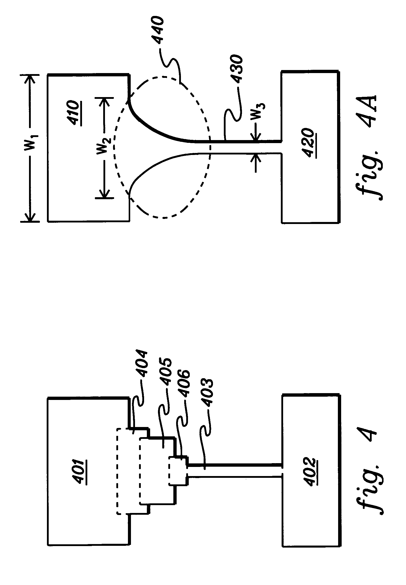

[Fig. 4 / 4A · PDF 4](https://patentimages.storage.googleapis.com/1e/7d/12/c3ce4fbb0c479a/US7417300B2.pdf#page=4)

- 410 / 420 · Terminal regions, wider than the connecting fuse
- 430 · Elongated fuse joining the terminals
- 440 · Narrowed region within the terminal, distinct from the fuse link

Claim 1 combines terminal narrowing, different silicide and polysilicon footprints, and unsilicided boundaries. Figure 4A explains the narrowing; the material and boundary requirements remain part of the claim.

Compare the eFuse write sequence: current path → material redistribution → high resistance. Different fuse stacks need different physical failure models.

### US8847350B2 · Control the programming location through partial via contact

Follow the top-view metal link into the two via cross-sections. A smaller contact area concentrates current and local heating.

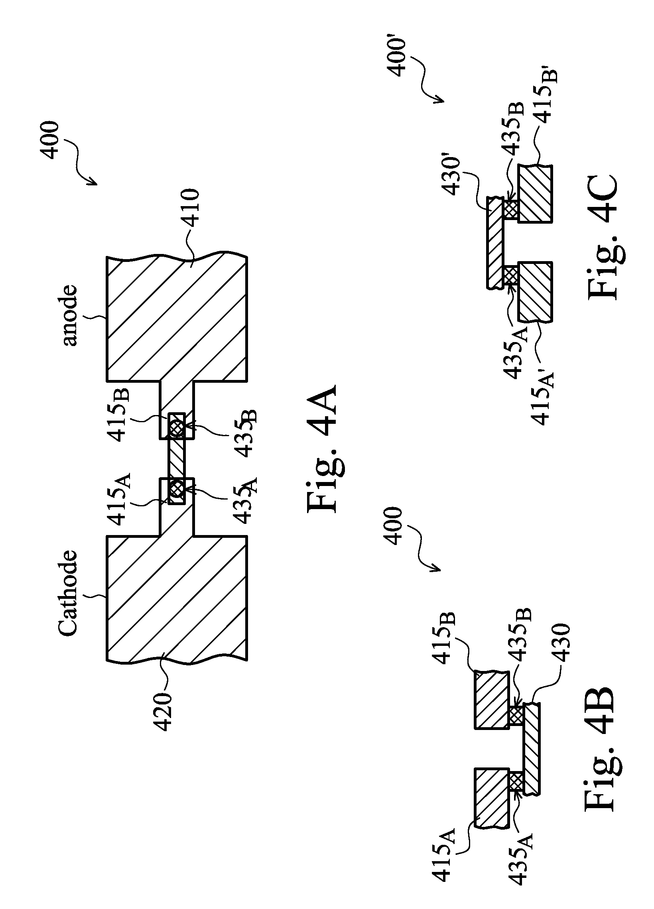

[Fig. 4A–4C · PDF 6](https://patentimages.storage.googleapis.com/f0/e6/d1/93874e8e69ad3a/US8847350.pdf#page=6)

- 410 / 420 · Anode and cathode terminals
- 430 · Metal fuse link
- 435 / 435A / 435B · Via plugs and contact portions; compare their overlap with the link

Claim 1 requires a via end that lands only partly on the fuse link and specifies the connection between two metal layers. Dimensions, resistance and other conditions appear in dependent claims.

Compare localized heating and separation in a metal-via fuse. Its material explanation differs from the silicide electromigration example.

### US6667902B2 · Separate dielectric breakdown from array selection

Locate the storage element and select transistor in Figure 3, then compare selected and unselected biases in Figure 8. The listed voltages belong to this embodiment.

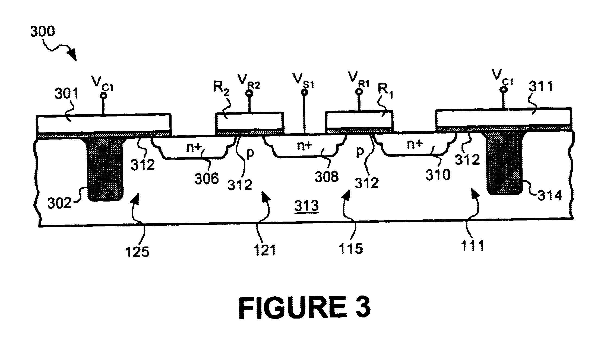

[Fig. 3 · PDF 5](https://patentimages.storage.googleapis.com/7a/76/35/6662110a53d9f3/US6667902.pdf#page=5)

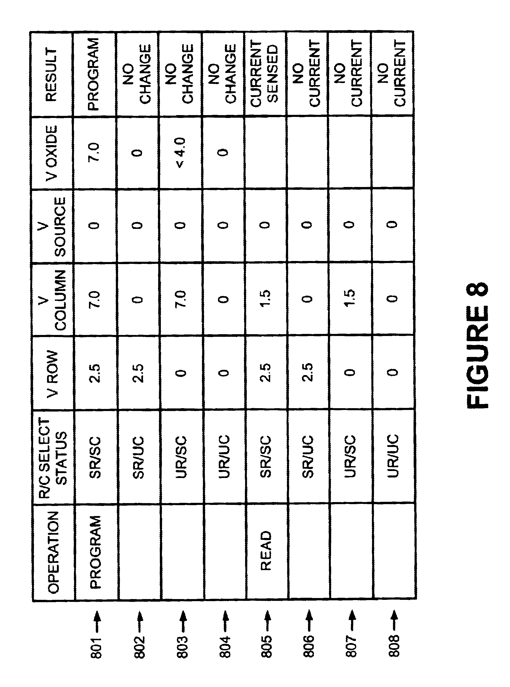

[Fig. 8 · PDF 10](https://patentimages.storage.googleapis.com/7a/76/35/6662110a53d9f3/US6667902.pdf#page=10)

- 311 / 312 · Conductive storage gate and underlying thin gate dielectric
- 313 · Active region participating in the post-breakdown current path
- 111 / 115 · Adjacent device arrangement; read with the selection lines

Claim 1 combines a MOS select transistor, a thin-dielectric storage element, and row-select, column-select and row-program lines. The breakdown cross-section alone does not capture the array connections.

Compare antifuse operation: intact dielectric → selected high field → permanent conduction path, followed by low-stress sensing.

### US4115914A · Provide charge transfer through a localized thin dielectric

Identify the floating gate, localized thin region and upper control gate in the late process cross-sections. Thin-region placement and the second dielectric determine coupling and tunneling paths.

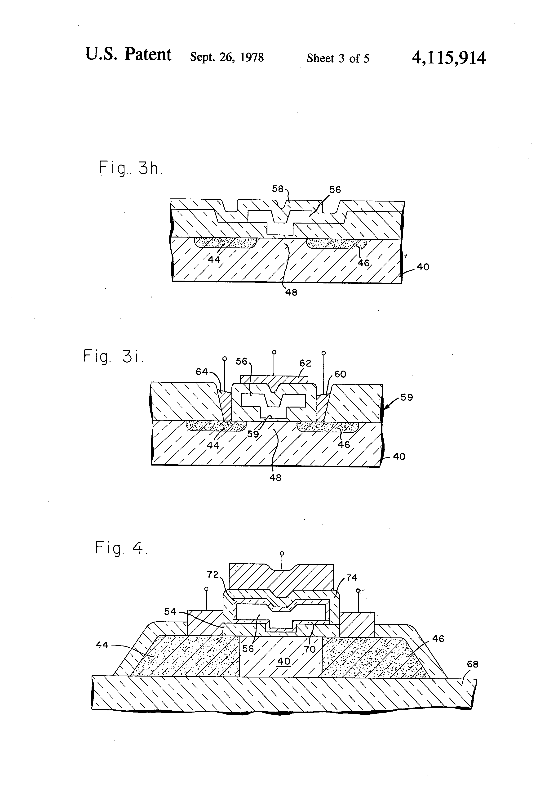

[Fig. 3h / 3i / 4 · PDF 4](https://patentimages.storage.googleapis.com/31/47/ab/e89f6659da690c/US4115914.pdf#page=4)

- 54 · First dielectric containing the localized thin region
- 56 · Insulated floating gate
- 58 / 62 · Second dielectric and upper second gate

Claim 1 is a fabrication method: active regions, a localized thin dielectric, floating gate, isolating second dielectric and second gate covering the channel. Its process requirements are more specific than a generic EEPROM sketch.

Compare EEPROM FN injection and removal: both directions must pass through the actual thin dielectric region.

### US5844271A · Couple a single-poly floating gate through a buried control node

Find the overlap between the buried control region and floating gate, then use the equivalent circuit to distinguish coupling, storage and channel conduction.

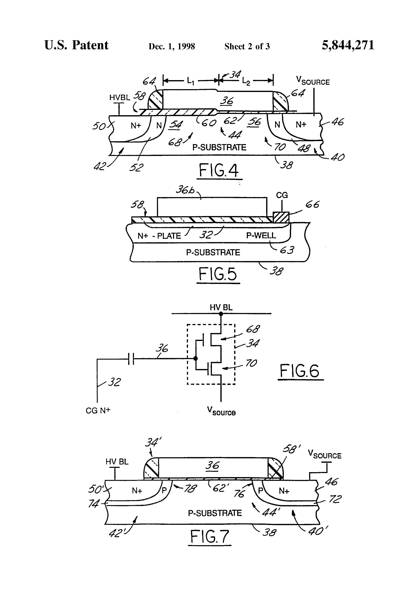

[Fig. 4–7 · PDF 3](https://patentimages.storage.googleapis.com/1e/60/1a/e2aacc35ea296c/US5844271.pdf#page=3)

- 32 · Buried n+ control-gate region
- 36 · Single-poly floating gate
- 40 / 42 / 44 · Source, drain and channel

Claim 1 includes a buried control gate, coupled floating gate and a thin tunnel region spanning part of the channel and a junction, with inhibition of an unselected overerased cell. Claim 4 separately specifies a split-gate structure.

Compare the MTP IP study’s single-poly teaching variant: this patent’s CHE injection and FN removal use a buried control node, with no second control-poly layer above the floating gate. Current product mechanisms require their own documentation.

### US6232180B1 · Control operation with source coupling, split gates and well bias

Follow floating-gate formation in Figure 5 into the source/drain structure in Figure 6. Locate the select gate and tunnel oxide; the nested wells support separately controlled erase bias.

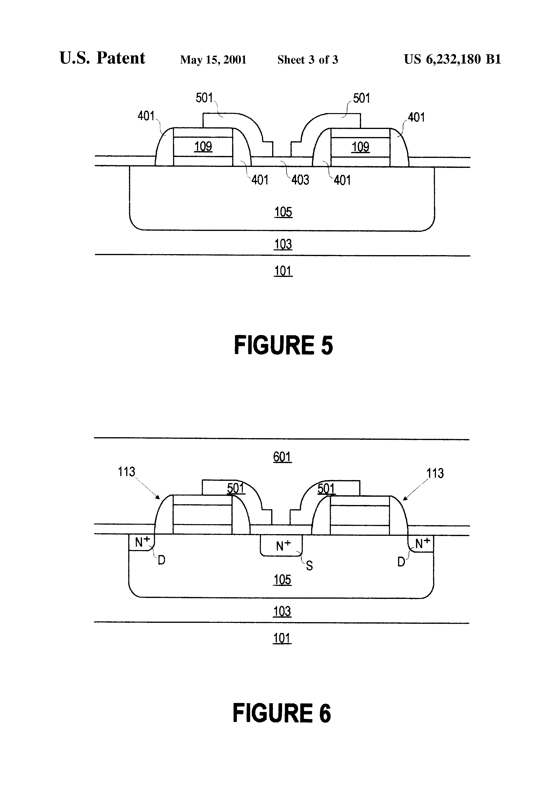

[Fig. 5 / 6 · PDF 4](https://patentimages.storage.googleapis.com/bf/a4/72/d2d74438bd3c5f/US6232180.pdf#page=4)

- 501 / 113 · Floating gate and select gate
- 403 · Tunnel oxide toward the channel
- 103 / 105 · Deep n-well and enclosed p-well

Claim 1 specifies nested wells, select and floating gates, and a source acting as the control-coupling node. Claims 4–6 add particular erase and programming biases; these values do not define all split-gate NOR.

Compare the third NOR variant: source-side injection and well/channel-side FN erase, separately from implementations that tunnel toward a select gate.

### WO1981000790A1 · Add a blocking oxide between the charge-trapping layer and gate

Read upward from silicon: thin memory oxide, silicon nitride, interfacial oxide and polysilicon gate. The drawing explains the dielectric stack.

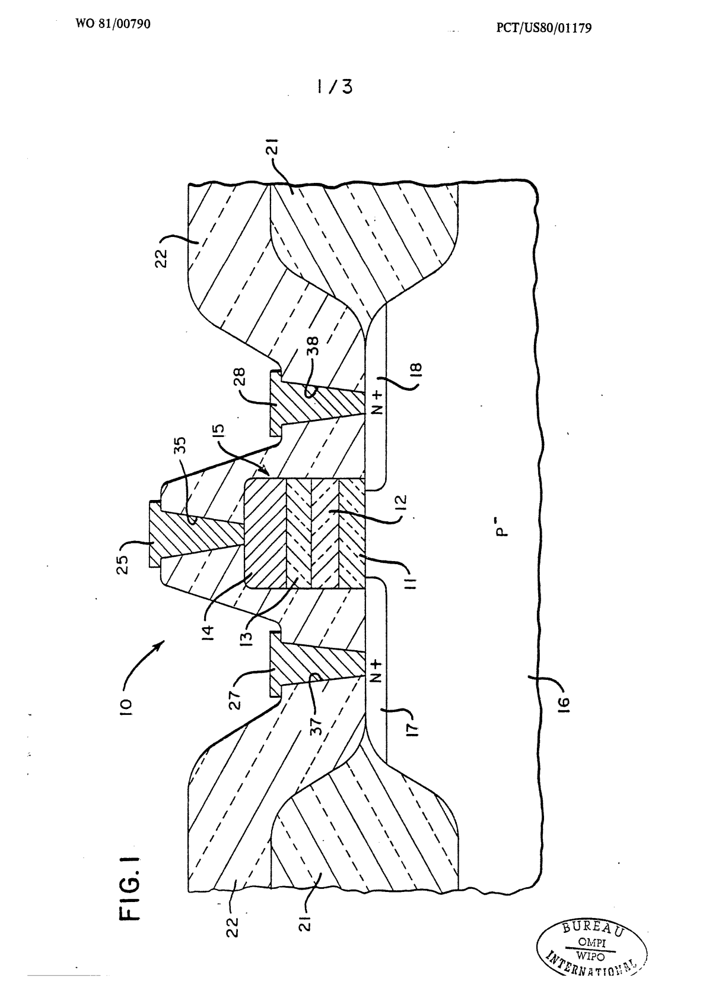

[Fig. 1 · PDF 14](https://patentimages.storage.googleapis.com/28/0b/c1/62d59b67395c82/WO1981000790A1.pdf#page=14)

- 11 / 12 · Thin memory oxide and nitride trapping layer
- 13 / 14 · Interfacial oxide and polysilicon gate
- 16 / 17 / 18 · Substrate and source/drain regions

Claim 1 specifies a CVD second oxide with a thickness range and an upper limit for the first oxide. Claim 6 covers fabrication. This early SONOS stack does not specify every later engineered tunneling stack.

For SONOS operation, distinguish the lower tunnel oxide from the upper blocking oxide. Stored charge resides in the nitride.

### US5768192A · Use localized trapping and reverse read to increase sensing contrast

Compare the prior-art A panels with embodiment B panels. Trace the localized charge region and READ arrow; reading direction changes which end of the channel barrier controls current.

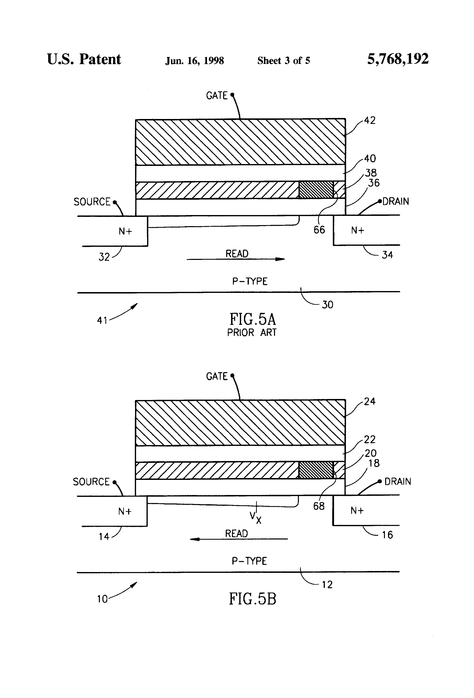

[Fig. 5A / 5B · PDF 4](https://patentimages.storage.googleapis.com/59/3c/28/7e679959ef55fa/US5768192.pdf#page=4)

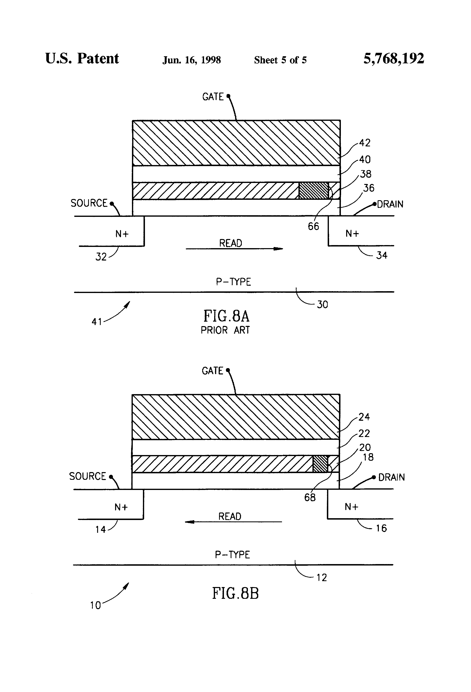

[Fig. 8A / 8B · PDF 6](https://patentimages.storage.googleapis.com/59/3c/28/7e679959ef55fa/US5768192.pdf#page=6)

- 14 / 16 · Source/drain labels; interpret them with the operating bias
- 20 · Nonconducting nitride trapping layer
- 24 / 68 · Control gate and localized stored-charge region

Claim 1 combines localized electron trapping near the programming drain with different thresholds for reverse and forward read. The directional behavior is essential to the reading, beyond the ONO stack alone.

Compare the localized NROM sequence: CHE stores electrons near one end, reverse read senses from the opposite direction, and BBHH erase is explained with its separate source.

### US7696559B2 · Move the NAND string into a vertical gate stack

In Figure 2, trace the silicon pillar from the common source to the bit line. Figure 6 unfolds the same structure into a string circuit, with select gates at both ends.

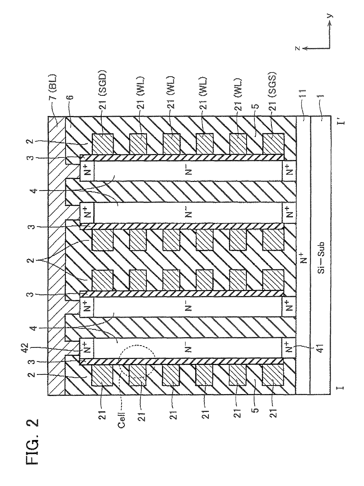

[Fig. 2 · PDF 4](https://patentimages.storage.googleapis.com/79/10/3c/cc469fa1eed4fc/US7696559.pdf#page=4)

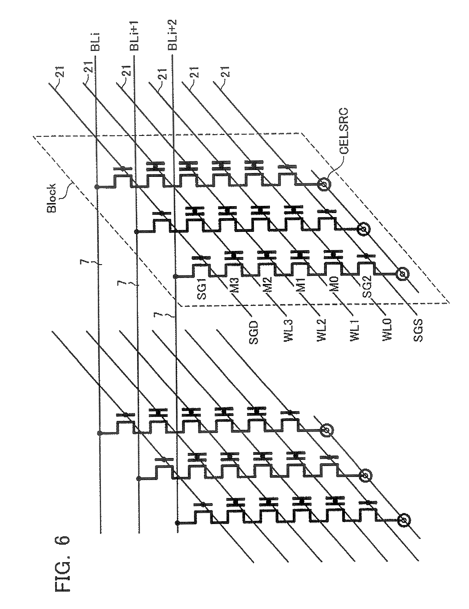

[Fig. 6 · PDF 7](https://patentimages.storage.googleapis.com/79/10/3c/cc469fa1eed4fc/US7696559.pdf#page=7)

- 21 · Stacked gate wiring, including memory and end-select gates
- 3 / 4 · Charge-storage gate dielectric and silicon pillar
- 7 / 11 · Upper bit line and lower common-source diffusion

Claim 1 specifies gate stacks, sidewall dielectric containing an insulating storage layer, semiconductor pillars, data lines and upper/lower select gates. It describes a particular vertical NAND structure, not every modern cylindrical-hole array.

Compare selected-word-line injection, pass biases and program inhibit. This patent’s source-side electron removal is shown separately from later GIDL hole-assisted erase.

### US6545906B1 · Rotate coupled moments with overlapping field pulses

Start with the two pulse waveforms in Figure 4, then follow the moments through Figures 5 and 6. The overlap interval and turn-off order are part of the operation.

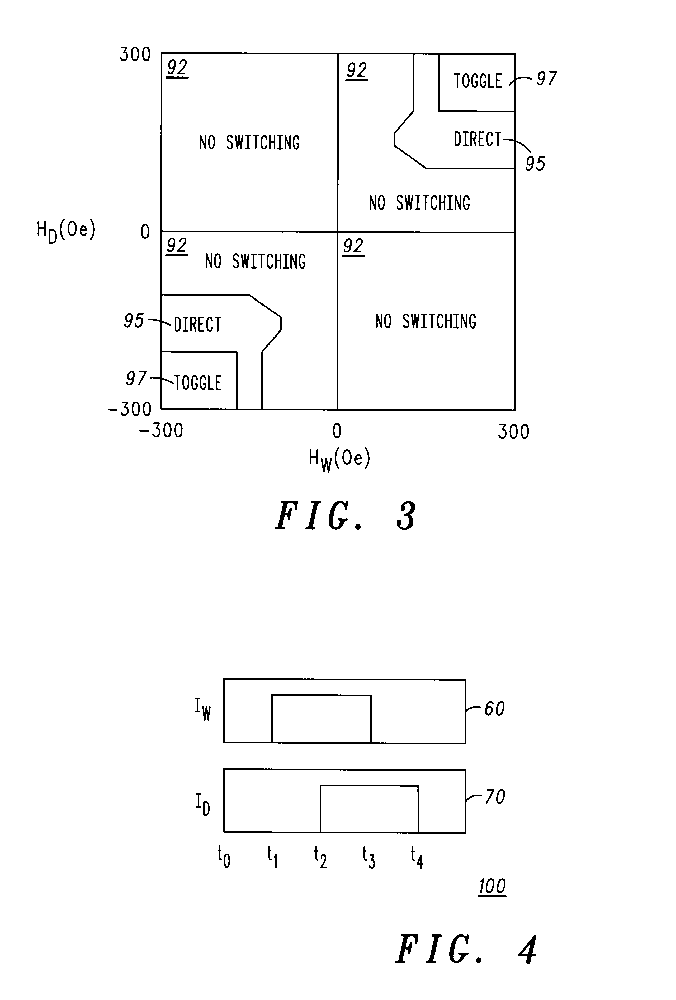

[Fig. 3 / 4 · PDF 3](https://patentimages.storage.googleapis.com/1e/95/11/99d21025b0f19c/US6545906.pdf#page=3)

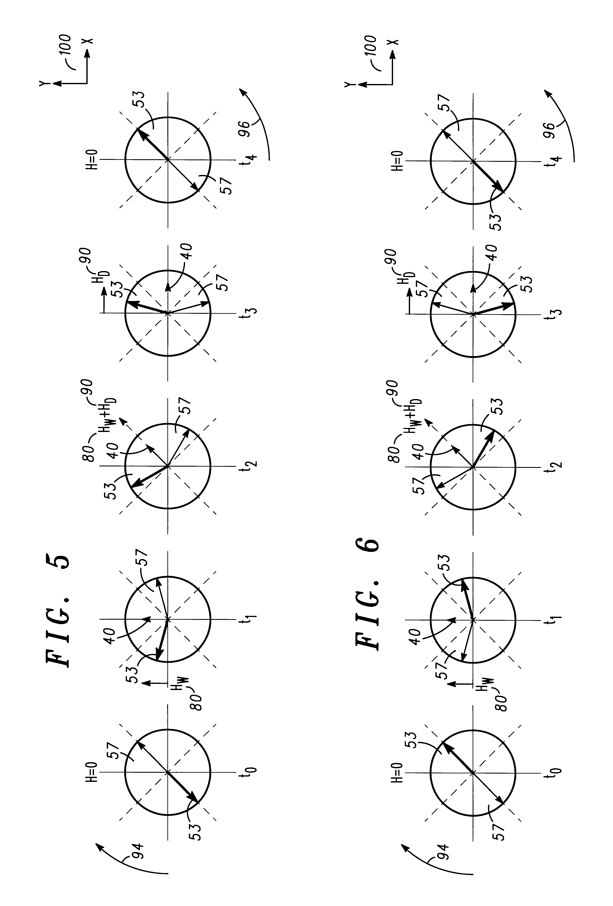

[Fig. 5 / 6 · PDF 4](https://patentimages.storage.googleapis.com/1e/95/11/99d21025b0f19c/US6545906.pdf#page=4)

- 60 / 70 · Word-line and digit-line pulses
- 100 · Complete overlapping write sequence
- 40 / 53 / 57 · Resultant moment and antiferromagnetically coupled sublayer moments

Claim 1 (PDF p. 12) requires N≥2 antiferromagnetically coupled ferromagnetic sublayers, a sublayer moment balance ratio 0≤|Mbr|≤0.1, and t₀<t₁<t₂<t₃<t₄: the word pulse starts at t₁ and ends at t₃; the digit pulse starts at t₂ and ends at t₄. Read-and-compare appears in claims 5 and 8; writing only when data differs appears in claim 21 (PDF p. 13). These are not all limitations of claim 1.

Compare the five-frame Toggle sequence and initial-state check: apply a toggle when the stored bit needs to change.

### US5695864A · Transfer spin angular momentum with current through the layers

Figure 1 is a five-layer metallic-conductor model. Follow A→F1→B→F2→C to locate fixed and variable moments, then relate current to torque on F2.

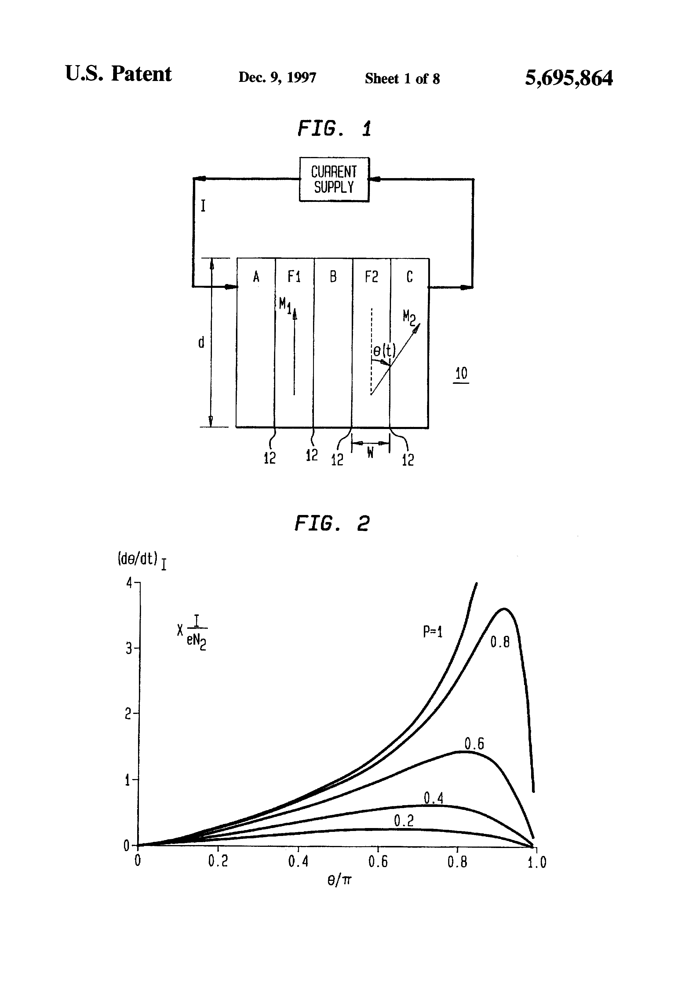

[Fig. 1 / 2 · PDF 2](https://patentimages.storage.googleapis.com/f2/de/53/7c37f0c1e307e4/US5695864.pdf#page=2)

- 10 · Five-layer spin-transfer device
- F1 / F2 · Fixed-moment and changeable-moment magnetic layers
- A / B / C · Outer electrodes and central nonmagnetic conductor; current crosses the layers

Claim 1 specifies fixed and changeable magnetic conducting layers, a nonmagnetic conductor between them and a perpendicular current source. This early embodiment has a metallic spacer, rather than a modern MgO tunnel barrier.

Use this patent for spin-transfer physics, then the modern STT-MRAM plates for P/AP resistance sensing and the tunnel barrier.

### US10930843B2 · Integrate SOT write conductors and magnetic stacks into an array

Trace the first horizontal wire through the magnetic stack to wiring in the other direction. Access transistors and crossing interconnect explain array integration beyond one MTJ.

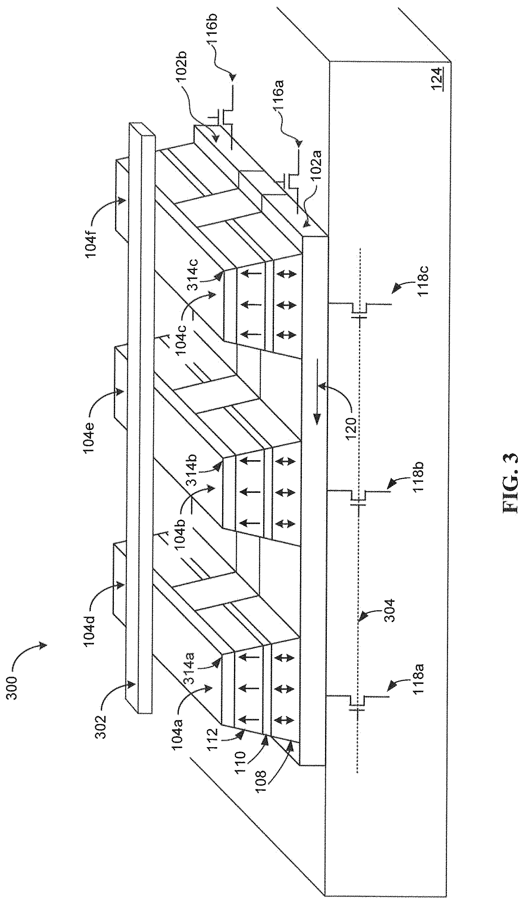

[Fig. 3 · PDF 5](https://patentimages.storage.googleapis.com/1b/15/5f/552c7b2be8d3cd/US10930843.pdf#page=5)

- 102a / 102b · First conductive wires carrying the lateral write path
- 108 / 110 / 112 · Magnetic storage, spacing and reference layers
- 116 / 118 / 314 · Control transistors and second wiring set

Claim 1 is a fabrication method covering isolated first wires, common device layers formed and separated above them, and second wires in another direction. The drawing explains connectivity; the claim centers on fabrication steps.

Compare three-terminal SOT read/write separation. Preserve the control terminals rather than reducing them to the STT current path.

### US8331131B2 · Control resistance switching through an intermediate state and second pulse

Follow the Figure 5 cycle through mobile-species, barrier and conductive-region changes. The intermediate state has a physical location; it is not a single-step SET/RESET diagram.

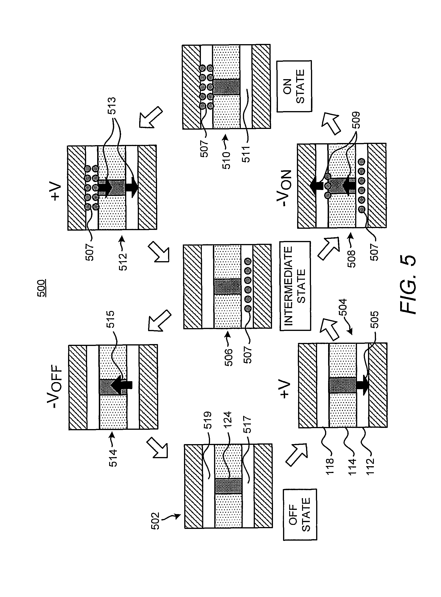

[Fig. 5 · PDF 5](https://patentimages.storage.googleapis.com/90/dd/5a/259ef8491b3d97/US8331131.pdf#page=5)

- 507 · Mobile species
- 502 / 506 / 510 · Initial, intermediate and changed states
- 511 / 517 / 519 · Tunneling barriers in the different stages

Claim 1 requires three intermediate layers and two pulses: accumulation in the first layer, then motion into the third to complete the change. This specific multilayer memristor scheme does not define all bipolar VCM.

Compare species redistribution in VCM operation; this patent additionally shows how pulse sequencing introduces an intermediate state.

### US5761115A · Reversibly grow a metal bridge inside an ion conductor

Trace the dendrite in Figure 1’s plan and cross-section, then compare the vertical geometry in Figure 4. Figure 5 adds an insulating condition that prevents direct contact.

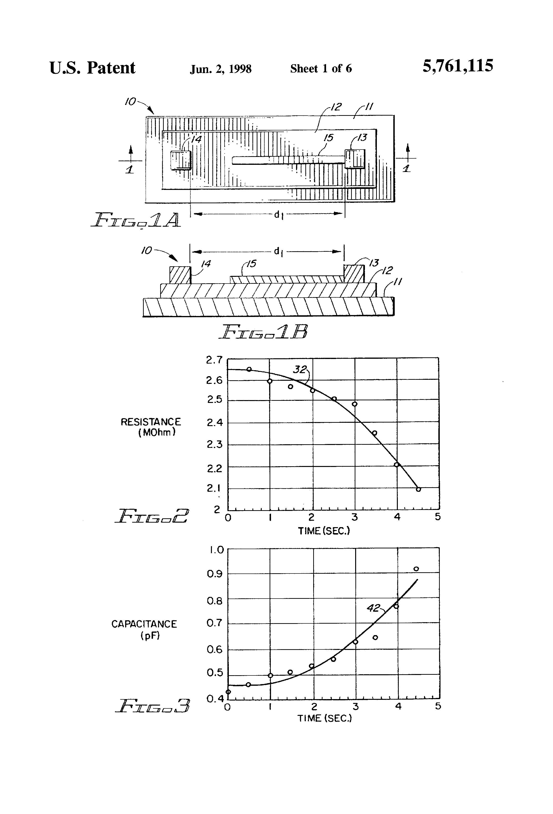

[Fig. 1A / 1B / 2 / 3 · PDF 3](https://patentimages.storage.googleapis.com/8e/2a/ba/50b37273a2724f/US5761115.pdf#page=3)

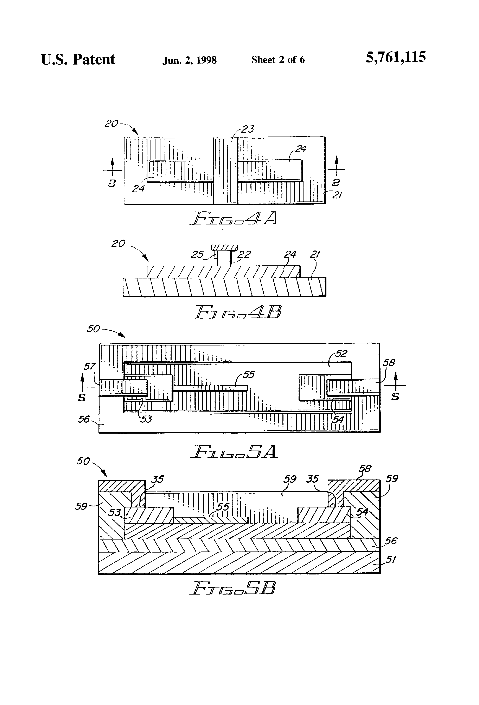

[Fig. 4A / 4B / 5A / 5B · PDF 4](https://patentimages.storage.googleapis.com/8e/2a/ba/50b37273a2724f/US5761115.pdf#page=4)

- 12 / 22 · Fast ion conductor containing metal ions
- 13 / 14 / 23 / 24 · Biased electrodes; 23 denotes the cathode
- 15 / 25 · Metal dendrite growing from the negative electrode

Claim 1 covers an ion-containing conductor, electrodes and dendrite growth from negative toward positive. Claim 2 adds opposite-polarity reversal. Claim 3’s blocking condition is an additional limitation, not universal to all embodiments.

Compare ECM metal oxidation, ion migration, reduction/deposition and reverse dissolution. The bridge is metallic, rather than an oxygen-vacancy filament.

### US5912839A · Use cumulative pulses to reach distinguishable phase-change resistance states

First inspect Figure 1’s nonmonotonic resistance versus pulse-current relationship, then the material/electrode structure in Figure 2. The plot lacks a complete measurement contract for current product specifications.

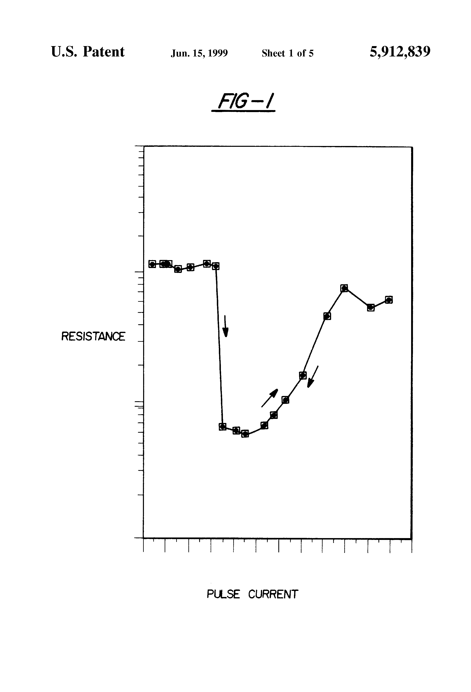

[Fig. 1 · PDF 2](https://patentimages.storage.googleapis.com/b9/d0/ac/dfd15bdaa20dc7/US5912839.pdf#page=2)

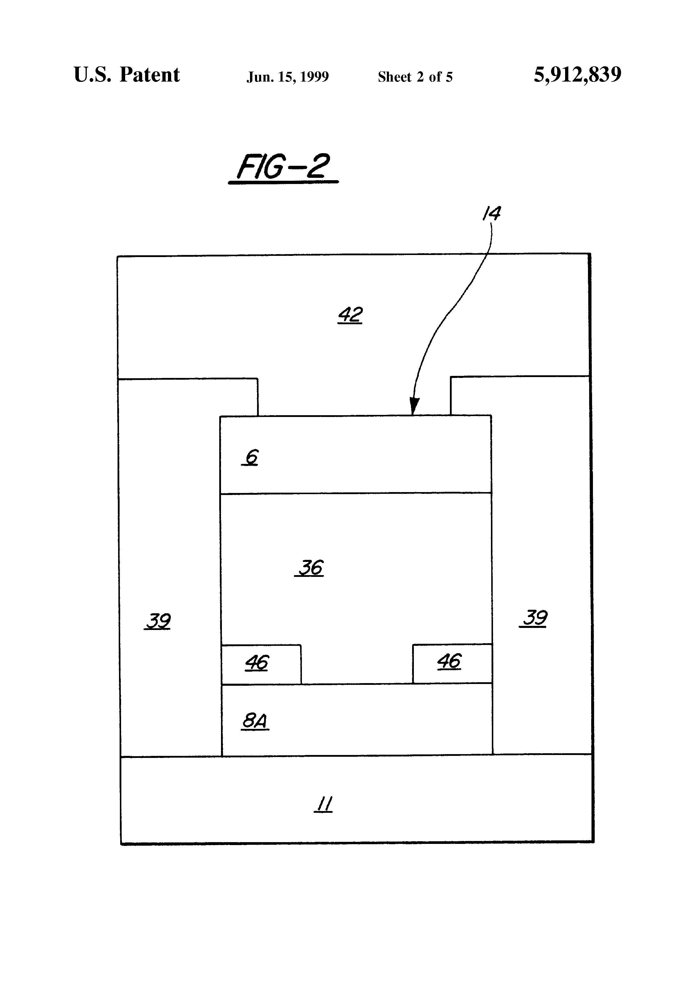

[Fig. 2 · PDF 3](https://patentimages.storage.googleapis.com/b9/d0/ac/dfd15bdaa20dc7/US5912839.pdf#page=3)

- 36 · Phase-change memory material
- 42 · Electrode grid structure
- 46 · Insulation layer

Claim 1 focuses on a program pulse insufficient for a single SET but effective cumulatively with later pulses. Claim 2 adds RESET; claim 3 adds a read method that counts extra pulses. This is more specific than generic PCM heating.

Compare PCM temperature and phase-state sequences, then examine how this patent uses repeated stimulation for data encoding.

### US4873664A · Restore ferroelectric data through the sensing circuit

Trace the 1T1C cell along the bit line into the sense/restore circuit, then compare word-line and plate-line timing. After charge sensing, the latched result restores the original polarization.

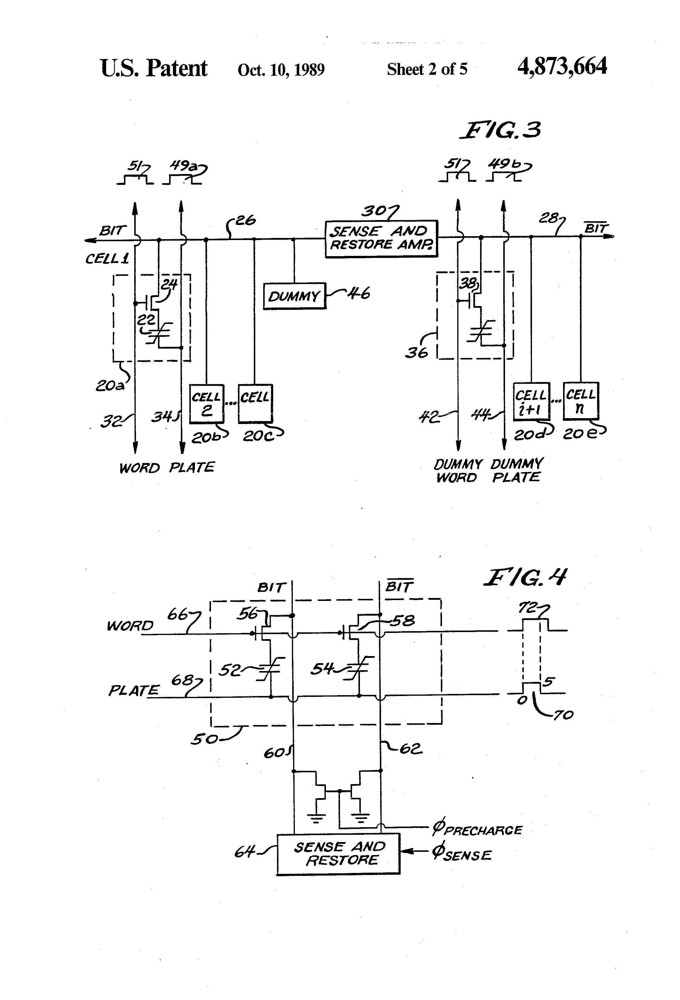

[Fig. 3 / 4 · PDF 3](https://patentimages.storage.googleapis.com/33/4c/dd/c26b6f9525498b/US4873664.pdf#page=3)

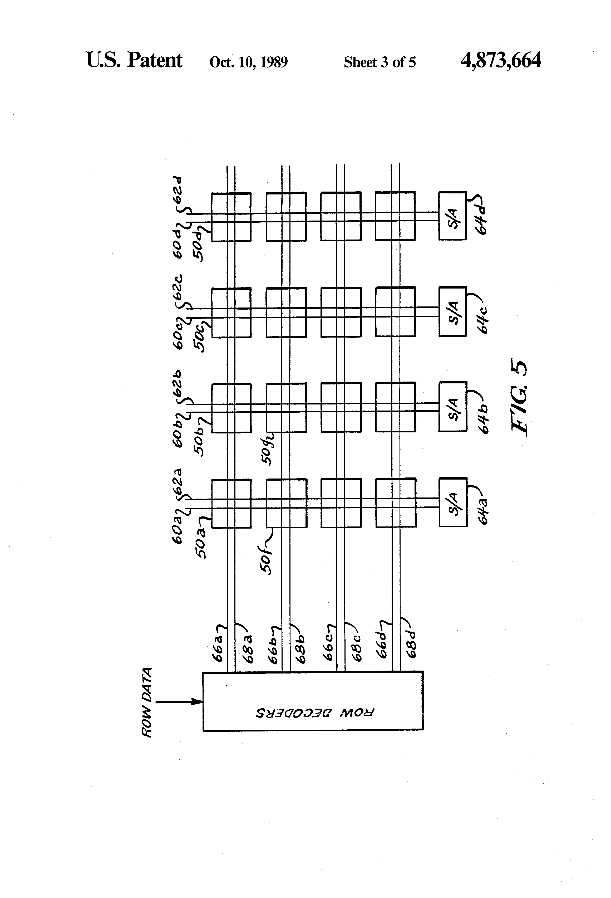

[Fig. 5 · PDF 4](https://patentimages.storage.googleapis.com/33/4c/dd/c26b6f9525498b/US4873664.pdf#page=4)

- 22 / 24 · Ferroelectric capacitor and access transistor
- 32 / 68 · Word line and separate plate line
- 64 · Sense amplifier, with reference cells providing a comparison

Claim 1 specifies cell connections to word, bit and separate plate lines, with one capacitor electrode connected to the bit line through a switch. Claim 2 adds a sense amplifier and dummy ferroelectric reference cell.

Compare both initial polarizations, switching-charge contrast, latching and write-back in the FeRAM read plates. Restoration is an explicit stage.

### US10153155B2 · Form a ferroelectric film through alternating dopants and heat treatment

Figures 1 and 2 compare three- and four-layer film arrangements. Identify the material and outer conducting layers, then read the distinct dopant layers and heating requirements in the process claim.

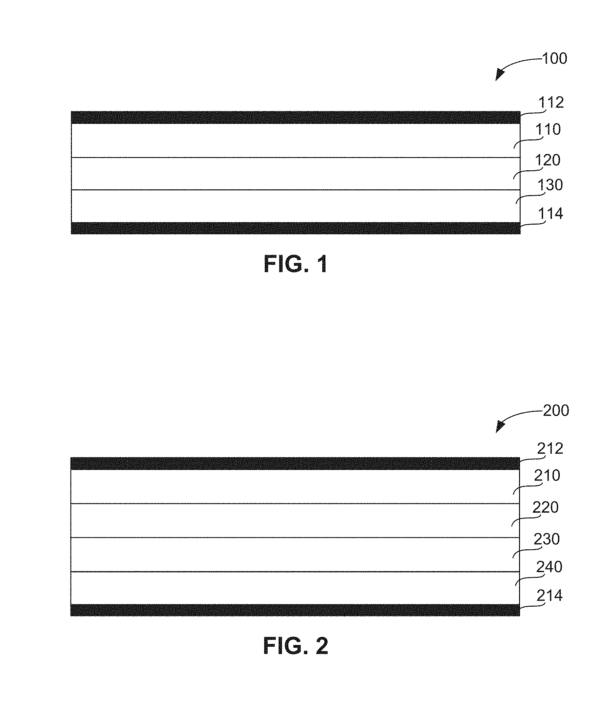

[Fig. 1 / 2 · PDF 3](https://patentimages.storage.googleapis.com/14/31/15/bbdde795e5e4a4/US10153155.pdf#page=3)

- 110 / 120 / 130 · First, second and third material layers
- 112 / 114 · Outer conductive layers
- 210 / 220 / 230 / 240 · Extended four-layer arrangement

Claim 1 is a film-formation method involving three hafnium/oxygen layers, two different dopant layers, heating and conductive layers on both sides. The figure is not a complete FeFET bitcell and does not define its read channel.

Use this source for FeFET material/process constraints. The next transistor-stack patent and operation plates cover the electrical device.

### US11502083B2 · Integrate a ferroelectric film into a specific composite gate

Read layers 31, 32, 33b, 34 and 35 upward from the substrate, then trace the junctions back to the channel. This stack includes a floating gate and is not the simplest metal/ferroelectric/silicon structure.

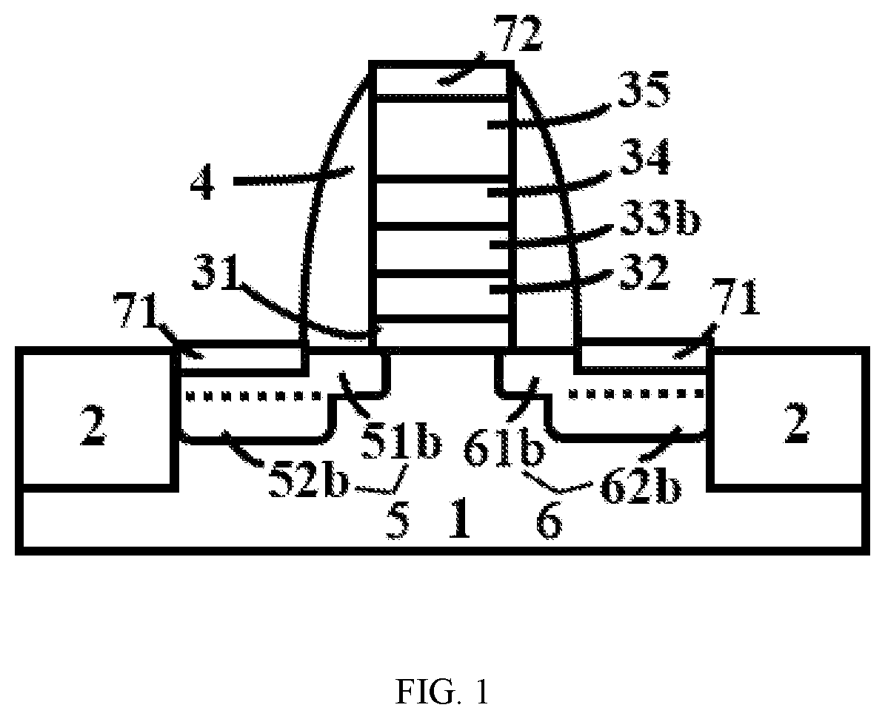

[Fig. 1 · PDF 3](https://patentimages.storage.googleapis.com/26/68/6f/921a8116ea99d7/US11502083.pdf#page=3)

- 31 / 32 · Buffer layer and floating-gate electrode
- 33b / 34 / 35 · Hafnium-based ferroelectric, control gate and film-electrode layer
- 5 / 6 / 71 · Source, drain and silicide contact

Claim 1 details the relative positions of the composite gate, isolation, sidewalls, source/drain and silicide. The drawing teaches one implementation, rather than a universal FeFET stack.

Compare polarization-controlled threshold shift in FeFETs. Distinguish material layers from electrical terminals to locate the applied field.

### US20240057343A1 · Design tunneling states with a catalytic interface and thin ferroelectric layer

Read the five-layer stack in Figure 3, then compare polarization-dependent barriers in Figure 5. Figures 15–18 connect memory stacks to transistors.

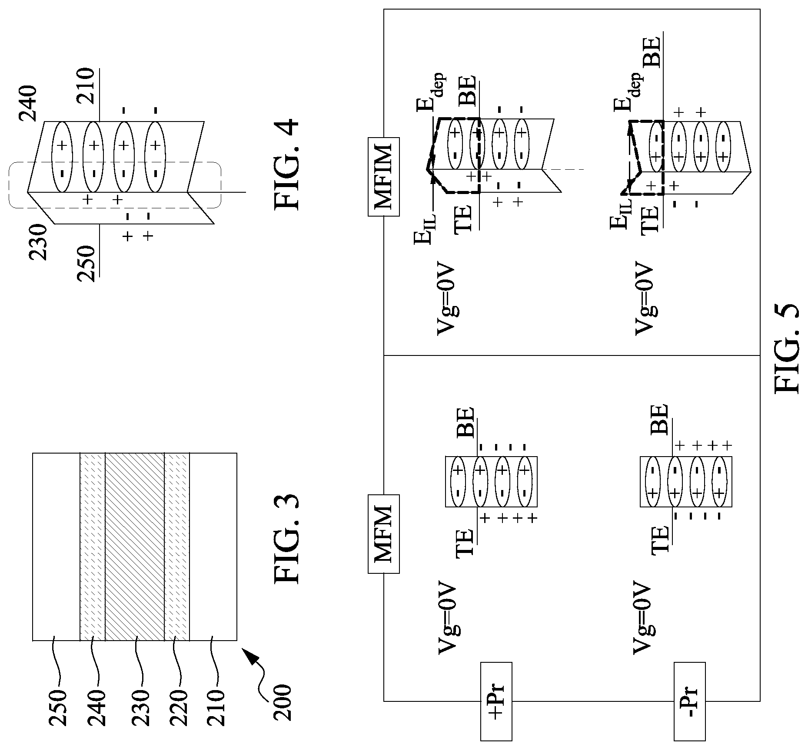

[Fig. 3–5 · PDF 4](https://patentimages.storage.googleapis.com/82/23/f6/5dcf02a41aa96f/US20240057343A1.pdf#page=4)

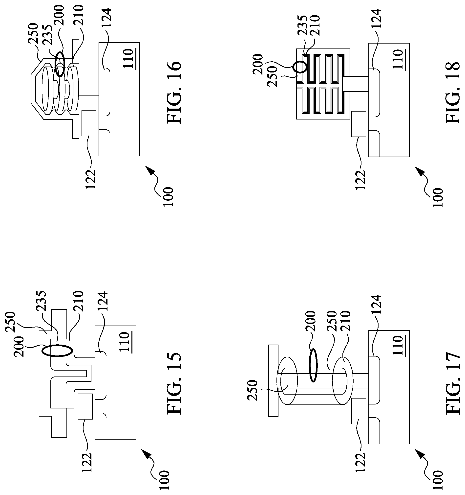

[Fig. 15–18 · PDF 9](https://patentimages.storage.googleapis.com/82/23/f6/5dcf02a41aa96f/US20240057343A1.pdf#page=9)

- 210 / 220 · Bottom electrode and catalytic metal layer
- 230 / 240 / 250 · Ferroelectric layer, tunneling dielectric and top electrode
- 122 / 124 / 200 · Access gate, source/drain regions and memory cell

This is a published application. Claim 1 combines a first electrode, ferroelectric material and contacting catalytic metal; claims 2–3 add particular electronegativity and thickness limits. The five-layer embodiment includes details beyond the independent claim.

Compare FTJ polarization reversal and barrier changes, keeping this stack distinct from research devices using other electrodes and ferroelectrics.

## Major Industry and Research Routes

Trace named implementations from purchasable memories and integrable IP/processes to materials and arrays still under validation. Align mechanisms, measurement levels and maturity before assessing application value.

### A Technology Name Does Not Define a Deliverable

RRAM filaments, STT tunneling-current writes and SOT separate paths impose different process, endurance and peripheral requirements. Products, foundry platforms and research papers answer different questions; preserve their conditions and attribution.

### Everspin · Three Product Lines: Toggle, DDR STT and xSPI

Standalone MRAM Product Supplier

Everspin is a core commercial MRAM reference. Its three product lines differ in write physics, interfaces, retention and qualification; compare exact ordering codes and document versions.

Commercial Products; Qualification Is Version-Specific: DDR4-like does not mean a drop-in replacement for every DDR4 device; HR 64Mb qualification does not cover the whole family.

Standalone Toggle MRAM, 1Gb persistent STT memory and EMxxLX xSPI.

Toggle uses fields from selected lines to switch magnetization; STT switches the free layer with spin-polarized current through the MTJ.

Both routes can update the opposite magnetic state without a Flash block erase. Commands, update granularity and timing remain interface-specific.

Sense data through MTJ resistance. System latency includes asynchronous-bus, DDR or xSPI transactions and cannot be reduced to a switching pulse.

- [everspin-toggle: Everspin Toggle MRAM · Toggle MRAM](https://www.everspin.com/persyst?page=2)
- [everspin-ddr-technology: Current official explanation of 1Gb DDR4-like persistent DRAM and separate xSPI STT products.](https://www.everspin.com/stt-mram-technology)
- [EMG-P-TOGGLE: Motorola: Toggle Writing Patent US6545906B1](https://patents.google.com/patent/US6545906B1/en)

#### Toggle: Mature Interfaces and Exact Parts

The current PERSYST catalog marks MR3A16ACYS35 as mass production, with 8Mb, asynchronous x16, 35ns, 3.3V and −40°C to 85°C. These are named-part conditions, not universal MRAM density, speed or retention specifications.

- [everspin-toggle: Everspin Toggle MRAM · Toggle MRAM](https://www.everspin.com/persyst?page=2)

#### 1Gb STT: Persistent Buffers for Enterprise Storage

The 2025 filing confirms continuing 1Gb STT-MRAM shipments; the technology page describes a DDR4-like persistent-DRAM interface. Retention and controller requirements need the relevant datasheet, rather than values copied from Toggle or xSPI.

- [everspin-1gb-ddr: Everspin 1Gb STT-MRAM · STT-MRAM / DDR4-derived](https://www.sec.gov/Archives/edgar/data/1438423/000162828026014733/mram-20251231.htm)
- [everspin-ddr-technology: Current official explanation of 1Gb DDR4-like persistent DRAM and separate xSPI STT products.](https://www.everspin.com/stt-mram-technology)

#### xSPI: Separate Density Availability from HR Qualification

The March 5, 2026 release confirms HR 64Mb AEC-Q100 Grade 1 production qualification and order availability. Its HR 128Mb/256Mb dates are announcement-time plans; later completion is not established by the primary text reviewed here. A September 2 Teledyne partnership starts with 256Mb and anticipates partner customer availability in Q4 2026.

- [everspin-xspi: Everspin EMxxLX xSPI · STT-MRAM / xSPI](https://investor.everspin.com/news-releases/news-release-details/everspin-advances-high-reliability-xspi-mram-portfolio-256mb)
- [RES-EVERSPIN-TELEDYNE-2026: Everspin / Teledyne HiRel Partnership](https://investor.everspin.com/news-releases/news-release-details/everspin-technologies-and-teledyne-hirel-semiconductors-partner)

- **8Mb / 35ns**: Capacity and asynchronous cycle specification for MR3A16ACYS35. Not a specification for 1Gb DDR or EMxxLX.

- [everspin-toggle: Everspin Toggle MRAM · Toggle MRAM](https://www.everspin.com/persyst?page=2)

- **HR 64Mb / Grade 1**: Qualified and available for orders on March 5, 2026. Other capacities and versions do not inherit this qualification.

- [everspin-xspi: Everspin EMxxLX xSPI · STT-MRAM / xSPI](https://investor.everspin.com/news-releases/news-release-details/everspin-advances-high-reliability-xspi-mram-portfolio-256mb)

Engineering interpretation: Toggle, persistent DDR buffers and low-pin-count xSPI serve different controllers and data lifecycles. Compare power-loss protection, update frequency, latency, qualification and board-integration cost.

Specify the complete part number, datasheet revision, retention temperature, endurance conditions, controller support and exact qualification scope.

### UMC · Embedded RRAM and a Distinct MRAM Product Route

Foundry and Ecosystem Integration

UMC evidence spans process availability, qualified RRAM IP, a SoC development platform and standalone MRAM products. These are distinct delivery levels.

Qualified RRAM IP; Named MRAM Products Available: A standalone MRAM product does not establish an available embedded macro.

22nm ULP/ULL RRAM; separately, Avalanche 22nm pMTJ STT-MRAM.

RRAM SET establishes a low-resistance state; the UMC/eMemory announcement does not disclose material, bias or pulse algorithms.

RESET returns to high resistance, unlike Flash block erase. Avalanche STT-MRAM directly overwrites a magnetic state.

Low-disturb sensing is combined with verification, ECC and repair; controller behavior is specific to the IP.

- [RES-UMC-RRAM-2023: UMC / eMemory: 22nm RRAM Qualification](https://www.umc.com/en/News/press_release/Content/technology_related/20230328)
- [RES-UMC-MRAM-2022: UMC / Avalanche: 22nm P-SRAM Availability](https://www.umc.com/en/News/press_release/Content/technology_related/20220913)

#### From 40nm Collaboration to 22nm IP

The 2017 Panasonic collaboration establishes a 40nm history; eMemory announced qualification of a 22nm version in 2023. Public evidence does not establish an identical stack or IP lineage. Low-temperature backend integration and logic-platform compatibility matter to SoC adoption.

- [RES-PANASONIC-UMC-2017: Panasonic / UMC: 40nm ReRAM Collaboration](https://news.panasonic.com/global/press/en170201-3)
- [RES-UMC-RRAM-2023: UMC / eMemory: 22nm RRAM Qualification](https://www.umc.com/en/News/press_release/Content/technology_related/20230328)

#### MRAM: Separate Agreements from Products

The 2018 agreement began with 28nm CMOS. The 2022 immediate-availability evidence concerns Avalanche third-generation 22nm P-SRAM. This establishes a named MRAM product route, not a universally available embedded macro.

- [RES-UMC-MRAM-2018: UMC / Avalanche: MRAM Development Agreement](https://www.umc.com/en/News/press_release/Content/technology_related/20180806)
- [RES-UMC-MRAM-2022: UMC / Avalanche: 22nm P-SRAM Availability](https://www.umc.com/en/News/press_release/Content/technology_related/20220913)

#### SoC Adoption Evidence and Open Roadmap Items

Faraday FlashKit-22RRAM adds silicon-validated controller, BIST and processor integration in 2025. The 16Mb automotive and 0.8V/1.8V variants targeted in 2023 still require completion evidence. The Infineon/UMC 40nm automotive agreement identifies proprietary eNVM without identifying RRAM.

- [RES-FARADAY-RRAM-2025: Faraday: FlashKit-22RRAM Silicon Validation](https://www.faraday-tech.com/html/News/pressRelease/CHI_01_0441.jsp)
- [RES-UMC-RRAM-2023: UMC / eMemory: 22nm RRAM Qualification](https://www.umc.com/en/News/press_release/Content/technology_related/20230328)
- [RES-UMC-INFINEON-2023: UMC / Infineon: 40nm Automotive MCU Agreement](https://www.umc.com/en/News/press_release/Content/technology_related/20230307)

- **8Mb + 16Kb**: The 2023 qualified RRAM macro and information area; 10k cycles and 10-year retention up to 105°C. These values belong to the named version, not all 22nm eNVM.

- [RES-UMC-RRAM-2023: UMC / eMemory: 22nm RRAM Qualification](https://www.umc.com/en/News/press_release/Content/technology_related/20230328)

- **22nm P-SRAM**: Avalanche standalone products announced immediately available in 2022. This does not establish qualification of an embedded MRAM macro.

- [RES-UMC-MRAM-2022: UMC / Avalanche: 22nm P-SRAM Availability](https://www.umc.com/en/News/press_release/Content/technology_related/20220913)

Engineering interpretation: evaluate RRAM for low-standby-power MCUs, AIoT and embedded code storage. Value depends on the selected IP retention conditions, update budget, test cost and controller integration.

Confirm the version, PDK, macro capacity, ECC, update granularity, automotive qualification and tapeout availability.

### Panasonic · Tantalum-Oxide Filaments and Product Evidence

ReRAM Technology and Product Lineage

Panasonic is an important early commercial ReRAM developer. Trace 180nm production, 40nm test macros and Fujitsu products separately to connect the mechanism with reliability and products.

Historical Production, Test Macros and Named Products: Sampling targets and test macros do not establish production of every 40nm product.

Tantalum-oxide ReRAM; integration in foundry-standard 40nm CMOS.

Forming first creates a localized conductive path in the oxide; later SET enters the low-resistance state. Forming is distinct from each data write.

RESET returns to high resistance through redox and defect redistribution; it neither removes the layer nor irreversibly blows a fuse.

Sense high and low resistance with a low-disturb bias, accounting for state distributions and the post-cycling sensing window.

- [RES-PANASONIC-SSDM-2018: Panasonic: 40nm ReRAM Mechanism and Reliability](https://confit.atlas.jp/guide/event-img/ssdm2018/B-1-01/public/pdf_archive?type=in)

#### Reliability Must Preserve the Test Sequence

The 2018 8Mbit test macro separately reports 100k-cycle endurance and over ten years at 85°C after 10k cycles. These do not establish ten-year retention after 100k cycles. Engineering evaluation also needs HRS/LRS distribution tails, not only average resistance.

- [RES-PANASONIC-SSDM-2018: Panasonic: 40nm ReRAM Mechanism and Reliability](https://confit.atlas.jp/guide/event-img/ssdm2018/B-1-01/public/pdf_archive?type=in)

#### Partnerships Do Not Reveal Undisclosed Processes

The 2017 announcement confirms 180nm production since 2013 and describes future 40nm sampling. The 2019 Fujitsu/Panasonic MB85AS8MT release names an SPI product without identifying its node or foundry. It cannot by itself establish UMC 40nm product production.

- [RES-PANASONIC-UMC-2017: Panasonic / UMC: 40nm ReRAM Collaboration](https://news.panasonic.com/global/press/en170201-3)
- [RES-FUJITSU-RERAM-2019: Fujitsu / Panasonic: 8Mbit ReRAM Product](https://info.archives.global.fujitsu/tw/about/resources/news/press-releases/2019/fep-0812.html)

- **100k Cycles**: Endurance result for a 40nm 8Mbit test macro. The retention result uses a separate 10k-cycle condition.

- [RES-PANASONIC-SSDM-2018: Panasonic: 40nm ReRAM Mechanism and Reliability](https://confit.atlas.jp/guide/event-img/ssdm2018/B-1-01/public/pdf_archive?type=in)

- **0.15mA @ 5MHz**: Average read current for the standalone MB85AS8MT SPI product. Not bitcell write energy and not directly comparable with macro speed.

- [RES-FUJITSU-RERAM-2019: Fujitsu / Panasonic: 8Mbit ReRAM Product](https://info.archives.global.fujitsu/tw/about/resources/news/press-releases/2019/fep-0812.html)

Engineering interpretation: this lineage informs low-power persistent storage. Product selection must separate standalone serial-interface system costs from embedded-macro process costs.

Confirm current supplier, ordering code, interface and combined cycling/retention conditions rather than relying on historical partnerships.

### IBM Research · Read MRAM Scaling, Current and Retention Together

Device and Integration Research

IBM contributes traceable device physics and CMOS integration results. MTJ size, process node and write-error rate from different studies must not be combined into an imaginary best-specification product.

Device and CMOS Integration Demonstrations: IBM papers are not a list of IBM production foundry services.

Perpendicular STT-MRAM; distinguish 14nm CMOS integration from smaller-MTJ research.

Current through the MTJ transfers spin angular momentum to set P or AP. The current required for a target WER depends on pulse width and materials.

Switch magnetization in the opposite direction to overwrite the other value, without a Flash-style block erase. The two switching thresholds can differ.

Sense P/AP through MTJ resistance; sensing margin, read disturb and MgO barrier lifetime constrain the bias design.

- [RES-IBM-REVIEW-2024: IBM Authors: STT-MRAM Status and Directions](https://research.ibm.com/publications/spin-transfer-torque-magnetoresistive-random-access-memory-technology-status-and-future-directions)
- [RES-IBM-11NM-2017: IBM: Low-Current 11nm MTJ Research](https://research.ibm.com/publications/low-current-spin-transfer-torque-mram--1)

#### 14nm Is a CMOS Node; 11nm Is an MTJ Size

The 2020 14nm study places MTJs between M1 and M2 with three added masks and one electrode module; 400°C describes process compatibility. The 2017 11nm result describes a junction size for low-current switching, not an 11nm CMOS platform.

- [RES-IBM-14NM-2020: IBM: 14nm CMOS Embedded STT-MRAM](https://research.ibm.com/publications/a-14-nm-embedded-stt-mram-cmos-technology)
- [RES-IBM-11NM-2017: IBM: Low-Current 11nm MTJ Research](https://research.ibm.com/publications/low-current-spin-transfer-torque-mram--1)

#### Co-Designing Retention and Speed

The 2024 ordered-alloy study combines a low magnetic moment with strong perpendicular anisotropy, demonstrating a high energy barrier and 2ns operation. This advances material and switching design; retention guarantees still require temperature and statistical conditions.

- [RES-IBM-ALLOY-2024: IBM: Ordered-Alloy Free-Layer Research](https://research.ibm.com/publications/first-demonstration-of-high-retention-energy-barriers-and-2-ns-switching-using-magnetic-ordered-alloy-based-stt-mram-devices)

#### 2025: Double Spin-Torque Arrays for Cache

IEDM 2025 reports a 4-kbit DS-MTJ array in which all devices switch with 2ns pulses, with an approximately 60kT energy barrier at about 40nm critical dimension. This extends the evidence to a research array while preserving the distinction between device geometry and CMOS node.

- [RES-IBM-DSMTJ-2025: IBM: Double Spin-Torque MTJs for Cache](https://research.ibm.com/publications/progress-and-gaps-in-double-spin-torque-mtjs-for-last-level-cache-applications)

- **0.0273μm² / 4ns**: Cell area and minimum demonstrated write time in the 14nm CMOS integration study. Not system area per bit including periphery, nor full access latency.

- [RES-IBM-14NM-2020: IBM: 14nm CMOS Embedded STT-MRAM](https://research.ibm.com/publications/a-14-nm-embedded-stt-mram-cmos-technology)

- **8μA / 10ns / 10⁻⁹**: Current, pulse duration and WER for an 11nm MTJ. Does not establish large-array yield or identical retention.

- [RES-IBM-11NM-2017: IBM: Low-Current 11nm MTJ Research](https://research.ibm.com/publications/low-current-spin-transfer-torque-mram--1)

Engineering interpretation: use these studies to evaluate the physics and integration of embedded MRAM or cache candidates. Procurement still requires a named supplier and a deliverable macro, controller and production contract.

Align definitions of node versus MTJ size, pulse versus access time, device versus array WER, retention temperature and thermal budget.

### ITRI · From SOT Write Channels to Arrays and Computing

Collaborative Research, Prototyping and Transfer

ITRI evidence spans distinct collaborations and versions: SOT with TSMC, cryogenic STT with NYCU, a joint β-W array, an 8-inch prototyping service and RRAM technology transfer.

Research Arrays, Prototypes and Trial Production: Collaborative research must not be represented as an ITRI standalone production product.

SOT-MRAM and BEOL integration; separately, 1S1R RRAM transfer.

In-plane channel current generates spin-orbit torque to switch the free layer; field requirements, assist pulses and directionality depend on the implementation.

Update the opposite magnetic state by direct overwrite. Separate paths can reduce write stress across the tunnel barrier without implying unlimited endurance.

MTJ resistance still reads the state; compute-in-memory also depends on RA, read current, interconnect drop and peripheral circuitry.

- [RES-ITRI-SOT-2022: ITRI: SOT and Cryogenic STT Collaborations](https://www.itri.org.tw/ListStyle.aspx?DisplayStyle=01_content&MGID=111061510283488782&MmmID=1036276263153520257&SiteID=1)
- [RES-ITRI-CIM-2024: ITRI / TSMC: IEDM 2023 SOT-CIM](https://www.itri.org.tw/ListStyle.aspx?DisplayStyle=01_content&MGID=113011710184808020&MmmID=1036276263153520257&SiteID=1)
- [RES-ITRI-SERVICE: ITRI: 8-Inch MRAM Development Services](https://www.itri.org.tw/english/ListStyle.aspx?DisplayStyle=01_content&MGID=1126511563713777471&MmmID=1071732317047353240&SiteID=1)

#### Different Research Targets in 2022 and 2023

The 2022 0.4ns and seven-trillion-cycle claim concerns SOT with TSMC; the same release attributes −269°C to 127°C operation to cryogenic STT with NYCU. The IEDM 2023 result released in 2024 addresses 10ns devices and computing. Its 1% power claim lacks a fully disclosed comparison workload.

- [RES-ITRI-SOT-2022: ITRI: SOT and Cryogenic STT Collaborations](https://www.itri.org.tw/ListStyle.aspx?DisplayStyle=01_content&MGID=111061510283488782&MmmID=1036276263153520257&SiteID=1)
- [RES-ITRI-CIM-2024: ITRI / TSMC: IEDM 2023 SOT-CIM](https://www.itri.org.tw/ListStyle.aspx?DisplayStyle=01_content&MGID=113011710184808020&MmmID=1036276263153520257&SiteID=1)

#### 2025: Thermally Stable Materials in a 64kb Array

A joint NYCU, TSMC, ITRI, NSRRC, Stanford and NCHU paper uses Co insertion to stabilize β-W. The film maintains phase stability at 400°C for ten hours, and the memory demonstrates 1ns switching. This is integration evidence, not a production-platform announcement.

- [RES-SOT-BETAW-2025: Joint Research: β-W 64kb SOT-MRAM](https://www.nature.com/articles/s41928-025-01434-x)

#### Prototyping and RRAM Transfer Have Separate Contracts

The 8-inch BEOL platform supports Kb-to-Mb research, prototypes and initial trial production. A separate 1S1R RRAM transfer page lists selector, current and geometry specifications. Its undated status cannot establish current production or the maturity of the overall ReRAM market.

- [RES-ITRI-SERVICE: ITRI: 8-Inch MRAM Development Services](https://www.itri.org.tw/english/ListStyle.aspx?DisplayStyle=01_content&MGID=1126511563713777471&MmmID=1071732317047353240&SiteID=1)
- [RES-ITRI-RRAM: ITRI: 1S1R 3D RRAM Technology Transfer](https://www.itri.org.tw/ListStyle.aspx?DisplayStyle=13_content&MmmID=1036233405427625204&SiteID=1&Trt_idx=4557)

- **64kb / 1ns**: The 2025 β-W SOT research memory; the abstract also reports >10-year retention and 146% TMR. The public abstract omits retention temperature, full WER and CMOS node.

- [RES-SOT-BETAW-2025: Joint Research: β-W 64kb SOT-MRAM](https://www.nature.com/articles/s41928-025-01434-x)

- **1S1R / ≤4F²**: The RRAM transfer listing specifies selectivity ≥100 and current ≤100μA. Transfer specifications, not production density, yield or a node guarantee.

- [RES-ITRI-RRAM: ITRI: 1S1R 3D RRAM Technology Transfer](https://www.itri.org.tw/ListStyle.aspx?DisplayStyle=13_content&MmmID=1036233405427625204&SiteID=1&Trt_idx=4557)

Engineering interpretation: consider joint research, process prototyping and compute-architecture validation. SOT speed and barrier-reliability potential must be weighed against channel area, selectors, routing and drive current.

Request version-specific capacity, WER, field or assist requirements, retention, process compatibility and deliverable service scope.

### Turn Research Numbers into Engineering Questions

#### Define the Timing Boundary

A switching pulse excludes some or all decoding, verification, ECC and serial-transfer overhead. Engineering interpretation: establish the measurement level before comparing access time or update energy.

- [RES-IBM-14NM-2020: IBM: 14nm CMOS Embedded STT-MRAM](https://research.ibm.com/publications/a-14-nm-embedded-stt-mram-cmos-technology)
- [RES-FUJITSU-RERAM-2019: Fujitsu / Panasonic: 8Mbit ReRAM Product](https://info.archives.global.fujitsu/tw/about/resources/news/press-releases/2019/fep-0812.html)

#### Bind Cycling, Retention and Temperature

Thermal budget describes processing, retention temperature describes storage and operating range is a separate specification. Best values from different experiments do not form a product guarantee.

- [RES-PANASONIC-SSDM-2018: Panasonic: 40nm ReRAM Mechanism and Reliability](https://confit.atlas.jp/guide/event-img/ssdm2018/B-1-01/public/pdf_archive?type=in)
- [RES-SOT-BETAW-2025: Joint Research: β-W 64kb SOT-MRAM](https://www.nature.com/articles/s41928-025-01434-x)

#### Ground Commercial Value in Deliverables

Engineering interpretation: separate components, IP, PDKs and joint research. Power, endurance and density become adoption advantages only when testing, yield, controllers, licensing and supply meet the product requirements.

- [RES-FARADAY-RRAM-2025: Faraday: FlashKit-22RRAM Silicon Validation](https://www.faraday-tech.com/html/News/pressRelease/CHI_01_0441.jsp)
- [RES-ITRI-SERVICE: ITRI: 8-Inch MRAM Development Services](https://www.itri.org.tw/english/ListStyle.aspx?DisplayStyle=01_content&MGID=1126511563713777471&MmmID=1071732317047353240&SiteID=1)

#### NRAM: Keep the Material Route and Historical Status Separate

The 2016 Fujitsu archive identifies carbon nanotubes as the NRAM storage technology and a 55nm joint-development plan with Nantero. That evidence does not identify an oxide-filament ReRAM device, nor does it establish a currently available product. The detailed write, reverse-update and read waveforms require a specific device publication or datasheet; no voltage or endurance specification is inferred from the licensing announcement.

- [NRAM-NANTERO-FUJITSU-2016: Nantero/Fujitsu Semiconductor/Mie Fujitsu Semiconductor · Carbon-Nanotube NRAM](https://info.archives.global.fujitsu/global/about/resources/news/press-releases/2016/)

Reviewed through 2026-09-10 using official releases, product documents, author papers and public abstracts. Claims based on abstracts remain limited to those abstracts. Engineering interpretations are comparative analysis, not supplier guarantees.

## Global NVM Industry and Research Map

### Everspin Toggle MRAM · Toggle MRAM

Discrete memory supplier · Commercial products

The current PERSYST catalog lists Toggle production parts. MR3A16ACYS35 is marked MP and specifies 8Mb, asynchronous x16, 35ns, 3.3V and −40 to 85°C.

These values belong only to MR3A16ACYS35. Do not mix speed, temperature or automotive ratings across parts. The old MR4A16B datasheet is inaccessible, so its over-20-year retention is not cited.

Undated source; checked 2026-09-10

- [everspin-toggle: Everspin Toggle MRAM · Toggle MRAM](https://www.everspin.com/persyst?page=2)
- [everspin-persyst-catalog: Current official catalog lists MR3A16ACYS35 as MP, 8Mb, x16, 35ns, 3.3V and −40 to 85°C.](https://www.everspin.com/persyst?page=2)

### Everspin 1Gb STT-MRAM · STT-MRAM / DDR4-derived

Discrete persistent-memory supplier · Shipping

The 2025 Form 10-K confirms continuing 1Gb STT-MRAM shipments. The technology page identifies a DDR4-like persistent-DRAM product for enterprise storage.

DDR4-like does not imply drop-in compatibility with every DDR4 controller. Do not transfer Toggle or xSPI retention, endurance or automotive ratings. The old family URL is now 404.

Source date / event period: 2026-03-04 · Checked 2026-09-10

- [everspin-1gb-ddr: Everspin 1Gb STT-MRAM · STT-MRAM / DDR4-derived](https://www.sec.gov/Archives/edgar/data/1438423/000162828026014733/mram-20251231.htm)
- [everspin-ddr-technology: Current official explanation of 1Gb DDR4-like persistent DRAM and separate xSPI STT products.](https://www.everspin.com/stt-mram-technology)
- [everspin-2025-10k: The annual filing confirms continuing 1Gb STT-MRAM shipments; its March 4 filing date is explicitly stated in the March 5 official release.](https://www.sec.gov/Archives/edgar/data/1438423/000162828026014733/mram-20251231.htm)

### Everspin EMxxLX xSPI · STT-MRAM / xSPI

Discrete memory supplier · HR 64Mb qualified and orderable; HR 128/256Mb scheduled at release

The March 5, 2026 investor release confirms HR 64Mb xSPI STT-MRAM completed AEC-Q100 Grade 1 production qualification and is orderable with distributor inventory. HR 128Mb qualification was expected in May and 256Mb in July, with 256Mb volume availability expected in the second half of 2026.

The 128Mb and 256Mb dates were forecasts as of March 5, 2026; subsequent completion was not verified. HR qualification does not transfer to other EMxxLX variants. This release does not specify bandwidth or retention.

Source date / event period: 2026-03-05 · Checked 2026-09-10

- [everspin-xspi: Everspin EMxxLX xSPI · STT-MRAM / xSPI](https://investor.everspin.com/news-releases/news-release-details/everspin-advances-high-reliability-xspi-mram-portfolio-256mb)
- [everspin-hr-xspi-20260305: Original official release: HR 64Mb qualified and orderable; HR 128/256Mb qualification and volume dates remain forecasts.](https://investor.everspin.com/news-releases/news-release-details/everspin-advances-high-reliability-xspi-mram-portfolio-256mb)
- [everspin-ddr-technology: Current official explanation of 1Gb DDR4-like persistent DRAM and separate xSPI STT products.](https://www.everspin.com/stt-mram-technology)

### Avalanche Technology / UMC · pMTJ STT-MRAM

Memory supplier / foundry · Named product in production

The September 13, 2022 release announces immediate availability of Gen 3 P-SRAM on UMC 22nm. The cited parallel x32 product specifies over 10^14 writes and 1,000-year retention at 85°C.

This is a discrete product, not proof of identical specifications for general UMC embedded macros. Retention is a supplier reliability specification.

Source date / event period: 2022-09-13 · Checked 2026-09-10

- [avalanche-umc22: Avalanche Technology / UMC · pMTJ STT-MRAM](https://www.umc.com/en/News/press_release/Content/technology_related/20220913)

### Avalanche Technology · STT-MRAM

Memory and technology developer · Cell-scaling milestone

The 2026 web announcement reports completion of a first-phase MTJ scaling milestone for future higher-density space-grade MRAM.

The page is dated March 2, 2026, but the body says March 2, 2025. A 16x density increase is a future goal, not a shipped product.

Source date / event period: 2026-03-02 · Checked 2026-09-10

- [avalanche-scaling2026: Avalanche Technology · STT-MRAM](https://www.avalanche-technology.com/avalanche-technology-phase-one-magnetic-cell-scaling-space-grade-mram-us-government/)

### Samsung Foundry · STT-MRAM / eMRAM

Foundry platform · 28FDS production; FinFET expansion

The current specialty-process page confirms 28nm FD-SOI eMRAM mass production since 2019 and expansion to 14LPU and 8LPU, with 5nm still planned.

Platform expansion does not establish named high-volume customers at every node. Earlier roadmap dates are not completion evidence.

Undated source; checked 2026-09-10

- [samsung-emram: Samsung Foundry · STT-MRAM / eMRAM](https://semiconductor.samsung.com/foundry/process-technology/specialty-technology/)

### Intel · STT-MRAM

Process and device R&D · Published research; current product unverified

The official IEDM 2018 program lists Intel-authored work on MRAM embedded in 22FFL FinFET, establishing primary evidence of process-integration research.

No newer verified Intel commercial MRAM offering was found in this bounded review. Do not infer availability from the paper or the Intel 16 name.

Source date / event period: 2018-12-04 · Checked 2026-09-10

- [intel-22ffl-research: Intel · STT-MRAM](https://ieee-iedm.org/wp-content/uploads/2026/05/2018-IEDM-Archive.pdf)

### TSMC · eMRAM / STT route

Foundry platform · Automotive Grade 1 qualified

The 2025 annual report confirms qualification and customer availability of second-generation 16nm automotive Grade 1 MRAM. 12nm automotive and 5nm high-speed MRAM remain in development.

Qualification is not proof of volume shipment of a named MCU. SOT research must remain separate from qualified platforms.

Source date / event period: 2025 · Checked 2026-09-10

- [tsmc-16mram2025: TSMC · eMRAM / STT route](https://investor.tsmc.com/sites/ir/annual-report/2025/2025%20Annual%20Report.E.pdf)

### TSMC SOT-MRAM · SOT-MRAM

Advanced memory R&D · Research demonstration

The 2025 annual report describes an IEDM 2025 Type-C SOT-MRAM demonstration using a circular MTJ with built-in magnetic anisotropy for field-free operation.

A research demonstration is not a commercial process or a shipping SRAM replacement; 16nm automotive MRAM maturity does not transfer.

Source date / event period: 2025-12 · Checked 2026-09-10

- [tsmc-sot2025: TSMC SOT-MRAM · SOT-MRAM](https://investor.tsmc.com/sites/ir/annual-report/2025/2025%20Annual%20Report.E.pdf)

### GlobalFoundries · STT-MRAM / 22FDX

Foundry platform · Platform entered production

The February 27, 2020 announcement confirms production entry of 22FDX eMRAM and 4–48Mb silicon-validated macros, with 100k endurance and 10-year retention across the stated temperature range.

Grade 1 was a future target in that release. The current FDX page still lists MRAM, but customer-specific qualification requires separate evidence.

Source date / event period: 2020-02-27 · Checked 2026-09-10

- [gf-22fdx: GlobalFoundries · STT-MRAM / 22FDX](https://investors.gf.com/news-releases/news-release-details/globalfoundries-delivers-industrys-first-production-ready-emram)
- [gf-current-fdx: Current FDX platform page continues to list MRAM.](https://gf.com/technologies/cmos/fdx-fd-soi/)

### Renesas RA8M2 / RA8D2 · Embedded MRAM

MCU supplier · Available; Japanese release confirms production

The October 22, 2025 release announces available RA8M2 and RA8D2 MCUs with embedded MRAM, a 1GHz Cortex-M85 and a 250MHz Cortex-M33.

CPU clock is not native MRAM read speed. Do not transfer 2024 research-macro measurements directly to the RA8 products.

Source date / event period: 2025-10-22 · Checked 2026-09-10

- [renesas-ra8-2025: Renesas RA8M2 / RA8D2 · Embedded MRAM](https://www.renesas.com/en/about/newsroom/renesas-adds-two-new-mcu-groups-blazing-fast-ra8-series-1ghz-performance-and-embedded-mram)

### NXP S32K5 · Embedded MRAM

Automotive MCU supplier · Announced; official brief says preproduction

NXP announced the 16nm FinFET S32K5 with embedded MRAM on March 11, 2025. Its October 30, 2025 product brief still labels the family preproduction.

The claimed 15x write advantage is a supplier comparison against embedded flash, not an absolute latency. Announcement is not volume-production evidence.

Source date / event period: 2025-10-30 · Checked 2026-09-10

- [nxp-s32k5: NXP S32K5 · Embedded MRAM](https://www.nxp.com)
- [nxp-launch: S32K5 launch and supplier comparison claims.](https://www.nxp.com)

### NETSOL · STT-MRAM

Discrete memory supplier · Named product datasheet

The March 2024 S3RxxxxR1M datasheet specifies 1–16Mbit STT-MRAM, asynchronous x8/x16 interfaces and an industrial −40 to 85°C range; the website also lists serial products.

Do not transfer larger densities or process nodes from other series or media reports into this datasheet. Shipment volume is not disclosed.

Source date / event period: 2024-03 · Checked 2026-09-10

- [netsol-stt: NETSOL · STT-MRAM](https://netsol.co.kr/wp-content/uploads/2024/03/S3RxxxxR1M_rev1.1.pdf)

### TDK / Headway · STT-MRAM

Magnetics, MTJ and technology R&D · Technology and R&D; commercial memory SKU unverified

TDK's September 1, 2025 investor-day presentation includes STT-MRAM among its spintronics technologies; Headway authors also have public embedded-STT-MRAM research presentations.

HDD-head production and MTJ expertise do not establish commercial discrete MRAM. No orderable MRAM SKU, PDK or specific foundry commitment was verified.

Source date / event period: 2025-09-01 · Checked 2026-09-10

- [tdk-headway: TDK / Headway · STT-MRAM](https://www.tdk.com/system/files/tdk_investor_day_20250901_en.pdf)
- [headway-author-research: Headway-authored embedded STT-MRAM research presentation; not commercial supply evidence.](https://www.cea.fr/cea-tech/leti/Documents/%C3%A9v%C3%A9nements/Prez%20workshop%20memory%202017/2.2.pdf)

### Numem · Foundry-based STT-MRAM

Memory IP and chip/chiplet architecture provider · Supplier claims production readiness; shipments unverified

Numem describes foundry-based STT-MRAM IP and chips/chiplets enhanced by AIME. Its June 10, 2025 announcement claims production readiness.

Power and SRAM-class performance are supplier claims without uniform independent benchmarking. This is not evidence of a new magnetic material or named volume shipments.

Source date / event period: 2025-06-10 · Checked 2026-09-10

- [numem-aime: Numem · Foundry-based STT-MRAM](https://numem.com/news)
- [numem-current: Current site explicitly identifies foundry-based STT-MRAM and AIME.](https://www.numem.com/)

### imec · SOT-MRAM

Research institute / technology R&D · 300mm research-device demonstration

On December 13, 2023 imec reported roughly 50nm critical-dimension SOT devices on 300mm wafers, below 100fJ/bit switching energy and endurance above 10^15 cycles.

Device switching energy excludes full macro, bus and system overhead. The 50nm dimension is not a 50nm CMOS process-node claim.

Source date / event period: 2023-12-13 · Checked 2026-09-10

- [imec-sot: imec · SOT-MRAM](https://www.imec-int.com/en/press/imecs-extremely-scaled-sot-mram-devices-show-record-low-switching-energy-and-virtually)

### IBM Research · STT-MRAM

Device and Integration Research · Device and CMOS Integration Demonstrations

IBM contributes traceable device physics and CMOS integration results. MTJ size, process node and write-error rate from different studies must not be combined into an imaginary best-specification product.

IBM papers are not a list of IBM production foundry services.

Checked 2026-09-10

- [RES-IBM-REVIEW-2024: IBM Authors: STT-MRAM Status and Directions](https://research.ibm.com/publications/spin-transfer-torque-magnetoresistive-random-access-memory-technology-status-and-future-directions)
- [RES-IBM-11NM-2017: IBM: Low-Current 11nm MTJ Research](https://research.ibm.com/publications/low-current-spin-transfer-torque-mram--1)

### ITRI · SOT-MRAM

Collaborative Research, Prototyping and Transfer · Research Arrays, Prototypes and Trial Production

ITRI evidence spans distinct collaborations and versions: SOT with TSMC, cryogenic STT with NYCU, a joint β-W array, an 8-inch prototyping service and RRAM technology transfer.

Collaborative research must not be represented as an ITRI standalone production product.

Checked 2026-09-10

- [RES-ITRI-SOT-2022: ITRI: SOT and Cryogenic STT Collaborations](https://www.itri.org.tw/ListStyle.aspx?DisplayStyle=01_content&MGID=111061510283488782&MmmID=1036276263153520257&SiteID=1)
- [RES-ITRI-CIM-2024: ITRI / TSMC: IEDM 2023 SOT-CIM](https://www.itri.org.tw/ListStyle.aspx?DisplayStyle=01_content&MGID=113011710184808020&MmmID=1036276263153520257&SiteID=1)
- [RES-ITRI-SERVICE: ITRI: 8-Inch MRAM Development Services](https://www.itri.org.tw/english/ListStyle.aspx?DisplayStyle=01_content&MGID=1126511563713777471&MmmID=1071732317047353240&SiteID=1)

### Weebit Nano · ReRAM

ReRAM IP licensor · Licensing and customer prototypes

Three customer designs had taped out by July 2026, with a prototype running software.

First customer product mass production remained a future milestone.

Source date / event period: 2026-07-31 · Checked 2026-09-10

- [RRAM-WEEBIT-2026: Weebit Nano · ReRAM](https://www.weebit-nano.com/news/press-releases/weebit-nano-expands-licensing-agreements-with-key-customers-three-customer-chip-designs-taped-out-to-date/)

### onsemi · ReRAM

IDM adopting ReRAM · Technology transfer

Weebit reported onsemi ReRAM technology transfer progressing to schedule.

Licensing or transfer does not establish product mass production.

Source date / event period: 2026-07-31 · Checked 2026-09-10

- [RRAM-ONSEMI-2026: onsemi · ReRAM](https://www.weebit-nano.com/news/press-releases/weebit-nano-expands-licensing-agreements-with-key-customers-three-customer-chip-designs-taped-out-to-date/)

### Texas Instruments · ReRAM

IDM adopting ReRAM · Technology transfer

Weebit reported TI ReRAM technology transfer progressing to schedule.

TI commercial FRAM and this ReRAM transfer are separate technology routes.

Source date / event period: 2026-07-31 · Checked 2026-09-10

- [RRAM-TI-2026: Texas Instruments · ReRAM](https://www.weebit-nano.com/news/press-releases/weebit-nano-expands-licensing-agreements-with-key-customers-three-customer-chip-designs-taped-out-to-date/)

### SkyWater / Weebit Nano · ReRAM

Foundry and IP partnership · Qualified IP available for SoC integration

The official IP page lists qualified S130 130 nm CMOS ReRAM, available for integration, with two added masks in BEOL.

IP qualification does not qualify every customer chip or prove its mass production.

Undated source; checked 2026-09-10

- [RRAM-SKYWATER-S130: SkyWater/Weebit Nano · ReRAM](https://www.weebit-nano.com/products/embedded-reram-ip/weebit-reram-nvm-in-skywater-130nm-cmos/)

### DB HiTek / Weebit Nano · ReRAM

Foundry and IP partnership · Qualified and available for integration

130 nm BCD ReRAM IP is silicon-proven and qualified, adding two masks; listed specifications include 10K writes and over ten years retention at 125°C.

100K cycles is an extension option; base BCD volume does not establish ReRAM product shipments.

Undated source; checked 2026-09-10

- [RRAM-DBHITEK-130: DB HiTek/Weebit Nano · ReRAM](https://www.weebit-nano.com/products/embedded-reram-ip/wbt-dbh-db130lva-reram-rram/)

### TSMC · ReRAM

Embedded-memory foundry · 40/28/22/12nm eRRAM in volume production

The current eNVM page confirms commercial N12e RRAM volume production. Separately, the IoT page records 12RRAM consumer-grade risk production in 2024.

The 2024 event and current status are distinct evidence. Neither establishes a unique first-production date or 12nm automotive qualification.

2024 historical milestone; current page checked 2026-10-09

- [RRAM-TSMC-IOT: TSMC · ReRAM](https://www.tsmc.com/english/dedicatedFoundry/technology/platform_IoT_tech_NVM)
- [RRAM-TSMC-CURRENT-NVM: TSMC Current eNVM Page: Commercial N12e RRAM](https://www.tsmc.com/english/dedicatedFoundry/technology/specialty/eflash)

### Infineon / TSMC · ReRAM

Automotive MCU and process partnership · Announced integration partnership

The 2022 announcement describes preparing TSMC RRAM for next-generation AURIX TC4x, supporting bit-wise writes without prior erase.

This announcement does not prove every TC4x variant uses RRAM or has reached production.

Source date / event period: 2022-11-25 · Checked 2026-09-10

- [RRAM-INFINEON-TC4X: Infineon/TSMC · ReRAM](https://www.infineon.com/technology-news/2022/infatv202211-031)

### GlobalFoundries / Renesas / Dialog · CBRAM

CBRAM acquisition and foundry integration · 2023 acquisition; 22FDX then in qualification

GF acquired production-proven CBRAM technology from Renesas in 2023, following a 2020 Dialog license; 22FDX qualification was underway.

Prior CBRAM production does not establish 22FDX production; the acquirer was GF, not Infineon.

Source date / event period: 2023-02-09 · Checked 2026-09-10

- [CBRAM-GF-RENESAS: GlobalFoundries/Renesas/Dialog · CBRAM](https://gf.com/news-and-events/news/globalfoundries-acquires-renesas-non-volatile-resistive-ram-technology-to-proliferate-iot-and-5g-applications/)

### Nuvoton · ReRAM

Embedded ReRAM MCU supplier · Commercial product family

The M2L31 family lists an Arm Cortex-M23, 64–512 KB ReRAM and 72 MHz operation; writes do not require a page erase.

72 MHz is the MCU clock, not cell write latency; density and reliability are part-specific.

Undated source; checked 2026-09-10

- [RRAM-NUVOTON-M2L31: Nuvoton · ReRAM](https://www.nuvoton.com/products/microcontrollers/arm-cortex-m23-mcus/m2l31-series/index.html)

### Panasonic / UMC · ReRAM

Historical ReRAM process collaboration · 2017 joint-development announcement

The 2017 agreement combined Panasonic ReRAM with UMC manufacturing to develop a 40 nm mass-production process.

The development target is not evidence of 2026 availability or the process used by every current Nuvoton part.

Source date / event period: 2017-02-01 · Checked 2026-09-10

- [RRAM-PANASONIC-UMC: Panasonic/UMC · ReRAM](https://news.panasonic.com/global/press/en170201-3)

### RAMXEED · ReRAM

Standalone ReRAM supplier · Specific part in mass production

The product list marks the MB85AS8MT 8 Mbit SPI ReRAM as mass-produced with one million cycles; the 12 Mbit part requires sales contact.

Do not transfer the 8 Mbit production status or endurance to the 12 Mbit part.

Undated source; checked 2026-09-10

- [RRAM-RAMXEED-PRODUCT: RAMXEED · ReRAM](https://www.ramxeed.com/products/reram/reram-products.html)

### CrossBar · ReRAM

ReRAM IP and secure-processor developer · Vendor architecture and chip disclosure

A 2026 company article describes the 22 nm Daric secure processor integrating ReRAM, computing and cryptography on one die.

The article does not establish production qualification or independent security certification; avoid blanket immunity claims.

Source date / event period: 2026-05-06 · Checked 2026-09-10

- [RRAM-CROSSBAR-DARIC: CrossBar · ReRAM](https://crossbar-inc.com/blogs/all/overview-of-crossbar-hardware-reram-and-chip)

### CEA-Leti / Weebit Nano · ReRAM

ReRAM and neuromorphic research partnership · Research demonstration

The announcement combines CEA-Leti spiking neural networks with Weebit SiOx ReRAM in a neuromorphic object-recognition demonstration.

The demonstration is not an orderable complete AI accelerator; transfer and qualification require separate evidence.

Source date / event period: 2019-07-18 · Checked 2026-09-10

- [RRAM-CEA-LETI: CEA-Leti/Weebit Nano · ReRAM](https://www.cea.fr/cea-tech/leti/english/Pages/What's-On/Press%20release/Weebit-Nano-and-CEA-Leti-to-demonstrate-brain-inspired-neuromorphic-demo-.aspx)

### UMC · 22nm RRAM

Foundry and Ecosystem Integration · Qualified RRAM IP; Named MRAM Products Available

UMC evidence spans process availability, qualified RRAM IP, a SoC development platform and standalone MRAM products. These are distinct delivery levels.

A standalone MRAM product does not establish an available embedded macro.

Checked 2026-09-10

- [RES-UMC-RRAM-2023: UMC / eMemory: 22nm RRAM Qualification](https://www.umc.com/en/News/press_release/Content/technology_related/20230328)
- [RES-UMC-MRAM-2022: UMC / Avalanche: 22nm P-SRAM Availability](https://www.umc.com/en/News/press_release/Content/technology_related/20220913)

### ITRI · 1S1R RRAM

Technology transfer · Undated research / transfer listing

Cross-point RRAM and selector development with published electrical and geometry targets.

Not evidence of current high-volume manufacturing.

Checked 2026-09-10

- [RES-ITRI-RRAM: ITRI: 1S1R 3D RRAM Technology Transfer](https://www.itri.org.tw/ListStyle.aspx?DisplayStyle=13_content&MmmID=1036233405427625204&SiteID=1&Trt_idx=4557)

### STMicroelectronics · PCM, not established MRAM offering

MCU supplier; classification boundary · Announced; selected-customer early access

The November 18, 2025 STM32V8 announcement explicitly identifies 18nm FD-SOI and embedded PCM, with Samsung Foundry manufacturing cooperation.

The 2025 announcement offered early access to selected customers and targeted major OEM availability for Q1 2026, with broad availability later. Calendar passage does not prove completion.

Source date / event period: 2025-11-18 · Checked 2026-09-10

- [st-pcm-boundary: STMicroelectronics · PCM, not established MRAM offering](https://newsroom.st.com/media-center/press-item.html/p4733.html)

### Micron · 3D XPoint

Historical 3D XPoint developer and supplier · Historical route; development ceased

Micron announced an immediate end to 3D XPoint development in 2021 and redirected resources toward CXL memory products.

Ending this route does not end all PCM research; CXL is an interconnect, not a memory-cell mechanism.

Source date / event period: 2021-03-16 · Checked 2026-09-10

- [XPOINT-MICRON-EXIT: Micron · 3D XPoint](https://investors.micron.com/news/press-release/2021/Micron-Updates-Data-Center-Portfolio-Strategy-to-Address-Growing-Opportunity-for-Memory-and-Storage-Hierarchy-Innovation-03-16-2021/default.aspx)

### Intel · 3D XPoint

Historical Optane supplier · Historical route; business wind-down

Intel's 2022 annual filing states that the Optane memory business wind-down began in 2022.

Historical product pages or inventory sales do not establish continuing development or other vendors' PCM exits.

Source date / event period: 2022 · Checked 2026-09-10

- [XPOINT-INTEL-EXIT: Intel · 3D XPoint](https://www.intc.com/filings-reports/all-sec-filings/content/0000050863-23-000006/intc-20221231.htm)

### STMicroelectronics · PCM

Automotive embedded-PCM MCU supplier · Stellar family; P3E sampling and production plan

The 2026 Stellar P3E page identifies xMemory PCM, with full automotive qualification and production readiness planned for H2 2026.

Reaching the planned quarter does not prove completion; P3E timing does not apply to every Stellar part.

Source date / event period: 2026 · Checked 2026-09-10

- [PCM-ST-P3E: STMicroelectronics · PCM](https://www.st.com/content/st_com/en/campaigns/stellar-p3e-automotive-mcu-with-npu-accelerator-and-xmemory.html)

### IBM Research · PCM

Analog in-memory-computing research · Research chip

A 14 nm CMOS research chip with backend PCM integrates 64 256×256 analog cores and digital processing and communication for neural-network inference.

Analog weight-compute results do not establish a purchasable general-purpose PCM memory or complete-system performance.

Source date / event period: 2023-09-17 · Checked 2026-09-10

- [PCM-IBM-AIMC: IBM Research · PCM](https://research.ibm.com/publications/deep-neural-network-inference-with-a-64-core-in-memory-compute-chip-based-on-phase-change-memory)

### Texas Instruments · FeRAM

Embedded FRAM MCU supplier · Commercial MCUs and reference design

An MSP430 reference design emulates EEPROM using embedded FRAM and lists supported MCUs and I2C/SPI host interfaces.

FRAM is the storage technology; EEPROM emulation is interface behavior, not floating-gate or FeFET construction.

Source date / event period: 2016-12-20 · Checked 2026-09-10

- [FERAM-TI-MSP430: Texas Instruments · FeRAM](https://www.ti.com/tool/TIDM-FRAM-EEPROM)

### RAMXEED · FeRAM

Standalone FeRAM and embedded-application supplier · Mass-produced products

The FAQ states FeRAM has been mass-produced since 1999 for frequent-write applications; retention must be interpreted at the specified temperature.

Cycle ratings, interfaces and temperatures are part-specific; FeRAM is not synonymous with all FeFET or FTJ devices.

Undated source; checked 2026-09-10

- [FERAM-RAMXEED: RAMXEED · FeRAM](https://www.ramxeed.com/faq/)

### Infineon · FeRAM

Standalone F-RAM supplier · Commercial product family

Infineon lists serial, parallel and EXCELON F-RAM using PZT ferroelectric films, with family-dependent endurance up to 100 trillion cycles.

Maximum ratings do not apply to every part; this does not establish HfO2 FeFET or FTJ construction.

Undated source; checked 2026-09-10

- [FERAM-INFINEON: Infineon · FeRAM](https://www.infineon.com/products/memories/f-ram-ferroelectric-ram)

### GlobalFoundries / Fraunhofer IPMS · FeRAM

Ferroelectric process and research partnership · 22FDX industrial-process integration demonstration

The 2026 collaboration reports HfO2 ferroelectric FRAM integrated in 22FDX, operating below 1 V with nanosecond switching.

The announcement lacks orderable parts, a complete qualification report or shipment volumes.

Source date / event period: 2026-06-11 · Checked 2026-09-10

- [FERAM-GF-IPMS-2026: GlobalFoundries/Fraunhofer IPMS · FeRAM](https://www.ipms.fraunhofer.de/en/press-media/press/2026/Ferroelectric-memory-storage.html)

### imec · FeRAM / FeCAP

Ferroelectric-device and compute-in-memory research · Research demonstration

Joint work with Georgia Tech demonstrated nondestructive FeCAP reading, reporting over 10^11 read cycles at IEDM 2023.

Read endurance is not write endurance and does not establish conventional FeRAM behavior or mass production.

Source date / event period: 2023 · Checked 2026-09-10

- [FERRO-IMEC-NDREAD: imec · FeRAM/FeCAP](https://www.imec-int.com/en/articles/non-destructive-readout-mechanism-ferroelectric-capacitors)

### NaMLab · FeFET / FTJ

Ferroelectric-device research institute · Research and publications

The official 2025 publication list includes HZO bilayer FTJ thickness scaling and charge-trapping challenges in CMOS-embedded FeFETs.

Publication listings establish research participation, not foundry service, PDK availability or mass production.

Source date / event period: 2025 · Checked 2026-09-10

- [FERRO-NAMLAB-2025: NaMLab · FeFET/FTJ](https://www.namlab.com/publications/)

### FMC · HfO2 Ferroelectric Memory

Ferroelectric-memory commercialization developer · Commercialization and vendor solution claims

The current site proposes DRAM+ persistent modules and CACHE+ persistent chiplets based on ferroelectric technology.

The current page describes ferroelectric capacitors; it does not establish that DRAM+ or CACHE+ uses a FeFET or FTJ. Product qualification and shipment volumes are not verified.

Undated source; checked 2026-09-10

- [FERRO-FMC: FMC · Ferroelectric Memory](https://www.ferroelectric-memory.com/technology/)

### Infineon / Cypress · SONOS eFlash

Technology and IP licensor · Named production platforms and licensing

The official page identifies 2T SONOS, FN program/erase, production nodes and process/design licensing.

Separate Cypress history from current macros; do not combine family-wide maximum specifications.

Undated source; checked 2026-09-10

- [industry-infineon-sonos: Infineon/Cypress · SONOS eFlash](https://www.infineon.com/products/memories/embedded-flash-ip-solutions)

### SST / Microchip · SuperFlash NOR / eFlash

Technology and IP licensor · Commercial technology licensing

SST lists SuperFlash process integration and licensing, complementing standalone NOR coverage.

Licensing does not establish identical current qualification across nodes; verify each technology generation.

Undated source; checked 2026-09-10

- [industry-sst-superflash: SST/Microchip · SuperFlash NOR/eFlash](https://www.sst.com/services/)

### Chingis Technology · pFusion eFlash

Niche eFlash IP Provider · Physics and commercial qualification unverified

The named pFusion entry is retained; this review did not obtain readable vendor documentation sufficient to verify carriers, floating-gate structure or read/write polarity.

The earlier BBHH, FN, microamp and threshold-direction claims lacked verifiable primary evidence and have been withdrawn. The drawing retains functional states only, not a reconstructed vendor cross-section.

2026-10-09

- [ip-chingis-pfusion: Chingis pFusion: Vendor Documentation Unverified](https://www.chingistek.com/)
- [ip-chingis-pm25: Chingis Pm25: Product Documentation Unverified](https://www.chingistek.com/)

### IOTMemory · SilvoFlash eFlash

Ultra-Low-Voltage eFlash IP Provider · Vendor technology description; product qualification separate

The vendor technology page describes floating-gate NOR and single low-voltage reading; voltages and process versions must be tied to a named macro.

Public evidence supports a low single supply and floating gates, not the earlier single-poly, fixed 0.9–1.2V, DDR5 SPD production or specific tunneling-stack claims. Verify SilvoFE organization separately by version.

2026-10-09

- [ip-iotmemory-silvoflash: IOTMemory: SilvoFlash Technology Overview](https://www.iotmemory.com/en/technology/4)
- [ip-iotmemory-silvofe: IOTMemory: SilvoFlash and SilvoFE Technology Navigation](https://www.iotmemory.com/en/technology/4)

### STMicroelectronics · eSTM eFlash / Page EEPROM

Integrated device manufacturer · Named commercial implementation

ST links 40nm floating-gate eSTM with vertical select transistors to STM32H5 and Page EEPROM implementations.

Keep eSTM separate from Stellar PCM; it is not the cell used by every ST MCU.

Undated source; checked 2026-09-10

- [industry-st-estm: STMicroelectronics · eSTM eFlash/Page EEPROM](https://www.st.com/content/st_com/en/about/innovation-and-technology/estm.html)

### Renesas · SG-MONOS eFlash

Integrated device manufacturer · Historical production and smaller-node research

The 2016 announcement identifies production 40nm SG-MONOS MCUs and research on 16/14nm fin-shaped cells.

This announcement does not prove 16/14nm production; verify current part numbers separately.

Source date / event period: 2016-12-07 · Checked 2026-09-10

- [industry-renesas-sgmonos: Renesas · SG-MONOS eFlash](https://www.renesas.com/en/about/press-room/renesas-electronics-announces-world-s-first-development-fin-shaped-monos-flash-memory-cells-high)

### X-FAB · XT011 eFlash / EEPROM

Foundry and platform provider · Named platform release

The 2024 announcement identifies embedded Flash and EEPROM on the XT011 110nm BCD-on-SOI platform.

Keep this separate from the historical 2003 XC06 example; do not assume identical cells.

Source date / event period: 2024-12-03 · Checked 2026-09-10

- [industry-xfab-xt011: X-FAB · XT011 eFlash/EEPROM](https://www.xfab.com/news/details/article/x-fab-releases-embedded-flash-solution-on-its-110nm-automotive-bcd-on-soi-technology)

### Macronix · Serial NOR / OctaBus

NOR/NAND product supplier · Official product portfolio

Macronix's official Serial NOR page provides its product portfolio and OctaBus interface offerings.

This source directly supports NOR; verify NAND parts separately and do not infer cell geometry from interfaces.

Undated source; checked 2026-09-10

- [industry-macronix-nor: Macronix · Serial NOR/OctaBus](https://www.macronix.com/en-us/products/NOR-Flash/Serial-NOR-Flash/Pages/default.aspx)

### Winbond · W25Q16JW Serial NOR

Code-storage memory supplier · Named product catalog

The official catalog identifies W25Q16JW Serial NOR and associated ordering entries.

Catalog presence does not guarantee stock; verify NAND families and other capacities separately.

Undated source; checked 2026-09-10

- [industry-winbond-w25q: Winbond · W25Q16JW Serial NOR](https://www.winbond.com/hq/new-online-purchasing-guide/?__locale=en&pLine=/product/code-storage-flash/qspi-nor/&pNo=W25Q16JW)

### Samsung · Ninth-Generation TLC V-NAND

NAND and storage supplier · Named generation in mass production

Samsung announced mass production of 1Tb TLC ninth-generation V-NAND in April 2024.

Evidence concerns this TLC generation; later demonstrations and projected QLC timing are separate.

Source date / event period: 2024-04-23 · Checked 2026-09-10

- [industry-samsung-vnand9: Samsung · Ninth-Generation TLC V-NAND](https://news.samsung.com/global/samsung-electronics-begins-industrys-first-mass-production-of-9th-gen-v-nand)

### SK hynix · 321-Layer TLC 4D NAND

NAND and storage supplier · Named generation starts mass production

SK hynix announced the start of 321-layer 1Tb TLC NAND mass production in November 2024.

Separate production from customer delivery; do not assign this die to every Solidigm SSD.

Source date / event period: 2024-11-21 · Checked 2026-09-10

- [industry-skhynix-321tlc: SK hynix · 321-Layer TLC 4D NAND](https://news.skhynix.com/en/sk-hynix-starts-mass-production-of-world-first-321-high-nand/)

### Solidigm · D5-P5336 QLC SSD

Enterprise SSD supplier · Named commercial product

The official D5-P5336 page identifies a commercial enterprise QLC SSD family and capacity options.

SSD capacity and system metrics are not die specifications; corporate relationships do not establish common NAND.

Undated source; checked 2026-09-10

- [industry-solidigm-p5336: Solidigm · D5-P5336 QLC SSD](https://www.solidigm.com/products/data-center/d5/p5336.html)

### Micron · G9 TLC NAND

NAND and storage supplier · Volume production and named SSD shipments

The July 2024 release reports G9 TLC NAND and volume shipment of the Micron 2650 SSD using it.

Do not extend TLC evidence to every QLC or NOR product; interface speed is not cell programming speed.

Source date / event period: 2024-07-30 · Checked 2026-09-10

- [industry-micron-g9: Micron · G9 TLC NAND](https://investors.micron.com/news/press-release/2024/Micron-Announces-Volume-Production-of-Ninth-Generation-NAND-Flash-Technology-07-30-2024/default.aspx)

### Kioxia / Sandisk · Tenth-Generation BiCS 3D NAND

Joint development and manufacturing partners · Production begins at a named fab

The July 2026 joint announcement states that tenth-generation 3D Flash production began at Kitakami K2.

Production start does not establish universal customer availability or identical finished products.

Source date / event period: 2026-07-03 · Checked 2026-09-10

- [industry-kioxia-sandisk-gen10: Kioxia/Sandisk · Tenth-Generation BiCS 3D NAND](https://www.kioxia.com/en-jp/about/news/2026/20260703-2.html)

### YMTC · Xtacking 3D NAND

NAND technology and product supplier · Published architecture and named product family

The official page explains separate peripheral/array wafers joined by bonding and names Xtacking 4.0 X4 products in 2025.

Awards and architecture descriptions alone do not prove each product's volume, layer count or shipment status.

Undated source; checked 2026-09-10

- [industry-ymtc-xtacking: YMTC · Xtacking 3D NAND](https://www.ymtc.com/en/technicalintroduction.html)

### GigaDevice · GD25 / GD55 NOR

NOR/NAND product supplier · Official product portfolio

The official portfolio lists GD25/GD55 NOR products.

Family coverage does not replace part-specific production status, temperature, endurance or retention specifications.

Undated source; checked 2026-09-10

- [industry-gigadevice-flash: GigaDevice · GD25/GD55 NOR; GD5F NAND](https://www.gigadevice.com/product/flash)

### Floadia · LEE Flash ZT MTP

Technology and IP licensor · Named commercial IP

The ZT page describes FN program/erase, zero added masks and named platform production records.

General and platform-specific endurance figures differ; do not infer universal endurance or polysilicon count.

Undated source; checked 2026-09-10

- [industry-floadia-zt: Floadia · LEE Flash ZT MTP](https://floadia.com/product/lee-flash-zt/)

### eMemory · NeoBit · Floating-Gate OTP · OTP

Memory IP / technology lineage · Named IP study; qualification is process-specific

Follow the series select transistor and p-type floating-gate storage transistor as electron injection changes read current. Then distinguish normal OTP operation from the physical possibility of ultraviolet erasure.

Historical cells and patents do not establish the structure of every current implementation.

Checked 2026-09-10

- [ip-neobit: NeoBit Technical Principles](https://www.ememory.com.tw/en-US/Products/OTP/NeoBit)
- [ip-neobit-pat: Historical NeoBit Charge-Retention Patent](https://patents.google.com/patent/US6914825B2/en)

### eMemory · NeoFuse · Antifuse OTP · OTP

Memory IP / technology lineage · Named IP study; qualification is process-specific

Start at the n-type cell's gate dielectric and follow high-field defect creation, changes in effective tunneling distance and the gate current used for sensing.

Historical cells and patents do not establish the structure of every current implementation.

Checked 2026-09-10

- [ip-neofuse: NeoFuse Technical Principles](https://www.ememory.com.tw/en-US/Products/OTP/NeoFuse)
- [ip-neofuse-dt: Quantum Tunneling Mechanism in NeoFuse](https://www.chipestimate.com/Quantum-Tunneling-Mechanism-in-NeoFuse/eMemory/Technical-Article/2021/01/19)

### Kilopass; acquired by Synopsys in 2018 · Kilopass XPM · OTP

Memory IP / technology lineage · Named IP study; qualification is process-specific

The original patent explicitly names XPM and distinguishes the storage MOS from the select MOS.

Historical cells and patents do not establish the structure of every current implementation.

Checked 2026-09-10

- [ip-kilopass-xpm-2007: Historical Kilopass XPM 2T Patent Diagram](https://patents.google.com/patent/WO2007090089A2/en)
- [ip-kilopass-2t-2012: Kilopass 130/110 nm XPM and Gusto 2T Announcement](https://www.design-reuse.com/news/202521997-kilopass-nvm-ip-cores-first-to-deliver-footprint-and-pin-compatibility-across-eight-top-tier-silicon-foundries-for-the-130-110nm-process-node/)

### Sidense; acquired by Synopsys in 2017 · Sidense 1T-Fuse · OTP

Memory IP / technology lineage · Named IP study; qualification is process-specific

One gate spans thick and thin oxide; persistent conduction through the thin region creates the OTP state.

Historical cells and patents do not establish the structure of every current implementation.

Checked 2026-09-10

- [ip-sidense-cell-2007: Sidense 1T-Fuse Original-Author Cell Section](https://www.chipestimate.com/1T-OTP-Memory-Delivering-Quality-and-Reliability/Sidense-a-part-of-Synopsys/Technical-Article/2007/12/18)
- [ip-sidense-irreversible-2017: Sidense 1T-Fuse Irreversibility and eMTP Boundary](https://www.chipestimate.com/Enabling-Secure-Semiconductor-Supply-Chain-Management/Sidense-a-part-of-Synopsys/Technical-Article/2017/09/05)

### eMemory · NeoEE · FN/FN MTP · MTP

Memory IP / technology lineage · Named IP study; qualification is process-specific

Follow the control-coupling region, floating node and tunneling region as FN transport stores and removes electrons. A read transistor then senses the stored state.

Historical cells and patents do not establish the structure of every current implementation.

Checked 2026-09-10

- [ip-neoee: NeoEE Technical Principles](https://www.ememory.com.tw/en-US/Products/MTP/NeoEE)
- [ip-neoee-history: Historical NeoEE Conceptual Cell](https://www.chipestimate.com/Value-Propositions-that-NeoEETM-Technology-can-Delivery/eMemory/Technical-Article/2010/10/19)

### eMemory · NeoMTP · CHI/FN MTP · MTP

Memory IP / technology lineage · Named IP study; qualification is process-specific

Compare hot-carrier programming of the p-type floating-gate cell with FN electron transfer toward a dedicated erase gate. Both operations act on the same storage node.

Historical cells and patents do not establish the structure of every current implementation.

Checked 2026-09-10

- [ip-neomtp: NeoMTP Technical Principles](https://www.ememory.com.tw/en-US/Products/MTP/NeoMTP)
- [ip-neomtp-pat: Related pMOS and Edge-Erase-Gate Patent](https://patents.google.com/patent/US20030235082A1/en)

### Yield Microelectronics (YMC) · YMC · MTP and Mechanism Boundaries · MTP

Memory IP / technology lineage · Named IP study; qualification is process-specific

YMC publicly identifies a logic-process MTP family. The CHI/BBHH sequence below is an independent mechanism illustration, not evidence that a current ymtp product uses BBHH. Separate product capability from an illustrative 1T1C model.

Historical cells and patents do not establish the structure of every current implementation.

Checked 2026-09-10

- [ymc-product: YMC: Logic-Process ymtp MTP IP](https://www.ymc.com.tw/index_en.php)
- [ymc-1t1c: YMC: 1T1C Core Technology](https://www.ymc.com.tw/upload/files/6423%E5%84%84%E8%80%8C%E5%BE%97%E4%B8%8A%E5%B8%82%E5%89%8D%E6%A5%AD%E7%B8%BE%E7%99%BC%E8%A1%A8%E6%9C%83_%E7%B0%A1%E5%A0%B10416(%E4%B8%8A).pdf#page=25)

### Impinj → Virage Logic → Synopsys · AEON · FN/FN MTP · MTP

Memory IP / technology lineage · Named IP study; qualification is process-specific

Follow the named 2009 AEON company account: electrons enter and leave FG by FN, then a read MOS senses the state. Business and brand succession have a separate timeline.

Historical cells and patents do not establish the structure of every current implementation.

Checked 2026-09-10

- [aeon-impinj-2007: Impinj AEON/MTP Floating-Gate Announcement](https://www.impinj.com/about-us/news-room/2007/impinj-delivers-reprogrammable-nonvolatile-memory-ip-breakthrough---aeonmtp-worlds-first-25v-floatin)
- [aeon-virage-fn-2009: Virage Logic AEON MTP Program/Erase and Monitoring](https://www.chipestimate.com/Auto-Industry-Replaces-Fuse-Technology-with-Standard-CMOS-Based-MTP---Adds-Functionality-Testability-and-Reliability/Synopsys-formerly-Virage-Logic-products/Technical-Article/2009/06/30)

### Sony / Micron · Copper ReRAM

Joint device and memory R&D · Historical research demonstration

Micron’s 2014 VLSI announcement identifies Sony collaboration on copper ReRAM for a 16Gb storage-class-memory demonstration.

This does not establish current products or adoption in a Sony image sensor.

Source: 2014-06-05; checked 2026-09-10

- [RES-SONY-MICRON-2014: Micron / Sony: Copper ReRAM Research](https://investors.micron.com/static-files/7ac25c4b-edd0-4482-97ad-267a7263bcf0)

### GigaDevice · GD5F NAND

NOR/NAND product supplier · Official product portfolio

The official portfolio separately lists GD5F NAND products.

Family coverage does not replace part-specific production status, temperature, endurance or retention specifications.

Undated source; checked 2026-09-10

- [industry-gigadevice-flash: GigaDevice · GD25/GD55 NOR; GD5F NAND](https://www.gigadevice.com/product/flash)

### Kioxia/SK hynix · 64 Gbit 1Selector–1MTJ Cross-Point MRAM

Joint high-density MRAM research · IEDM 2024 research prototype; described publicly in 2025

The jointly developed 64 Gbit cross-point MRAM replaces select transistors with two-terminal selectors; MTJ diameter is 20 nm, half-pitch 20.5 nm, and cell area 0.001681 µm².

This is a research array, not evidence of product availability. The 20 nm figure is MTJ diameter, not a CMOS process node; typical-bit tests do not establish full-array yield.

Source date 2025-04-15

- [MRAM-KIOXIA-SKHYNIX-64GB-2025: Kioxia/SK hynix · 64 Gbit 1Selector–1MTJ Cross-Point MRAM](https://www.kioxia.com/en-jp/rd/technology/topics/topics-80.html)

### TetraMem · MLX200 Multi-Level RRAM Analog IMC

Multi-level RRAM analog in-memory computing developer · Tape-out and initial silicon validation completed

In May 2026, TetraMem reported MLX200 tape-out and initial silicon validation on TSMC 22nm, integrating multi-level RRAM with mixed-signal computing in a SoC.

Evaluation kits were scheduled for H2 2026 at announcement. Initial validation does not establish mass production or delivery, and computing results are not general-purpose storage specifications.

Source date 2026-05-19

- [RRAM-TETRAMEM-MLX200-2026: TetraMem · MLX200 Multi-Level RRAM Analog IMC](https://tetramem.com/tetramem-completes-mlx200-silicon-validation/)

### Intrinsic/sureCore · SiOx RRAM

Silicon-oxide RRAM and embedded-memory architecture collaboration · Technology development and commercialization collaboration

Intrinsic identifies silicon-oxide RRAM as its core technology and lists a sureCore collaboration combining CMOS-compatible cells, memory architectures and compiler-design expertise.

The collaboration does not establish qualification or mass production of a named process macro; the site does not provide a complete orderable part and datasheet proving current supply.

Undated source; reviewed 2026-09-10

- [RRAM-INTRINSIC-SURECORE: Intrinsic/sureCore · SiOx RRAM](https://www.intrinsicsemi.com/)

### Nantero/Fujitsu Semiconductor/Mie Fujitsu Semiconductor · Carbon-Nanotube NRAM

Historical carbon-nanotube NRAM licensing and joint development · 2016 licensing and 55nm joint-development announcement

Fujitsu's official archive confirms that its two semiconductor businesses licensed Nantero carbon-nanotube NRAM in 2016 and began joint development toward a 55nm product.

This historical development evidence establishes neither 2026 production and availability nor program termination; NRAM should be classified separately from oxide RRAM.

Source date 2016-08-31

- [NRAM-NANTERO-FUJITSU-2016: Nantero/Fujitsu Semiconductor/Mie Fujitsu Semiconductor · Carbon-Nanotube NRAM](https://info.archives.global.fujitsu/global/about/resources/news/press-releases/2016/)

### PUFsecurity · PUFcc: PUF, Secure OTP and Crypto Coprocessor

Hardware Root of Trust & Security IP Provider · Vendor product and certification information; process and production scope separate

The vendor describes PUFcc as IP combining a PUFrt hardware root of trust, secure OTP, cryptographic accelerators and a true random number generator, with key processing, secure boot and external-Flash protection.

These are vendor feature claims; their security scope and conditions have not been independently verified. This page does not establish production across all TSMC/UMC nodes, immunity to TEM/SEM attacks or shared certification across products. Certifications require named versions and certificates.

Undated product page; checked 2026-10-09

- [RES-PUFSEC-HROT-2025: PUFsecurity: Official PUFcc Product Page](https://www.pufsecurity.com/products/pufcc/pufcc/)
- [ip-neofuse: NeoFuse Technical Principles](https://www.ememory.com.tw/en-US/Products/OTP/NeoFuse)

### Tower Semiconductor · Y-Flash 0-Mask eFlash / MTP

Specialty Analog & High-Voltage BCD Foundry · 0.18µm and 65nm BCD platforms are public; vendor briefs mention Grade 0 retention narratives, but ambient Ta and junction Tj test conditions must be cited separately — do not equate 175°C with blanket certification.

Single-poly floating gate; per Tower's public NVM brief and arXiv:2202.10228, program uses channel hot-electron injection (CHE) and erase uses band-to-band-tunneling (BBT) holes — not FN/FN. Zero mask adders integrate with Tower HV BCD/power platforms; public briefs cite 1K–10K endurance and high-temperature retention; name Ta, Tj, and AEC-Q100 qualification per product.

Single-poly footprint yields larger cell size, targeting 1Kb–512Kb high-voltage PMIC trim, battery management (BMS), and gate drivers rather than high-density code storage.

2024–2026 Volume Production Specification

- [RES-TOWER-YFLASH-2024: Tower Semiconductor: Y-Flash 0-Mask Embedded Flash Technology Brief](https://towersemi.com/technology/non-volatile-memory-nvm/)

### Weebit Nano · Embedded ReRAM (OxRAM) & analog CIM research

Embedded ReRAM IP developer and licensor · DB HiTek and SkyWater 130nm IP qualified; customer-product production is separate

DB HiTek 130nm BCD IP is qualified and available for integration; SkyWater S130 IP is qualified to JEDEC and AEC-Q100 and ready for production. The July 2026 announcement reports three customer tape-outs, with further product testing and qualification before mass production.

Qualified IP and production readiness are not completed customer-product mass production. The reported 22nm FD-SOI test tape-out does not name GF in the cited IP-page paragraph. Analog CIM research must remain separate from storage-product specifications.

Undated IP pages and 2026-07-31 announcement; checked 2026-10-09

- [RES-WEEBIT-RERAM-2025: Weebit Nano: Qualified ReRAM IP in DB HiTek 130nm BCD](https://www.weebit-nano.com/products/embedded-reram-ip/wbt-dbh-db130lva-reram-rram/)
- [RRAM-SKYWATER-S130: SkyWater/Weebit Nano · ReRAM](https://www.weebit-nano.com/products/embedded-reram-ip/weebit-reram-nvm-in-skywater-130nm-cmos/)
- [RRAM-WEEBIT-2026: Weebit Nano · ReRAM](https://www.weebit-nano.com/news/press-releases/weebit-nano-expands-licensing-agreements-with-key-customers-three-customer-chip-designs-taped-out-to-date/)

### Everspin Technologies (Enterprise PLP) · Enterprise STT-MRAM & Data Center Power Loss Protection (PLP)

Discrete & embedded MRAM silicon and IP supplier · Commercial STT-MRAM shipments; GF 300mm manufacturing

The 2025 Form 10-K confirms 1Gb STT-MRAM shipments and describes DDR3/DDR4-derived interfaces across its STT portfolio for persistent data-center memory. Separate product families provide SPI/xSPI and other serial interfaces. STT-MRAM manufacturing is identified at GF 300mm facilities; 12nm is separately described as joint development.

Do not merge discrete products with GF 22FDX embedded macros or label a 12nm development agreement as production. Endurance, write latency and power-loss-protection architecture require named-part and controller evidence; no zero-latency or unlimited-endurance guarantee is established.

2025 reporting period; filed 2026-03-04; checked 2026-10-09

- [RES-EVERSPIN-PLP-2025: Everspin 2025 Form 10-K: STT-MRAM Products and Manufacturing](https://www.sec.gov/Archives/edgar/data/1438423/000162828026014733/mram-20251231.htm)
- [everspin-1gb-ddr: Everspin 1Gb STT-MRAM · STT-MRAM / DDR4-derived](https://www.sec.gov/Archives/edgar/data/1438423/000162828026014733/mram-20251231.htm)

### Intrinsic ID Quiddikey / Synopsys PUF · SRAM PUF and Key Generation

Physical Unclonable Function (PUF) & Security IP Provider · Vendor PUF IP offering; named versions and deployment scope separate

The former official Quiddikey URL now redirects to the Synopsys PUF page. The vendor describes generating identifiers and cryptographic keys from each chip's inherent differences and combining SRAM PUF, OTP and cryptography in its Secure Storage solution.

The scope of vendor feature and deployment claims has not been independently verified. Company-wide PUF deployment figures and certifications do not automatically apply to a specific Quiddikey version. This page establishes neither elimination of all key-leakage risks and provisioning costs nor a single-cycle zeroization requirement.

Former URL redirects to current product page; checked 2026-10-09

- [RES-INTRINSICID-QUIDDIKEY-2025: Official Synopsys PUF Page (Redirect from Former Quiddikey URL)](https://www.synopsys.com/designware-ip/security-ip/cryptography-ip/puf.html)

### Synopsys (DesignWare tRoot™ HSM) · Hardware Secure Module & AntiFuse Integrated Enclave

Silicon Security Subsystem & Physical IP Provider · Widely deployed narrative; Synopsys public pages list the Automotive HSM as ASIL-B and OTP NVM separately as ASIL-D — do not merge into one “tRoot ASIL-D” or CC/PSA bundle certification.

HSM subsystem integrating a security processor with AntiFuse OTP; public features include secure boot, key wrapping, and rollback interfaces — named crypto modes, timing, and PSA/CC bundles require product documentation; do not port portfolio peak tiers.

Subsystem-level IP requiring dedicated silicon area, memory protection units, and secure debug infrastructure.

2024–2026 Product Manual

- [RES-SYNOPSYS-TROOT-2024: Synopsys: DesignWare tRoot™ Hardware Secure Module (HSM) & 1T AntiFuse Security Subsystem Manual](https://www.synopsys.com/designware-ip/security-ip.html)

### Rambus (CryptoManager™ Root of Trust) · CryptoManager Root of Trust; SPDM/IDE Integration Requires Separate Evidence

Root of Trust and Security IP Supplier · Vendor product portfolio; named-customer deployment scope unverified

The vendor describes CryptoManager as a programmable hardware root-of-trust offering with secure boot, secure debug, and key and asset management. Its broader portfolio addresses data centers, automotive and IoT/MCU applications.

These are vendor feature and target-market claims; their scope and conditions have not been independently verified. Target markets do not establish widespread adoption. The cited page does not establish a combined commitment to specific SPDM versions, line-rate PCIe/CXL IDE, AntiFuse storage or an unforgeable certificate chain.

Undated product page; checked 2026-10-09

- [RES-RAMBUS-CRYPTOMANAGER-2025: Rambus: Official Root-of-Trust Product Portfolio](https://www.rambus.com/security/root-of-trust/)

### Spin Memory (Spin Transfer Technologies) · Spin Memory: PSC and Skyrmionic Enhancement Patent

Named memory technology research and product case · Public patent embodiment; not product production

Figure 3; claims 1, 8 and 20; original assignee Spin Memory Inc. Limited to the PSC, coupling-layer and enhancement-layer embodiment; no sub-3ns, endurance or production guarantee.

Limited to the PSC, coupling-layer and enhancement-layer embodiment; no sub-3ns, endurance or production guarantee.

2026-10-09

- [RES-P-SPINMEM-PSC: Spin Memory: PSC and Skyrmionic Enhancement Patent](https://patents.google.com/patent/US10468588B2/en)

### Crocus Technology (Allegro MicroSystems) · Crocus: TAS-MRAM with Heating Elements and Thermal Barriers

Named memory technology research and product case · Public patent embodiment; not product production

Figures 1 and 2; claim 1; TAS writing and cooling description. Separate thermal selection from magnetic setting; this lesson uses field-assisted TAS, not ordinary STT or SOT. The patent also discusses thermally assisted STT variants.

Separate thermal selection from magnetic setting; this lesson uses field-assisted TAS, not ordinary STT or SOT. The patent also discusses thermally assisted STT variants.

2026-10-09

- [RES-P-CROCUS-TAS: Crocus: TAS-MRAM with Heating Elements and Thermal Barriers](https://patents.google.com/patent/US8717812B2/en)

### 4DS Memory Limited · 4DS: PCMO Area-Based Interface Switching

Named memory technology research and product case · Public technology material; current availability and qualification separate

PCMO and Area Based Interface Switching. The vendor describes SET when oxygen occupies sites and RESET on oxygen depletion; no exact stoichiometry, universal Schottky curve or forming-free guarantee is established.

The vendor describes SET when oxygen occupies sites and RESET on oxygen depletion; no exact stoichiometry, universal Schottky curve or forming-free guarantee is established.

2026-10-09

- [RES-P-4DS-PCMO: 4DS: PCMO Area-Based Interface Switching](https://www.4dsmemory.com/technology/4ds-technology/)

### Adesto Technologies (Dialog / Renesas) · Adesto: CBRAM Reliability Research Announcement

Named memory technology research and product case · Public technology material; current availability and qualification separate

CBRAM research and historical IoT commercialization paragraphs. Supports CBRAM and historical products; the announcement does not disclose a universal copper stack, 1µA, TΩ or current MCU integration.

Supports CBRAM and historical products; the announcement does not disclose a universal copper stack, 1µA, TΩ or current MCU integration.

2026-10-09

- [RES-P-ADESTO-CBRAM: Adesto: CBRAM Reliability Research Announcement](https://www.renesas.com/en/about/newsroom/adesto-demonstrates-resistive-ram-technology-targeting-high-reliability-applications-such-automotive)

## NVM Patent Maps · By Filing Company

Dataset date: 2026-10-15

Status and term dates are recorded research data, not current legal determinations. Expiration of one patent does not establish freedom to operate: jurisdiction, related rights, claim scope, maintenance and term adjustments require case-specific review.

[USPTO](https://www.uspto.gov/patents/basics/essentials) · [Patent term](https://www.uspto.gov/patents/laws/patent-term-calculator)

### eMemory Technology Inc. (eMemory)

Company/lineage grouping is editorial. Each record separately identifies the publication-time assignee or applicant; later assignments are not established.

[Selected Publication Personnel · Checked 2026-10-15 · p. 1](https://patentimages.storage.googleapis.com/ef/e7/96/010ab59e949c35/US6678190.pdf#page=1) — Names follow the selected front pages, not a founder, executive or complete R&D roster; no inferred Chinese transliterations.

- **Headquarters**: Hsinchu Science Park, Taiwan
- **Founded**: 2000
- **Inventors in Selected Publications**: Inventors named in selected publications include Ching-Sung Yang; Shih-Jye Shen; Ching-Hsiang Hsu; Ming-Chou Ho; Chih-Hsun Chu (full names in each record).
- **Business Model**: Pure-Play Logic-Based Embedded Non-Volatile Memory IP Licensing & Design Services (0-Mask Logic NVM IP)
- **Recorded Portfolio Status**: 68 Recorded active · 6 Recorded expired · 1 Needs verification
- **Global Patents**: 1,370+ Patents Issued
- [Company briefing · 2026-08-19 · p. 4](https://www.ememory.com.tw/Content/Upload/files/IR/eMemory%20Briefing_eng_20260819.pdf#page=4) — Company-reported total; not the map count or currently active patents.
- **Patent Portfolio Regions**: United States, Taiwan, China, Europe, Japan — [2024 ESG Report · Published 2025-08 · p. 56](https://www.ememory.com.tw/Content/Upload/files/ESG/20250730/2024%E5%B9%B4%E5%BA%A6%E6%B0%B8%E7%BA%8C%E5%A0%B1%E5%91%8A%E6%9B%B8%E8%8B%B1%E6%96%87%E7%89%88V1.pdf#page=56) — Regions covered by eMemory and PUFsecurity portfolios in 2024; not a claim that every patent is granted in all five regions.
- **Public Foundry Partners**: TSMC, UMC, GlobalFoundries, SMIC, Vanguard (VIS), Tower Semiconductor — [Official foundry partners · Checked 2026-10-14](https://www.ememory.com.tw/en-US/About/Foundry) — Examples listed on the official page, which has no update date. Partnership does not establish qualification of every IP or process node.
- **Cumulative Wafer Shipments**: 79M+ cumulative wafers shipped — [Company briefing · Published 2026-08-19 · p. 4](https://www.ememory.com.tw/Content/Upload/files/IR/eMemory%20Briefing_eng_20260819.pdf#page=4) — Company-reported cumulative shipments of wafers using eMemory IP, not chip units. Page 4 does not specify a wafer-size conversion for this cumulative total.
- **Patent Strategy**: Selected technical scope: Series PMOS Selector and Floating Gate; Wells, Select/Following Devices and Antifuse; Well-Coupled Gates and Local Thin-Oxide Erase Region; PMOS Floating Gate with Integral Assistant Gate; Antifuse PUF, Key Generation and Address Scrambling. The evidence supports claim-level comparison, not an exhaustive portfolio or legal exclusivity finding.

[US6678190B2 · Original Publication · Published 2004-01-13 · p. 15](https://patentimages.storage.googleapis.com/ef/e7/96/010ab59e949c35/US6678190.pdf#page=15) — Front page 1: inventor names and assignee. PDF page 15: representative claim 1 reading; not an exhaustive claim chart. Earliest claimed priority is recorded from the publication/index, without determining entitlement of every claim.

[US9634015B2 · Original Publication · Published 2017-04-25 · p. 12](https://patentimages.storage.googleapis.com/3f/1f/ca/0214957a6edc30/US9634015.pdf#page=12) — Front page 1: inventor names and assignee. PDF page 12: representative claim 1 reading; not an exhaustive claim chart. Earliest claimed priority is recorded from the publication/index, without determining entitlement of every claim.

[US8199578B2 · Original Publication · Published 2012-06-12 · p. 15](https://patentimages.storage.googleapis.com/03/42/ab/4b15f3e4be8a99/US8199578.pdf#page=15) — Front page 1: inventor names and assignee. PDF page 15: representative claim 1 reading; not an exhaustive claim chart. Earliest claimed priority is recorded from the publication/index, without determining entitlement of every claim.

[US9368161B2 · Original Publication · Published 2016-06-14 · p. 10](https://patentimages.storage.googleapis.com/f3/be/0b/a555ffa9eadcb1/US9368161.pdf#page=10) — Front page 1: inventor names and assignee. PDF page 10: representative claim 1 reading; not an exhaustive claim chart. Earliest claimed priority is recorded from the publication/index, without determining entitlement of every claim.

[US10122538B2 · Original Publication · Published 2018-11-06 · p. 16](https://patentimages.storage.googleapis.com/29/b1/08/952524559e46e1/US10122538.pdf#page=16) — Front page 1: inventor names and assignee. PDF page 16: representative claim 1 reading; not an exhaustive claim chart. Earliest claimed priority is recorded from the publication/index, without determining entitlement of every claim.

#### NeoBit® Comparison: Single-Poly Floating-Gate OTP (OTP (One-Time Programmable))

*Hot-Carrier Injection and Floating-Gate Retention*

- **Cell Topology**: Series PMOS Selector and Floating Gate
- **Physical Mechanism**: Hot-Carrier Injection and Floating-Gate Retention
- **Process Node**: Not established from these claims; consult product qualification evidence.

Three eMemory publications address series PMOS cells, doped floating gates and I/O integration. This is a technical grouping; implementation of every claim in the branded product is not established.

##### [US6678190B2](https://patents.google.com/patent/US6678190B2/en) · Single poly embedded eprom

> Correction History · [US6678190B2](https://patents.google.com/patent/US6678190B2/en) — US6678190B2: retained publication; inventor names, claim reading and context corrected from the original. [US6678190B2 · Former Record Check · Published 2004-01-13 · p. 1](https://patentimages.storage.googleapis.com/ef/e7/96/010ab59e949c35/US6678190.pdf#page=1) — Original front-page identity check; technical interpretation was corrected against the selected publication.

[US6678190B2 · Original Publication · Published 2004-01-13 · p. 15](https://patentimages.storage.googleapis.com/ef/e7/96/010ab59e949c35/US6678190.pdf#page=15) — Front page 1: inventor names and assignee. PDF page 15: representative claim 1 reading; not an exhaustive claim chart. Earliest claimed priority is recorded from the publication/index, without determining entitlement of every claim.

[US6678190B2 · Index Status Check · Checked 2026-10-15](https://patents.google.com/patent/US6678190B2/en) — Status is an index snapshot, not a current legal determination or a verified expiration date.

- **Recorded Status**: Recorded expired (Recorded term date: Not determined in this review)
- **Category & Generation**: Device Structure · Publication-Based Selection
- **Priority / Grant**: 2002-01-25 / 2004-01-13
- **Assignee**: eMemory Technology Inc.
- **Technical Problem**: Store charge in a single-poly cell without a control-gate programming bias.
- **Product Linkage**: Technical comparison with NeoBit® Comparison: Single-Poly Floating-Gate OTP; not a verified product claim chart.
- **Inventors**: Ching-Sung Yang; Shih-Jye Shen; Ching-Hsiang Hsu
- **Claim 1 Reading**: Claim 1 is a device claim: two series PMOS transistors, the specified select-gate/source-line/bit-line connections, a floating gate on the second transistor, and hot-carrier injection without a control-gate programming bias. Claim 1 does not specify the former draft’s 3–8 V range or negative drain bias.
- **Existing FTO Note · Requires Case Review**: This reading does not determine current enforceability or freedom to operate; prosecution, fees, term and related rights require separate review.
- **Physical Solution**: Two series PMOS devices provide selection and floating-gate charge storage through hot-carrier injection.
##### [US6914825B2](https://patents.google.com/patent/US6914825B2/en) · Semiconductor memory device having improved data retention

> Correction History · [US6914825B2](https://patents.google.com/patent/US6914825B2/en) — US6914825B2: retained publication; inventor names, claim reading and context corrected from the original. [US6914825B2 · Former Record Check · Published 2005-07-05 · p. 1](https://patentimages.storage.googleapis.com/61/f4/a7/c45079767fb03e/US6914825.pdf#page=1) — Original front-page identity check; technical interpretation was corrected against the selected publication.

[US6914825B2 · Original Publication · Published 2005-07-05 · p. 11](https://patentimages.storage.googleapis.com/61/f4/a7/c45079767fb03e/US6914825.pdf#page=11) — Front page 1: inventor names and assignee. PDF page 11: representative claim 1 reading; not an exhaustive claim chart. Earliest claimed priority is recorded from the publication/index, without determining entitlement of every claim.

[US6914825B2 · Index Status Check · Checked 2026-10-15](https://patents.google.com/patent/US6914825B2/en) — Status is an index snapshot, not a current legal determination or a verified expiration date.

- **Recorded Status**: Recorded expired (Recorded term date: Not determined in this review)
- **Category & Generation**: Device Structure · Publication-Based Selection
- **Priority / Grant**: 2003-04-03 / 2005-07-05
- **Assignee**: eMemory Technology Inc.
- **Technical Problem**: Floating-gate doping and injected carrier polarity affect retention and must be considered with the cell structure.
- **Product Linkage**: Technical comparison with NeoBit® Comparison: Single-Poly Floating-Gate OTP; not a verified product claim chart.
- **Inventors**: Ching-Hsiang Hsu; Shih-Jye Shen; Ming-Chou Ho
- **Claim 1 Reading**: Claim 1 combines a P substrate, N well, series PMOS selector and storage transistor, a P-doped floating gate, P+ source/drain regions and line connections. The floating gate does not capacitively couple to a control gate above or below it. The claim does not guarantee a retention lifetime.
- **Existing FTO Note · Requires Case Review**: This reading does not determine current enforceability or freedom to operate; prosecution, fees, term and related rights require separate review.
- **Physical Solution**: A PMOS selector and a PMOS storage device with a P-doped floating gate share an N well; the disclosure relates doping to charge retention.
##### [US6920067B2](https://patents.google.com/patent/US6920067B2/en) · Integrated circuit embedded with single-poly non-volatile memory

> Correction History · [US6920067B2](https://patents.google.com/patent/US6920067B2/en) — US6920067B2: retained publication; inventor names, claim reading and context corrected from the original. [US6920067B2 · Former Record Check · Published 2005-07-19 · p. 1](https://patentimages.storage.googleapis.com/fd/5e/a5/cfdc7bcb3b907c/US6920067B2.pdf#page=1) — Original front-page identity check; technical interpretation was corrected against the selected publication.

[US6920067B2 · Original Publication · Published 2005-07-19 · p. 22](https://patentimages.storage.googleapis.com/fd/5e/a5/cfdc7bcb3b907c/US6920067B2.pdf#page=22) — Front page 1: inventor names and assignee. PDF page 22: representative claim 1 reading; not an exhaustive claim chart. Earliest claimed priority is recorded from the publication/index, without determining entitlement of every claim.

[US6920067B2 · Index Status Check · Checked 2026-10-15](https://patents.google.com/patent/US6920067B2/en) — Status is an index snapshot, not a current legal determination or a verified expiration date.

- **Recorded Status**: Recorded expired (Recorded term date: Not determined in this review)
- **Category & Generation**: Integrated-Circuit Structure · Publication-Based Selection
- **Priority / Grant**: 2002-12-25 / 2005-07-19
- **Assignee**: eMemory Technology Inc.
- **Technical Problem**: Integrate NVM with core and I/O circuits while retaining compatible transistor behavior.
- **Product Linkage**: Technical comparison with NeoBit® Comparison: Single-Poly Floating-Gate OTP; not a verified product claim chart.
- **Inventors**: Ching-Hsiang Hsu; Chih-Hsun Chu; Ming-Chou Ho; Shih-Jye Shen
- **Claim 1 Reading**: Claim 1 requires a core circuit, an I/O circuit containing the single-poly array, and the stated connections of two MOS devices in a well. The first floating gate is isolated from other control terminals; both devices have the same electrical behavior as I/O MOS devices. It specifies neither a 28 nm node nor a mask count.
- **Existing FTO Note · Requires Case Review**: This reading does not determine current enforceability or freedom to operate; prosecution, fees, term and related rights require separate review.
- **Physical Solution**: An I/O-embedded array uses series floating-gate and select MOS devices with well, bit-line and source-line connections.
##### [US7405972B1](https://patents.google.com/patent/US7405972B1/en) · Non-volatile memory array

> Correction History · [US7405972B1](https://patents.google.com/patent/US7405972B1/en) — US7405972B1 indexed from the original grant publication; front-page assignee and inventors verified. [US7405972B1 · Front-Page Identity Verification · Published 2008-07-29 · p. 1](https://patentimages.storage.googleapis.com/23/99/4a/52bbc6d77fb6c2/US7405972.pdf#page=1) — Verified original publication front-page assignee eMemory Technology Inc. and inventors.

[US7405972B1 · Original Publication · Published 2008-07-29 · p. 16](https://patentimages.storage.googleapis.com/23/99/4a/52bbc6d77fb6c2/US7405972.pdf#page=16) — Front page 1: inventor names and assignee. PDF page 16: representative claim 1 reading; not an exhaustive claim chart. Earliest claimed priority is recorded from the publication/index, without determining entitlement of every claim.

[US7405972B1 · Index Status Check · Checked 2026-10-15](https://patents.google.com/patent/US7405972B1/en) — Status is an index snapshot, not a current legal determination or a verified expiration date.

- **Recorded Status**: Recorded expired (Recorded term date: Not determined in this review)
- **Category & Generation**: Array and Circuit · Publication-Based Selection
- **Priority / Grant**: 2007-06-08 / 2008-07-29
- **Assignee**: eMemory Technology Inc.
- **Technical Problem**: In large-scale arrays of single-poly floating-gate cells, capacitive cross-coupling between bit lines and source lines induces read disturb and parasitic crosstalk leakage.
- **Product Linkage**: Technical comparison with NeoBit® Comparison: Single-Poly Floating-Gate OTP; not a verified product claim chart.
- **Inventors**: Yen-Tai Lin; Shih-Jye Shen; Ching-Sung Yang; Ching-Hsiang Hsu
- **Claim 1 Reading**: Claim 1 recites an array architecture comprising a plurality of bit lines, word lines, and single-poly cells each including a select transistor and a floating-gate transistor, wherein adjacent columns share a source line and a low bias voltage is applied during read operations to suppress read disturb.
- **Existing FTO Note · Requires Case Review**: This reading does not determine current enforceability or freedom to operate; prosecution, fees, term and related rights require separate review.
- **Physical Solution**: Employs shared source lines and symmetrical virtual ground geometry, utilizing alternating bias switching to suppress charging and discharging of parasitic capacitances in unselected cells.
##### [US7417897B2](https://patents.google.com/patent/US7417897B2/en) · Method for reading single poly 1T non-volatile memory cell

> Correction History · [US7417897B2](https://patents.google.com/patent/US7417897B2/en) — US7417897B2 indexed from the original grant publication; front-page assignee and inventors verified. [US7417897B2 · Front-Page Identity Verification · Published 2008-08-26 · p. 1](https://patentimages.storage.googleapis.com/aa/bc/c5/f636a7fa987e5b/US7417897B2.pdf#page=1) — Verified original publication front-page assignee eMemory Technology Inc. and inventors.

[US7417897B2 · Original Publication · Published 2008-08-26 · p. 14](https://patentimages.storage.googleapis.com/aa/bc/c5/f636a7fa987e5b/US7417897B2.pdf#page=14) — Front page 1: inventor names and assignee. PDF page 14: representative claim 1 reading; not an exhaustive claim chart. Earliest claimed priority is recorded from the publication/index, without determining entitlement of every claim.

[US7417897B2 · Index Status Check · Checked 2026-10-15](https://patents.google.com/patent/US7417897B2/en) — Status is an index snapshot, not a current legal determination or a verified expiration date.

- **Recorded Status**: Recorded expired (Recorded term date: Not determined in this review)
- **Category & Generation**: Operating Method · Publication-Based Selection
- **Priority / Grant**: 2006-07-24 / 2008-08-26
- **Assignee**: eMemory Technology Inc.
- **Technical Problem**: Conventional 2T cells occupy significant silicon area, whereas 1T single-transistor cells without dedicated selectors suffer from unselected leakage and over-erase conduction.
- **Product Linkage**: Technical comparison with NeoBit® Comparison: Single-Poly Floating-Gate OTP; not a verified product claim chart.
- **Inventors**: Hsin-Ming Chen; Shih-Jye Shen; Ching-Sung Yang; Ching-Hsiang Hsu
- **Claim 1 Reading**: Claim 1 recites a method of reading a single-poly single-transistor memory cell by applying a read voltage to the gate and establishing a small sensing voltage differential between drain and source to determine binary states non-destructively based on channel conduction influenced by floating-gate stored electrons.
- **Existing FTO Note · Requires Case Review**: This reading does not determine current enforceability or freedom to operate; prosecution, fees, term and related rights require separate review.
- **Physical Solution**: Leverages sub-micron channel weak-inversion sensing with dynamic source-drain bias reversal to achieve precise threshold voltage window discrimination on 1T cells, suppressing over-erase and unselected leakage.
##### [US6483366B2](https://patents.google.com/patent/US6483366B2/en) · Breakdown-Free Negative Level Shifter

> Correction History · [US6483366B2](https://patents.google.com/patent/US6483366B2/en) — US6483366B2 serves as eMemory's core high-to-low voltage peripheral level shifter patent, verified to be assigned to eMemory Technology Inc. [US6483366B2 · Official Gazette Verification · Published 2002-11-19 · p. 1](https://patentimages.storage.googleapis.com/54/f8/4a/86940fb9da4d17/US6483366.pdf#page=1) — Verified front page assignee eMemory Technology Inc.; technical reading reconstructed from selected gazette.

[US6483366B2 · Gazette Primary Document · Published 2002-11-19 · p. 7](https://patentimages.storage.googleapis.com/54/f8/4a/86940fb9da4d17/US6483366.pdf#page=7) — Front page verifies inventor Chien-Hung Ho and assignee eMemory Technology Inc.; PDF page 7 onwards provides representative claim 1 interpretation, not an exhaustive claims chart. Priority date reflects earliest claimed date in gazette/index without per-claim priority determination.

[US6483366B2 · Index Status Review · Checked 2026-10-15](https://patents.google.com/patent/US6483366B2/en) — Status represents an index snapshot, not a live legal determination or verified term expiry.

- **Recorded Status**: Recorded expired (Recorded term date: Not determined in this review)
- **Category & Generation**: Peripheral Circuitry · Publication-Based Selection
- **Priority / Grant**: 2002-05-15 / 2002-11-19
- **Assignee**: eMemory Technology Inc.
- **Technical Problem**: During high-voltage programming or erasing in non-volatile memories, negative voltage level shifters must transition between standard logic levels (e.g., 0V to 3.3V) and negative high-voltage rails (e.g., -5V to -10V), exposing cross-coupled MOS devices to excessive electric field stress exceeding gate oxide dielectric breakdown limits.
- **Product Linkage**: Technical comparison against NeoBit® / NeoFuse® peripheral high-voltage drive and negative voltage switching circuitry; not an adjudicated product-to-claim mapping.
- **Inventors**: Chien-Hung Ho
- **Claim 1 Reading**: Claim 1 defines a negative voltage level shifting circuit: comprising a pair of cross-coupled transistors, first and second input transistors, and breakdown protection circuitry configured to convert a first logic level to a second negative high-voltage level, wherein maximum voltages across all internal nodes remain substantially below predetermined oxide breakdown limits.
- **Existing FTO Note · Requires Case Review**: This reading does not determine current enforceability or freedom to operate; prosecution, fees, term and related rights require separate review.
- **Physical Solution**: Introduces series-connected clamping and voltage-dividing structures between cross-coupled inverter pairs and input switching transistors, dynamically restricting maximum potential differences relative to substrate and wells within a single power supply tolerance to eliminate gate oxide overstress.
##### [US10083757B2](https://patents.google.com/patent/US10083757B2/en) · Single poly nonvolatile memory device

> Correction History · [US10083757B2](https://patents.google.com/patent/US10083757B2/en) — US10083757B2 recorded per original grant publication, verifying assignee eMemory Technology Inc. and inventors. [US10083757B2 · Front Page Verification · Published 2016-10-14 · p. 1](https://patentimages.storage.googleapis.com/60/39/4a/9e30fc6fd71acc/US10083757.pdf#page=1) — Front page verification of assignee eMemory Technology Inc. and inventors Charles Ching-Hsiang Hsu.

[US10083757B2 · Official Publication · Published 2016-10-14 · p. 8](https://patentimages.storage.googleapis.com/60/39/4a/9e30fc6fd71acc/US10083757.pdf#page=8) — Page 1 verifies inventors and assignee; PDF page 8 provides representative Claim 1 reading. Earliest claimed priority date: 2016-10-14.

[US10083757B2 · Index Status Check · Checked 2026-10-15](https://patents.google.com/patent/US10083757B2/en) — Status is an index snapshot, not a real-time legal determination.

- **Recorded Status**: Recorded active (Recorded term date: Not determined in this review)
- **Category & Generation**: Memory Array Structure · Publication-Based Selection
- **Priority / Grant**: 2016-10-14 / 2016-10-14
- **Assignee**: eMemory Technology Inc.
- **Technical Problem**: Conventional floating-gate cells require expensive double-poly processes, inflating wafer costs and blocking seamless logic CMOS integration.
- **Product Linkage**: Technical comparison with NeoBit® Comparison: Single-Poly Floating-Gate OTP; not a verified product claim chart.
- **Inventors**: Charles Ching-Hsiang Hsu
- **Claim 1 Reading**: Claim 1 (Page 8+): Defines a single-poly NVM cell comprising a floating-gate transistor and capacitor coupling well modulating floating gate charges via CHEI without double-poly layers.
- **Existing FTO Note · Requires Case Review**: This reading does not determine current enforceability or freedom to operate; prosecution, fees, term and related rights require separate review.
- **Physical Solution**: Employs a patented single-poly capacitive coupling architecture writing via channel hot electron injection (CHEI), achieving zero-mask-adder low-cost OTP macros.
##### [US7551494B2](https://patents.google.com/patent/US7551494B2/en) · Single-poly non-volatile memory device and its operation method

> Correction History · [US7551494B2](https://patents.google.com/patent/US7551494B2/en) — US7551494B2 recorded per original grant publication, verifying assignee eMemory Technology Inc. and inventors. [US7551494B2 · Front Page Verification · Published 2008-05-22 · p. 1](https://patentimages.storage.googleapis.com/4a/6a/5f/218af500620f51/US7551494.pdf#page=1) — Front page verification of assignee eMemory Technology Inc. and inventors Charles Ching-Hsiang Hsu.

[US7551494B2 · Official Publication · Published 2008-05-22 · p. 15](https://patentimages.storage.googleapis.com/4a/6a/5f/218af500620f51/US7551494.pdf#page=15) — Page 1 verifies inventors and assignee; PDF page 15 provides representative Claim 1 reading. Earliest claimed priority date: 2008-05-22.

[US7551494B2 · Index Status Check · Checked 2026-10-15](https://patents.google.com/patent/US7551494B2/en) — Status is an index snapshot, not a real-time legal determination.

- **Recorded Status**: Recorded active (Recorded term date: Not determined in this review)
- **Category & Generation**: Memory Array Structure · Publication-Based Selection
- **Priority / Grant**: 2008-05-22 / 2008-05-22
- **Assignee**: eMemory Technology Inc.
- **Technical Problem**: Conventional floating-gate cells require expensive double-poly processes, inflating wafer costs and blocking seamless logic CMOS integration.
- **Product Linkage**: Technical comparison with NeoBit® Comparison: Single-Poly Floating-Gate OTP; not a verified product claim chart.
- **Inventors**: Charles Ching-Hsiang Hsu
- **Claim 1 Reading**: Claim 1 (Page 15+): Defines a single-poly NVM cell comprising a floating-gate transistor and capacitor coupling well modulating floating gate charges via CHEI without double-poly layers.
- **Existing FTO Note · Requires Case Review**: This reading does not determine current enforceability or freedom to operate; prosecution, fees, term and related rights require separate review.
- **Physical Solution**: Employs a patented single-poly capacitive coupling architecture writing via channel hot electron injection (CHEI), achieving zero-mask-adder low-cost OTP macros.
##### [US7663928B2](https://patents.google.com/patent/US7663928B2/en) · Sense amplifier circuit having current mirror architecture

> Correction History · [US7663928B2](https://patents.google.com/patent/US7663928B2/en) — US7663928B2 recorded per original grant publication, verifying assignee eMemory Technology Inc. and inventors. [US7663928B2 · Front Page Verification · Published 2007-10-09 · p. 1](https://patentimages.storage.googleapis.com/ff/d6/ec/8044fc2d09f87d/US7663928.pdf#page=1) — Front page verification of assignee eMemory Technology Inc. and inventors Charles Ching-Hsiang Hsu.

[US7663928B2 · Official Publication · Published 2007-10-09 · p. 10](https://patentimages.storage.googleapis.com/ff/d6/ec/8044fc2d09f87d/US7663928.pdf#page=10) — Page 1 verifies inventors and assignee; PDF page 10 provides representative Claim 1 reading. Earliest claimed priority date: 2007-10-09.

[US7663928B2 · Index Status Check · Checked 2026-10-15](https://patents.google.com/patent/US7663928B2/en) — Status is an index snapshot, not a real-time legal determination.

- **Recorded Status**: Recorded active (Recorded term date: Not determined in this review)
- **Category & Generation**: Memory Array Structure · Publication-Based Selection
- **Priority / Grant**: 2007-10-09 / 2007-10-09
- **Assignee**: eMemory Technology Inc.
- **Technical Problem**: Conventional floating-gate cells require expensive double-poly processes, inflating wafer costs and blocking seamless logic CMOS integration.
- **Product Linkage**: Technical comparison with NeoBit® Comparison: Single-Poly Floating-Gate OTP; not a verified product claim chart.
- **Inventors**: Charles Ching-Hsiang Hsu
- **Claim 1 Reading**: Claim 1 (Page 10+): Defines a single-poly NVM cell comprising a floating-gate transistor and capacitor coupling well modulating floating gate charges via CHEI without double-poly layers.
- **Existing FTO Note · Requires Case Review**: This reading does not determine current enforceability or freedom to operate; prosecution, fees, term and related rights require separate review.
- **Physical Solution**: Employs a patented single-poly capacitive coupling architecture writing via channel hot electron injection (CHEI), achieving zero-mask-adder low-cost OTP macros.
##### [US9792968B2](https://patents.google.com/patent/US9792968B2/en) · Self-timed reset pulse generator and memory device with self-timed reset pulse

> Correction History · [US9792968B2](https://patents.google.com/patent/US9792968B2/en) — US9792968B2 recorded per original grant publication, verifying assignee eMemory Technology Inc. and inventors. [US9792968B2 · Front Page Verification · Published 2017-01-16 · p. 1](https://patentimages.storage.googleapis.com/50/38/ab/9fd5c96f01aeda/US9792968.pdf#page=1) — Front page verification of assignee eMemory Technology Inc. and inventors Charles Ching-Hsiang Hsu.

[US9792968B2 · Official Publication · Published 2017-01-16 · p. 7](https://patentimages.storage.googleapis.com/50/38/ab/9fd5c96f01aeda/US9792968.pdf#page=7) — Page 1 verifies inventors and assignee; PDF page 7 provides representative Claim 1 reading. Earliest claimed priority date: 2017-01-16.

[US9792968B2 · Index Status Check · Checked 2026-10-15](https://patents.google.com/patent/US9792968B2/en) — Status is an index snapshot, not a real-time legal determination.

- **Recorded Status**: Recorded active (Recorded term date: Not determined in this review)
- **Category & Generation**: Memory Array Structure · Publication-Based Selection
- **Priority / Grant**: 2017-01-16 / 2017-01-16
- **Assignee**: eMemory Technology Inc.
- **Technical Problem**: Conventional floating-gate cells require expensive double-poly processes, inflating wafer costs and blocking seamless logic CMOS integration.
- **Product Linkage**: Technical comparison with NeoBit® Comparison: Single-Poly Floating-Gate OTP; not a verified product claim chart.
- **Inventors**: Charles Ching-Hsiang Hsu
- **Claim 1 Reading**: Claim 1 (Page 7+): Defines a single-poly NVM cell comprising a floating-gate transistor and capacitor coupling well modulating floating gate charges via CHEI without double-poly layers.
- **Existing FTO Note · Requires Case Review**: This reading does not determine current enforceability or freedom to operate; prosecution, fees, term and related rights require separate review.
- **Physical Solution**: Employs a patented single-poly capacitive coupling architecture writing via channel hot electron injection (CHEI), achieving zero-mask-adder low-cost OTP macros.
##### [US9385596B1](https://patents.google.com/patent/US9385596B1/en) · Charge pump circuit capable of reducing reverse currents

> Correction History · [US9385596B1](https://patents.google.com/patent/US9385596B1/en) — US9385596B1 recorded per original grant publication, verifying assignee eMemory Technology Inc. and inventors. [US9385596B1 · Front Page Verification · Published 2016-01-05 · p. 1](https://patentimages.storage.googleapis.com/1d/c9/ab/2b7388c0030119/US9385596.pdf#page=1) — Front page verification of assignee eMemory Technology Inc. and inventors Charles Ching-Hsiang Hsu.

[US9385596B1 · Official Publication · Published 2016-01-05 · p. 16](https://patentimages.storage.googleapis.com/1d/c9/ab/2b7388c0030119/US9385596.pdf#page=16) — Page 1 verifies inventors and assignee; PDF page 16 provides representative Claim 1 reading. Earliest claimed priority date: 2016-01-05.

[US9385596B1 · Index Status Check · Checked 2026-10-15](https://patents.google.com/patent/US9385596B1/en) — Status is an index snapshot, not a real-time legal determination.

- **Recorded Status**: Recorded active (Recorded term date: Not determined in this review)
- **Category & Generation**: Memory Array Structure · Publication-Based Selection
- **Priority / Grant**: 2016-01-05 / 2016-01-05
- **Assignee**: eMemory Technology Inc.
- **Technical Problem**: Conventional floating-gate cells require expensive double-poly processes, inflating wafer costs and blocking seamless logic CMOS integration.
- **Product Linkage**: Technical comparison with NeoBit® Comparison: Single-Poly Floating-Gate OTP; not a verified product claim chart.
- **Inventors**: Charles Ching-Hsiang Hsu
- **Claim 1 Reading**: Claim 1 (Page 16+): Defines a single-poly NVM cell comprising a floating-gate transistor and capacitor coupling well modulating floating gate charges via CHEI without double-poly layers.
- **Existing FTO Note · Requires Case Review**: This reading does not determine current enforceability or freedom to operate; prosecution, fees, term and related rights require separate review.
- **Physical Solution**: Employs a patented single-poly capacitive coupling architecture writing via channel hot electron injection (CHEI), achieving zero-mask-adder low-cost OTP macros.
##### [US10991430B2](https://patents.google.com/patent/US10991430B2/en) · Non-Volatile Memory Cell Compliant to a Near Memory Computation System

> Correction History · [US10991430B2](https://patents.google.com/patent/US10991430B2/en) — US10991430B2 recorded per original grant publication, verifying assignee eMemory Technology Inc. and inventors. [US10991430B2 · Front Page Verification · Published 2019-10-30 · p. 1](https://patentimages.storage.googleapis.com/d0/21/c8/e178cdca65db4b/US10991430.pdf#page=1) — Front page verification of assignee eMemory Technology Inc. and inventors Charles Ching-Hsiang Hsu.

[US10991430B2 · Official Publication · Published 2019-10-30 · p. 10](https://patentimages.storage.googleapis.com/d0/21/c8/e178cdca65db4b/US10991430.pdf#page=10) — Page 1 verifies inventors and assignee; PDF page 10 provides representative Claim 1 reading. Earliest claimed priority date: 2019-10-30.

[US10991430B2 · Index Status Check · Checked 2026-10-15](https://patents.google.com/patent/US10991430B2/en) — Status is an index snapshot, not a real-time legal determination.

- **Recorded Status**: Recorded active (Recorded term date: Not determined in this review)
- **Category & Generation**: Memory Array Structure · Publication-Based Selection
- **Priority / Grant**: 2019-10-30 / 2019-10-30
- **Assignee**: eMemory Technology Inc.
- **Technical Problem**: Von Neumann bus bottlenecks induce excessive data transfer energy, necessitating near-memory matrix computing.
- **Product Linkage**: Technical comparison with NeoBit® Comparison: Single-Poly Floating-Gate OTP; not a verified product claim chart.
- **Inventors**: Charles Ching-Hsiang Hsu
- **Claim 1 Reading**: Claim 1 requires a single-poly floating-gate storage transistor, a multiply-switch transistor coupled to an operand line, and summing nodes.
- **Existing FTO Note · Requires Case Review**: This reading does not determine current enforceability or freedom to operate; prosecution, fees, term and related rights require separate review.
- **Physical Solution**: Integrates single-poly floating gate cells with multiplicative switches, translating input voltages into analog currents summed on bitlines.
##### [US10276239B2](https://patents.google.com/patent/US10276239B2/en) · Memory Cell and Associated Array Structure

> Correction History · [US10276239B2](https://patents.google.com/patent/US10276239B2/en) — US10276239B2 recorded per original grant publication, verifying assignee eMemory Technology Inc. and inventors. [US10276239B2 · Front Page Verification · Published 2017-07-07 · p. 1](https://patentimages.storage.googleapis.com/db/d7/9f/8240db79ffb1dc/US10276239.pdf#page=1) — Front page verification of assignee eMemory Technology Inc. and inventors Charles Ching-Hsiang Hsu.

[US10276239B2 · Official Publication · Published 2017-07-07 · p. 18](https://patentimages.storage.googleapis.com/db/d7/9f/8240db79ffb1dc/US10276239.pdf#page=18) — Page 1 verifies inventors and assignee; PDF page 18 provides representative Claim 1 reading. Earliest claimed priority date: 2017-07-07.

[US10276239B2 · Index Status Check · Checked 2026-10-15](https://patents.google.com/patent/US10276239B2/en) — Status is an index snapshot, not a real-time legal determination.

- **Recorded Status**: Recorded active (Recorded term date: Not determined in this review)
- **Category & Generation**: Memory Array Structure · Publication-Based Selection
- **Priority / Grant**: 2017-07-07 / 2017-07-07
- **Assignee**: eMemory Technology Inc.
- **Technical Problem**: Capacitive coupling ratio severely degrades in scaled planar logic nodes, compromising write speed and disturb margins.
- **Product Linkage**: Technical comparison with NeoBit® Comparison: Single-Poly Floating-Gate OTP; not a verified product claim chart.
- **Inventors**: Charles Ching-Hsiang Hsu
- **Claim 1 Reading**: Claim 1 focuses on the poly floating gate geometry, control diffusion overlap area, and well-coupling bias configurations.
- **Existing FTO Note · Requires Case Review**: This reading does not determine current enforceability or freedom to operate; prosecution, fees, term and related rights require separate review.
- **Physical Solution**: Utilizes interdigitated polysilicon extensions and multi-well diffusion plates to boost capacitive coupling in compact footprints.
##### [US11508425B2](https://patents.google.com/patent/US11508425B2/en) · Memory Cell Array of Programmable Non-Volatile Memory

> Correction History · [US11508425B2](https://patents.google.com/patent/US11508425B2/en) — US11508425B2 recorded per original grant publication, verifying assignee eMemory Technology Inc. and inventors. [US11508425B2 · Front Page Verification · Published 2021-02-09 · p. 1](https://patentimages.storage.googleapis.com/83/9d/2a/77998afd5f91fe/US11508425.pdf#page=1) — Front page verification of assignee eMemory Technology Inc. and inventors Charles Ching-Hsiang Hsu.

[US11508425B2 · Official Publication · Published 2021-02-09 · p. 11](https://patentimages.storage.googleapis.com/83/9d/2a/77998afd5f91fe/US11508425.pdf#page=11) — Page 1 verifies inventors and assignee; PDF page 11 provides representative Claim 1 reading. Earliest claimed priority date: 2021-02-09.

[US11508425B2 · Index Status Check · Checked 2026-10-15](https://patents.google.com/patent/US11508425B2/en) — Status is an index snapshot, not a real-time legal determination.

- **Recorded Status**: Recorded active (Recorded term date: Not determined in this review)
- **Category & Generation**: Memory Array Structure · Publication-Based Selection
- **Priority / Grant**: 2021-02-09 / 2021-02-09
- **Assignee**: eMemory Technology Inc.
- **Technical Problem**: Adjacent floating-gate parasitic capacitive coupling in dense arrays causes severe cross-cell program disturb.
- **Product Linkage**: Technical comparison with NeoBit® Comparison: Single-Poly Floating-Gate OTP; not a verified product claim chart.
- **Inventors**: Charles Ching-Hsiang Hsu
- **Claim 1 Reading**: Claim 1 requires floating-gate row/column architectures, isolation dummy shield networks, and unselected-cell disturb inhibition logic.
- **Existing FTO Note · Requires Case Review**: This reading does not determine current enforceability or freedom to operate; prosecution, fees, term and related rights require separate review.
- **Physical Solution**: Employs self-aligned dummy shield rails and asymmetric wordline biasing across adjacent rows to decouple fringing electric fields.
##### [US11877456B2](https://patents.google.com/patent/US11877456B2/en) · Memory Cell of Non-Volatile Memory

> Correction History · [US11877456B2](https://patents.google.com/patent/US11877456B2/en) — US11877456B2 recorded per original grant publication, verifying assignee eMemory Technology Inc. and inventors. [US11877456B2 · Front Page Verification · Published 2021-07-21 · p. 1](https://patentimages.storage.googleapis.com/8a/51/2c/30590e452070f5/US11877456.pdf#page=1) — Front page verification of assignee eMemory Technology Inc. and inventors Charles Ching-Hsiang Hsu.

[US11877456B2 · Official Publication · Published 2021-07-21 · p. 18](https://patentimages.storage.googleapis.com/8a/51/2c/30590e452070f5/US11877456.pdf#page=18) — Page 1 verifies inventors and assignee; PDF page 18 provides representative Claim 1 reading. Earliest claimed priority date: 2021-07-21.

[US11877456B2 · Index Status Check · Checked 2026-10-15](https://patents.google.com/patent/US11877456B2/en) — Status is an index snapshot, not a real-time legal determination.

- **Recorded Status**: Recorded active (Recorded term date: Not determined in this review)
- **Category & Generation**: Memory Array Structure · Publication-Based Selection
- **Priority / Grant**: 2021-07-21 / 2021-07-21
- **Assignee**: eMemory Technology Inc.
- **Technical Problem**: Standby sub-threshold junction leakage in unselected memory nodes drains batteries in ultra-low power always-on IoT systems.
- **Product Linkage**: Technical comparison with NeoBit® Comparison: Single-Poly Floating-Gate OTP; not a verified product claim chart.
- **Inventors**: Charles Ching-Hsiang Hsu
- **Claim 1 Reading**: Claim 1 requires a storage transistor, an isolated well with switchable body bias, and standby bias gating units.
- **Existing FTO Note · Requires Case Review**: This reading does not determine current enforceability or freedom to operate; prosecution, fees, term and related rights require separate review.
- **Physical Solution**: Implements dynamic substrate back-biasing and dual-oxide channels to cut off parasitic leakage paths during standby.
##### [US12482526B2](https://patents.google.com/patent/US12482526B2/en) · Non-Volatile Memory and Reference Current Generator Thereof

> Correction History · [US12482526B2](https://patents.google.com/patent/US12482526B2/en) — US12482526B2 recorded per original grant publication, verifying assignee eMemory Technology Inc. and inventors. [US12482526B2 · Front Page Verification · Published 2023-11-09 · p. 1](https://patentimages.storage.googleapis.com/f0/59/6a/54853dda2286e1/US12482526.pdf#page=1) — Front page verification of assignee eMemory Technology Inc. and inventors Charles Ching-Hsiang Hsu.

[US12482526B2 · Official Publication · Published 2023-11-09 · p. 25](https://patentimages.storage.googleapis.com/f0/59/6a/54853dda2286e1/US12482526.pdf#page=25) — Page 1 verifies inventors and assignee; PDF page 25 provides representative Claim 1 reading. Earliest claimed priority date: 2023-11-09.

[US12482526B2 · Index Status Check · Checked 2026-10-15](https://patents.google.com/patent/US12482526B2/en) — Status is an index snapshot, not a real-time legal determination.

- **Recorded Status**: Recorded active (Recorded term date: Not determined in this review)
- **Category & Generation**: Memory Array Structure · Publication-Based Selection
- **Priority / Grant**: 2023-11-09 / 2023-11-09
- **Assignee**: eMemory Technology Inc.
- **Technical Problem**: Process, voltage, and temperature (PVT) variations cause read margin drift, leading to false readouts with fixed reference currents.
- **Product Linkage**: Technical comparison with NeoBit® Comparison: Single-Poly Floating-Gate OTP; not a verified product claim chart.
- **Inventors**: Charles Ching-Hsiang Hsu
- **Claim 1 Reading**: Claim 1 requires a dynamic reference current source, PVT tracking compensation transistor arrays, and closed-loop differential sense amps.
- **Existing FTO Note · Requires Case Review**: This reading does not determine current enforceability or freedom to operate; prosecution, fees, term and related rights require separate review.
- **Physical Solution**: Synthesizes a self-tuning reference current via tracking dummy cells reflecting real-time PVT array behavior.
#### NeoFuse® Comparison: Antifuse OTP (Antifuse OTP (Anti-Tamper One-Time Programmable))

*Dielectric Breakdown Creates a Persistent Low-Resistance State*

- **Cell Topology**: Wells, Select/Following Devices and Antifuse
- **Physical Mechanism**: Dielectric Breakdown Creates a Persistent Low-Resistance State
- **Process Node**: Not established from these claims; consult product qualification evidence.

The selection spans planar wells, series selectors and FinFET structures. The A1 record is an application publication; publication and grant dates remain distinct, without inferring advanced-node production.

##### [US9634015B2](https://patents.google.com/patent/US9634015B2/en) · Antifuse-type one time programming memory cell and array structure with same

> Correction History · [US8514614B2](https://patents.google.com/patent/US8514614B2/en) — Replaced the former selection US8514614B2 with US9634015B2. The former publication identifies Toshiba Corp; this is a new editorial selection, not renumbering or proof of assignment. [US8514614B2 · Former Record Check · Published 2013-08-20 · p. 1](https://patentimages.storage.googleapis.com/82/9c/67/b811554884f745/US8514614.pdf#page=1) — Original front-page identity check; technical interpretation was corrected against the selected publication.

[US9634015B2 · Original Publication · Published 2017-04-25 · p. 12](https://patentimages.storage.googleapis.com/3f/1f/ca/0214957a6edc30/US9634015.pdf#page=12) — Front page 1: inventor names and assignee. PDF page 12: representative claim 1 reading; not an exhaustive claim chart. Earliest claimed priority is recorded from the publication/index, without determining entitlement of every claim.

[US9634015B2 · Index Status Check · Checked 2026-10-15](https://patents.google.com/patent/US9634015B2/en) — Status is an index snapshot, not a current legal determination or a verified expiration date.

- **Recorded Status**: Recorded active (Recorded term date: Not determined in this review)
- **Category & Generation**: Device Structure · Publication-Based Selection
- **Priority / Grant**: 2015-08-18 / 2017-04-25
- **Assignee**: eMemory Technology Inc.
- **Technical Problem**: Arrange selection paths and interconnects around an antifuse for cell access.
- **Product Linkage**: Technical comparison with NeoFuse® Comparison: Antifuse OTP; not a verified product claim chart.
- **Inventors**: Wei-Zhe Wong; Meng-Yi Wu; Ping-Lung Ho
- **Claim 1 Reading**: Claim 1 requires four doped regions in a well, complete well separation of the second and third regions, gate oxide, three spanning gates, and a metal bit line connected through two vias to the first and fourth regions. The scope is this combination, not every gate-oxide OTP.
- **Existing FTO Note · Requires Case Review**: This reading does not determine current enforceability or freedom to operate; prosecution, fees, term and related rights require separate review.
- **Physical Solution**: Four doped regions and three gates separate word-line selection from the central antifuse control; a metal bit line joins the outer regions.
##### [US10090309B1](https://patents.google.com/patent/US10090309B1/en) · Nonvolatile memory cell capable of improving program performance

> Correction History · [US8982637B2](https://patents.google.com/patent/US8982637B2/en) — Replaced the former selection US8982637B2 with US10090309B1. The former publication identifies SanDisk Technologies LLC; this is a new editorial selection, not renumbering or proof of assignment. The former kind code was also wrong; the original is US8982637B1. [US8982637B1 · Former Record Check · Published 2015-03-17 · p. 1](https://patentimages.storage.googleapis.com/1b/41/d0/0cce8566be94a5/US8982637.pdf#page=1) — Original front-page identity check; technical interpretation was corrected against the selected publication.

[US10090309B1 · Original Publication · Published 2018-10-02 · p. 11](https://patentimages.storage.googleapis.com/20/0b/f3/9a24a2ca1bb6ee/US10090309.pdf#page=11) — Front page 1: inventor names and assignee. PDF page 11: representative claim 1 reading; not an exhaustive claim chart. Earliest claimed priority is recorded from the publication/index, without determining entitlement of every claim.

[US10090309B1 · Index Status Check · Checked 2026-10-15](https://patents.google.com/patent/US10090309B1/en) — Status is an index snapshot, not a current legal determination or a verified expiration date.

- **Recorded Status**: Recorded active (Recorded term date: Not determined in this review)
- **Category & Generation**: Device Structure · Publication-Based Selection
- **Priority / Grant**: 2017-04-27 / 2018-10-02
- **Assignee**: eMemory Technology Inc.
- **Technical Problem**: Control antifuse programming fields and leakage through device and well layout.
- **Product Linkage**: Technical comparison with NeoFuse® Comparison: Antifuse OTP; not a verified product claim chart.
- **Inventors**: Kuan-Hsun Chen; Ting-Ting Su
- **Claim 1 Reading**: Claim 1 requires a trench-isolated active area, the three series devices, partial overlap of the following gate with a first well, and a lower-doped second well contiguous with but not superimposed on the first. It is not a generic claim to any low-voltage antifuse.
- **Existing FTO Note · Requires Case Review**: This reading does not determine current enforceability or freedom to operate; prosecution, fees, term and related rights require separate review.
- **Physical Solution**: A selector, following-gate transistor and antifuse varactor are connected in series beside contiguous same-type wells of different doping concentrations.
##### [US11735266B2](https://patents.google.com/patent/US11735266B2/en) · Antifuse-type one time programming memory cell and cell array structure with same

> Correction History · [US10410712B2](https://patents.google.com/patent/US10410712B2/en) — Replaced the former selection US10410712B2 with US11735266B2. The former publication identifies Micron Technology Inc; this is a new editorial selection, not renumbering or proof of assignment. [US10410712B2 · Former Record Check · Published 2019-09-10 · p. 1](https://patentimages.storage.googleapis.com/6f/c6/db/7e709a884ce97e/US10410712.pdf#page=1) — Original front-page identity check; technical interpretation was corrected against the selected publication.

[US11735266B2 · Original Publication · Published 2023-08-22 · p. 17](https://patentimages.storage.googleapis.com/6c/5b/92/3af0a0f7bc76b2/US11735266.pdf#page=17) — Front page 1: inventor names and assignee. PDF page 17: representative claim 1 reading; not an exhaustive claim chart. Earliest claimed priority is recorded from the publication/index, without determining entitlement of every claim.

[US11735266B2 · Index Status Check · Checked 2026-10-15](https://patents.google.com/patent/US11735266B2/en) — Status is an index snapshot, not a current legal determination or a verified expiration date.

- **Recorded Status**: Recorded active (Recorded term date: Not determined in this review)
- **Category & Generation**: Device Structure · Publication-Based Selection
- **Priority / Grant**: 2021-08-13 / 2023-08-22
- **Assignee**: eMemory Technology Inc.
- **Technical Problem**: Distinguish selected and inhibited cells while controlling antifuse voltage stress and leakage.
- **Product Linkage**: Technical comparison with NeoFuse® Comparison: Antifuse OTP; not a verified product claim chart.
- **Inventors**: Lun-Chun Chen; Jiun-Ren Chen; Ping-Lung Ho; Hsin-Ming Chen
- **Claim 1 Reading**: Claim 1 covers an array with the specified select device, following device, antifuse control connections and floating terminal. The select device expressly contains two series select transistors sharing a word line. The abstract’s three-block description alone omits this limitation.
- **Existing FTO Note · Requires Case Review**: This reading does not determine current enforceability or freedom to operate; prosecution, fees, term and related rights require separate review.
- **Physical Solution**: The bit line reaches an antifuse through select and following devices; the other antifuse terminal floats, and series selectors distribute voltage.
##### [US20250024668A1](https://patents.google.com/patent/US20250024668A1/en) · Antifuse-type memory with fin field-effect transistor

> Correction History · [US20250024668A1](https://patents.google.com/patent/US20250024668A1/en) — US20250024668A1: retained publication; inventor names, claim reading and context corrected from the original. [US20250024668A1 · Former Record Check · Published 2025-01-16 · p. 1](https://patentimages.storage.googleapis.com/89/08/f7/15c2b089e22101/US20250024668A1.pdf#page=1) — Original front-page identity check; technical interpretation was corrected against the selected publication.

[US20250024668A1 · Original Publication · Published 2025-01-16 · p. 21](https://patentimages.storage.googleapis.com/89/08/f7/15c2b089e22101/US20250024668A1.pdf#page=21) — Front page 1: inventor names and applicant. PDF page 21: representative claim 1 reading; not an exhaustive claim chart. Earliest claimed priority is recorded from the publication/index, without determining entitlement of every claim.

[US20250024668A1 · Index Status Check · Checked 2026-10-15](https://patents.google.com/patent/US20250024668A1/en) — Application publication; grant and current legal status remain unverified.

- **Recorded Status**: Needs verification (Recorded term date: Not determined in this review)
- **Category & Generation**: Published Application · Device · Publication-Based Selection
- **Priority / Application Publication**: 2023-07-13 / 2025-01-16
- **Applicant on Publication**: eMemory Technology Inc.
- **Technical Problem**: Implement and bias a programmable gate-dielectric path in a fin transistor.
- **Product Linkage**: Technical comparison with NeoFuse® Comparison: Antifuse OTP; not a verified product claim chart.
- **Inventors**: Yi-Hung Li; Chun-Hung Lin
- **Claim 1 Reading**: Published application claim 1 specifies the select/following transistors, fin, three-sided gate dielectric and gate layer, terminal contacts and programming biases that rupture the dielectric into a low-resistance state. This A1 text is not an issued claim and specifies neither GAA nor 3 nm.
- **Existing FTO Note · Requires Case Review**: This reading does not determine current enforceability or freedom to operate; prosecution, fees, term and related rights require separate review.
- **Physical Solution**: Select and following transistors feed an antifuse FinFET whose top-and-sidewall gate dielectric ruptures under programming bias to create a low-resistance state.
##### [US9324381B2](https://patents.google.com/patent/US9324381B2/en) · Anti-fuse memory cell

> Correction History · [US9324381B2](https://patents.google.com/patent/US9324381B2/en) — US9324381B2 indexed from the original grant publication; front-page assignee and inventors verified. [US9324381B2 · Front-Page Identity Verification · Published 2016-04-26 · p. 1](https://patentimages.storage.googleapis.com/df/b4/81/fa82f0a183ec97/US9324381.pdf#page=1) — Verified original publication front-page assignee eMemory Technology Inc. and inventors.

[US9324381B2 · Original Publication · Published 2016-04-26 · p. 25](https://patentimages.storage.googleapis.com/df/b4/81/fa82f0a183ec97/US9324381.pdf#page=25) — Front page 1: inventor names and assignee. PDF page 25: representative claim 1 reading; not an exhaustive claim chart. Earliest claimed priority is recorded from the publication/index, without determining entitlement of every claim.

[US9324381B2 · Index Status Check · Checked 2026-10-15](https://patents.google.com/patent/US9324381B2/en) — Status is an index snapshot, not a current legal determination or a verified expiration date.

- **Recorded Status**: Recorded active (Recorded term date: Not determined in this review)
- **Category & Generation**: Device Structure · Publication-Based Selection
- **Priority / Grant**: 2014-06-11 / 2016-04-26
- **Assignee**: eMemory Technology Inc.
- **Technical Problem**: Standard gate oxide antifuse breakdown produces unconstrained stochastic thermal filament rupture, causing wide post-breakdown resistance spread and localized silicon lattice cratering.
- **Product Linkage**: Technical comparison with NeoFuse® Comparison: Antifuse OTP; not a verified product claim chart.
- **Inventors**: Meng-Yi Wu; Te-Hsun Hsu; Hsueh-Wei Chen; Ching-Hsiang Hsu
- **Claim 1 Reading**: Claim 1 defines an antifuse memory cell comprising a substrate, a gate dielectric layer, and a conductive gate electrode forming an overlap region over a graded diffusion well, configured such that programming voltage induces localized oxide rupture exclusively at the predetermined edge region.
- **Existing FTO Note · Requires Case Review**: This reading does not determine current enforceability or freedom to operate; prosecution, fees, term and related rights require separate review.
- **Physical Solution**: Introduces graded doped halo buffer wells and gate edge electric field modulation to confine dielectric breakdown to an engineered gate overlap edge, achieving low-voltage deterministic rupture.
##### [US9799410B2](https://patents.google.com/patent/US9799410B2/en) · Programming method for non-volatile memory cell

> Correction History · [US9799410B2](https://patents.google.com/patent/US9799410B2/en) — US9799410B2 indexed from the original grant publication; front-page assignee and inventors verified. [US9799410B2 · Front-Page Identity Verification · Published 2017-10-24 · p. 1](https://patentimages.storage.googleapis.com/b3/36/ec/9567c35eeda9ac/US9799410.pdf#page=1) — Verified original publication front-page assignee eMemory Technology Inc. and inventors.

[US9799410B2 · Original Publication · Published 2017-10-24 · p. 18](https://patentimages.storage.googleapis.com/b3/36/ec/9567c35eeda9ac/US9799410.pdf#page=18) — Front page 1: inventor names and assignee. PDF page 18: representative claim 1 reading; not an exhaustive claim chart. Earliest claimed priority is recorded from the publication/index, without determining entitlement of every claim.

[US9799410B2 · Index Status Check · Checked 2026-10-15](https://patents.google.com/patent/US9799410B2/en) — Status is an index snapshot, not a current legal determination or a verified expiration date.

- **Recorded Status**: Recorded active (Recorded term date: Not determined in this review)
- **Category & Generation**: Operating Method · Publication-Based Selection
- **Priority / Grant**: 2015-08-20 / 2017-10-24
- **Assignee**: eMemory Technology Inc.
- **Technical Problem**: High programming electric fields in antifuse arrays induce severe half-select gate dielectric stress and substrate punch-through in unselected cells along the same bitline.
- **Product Linkage**: Technical comparison with NeoFuse® Comparison: Antifuse OTP; not a verified product claim chart.
- **Inventors**: Meng-Yi Wu; Te-Hsun Hsu; Hsueh-Wei Chen; Ching-Hsiang Hsu
- **Claim 1 Reading**: Claim 1 recites a programming method for an antifuse cell array comprising applying a progressive step-up voltage sequence to selected wordlines while driving inhibit bias to unselected columns to maintain dielectric field margins below soft-breakdown thresholds.
- **Existing FTO Note · Requires Case Review**: This reading does not determine current enforceability or freedom to operate; prosecution, fees, term and related rights require separate review.
- **Physical Solution**: Applies a multi-step staircase pulse programming profile with intermediate inhibit bias clamps on half-selected bitlines, limiting peak transient electric field while ensuring reliable filament rupture in selected cells.
##### [US9627088B2](https://patents.google.com/patent/US9627088B2/en) · One time programmable non-volatile memory and read sensing method thereof

> Correction History · [US9627088B2](https://patents.google.com/patent/US9627088B2/en) — US9627088B2 preserves publication number; inventors and claim context rebuilt from original disclosure. [US9627088B2 · Official Verification · Published 2017-04-18 · p. 1](https://patentimages.storage.googleapis.com/b7/d9/d8/b884fc6bbcd6d4/US9627088.pdf#page=1) — Identity verified against original publication front page.

[US9627088B2 · Official Publication · Published 2017-04-18 · p. 15](https://patentimages.storage.googleapis.com/b7/d9/d8/b884fc6bbcd6d4/US9627088.pdf#page=15) — Page 1 verifies inventors and assignee; PDF page 15 begins claim 1 overview. Earliest priority date per publication/index, without individual priority validity analysis.

[US9627088B2 · Status Check · Checked 2026-10-15](https://patents.google.com/patent/US9627088B2/en) — Status is an index snapshot and not a legal determination.

- **Recorded Status**: Recorded active (Recorded term date: Not determined in this review)
- **Category & Generation**: Peripheral Circuit · Publication-Based Selection
- **Priority / Grant**: 2015-02-25 / 2017-04-18
- **Assignee**: eMemory Technology Inc.
- **Technical Problem**: Providing sufficient read noise margin under low operational voltage and eliminating interference between bitline precharge and dataline reset in ultra-thin gate oxide high-density OTP arrays.
- **Product Linkage**: Technical mapping with 'NeoFuse® Comparative Subject: Antifuse OTP'; not an official claim chart.
- **Inventors**: Shih-Chen Wang; Ching-Sung Yang; Hsin-Ming Chen
- **Claim 1 Reading**: Claim 1 is an apparatus claim comprising an M×N memory array, voltage generator, wordline driver, column driver, timing controller, bitline precharge circuit, column selector, dataline reset circuit, and a sense amplifier.
- **Existing FTO Note · Requires Case Review**: This reading does not determine current enforceability or freedom to operate; prosecution, fees, term and related rights require separate review.
- **Physical Solution**: Employs two-stage precharge and dataline reset mechanisms; after wordline selection, the bitline remains continuously connected to the dataline for cell-current integration, while the sense amplifier compares dataline voltage against a reference.
##### [US10290329B2](https://patents.google.com/patent/US10290329B2/en) · Charge pump apparatus

> Correction History · [US10290329B2](https://patents.google.com/patent/US10290329B2/en) — US10290329B2 preserves publication number; inventors and claim context rebuilt from original disclosure. [US10290329B2 · Official Verification · Published 2019-05-14 · p. 1](https://patentimages.storage.googleapis.com/cd/0f/d7/3e622ef8a34837/US10290329B2.pdf#page=1) — Identity verified against original publication front page.

[US10290329B2 · Official Publication · Published 2019-05-14 · p. 17](https://patentimages.storage.googleapis.com/cd/0f/d7/3e622ef8a34837/US10290329B2.pdf#page=17) — Page 1 verifies inventor and assignee; PDF page 17 begins claim 1 overview. Earliest priority date per publication/index, without individual priority validity analysis.

[US10290329B2 · Status Check · Checked 2026-10-15](https://patents.google.com/patent/US10290329B2/en) — Status is an index snapshot and not a legal determination.

- **Recorded Status**: Recorded active (Recorded term date: Not determined in this review)
- **Category & Generation**: Peripheral Circuit · Publication-Based Selection
- **Priority / Grant**: 2016-07-14 / 2019-05-14
- **Assignee**: eMemory Technology Inc.
- **Technical Problem**: Mitigating switching transistor body effects and substantially shrinking multi-phase clock generation layout area and power in logic NVM on-chip high-voltage charge pumps.
- **Product Linkage**: Technical mapping with 'NeoFuse® Comparative Subject: Antifuse OTP'; not an official claim chart.
- **Inventors**: Chi-Yi Shao
- **Claim 1 Reading**: Claim 1 is an apparatus claim reciting a first two-phase charge pump circuit and a first four-phase charge pump circuit coupled in series, and a driving circuit generating multi-phase clocks from ring-oscillator delay-chain nodes.
- **Existing FTO Note · Requires Case Review**: This reading does not determine current enforceability or freedom to operate; prosecution, fees, term and related rights require separate review.
- **Physical Solution**: Couples a two-phase charge pump circuit in series with a four-phase charge pump circuit, directly synthesizing non-overlapping multi-phase driving clocks from ring oscillator delay-chain tapping nodes without extra delay stages.
##### [US9786383B2](https://patents.google.com/patent/US9786383B2/en) · One time programmable non-volatile memory and read sensing method thereof

> Correction History · [US9786383B2](https://patents.google.com/patent/US9786383B2/en) — US9786383B2 recorded per original grant publication, verifying assignee eMemory Technology Inc. and inventors. [US9786383B2 · Front Page Verification · Published 2017-03-06 · p. 1](https://patentimages.storage.googleapis.com/59/69/65/35c7cfaf35ec86/US9786383.pdf#page=1) — Front page verification of assignee eMemory Technology Inc. and inventors Charles Ching-Hsiang Hsu.

[US9786383B2 · Official Publication · Published 2017-03-06 · p. 22](https://patentimages.storage.googleapis.com/59/69/65/35c7cfaf35ec86/US9786383.pdf#page=22) — Page 1 verifies inventors and assignee; PDF page 22 provides representative Claim 1 reading. Earliest claimed priority date: 2017-03-06.

[US9786383B2 · Index Status Check · Checked 2026-10-15](https://patents.google.com/patent/US9786383B2/en) — Status is an index snapshot, not a real-time legal determination.

- **Recorded Status**: Recorded active (Recorded term date: Not determined in this review)
- **Category & Generation**: Memory Array Structure · Publication-Based Selection
- **Priority / Grant**: 2017-03-06 / 2017-03-06
- **Assignee**: eMemory Technology Inc.
- **Technical Problem**: In 3D FinFET and nanosheet scaling, high-voltage breakdown programming risks triggering parasitic BJT effects and unselected cell breakdown disturbances.
- **Product Linkage**: Technical comparison with NeoFuse® Comparison: Antifuse OTP; not a verified product claim chart.
- **Inventors**: Charles Ching-Hsiang Hsu
- **Claim 1 Reading**: Claim 1 (Page 22+): Defines an antifuse NVM cell comprising a select transistor and antifuse capacitor forming a localized conductive filament with standby leakage below 1 pA.
- **Existing FTO Note · Requires Case Review**: This reading does not determine current enforceability or freedom to operate; prosecution, fees, term and related rights require separate review.
- **Physical Solution**: Employs self-limiting programming drivers and split-channel/dual-gate isolation confining high electric fields strictly to oxide regions, preventing substrate disturbance.
##### [US9224497B2](https://patents.google.com/patent/US9224497B2/en) · One time programmable memory cell capable of reducing leakage current and

> Correction History · [US9224497B2](https://patents.google.com/patent/US9224497B2/en) — US9224497B2 recorded per original grant publication, verifying assignee eMemory Technology Inc. and inventors. [US9224497B2 · Front Page Verification · Published 2015-04-28 · p. 1](https://patentimages.storage.googleapis.com/fe/2c/ff/6b4ff0dc5b4758/US9224497.pdf#page=1) — Front page verification of assignee eMemory Technology Inc. and inventors Charles Ching-Hsiang Hsu.

[US9224497B2 · Official Publication · Published 2015-04-28 · p. 17](https://patentimages.storage.googleapis.com/fe/2c/ff/6b4ff0dc5b4758/US9224497.pdf#page=17) — Page 1 verifies inventors and assignee; PDF page 17 provides representative Claim 1 reading. Earliest claimed priority date: 2015-04-28.

[US9224497B2 · Index Status Check · Checked 2026-10-15](https://patents.google.com/patent/US9224497B2/en) — Status is an index snapshot, not a real-time legal determination.

- **Recorded Status**: Recorded active (Recorded term date: Not determined in this review)
- **Category & Generation**: Memory Array Structure · Publication-Based Selection
- **Priority / Grant**: 2015-04-28 / 2015-04-28
- **Assignee**: eMemory Technology Inc.
- **Technical Problem**: In 3D FinFET and nanosheet scaling, high-voltage breakdown programming risks triggering parasitic BJT effects and unselected cell breakdown disturbances.
- **Product Linkage**: Technical comparison with NeoFuse® Comparison: Antifuse OTP; not a verified product claim chart.
- **Inventors**: Charles Ching-Hsiang Hsu
- **Claim 1 Reading**: Claim 1 (Page 17+): Defines an antifuse NVM cell comprising a select transistor and antifuse capacitor forming a localized conductive filament with standby leakage below 1 pA.
- **Existing FTO Note · Requires Case Review**: This reading does not determine current enforceability or freedom to operate; prosecution, fees, term and related rights require separate review.
- **Physical Solution**: Employs self-limiting programming drivers and split-channel/dual-gate isolation confining high electric fields strictly to oxide regions, preventing substrate disturbance.
##### [US11610103B2](https://patents.google.com/patent/US11610103B2/en) · One time programmable non-volatile memory cell on glass substrate

> Correction History · [US11610103B2](https://patents.google.com/patent/US11610103B2/en) — US11610103B2 recorded per original grant publication, verifying assignee eMemory Technology Inc. and inventors. [US11610103B2 · Front Page Verification · Published 2021-01-19 · p. 1](https://patentimages.storage.googleapis.com/55/a6/42/4afc7efa844604/US11610103.pdf#page=1) — Front page verification of assignee eMemory Technology Inc. and inventors Charles Ching-Hsiang Hsu.

[US11610103B2 · Official Publication · Published 2021-01-19 · p. 11](https://patentimages.storage.googleapis.com/55/a6/42/4afc7efa844604/US11610103.pdf#page=11) — Page 1 verifies inventors and assignee; PDF page 11 provides representative Claim 1 reading. Earliest claimed priority date: 2021-01-19.

[US11610103B2 · Index Status Check · Checked 2026-10-15](https://patents.google.com/patent/US11610103B2/en) — Status is an index snapshot, not a real-time legal determination.

- **Recorded Status**: Recorded active (Recorded term date: Not determined in this review)
- **Category & Generation**: Memory Array Structure · Publication-Based Selection
- **Priority / Grant**: 2021-01-19 / 2021-01-19
- **Assignee**: eMemory Technology Inc.
- **Technical Problem**: In 3D FinFET and nanosheet scaling, high-voltage breakdown programming risks triggering parasitic BJT effects and unselected cell breakdown disturbances.
- **Product Linkage**: Technical comparison with NeoFuse® Comparison: Antifuse OTP; not a verified product claim chart.
- **Inventors**: Charles Ching-Hsiang Hsu
- **Claim 1 Reading**: Claim 1 (Page 11+): Defines an antifuse NVM cell comprising a select transistor and antifuse capacitor forming a localized conductive filament with standby leakage below 1 pA.
- **Existing FTO Note · Requires Case Review**: This reading does not determine current enforceability or freedom to operate; prosecution, fees, term and related rights require separate review.
- **Physical Solution**: Employs self-limiting programming drivers and split-channel/dual-gate isolation confining high electric fields strictly to oxide regions, preventing substrate disturbance.
##### [US9653177B1](https://patents.google.com/patent/US9653177B1/en) · One time programmable non-volatile memory and read sensing method thereof

> Correction History · [US9653177B1](https://patents.google.com/patent/US9653177B1/en) — US9653177B1 recorded per original grant publication, verifying assignee eMemory Technology Inc. and inventors. [US9653177B1 · Front Page Verification · Published 2017-01-18 · p. 1](https://patentimages.storage.googleapis.com/68/63/65/c6b8e7ae42ffe4/US9653177.pdf#page=1) — Front page verification of assignee eMemory Technology Inc. and inventors Charles Ching-Hsiang Hsu.

[US9653177B1 · Official Publication · Published 2017-01-18 · p. 13](https://patentimages.storage.googleapis.com/68/63/65/c6b8e7ae42ffe4/US9653177.pdf#page=13) — Page 1 verifies inventors and assignee; PDF page 13 provides representative Claim 1 reading. Earliest claimed priority date: 2017-01-18.

[US9653177B1 · Index Status Check · Checked 2026-10-15](https://patents.google.com/patent/US9653177B1/en) — Status is an index snapshot, not a real-time legal determination.

- **Recorded Status**: Recorded active (Recorded term date: Not determined in this review)
- **Category & Generation**: Memory Array Structure · Publication-Based Selection
- **Priority / Grant**: 2017-01-18 / 2017-01-18
- **Assignee**: eMemory Technology Inc.
- **Technical Problem**: In 3D FinFET and nanosheet scaling, high-voltage breakdown programming risks triggering parasitic BJT effects and unselected cell breakdown disturbances.
- **Product Linkage**: Technical comparison with NeoFuse® Comparison: Antifuse OTP; not a verified product claim chart.
- **Inventors**: Charles Ching-Hsiang Hsu
- **Claim 1 Reading**: Claim 1 (Page 13+): Defines an antifuse NVM cell comprising a select transistor and antifuse capacitor forming a localized conductive filament with standby leakage below 1 pA.
- **Existing FTO Note · Requires Case Review**: This reading does not determine current enforceability or freedom to operate; prosecution, fees, term and related rights require separate review.
- **Physical Solution**: Employs self-limiting programming drivers and split-channel/dual-gate isolation confining high electric fields strictly to oxide regions, preventing substrate disturbance.
##### [US9312009B2](https://patents.google.com/patent/US9312009B2/en) · Non-volatile memory and associated memory array, row decoder, column decoder,

> Correction History · [US9312009B2](https://patents.google.com/patent/US9312009B2/en) — US9312009B2 recorded per original grant publication, verifying assignee eMemory Technology Inc. and inventors. [US9312009B2 · Front Page Verification · Published 2015-01-08 · p. 1](https://patentimages.storage.googleapis.com/ce/f1/c9/7ef0d3d0efd688/US9312009.pdf#page=1) — Front page verification of assignee eMemory Technology Inc. and inventors Charles Ching-Hsiang Hsu.

[US9312009B2 · Official Publication · Published 2015-01-08 · p. 14](https://patentimages.storage.googleapis.com/ce/f1/c9/7ef0d3d0efd688/US9312009.pdf#page=14) — Page 1 verifies inventors and assignee; PDF page 14 provides representative Claim 1 reading. Earliest claimed priority date: 2015-01-08.

[US9312009B2 · Index Status Check · Checked 2026-10-15](https://patents.google.com/patent/US9312009B2/en) — Status is an index snapshot, not a real-time legal determination.

- **Recorded Status**: Recorded active (Recorded term date: Not determined in this review)
- **Category & Generation**: Memory Array Structure · Publication-Based Selection
- **Priority / Grant**: 2015-01-08 / 2015-01-08
- **Assignee**: eMemory Technology Inc.
- **Technical Problem**: In 3D FinFET and nanosheet scaling, high-voltage breakdown programming risks triggering parasitic BJT effects and unselected cell breakdown disturbances.
- **Product Linkage**: Technical comparison with NeoFuse® Comparison: Antifuse OTP; not a verified product claim chart.
- **Inventors**: Charles Ching-Hsiang Hsu
- **Claim 1 Reading**: Claim 1 (Page 14+): Defines an antifuse NVM cell comprising a select transistor and antifuse capacitor forming a localized conductive filament with standby leakage below 1 pA.
- **Existing FTO Note · Requires Case Review**: This reading does not determine current enforceability or freedom to operate; prosecution, fees, term and related rights require separate review.
- **Physical Solution**: Employs self-limiting programming drivers and split-channel/dual-gate isolation confining high electric fields strictly to oxide regions, preventing substrate disturbance.
##### [US8604538B2](https://patents.google.com/patent/US8604538B2/en) · Non-volatile semiconductor memory device with intrinsic charge trapping layer

> Correction History · [US8604538B2](https://patents.google.com/patent/US8604538B2/en) — US8604538B2 recorded per original grant publication, verifying assignee eMemory Technology Inc. and inventors. [US8604538B2 · Front Page Verification · Published 2012-12-24 · p. 1](https://patentimages.storage.googleapis.com/91/7e/1c/2d6f62d20f79e1/US8604538.pdf#page=1) — Front page verification of assignee eMemory Technology Inc. and inventors Charles Ching-Hsiang Hsu.

[US8604538B2 · Official Publication · Published 2012-12-24 · p. 10](https://patentimages.storage.googleapis.com/91/7e/1c/2d6f62d20f79e1/US8604538.pdf#page=10) — Page 1 verifies inventors and assignee; PDF page 10 provides representative Claim 1 reading. Earliest claimed priority date: 2012-12-24.

[US8604538B2 · Index Status Check · Checked 2026-10-15](https://patents.google.com/patent/US8604538B2/en) — Status is an index snapshot, not a real-time legal determination.

- **Recorded Status**: Recorded active (Recorded term date: Not determined in this review)
- **Category & Generation**: Memory Array Structure · Publication-Based Selection
- **Priority / Grant**: 2012-12-24 / 2012-12-24
- **Assignee**: eMemory Technology Inc.
- **Technical Problem**: In 3D FinFET and nanosheet scaling, high-voltage breakdown programming risks triggering parasitic BJT effects and unselected cell breakdown disturbances.
- **Product Linkage**: Technical comparison with NeoFuse® Comparison: Antifuse OTP; not a verified product claim chart.
- **Inventors**: Charles Ching-Hsiang Hsu
- **Claim 1 Reading**: Claim 1 (Page 10+): Defines an antifuse NVM cell comprising a select transistor and antifuse capacitor forming a localized conductive filament with standby leakage below 1 pA.
- **Existing FTO Note · Requires Case Review**: This reading does not determine current enforceability or freedom to operate; prosecution, fees, term and related rights require separate review.
- **Physical Solution**: Employs self-limiting programming drivers and split-channel/dual-gate isolation confining high electric fields strictly to oxide regions, preventing substrate disturbance.
##### [US9013910B2](https://patents.google.com/patent/US9013910B2/en) · Antifuse OTP Memory Cell with Performance Improvement Prevention and Operating Method

> Correction History · [US9013910B2](https://patents.google.com/patent/US9013910B2/en) — US9013910B2 recorded per original grant publication, verifying assignee eMemory Technology Inc. and inventors. [US9013910B2 · Front Page Verification · Published 2013-12-10 · p. 1](https://patentimages.storage.googleapis.com/e5/65/3f/5c20ab3f80c8f3/US9013910.pdf#page=1) — Front page verification of assignee eMemory Technology Inc. and inventors Charles Ching-Hsiang Hsu.

[US9013910B2 · Official Publication · Published 2013-12-10 · p. 20](https://patentimages.storage.googleapis.com/e5/65/3f/5c20ab3f80c8f3/US9013910.pdf#page=20) — Page 1 verifies inventors and assignee; PDF page 20 provides representative Claim 1 reading. Earliest claimed priority date: 2013-12-10.

[US9013910B2 · Index Status Check · Checked 2026-10-15](https://patents.google.com/patent/US9013910B2/en) — Status is an index snapshot, not a real-time legal determination.

- **Recorded Status**: Recorded active (Recorded term date: Not determined in this review)
- **Category & Generation**: Memory Array Structure · Publication-Based Selection
- **Priority / Grant**: 2013-12-10 / 2013-12-10
- **Assignee**: eMemory Technology Inc.
- **Technical Problem**: Ruptured dielectric antifuse filaments can undergo self-annealing recovery under thermal stress, causing read resistance rebound.
- **Product Linkage**: Technical comparison with NeoFuse® Comparison: Antifuse OTP; not a verified product claim chart.
- **Inventors**: Charles Ching-Hsiang Hsu
- **Claim 1 Reading**: Claim 1 specifies a method comprising dielectric rupture breakdown followed by an alloying filament restructuring current pulse.
- **Existing FTO Note · Requires Case Review**: This reading does not determine current enforceability or freedom to operate; prosecution, fees, term and related rights require separate review.
- **Physical Solution**: Applies dual-stage high-energy shaping pulses to fully eutectic-alloy the silicon and poly-Si across the ruptured channel.
##### [US8724363B2](https://patents.google.com/patent/US8724363B2/en) · Anti-Fuse Memory Utilizing a Coupling Channel and Operating Method Thereof

> Correction History · [US8724363B2](https://patents.google.com/patent/US8724363B2/en) — US8724363B2 recorded per original grant publication, verifying assignee eMemory Technology Inc. and inventors. [US8724363B2 · Front Page Verification · Published 2012-03-06 · p. 1](https://patentimages.storage.googleapis.com/4c/fa/74/4fd993760ab2b9/US8724363.pdf#page=1) — Front page verification of assignee eMemory Technology Inc. and inventors Charles Ching-Hsiang Hsu.

[US8724363B2 · Official Publication · Published 2012-03-06 · p. 12](https://patentimages.storage.googleapis.com/4c/fa/74/4fd993760ab2b9/US8724363.pdf#page=12) — Page 1 verifies inventors and assignee; PDF page 12 provides representative Claim 1 reading. Earliest claimed priority date: 2012-03-06.

[US8724363B2 · Index Status Check · Checked 2026-10-15](https://patents.google.com/patent/US8724363B2/en) — Status is an index snapshot, not a real-time legal determination.

- **Recorded Status**: Recorded active (Recorded term date: Not determined in this review)
- **Category & Generation**: Memory Array Structure · Publication-Based Selection
- **Priority / Grant**: 2012-03-06 / 2012-03-06
- **Assignee**: eMemory Technology Inc.
- **Technical Problem**: High breakdown voltages required for antifuse programming risk gate rupture in adjacent thin-oxide select transistors.
- **Product Linkage**: Technical comparison with NeoFuse® Comparison: Antifuse OTP; not a verified product claim chart.
- **Inventors**: Charles Ching-Hsiang Hsu
- **Claim 1 Reading**: Claim 1 requires a coupled channel structure, antifuse capacitor, low-voltage protect transistor, and stepped bias control.
- **Existing FTO Note · Requires Case Review**: This reading does not determine current enforceability or freedom to operate; prosecution, fees, term and related rights require separate review.
- **Physical Solution**: Accumulates localized breakdown fields via coupled channel wells while keeping terminal stresses low on select transistors.
##### [US9799662B2](https://patents.google.com/patent/US9799662B2/en) · Antifuse-Type One Time Programming Memory Cell and Array Structure

> Correction History · [US9799662B2](https://patents.google.com/patent/US9799662B2/en) — US9799662B2 recorded per original grant publication, verifying assignee eMemory Technology Inc. and inventors. [US9799662B2 · Front Page Verification · Published 2016-01-13 · p. 1](https://patentimages.storage.googleapis.com/66/e7/3d/d8c1d7f8473d5c/US9799662.pdf#page=1) — Front page verification of assignee eMemory Technology Inc. and inventors Charles Ching-Hsiang Hsu.

[US9799662B2 · Official Publication · Published 2016-01-13 · p. 22](https://patentimages.storage.googleapis.com/66/e7/3d/d8c1d7f8473d5c/US9799662.pdf#page=22) — Page 1 verifies inventors and assignee; PDF page 22 provides representative Claim 1 reading. Earliest claimed priority date: 2016-01-13.

[US9799662B2 · Index Status Check · Checked 2026-10-15](https://patents.google.com/patent/US9799662B2/en) — Status is an index snapshot, not a real-time legal determination.

- **Recorded Status**: Recorded active (Recorded term date: Not determined in this review)
- **Category & Generation**: Memory Array Structure · Publication-Based Selection
- **Priority / Grant**: 2016-01-13 / 2016-01-13
- **Assignee**: eMemory Technology Inc.
- **Technical Problem**: Massive surge currents during antifuse breakdown trigger severe ground bounce and supply noise, disrupting peripheral circuits.
- **Product Linkage**: Technical comparison with NeoFuse® Comparison: Antifuse OTP; not a verified product claim chart.
- **Inventors**: Charles Ching-Hsiang Hsu
- **Claim 1 Reading**: Claim 1 requires an antifuse array, integrated current-limiting elements, and surge-damping clamp networks.
- **Existing FTO Note · Requires Case Review**: This reading does not determine current enforceability or freedom to operate; prosecution, fees, term and related rights require separate review.
- **Physical Solution**: Integrates active current-limiting diodes and transient damping resistors into bitline legs to cushion surge discharge.
##### [US9601499B2](https://patents.google.com/patent/US9601499B2/en) · One-Time Programmable Memory Cell Capable of Reducing Leakage Current and Array Structure

> Correction History · [US9601499B2](https://patents.google.com/patent/US9601499B2/en) — US9601499B2 recorded per original grant publication, verifying assignee eMemory Technology Inc. and inventors. [US9601499B2 · Front Page Verification · Published 2016-01-25 · p. 1](https://patentimages.storage.googleapis.com/d1/28/0c/0e065efb558fb2/US9601499.pdf#page=1) — Front page verification of assignee eMemory Technology Inc. and inventors Charles Ching-Hsiang Hsu.

[US9601499B2 · Official Publication · Published 2016-01-25 · p. 33](https://patentimages.storage.googleapis.com/d1/28/0c/0e065efb558fb2/US9601499.pdf#page=33) — Page 1 verifies inventors and assignee; PDF page 33 provides representative Claim 1 reading. Earliest claimed priority date: 2016-01-25.

[US9601499B2 · Index Status Check · Checked 2026-10-15](https://patents.google.com/patent/US9601499B2/en) — Status is an index snapshot, not a real-time legal determination.

- **Recorded Status**: Recorded active (Recorded term date: Not determined in this review)
- **Category & Generation**: Memory Array Structure · Publication-Based Selection
- **Priority / Grant**: 2016-01-25 / 2016-01-25
- **Assignee**: eMemory Technology Inc.
- **Technical Problem**: Accumulated sub-breakdown tunneling leakage across unprogrammed antifuses restricts maximum bitline array multiplexing.
- **Product Linkage**: Technical comparison with NeoFuse® Comparison: Antifuse OTP; not a verified product claim chart.
- **Inventors**: Charles Ching-Hsiang Hsu
- **Claim 1 Reading**: Claim 1 requires an antifuse structure with thick/thin regions, asymmetric channel doping, and multiplexed read gates.
- **Existing FTO Note · Requires Case Review**: This reading does not determine current enforceability or freedom to operate; prosecution, fees, term and related rights require separate review.
- **Physical Solution**: Employs asymmetric split-channel geometries to divert read electric fields away from thin dielectric regions, slashing leakage by 1000x.
##### [US11881274B2](https://patents.google.com/patent/US11881274B2/en) · Program Control Circuit for Antifuse-Type One Time Programming Memory Cell Array

> Correction History · [US11881274B2](https://patents.google.com/patent/US11881274B2/en) — US11881274B2 recorded per original grant publication, verifying assignee eMemory Technology Inc. and inventors. [US11881274B2 · Front Page Verification · Published 2022-06-17 · p. 1](https://patentimages.storage.googleapis.com/8e/02/69/d07210c574b5f6/US11881274.pdf#page=1) — Front page verification of assignee eMemory Technology Inc. and inventors Charles Ching-Hsiang Hsu.

[US11881274B2 · Official Publication · Published 2022-06-17 · p. 23](https://patentimages.storage.googleapis.com/8e/02/69/d07210c574b5f6/US11881274.pdf#page=23) — Page 1 verifies inventors and assignee; PDF page 23 provides representative Claim 1 reading. Earliest claimed priority date: 2022-06-17.

[US11881274B2 · Index Status Check · Checked 2026-10-15](https://patents.google.com/patent/US11881274B2/en) — Status is an index snapshot, not a real-time legal determination.

- **Recorded Status**: Recorded active (Recorded term date: Not determined in this review)
- **Category & Generation**: Memory Array Structure · Publication-Based Selection
- **Priority / Grant**: 2022-06-17 / 2022-06-17
- **Assignee**: eMemory Technology Inc.
- **Technical Problem**: Over-programming antifuse cells during wafer sort causes metal electromigration and adjacent-cell thermal damage without real-time cutoff.
- **Product Linkage**: Technical comparison with NeoFuse® Comparison: Antifuse OTP; not a verified product claim chart.
- **Inventors**: Charles Ching-Hsiang Hsu
- **Claim 1 Reading**: Claim 1 requires automatic cutoff logic, high-speed spike detection comparators, pulse timers, and rupture-verify registers.
- **Existing FTO Note · Requires Case Review**: This reading does not determine current enforceability or freedom to operate; prosecution, fees, term and related rights require separate review.
- **Physical Solution**: Features nanosecond-fast current-spike triggered cutoffs, immediately quenching programming voltages upon dielectric rupture.
#### NeoEE® Comparison: Erasable Single-Poly NVM (MTP (Multi-Time Programmable))

*Separate Charge-Transfer Regions and Oxide Thicknesses*

- **Cell Topology**: Well-Coupled Gates and Local Thin-Oxide Erase Region
- **Physical Mechanism**: Separate Charge-Transfer Regions and Oxide Thicknesses
- **Process Node**: Not established from these claims; consult product qualification evidence.

The two publications address array program/control/erase paths and differing channel/erase oxide thicknesses. They are replacements for the former misattributed Impinj/Virage references, not renamed versions of those patents.

##### [US8199578B2](https://patents.google.com/patent/US8199578B2/en) · Single polysilicon layer non-volatile memory and operating method thereof

> Correction History · [US6788574B2](https://patents.google.com/patent/US6788574B2/en) — Replaced the former selection US6788574B2 with US8199578B2. The former publication identifies Virage Logic Corp; this is a new editorial selection, not renumbering or proof of assignment. The former kind code was also wrong; the original is US6788574B1. [US6788574B1 · Former Record Check · Published 2004-09-07 · p. 1](https://patentimages.storage.googleapis.com/db/25/1c/90acfdf8ed14ca/US6788574.pdf#page=1) — Original front-page identity check; technical interpretation was corrected against the selected publication.

[US8199578B2 · Original Publication · Published 2012-06-12 · p. 15](https://patentimages.storage.googleapis.com/03/42/ab/4b15f3e4be8a99/US8199578.pdf#page=15) — Front page 1: inventor names and assignee. PDF page 15: representative claim 1 reading; not an exhaustive claim chart. Earliest claimed priority is recorded from the publication/index, without determining entitlement of every claim.

[US8199578B2 · Index Status Check · Checked 2026-10-15](https://patents.google.com/patent/US8199578B2/en) — Status is an index snapshot, not a current legal determination or a verified expiration date.

- **Recorded Status**: Recorded active (Recorded term date: Not determined in this review)
- **Category & Generation**: Memory-Array Structure · Publication-Based Selection
- **Priority / Grant**: 2010-06-03 / 2012-06-12
- **Assignee**: eMemory Technology Inc.
- **Technical Problem**: Separate charge-transfer regions to address repeated programming and erase stress.
- **Product Linkage**: Technical comparison with NeoEE® Comparison: Erasable Single-Poly NVM; not a verified product claim chart.
- **Inventors**: Hsin-Ming Chen; Shih-Chen Wang; Wen-Hao Ching; Yen-Hsin Lai; Ching-Sung Yang
- **Claim 1 Reading**: Claim 1 combines series cell rows, floating-gate transistors, program/control gates, row/column wiring and well-based erase lines. The floating gate spans three active regions; the storage transistor is P-channel and the program/control gates are N wells. A generic coupling capacitor is insufficient.
- **Existing FTO Note · Requires Case Review**: This reading does not determine current enforceability or freedom to operate; prosecution, fees, term and related rights require separate review.
- **Physical Solution**: A floating gate spans three active regions; substrate wells implement program/control gates and row erase lines.
##### [US8592886B2](https://patents.google.com/patent/US8592886B2/en) · Erasable programmable single-ploy nonvolatile memory

> Correction History · [US6950342B2](https://patents.google.com/patent/US6950342B2/en) — Replaced the former selection US6950342B2 with US8592886B2. The former publication identifies Impinj Inc; this is a new editorial selection, not renumbering or proof of assignment. [US6950342B2 · Former Record Check · Published 2005-09-27 · p. 1](https://patentimages.storage.googleapis.com/9d/c4/c3/3f020f56d0d1f1/US6950342.pdf#page=1) — Original front-page identity check; technical interpretation was corrected against the selected publication.

[US8592886B2 · Original Publication · Published 2013-11-26 · p. 14](https://patentimages.storage.googleapis.com/17/12/50/7b2320336db2ef/US8592886.pdf#page=14) — Front page 1: inventor names and assignee. PDF page 14: representative claim 1 reading; not an exhaustive claim chart. Earliest claimed priority is recorded from the publication/index, without determining entitlement of every claim.

[US8592886B2 · Index Status Check · Checked 2026-10-15](https://patents.google.com/patent/US8592886B2/en) — Status is an index snapshot, not a current legal determination or a verified expiration date.

- **Recorded Status**: Recorded active (Recorded term date: Not determined in this review)
- **Category & Generation**: Device Structure · Publication-Based Selection
- **Priority / Grant**: 2012-03-08 / 2013-11-26
- **Assignee**: eMemory Technology Inc.
- **Technical Problem**: The storage channel and erase region have different oxide-reliability and tunneling requirements.
- **Product Linkage**: Technical comparison with NeoEE® Comparison: Erasable Single-Poly NVM; not a verified product claim chart.
- **Inventors**: Te-Hsun Hsu; Hsin-Ming Chen; Ching-Sung Yang; Wen-Hao Ching; Wei-Ren Chen
- **Claim 1 Reading**: Claim 1 requires a floating-gate transistor, adjacent erase-gate region, an extended floating gate, and oxide above the channel thicker than oxide above the erase region. That relative thickness is required; no endurance count or foundry node is specified.
- **Existing FTO Note · Requires Case Review**: This reading does not determine current enforceability or freedom to operate; prosecution, fees, term and related rights require separate review.
- **Physical Solution**: The floating gate extends toward an erase-gate region with thinner oxide than that above the channel.
##### [US9508447B2](https://patents.google.com/patent/US9508447B2/en) · Erasable non-volatile memory cell

> Correction History · [US9508447B2](https://patents.google.com/patent/US9508447B2/en) — US9508447B2 indexed from the original grant publication; front-page assignee and inventors verified. [US9508447B2 · Front-Page Identity Verification · Published 2016-11-29 · p. 1](https://patentimages.storage.googleapis.com/b1/ea/9f/43cd53f7ce6461/US9508447.pdf#page=1) — Verified original publication front-page assignee eMemory Technology Inc. and inventors.

[US9508447B2 · Original Publication · Published 2016-11-29 · p. 12](https://patentimages.storage.googleapis.com/b1/ea/9f/43cd53f7ce6461/US9508447.pdf#page=12) — Front page 1: inventor names and assignee. PDF page 12: representative claim 1 reading; not an exhaustive claim chart. Earliest claimed priority is recorded from the publication/index, without determining entitlement of every claim.

[US9508447B2 · Index Status Check · Checked 2026-10-15](https://patents.google.com/patent/US9508447B2/en) — Status is an index snapshot, not a current legal determination or a verified expiration date.

- **Recorded Status**: Recorded active (Recorded term date: Not determined in this review)
- **Category & Generation**: Device Structure · Publication-Based Selection
- **Priority / Grant**: 2015-05-20 / 2016-11-29
- **Assignee**: eMemory Technology Inc.
- **Technical Problem**: Single-poly EEPROM cells degrade rapidly during high-voltage Fowler-Nordheim cycling due to trapped hole accumulation and oxide interface state generation, limiting endurance below 10K cycles.
- **Product Linkage**: Technical comparison with NeoEE® Comparison: Erasable Single-Poly NVM; not a verified product claim chart.
- **Inventors**: Meng-Yi Wu; Te-Hsun Hsu; Hsueh-Wei Chen; Ching-Hsiang Hsu
- **Claim 1 Reading**: Claim 1 recites an erasable non-volatile memory cell fabricated in standard CMOS logic comprising a floating gate extending over a program diffusion and an erase diffusion, configured to execute bidirectional Fowler-Nordheim charge transfer with self-limiting detrapping.
- **Existing FTO Note · Requires Case Review**: This reading does not determine current enforceability or freedom to operate; prosecution, fees, term and related rights require separate review.
- **Physical Solution**: Integrates a self-converging detrapping diffusion well adjacent to the floating gate, alternating FN tunneling polarities to dynamically neutralize interface traps and extend write endurance beyond 100K cycles.
##### [US9666279B2](https://patents.google.com/patent/US9666279B2/en) · Non-volatile memory for high rewrite cycles application

> Correction History · [US9666279B2](https://patents.google.com/patent/US9666279B2/en) — US9666279B2 recorded per original grant publication, verifying assignee eMemory Technology Inc. and inventors. [US9666279B2 · Front Page Verification · Published 2016-06-26 · p. 1](https://patentimages.storage.googleapis.com/b8/a4/53/3a1409913cc05b/US9666279.pdf#page=1) — Front page verification of assignee eMemory Technology Inc. and inventors Charles Ching-Hsiang Hsu.

[US9666279B2 · Official Publication · Published 2016-06-26 · p. 23](https://patentimages.storage.googleapis.com/b8/a4/53/3a1409913cc05b/US9666279.pdf#page=23) — Page 1 verifies inventors and assignee; PDF page 23 provides representative Claim 1 reading. Earliest claimed priority date: 2016-06-26.

[US9666279B2 · Index Status Check · Checked 2026-10-15](https://patents.google.com/patent/US9666279B2/en) — Status is an index snapshot, not a real-time legal determination.

- **Recorded Status**: Recorded active (Recorded term date: Not determined in this review)
- **Category & Generation**: Memory Array Structure · Publication-Based Selection
- **Priority / Grant**: 2016-06-26 / 2016-06-26
- **Assignee**: eMemory Technology Inc.
- **Technical Problem**: Traditional embedded EEPROMs require thick tunnel oxides or specialized high-voltage wells, adding masks and precluding standard logic fab portability.
- **Product Linkage**: Technical comparison with NeoEE® Comparison: Erasable Single-Poly NVM; not a verified product claim chart.
- **Inventors**: Charles Ching-Hsiang Hsu
- **Claim 1 Reading**: Claim 1 (Page 23+): Defines an electrically erasable NVM device comprising a single-poly floating gate, control gate, and erase gate updating data via Fowler-Nordheim tunneling.
- **Existing FTO Note · Requires Case Review**: This reading does not determine current enforceability or freedom to operate; prosecution, fees, term and related rights require separate review.
- **Physical Solution**: Combines a single-poly floating gate with on-chip charge pumps and symmetric program/erase gates, achieving over 100k cycles endurance with zero additional masks.
##### [US9424939B2](https://patents.google.com/patent/US9424939B2/en) · Non-volatile memory apparatus and erasing method thereof

> Correction History · [US9424939B2](https://patents.google.com/patent/US9424939B2/en) — US9424939B2 recorded per original grant publication, verifying assignee eMemory Technology Inc. and inventors. [US9424939B2 · Front Page Verification · Published 2015-10-23 · p. 1](https://patentimages.storage.googleapis.com/29/e3/2a/cb583f4c8a7776/US9424939.pdf#page=1) — Front page verification of assignee eMemory Technology Inc. and inventors Charles Ching-Hsiang Hsu.

[US9424939B2 · Official Publication · Published 2015-10-23 · p. 10](https://patentimages.storage.googleapis.com/29/e3/2a/cb583f4c8a7776/US9424939.pdf#page=10) — Page 1 verifies inventors and assignee; PDF page 10 provides representative Claim 1 reading. Earliest claimed priority date: 2015-10-23.

[US9424939B2 · Index Status Check · Checked 2026-10-15](https://patents.google.com/patent/US9424939B2/en) — Status is an index snapshot, not a real-time legal determination.

- **Recorded Status**: Recorded active (Recorded term date: Not determined in this review)
- **Category & Generation**: Memory Array Structure · Publication-Based Selection
- **Priority / Grant**: 2015-10-23 / 2015-10-23
- **Assignee**: eMemory Technology Inc.
- **Technical Problem**: Traditional embedded EEPROMs require thick tunnel oxides or specialized high-voltage wells, adding masks and precluding standard logic fab portability.
- **Product Linkage**: Technical comparison with NeoEE® Comparison: Erasable Single-Poly NVM; not a verified product claim chart.
- **Inventors**: Charles Ching-Hsiang Hsu
- **Claim 1 Reading**: Claim 1 (Page 10+): Defines an electrically erasable NVM device comprising a single-poly floating gate, control gate, and erase gate updating data via Fowler-Nordheim tunneling.
- **Existing FTO Note · Requires Case Review**: This reading does not determine current enforceability or freedom to operate; prosecution, fees, term and related rights require separate review.
- **Physical Solution**: Combines a single-poly floating gate with on-chip charge pumps and symmetric program/erase gates, achieving over 100k cycles endurance with zero additional masks.
##### [US11055235B2](https://patents.google.com/patent/US11055235B2/en) · Storage cell using charge-trapping devices

> Correction History · [US11055235B2](https://patents.google.com/patent/US11055235B2/en) — US11055235B2 recorded per original grant publication, verifying assignee eMemory Technology Inc. and inventors. [US11055235B2 · Front Page Verification · Published 2019-12-05 · p. 1](https://patentimages.storage.googleapis.com/a2/0f/3a/1652a8847a4d17/US11055235.pdf#page=1) — Front page verification of assignee eMemory Technology Inc. and inventors Charles Ching-Hsiang Hsu.

[US11055235B2 · Official Publication · Published 2019-12-05 · p. 12](https://patentimages.storage.googleapis.com/a2/0f/3a/1652a8847a4d17/US11055235.pdf#page=12) — Page 1 verifies inventors and assignee; PDF page 12 provides representative Claim 1 reading. Earliest claimed priority date: 2019-12-05.

[US11055235B2 · Index Status Check · Checked 2026-10-15](https://patents.google.com/patent/US11055235B2/en) — Status is an index snapshot, not a real-time legal determination.

- **Recorded Status**: Recorded active (Recorded term date: Not determined in this review)
- **Category & Generation**: Memory Array Structure · Publication-Based Selection
- **Priority / Grant**: 2019-12-05 / 2019-12-05
- **Assignee**: eMemory Technology Inc.
- **Technical Problem**: Traditional embedded EEPROMs require thick tunnel oxides or specialized high-voltage wells, adding masks and precluding standard logic fab portability.
- **Product Linkage**: Technical comparison with NeoEE® Comparison: Erasable Single-Poly NVM; not a verified product claim chart.
- **Inventors**: Charles Ching-Hsiang Hsu
- **Claim 1 Reading**: Claim 1 (Page 12+): Defines an electrically erasable NVM device comprising a single-poly floating gate, control gate, and erase gate updating data via Fowler-Nordheim tunneling.
- **Existing FTO Note · Requires Case Review**: This reading does not determine current enforceability or freedom to operate; prosecution, fees, term and related rights require separate review.
- **Physical Solution**: Combines a single-poly floating gate with on-chip charge pumps and symmetric program/erase gates, achieving over 100k cycles endurance with zero additional masks.
##### [US9466392B2](https://patents.google.com/patent/US9466392B2/en) · Memory array with memory cells arranged in pages

> Correction History · [US9466392B2](https://patents.google.com/patent/US9466392B2/en) — US9466392B2 recorded per original grant publication, verifying assignee eMemory Technology Inc. and inventors. [US9466392B2 · Front Page Verification · Published 2015-10-13 · p. 1](https://patentimages.storage.googleapis.com/45/a6/d2/8751d457f18e0a/US9466392.pdf#page=1) — Front page verification of assignee eMemory Technology Inc. and inventors Charles Ching-Hsiang Hsu.

[US9466392B2 · Official Publication · Published 2015-10-13 · p. 15](https://patentimages.storage.googleapis.com/45/a6/d2/8751d457f18e0a/US9466392.pdf#page=15) — Page 1 verifies inventors and assignee; PDF page 15 provides representative Claim 1 reading. Earliest claimed priority date: 2015-10-13.

[US9466392B2 · Index Status Check · Checked 2026-10-15](https://patents.google.com/patent/US9466392B2/en) — Status is an index snapshot, not a real-time legal determination.

- **Recorded Status**: Recorded active (Recorded term date: Not determined in this review)
- **Category & Generation**: Memory Array Structure · Publication-Based Selection
- **Priority / Grant**: 2015-10-13 / 2015-10-13
- **Assignee**: eMemory Technology Inc.
- **Technical Problem**: Traditional embedded EEPROMs require thick tunnel oxides or specialized high-voltage wells, adding masks and precluding standard logic fab portability.
- **Product Linkage**: Technical comparison with NeoEE® Comparison: Erasable Single-Poly NVM; not a verified product claim chart.
- **Inventors**: Charles Ching-Hsiang Hsu
- **Claim 1 Reading**: Claim 1 (Page 15+): Defines an electrically erasable NVM device comprising a single-poly floating gate, control gate, and erase gate updating data via Fowler-Nordheim tunneling.
- **Existing FTO Note · Requires Case Review**: This reading does not determine current enforceability or freedom to operate; prosecution, fees, term and related rights require separate review.
- **Physical Solution**: Combines a single-poly floating gate with on-chip charge pumps and symmetric program/erase gates, achieving over 100k cycles endurance with zero additional masks.
##### [US9941011B2](https://patents.google.com/patent/US9941011B2/en) · Memory array with one shared deep doped region

> Correction History · [US9941011B2](https://patents.google.com/patent/US9941011B2/en) — US9941011B2 recorded per original grant publication, verifying assignee eMemory Technology Inc. and inventors. [US9941011B2 · Front Page Verification · Published 2016-11-16 · p. 1](https://patentimages.storage.googleapis.com/28/e1/f1/a4f87a6f22a35a/US9941011.pdf#page=1) — Front page verification of assignee eMemory Technology Inc. and inventors Charles Ching-Hsiang Hsu.

[US9941011B2 · Official Publication · Published 2016-11-16 · p. 17](https://patentimages.storage.googleapis.com/28/e1/f1/a4f87a6f22a35a/US9941011.pdf#page=17) — Page 1 verifies inventors and assignee; PDF page 17 provides representative Claim 1 reading. Earliest claimed priority date: 2016-11-16.

[US9941011B2 · Index Status Check · Checked 2026-10-15](https://patents.google.com/patent/US9941011B2/en) — Status is an index snapshot, not a real-time legal determination.

- **Recorded Status**: Recorded active (Recorded term date: Not determined in this review)
- **Category & Generation**: Memory Array Structure · Publication-Based Selection
- **Priority / Grant**: 2016-11-16 / 2016-11-16
- **Assignee**: eMemory Technology Inc.
- **Technical Problem**: Traditional embedded EEPROMs require thick tunnel oxides or specialized high-voltage wells, adding masks and precluding standard logic fab portability.
- **Product Linkage**: Technical comparison with NeoEE® Comparison: Erasable Single-Poly NVM; not a verified product claim chart.
- **Inventors**: Charles Ching-Hsiang Hsu
- **Claim 1 Reading**: Claim 1 (Page 17+): Defines an electrically erasable NVM device comprising a single-poly floating gate, control gate, and erase gate updating data via Fowler-Nordheim tunneling.
- **Existing FTO Note · Requires Case Review**: This reading does not determine current enforceability or freedom to operate; prosecution, fees, term and related rights require separate review.
- **Physical Solution**: Combines a single-poly floating gate with on-chip charge pumps and symmetric program/erase gates, achieving over 100k cycles endurance with zero additional masks.
##### [US8941167B2](https://patents.google.com/patent/US8941167B2/en) · Erasable Programmable Single-Poly Nonvolatile Memory

> Correction History · [US8941167B2](https://patents.google.com/patent/US8941167B2/en) — US8941167B2 recorded per original grant publication, verifying assignee eMemory Technology Inc. and inventors. [US8941167B2 · Front Page Verification · Published 2012-03-08 · p. 1](https://patentimages.storage.googleapis.com/72/f3/02/6b498f452e2e09/US8941167.pdf#page=1) — Front page verification of assignee eMemory Technology Inc. and inventors Charles Ching-Hsiang Hsu.

[US8941167B2 · Official Publication · Published 2012-03-08 · p. 19](https://patentimages.storage.googleapis.com/72/f3/02/6b498f452e2e09/US8941167.pdf#page=19) — Page 1 verifies inventors and assignee; PDF page 19 provides representative Claim 1 reading. Earliest claimed priority date: 2012-03-08.

[US8941167B2 · Index Status Check · Checked 2026-10-15](https://patents.google.com/patent/US8941167B2/en) — Status is an index snapshot, not a real-time legal determination.

- **Recorded Status**: Recorded active (Recorded term date: Not determined in this review)
- **Category & Generation**: Memory Array Structure · Publication-Based Selection
- **Priority / Grant**: 2012-03-08 / 2012-03-08
- **Assignee**: eMemory Technology Inc.
- **Technical Problem**: Single-poly architectures lack vertical control gates, requiring extreme erase voltages that compromise oxide reliability.
- **Product Linkage**: Technical comparison with NeoEE® Comparison: Erasable Single-Poly NVM; not a verified product claim chart.
- **Inventors**: Charles Ching-Hsiang Hsu
- **Claim 1 Reading**: Claim 1 requires a single-poly floating gate, first erase-coupling diffusion, second program-coupling diffusion, and differential bias drivers.
- **Existing FTO Note · Requires Case Review**: This reading does not determine current enforceability or freedom to operate; prosecution, fees, term and related rights require separate review.
- **Physical Solution**: Distributes erase stress across dual cross-coupled diffusion wells, substantially lowering peak required erase voltages.
##### [US10181520B2](https://patents.google.com/patent/US10181520B2/en) · Method of Fabricating Electrically Erasable Programmable Non-Volatile Memory Cell

> Correction History · [US10181520B2](https://patents.google.com/patent/US10181520B2/en) — US10181520B2 recorded per original grant publication, verifying assignee eMemory Technology Inc. and inventors. [US10181520B2 · Front Page Verification · Published 2017-10-25 · p. 1](https://patentimages.storage.googleapis.com/0d/8d/aa/97f2fc36917863/US10181520.pdf#page=1) — Front page verification of assignee eMemory Technology Inc. and inventors Charles Ching-Hsiang Hsu.

[US10181520B2 · Official Publication · Published 2017-10-25 · p. 23](https://patentimages.storage.googleapis.com/0d/8d/aa/97f2fc36917863/US10181520.pdf#page=23) — Page 1 verifies inventors and assignee; PDF page 23 provides representative Claim 1 reading. Earliest claimed priority date: 2017-10-25.

[US10181520B2 · Index Status Check · Checked 2026-10-15](https://patents.google.com/patent/US10181520B2/en) — Status is an index snapshot, not a real-time legal determination.

- **Recorded Status**: Recorded active (Recorded term date: Not determined in this review)
- **Category & Generation**: Memory Array Structure · Publication-Based Selection
- **Priority / Grant**: 2017-10-25 / 2017-10-25
- **Assignee**: eMemory Technology Inc.
- **Technical Problem**: Standard foundry logic CMOS prohibits extra mask layers, complicating thin tunneling oxide integration for EEPROM.
- **Product Linkage**: Technical comparison with NeoEE® Comparison: Erasable Single-Poly NVM; not a verified product claim chart.
- **Inventors**: Charles Ching-Hsiang Hsu
- **Claim 1 Reading**: Claim 1 specifies manufacturing method steps leveraging standard dual-gate oxides, single-poly deposition, and well implant masks.
- **Existing FTO Note · Requires Case Review**: This reading does not determine current enforceability or freedom to operate; prosecution, fees, term and related rights require separate review.
- **Physical Solution**: Exclusively leverages dual-gate oxide logic masks (I/O thick oxide and core thin oxide) for zero-mask-adder EEPROM.
##### [US10103157B2](https://patents.google.com/patent/US10103157B2/en) · Nonvolatile Memory Having a Shallow Junction Diffusion Region

> Correction History · [US10103157B2](https://patents.google.com/patent/US10103157B2/en) — US10103157B2 recorded per original grant publication, verifying assignee eMemory Technology Inc. and inventors. [US10103157B2 · Front Page Verification · Published 2017-07-13 · p. 1](https://patentimages.storage.googleapis.com/39/ee/a0/3cab043e7a3bcb/US10103157.pdf#page=1) — Front page verification of assignee eMemory Technology Inc. and inventors Charles Ching-Hsiang Hsu.

[US10103157B2 · Official Publication · Published 2017-07-13 · p. 23](https://patentimages.storage.googleapis.com/39/ee/a0/3cab043e7a3bcb/US10103157.pdf#page=23) — Page 1 verifies inventors and assignee; PDF page 23 provides representative Claim 1 reading. Earliest claimed priority date: 2017-07-13.

[US10103157B2 · Index Status Check · Checked 2026-10-15](https://patents.google.com/patent/US10103157B2/en) — Status is an index snapshot, not a real-time legal determination.

- **Recorded Status**: Recorded active (Recorded term date: Not determined in this review)
- **Category & Generation**: Memory Array Structure · Publication-Based Selection
- **Priority / Grant**: 2017-07-13 / 2017-07-13
- **Assignee**: eMemory Technology Inc.
- **Technical Problem**: Deep junction diffusions suffer lateral thermal dopant migration under high temperatures, degrading effective channel length.
- **Product Linkage**: Technical comparison with NeoEE® Comparison: Erasable Single-Poly NVM; not a verified product claim chart.
- **Inventors**: Charles Ching-Hsiang Hsu
- **Claim 1 Reading**: Claim 1 requires a floating-gate transistor, shallow junction diffusions, heavily-doped contacts, and interface stress buffers.
- **Existing FTO Note · Requires Case Review**: This reading does not determine current enforceability or freedom to operate; prosecution, fees, term and related rights require separate review.
- **Physical Solution**: Integrates self-aligned ultra-shallow junctions (USJ) with carbon-co-implants at injection nodes to stabilize effective channel length.
##### [US11245004B2](https://patents.google.com/patent/US11245004B2/en) · Memory Cell with Isolated Well Region and Associated Non-Volatile Memory

> Correction History · [US11245004B2](https://patents.google.com/patent/US11245004B2/en) — US11245004B2 recorded per original grant publication, verifying assignee eMemory Technology Inc. and inventors. [US11245004B2 · Front Page Verification · Published 2020-09-30 · p. 1](https://patentimages.storage.googleapis.com/2e/cb/f2/69245216382f5e/US11245004.pdf#page=1) — Front page verification of assignee eMemory Technology Inc. and inventors Charles Ching-Hsiang Hsu.

[US11245004B2 · Official Publication · Published 2020-09-30 · p. 21](https://patentimages.storage.googleapis.com/2e/cb/f2/69245216382f5e/US11245004.pdf#page=21) — Page 1 verifies inventors and assignee; PDF page 21 provides representative Claim 1 reading. Earliest claimed priority date: 2020-09-30.

[US11245004B2 · Index Status Check · Checked 2026-10-15](https://patents.google.com/patent/US11245004B2/en) — Status is an index snapshot, not a real-time legal determination.

- **Recorded Status**: Recorded active (Recorded term date: Not determined in this review)
- **Category & Generation**: Memory Array Structure · Publication-Based Selection
- **Priority / Grant**: 2020-09-30 / 2020-09-30
- **Assignee**: eMemory Technology Inc.
- **Technical Problem**: Automotive inductive substrate noise injects into sensitive floating-gate nodes via shared bulk, causing soft errors.
- **Product Linkage**: Technical comparison with NeoEE® Comparison: Erasable Single-Poly NVM; not a verified product claim chart.
- **Inventors**: Charles Ching-Hsiang Hsu
- **Claim 1 Reading**: Claim 1 requires a deep N-well isolation tank, internal P-well, floating-gate arrays, and noise-damping bias networks.
- **Existing FTO Note · Requires Case Review**: This reading does not determine current enforceability or freedom to operate; prosecution, fees, term and related rights require separate review.
- **Physical Solution**: Encloses the cell array in deep triple-well isolation tanks, forming an electrostatic Faraday cage against substrate transients.
##### [US9041089B2](https://patents.google.com/patent/US9041089B2/en) · Nonvolatile Memory Structure

> Correction History · [US9041089B2](https://patents.google.com/patent/US9041089B2/en) — US9041089B2 recorded per original grant publication, verifying assignee eMemory Technology Inc. and inventors. [US9041089B2 · Front Page Verification · Published 2013-12-27 · p. 1](https://patentimages.storage.googleapis.com/57/97/6e/4a792f2dddc249/US9041089.pdf#page=1) — Front page verification of assignee eMemory Technology Inc. and inventors Charles Ching-Hsiang Hsu.

[US9041089B2 · Official Publication · Published 2013-12-27 · p. 19](https://patentimages.storage.googleapis.com/57/97/6e/4a792f2dddc249/US9041089.pdf#page=19) — Page 1 verifies inventors and assignee; PDF page 19 provides representative Claim 1 reading. Earliest claimed priority date: 2013-12-27.

[US9041089B2 · Index Status Check · Checked 2026-10-15](https://patents.google.com/patent/US9041089B2/en) — Status is an index snapshot, not a real-time legal determination.

- **Recorded Status**: Recorded active (Recorded term date: Not determined in this review)
- **Category & Generation**: Memory Array Structure · Publication-Based Selection
- **Priority / Grant**: 2013-12-27 / 2013-12-27
- **Assignee**: eMemory Technology Inc.
- **Technical Problem**: Planar control coupling capacitors consume excessive silicon area, bottlenecking single-poly EEPROM density beyond 512Kb.
- **Product Linkage**: Technical comparison with NeoEE® Comparison: Erasable Single-Poly NVM; not a verified product claim chart.
- **Inventors**: Charles Ching-Hsiang Hsu
- **Claim 1 Reading**: Claim 1 requires poly floating-gate extension wings disposed on STI sidewalls, shared control diffusions, and erase nodes.
- **Existing FTO Note · Requires Case Review**: This reading does not determine current enforceability or freedom to operate; prosecution, fees, term and related rights require separate review.
- **Physical Solution**: Utilizes shallow trench isolation (STI) sidewall facets to wrap poly gates three-dimensionally, doubling coupling area without area penalty.
#### NeoMTP® Comparison: Assistant-Gate Cells and Arrays (High-Density MTP (Multi-Time Programmable))

*Well and Active-Edge Capacitive Coupling*

- **Cell Topology**: PMOS Floating Gate with Integral Assistant Gate
- **Physical Mechanism**: Well and Active-Edge Capacitive Coupling
- **Process Node**: Not established from these claims; consult product qualification evidence.

These related publications address the cell and its array wiring. The assistant gate should not be relabeled as an unverified product generation with a separate erase gate.

##### [US9368161B2](https://patents.google.com/patent/US9368161B2/en) · Nonvolatile memory cell structure with assistant gate

> Correction History · [US6853583B2](https://patents.google.com/patent/US6853583B2/en) — Replaced the former selection US6853583B2 with US9368161B2. The former publication identifies Impinj Inc; this is a new editorial selection, not renumbering or proof of assignment. [US6853583B2 · Former Record Check · Published 2005-02-08 · p. 1](https://patentimages.storage.googleapis.com/40/bb/26/badfccc94e0cde/US6853583.pdf#page=1) — Original front-page identity check; technical interpretation was corrected against the selected publication.

[US9368161B2 · Original Publication · Published 2016-06-14 · p. 10](https://patentimages.storage.googleapis.com/f3/be/0b/a555ffa9eadcb1/US9368161.pdf#page=10) — Front page 1: inventor names and assignee. PDF page 10: representative claim 1 reading; not an exhaustive claim chart. Earliest claimed priority is recorded from the publication/index, without determining entitlement of every claim.

[US9368161B2 · Index Status Check · Checked 2026-10-15](https://patents.google.com/patent/US9368161B2/en) — Status is an index snapshot, not a current legal determination or a verified expiration date.

- **Recorded Status**: Recorded active (Recorded term date: Not determined in this review)
- **Category & Generation**: Device Structure · Publication-Based Selection
- **Priority / Grant**: 2014-04-02 / 2016-06-14
- **Assignee**: eMemory Technology Inc.
- **Technical Problem**: Provide controllable capacitive coupling for a single-poly floating-gate cell.
- **Product Linkage**: Technical comparison with NeoMTP® Comparison: Assistant-Gate Cells and Arrays; not a verified product claim chart.
- **Inventors**: Mu-Ying Tsao; Wei-Ren Chen
- **Claim 1 Reading**: Claim 1 requires two OD regions in an N well, a series PMOS selector and storage transistor on the first region, and an assistant gate extending from the floating-gate end to the second-region edge. N-well bias controls the coupled voltage; it is not a generic separate erase gate.
- **Existing FTO Note · Requires Case Review**: This reading does not determine current enforceability or freedom to operate; prosecution, fees, term and related rights require separate review.
- **Physical Solution**: An assistant gate extends from the floating gate toward a second active-region edge and couples the N-well bias to the floating gate.
##### [US9601501B2](https://patents.google.com/patent/US9601501B2/en) · Nonvolatile memory cell structure with assistant gate and memory array thereof

> Correction History · [US7158412B2](https://patents.google.com/patent/US7158412B2/en) — Replaced the former selection US7158412B2 with US9601501B2. The former publication identifies Intersil Americas LLC; this is a new editorial selection, not renumbering or proof of assignment. [US7158412B2 · Former Record Check · Published 2007-01-02 · p. 1](https://patentimages.storage.googleapis.com/f3/ef/ee/6becb687d69234/US7158412.pdf#page=1) — Original front-page identity check; technical interpretation was corrected against the selected publication.

[US9601501B2 · Original Publication · Published 2017-03-21 · p. 20](https://patentimages.storage.googleapis.com/8c/59/b7/cf45d4056ca5ed/US9601501.pdf#page=20) — Front page 1: inventor names and assignee. PDF page 20: representative claim 1 reading; not an exhaustive claim chart. Earliest claimed priority is recorded from the publication/index, without determining entitlement of every claim.

[US9601501B2 · Index Status Check · Checked 2026-10-15](https://patents.google.com/patent/US9601501B2/en) — Status is an index snapshot, not a current legal determination or a verified expiration date.

- **Recorded Status**: Recorded active (Recorded term date: Not determined in this review)
- **Category & Generation**: Memory-Array Structure · Publication-Based Selection
- **Priority / Grant**: 2014-04-02 / 2017-03-21
- **Assignee**: eMemory Technology Inc.
- **Technical Problem**: An assistant-gate cell needs a defined word-line, bit-line and source-line arrangement at array level.
- **Product Linkage**: Technical comparison with NeoMTP® Comparison: Assistant-Gate Cells and Arrays; not a verified product claim chart.
- **Inventors**: Mu-Ying Tsao; Wei-Ren Chen
- **Claim 1 Reading**: Claim 1 is an array claim specifying each PMOS selector, storage transistor and doped regions, an integral single-poly assistant/floating gate, and word lines to select gates, bit lines to third doped regions, and source lines to first source regions.
- **Existing FTO Note · Requires Case Review**: This reading does not determine current enforceability or freedom to operate; prosecution, fees, term and related rights require separate review.
- **Physical Solution**: The floating and assistant gates are integral parts of one polysilicon layer; series PMOS cells connect to three defined line networks.
##### [US10797063B2](https://patents.google.com/patent/US10797063B2/en) · Multiple-time programmable non-volatile memory

> Correction History · [US10797063B2](https://patents.google.com/patent/US10797063B2/en) — US10797063B2 indexed from the original grant publication; front-page assignee and inventors verified. [US10797063B2 · Front-Page Identity Verification · Published 2020-10-06 · p. 1](https://patentimages.storage.googleapis.com/2f/19/c3/7a1052f196f9a5/US10797063.pdf#page=1) — Verified original publication front-page assignee eMemory Technology Inc. and inventors.

[US10797063B2 · Original Publication · Published 2020-10-06 · p. 20](https://patentimages.storage.googleapis.com/2f/19/c3/7a1052f196f9a5/US10797063.pdf#page=20) — Front page 1: inventor names and assignee. PDF page 20: representative claim 1 reading; not an exhaustive claim chart. Earliest claimed priority is recorded from the publication/index, without determining entitlement of every claim.

[US10797063B2 · Index Status Check · Checked 2026-10-15](https://patents.google.com/patent/US10797063B2/en) — Status is an index snapshot, not a current legal determination or a verified expiration date.

- **Recorded Status**: Recorded active (Recorded term date: Not determined in this review)
- **Category & Generation**: Device Structure · Publication-Based Selection
- **Priority / Grant**: 2019-01-29 / 2020-10-06
- **Assignee**: eMemory Technology Inc.
- **Technical Problem**: Multi-time programmable single-poly cells typically suffer from large cell dimensions (>50 F²) and inter-cell capacitive coupling during hot-carrier injection programming.
- **Product Linkage**: Technical comparison with NeoMTP® Comparison: Assistant-Gate Cells and Arrays; not a verified product claim chart.
- **Inventors**: Chih-Min Wang; Shih-Jye Shen; Ching-Sung Yang; Ching-Hsiang Hsu
- **Claim 1 Reading**: Claim 1 defines an MTP memory cell comprising a select gate, a floating gate, and an assistant gate electrode disposed adjacent to the channel region to focus carrier injection trajectories and shield parasitic fringing capacitance during programming.
- **Existing FTO Note · Requires Case Review**: This reading does not determine current enforceability or freedom to operate; prosecution, fees, term and related rights require separate review.
- **Physical Solution**: Employs an integrated assistant gate (AG) shielding structure that focuses the lateral electric field for channel hot-electron injection while screening neighboring cell fringe fields, scaling cell area down to ~20 F².
##### [US11164880B2](https://patents.google.com/patent/US11164880B2/en) · Multi-time programming non-volatile memory

> Correction History · [US11164880B2](https://patents.google.com/patent/US11164880B2/en) — US11164880B2 recorded per original grant publication, verifying assignee eMemory Technology Inc. and inventors. [US11164880B2 · Front Page Verification · Published 2019-03-29 · p. 1](https://patentimages.storage.googleapis.com/2b/fe/11/2580d96bd14832/US11164880.pdf#page=1) — Front page verification of assignee eMemory Technology Inc. and inventors Charles Ching-Hsiang Hsu.

[US11164880B2 · Official Publication · Published 2019-03-29 · p. 10](https://patentimages.storage.googleapis.com/2b/fe/11/2580d96bd14832/US11164880.pdf#page=10) — Page 1 verifies inventors and assignee; PDF page 10 provides representative Claim 1 reading. Earliest claimed priority date: 2019-03-29.

[US11164880B2 · Index Status Check · Checked 2026-10-15](https://patents.google.com/patent/US11164880B2/en) — Status is an index snapshot, not a real-time legal determination.

- **Recorded Status**: Recorded active (Recorded term date: Not determined in this review)
- **Category & Generation**: Memory Array Structure · Publication-Based Selection
- **Priority / Grant**: 2019-03-29 / 2019-03-29
- **Assignee**: eMemory Technology Inc.
- **Technical Problem**: Multiple-time programmable (MTP) cells suffer oxide degradation from hot-carrier trapping during cycling, causing rapid retention decay.
- **Product Linkage**: Technical comparison with NeoMTP® Comparison: Assistant-Gate Cells and Arrays; not a verified product claim chart.
- **Inventors**: Charles Ching-Hsiang Hsu
- **Claim 1 Reading**: Claim 1 (Page 10+): Defines an MTP device comprising memory cells with main control and assist gates, using assist bias to suppress hot-carrier overshoot and write target conduction states.
- **Existing FTO Note · Requires Case Review**: This reading does not determine current enforceability or freedom to operate; prosecution, fees, term and related rights require separate review.
- **Physical Solution**: Introduces an assist gate tailoring lateral electric fields to lower programming voltage and dielectric fatigue, supporting analog MAC multi-level conductance weights.
##### [US11521050B2](https://patents.google.com/patent/US11521050B2/en) · Control circuit for multiply accumulate circuit of neural network system

> Correction History · [US11521050B2](https://patents.google.com/patent/US11521050B2/en) — US11521050B2 recorded per original grant publication, verifying assignee eMemory Technology Inc. and inventors. [US11521050B2 · Front Page Verification · Published 2020-05-15 · p. 1](https://patentimages.storage.googleapis.com/29/f4/b2/5a9d22c99f62a9/US11521050.pdf#page=1) — Front page verification of assignee eMemory Technology Inc. and inventors Charles Ching-Hsiang Hsu.

[US11521050B2 · Official Publication · Published 2020-05-15 · p. 12](https://patentimages.storage.googleapis.com/29/f4/b2/5a9d22c99f62a9/US11521050.pdf#page=12) — Page 1 verifies inventors and assignee; PDF page 12 provides representative Claim 1 reading. Earliest claimed priority date: 2020-05-15.

[US11521050B2 · Index Status Check · Checked 2026-10-15](https://patents.google.com/patent/US11521050B2/en) — Status is an index snapshot, not a real-time legal determination.

- **Recorded Status**: Recorded active (Recorded term date: Not determined in this review)
- **Category & Generation**: Memory Array Structure · Publication-Based Selection
- **Priority / Grant**: 2020-05-15 / 2020-05-15
- **Assignee**: eMemory Technology Inc.
- **Technical Problem**: Multiple-time programmable (MTP) cells suffer oxide degradation from hot-carrier trapping during cycling, causing rapid retention decay.
- **Product Linkage**: Technical comparison with NeoMTP® Comparison: Assistant-Gate Cells and Arrays; not a verified product claim chart.
- **Inventors**: Charles Ching-Hsiang Hsu
- **Claim 1 Reading**: Claim 1 (Page 12+): Defines an MTP device comprising memory cells with main control and assist gates, using assist bias to suppress hot-carrier overshoot and write target conduction states.
- **Existing FTO Note · Requires Case Review**: This reading does not determine current enforceability or freedom to operate; prosecution, fees, term and related rights require separate review.
- **Physical Solution**: Introduces an assist gate tailoring lateral electric fields to lower programming voltage and dielectric fatigue, supporting analog MAC multi-level conductance weights.
##### [US11508720B2](https://patents.google.com/patent/US11508720B2/en) · Memory device including alignment layer and semiconductor process method

> Correction History · [US11508720B2](https://patents.google.com/patent/US11508720B2/en) — US11508720B2 recorded per original grant publication, verifying assignee eMemory Technology Inc. and inventors. [US11508720B2 · Front Page Verification · Published 2020-05-12 · p. 1](https://patentimages.storage.googleapis.com/29/2f/fa/dcb4c9796076c4/US11508720.pdf#page=1) — Front page verification of assignee eMemory Technology Inc. and inventors Charles Ching-Hsiang Hsu.

[US11508720B2 · Official Publication · Published 2020-05-12 · p. 10](https://patentimages.storage.googleapis.com/29/2f/fa/dcb4c9796076c4/US11508720.pdf#page=10) — Page 1 verifies inventors and assignee; PDF page 10 provides representative Claim 1 reading. Earliest claimed priority date: 2020-05-12.

[US11508720B2 · Index Status Check · Checked 2026-10-15](https://patents.google.com/patent/US11508720B2/en) — Status is an index snapshot, not a real-time legal determination.

- **Recorded Status**: Recorded active (Recorded term date: Not determined in this review)
- **Category & Generation**: Memory Array Structure · Publication-Based Selection
- **Priority / Grant**: 2020-05-12 / 2020-05-12
- **Assignee**: eMemory Technology Inc.
- **Technical Problem**: Multiple-time programmable (MTP) cells suffer oxide degradation from hot-carrier trapping during cycling, causing rapid retention decay.
- **Product Linkage**: Technical comparison with NeoMTP® Comparison: Assistant-Gate Cells and Arrays; not a verified product claim chart.
- **Inventors**: Charles Ching-Hsiang Hsu
- **Claim 1 Reading**: Claim 1 (Page 10+): Defines an MTP device comprising memory cells with main control and assist gates, using assist bias to suppress hot-carrier overshoot and write target conduction states.
- **Existing FTO Note · Requires Case Review**: This reading does not determine current enforceability or freedom to operate; prosecution, fees, term and related rights require separate review.
- **Physical Solution**: Introduces an assist gate tailoring lateral electric fields to lower programming voltage and dielectric fatigue, supporting analog MAC multi-level conductance weights.
##### [US10714155B2](https://patents.google.com/patent/US10714155B2/en) · Charge pump circuit with low reverse current and low peak current

> Correction History · [US10714155B2](https://patents.google.com/patent/US10714155B2/en) — US10714155B2 recorded per original grant publication, verifying assignee eMemory Technology Inc. and inventors. [US10714155B2 · Front Page Verification · Published 2019-01-15 · p. 1](https://patentimages.storage.googleapis.com/cc/fe/c1/4112a6a6ef5fcf/US10714155.pdf#page=1) — Front page verification of assignee eMemory Technology Inc. and inventors Charles Ching-Hsiang Hsu.

[US10714155B2 · Official Publication · Published 2019-01-15 · p. 12](https://patentimages.storage.googleapis.com/cc/fe/c1/4112a6a6ef5fcf/US10714155.pdf#page=12) — Page 1 verifies inventors and assignee; PDF page 12 provides representative Claim 1 reading. Earliest claimed priority date: 2019-01-15.

[US10714155B2 · Index Status Check · Checked 2026-10-15](https://patents.google.com/patent/US10714155B2/en) — Status is an index snapshot, not a real-time legal determination.

- **Recorded Status**: Recorded active (Recorded term date: Not determined in this review)
- **Category & Generation**: Memory Array Structure · Publication-Based Selection
- **Priority / Grant**: 2019-01-15 / 2019-01-15
- **Assignee**: eMemory Technology Inc.
- **Technical Problem**: Multiple-time programmable (MTP) cells suffer oxide degradation from hot-carrier trapping during cycling, causing rapid retention decay.
- **Product Linkage**: Technical comparison with NeoMTP® Comparison: Assistant-Gate Cells and Arrays; not a verified product claim chart.
- **Inventors**: Charles Ching-Hsiang Hsu
- **Claim 1 Reading**: Claim 1 (Page 12+): Defines an MTP device comprising memory cells with main control and assist gates, using assist bias to suppress hot-carrier overshoot and write target conduction states.
- **Existing FTO Note · Requires Case Review**: This reading does not determine current enforceability or freedom to operate; prosecution, fees, term and related rights require separate review.
- **Physical Solution**: Introduces an assist gate tailoring lateral electric fields to lower programming voltage and dielectric fatigue, supporting analog MAC multi-level conductance weights.
##### [US9305611B2](https://patents.google.com/patent/US9305611B2/en) · Sense amplifier for a memory cell with a fast sensing speed

> Correction History · [US9305611B2](https://patents.google.com/patent/US9305611B2/en) — US9305611B2 recorded per original grant publication, verifying assignee eMemory Technology Inc. and inventors. [US9305611B2 · Front Page Verification · Published 2015-06-11 · p. 1](https://patentimages.storage.googleapis.com/9a/46/e1/cd915be7273d81/US9305611.pdf#page=1) — Front page verification of assignee eMemory Technology Inc. and inventors Charles Ching-Hsiang Hsu.

[US9305611B2 · Official Publication · Published 2015-06-11 · p. 12](https://patentimages.storage.googleapis.com/9a/46/e1/cd915be7273d81/US9305611.pdf#page=12) — Page 1 verifies inventors and assignee; PDF page 12 provides representative Claim 1 reading. Earliest claimed priority date: 2015-06-11.

[US9305611B2 · Index Status Check · Checked 2026-10-15](https://patents.google.com/patent/US9305611B2/en) — Status is an index snapshot, not a real-time legal determination.

- **Recorded Status**: Recorded active (Recorded term date: Not determined in this review)
- **Category & Generation**: Memory Array Structure · Publication-Based Selection
- **Priority / Grant**: 2015-06-11 / 2015-06-11
- **Assignee**: eMemory Technology Inc.
- **Technical Problem**: Multiple-time programmable (MTP) cells suffer oxide degradation from hot-carrier trapping during cycling, causing rapid retention decay.
- **Product Linkage**: Technical comparison with NeoMTP® Comparison: Assistant-Gate Cells and Arrays; not a verified product claim chart.
- **Inventors**: Charles Ching-Hsiang Hsu
- **Claim 1 Reading**: Claim 1 (Page 12+): Defines an MTP device comprising memory cells with main control and assist gates, using assist bias to suppress hot-carrier overshoot and write target conduction states.
- **Existing FTO Note · Requires Case Review**: This reading does not determine current enforceability or freedom to operate; prosecution, fees, term and related rights require separate review.
- **Physical Solution**: Introduces an assist gate tailoring lateral electric fields to lower programming voltage and dielectric fatigue, supporting analog MAC multi-level conductance weights.
##### [US8625350B2](https://patents.google.com/patent/US8625350B2/en) · Logic-Based Multiple Time Programming Memory Cell

> Correction History · [US8625350B2](https://patents.google.com/patent/US8625350B2/en) — US8625350B2 recorded per original grant publication, verifying assignee eMemory Technology Inc. and inventors. [US8625350B2 · Front Page Verification · Published 2012-06-01 · p. 1](https://patentimages.storage.googleapis.com/e4/74/31/05c6000d6be0b4/US8625350.pdf#page=1) — Front page verification of assignee eMemory Technology Inc. and inventors Charles Ching-Hsiang Hsu.

[US8625350B2 · Official Publication · Published 2012-06-01 · p. 13](https://patentimages.storage.googleapis.com/e4/74/31/05c6000d6be0b4/US8625350.pdf#page=13) — Page 1 verifies inventors and assignee; PDF page 13 provides representative Claim 1 reading. Earliest claimed priority date: 2012-06-01.

[US8625350B2 · Index Status Check · Checked 2026-10-15](https://patents.google.com/patent/US8625350B2/en) — Status is an index snapshot, not a real-time legal determination.

- **Recorded Status**: Recorded active (Recorded term date: Not determined in this review)
- **Category & Generation**: Memory Array Structure · Publication-Based Selection
- **Priority / Grant**: 2012-06-01 / 2012-06-01
- **Assignee**: eMemory Technology Inc.
- **Technical Problem**: Endurance cycling (>10k cycles) traps oxide charges, causing erase threshold drift and window closure.
- **Product Linkage**: Technical comparison with NeoMTP® Comparison: Assistant-Gate Cells and Arrays; not a verified product claim chart.
- **Inventors**: Charles Ching-Hsiang Hsu
- **Claim 1 Reading**: Claim 1 requires an MTP single-poly cell, charge-detrapping bias circuitry, and cycling-counter adaptive controls.
- **Existing FTO Note · Requires Case Review**: This reading does not determine current enforceability or freedom to operate; prosecution, fees, term and related rights require separate review.
- **Physical Solution**: Applies dynamic adaptive bipolar de-trapping pulses during cycling to evacuate trapped oxide charges, boosting endurance to 100k cycles.
##### [US8958245B2](https://patents.google.com/patent/US8958245B2/en) · Logic-Based Multiple Time Programming Memory Cell Compatible with Generic CMOS Process

> Correction History · [US8958245B2](https://patents.google.com/patent/US8958245B2/en) — US8958245B2 recorded per original grant publication, verifying assignee eMemory Technology Inc. and inventors. [US8958245B2 · Front Page Verification · Published 2012-05-29 · p. 1](https://patentimages.storage.googleapis.com/81/78/de/44ab3a3ef84237/US8958245.pdf#page=1) — Front page verification of assignee eMemory Technology Inc. and inventors Charles Ching-Hsiang Hsu.

[US8958245B2 · Official Publication · Published 2012-05-29 · p. 26](https://patentimages.storage.googleapis.com/81/78/de/44ab3a3ef84237/US8958245.pdf#page=26) — Page 1 verifies inventors and assignee; PDF page 26 provides representative Claim 1 reading. Earliest claimed priority date: 2012-05-29.

[US8958245B2 · Index Status Check · Checked 2026-10-15](https://patents.google.com/patent/US8958245B2/en) — Status is an index snapshot, not a real-time legal determination.

- **Recorded Status**: Recorded active (Recorded term date: Not determined in this review)
- **Category & Generation**: Memory Array Structure · Publication-Based Selection
- **Priority / Grant**: 2012-05-29 / 2012-05-29
- **Assignee**: eMemory Technology Inc.
- **Technical Problem**: Repeatedly cycled thin-oxide MTP cells suffer accelerated stress-induced leakage current (SILC) at 150°C.
- **Product Linkage**: Technical comparison with NeoMTP® Comparison: Assistant-Gate Cells and Arrays; not a verified product claim chart.
- **Inventors**: Charles Ching-Hsiang Hsu
- **Claim 1 Reading**: Claim 1 requires a floating-gate cell, cascode blocking transistor, high-temperature SILC suppression circuitry, and symmetric erase nodes.
- **Existing FTO Note · Requires Case Review**: This reading does not determine current enforceability or freedom to operate; prosecution, fees, term and related rights require separate review.
- **Physical Solution**: Cascodes a micro-blocking transistor with potential self-locking nodes to erect multi-step barriers against thermal electron escape.
##### [US11398259B2](https://patents.google.com/patent/US11398259B2/en) · Memory Cell Array of Multi-Time Programmable Non-Volatile Memory

> Correction History · [US11398259B2](https://patents.google.com/patent/US11398259B2/en) — US11398259B2 recorded per original grant publication, verifying assignee eMemory Technology Inc. and inventors. [US11398259B2 · Front Page Verification · Published 2021-02-24 · p. 1](https://patentimages.storage.googleapis.com/7e/f5/83/be6079255e3d7a/US11398259.pdf#page=1) — Front page verification of assignee eMemory Technology Inc. and inventors Charles Ching-Hsiang Hsu.

[US11398259B2 · Official Publication · Published 2021-02-24 · p. 21](https://patentimages.storage.googleapis.com/7e/f5/83/be6079255e3d7a/US11398259.pdf#page=21) — Page 1 verifies inventors and assignee; PDF page 21 provides representative Claim 1 reading. Earliest claimed priority date: 2021-02-24.

[US11398259B2 · Index Status Check · Checked 2026-10-15](https://patents.google.com/patent/US11398259B2/en) — Status is an index snapshot, not a real-time legal determination.

- **Recorded Status**: Recorded active (Recorded term date: Not determined in this review)
- **Category & Generation**: Memory Array Structure · Publication-Based Selection
- **Priority / Grant**: 2021-02-24 / 2021-02-24
- **Assignee**: eMemory Technology Inc.
- **Technical Problem**: High-density MTP page erasing causes extreme capacitive charging peak power across parallel unselected bitlines.
- **Product Linkage**: Technical comparison with NeoMTP® Comparison: Assistant-Gate Cells and Arrays; not a verified product claim chart.
- **Inventors**: Charles Ching-Hsiang Hsu
- **Claim 1 Reading**: Claim 1 requires a segmented MTP array, charge-recycling switch matrix, and multiphase clock smoothing logic.
- **Existing FTO Note · Requires Case Review**: This reading does not determine current enforceability or freedom to operate; prosecution, fees, term and related rights require separate review.
- **Physical Solution**: Implements segmented charge-sharing precharging, recycling transient energy across adjacent bitlines during page erase.
##### [US11017862B2](https://patents.google.com/patent/US11017862B2/en) · Multi-Time Programming Memory Cell and Memory Cell Array with Erase Inhibit Capability

> Correction History · [US11017862B2](https://patents.google.com/patent/US11017862B2/en) — US11017862B2 recorded per original grant publication, verifying assignee eMemory Technology Inc. and inventors. [US11017862B2 · Front Page Verification · Published 2019-10-23 · p. 1](https://patentimages.storage.googleapis.com/6b/43/30/8b301284590565/US11017862.pdf#page=1) — Front page verification of assignee eMemory Technology Inc. and inventors Charles Ching-Hsiang Hsu.

[US11017862B2 · Official Publication · Published 2019-10-23 · p. 16](https://patentimages.storage.googleapis.com/6b/43/30/8b301284590565/US11017862.pdf#page=16) — Page 1 verifies inventors and assignee; PDF page 16 provides representative Claim 1 reading. Earliest claimed priority date: 2019-10-23.

[US11017862B2 · Index Status Check · Checked 2026-10-15](https://patents.google.com/patent/US11017862B2/en) — Status is an index snapshot, not a real-time legal determination.

- **Recorded Status**: Recorded active (Recorded term date: Not determined in this review)
- **Category & Generation**: Memory Array Structure · Publication-Based Selection
- **Priority / Grant**: 2019-10-23 / 2019-10-23
- **Assignee**: eMemory Technology Inc.
- **Technical Problem**: Selective bit-level erasing induces over-erase soft errors in unselected cells sharing common control lines.
- **Product Linkage**: Technical comparison with NeoMTP® Comparison: Assistant-Gate Cells and Arrays; not a verified product claim chart.
- **Inventors**: Charles Ching-Hsiang Hsu
- **Claim 1 Reading**: Claim 1 requires an MTP cell with an integrated erase-inhibit switch, shared control lines, and state-protection logic.
- **Existing FTO Note · Requires Case Review**: This reading does not determine current enforceability or freedom to operate; prosecution, fees, term and related rights require separate review.
- **Physical Solution**: Equips each cell with a self-biased erase-inhibit clamp transistor, pinning unselected floating gates within safe margins.
##### [US11557338B2](https://patents.google.com/patent/US11557338B2/en) · Non-Volatile Memory with Multi-Level Cell Array and Associated Program Control Method

> Correction History · [US11557338B2](https://patents.google.com/patent/US11557338B2/en) — US11557338B2 recorded per original grant publication, verifying assignee eMemory Technology Inc. and inventors. [US11557338B2 · Front Page Verification · Published 2021-05-13 · p. 1](https://patentimages.storage.googleapis.com/e2/cb/50/223516a8d18e64/US11557338.pdf#page=1) — Front page verification of assignee eMemory Technology Inc. and inventors Charles Ching-Hsiang Hsu.

[US11557338B2 · Official Publication · Published 2021-05-13 · p. 25](https://patentimages.storage.googleapis.com/e2/cb/50/223516a8d18e64/US11557338.pdf#page=25) — Page 1 verifies inventors and assignee; PDF page 25 provides representative Claim 1 reading. Earliest claimed priority date: 2021-05-13.

[US11557338B2 · Index Status Check · Checked 2026-10-15](https://patents.google.com/patent/US11557338B2/en) — Status is an index snapshot, not a real-time legal determination.

- **Recorded Status**: Recorded active (Recorded term date: Not determined in this review)
- **Category & Generation**: Memory Array Structure · Publication-Based Selection
- **Priority / Grant**: 2021-05-13 / 2021-05-13
- **Assignee**: eMemory Technology Inc.
- **Technical Problem**: Limited floating-gate charge capacity in planar logic nodes narrows multi-level (2-bit/cell) threshold distribution margins.
- **Product Linkage**: Technical comparison with NeoMTP® Comparison: Assistant-Gate Cells and Arrays; not a verified product claim chart.
- **Inventors**: Charles Ching-Hsiang Hsu
- **Claim 1 Reading**: Claim 1 requires MLC storage cells, configurable ISPP pulse generators, multi-tier sense comparators, and calibration state machines.
- **Existing FTO Note · Requires Case Review**: This reading does not determine current enforceability or freedom to operate; prosecution, fees, term and related rights require separate review.
- **Physical Solution**: Utilizes incremental step pulse programming (ISPP) combined with dynamic multi-tier reference sensing to tighten state distributions (<100mV).
#### NeoPUF® Comparison: Antifuse and Security Systems (PUF (Physical Unclonable Function))

*Physical Random States and Digital Security Processing*

- **Cell Topology**: Antifuse PUF, Key Generation and Address Scrambling
- **Physical Mechanism**: Physical Random States and Digital Security Processing
- **Process Node**: Not established from these claims; consult product qualification evidence.

Antifuse cells, entropy-string key processing and memory-address protection are different claim combinations. They cannot all be reduced to one quantum-noise source.

##### [US10122538B2](https://patents.google.com/patent/US10122538B2/en) · Antifuse physically unclonable function unit and associated control method

> Correction History · [US10204981B2](https://patents.google.com/patent/US10204981B2/en) — Replaced the former selection US10204981B2 with US10122538B2. The former publication identifies United Microelectronics Corp; this is a new editorial selection, not renumbering or proof of assignment. [US10204981B2 · Former Record Check · Published 2019-02-12 · p. 1](https://patentimages.storage.googleapis.com/27/c1/94/78c6071fb12696/US10204981.pdf#page=1) — Original front-page identity check; technical interpretation was corrected against the selected publication.

[US10122538B2 · Original Publication · Published 2018-11-06 · p. 16](https://patentimages.storage.googleapis.com/29/b1/08/952524559e46e1/US10122538.pdf#page=16) — Front page 1: inventor names and assignee. PDF page 16: representative claim 1 reading; not an exhaustive claim chart. Earliest claimed priority is recorded from the publication/index, without determining entitlement of every claim.

[US10122538B2 · Index Status Check · Checked 2026-10-15](https://patents.google.com/patent/US10122538B2/en) — Status is an index snapshot, not a current legal determination or a verified expiration date.

- **Recorded Status**: Recorded active (Recorded term date: Not determined in this review)
- **Category & Generation**: Device Structure · Publication-Based Selection
- **Priority / Grant**: 2016-10-12 / 2018-11-06
- **Assignee**: eMemory Technology Inc.
- **Technical Problem**: A random antifuse outcome needs a circuit path for preservation and readout.
- **Product Linkage**: Technical comparison with NeoPUF® Comparison: Antifuse and Security Systems; not a verified product claim chart.
- **Inventors**: Meng-Yi Wu; Hsin-Ming Chen
- **Claim 1 Reading**: Claim 1 requires select, switching and antifuse transistors with specified control lines in each subcell, a connection circuit, a copying circuit containing a third antifuse, and readout that generates a random code from that third antifuse. An antifuse alone is insufficient.
- **Existing FTO Note · Requires Case Review**: This reading does not determine current enforceability or freedom to operate; prosecution, fees, term and related rights require separate review.
- **Physical Solution**: Two sub-antifuse cells connect through a connection circuit; a third antifuse in a copying circuit preserves a state for random-code readout.
##### [US10649735B2](https://patents.google.com/patent/US10649735B2/en) · Security system with entropy bits

> Correction History · [US10651268B2](https://patents.google.com/patent/US10651268B2/en) — Replaced the former selection US10651268B2 with US10649735B2. The former publication identifies Qualcomm Inc; this is a new editorial selection, not renumbering or proof of assignment. [US10651268B2 · Former Record Check · Published 2020-05-12 · p. 1](https://patentimages.storage.googleapis.com/c1/c2/56/6925f4101c3649/US10651268.pdf#page=1) — Original front-page identity check; technical interpretation was corrected against the selected publication.

[US10649735B2 · Original Publication · Published 2020-05-12 · p. 14](https://patentimages.storage.googleapis.com/c2/c9/df/2281b9677665ae/US10649735.pdf#page=14) — Front page 1: inventor names and assignee. PDF page 14: representative claim 1 reading; not an exhaustive claim chart. Earliest claimed priority is recorded from the publication/index, without determining entitlement of every claim.

[US10649735B2 · Index Status Check · Checked 2026-10-15](https://patents.google.com/patent/US10649735B2/en) — Status is an index snapshot, not a current legal determination or a verified expiration date.

- **Recorded Status**: Recorded active (Recorded term date: Not determined in this review)
- **Category & Generation**: Security-System Structure · Publication-Based Selection
- **Priority / Grant**: 2017-09-12 / 2020-05-12
- **Assignee**: eMemory Technology Inc.
- **Technical Problem**: Convert multiple PUF entropy strings into a security key.
- **Product Linkage**: Technical comparison with NeoPUF® Comparison: Antifuse and Security Systems; not a verified product claim chart.
- **Inventors**: Hsin-Ming Chen; Meng-Yi Wu; Po-Hao Huang
- **Claim 1 Reading**: Claim 1 requires a PUF supplying multiple entropy strings and a key generator whose operations are selected bit by bit by an operation-entropy string. It does not require a particular gate-oxide noise source or establish a product security certification.
- **Existing FTO Note · Requires Case Review**: This reading does not determine current enforceability or freedom to operate; prosecution, fees, term and related rights require separate review.
- **Physical Solution**: A key generator uses each bit of an operation-entropy string to select operations on a manipulation string derived from PUF entropy strings.
##### [US10915464B2](https://patents.google.com/patent/US10915464B2/en) · Security system using random number bit string

> Correction History · [US10769300B2](https://patents.google.com/patent/US10769300B2/en) — Replaced the former selection US10769300B2 with US10915464B2. The former publication identifies International Business Machines Corp; this is a new editorial selection, not renumbering or proof of assignment. [US10769300B2 · Former Record Check · Published 2020-09-08 · p. 1](https://patentimages.storage.googleapis.com/3a/0f/1f/fdc0198768a54a/US10769300.pdf#page=1) — Original front-page identity check; technical interpretation was corrected against the selected publication.

[US10915464B2 · Original Publication · Published 2021-02-09 · p. 12](https://patentimages.storage.googleapis.com/01/7c/29/60ed66a95097fe/US10915464.pdf#page=12) — Front page 1: inventor names and assignee. PDF page 12: representative claim 1 reading; not an exhaustive claim chart. Earliest claimed priority is recorded from the publication/index, without determining entitlement of every claim.

[US10915464B2 · Index Status Check · Checked 2026-10-15](https://patents.google.com/patent/US10915464B2/en) — Status is an index snapshot, not a current legal determination or a verified expiration date.

- **Recorded Status**: Recorded active (Recorded term date: Not determined in this review)
- **Category & Generation**: Security-System Structure · Publication-Based Selection
- **Priority / Grant**: 2017-09-12 / 2021-02-09
- **Assignee**: eMemory Technology Inc.
- **Technical Problem**: Prevent physical storage placement from directly revealing the external access address.
- **Product Linkage**: Technical comparison with NeoPUF® Comparison: Antifuse and Security Systems; not a verified product claim chart.
- **Inventors**: Hsin-Ming Chen; Meng-Yi Wu; Po-Hao Huang
- **Claim 1 Reading**: Claim 1 combines PUF units with paired select/antifuse transistors, an address-scrambling write-protection circuit, memory and readout decryption. Both the specified antifuse wiring and address mapping matter; this is not a generic TRNG claim.
- **Existing FTO Note · Requires Case Review**: This reading does not determine current enforceability or freedom to operate; prosecution, fees, term and related rights require separate review.
- **Physical Solution**: A PUF string scrambles write addresses; data is stored at the scrambled address and recovered through the readout circuit.
##### [US11055065B2](https://patents.google.com/patent/US11055065B2/en) · Physical unclonable function and method of operating the same

> Correction History · [US11055065B2](https://patents.google.com/patent/US11055065B2/en) — US11055065B2 indexed from the original grant publication; front-page assignee and inventors verified. [US11055065B2 · Front-Page Identity Verification · Published 2021-07-06 · p. 1](https://patentimages.storage.googleapis.com/04/e3/50/a67788d346dde7/US11055065.pdf#page=1) — Verified original publication front-page assignee eMemory Technology Inc. and inventors.

[US11055065B2 · Original Publication · Published 2021-07-06 · p. 16](https://patentimages.storage.googleapis.com/04/e3/50/a67788d346dde7/US11055065.pdf#page=16) — Front page 1: inventor names and assignee. PDF page 16: representative claim 1 reading; not an exhaustive claim chart. Earliest claimed priority is recorded from the publication/index, without determining entitlement of every claim.

[US11055065B2 · Index Status Check · Checked 2026-10-15](https://patents.google.com/patent/US11055065B2/en) — Status is an index snapshot, not a current legal determination or a verified expiration date.

- **Recorded Status**: Recorded active (Recorded term date: Not determined in this review)
- **Category & Generation**: Device Structure · Publication-Based Selection
- **Priority / Grant**: 2018-09-07 / 2021-07-06
- **Assignee**: eMemory Technology Inc.
- **Technical Problem**: Traditional SRAM PUF and ring-oscillator PUF suffer from temperature drift, aging instability, and vulnerability to EM injection or photon emission side-channel analysis.
- **Product Linkage**: Technical comparison with NeoPUF® Comparison: Antifuse and Security Systems; not a verified product claim chart.
- **Inventors**: Meng-Yi Wu; Te-Hsun Hsu; Hsueh-Wei Chen; Ching-Hsiang Hsu
- **Claim 1 Reading**: Claim 1 recites a physical unclonable function device comprising a pair of unprogrammed antifuse structures having native gate oxide quantum tunneling variations, and a differential sensing circuit coupled to compare minute tunneling currents to generate stable, unclonable digital entropy keys.
- **Existing FTO Note · Requires Case Review**: This reading does not determine current enforceability or freedom to operate; prosecution, fees, term and related rights require separate review.
- **Physical Solution**: Harnesses intrinsic microscopic oxide quantum tunneling thickness variations in unprogrammed paired antifuse dielectric cells to extract truly random, non-deterministic microscopic physical entropy without requiring destructive breakdown.
##### [US10177924B1](https://patents.google.com/patent/US10177924B1/en) · Physically unclonable function unit with one single anti-fuse transistor

> Correction History · [US10177924B1](https://patents.google.com/patent/US10177924B1/en) — US10177924B1 recorded per original grant publication, verifying assignee eMemory Technology Inc. and inventors. [US10177924B1 · Front Page Verification · Published 2018-07-17 · p. 1](https://patentimages.storage.googleapis.com/2c/65/63/75fed338b767cd/US10177924.pdf#page=1) — Front page verification of assignee eMemory Technology Inc. and inventors Charles Ching-Hsiang Hsu.

[US10177924B1 · Official Publication · Published 2018-07-17 · p. 7](https://patentimages.storage.googleapis.com/2c/65/63/75fed338b767cd/US10177924.pdf#page=7) — Page 1 verifies inventors and assignee; PDF page 7 provides representative Claim 1 reading. Earliest claimed priority date: 2018-07-17.

[US10177924B1 · Index Status Check · Checked 2026-10-15](https://patents.google.com/patent/US10177924B1/en) — Status is an index snapshot, not a real-time legal determination.

- **Recorded Status**: Recorded active (Recorded term date: Not determined in this review)
- **Category & Generation**: Memory Array Structure · Publication-Based Selection
- **Priority / Grant**: 2018-07-17 / 2018-07-17
- **Assignee**: eMemory Technology Inc.
- **Technical Problem**: Conventional SRAM PUFs require heavy helper data and ECC overhead to correct high power-up error rates, with entropy degrading under extreme heat.
- **Product Linkage**: Technical comparison with NeoPUF® Comparison: Antifuse and Security Systems; not a verified product claim chart.
- **Inventors**: Charles Ching-Hsiang Hsu
- **Claim 1 Reading**: Claim 1 (Page 7+): Defines a PUF random code generator comprising pairs of antifuse cells sensed by differential amplifiers detecting microscopic tunneling current differences to output cryptographic keys.
- **Existing FTO Note · Requires Case Review**: This reading does not determine current enforceability or freedom to operate; prosecution, fees, term and related rights require separate review.
- **Physical Solution**: Harnesses stochastic microscopic quantum tunneling across logic gate oxides to generate native zero-BER physical unclonable hardware fingerprints resistant to probing.
##### [US10475491B2](https://patents.google.com/patent/US10475491B2/en) · Random code generator with antifuse differential cell and associated sensing

> Correction History · [US10475491B2](https://patents.google.com/patent/US10475491B2/en) — US10475491B2 recorded per original grant publication, verifying assignee eMemory Technology Inc. and inventors. [US10475491B2 · Front Page Verification · Published 2018-04-20 · p. 1](https://patentimages.storage.googleapis.com/e0/2b/1d/964311b5ca3f04/US10475491.pdf#page=1) — Front page verification of assignee eMemory Technology Inc. and inventors Charles Ching-Hsiang Hsu.

[US10475491B2 · Official Publication · Published 2018-04-20 · p. 16](https://patentimages.storage.googleapis.com/e0/2b/1d/964311b5ca3f04/US10475491.pdf#page=16) — Page 1 verifies inventors and assignee; PDF page 16 provides representative Claim 1 reading. Earliest claimed priority date: 2018-04-20.

[US10475491B2 · Index Status Check · Checked 2026-10-15](https://patents.google.com/patent/US10475491B2/en) — Status is an index snapshot, not a real-time legal determination.

- **Recorded Status**: Recorded active (Recorded term date: Not determined in this review)
- **Category & Generation**: Memory Array Structure · Publication-Based Selection
- **Priority / Grant**: 2018-04-20 / 2018-04-20
- **Assignee**: eMemory Technology Inc.
- **Technical Problem**: Conventional SRAM PUFs require heavy helper data and ECC overhead to correct high power-up error rates, with entropy degrading under extreme heat.
- **Product Linkage**: Technical comparison with NeoPUF® Comparison: Antifuse and Security Systems; not a verified product claim chart.
- **Inventors**: Charles Ching-Hsiang Hsu
- **Claim 1 Reading**: Claim 1 (Page 16+): Defines a PUF random code generator comprising pairs of antifuse cells sensed by differential amplifiers detecting microscopic tunneling current differences to output cryptographic keys.
- **Existing FTO Note · Requires Case Review**: This reading does not determine current enforceability or freedom to operate; prosecution, fees, term and related rights require separate review.
- **Physical Solution**: Harnesses stochastic microscopic quantum tunneling across logic gate oxides to generate native zero-BER physical unclonable hardware fingerprints resistant to probing.
##### [US11404958B2](https://patents.google.com/patent/US11404958B2/en) · Random code generator and associated random code generating method

> Correction History · [US11404958B2](https://patents.google.com/patent/US11404958B2/en) — US11404958B2 recorded per original grant publication, verifying assignee eMemory Technology Inc. and inventors. [US11404958B2 · Front Page Verification · Published 2019-05-24 · p. 1](https://patentimages.storage.googleapis.com/ae/22/3b/1b0790c5db169c/US11404958.pdf#page=1) — Front page verification of assignee eMemory Technology Inc. and inventors Charles Ching-Hsiang Hsu.

[US11404958B2 · Official Publication · Published 2019-05-24 · p. 7](https://patentimages.storage.googleapis.com/ae/22/3b/1b0790c5db169c/US11404958.pdf#page=7) — Page 1 verifies inventors and assignee; PDF page 7 provides representative Claim 1 reading. Earliest claimed priority date: 2019-05-24.

[US11404958B2 · Index Status Check · Checked 2026-10-15](https://patents.google.com/patent/US11404958B2/en) — Status is an index snapshot, not a real-time legal determination.

- **Recorded Status**: Recorded active (Recorded term date: Not determined in this review)
- **Category & Generation**: Memory Array Structure · Publication-Based Selection
- **Priority / Grant**: 2019-05-24 / 2019-05-24
- **Assignee**: eMemory Technology Inc.
- **Technical Problem**: Conventional SRAM PUFs require heavy helper data and ECC overhead to correct high power-up error rates, with entropy degrading under extreme heat.
- **Product Linkage**: Technical comparison with NeoPUF® Comparison: Antifuse and Security Systems; not a verified product claim chart.
- **Inventors**: Charles Ching-Hsiang Hsu
- **Claim 1 Reading**: Claim 1 (Page 7+): Defines a PUF random code generator comprising pairs of antifuse cells sensed by differential amplifiers detecting microscopic tunneling current differences to output cryptographic keys.
- **Existing FTO Note · Requires Case Review**: This reading does not determine current enforceability or freedom to operate; prosecution, fees, term and related rights require separate review.
- **Physical Solution**: Harnesses stochastic microscopic quantum tunneling across logic gate oxides to generate native zero-BER physical unclonable hardware fingerprints resistant to probing.
##### [US11057223B2](https://patents.google.com/patent/US11057223B2/en) · Anti-counterfeit communication system

> Correction History · [US11057223B2](https://patents.google.com/patent/US11057223B2/en) — US11057223B2 recorded per original grant publication, verifying assignee eMemory Technology Inc. and inventors. [US11057223B2 · Front Page Verification · Published 2018-10-11 · p. 1](https://patentimages.storage.googleapis.com/cc/bd/b8/606893604f299f/US11057223.pdf#page=1) — Front page verification of assignee eMemory Technology Inc. and inventors Charles Ching-Hsiang Hsu.

[US11057223B2 · Official Publication · Published 2018-10-11 · p. 10](https://patentimages.storage.googleapis.com/cc/bd/b8/606893604f299f/US11057223.pdf#page=10) — Page 1 verifies inventors and assignee; PDF page 10 provides representative Claim 1 reading. Earliest claimed priority date: 2018-10-11.

[US11057223B2 · Index Status Check · Checked 2026-10-15](https://patents.google.com/patent/US11057223B2/en) — Status is an index snapshot, not a real-time legal determination.

- **Recorded Status**: Recorded active (Recorded term date: Not determined in this review)
- **Category & Generation**: Memory Array Structure · Publication-Based Selection
- **Priority / Grant**: 2018-10-11 / 2018-10-11
- **Assignee**: eMemory Technology Inc.
- **Technical Problem**: Conventional SRAM PUFs require heavy helper data and ECC overhead to correct high power-up error rates, with entropy degrading under extreme heat.
- **Product Linkage**: Technical comparison with NeoPUF® Comparison: Antifuse and Security Systems; not a verified product claim chart.
- **Inventors**: Charles Ching-Hsiang Hsu
- **Claim 1 Reading**: Claim 1 (Page 10+): Defines a PUF random code generator comprising pairs of antifuse cells sensed by differential amplifiers detecting microscopic tunneling current differences to output cryptographic keys.
- **Existing FTO Note · Requires Case Review**: This reading does not determine current enforceability or freedom to operate; prosecution, fees, term and related rights require separate review.
- **Physical Solution**: Harnesses stochastic microscopic quantum tunneling across logic gate oxides to generate native zero-BER physical unclonable hardware fingerprints resistant to probing.
##### [US10685728B2](https://patents.google.com/patent/US10685728B2/en) · Code generating apparatus and one time programming block

> Correction History · [US10685728B2](https://patents.google.com/patent/US10685728B2/en) — US10685728B2 recorded per original grant publication, verifying assignee eMemory Technology Inc. and inventors. [US10685728B2 · Front Page Verification · Published 2018-11-23 · p. 1](https://patentimages.storage.googleapis.com/58/e9/80/e37291d048ddba/US10685728.pdf#page=1) — Front page verification of assignee eMemory Technology Inc. and inventors Charles Ching-Hsiang Hsu.

[US10685728B2 · Official Publication · Published 2018-11-23 · p. 9](https://patentimages.storage.googleapis.com/58/e9/80/e37291d048ddba/US10685728.pdf#page=9) — Page 1 verifies inventors and assignee; PDF page 9 provides representative Claim 1 reading. Earliest claimed priority date: 2018-11-23.

[US10685728B2 · Index Status Check · Checked 2026-10-15](https://patents.google.com/patent/US10685728B2/en) — Status is an index snapshot, not a real-time legal determination.

- **Recorded Status**: Recorded active (Recorded term date: Not determined in this review)
- **Category & Generation**: Memory Array Structure · Publication-Based Selection
- **Priority / Grant**: 2018-11-23 / 2018-11-23
- **Assignee**: eMemory Technology Inc.
- **Technical Problem**: Conventional SRAM PUFs require heavy helper data and ECC overhead to correct high power-up error rates, with entropy degrading under extreme heat.
- **Product Linkage**: Technical comparison with NeoPUF® Comparison: Antifuse and Security Systems; not a verified product claim chart.
- **Inventors**: Charles Ching-Hsiang Hsu
- **Claim 1 Reading**: Claim 1 (Page 9+): Defines a PUF random code generator comprising pairs of antifuse cells sensed by differential amplifiers detecting microscopic tunneling current differences to output cryptographic keys.
- **Existing FTO Note · Requires Case Review**: This reading does not determine current enforceability or freedom to operate; prosecution, fees, term and related rights require separate review.
- **Physical Solution**: Harnesses stochastic microscopic quantum tunneling across logic gate oxides to generate native zero-BER physical unclonable hardware fingerprints resistant to probing.
##### [US10020268B2](https://patents.google.com/patent/US10020268B2/en) · Random Number Generator Device and Control Method Thereof

> Correction History · [US10020268B2](https://patents.google.com/patent/US10020268B2/en) — US10020268B2 recorded per original grant publication, verifying assignee eMemory Technology Inc. and inventors. [US10020268B2 · Front Page Verification · Published 2017-04-13 · p. 1](https://patentimages.storage.googleapis.com/cf/13/08/6fa0433d6bd647/US10020268.pdf#page=1) — Front page verification of assignee eMemory Technology Inc. and inventors Charles Ching-Hsiang Hsu.

[US10020268B2 · Official Publication · Published 2017-04-13 · p. 19](https://patentimages.storage.googleapis.com/cf/13/08/6fa0433d6bd647/US10020268.pdf#page=19) — Page 1 verifies inventors and assignee; PDF page 19 provides representative Claim 1 reading. Earliest claimed priority date: 2017-04-13.

[US10020268B2 · Index Status Check · Checked 2026-10-15](https://patents.google.com/patent/US10020268B2/en) — Status is an index snapshot, not a real-time legal determination.

- **Recorded Status**: Recorded active (Recorded term date: Not determined in this review)
- **Category & Generation**: Memory Array Structure · Publication-Based Selection
- **Priority / Grant**: 2017-04-13 / 2017-04-13
- **Assignee**: eMemory Technology Inc.
- **Technical Problem**: Pseudo-random generators are vulnerable to mathematical reverse-engineering, demanding physical silicon entropy sources.
- **Product Linkage**: Technical comparison with NeoPUF® Comparison: Antifuse and Security Systems; not a verified product claim chart.
- **Inventors**: Charles Ching-Hsiang Hsu
- **Claim 1 Reading**: Claim 1 specifies a device comprising paired dielectric cells, differential tunneling sense amps, and de-biasing digital filters.
- **Existing FTO Note · Requires Case Review**: This reading does not determine current enforceability or freedom to operate; prosecution, fees, term and related rights require separate review.
- **Physical Solution**: Exploits atomic-scale oxide thickness variations across twin dielectric cells to generate unpredictable physical true random bits.
##### [US10748591B2](https://patents.google.com/patent/US10748591B2/en) · Random Code Generator

> Correction History · [US10748591B2](https://patents.google.com/patent/US10748591B2/en) — US10748591B2 recorded per original grant publication, verifying assignee eMemory Technology Inc. and inventors. [US10748591B2 · Front Page Verification · Published 2019-08-16 · p. 1](https://patentimages.storage.googleapis.com/81/09/cd/f36e06b27d20b7/US10748591.pdf#page=1) — Front page verification of assignee eMemory Technology Inc. and inventors Charles Ching-Hsiang Hsu.

[US10748591B2 · Official Publication · Published 2019-08-16 · p. 13](https://patentimages.storage.googleapis.com/81/09/cd/f36e06b27d20b7/US10748591.pdf#page=13) — Page 1 verifies inventors and assignee; PDF page 13 provides representative Claim 1 reading. Earliest claimed priority date: 2019-08-16.

[US10748591B2 · Index Status Check · Checked 2026-10-15](https://patents.google.com/patent/US10748591B2/en) — Status is an index snapshot, not a real-time legal determination.

- **Recorded Status**: Recorded active (Recorded term date: Not determined in this review)
- **Category & Generation**: Memory Array Structure · Publication-Based Selection
- **Priority / Grant**: 2019-08-16 / 2019-08-16
- **Assignee**: eMemory Technology Inc.
- **Technical Problem**: Thermal noise and voltage fluctuations cause PUF bit-flips, risking key instability without heavy helper-data ECC engines.
- **Product Linkage**: Technical comparison with NeoPUF® Comparison: Antifuse and Security Systems; not a verified product claim chart.
- **Inventors**: Charles Ching-Hsiang Hsu
- **Claim 1 Reading**: Claim 1 requires physical mismatch cell pairs, regenerative self-reinforcing switch networks, and zero-BER output latches.
- **Existing FTO Note · Requires Case Review**: This reading does not determine current enforceability or freedom to operate; prosecution, fees, term and related rights require separate review.
- **Physical Solution**: Introduces regenerative cross-coupled latch positive feedback to amplify minute physical mismatches into rock-solid 0/1 states with zero BER.
##### [US11294640B2](https://patents.google.com/patent/US11294640B2/en) · Random Number Generator

> Correction History · [US11294640B2](https://patents.google.com/patent/US11294640B2/en) — US11294640B2 recorded per original grant publication, verifying assignee eMemory Technology Inc. and inventors. [US11294640B2 · Front Page Verification · Published 2020-02-07 · p. 1](https://patentimages.storage.googleapis.com/b2/45/ce/e19b3202f6ecb8/US11294640.pdf#page=1) — Front page verification of assignee eMemory Technology Inc. and inventors Charles Ching-Hsiang Hsu.

[US11294640B2 · Official Publication · Published 2020-02-07 · p. 17](https://patentimages.storage.googleapis.com/b2/45/ce/e19b3202f6ecb8/US11294640.pdf#page=17) — Page 1 verifies inventors and assignee; PDF page 17 provides representative Claim 1 reading. Earliest claimed priority date: 2020-02-07.

[US11294640B2 · Index Status Check · Checked 2026-10-15](https://patents.google.com/patent/US11294640B2/en) — Status is an index snapshot, not a real-time legal determination.

- **Recorded Status**: Recorded active (Recorded term date: Not determined in this review)
- **Category & Generation**: Memory Array Structure · Publication-Based Selection
- **Priority / Grant**: 2020-02-07 / 2020-02-07
- **Assignee**: eMemory Technology Inc.
- **Technical Problem**: Laser fault injection (LFI) and side-channel tampering can force PUF cells into deterministic biased states.
- **Product Linkage**: Technical comparison with NeoPUF® Comparison: Antifuse and Security Systems; not a verified product claim chart.
- **Inventors**: Charles Ching-Hsiang Hsu
- **Claim 1 Reading**: Claim 1 requires complementary entropy arrays, dynamic polarity-scrambling drivers, and common-mode fault rejection sense logic.
- **Existing FTO Note · Requires Case Review**: This reading does not determine current enforceability or freedom to operate; prosecution, fees, term and related rights require separate review.
- **Physical Solution**: Applies dynamic random-polarity excitation and complementary differential cancellation to neutralize laser-injected photo-currents.
##### [US10459693B2](https://patents.google.com/patent/US10459693B2/en) · Random Code Generator with Differential Cells and Associated Control Method

> Correction History · [US10459693B2](https://patents.google.com/patent/US10459693B2/en) — US10459693B2 recorded per original grant publication, verifying assignee eMemory Technology Inc. and inventors. [US10459693B2 · Front Page Verification · Published 2018-07-27 · p. 1](https://patentimages.storage.googleapis.com/d2/38/88/d7619eb73c2b2e/US10459693.pdf#page=1) — Front page verification of assignee eMemory Technology Inc. and inventors Charles Ching-Hsiang Hsu.

[US10459693B2 · Official Publication · Published 2018-07-27 · p. 18](https://patentimages.storage.googleapis.com/d2/38/88/d7619eb73c2b2e/US10459693.pdf#page=18) — Page 1 verifies inventors and assignee; PDF page 18 provides representative Claim 1 reading. Earliest claimed priority date: 2018-07-27.

[US10459693B2 · Index Status Check · Checked 2026-10-15](https://patents.google.com/patent/US10459693B2/en) — Status is an index snapshot, not a real-time legal determination.

- **Recorded Status**: Recorded active (Recorded term date: Not determined in this review)
- **Category & Generation**: Memory Array Structure · Publication-Based Selection
- **Priority / Grant**: 2018-07-27 / 2018-07-27
- **Assignee**: eMemory Technology Inc.
- **Technical Problem**: Transistor aging and interface trap generation over time shift relative cell impedance, causing startup fingerprint drift.
- **Product Linkage**: Technical comparison with NeoPUF® Comparison: Antifuse and Security Systems; not a verified product claim chart.
- **Inventors**: Charles Ching-Hsiang Hsu
- **Claim 1 Reading**: Claim 1 requires differential cell pairs, pre-charge equipotential shunts, dynamic comparators, and fingerprint timing sequencers.
- **Existing FTO Note · Requires Case Review**: This reading does not determine current enforceability or freedom to operate; prosecution, fees, term and related rights require separate review.
- **Physical Solution**: Performs micro-pre-balancing equipotential discharges prior to each readout, eliminating charge memory and isolating intrinsic lattice mismatch.
##### [US11989533B2](https://patents.google.com/patent/US11989533B2/en) · Short Channel Effect Based Random Bit Generator

> Correction History · [US11989533B2](https://patents.google.com/patent/US11989533B2/en) — US11989533B2 recorded per original grant publication, verifying assignee eMemory Technology Inc. and inventors. [US11989533B2 · Front Page Verification · Published 2023-06-05 · p. 1](https://patentimages.storage.googleapis.com/f8/cd/61/5f821f2c49b742/US11989533.pdf#page=1) — Front page verification of assignee eMemory Technology Inc. and inventors Charles Ching-Hsiang Hsu.

[US11989533B2 · Official Publication · Published 2023-06-05 · p. 10](https://patentimages.storage.googleapis.com/f8/cd/61/5f821f2c49b742/US11989533.pdf#page=10) — Page 1 verifies inventors and assignee; PDF page 10 provides representative Claim 1 reading. Earliest claimed priority date: 2023-06-05.

[US11989533B2 · Index Status Check · Checked 2026-10-15](https://patents.google.com/patent/US11989533B2/en) — Status is an index snapshot, not a real-time legal determination.

- **Recorded Status**: Recorded active (Recorded term date: Not determined in this review)
- **Category & Generation**: Memory Array Structure · Publication-Based Selection
- **Priority / Grant**: 2023-06-05 / 2023-06-05
- **Assignee**: eMemory Technology Inc.
- **Technical Problem**: Dielectric variations plateau in sub-10nm FinFET/GAA nodes, limiting classical oxide-breakdown entropy scaling.
- **Product Linkage**: Technical comparison with NeoPUF® Comparison: Antifuse and Security Systems; not a verified product claim chart.
- **Inventors**: Charles Ching-Hsiang Hsu
- **Claim 1 Reading**: Claim 1 requires paired sub-micron short-channel transistors, DIBL differential sensing circuits, and short-channel PUF bit output stages.
- **Existing FTO Note · Requires Case Review**: This reading does not determine current enforceability or freedom to operate; prosecution, fees, term and related rights require separate review.
- **Physical Solution**: Exploits line-edge roughness (LER) and random dopant fluctuation (RDF) in nanoscale short channels as natural entropy sources.
#### Technology Milestones

- **2004-01-13 – 2005-07-19 · NeoBit® Comparison: Single-Poly Floating-Gate OTP** (Publication chronology) — Three eMemory publications address series PMOS cells, doped floating gates and I/O integration. This is a technical grouping; implementation of every claim in the branded product is not established. Not established from these claims; consult product qualification evidence. · US6678190B2, US6914825B2, US6920067B2
- **2017-04-25 – 2025-01-16 · NeoFuse® Comparison: Antifuse OTP** (Publication chronology) — The selection spans planar wells, series selectors and FinFET structures. The A1 record is an application publication; publication and grant dates remain distinct, without inferring advanced-node production. Not established from these claims; consult product qualification evidence. · US9634015B2, US10090309B1, US11735266B2, US20250024668A1
- **2012-06-12 – 2013-11-26 · NeoEE® Comparison: Erasable Single-Poly NVM** (Publication chronology) — The two publications address array program/control/erase paths and differing channel/erase oxide thicknesses. They are replacements for the former misattributed Impinj/Virage references, not renamed versions of those patents. Not established from these claims; consult product qualification evidence. · US8199578B2, US8592886B2
- **2016-06-14 – 2017-03-21 · NeoMTP® Comparison: Assistant-Gate Cells and Arrays** (Publication chronology) — These related publications address the cell and its array wiring. The assistant gate should not be relabeled as an unverified product generation with a separate erase gate. Not established from these claims; consult product qualification evidence. · US9368161B2, US9601501B2
- **2018-11-06 – 2021-02-09 · NeoPUF® Comparison: Antifuse and Security Systems** (Publication chronology) — Antifuse cells, entropy-string key processing and memory-address protection are different claim combinations. They cannot all be reduced to one quantum-noise source. Not established from these claims; consult product qualification evidence. · US10122538B2, US10649735B2, US10915464B2
#### Claim Boundaries and Comparison: Claim Boundaries and Comparison Questions

The selected publications establish technical limitations. They do not establish litigation outcomes, infringement, invalidity or freedom to operate.

##### NeoBit® Comparison: Single-Poly Floating-Gate OTP

Claim 1 is a device claim: two series PMOS transistors, the specified select-gate/source-line/bit-line connections, a floating gate on the second transistor, and hot-carrier injection without a control-gate programming bias. Claim 1 does not specify the former draft’s 3–8 V range or negative drain bias.

##### NeoFuse® Comparison: Antifuse OTP

Claim 1 requires four doped regions in a well, complete well separation of the second and third regions, gate oxide, three spanning gates, and a metal bit line connected through two vias to the first and fourth regions. The scope is this combination, not every gate-oxide OTP.

##### NeoEE® Comparison: Erasable Single-Poly NVM

Claim 1 combines series cell rows, floating-gate transistors, program/control gates, row/column wiring and well-based erase lines. The floating gate spans three active regions; the storage transistor is P-channel and the program/control gates are N wells. A generic coupling capacitor is insufficient.

##### NeoMTP® Comparison: Assistant-Gate Cells and Arrays

Claim 1 requires two OD regions in an N well, a series PMOS selector and storage transistor on the first region, and an assistant gate extending from the floating-gate end to the second-region edge. N-well bias controls the coupled voltage; it is not a generic separate erase gate.

##### NeoPUF® Comparison: Antifuse and Security Systems

Claim 1 requires select, switching and antifuse transistors with specified control lines in each subcell, a connection circuit, a copying circuit containing a third antifuse, and readout that generates a random code from that third antifuse. An antifuse alone is insufficient.

> **Existing FTO Note · Requires Case Review**: This reading does not determine current enforceability or freedom to operate; prosecution, fees, term and related rights require separate review.

### Kilopass Technology Inc. (Acquired by Synopsys in 2018) (Kilopass (Synopsys))

Company/lineage grouping is editorial. Each record separately identifies the publication-time assignee or applicant; later assignments are not established.

[Selected Publication Personnel · Checked 2026-10-15 · p. 1](https://patentimages.storage.googleapis.com/1c/4b/b3/c2a9e687ce6d7f/US6992925.pdf#page=1) — Names follow the selected front pages, not a founder, executive or complete R&D roster; no inferred Chinese transliterations.

- **Headquarters**: Santa Clara, California, USA
- **Founded**: 2001 (Acquired by Synopsys in 2018)
- **Inventors in Selected Publications**: Inventors named in selected publications include Jack Zezhong Peng; David Fong; Harry Shengwen Luan; Zhongshang Liu (full names in each record).
- **Business Model**: Standard CMOS Logic 2T Gate-Oxide Breakdown Antifuse OTP IP (Standard Logic 2T Antifuse OTP IP)
- **Recorded Portfolio Status**: 54 Recorded active · 6 Recorded expired
- **Historical Patent Disclosure**: 60 granted or pending patents (2014) — [Kilopass / UMC joint announcement · Published 2014-05-13](https://www.prnewswire.com/news-releases/kilopass-gusto-tm-ultra-low-power-nvm-ip-for-code-storage-enabled-on-umc-55nm-lp-process-259032811.html) — Combined granted and pending cases, not 60 grants; not a current active-patent total.
- **Jurisdiction Evidence Gap**: Complete jurisdiction list not verified in this review — [Kilopass / UMC joint announcement · Checked 2026-10-15](https://www.prnewswire.com/news-releases/kilopass-gusto-tm-ultra-low-power-nvm-ip-for-code-storage-enabled-on-umc-55nm-lp-process-259032811.html) — This announcement does not list all jurisdictions. The previous US, Taiwan, China and Europe list was not verified; customer or foundry locations do not establish patent coverage.
- **Verified Foundry Example**: UMC 55nm LP Gusto; DB HiTek TS11 — [Kilopass / UMC joint announcement · Published 2014-05-13](https://www.prnewswire.com/news-releases/kilopass-gusto-tm-ultra-low-power-nvm-ip-for-code-storage-enabled-on-umc-55nm-lp-process-259032811.html) — Gusto qualified on UMC 55nm LP; limited to that product and node, not a complete partner list. / [DB HiTek official MS/RF portfolio · Checked 2026-10-15](https://www.dbhitek.com/en/technology/portfolio/ms-rf) — TS11 lists Kilopass anti-fuse IP; no update date is shown, and qualification on other nodes is not inferred.
- **Historical Cumulative Shipments**: Over 10 billion units shipped (2018) — [Synopsys Kilopass acquisition announcement · Published 2018-01-10](https://news.synopsys.com/2018-01-10-Synopsys-Expands-DesignWare-IP-Portfolio-with-Acquisition-of-Kilopass-Technology) — Cumulative units using Kilopass technology at acquisition; also reported over 170 customers and 400 SoC designs, not current shipments.
- **Patent Strategy**: Selected technical scope: Crosspoint Transistor and Diffusion Word Line; P Well in Deep N Well with Series Storage Element. The evidence supports claim-level comparison, not an exhaustive portfolio or legal exclusivity finding.

[US6992925B2 · Original Publication · Published 2006-01-31 · p. 38](https://patentimages.storage.googleapis.com/1c/4b/b3/c2a9e687ce6d7f/US6992925.pdf#page=38) — Front page 1: inventor names and assignee. PDF page 38: representative claim 1 reading; not an exhaustive claim chart. Earliest claimed priority is recorded from the publication/index, without determining entitlement of every claim.

[US7471540B2 · Original Publication · Published 2008-12-30 · p. 10](https://patentimages.storage.googleapis.com/38/b7/61/78c759dc556af6/US7471540.pdf#page=10) — Front page 1: inventor names and assignee. PDF page 10: representative claim 1 reading; not an exhaustive claim chart. Earliest claimed priority is recorded from the publication/index, without determining entitlement of every claim.

#### XPM™ Comparison: Single-Transistor Programmable Cells (Antifuse OTP (Tamper-Evident One-Time Programmable))

*Programming-Induced Conduction and Doped Regions*

- **Cell Topology**: Crosspoint Transistor and Diffusion Word Line
- **Physical Mechanism**: Programming-Induced Conduction and Doped Regions
- **Process Node**: Not established from these claims; consult product qualification evidence.

The two Kilopass publications focus on single-transistor crosspoints; the former blanket 2T description was incorrect. XPM remains a product-search reference, not a completed product claim chart.

##### [US6992925B2](https://patents.google.com/patent/US6992925B2/en) · High density semiconductor memory cell and memory array using a single transistor and having counter-doped poly and buried diffusion wordline

> Correction History · [US6992925B2](https://patents.google.com/patent/US6992925B2/en) — US6992925B2: retained publication; inventor names, claim reading and context corrected from the original. [US6992925B2 · Former Record Check · Published 2006-01-31 · p. 1](https://patentimages.storage.googleapis.com/1c/4b/b3/c2a9e687ce6d7f/US6992925.pdf#page=1) — Original front-page identity check; technical interpretation was corrected against the selected publication.

[US6992925B2 · Original Publication · Published 2006-01-31 · p. 38](https://patentimages.storage.googleapis.com/1c/4b/b3/c2a9e687ce6d7f/US6992925.pdf#page=38) — Front page 1: inventor names and assignee. PDF page 38: representative claim 1 reading; not an exhaustive claim chart. Earliest claimed priority is recorded from the publication/index, without determining entitlement of every claim.

[US6992925B2 · Index Status Check · Checked 2026-10-15](https://patents.google.com/patent/US6992925B2/en) — Status is an index snapshot, not a current legal determination or a verified expiration date.

- **Recorded Status**: Recorded expired (Recorded term date: Not determined in this review)
- **Category & Generation**: Device Structure · Publication-Based Selection
- **Priority / Grant**: 2002-04-26 / 2006-01-31
- **Assignee**: Kilopass Technologies, Inc.
- **Technical Problem**: Implement dense programmable crosspoints with one transistor and diffusion wiring.
- **Product Linkage**: Technical comparison with XPM™ Comparison: Single-Transistor Programmable Cells; not a verified product claim chart.
- **Inventors**: Jack Zezhong Peng
- **Claim 1 Reading**: Claim 1 requires a P substrate, P+ gate, gate dielectric, two channel-defining doped regions, a gate formed by a column bit line, and a row word line formed by a near-surface N-type region connected to the second P+ region. It is not a mandatory two-transistor architecture.
- **Existing FTO Note · Requires Case Review**: This reading does not determine current enforceability or freedom to operate; prosecution, fees, term and related rights require separate review.
- **Physical Solution**: A polysilicon bit line forms the gate and a buried diffusion forms the word line; programmed local doping and junction conduction encode data.
##### [US6777757B2](https://patents.google.com/patent/US6777757B2/en) · High density semiconductor memory cell and memory array using a single transistor

> Correction History · [US6777766B2](https://patents.google.com/patent/US6777766B2/en) — Replaced the former selection US6777766B2 with US6777757B2. The former publication identifies Robert Bosch GmbH; this is a new editorial selection, not renumbering or proof of assignment. [US6777766B2 · Former Record Check · Published 2004-08-17 · p. 1](https://patentimages.storage.googleapis.com/68/c9/48/cdb3ca4cbdabed/US6777766.pdf#page=1) — Original front-page identity check; technical interpretation was corrected against the selected publication.

[US6777757B2 · Original Publication · Published 2004-08-17 · p. 17](https://patentimages.storage.googleapis.com/d8/44/aa/37bfbd2852d633/US6777757.pdf#page=17) — Front page 1: inventor names and assignee. PDF page 17: representative claim 1 reading; not an exhaustive claim chart. Earliest claimed priority is recorded from the publication/index, without determining entitlement of every claim.

[US6777757B2 · Index Status Check · Checked 2026-10-15](https://patents.google.com/patent/US6777757B2/en) — Status is an index snapshot, not a current legal determination or a verified expiration date.

- **Recorded Status**: Recorded expired (Recorded term date: Not determined in this review)
- **Category & Generation**: Device Structure · Publication-Based Selection
- **Priority / Grant**: 2002-04-26 / 2004-08-17
- **Assignee**: Kilopass Technologies, Inc.
- **Technical Problem**: Create a readable programmed state with minimal devices at a memory crosspoint.
- **Product Linkage**: Technical comparison with XPM™ Comparison: Single-Transistor Programmable Cells; not a verified product claim chart.
- **Inventors**: Jack Zezhong Peng; David Fong
- **Claim 1 Reading**: Claim 1 requires the gate/dielectric, two separated doped regions, a word-line segment connected to the second region, and a programmed doped region in the substrate channel. Former ID US6777766B2 is a different patent; this is a replacement selection, not a kind-code correction.
- **Existing FTO Note · Requires Case Review**: This reading does not determine current enforceability or freedom to operate; prosecution, fees, term and related rights require separate review.
- **Physical Solution**: The bit line forms the gate, a word-line segment connects to one doped region, and programming creates a doped region in the channel.
##### [US6667902B2](https://patents.google.com/patent/US6667902B2/en) · Semiconductor memory cell and memory array using a breakdown phenomena in an ultra-thin dielectric

> Correction History · [US6667902B2](https://patents.google.com/patent/US6667902B2/en) — US6667902B2 indexed from the original grant publication; front-page assignee and inventors verified. [US6667902B2 · Front-Page Identity Verification · Published 2003-12-23 · p. 1](https://patentimages.storage.googleapis.com/7a/76/35/6662110a53d9f3/US6667902.pdf#page=1) — Verified original publication front-page assignee Kilopass Technology Inc and inventors.

[US6667902B2 · Original Publication · Published 2003-12-23 · p. 18](https://patentimages.storage.googleapis.com/7a/76/35/6662110a53d9f3/US6667902.pdf#page=18) — Front page 1: inventor names and assignee. PDF page 18: representative claim 11 reading; not an exhaustive claim chart. Earliest claimed priority is recorded from the publication/index, without determining entitlement of every claim.

[US6667902B2 · Index Status Check · Checked 2026-10-15](https://patents.google.com/patent/US6667902B2/en) — Status is an index snapshot, not a current legal determination or a verified expiration date.

- **Recorded Status**: Recorded expired (Recorded term date: Not determined in this review)
- **Category & Generation**: Device Structure · Publication-Based Selection
- **Priority / Grant**: 2001-12-17 / 2003-12-23
- **Assignee**: Kilopass Technology Inc
- **Technical Problem**: Traditional floating gate and double-poly OTP technologies require complex high-voltage processes and additional masks, making embedded integration in standard logic CMOS costly.
- **Product Linkage**: Technical comparison with XPM™ Comparison: Single-Transistor Programmable Cell; not a verified product claim chart.
- **Inventors**: Jack Zezhong Peng
- **Claim 1 Reading**: Claim 11 defines a memory array comprising a plurality of row select lines, column select lines, and program lines, with memory cells comprising a select transistor coupled in series with an ultra-thin dielectric data storage element (Claim 12 recites a MOS half-transistor, Claim 13 recites a MOS capacitor).
- **Existing FTO Note · Requires Case Review**: This reading does not determine current enforceability or freedom to operate; prosecution, fees, term and related rights require separate review.
- **Physical Solution**: Utilizes controlled gate oxide soft/hard breakdown in standard ultra-thin gate dielectrics (1.5–5 nm) under high electric fields to form permanent, reliable low-resistance leakage paths for binary data storage.
##### [US6798693B2](https://patents.google.com/patent/US6798693B2/en) · Semiconductor memory cell and memory array using a breakdown phenomena in an ultra-thin dielectric

> Correction History · [US6798693B2](https://patents.google.com/patent/US6798693B2/en) — US6798693B2 indexed from the original grant publication; front-page assignee and inventors verified. [US6798693B2 · Front-Page Identity Verification · Published 2004-09-28 · p. 1](https://patentimages.storage.googleapis.com/0c/8d/e9/dcb6158d8b8350/US6798693.pdf#page=1) — Verified original publication front-page assignee Kilopass Technology Inc and inventors.

[US6798693B2 · Original Publication · Published 2004-09-28 · p. 16](https://patentimages.storage.googleapis.com/0c/8d/e9/dcb6158d8b8350/US6798693.pdf#page=16) — Front page 1: inventor names and assignee. PDF page 16: representative claim 1 reading; not an exhaustive claim chart. Earliest claimed priority is recorded from the publication/index, without determining entitlement of every claim.

[US6798693B2 · Index Status Check · Checked 2026-10-15](https://patents.google.com/patent/US6798693B2/en) — Status is an index snapshot, not a current legal determination or a verified expiration date.

- **Recorded Status**: Recorded expired (Recorded term date: Not determined in this review)
- **Category & Generation**: Device Structure · Publication-Based Selection
- **Priority / Grant**: 2001-09-18 / 2004-09-28
- **Assignee**: Kilopass Technology Inc
- **Technical Problem**: Post-breakdown leakage currents in conventional antifuse cells can be marginal and erratic, vulnerable to capacitive cross-talk from unselected cells.
- **Product Linkage**: Technical comparison with XPM™ Comparison: Single-Transistor Programmable Cell; not a verified product claim chart.
- **Inventors**: Jack Zezhong Peng
- **Claim 1 Reading**: Claim 1 recites a programmable read-only memory cell comprising a MOSFET select transistor and a MOS data storage element having an ultra-thin dielectric, configured to establish a defined cell leakage level by stressing the dielectric into breakdown.
- **Existing FTO Note · Requires Case Review**: This reading does not determine current enforceability or freedom to operate; prosecution, fees, term and related rights require separate review.
- **Physical Solution**: Integrates an inversion-enabled region underlying the storage element to establish a direct ohmic interface with the channel inversion layer upon dielectric rupture, significantly boosting sense current and on/off margin.
##### [US6856540B2](https://patents.google.com/patent/US6856540B2/en) · High density semiconductor memory cell and memory array using a single transistor

> Correction History · [US6856540B2](https://patents.google.com/patent/US6856540B2/en) — US6856540B2 indexed from the original grant publication; front-page assignee and inventors verified. [US6856540B2 · Front-Page Identity Verification · Published 2005-02-15 · p. 1](https://patentimages.storage.googleapis.com/18/d5/4b/fda6531e9aa47b/US6856540.pdf#page=1) — Verified original publication front-page assignee Kilopass Technology Inc and inventors.

[US6856540B2 · Original Publication · Published 2005-02-15 · p. 14](https://patentimages.storage.googleapis.com/18/d5/4b/fda6531e9aa47b/US6856540.pdf#page=14) — Front page 1: inventor names and assignee. PDF page 14: representative claim 1 reading; not an exhaustive claim chart. Earliest claimed priority is recorded from the publication/index, without determining entitlement of every claim.

[US6856540B2 · Index Status Check · Checked 2026-10-15](https://patents.google.com/patent/US6856540B2/en) — Status is an index snapshot, not a current legal determination or a verified expiration date.

- **Recorded Status**: Recorded expired (Recorded term date: Not determined in this review)
- **Category & Generation**: Device Structure · Publication-Based Selection
- **Priority / Grant**: 2003-05-30 / 2005-02-15
- **Assignee**: Kilopass Technology Inc
- **Technical Problem**: 2T bitcells occupy larger silicon real estate (>30 F²), hindering high-density embedded code storage scaling.
- **Product Linkage**: Technical comparison with XPM™ Comparison: Single-Transistor Programmable Cell; not a verified product claim chart.
- **Inventors**: Jack Zezhong Peng; David Fong
- **Claim 1 Reading**: Claim 1 recites a single-transistor programmable memory cell at the cross-point of a column bitline gate and a row wordline source segment, wherein a programmed doped region is formed in the substrate under the gate when programmed.
- **Existing FTO Note · Requires Case Review**: This reading does not determine current enforceability or freedom to operate; prosecution, fees, term and related rights require separate review.
- **Physical Solution**: Implements column bitlines as transistor gates and row wordlines coupled to source diffusions in a 1T cross-point stack without intervening conductors, forming localized conductive substrate regions during programming to achieve an 8–12 F² footprint.
##### [US6940751B2](https://patents.google.com/patent/US6940751B2/en) · High density semiconductor memory cell and memory array using a single transistor and having variable gate oxide breakdown

> Correction History · [US6940751B2](https://patents.google.com/patent/US6940751B2/en) — US6940751B2 indexed from the original grant publication; front-page assignee and inventors verified. [US6940751B2 · Front-Page Identity Verification · Published 2005-09-06 · p. 1](https://patentimages.storage.googleapis.com/e7/c3/bb/00e59b70d551fd/US6940751.pdf#page=1) — Verified original publication front-page assignee Kilopass Technology Inc and inventors.

[US6940751B2 · Original Publication · Published 2005-09-06 · p. 16](https://patentimages.storage.googleapis.com/e7/c3/bb/00e59b70d551fd/US6940751.pdf#page=16) — Front page 1: inventor names and assignee. PDF page 16: representative claim 1 reading; not an exhaustive claim chart. Earliest claimed priority is recorded from the publication/index, without determining entitlement of every claim.

[US6940751B2 · Index Status Check · Checked 2026-10-15](https://patents.google.com/patent/US6940751B2/en) — Status is an index snapshot, not a current legal determination or a verified expiration date.

- **Recorded Status**: Recorded expired (Recorded term date: Not determined in this review)
- **Category & Generation**: Device Structure · Publication-Based Selection
- **Priority / Grant**: 2004-01-26 / 2005-09-06
- **Assignee**: Kilopass Technology Inc
- **Technical Problem**: Stochastic dielectric breakdown locations in uniform-oxide 1T cells can occur near the source or channel center, compromising channel cutoff and inducing severe cross-talk leakage.
- **Product Linkage**: Technical comparison with XPM™ Comparison: Single-Transistor Programmable Cell; not a verified product claim chart.
- **Inventors**: Jack Zezhong Peng; Michael David Fliesler
- **Claim 1 Reading**: Claim 1 recites a programmable memory cell at the cross-point of bitlines and wordlines comprising a transistor whose gate dielectric is formed such that it is more susceptible to breakdown near the first doped region than the second doped region connected to the wordline.
- **Existing FTO Note · Requires Case Review**: This reading does not determine current enforceability or freedom to operate; prosecution, fees, term and related rights require separate review.
- **Physical Solution**: Employs an engineered variable-thickness or pre-damaged gate dielectric to force dielectric breakdown exclusively near a designated drain diffusion region rather than the source region.
##### [US9887201B2](https://patents.google.com/patent/US9887201B2/en) · One-time programmable memory and method for making the same

> Correction History · [US9887201B2](https://patents.google.com/patent/US9887201B2/en) — US9887201B2 indexed from the original grant publication; front-page assignee and inventors verified. [US9887201B2 · Front-Page Identity Verification · Published 2018-02-06 · p. 1](https://patentimages.storage.googleapis.com/4e/60/db/2d0cd1988c8f15/US9887201.pdf#page=1) — Verified original publication front-page assignee Kilopass Technology Inc and inventors.

[US9887201B2 · Original Publication · Published 2018-02-06 · p. 16](https://patentimages.storage.googleapis.com/4e/60/db/2d0cd1988c8f15/US9887201.pdf#page=16) — Front page 1: inventor names and assignee. PDF page 16: representative claim 1 reading; not an exhaustive claim chart. Earliest claimed priority is recorded from the publication/index, without determining entitlement of every claim.

[US9887201B2 · Index Status Check · Checked 2026-10-15](https://patents.google.com/patent/US9887201B2/en) — Status is an index snapshot, not a current legal determination or a verified expiration date.

- **Recorded Status**: Recorded active (Recorded term date: Not determined in this review)
- **Category & Generation**: Device Structure · Publication-Based Selection
- **Priority / Grant**: 2016-08-29 / 2018-02-06
- **Assignee**: Kilopass Technology Inc
- **Technical Problem**: Contact plug and metal pitch scaling limitations in sub-28nm/16nm nodes restrict conventional 1T antifuse bitcell shrinking due to parasitic resistance and leakage.
- **Product Linkage**: Technical comparison with XPM™ Comparison: Single-Transistor Programmable Cell; not a verified product claim chart.
- **Inventors**: Harry Shengwen Luan
- **Claim 1 Reading**: Claim 1 defines an OTP memory cell comprising a buried bitline in a substrate, an even-thickness dielectric layer, insulating isolation trenches deeper than the buried bitline, and a conductive gate, wherein the channel region has no electrical interaction other than to the buried bitline or gate.
- **Existing FTO Note · Requires Case Review**: This reading does not determine current enforceability or freedom to operate; prosecution, fees, term and related rights require separate review.
- **Physical Solution**: Employs buried bitlines within the substrate flanked by deep STI isolation trenches to construct contact-free, ultra-scaled Metal-Insulator-Semiconductor (MIS) crosspoint cells at physical lithography pitch limits.
##### [US9754641B1](https://patents.google.com/patent/US9754641B1/en) · Tunable Sense Amplifier Reference for Single-Ended Bit Lines

> Correction History · [US9754641B1](https://patents.google.com/patent/US9754641B1/en) — US9754641B1 represents Kilopass core tunable reference sense amplifier patent for single-ended bit lines, verified to be assigned to Kilopass Technology Inc. [US9754641B1 · Official Gazette Verification · Published 2017-09-05 · p. 1](https://patentimages.storage.googleapis.com/ff/a0/52/790da75d034be1/US9754641.pdf#page=1) — Verified front page assignee Kilopass Technology Inc.; technical reading reconstructed from selected gazette.

[US9754641B1 · Gazette Primary Document · Published 2017-09-05 · p. 7](https://patentimages.storage.googleapis.com/ff/a0/52/790da75d034be1/US9754641.pdf#page=7) — Front page verifies inventor Jimmy Lee Reaves and assignee Kilopass Technology Inc.; PDF page 7 onwards provides representative claim 1 interpretation, not an exhaustive claims chart. Priority date reflects earliest claimed date in gazette/index without per-claim priority determination.

[US9754641B1 · Index Status Review · Checked 2026-10-15](https://patents.google.com/patent/US9754641B1/en) — Status represents an index snapshot, not a live legal determination or verified term expiry.

- **Recorded Status**: Recorded active (Recorded term date: Not determined in this review)
- **Category & Generation**: Peripheral Circuitry · Publication-Based Selection
- **Priority / Grant**: 2016-11-17 / 2017-09-05
- **Assignee**: Kilopass Technology Inc.
- **Technical Problem**: In single-ended bit line antifuse OTP memories, cell programmed current and unprogrammed leakage drift widely across process, voltage, and temperature (PVT), where fixed reference voltages lack sufficient noise margin and cause read errors.
- **Product Linkage**: Technical comparison against Kilopass XPM™ single-ended bit line tunable reference sense amplifier macros; not an adjudicated product-to-claim mapping.
- **Inventors**: Jimmy Lee Reaves
- **Claim 1 Reading**: Claim 1 defines a sensing circuit: comprising a sense amplifier having a first input connected to a bit line, and a reference voltage generation circuit having a bipolar transistor and a voltage divider network connected between its base and emitter with selectable impedances to provide a tuned reference voltage to the second input of the sense amplifier.
- **Existing FTO Note · Requires Case Review**: This reading does not determine current enforceability or freedom to operate; prosecution, fees, term and related rights require separate review.
- **Physical Solution**: Employs the base-emitter voltage (Vbe) of a bipolar transistor combined with a multi-MOSFET-switched resistive divider network to generate a tunable reference voltage fed to the second input of a sense amplifier for adaptive, noise-immune single-ended bit line sensing.
##### [US9959934B2](https://patents.google.com/patent/US9959934B2/en) · High-Speed Differential Current Sensing of Preprogrammed NVM Cells

> Correction History · [US9959934B2](https://patents.google.com/patent/US9959934B2/en) — US9959934B2 represents Kilopass core high-speed differential current sensing patent, verified to be assigned to Kilopass Technology Inc. [US9959934B2 · Official Gazette Verification · Published 2018-05-01 · p. 1](https://patentimages.storage.googleapis.com/8b/b8/29/d5dc1d8b8e69ef/US9959934.pdf#page=1) — Verified front page assignee Kilopass Technology Inc.; technical reading reconstructed from selected gazette.

[US9959934B2 · Gazette Primary Document · Published 2018-05-01 · p. 6](https://patentimages.storage.googleapis.com/8b/b8/29/d5dc1d8b8e69ef/US9959934.pdf#page=6) — Front page verifies inventor Chinh Vo and assignee Kilopass Technology Inc.; PDF page 6 onwards provides representative claim 1 interpretation, not an exhaustive claims chart. Priority date reflects earliest claimed date in gazette/index without per-claim priority determination.

[US9959934B2 · Index Status Review · Checked 2026-10-15](https://patents.google.com/patent/US9959934B2/en) — Status represents an index snapshot, not a live legal determination or verified term expiry.

- **Recorded Status**: Recorded active (Recorded term date: Not determined in this review)
- **Category & Generation**: Peripheral Circuitry · Publication-Based Selection
- **Priority / Grant**: 2017-04-25 / 2018-05-01
- **Assignee**: Kilopass Technology Inc.
- **Technical Problem**: In antifuse OTP memory blocks, unprogrammed cells must be tested prior to shipment for micro-leakage or dielectric defects; conventional op-amp differential sensing requires multiple cycles and is too slow for high-throughput wafer ATE testing.
- **Product Linkage**: Technical comparison against Kilopass XPM™ / SecretCode™ high-speed pre-program defect differential current sensing circuitry; not an adjudicated product-to-claim mapping.
- **Inventors**: Chinh Vo
- **Claim 1 Reading**: Claim 1 defines a sensing architecture to read logic states of selected and complementary cells prior to programming: comprising first and second bit lines, a cross-coupled inverter sense amplifier operating by differential currents, and controllable current sources/sinks to perform high-speed differential current sensing prior to any programming.
- **Existing FTO Note · Requires Case Review**: This reading does not determine current enforceability or freedom to operate; prosecution, fees, term and related rights require separate review.
- **Physical Solution**: Utilizes cross-coupled inverter pairs for high-speed differential current sensing with controllable current sources/sinks, injecting differential currents to detect minute leakage between selected and complementary cells prior to programming within a single high-speed cycle.
##### [US7471541B2](https://patents.google.com/patent/US7471541B2/en) · Memory transistor gate oxide stress release and improved reliability

> Correction History · [US7471541B2](https://patents.google.com/patent/US7471541B2/en) — US7471541B2 recorded per original grant publication, verifying assignee Kilopass Technology, Inc. and inventors. [US7471541B2 · Front Page Verification · Published 2007-06-06 · p. 1](https://patentimages.storage.googleapis.com/de/82/be/e6b418cba314fb/US7471541.pdf#page=1) — Front page verification of assignee Kilopass Technology, Inc. and inventors Jack Z. Peng.

[US7471541B2 · Official Publication · Published 2007-06-06 · p. 11](https://patentimages.storage.googleapis.com/de/82/be/e6b418cba314fb/US7471541.pdf#page=11) — Page 1 verifies inventors and assignee; PDF page 11 provides representative Claim 1 reading. Earliest claimed priority date: 2007-06-06.

[US7471541B2 · Index Status Check · Checked 2026-10-15](https://patents.google.com/patent/US7471541B2/en) — Status is an index snapshot, not a real-time legal determination.

- **Recorded Status**: Recorded active (Recorded term date: Not determined in this review)
- **Category & Generation**: Memory Array Structure · Publication-Based Selection
- **Priority / Grant**: 2007-06-06 / 2007-06-06
- **Assignee**: Kilopass Technology, Inc.
- **Technical Problem**: Conventional floating-gate memories require 3-5 extra masks and thick oxide steps, inflating foundry wafer costs and stalling nano-scale logic scaling.
- **Product Linkage**: Technical comparison with XPM™ Comparison: Single-Transistor Programmable Cells; not a verified product claim chart.
- **Inventors**: Jack Z. Peng
- **Claim 1 Reading**: Claim 1 (Page 11+): Defines an antifuse memory device comprising intersecting wordlines and bitlines with antifuse cells storing binary states via gate dielectric breakdown.
- **Existing FTO Note · Requires Case Review**: This reading does not determine current enforceability or freedom to operate; prosecution, fees, term and related rights require separate review.
- **Physical Solution**: Harnesses ultra-thin CMOS logic gate oxide breakdown under high-field programming to achieve zero-additional-mask 1T antifuse non-volatile storage.
##### [US7609539B2](https://patents.google.com/patent/US7609539B2/en) · Electrically programmable fuse bit

> Correction History · [US7609539B2](https://patents.google.com/patent/US7609539B2/en) — US7609539B2 recorded per original grant publication, verifying assignee Kilopass Technology, Inc. and inventors. [US7609539B2 · Front Page Verification · Published 2007-01-29 · p. 1](https://patentimages.storage.googleapis.com/f7/a5/fc/a67132f6e5aa66/US7609539.pdf#page=1) — Front page verification of assignee Kilopass Technology, Inc. and inventors Jack Z. Peng.

[US7609539B2 · Official Publication · Published 2007-01-29 · p. 10](https://patentimages.storage.googleapis.com/f7/a5/fc/a67132f6e5aa66/US7609539.pdf#page=10) — Page 1 verifies inventors and assignee; PDF page 10 provides representative Claim 1 reading. Earliest claimed priority date: 2007-01-29.

[US7609539B2 · Index Status Check · Checked 2026-10-15](https://patents.google.com/patent/US7609539B2/en) — Status is an index snapshot, not a real-time legal determination.

- **Recorded Status**: Recorded active (Recorded term date: Not determined in this review)
- **Category & Generation**: Memory Array Structure · Publication-Based Selection
- **Priority / Grant**: 2007-01-29 / 2007-01-29
- **Assignee**: Kilopass Technology, Inc.
- **Technical Problem**: Conventional floating-gate memories require 3-5 extra masks and thick oxide steps, inflating foundry wafer costs and stalling nano-scale logic scaling.
- **Product Linkage**: Technical comparison with XPM™ Comparison: Single-Transistor Programmable Cells; not a verified product claim chart.
- **Inventors**: Jack Z. Peng
- **Claim 1 Reading**: Claim 1 (Page 10+): Defines an antifuse memory device comprising intersecting wordlines and bitlines with antifuse cells storing binary states via gate dielectric breakdown.
- **Existing FTO Note · Requires Case Review**: This reading does not determine current enforceability or freedom to operate; prosecution, fees, term and related rights require separate review.
- **Physical Solution**: Harnesses ultra-thin CMOS logic gate oxide breakdown under high-field programming to achieve zero-additional-mask 1T antifuse non-volatile storage.
##### [US9812454B2](https://patents.google.com/patent/US9812454B2/en) · Methods and systems for reducing electrical disturb effects between thyristor

> Correction History · [US9812454B2](https://patents.google.com/patent/US9812454B2/en) — US9812454B2 recorded per original grant publication, verifying assignee Kilopass Technology, Inc. and inventors. [US9812454B2 · Front Page Verification · Published 2016-06-30 · p. 1](https://patentimages.storage.googleapis.com/f7/60/48/6c81f129a965db/US9812454.pdf#page=1) — Front page verification of assignee Kilopass Technology, Inc. and inventors Jack Z. Peng.

[US9812454B2 · Official Publication · Published 2016-06-30 · p. 32](https://patentimages.storage.googleapis.com/f7/60/48/6c81f129a965db/US9812454.pdf#page=32) — Page 1 verifies inventors and assignee; PDF page 32 provides representative Claim 1 reading. Earliest claimed priority date: 2016-06-30.

[US9812454B2 · Index Status Check · Checked 2026-10-15](https://patents.google.com/patent/US9812454B2/en) — Status is an index snapshot, not a real-time legal determination.

- **Recorded Status**: Recorded active (Recorded term date: Not determined in this review)
- **Category & Generation**: Memory Array Structure · Publication-Based Selection
- **Priority / Grant**: 2016-06-30 / 2016-06-30
- **Assignee**: Kilopass Technology, Inc.
- **Technical Problem**: Conventional 6T SRAM scaling has stalled in advanced nodes with surging leakage currents, limiting high-density cache integration.
- **Product Linkage**: Technical comparison with XPM™ Comparison: Single-Transistor Programmable Cells; not a verified product claim chart.
- **Inventors**: Jack Z. Peng
- **Claim 1 Reading**: Claim 1 (Page 32+): Defines a thyristor memory cell comprising alternating doped anode, cathode, and control gate regions operating under avalanche breakdown for bi-stable charge storage.
- **Existing FTO Note · Requires Case Review**: This reading does not determine current enforceability or freedom to operate; prosecution, fees, term and related rights require separate review.
- **Physical Solution**: Integrates a bi-stable negative differential resistance micro-thyristor (T-RAM) achieving ultra-compact cell footprint with dynamic refresh and non-volatile latching.
##### [US9899389B2](https://patents.google.com/patent/US9899389B2/en) · Two-transistor SRAM semiconductor structure and methods of fabrication

> Correction History · [US9899389B2](https://patents.google.com/patent/US9899389B2/en) — US9899389B2 recorded per original grant publication, verifying assignee Kilopass Technology, Inc. and inventors. [US9899389B2 · Front Page Verification · Published 2017-02-07 · p. 1](https://patentimages.storage.googleapis.com/3d/f1/ec/a90a063cb13336/US9899389.pdf#page=1) — Front page verification of assignee Kilopass Technology, Inc. and inventors Jack Z. Peng.

[US9899389B2 · Official Publication · Published 2017-02-07 · p. 65](https://patentimages.storage.googleapis.com/3d/f1/ec/a90a063cb13336/US9899389.pdf#page=65) — Page 1 verifies inventors and assignee; PDF page 65 provides representative Claim 1 reading. Earliest claimed priority date: 2017-02-07.

[US9899389B2 · Index Status Check · Checked 2026-10-15](https://patents.google.com/patent/US9899389B2/en) — Status is an index snapshot, not a real-time legal determination.

- **Recorded Status**: Recorded active (Recorded term date: Not determined in this review)
- **Category & Generation**: Memory Array Structure · Publication-Based Selection
- **Priority / Grant**: 2017-02-07 / 2017-02-07
- **Assignee**: Kilopass Technology, Inc.
- **Technical Problem**: Conventional 6T SRAM scaling has stalled in advanced nodes with surging leakage currents, limiting high-density cache integration.
- **Product Linkage**: Technical comparison with XPM™ Comparison: Single-Transistor Programmable Cells; not a verified product claim chart.
- **Inventors**: Jack Z. Peng
- **Claim 1 Reading**: Claim 1 (Page 65+): Defines a thyristor memory cell comprising alternating doped anode, cathode, and control gate regions operating under avalanche breakdown for bi-stable charge storage.
- **Existing FTO Note · Requires Case Review**: This reading does not determine current enforceability or freedom to operate; prosecution, fees, term and related rights require separate review.
- **Physical Solution**: Integrates a bi-stable negative differential resistance micro-thyristor (T-RAM) achieving ultra-compact cell footprint with dynamic refresh and non-volatile latching.
##### [US9837418B2](https://patents.google.com/patent/US9837418B2/en) · Thyristor volatile random access memory and methods of manufacture

> Correction History · [US9837418B2](https://patents.google.com/patent/US9837418B2/en) — US9837418B2 recorded per original grant publication, verifying assignee Kilopass Technology, Inc. and inventors. [US9837418B2 · Front Page Verification · Published 2016-09-30 · p. 1](https://patentimages.storage.googleapis.com/63/18/43/8c3348561f8dcd/US9837418.pdf#page=1) — Front page verification of assignee Kilopass Technology, Inc. and inventors Jack Z. Peng.

[US9837418B2 · Official Publication · Published 2016-09-30 · p. 24](https://patentimages.storage.googleapis.com/63/18/43/8c3348561f8dcd/US9837418.pdf#page=24) — Page 1 verifies inventors and assignee; PDF page 24 provides representative Claim 1 reading. Earliest claimed priority date: 2016-09-30.

[US9837418B2 · Index Status Check · Checked 2026-10-15](https://patents.google.com/patent/US9837418B2/en) — Status is an index snapshot, not a real-time legal determination.

- **Recorded Status**: Recorded active (Recorded term date: Not determined in this review)
- **Category & Generation**: Memory Array Structure · Publication-Based Selection
- **Priority / Grant**: 2016-09-30 / 2016-09-30
- **Assignee**: Kilopass Technology, Inc.
- **Technical Problem**: Conventional 6T SRAM scaling has stalled in advanced nodes with surging leakage currents, limiting high-density cache integration.
- **Product Linkage**: Technical comparison with XPM™ Comparison: Single-Transistor Programmable Cells; not a verified product claim chart.
- **Inventors**: Jack Z. Peng
- **Claim 1 Reading**: Claim 1 (Page 24+): Defines a thyristor memory cell comprising alternating doped anode, cathode, and control gate regions operating under avalanche breakdown for bi-stable charge storage.
- **Existing FTO Note · Requires Case Review**: This reading does not determine current enforceability or freedom to operate; prosecution, fees, term and related rights require separate review.
- **Physical Solution**: Integrates a bi-stable negative differential resistance micro-thyristor (T-RAM) achieving ultra-compact cell footprint with dynamic refresh and non-volatile latching.
##### [US9971376B2](https://patents.google.com/patent/US9971376B2/en) · Voltage reference circuits with programmable temperature slope and independent

> Correction History · [US9971376B2](https://patents.google.com/patent/US9971376B2/en) — US9971376B2 recorded per original grant publication, verifying assignee Kilopass Technology, Inc. and inventors. [US9971376B2 · Front Page Verification · Published 2016-10-07 · p. 1](https://patentimages.storage.googleapis.com/18/dc/fa/184c8a2f5cdaaa/US9971376.pdf#page=1) — Front page verification of assignee Kilopass Technology, Inc. and inventors Jack Z. Peng.

[US9971376B2 · Official Publication · Published 2016-10-07 · p. 18](https://patentimages.storage.googleapis.com/18/dc/fa/184c8a2f5cdaaa/US9971376.pdf#page=18) — Page 1 verifies inventors and assignee; PDF page 18 provides representative Claim 1 reading. Earliest claimed priority date: 2016-10-07.

[US9971376B2 · Index Status Check · Checked 2026-10-15](https://patents.google.com/patent/US9971376B2/en) — Status is an index snapshot, not a real-time legal determination.

- **Recorded Status**: Recorded active (Recorded term date: Not determined in this review)
- **Category & Generation**: Memory Array Structure · Publication-Based Selection
- **Priority / Grant**: 2016-10-07 / 2016-10-07
- **Assignee**: Kilopass Technology, Inc.
- **Technical Problem**: Conventional floating-gate memories require 3-5 extra masks and thick oxide steps, inflating foundry wafer costs and stalling nano-scale logic scaling.
- **Product Linkage**: Technical comparison with XPM™ Comparison: Single-Transistor Programmable Cells; not a verified product claim chart.
- **Inventors**: Jack Z. Peng
- **Claim 1 Reading**: Claim 1 (Page 18+): Defines an antifuse memory device comprising intersecting wordlines and bitlines with antifuse cells storing binary states via gate dielectric breakdown.
- **Existing FTO Note · Requires Case Review**: This reading does not determine current enforceability or freedom to operate; prosecution, fees, term and related rights require separate review.
- **Physical Solution**: Harnesses ultra-thin CMOS logic gate oxide breakdown under high-field programming to achieve zero-additional-mask 1T antifuse non-volatile storage.
##### [US9741413B2](https://patents.google.com/patent/US9741413B2/en) · Methods of reading six-transistor cross-coupled thyristor-based SRAM memory

> Correction History · [US9741413B2](https://patents.google.com/patent/US9741413B2/en) — US9741413B2 recorded per original grant publication, verifying assignee Kilopass Technology, Inc. and inventors. [US9741413B2 · Front Page Verification · Published 2016-07-21 · p. 1](https://patentimages.storage.googleapis.com/18/7a/86/3b9bc1f42b7d60/US9741413.pdf#page=1) — Front page verification of assignee Kilopass Technology, Inc. and inventors Jack Z. Peng.

[US9741413B2 · Official Publication · Published 2016-07-21 · p. 67](https://patentimages.storage.googleapis.com/18/7a/86/3b9bc1f42b7d60/US9741413.pdf#page=67) — Page 1 verifies inventors and assignee; PDF page 67 provides representative Claim 1 reading. Earliest claimed priority date: 2016-07-21.

[US9741413B2 · Index Status Check · Checked 2026-10-15](https://patents.google.com/patent/US9741413B2/en) — Status is an index snapshot, not a real-time legal determination.

- **Recorded Status**: Recorded active (Recorded term date: Not determined in this review)
- **Category & Generation**: Memory Array Structure · Publication-Based Selection
- **Priority / Grant**: 2016-07-21 / 2016-07-21
- **Assignee**: Kilopass Technology, Inc.
- **Technical Problem**: Conventional 6T SRAM scaling has stalled in advanced nodes with surging leakage currents, limiting high-density cache integration.
- **Product Linkage**: Technical comparison with XPM™ Comparison: Single-Transistor Programmable Cells; not a verified product claim chart.
- **Inventors**: Jack Z. Peng
- **Claim 1 Reading**: Claim 1 (Page 67+): Defines a thyristor memory cell comprising alternating doped anode, cathode, and control gate regions operating under avalanche breakdown for bi-stable charge storage.
- **Existing FTO Note · Requires Case Review**: This reading does not determine current enforceability or freedom to operate; prosecution, fees, term and related rights require separate review.
- **Physical Solution**: Integrates a bi-stable negative differential resistance micro-thyristor (T-RAM) achieving ultra-compact cell footprint with dynamic refresh and non-volatile latching.
##### [US9748223B2](https://patents.google.com/patent/US9748223B2/en) · Six-transistor SRAM semiconductor structures and methods of fabrication

> Correction History · [US9748223B2](https://patents.google.com/patent/US9748223B2/en) — US9748223B2 recorded per original grant publication, verifying assignee Kilopass Technology, Inc. and inventors. [US9748223B2 · Front Page Verification · Published 2017-02-07 · p. 1](https://patentimages.storage.googleapis.com/5d/2e/11/d52c9362cfcbae/US9748223.pdf#page=1) — Front page verification of assignee Kilopass Technology, Inc. and inventors Jack Z. Peng.

[US9748223B2 · Official Publication · Published 2017-02-07 · p. 65](https://patentimages.storage.googleapis.com/5d/2e/11/d52c9362cfcbae/US9748223.pdf#page=65) — Page 1 verifies inventors and assignee; PDF page 65 provides representative Claim 1 reading. Earliest claimed priority date: 2017-02-07.

[US9748223B2 · Index Status Check · Checked 2026-10-15](https://patents.google.com/patent/US9748223B2/en) — Status is an index snapshot, not a real-time legal determination.

- **Recorded Status**: Recorded active (Recorded term date: Not determined in this review)
- **Category & Generation**: Memory Array Structure · Publication-Based Selection
- **Priority / Grant**: 2017-02-07 / 2017-02-07
- **Assignee**: Kilopass Technology, Inc.
- **Technical Problem**: Conventional 6T SRAM scaling has stalled in advanced nodes with surging leakage currents, limiting high-density cache integration.
- **Product Linkage**: Technical comparison with XPM™ Comparison: Single-Transistor Programmable Cells; not a verified product claim chart.
- **Inventors**: Jack Z. Peng
- **Claim 1 Reading**: Claim 1 (Page 65+): Defines a thyristor memory cell comprising alternating doped anode, cathode, and control gate regions operating under avalanche breakdown for bi-stable charge storage.
- **Existing FTO Note · Requires Case Review**: This reading does not determine current enforceability or freedom to operate; prosecution, fees, term and related rights require separate review.
- **Physical Solution**: Integrates a bi-stable negative differential resistance micro-thyristor (T-RAM) achieving ultra-compact cell footprint with dynamic refresh and non-volatile latching.
##### [US7586787B2](https://patents.google.com/patent/US7586787B2/en) · Reducing bit line leakage current in non-volatile memories

> Correction History · [US7586787B2](https://patents.google.com/patent/US7586787B2/en) — US7586787B2 recorded per original grant publication, verifying assignee Kilopass Technology, Inc. and inventors. [US7586787B2 · Front Page Verification · Published 2007-09-20 · p. 1](https://patentimages.storage.googleapis.com/88/70/59/616df3bc05b37c/US7586787.pdf#page=1) — Front page verification of assignee Kilopass Technology, Inc. and inventors Jack Z. Peng.

[US7586787B2 · Official Publication · Published 2007-09-20 · p. 10](https://patentimages.storage.googleapis.com/88/70/59/616df3bc05b37c/US7586787.pdf#page=10) — Page 1 verifies inventors and assignee; PDF page 10 provides representative Claim 1 reading. Earliest claimed priority date: 2007-09-20.

[US7586787B2 · Index Status Check · Checked 2026-10-15](https://patents.google.com/patent/US7586787B2/en) — Status is an index snapshot, not a real-time legal determination.

- **Recorded Status**: Recorded active (Recorded term date: Not determined in this review)
- **Category & Generation**: Memory Array Structure · Publication-Based Selection
- **Priority / Grant**: 2007-09-20 / 2007-09-20
- **Assignee**: Kilopass Technology, Inc.
- **Technical Problem**: Conventional floating-gate memories require 3-5 extra masks and thick oxide steps, inflating foundry wafer costs and stalling nano-scale logic scaling.
- **Product Linkage**: Technical comparison with XPM™ Comparison: Single-Transistor Programmable Cells; not a verified product claim chart.
- **Inventors**: Jack Z. Peng
- **Claim 1 Reading**: Claim 1 (Page 10+): Defines an antifuse memory device comprising intersecting wordlines and bitlines with antifuse cells storing binary states via gate dielectric breakdown.
- **Existing FTO Note · Requires Case Review**: This reading does not determine current enforceability or freedom to operate; prosecution, fees, term and related rights require separate review.
- **Physical Solution**: Harnesses ultra-thin CMOS logic gate oxide breakdown under high-field programming to achieve zero-additional-mask 1T antifuse non-volatile storage.
##### [US8330189B2](https://patents.google.com/patent/US8330189B2/en) · One-time programmable memory and method for making the same

> Correction History · [US8330189B2](https://patents.google.com/patent/US8330189B2/en) — US8330189B2 recorded per original grant publication, verifying assignee Kilopass Technology, Inc. and inventors. [US8330189B2 · Front Page Verification · Published 2010-06-21 · p. 1](https://patentimages.storage.googleapis.com/ed/e2/ee/a7e43be7821f6b/US8330189.pdf#page=1) — Front page verification of assignee Kilopass Technology, Inc. and inventors Jack Z. Peng.

[US8330189B2 · Official Publication · Published 2010-06-21 · p. 18](https://patentimages.storage.googleapis.com/ed/e2/ee/a7e43be7821f6b/US8330189.pdf#page=18) — Page 1 verifies inventors and assignee; PDF page 18 provides representative Claim 1 reading. Earliest claimed priority date: 2010-06-21.

[US8330189B2 · Index Status Check · Checked 2026-10-15](https://patents.google.com/patent/US8330189B2/en) — Status is an index snapshot, not a real-time legal determination.

- **Recorded Status**: Recorded active (Recorded term date: Not determined in this review)
- **Category & Generation**: Memory Array Structure · Publication-Based Selection
- **Priority / Grant**: 2010-06-21 / 2010-06-21
- **Assignee**: Kilopass Technology, Inc.
- **Technical Problem**: Conventional floating-gate memories require 3-5 extra masks and thick oxide steps, inflating foundry wafer costs and stalling nano-scale logic scaling.
- **Product Linkage**: Technical comparison with XPM™ Comparison: Single-Transistor Programmable Cells; not a verified product claim chart.
- **Inventors**: Jack Z. Peng
- **Claim 1 Reading**: Claim 1 (Page 18+): Defines an antifuse memory device comprising intersecting wordlines and bitlines with antifuse cells storing binary states via gate dielectric breakdown.
- **Existing FTO Note · Requires Case Review**: This reading does not determine current enforceability or freedom to operate; prosecution, fees, term and related rights require separate review.
- **Physical Solution**: Harnesses ultra-thin CMOS logic gate oxide breakdown under high-field programming to achieve zero-additional-mask 1T antifuse non-volatile storage.
##### [US8283731B2](https://patents.google.com/patent/US8283731B2/en) · One-time programmable memory

> Correction History · [US8283731B2](https://patents.google.com/patent/US8283731B2/en) — US8283731B2 recorded per original grant publication, verifying assignee Kilopass Technology, Inc. and inventors. [US8283731B2 · Front Page Verification · Published 2010-06-02 · p. 1](https://patentimages.storage.googleapis.com/ac/e8/86/7335adfb06d1f7/US8283731.pdf#page=1) — Front page verification of assignee Kilopass Technology, Inc. and inventors Jack Z. Peng.

[US8283731B2 · Official Publication · Published 2010-06-02 · p. 13](https://patentimages.storage.googleapis.com/ac/e8/86/7335adfb06d1f7/US8283731.pdf#page=13) — Page 1 verifies inventors and assignee; PDF page 13 provides representative Claim 1 reading. Earliest claimed priority date: 2010-06-02.

[US8283731B2 · Index Status Check · Checked 2026-10-15](https://patents.google.com/patent/US8283731B2/en) — Status is an index snapshot, not a real-time legal determination.

- **Recorded Status**: Recorded active (Recorded term date: Not determined in this review)
- **Category & Generation**: Memory Array Structure · Publication-Based Selection
- **Priority / Grant**: 2010-06-02 / 2010-06-02
- **Assignee**: Kilopass Technology, Inc.
- **Technical Problem**: Conventional floating-gate memories require 3-5 extra masks and thick oxide steps, inflating foundry wafer costs and stalling nano-scale logic scaling.
- **Product Linkage**: Technical comparison with XPM™ Comparison: Single-Transistor Programmable Cells; not a verified product claim chart.
- **Inventors**: Jack Z. Peng
- **Claim 1 Reading**: Claim 1 (Page 13+): Defines an antifuse memory device comprising intersecting wordlines and bitlines with antifuse cells storing binary states via gate dielectric breakdown.
- **Existing FTO Note · Requires Case Review**: This reading does not determine current enforceability or freedom to operate; prosecution, fees, term and related rights require separate review.
- **Physical Solution**: Harnesses ultra-thin CMOS logic gate oxide breakdown under high-field programming to achieve zero-additional-mask 1T antifuse non-volatile storage.
##### [US10133288B2](https://patents.google.com/patent/US10133288B2/en) · Circuit for low-dropout regulator output

> Correction History · [US10133288B2](https://patents.google.com/patent/US10133288B2/en) — US10133288B2 recorded per original grant publication, verifying assignee Kilopass Technology, Inc. and inventors. [US10133288B2 · Front Page Verification · Published 2016-09-30 · p. 1](https://patentimages.storage.googleapis.com/77/b1/32/8e48cd97062284/US10133288.pdf#page=1) — Front page verification of assignee Kilopass Technology, Inc. and inventors Jack Z. Peng.

[US10133288B2 · Official Publication · Published 2016-09-30 · p. 4](https://patentimages.storage.googleapis.com/77/b1/32/8e48cd97062284/US10133288.pdf#page=4) — Page 1 verifies inventors and assignee; PDF page 4 provides representative Claim 1 reading. Earliest claimed priority date: 2016-09-30.

[US10133288B2 · Index Status Check · Checked 2026-10-15](https://patents.google.com/patent/US10133288B2/en) — Status is an index snapshot, not a real-time legal determination.

- **Recorded Status**: Recorded active (Recorded term date: Not determined in this review)
- **Category & Generation**: Memory Array Structure · Publication-Based Selection
- **Priority / Grant**: 2016-09-30 / 2016-09-30
- **Assignee**: Kilopass Technology, Inc.
- **Technical Problem**: Conventional floating-gate memories require 3-5 extra masks and thick oxide steps, inflating foundry wafer costs and stalling nano-scale logic scaling.
- **Product Linkage**: Technical comparison with XPM™ Comparison: Single-Transistor Programmable Cells; not a verified product claim chart.
- **Inventors**: Jack Z. Peng
- **Claim 1 Reading**: Claim 1 (Page 4+): Defines an antifuse memory device comprising intersecting wordlines and bitlines with antifuse cells storing binary states via gate dielectric breakdown.
- **Existing FTO Note · Requires Case Review**: This reading does not determine current enforceability or freedom to operate; prosecution, fees, term and related rights require separate review.
- **Physical Solution**: Harnesses ultra-thin CMOS logic gate oxide breakdown under high-field programming to achieve zero-additional-mask 1T antifuse non-volatile storage.
##### [US10056389B2](https://patents.google.com/patent/US10056389B2/en) · Cross-coupled thyristor SRAM semiconductor structures and methods of

> Correction History · [US10056389B2](https://patents.google.com/patent/US10056389B2/en) — US10056389B2 recorded per original grant publication, verifying assignee Kilopass Technology, Inc. and inventors. [US10056389B2 · Front Page Verification · Published 2016-01-29 · p. 1](https://patentimages.storage.googleapis.com/f7/0a/86/a1a7cf4131e86b/US10056389.pdf#page=1) — Front page verification of assignee Kilopass Technology, Inc. and inventors Jack Z. Peng.

[US10056389B2 · Official Publication · Published 2016-01-29 · p. 67](https://patentimages.storage.googleapis.com/f7/0a/86/a1a7cf4131e86b/US10056389.pdf#page=67) — Page 1 verifies inventors and assignee; PDF page 67 provides representative Claim 1 reading. Earliest claimed priority date: 2016-01-29.

[US10056389B2 · Index Status Check · Checked 2026-10-15](https://patents.google.com/patent/US10056389B2/en) — Status is an index snapshot, not a real-time legal determination.

- **Recorded Status**: Recorded active (Recorded term date: Not determined in this review)
- **Category & Generation**: Memory Array Structure · Publication-Based Selection
- **Priority / Grant**: 2016-01-29 / 2016-01-29
- **Assignee**: Kilopass Technology, Inc.
- **Technical Problem**: Conventional 6T SRAM scaling has stalled in advanced nodes with surging leakage currents, limiting high-density cache integration.
- **Product Linkage**: Technical comparison with XPM™ Comparison: Single-Transistor Programmable Cells; not a verified product claim chart.
- **Inventors**: Jack Z. Peng
- **Claim 1 Reading**: Claim 1 (Page 67+): Defines a thyristor memory cell comprising alternating doped anode, cathode, and control gate regions operating under avalanche breakdown for bi-stable charge storage.
- **Existing FTO Note · Requires Case Review**: This reading does not determine current enforceability or freedom to operate; prosecution, fees, term and related rights require separate review.
- **Physical Solution**: Integrates a bi-stable negative differential resistance micro-thyristor (T-RAM) achieving ultra-compact cell footprint with dynamic refresh and non-volatile latching.
##### [US9548131B1](https://patents.google.com/patent/US9548131B1/en) · Reduced power read sensing for one-time programmable memories

> Correction History · [US9548131B1](https://patents.google.com/patent/US9548131B1/en) — US9548131B1 recorded per original grant publication, verifying assignee Kilopass Technology, Inc. and inventors. [US9548131B1 · Front Page Verification · Published 2016-05-11 · p. 1](https://patentimages.storage.googleapis.com/32/b4/ba/26a5af5514e9c7/US9548131.pdf#page=1) — Front page verification of assignee Kilopass Technology, Inc. and inventors Jack Z. Peng.

[US9548131B1 · Official Publication · Published 2016-05-11 · p. 2](https://patentimages.storage.googleapis.com/32/b4/ba/26a5af5514e9c7/US9548131.pdf#page=2) — Page 1 verifies inventors and assignee; PDF page 2 provides representative Claim 1 reading. Earliest claimed priority date: 2016-05-11.

[US9548131B1 · Index Status Check · Checked 2026-10-15](https://patents.google.com/patent/US9548131B1/en) — Status is an index snapshot, not a real-time legal determination.

- **Recorded Status**: Recorded active (Recorded term date: Not determined in this review)
- **Category & Generation**: Memory Array Structure · Publication-Based Selection
- **Priority / Grant**: 2016-05-11 / 2016-05-11
- **Assignee**: Kilopass Technology, Inc.
- **Technical Problem**: Conventional floating-gate memories require 3-5 extra masks and thick oxide steps, inflating foundry wafer costs and stalling nano-scale logic scaling.
- **Product Linkage**: Technical comparison with XPM™ Comparison: Single-Transistor Programmable Cells; not a verified product claim chart.
- **Inventors**: Jack Z. Peng
- **Claim 1 Reading**: Claim 1 (Page 2+): Defines an antifuse memory device comprising intersecting wordlines and bitlines with antifuse cells storing binary states via gate dielectric breakdown.
- **Existing FTO Note · Requires Case Review**: This reading does not determine current enforceability or freedom to operate; prosecution, fees, term and related rights require separate review.
- **Physical Solution**: Harnesses ultra-thin CMOS logic gate oxide breakdown under high-field programming to achieve zero-additional-mask 1T antifuse non-volatile storage.
##### [US9431254B2](https://patents.google.com/patent/US9431254B2/en) · One-time programmable memory and method for making the same

> Correction History · [US9431254B2](https://patents.google.com/patent/US9431254B2/en) — US9431254B2 recorded per original grant publication, verifying assignee Kilopass Technology, Inc. and inventors. [US9431254B2 · Front Page Verification · Published 2015-04-08 · p. 1](https://patentimages.storage.googleapis.com/d6/b8/61/5b128db6d4135d/US9431254.pdf#page=1) — Front page verification of assignee Kilopass Technology, Inc. and inventors Jack Z. Peng.

[US9431254B2 · Official Publication · Published 2015-04-08 · p. 25](https://patentimages.storage.googleapis.com/d6/b8/61/5b128db6d4135d/US9431254.pdf#page=25) — Page 1 verifies inventors and assignee; PDF page 25 provides representative Claim 1 reading. Earliest claimed priority date: 2015-04-08.

[US9431254B2 · Index Status Check · Checked 2026-10-15](https://patents.google.com/patent/US9431254B2/en) — Status is an index snapshot, not a real-time legal determination.

- **Recorded Status**: Recorded active (Recorded term date: Not determined in this review)
- **Category & Generation**: Memory Array Structure · Publication-Based Selection
- **Priority / Grant**: 2015-04-08 / 2015-04-08
- **Assignee**: Kilopass Technology, Inc.
- **Technical Problem**: Conventional floating-gate memories require 3-5 extra masks and thick oxide steps, inflating foundry wafer costs and stalling nano-scale logic scaling.
- **Product Linkage**: Technical comparison with XPM™ Comparison: Single-Transistor Programmable Cells; not a verified product claim chart.
- **Inventors**: Jack Z. Peng
- **Claim 1 Reading**: Claim 1 (Page 25+): Defines an antifuse memory device comprising intersecting wordlines and bitlines with antifuse cells storing binary states via gate dielectric breakdown.
- **Existing FTO Note · Requires Case Review**: This reading does not determine current enforceability or freedom to operate; prosecution, fees, term and related rights require separate review.
- **Physical Solution**: Harnesses ultra-thin CMOS logic gate oxide breakdown under high-field programming to achieve zero-additional-mask 1T antifuse non-volatile storage.
##### [US10020308B2](https://patents.google.com/patent/US10020308B2/en) · Thyristor memory cell with assist device

> Correction History · [US10020308B2](https://patents.google.com/patent/US10020308B2/en) — US10020308B2 recorded per original grant publication, verifying assignee Kilopass Technology, Inc. and inventors. [US10020308B2 · Front Page Verification · Published 2016-11-11 · p. 1](https://patentimages.storage.googleapis.com/f1/b3/ca/665d0bc2a9617f/US10020308.pdf#page=1) — Front page verification of assignee Kilopass Technology, Inc. and inventors Jack Z. Peng.

[US10020308B2 · Official Publication · Published 2016-11-11 · p. 6](https://patentimages.storage.googleapis.com/f1/b3/ca/665d0bc2a9617f/US10020308.pdf#page=6) — Page 1 verifies inventors and assignee; PDF page 6 provides representative Claim 1 reading. Earliest claimed priority date: 2016-11-11.

[US10020308B2 · Index Status Check · Checked 2026-10-15](https://patents.google.com/patent/US10020308B2/en) — Status is an index snapshot, not a real-time legal determination.

- **Recorded Status**: Recorded active (Recorded term date: Not determined in this review)
- **Category & Generation**: Memory Array Structure · Publication-Based Selection
- **Priority / Grant**: 2016-11-11 / 2016-11-11
- **Assignee**: Kilopass Technology, Inc.
- **Technical Problem**: Conventional 6T SRAM scaling has stalled in advanced nodes with surging leakage currents, limiting high-density cache integration.
- **Product Linkage**: Technical comparison with XPM™ Comparison: Single-Transistor Programmable Cells; not a verified product claim chart.
- **Inventors**: Jack Z. Peng
- **Claim 1 Reading**: Claim 1 (Page 6+): Defines a thyristor memory cell comprising alternating doped anode, cathode, and control gate regions operating under avalanche breakdown for bi-stable charge storage.
- **Existing FTO Note · Requires Case Review**: This reading does not determine current enforceability or freedom to operate; prosecution, fees, term and related rights require separate review.
- **Physical Solution**: Integrates a bi-stable negative differential resistance micro-thyristor (T-RAM) achieving ultra-compact cell footprint with dynamic refresh and non-volatile latching.
##### [US9564199B2](https://patents.google.com/patent/US9564199B2/en) · Methods of reading and writing data in a thyristor random access memory

> Correction History · [US9564199B2](https://patents.google.com/patent/US9564199B2/en) — US9564199B2 recorded per original grant publication, verifying assignee Kilopass Technology, Inc. and inventors. [US9564199B2 · Front Page Verification · Published 2015-08-31 · p. 1](https://patentimages.storage.googleapis.com/fb/20/fd/f6b3926509e735/US9564199.pdf#page=1) — Front page verification of assignee Kilopass Technology, Inc. and inventors Jack Z. Peng.

[US9564199B2 · Official Publication · Published 2015-08-31 · p. 23](https://patentimages.storage.googleapis.com/fb/20/fd/f6b3926509e735/US9564199.pdf#page=23) — Page 1 verifies inventors and assignee; PDF page 23 provides representative Claim 1 reading. Earliest claimed priority date: 2015-08-31.

[US9564199B2 · Index Status Check · Checked 2026-10-15](https://patents.google.com/patent/US9564199B2/en) — Status is an index snapshot, not a real-time legal determination.

- **Recorded Status**: Recorded active (Recorded term date: Not determined in this review)
- **Category & Generation**: Memory Array Structure · Publication-Based Selection
- **Priority / Grant**: 2015-08-31 / 2015-08-31
- **Assignee**: Kilopass Technology, Inc.
- **Technical Problem**: Conventional 6T SRAM scaling has stalled in advanced nodes with surging leakage currents, limiting high-density cache integration.
- **Product Linkage**: Technical comparison with XPM™ Comparison: Single-Transistor Programmable Cells; not a verified product claim chart.
- **Inventors**: Jack Z. Peng
- **Claim 1 Reading**: Claim 1 (Page 23+): Defines a thyristor memory cell comprising alternating doped anode, cathode, and control gate regions operating under avalanche breakdown for bi-stable charge storage.
- **Existing FTO Note · Requires Case Review**: This reading does not determine current enforceability or freedom to operate; prosecution, fees, term and related rights require separate review.
- **Physical Solution**: Integrates a bi-stable negative differential resistance micro-thyristor (T-RAM) achieving ultra-compact cell footprint with dynamic refresh and non-volatile latching.
##### [US9496020B2](https://patents.google.com/patent/US9496020B2/en) · Six-transistor thyristor SRAM circuits and methods of operation

> Correction History · [US9496020B2](https://patents.google.com/patent/US9496020B2/en) — US9496020B2 recorded per original grant publication, verifying assignee Kilopass Technology, Inc. and inventors. [US9496020B2 · Front Page Verification · Published 2015-06-15 · p. 1](https://patentimages.storage.googleapis.com/00/91/e5/351862d7d478db/US9496020.pdf#page=1) — Front page verification of assignee Kilopass Technology, Inc. and inventors Jack Z. Peng.

[US9496020B2 · Official Publication · Published 2015-06-15 · p. 65](https://patentimages.storage.googleapis.com/00/91/e5/351862d7d478db/US9496020.pdf#page=65) — Page 1 verifies inventors and assignee; PDF page 65 provides representative Claim 1 reading. Earliest claimed priority date: 2015-06-15.

[US9496020B2 · Index Status Check · Checked 2026-10-15](https://patents.google.com/patent/US9496020B2/en) — Status is an index snapshot, not a real-time legal determination.

- **Recorded Status**: Recorded active (Recorded term date: Not determined in this review)
- **Category & Generation**: Memory Array Structure · Publication-Based Selection
- **Priority / Grant**: 2015-06-15 / 2015-06-15
- **Assignee**: Kilopass Technology, Inc.
- **Technical Problem**: Conventional 6T SRAM scaling has stalled in advanced nodes with surging leakage currents, limiting high-density cache integration.
- **Product Linkage**: Technical comparison with XPM™ Comparison: Single-Transistor Programmable Cells; not a verified product claim chart.
- **Inventors**: Jack Z. Peng
- **Claim 1 Reading**: Claim 1 (Page 65+): Defines a thyristor memory cell comprising alternating doped anode, cathode, and control gate regions operating under avalanche breakdown for bi-stable charge storage.
- **Existing FTO Note · Requires Case Review**: This reading does not determine current enforceability or freedom to operate; prosecution, fees, term and related rights require separate review.
- **Physical Solution**: Integrates a bi-stable negative differential resistance micro-thyristor (T-RAM) achieving ultra-compact cell footprint with dynamic refresh and non-volatile latching.
##### [US10032500B2](https://patents.google.com/patent/US10032500B2/en) · Memory disturb recovery scheme for cross-point memory arrays

> Correction History · [US10032500B2](https://patents.google.com/patent/US10032500B2/en) — US10032500B2 recorded per original grant publication, verifying assignee Kilopass Technology, Inc. and inventors. [US10032500B2 · Front Page Verification · Published 2016-10-07 · p. 1](https://patentimages.storage.googleapis.com/a7/c4/39/5eb34fdbc53bac/US10032500.pdf#page=1) — Front page verification of assignee Kilopass Technology, Inc. and inventors Jack Z. Peng.

[US10032500B2 · Official Publication · Published 2016-10-07 · p. 8](https://patentimages.storage.googleapis.com/a7/c4/39/5eb34fdbc53bac/US10032500.pdf#page=8) — Page 1 verifies inventors and assignee; PDF page 8 provides representative Claim 1 reading. Earliest claimed priority date: 2016-10-07.

[US10032500B2 · Index Status Check · Checked 2026-10-15](https://patents.google.com/patent/US10032500B2/en) — Status is an index snapshot, not a real-time legal determination.

- **Recorded Status**: Recorded active (Recorded term date: Not determined in this review)
- **Category & Generation**: Memory Array Structure · Publication-Based Selection
- **Priority / Grant**: 2016-10-07 / 2016-10-07
- **Assignee**: Kilopass Technology, Inc.
- **Technical Problem**: Conventional floating-gate memories require 3-5 extra masks and thick oxide steps, inflating foundry wafer costs and stalling nano-scale logic scaling.
- **Product Linkage**: Technical comparison with XPM™ Comparison: Single-Transistor Programmable Cells; not a verified product claim chart.
- **Inventors**: Jack Z. Peng
- **Claim 1 Reading**: Claim 1 (Page 8+): Defines an antifuse memory device comprising intersecting wordlines and bitlines with antifuse cells storing binary states via gate dielectric breakdown.
- **Existing FTO Note · Requires Case Review**: This reading does not determine current enforceability or freedom to operate; prosecution, fees, term and related rights require separate review.
- **Physical Solution**: Harnesses ultra-thin CMOS logic gate oxide breakdown under high-field programming to achieve zero-additional-mask 1T antifuse non-volatile storage.
##### [US9653151B1](https://patents.google.com/patent/US9653151B1/en) · Memory array having segmented row addressed page registers

> Correction History · [US9653151B1](https://patents.google.com/patent/US9653151B1/en) — US9653151B1 recorded per original grant publication, verifying assignee Kilopass Technology, Inc. and inventors. [US9653151B1 · Front Page Verification · Published 2016-10-07 · p. 1](https://patentimages.storage.googleapis.com/1c/65/12/a4b0a428b0b952/US9653151.pdf#page=1) — Front page verification of assignee Kilopass Technology, Inc. and inventors Jack Z. Peng.

[US9653151B1 · Official Publication · Published 2016-10-07 · p. 9](https://patentimages.storage.googleapis.com/1c/65/12/a4b0a428b0b952/US9653151.pdf#page=9) — Page 1 verifies inventors and assignee; PDF page 9 provides representative Claim 1 reading. Earliest claimed priority date: 2016-10-07.

[US9653151B1 · Index Status Check · Checked 2026-10-15](https://patents.google.com/patent/US9653151B1/en) — Status is an index snapshot, not a real-time legal determination.

- **Recorded Status**: Recorded active (Recorded term date: Not determined in this review)
- **Category & Generation**: Memory Array Structure · Publication-Based Selection
- **Priority / Grant**: 2016-10-07 / 2016-10-07
- **Assignee**: Kilopass Technology, Inc.
- **Technical Problem**: Conventional floating-gate memories require 3-5 extra masks and thick oxide steps, inflating foundry wafer costs and stalling nano-scale logic scaling.
- **Product Linkage**: Technical comparison with XPM™ Comparison: Single-Transistor Programmable Cells; not a verified product claim chart.
- **Inventors**: Jack Z. Peng
- **Claim 1 Reading**: Claim 1 (Page 9+): Defines an antifuse memory device comprising intersecting wordlines and bitlines with antifuse cells storing binary states via gate dielectric breakdown.
- **Existing FTO Note · Requires Case Review**: This reading does not determine current enforceability or freedom to operate; prosecution, fees, term and related rights require separate review.
- **Physical Solution**: Harnesses ultra-thin CMOS logic gate oxide breakdown under high-field programming to achieve zero-additional-mask 1T antifuse non-volatile storage.
##### [US10032522B2](https://patents.google.com/patent/US10032522B2/en) · Three-transistor OTP memory cell

> Correction History · [US10032522B2](https://patents.google.com/patent/US10032522B2/en) — US10032522B2 recorded per original grant publication, verifying assignee Kilopass Technology, Inc. and inventors. [US10032522B2 · Front Page Verification · Published 2017-06-12 · p. 1](https://patentimages.storage.googleapis.com/10/31/61/16630eb7dc1fae/US10032522.pdf#page=1) — Front page verification of assignee Kilopass Technology, Inc. and inventors Jack Z. Peng.

[US10032522B2 · Official Publication · Published 2017-06-12 · p. 5](https://patentimages.storage.googleapis.com/10/31/61/16630eb7dc1fae/US10032522.pdf#page=5) — Page 1 verifies inventors and assignee; PDF page 5 provides representative Claim 1 reading. Earliest claimed priority date: 2017-06-12.

[US10032522B2 · Index Status Check · Checked 2026-10-15](https://patents.google.com/patent/US10032522B2/en) — Status is an index snapshot, not a real-time legal determination.

- **Recorded Status**: Recorded active (Recorded term date: Not determined in this review)
- **Category & Generation**: Memory Array Structure · Publication-Based Selection
- **Priority / Grant**: 2017-06-12 / 2017-06-12
- **Assignee**: Kilopass Technology, Inc.
- **Technical Problem**: Single-transistor antifuse arrays suffer unselected sneak-path leakage currents, reducing read speeds and sensing dynamic ranges in large macros.
- **Product Linkage**: Technical comparison with XPM™ Comparison: Single-Transistor Programmable Cells; not a verified product claim chart.
- **Inventors**: Jack Z. Peng
- **Claim 1 Reading**: Claim 1 (Page 5+): Defines a multi-transistor memory cell comprising select, read, and antifuse storage transistors establishing permanent conduction upon gate dielectric breakdown.
- **Existing FTO Note · Requires Case Review**: This reading does not determine current enforceability or freedom to operate; prosecution, fees, term and related rights require separate review.
- **Physical Solution**: Employs multi-transistor (2T/3T) isolation decoupling high-voltage breakdown terminals from sensitive read nodes to eliminate read disturb and slash standby leakage.
##### [US9761295B2](https://patents.google.com/patent/US9761295B2/en) · MTP-thyristor memory cell circuits and methods of operation

> Correction History · [US9761295B2](https://patents.google.com/patent/US9761295B2/en) — US9761295B2 recorded per original grant publication, verifying assignee Kilopass Technology, Inc. and inventors. [US9761295B2 · Front Page Verification · Published 2016-09-30 · p. 1](https://patentimages.storage.googleapis.com/75/5b/ca/aaf95fb5d1de46/US9761295.pdf#page=1) — Front page verification of assignee Kilopass Technology, Inc. and inventors Jack Z. Peng.

[US9761295B2 · Official Publication · Published 2016-09-30 · p. 40](https://patentimages.storage.googleapis.com/75/5b/ca/aaf95fb5d1de46/US9761295.pdf#page=40) — Page 1 verifies inventors and assignee; PDF page 40 provides representative Claim 1 reading. Earliest claimed priority date: 2016-09-30.

[US9761295B2 · Index Status Check · Checked 2026-10-15](https://patents.google.com/patent/US9761295B2/en) — Status is an index snapshot, not a real-time legal determination.

- **Recorded Status**: Recorded active (Recorded term date: Not determined in this review)
- **Category & Generation**: Memory Array Structure · Publication-Based Selection
- **Priority / Grant**: 2016-09-30 / 2016-09-30
- **Assignee**: Kilopass Technology, Inc.
- **Technical Problem**: Conventional 6T SRAM scaling has stalled in advanced nodes with surging leakage currents, limiting high-density cache integration.
- **Product Linkage**: Technical comparison with XPM™ Comparison: Single-Transistor Programmable Cells; not a verified product claim chart.
- **Inventors**: Jack Z. Peng
- **Claim 1 Reading**: Claim 1 (Page 40+): Defines a thyristor memory cell comprising alternating doped anode, cathode, and control gate regions operating under avalanche breakdown for bi-stable charge storage.
- **Existing FTO Note · Requires Case Review**: This reading does not determine current enforceability or freedom to operate; prosecution, fees, term and related rights require separate review.
- **Physical Solution**: Integrates a bi-stable negative differential resistance micro-thyristor (T-RAM) achieving ultra-compact cell footprint with dynamic refresh and non-volatile latching.
##### [US10090037B2](https://patents.google.com/patent/US10090037B2/en) · Methods of retaining and refreshing data in a thyristor random access memory

> Correction History · [US10090037B2](https://patents.google.com/patent/US10090037B2/en) — US10090037B2 recorded per original grant publication, verifying assignee Kilopass Technology, Inc. and inventors. [US10090037B2 · Front Page Verification · Published 2016-09-30 · p. 1](https://patentimages.storage.googleapis.com/d9/03/7e/75902e1b3cd7a6/US10090037.pdf#page=1) — Front page verification of assignee Kilopass Technology, Inc. and inventors Jack Z. Peng.

[US10090037B2 · Official Publication · Published 2016-09-30 · p. 23](https://patentimages.storage.googleapis.com/d9/03/7e/75902e1b3cd7a6/US10090037.pdf#page=23) — Page 1 verifies inventors and assignee; PDF page 23 provides representative Claim 1 reading. Earliest claimed priority date: 2016-09-30.

[US10090037B2 · Index Status Check · Checked 2026-10-15](https://patents.google.com/patent/US10090037B2/en) — Status is an index snapshot, not a real-time legal determination.

- **Recorded Status**: Recorded active (Recorded term date: Not determined in this review)
- **Category & Generation**: Memory Array Structure · Publication-Based Selection
- **Priority / Grant**: 2016-09-30 / 2016-09-30
- **Assignee**: Kilopass Technology, Inc.
- **Technical Problem**: Conventional 6T SRAM scaling has stalled in advanced nodes with surging leakage currents, limiting high-density cache integration.
- **Product Linkage**: Technical comparison with XPM™ Comparison: Single-Transistor Programmable Cells; not a verified product claim chart.
- **Inventors**: Jack Z. Peng
- **Claim 1 Reading**: Claim 1 (Page 23+): Defines a thyristor memory cell comprising alternating doped anode, cathode, and control gate regions operating under avalanche breakdown for bi-stable charge storage.
- **Existing FTO Note · Requires Case Review**: This reading does not determine current enforceability or freedom to operate; prosecution, fees, term and related rights require separate review.
- **Physical Solution**: Integrates a bi-stable negative differential resistance micro-thyristor (T-RAM) achieving ultra-compact cell footprint with dynamic refresh and non-volatile latching.
##### [US9496021B2](https://patents.google.com/patent/US9496021B2/en) · Power reduction in thyristor random access memory

> Correction History · [US9496021B2](https://patents.google.com/patent/US9496021B2/en) — US9496021B2 recorded per original grant publication, verifying assignee Kilopass Technology, Inc. and inventors. [US9496021B2 · Front Page Verification · Published 2015-08-31 · p. 1](https://patentimages.storage.googleapis.com/20/78/b2/ccc1c9380f610b/US9496021.pdf#page=1) — Front page verification of assignee Kilopass Technology, Inc. and inventors Jack Z. Peng.

[US9496021B2 · Official Publication · Published 2015-08-31 · p. 23](https://patentimages.storage.googleapis.com/20/78/b2/ccc1c9380f610b/US9496021.pdf#page=23) — Page 1 verifies inventors and assignee; PDF page 23 provides representative Claim 1 reading. Earliest claimed priority date: 2015-08-31.

[US9496021B2 · Index Status Check · Checked 2026-10-15](https://patents.google.com/patent/US9496021B2/en) — Status is an index snapshot, not a real-time legal determination.

- **Recorded Status**: Recorded active (Recorded term date: Not determined in this review)
- **Category & Generation**: Memory Array Structure · Publication-Based Selection
- **Priority / Grant**: 2015-08-31 / 2015-08-31
- **Assignee**: Kilopass Technology, Inc.
- **Technical Problem**: Conventional 6T SRAM scaling has stalled in advanced nodes with surging leakage currents, limiting high-density cache integration.
- **Product Linkage**: Technical comparison with XPM™ Comparison: Single-Transistor Programmable Cells; not a verified product claim chart.
- **Inventors**: Jack Z. Peng
- **Claim 1 Reading**: Claim 1 (Page 23+): Defines a thyristor memory cell comprising alternating doped anode, cathode, and control gate regions operating under avalanche breakdown for bi-stable charge storage.
- **Existing FTO Note · Requires Case Review**: This reading does not determine current enforceability or freedom to operate; prosecution, fees, term and related rights require separate review.
- **Physical Solution**: Integrates a bi-stable negative differential resistance micro-thyristor (T-RAM) achieving ultra-compact cell footprint with dynamic refresh and non-volatile latching.
##### [US11282840B2](https://patents.google.com/patent/US11282840B2/en) · High density vertical thyristor memory cell array with improved isolation

> Correction History · [US11282840B2](https://patents.google.com/patent/US11282840B2/en) — US11282840B2 recorded per original grant publication, verifying assignee Kilopass Technology, Inc. and inventors. [US11282840B2 · Front Page Verification · Published 2019-12-30 · p. 1](https://patentimages.storage.googleapis.com/8b/cc/29/9c2765d4797bd3/US11282840.pdf#page=1) — Front page verification of assignee Kilopass Technology, Inc. and inventors Jack Z. Peng.

[US11282840B2 · Official Publication · Published 2019-12-30 · p. 11](https://patentimages.storage.googleapis.com/8b/cc/29/9c2765d4797bd3/US11282840.pdf#page=11) — Page 1 verifies inventors and assignee; PDF page 11 provides representative Claim 1 reading. Earliest claimed priority date: 2019-12-30.

[US11282840B2 · Index Status Check · Checked 2026-10-15](https://patents.google.com/patent/US11282840B2/en) — Status is an index snapshot, not a real-time legal determination.

- **Recorded Status**: Recorded active (Recorded term date: Not determined in this review)
- **Category & Generation**: Memory Array Structure · Publication-Based Selection
- **Priority / Grant**: 2019-12-30 / 2019-12-30
- **Assignee**: Kilopass Technology, Inc.
- **Technical Problem**: Conventional 6T SRAM scaling has stalled in advanced nodes with surging leakage currents, limiting high-density cache integration.
- **Product Linkage**: Technical comparison with XPM™ Comparison: Single-Transistor Programmable Cells; not a verified product claim chart.
- **Inventors**: Jack Z. Peng
- **Claim 1 Reading**: Claim 1 (Page 11+): Defines a thyristor memory cell comprising alternating doped anode, cathode, and control gate regions operating under avalanche breakdown for bi-stable charge storage.
- **Existing FTO Note · Requires Case Review**: This reading does not determine current enforceability or freedom to operate; prosecution, fees, term and related rights require separate review.
- **Physical Solution**: Integrates a bi-stable negative differential resistance micro-thyristor (T-RAM) achieving ultra-compact cell footprint with dynamic refresh and non-volatile latching.
##### [US9842639B1](https://patents.google.com/patent/US9842639B1/en) · Systems and methods for managing read voltages in a cross-point memory array

> Correction History · [US9842639B1](https://patents.google.com/patent/US9842639B1/en) — US9842639B1 recorded per original grant publication, verifying assignee Kilopass Technology, Inc. and inventors. [US9842639B1 · Front Page Verification · Published 2016-10-07 · p. 1](https://patentimages.storage.googleapis.com/71/75/9d/010aa2016c9962/US9842639.pdf#page=1) — Front page verification of assignee Kilopass Technology, Inc. and inventors Jack Z. Peng.

[US9842639B1 · Official Publication · Published 2016-10-07 · p. 7](https://patentimages.storage.googleapis.com/71/75/9d/010aa2016c9962/US9842639.pdf#page=7) — Page 1 verifies inventors and assignee; PDF page 7 provides representative Claim 1 reading. Earliest claimed priority date: 2016-10-07.

[US9842639B1 · Index Status Check · Checked 2026-10-15](https://patents.google.com/patent/US9842639B1/en) — Status is an index snapshot, not a real-time legal determination.

- **Recorded Status**: Recorded active (Recorded term date: Not determined in this review)
- **Category & Generation**: Memory Array Structure · Publication-Based Selection
- **Priority / Grant**: 2016-10-07 / 2016-10-07
- **Assignee**: Kilopass Technology, Inc.
- **Technical Problem**: Conventional floating-gate memories require 3-5 extra masks and thick oxide steps, inflating foundry wafer costs and stalling nano-scale logic scaling.
- **Product Linkage**: Technical comparison with XPM™ Comparison: Single-Transistor Programmable Cells; not a verified product claim chart.
- **Inventors**: Jack Z. Peng
- **Claim 1 Reading**: Claim 1 (Page 7+): Defines an antifuse memory device comprising intersecting wordlines and bitlines with antifuse cells storing binary states via gate dielectric breakdown.
- **Existing FTO Note · Requires Case Review**: This reading does not determine current enforceability or freedom to operate; prosecution, fees, term and related rights require separate review.
- **Physical Solution**: Harnesses ultra-thin CMOS logic gate oxide breakdown under high-field programming to achieve zero-additional-mask 1T antifuse non-volatile storage.
##### [US9696744B1](https://patents.google.com/patent/US9696744B1/en) · CMOS low voltage bandgap reference design with orthogonal output voltage

> Correction History · [US9696744B1](https://patents.google.com/patent/US9696744B1/en) — US9696744B1 recorded per original grant publication, verifying assignee Kilopass Technology, Inc. and inventors. [US9696744B1 · Front Page Verification · Published 2016-09-29 · p. 1](https://patentimages.storage.googleapis.com/c7/56/8a/2b727c16a0eed8/US9696744.pdf#page=1) — Front page verification of assignee Kilopass Technology, Inc. and inventors Jack Z. Peng.

[US9696744B1 · Official Publication · Published 2016-09-29 · p. 3](https://patentimages.storage.googleapis.com/c7/56/8a/2b727c16a0eed8/US9696744.pdf#page=3) — Page 1 verifies inventors and assignee; PDF page 3 provides representative Claim 1 reading. Earliest claimed priority date: 2016-09-29.

[US9696744B1 · Index Status Check · Checked 2026-10-15](https://patents.google.com/patent/US9696744B1/en) — Status is an index snapshot, not a real-time legal determination.

- **Recorded Status**: Recorded active (Recorded term date: Not determined in this review)
- **Category & Generation**: Memory Array Structure · Publication-Based Selection
- **Priority / Grant**: 2016-09-29 / 2016-09-29
- **Assignee**: Kilopass Technology, Inc.
- **Technical Problem**: Conventional floating-gate memories require 3-5 extra masks and thick oxide steps, inflating foundry wafer costs and stalling nano-scale logic scaling.
- **Product Linkage**: Technical comparison with XPM™ Comparison: Single-Transistor Programmable Cells; not a verified product claim chart.
- **Inventors**: Jack Z. Peng
- **Claim 1 Reading**: Claim 1 (Page 3+): Defines an antifuse memory device comprising intersecting wordlines and bitlines with antifuse cells storing binary states via gate dielectric breakdown.
- **Existing FTO Note · Requires Case Review**: This reading does not determine current enforceability or freedom to operate; prosecution, fees, term and related rights require separate review.
- **Physical Solution**: Harnesses ultra-thin CMOS logic gate oxide breakdown under high-field programming to achieve zero-additional-mask 1T antifuse non-volatile storage.
##### [US8116145B2](https://patents.google.com/patent/US8116145B2/en) · Method and apparatus for programming auto shut-off

> Correction History · [US8116145B2](https://patents.google.com/patent/US8116145B2/en) — US8116145B2 recorded per original grant publication, verifying assignee Kilopass Technology, Inc. and inventors. [US8116145B2 · Front Page Verification · Published 2008-08-29 · p. 1](https://patentimages.storage.googleapis.com/79/ed/f6/06f6205992f07e/US8116145.pdf#page=1) — Front page verification of assignee Kilopass Technology, Inc. and inventors Jack Z. Peng.

[US8116145B2 · Official Publication · Published 2008-08-29 · p. 11](https://patentimages.storage.googleapis.com/79/ed/f6/06f6205992f07e/US8116145.pdf#page=11) — Page 1 verifies inventors and assignee; PDF page 11 provides representative Claim 1 reading. Earliest claimed priority date: 2008-08-29.

[US8116145B2 · Index Status Check · Checked 2026-10-15](https://patents.google.com/patent/US8116145B2/en) — Status is an index snapshot, not a real-time legal determination.

- **Recorded Status**: Recorded active (Recorded term date: Not determined in this review)
- **Category & Generation**: Memory Array Structure · Publication-Based Selection
- **Priority / Grant**: 2008-08-29 / 2008-08-29
- **Assignee**: Kilopass Technology, Inc.
- **Technical Problem**: Conventional floating-gate memories require 3-5 extra masks and thick oxide steps, inflating foundry wafer costs and stalling nano-scale logic scaling.
- **Product Linkage**: Technical comparison with XPM™ Comparison: Single-Transistor Programmable Cells; not a verified product claim chart.
- **Inventors**: Jack Z. Peng
- **Claim 1 Reading**: Claim 1 (Page 11+): Defines an antifuse memory device comprising intersecting wordlines and bitlines with antifuse cells storing binary states via gate dielectric breakdown.
- **Existing FTO Note · Requires Case Review**: This reading does not determine current enforceability or freedom to operate; prosecution, fees, term and related rights require separate review.
- **Physical Solution**: Harnesses ultra-thin CMOS logic gate oxide breakdown under high-field programming to achieve zero-additional-mask 1T antifuse non-volatile storage.
##### [US10163520B1](https://patents.google.com/patent/US10163520B1/en) · OTP cell with improved programmability

> Correction History · [US10163520B1](https://patents.google.com/patent/US10163520B1/en) — US10163520B1 recorded per original grant publication, verifying assignee Kilopass Technology, Inc. and inventors. [US10163520B1 · Front Page Verification · Published 2017-10-16 · p. 1](https://patentimages.storage.googleapis.com/12/f5/ef/647a08b0fcf098/US10163520.pdf#page=1) — Front page verification of assignee Kilopass Technology, Inc. and inventors Jack Z. Peng.

[US10163520B1 · Official Publication · Published 2017-10-16 · p. 8](https://patentimages.storage.googleapis.com/12/f5/ef/647a08b0fcf098/US10163520.pdf#page=8) — Page 1 verifies inventors and assignee; PDF page 8 provides representative Claim 1 reading. Earliest claimed priority date: 2017-10-16.

[US10163520B1 · Index Status Check · Checked 2026-10-15](https://patents.google.com/patent/US10163520B1/en) — Status is an index snapshot, not a real-time legal determination.

- **Recorded Status**: Recorded active (Recorded term date: Not determined in this review)
- **Category & Generation**: Memory Array Structure · Publication-Based Selection
- **Priority / Grant**: 2017-10-16 / 2017-10-16
- **Assignee**: Kilopass Technology, Inc.
- **Technical Problem**: Conventional floating-gate memories require 3-5 extra masks and thick oxide steps, inflating foundry wafer costs and stalling nano-scale logic scaling.
- **Product Linkage**: Technical comparison with XPM™ Comparison: Single-Transistor Programmable Cells; not a verified product claim chart.
- **Inventors**: Jack Z. Peng
- **Claim 1 Reading**: Claim 1 (Page 8+): Defines an antifuse memory device comprising intersecting wordlines and bitlines with antifuse cells storing binary states via gate dielectric breakdown.
- **Existing FTO Note · Requires Case Review**: This reading does not determine current enforceability or freedom to operate; prosecution, fees, term and related rights require separate review.
- **Physical Solution**: Harnesses ultra-thin CMOS logic gate oxide breakdown under high-field programming to achieve zero-additional-mask 1T antifuse non-volatile storage.
##### [US10269789B2](https://patents.google.com/patent/US10269789B2/en) · Protection circuit for integrated circuit die-let after scribe cut

> Correction History · [US10269789B2](https://patents.google.com/patent/US10269789B2/en) — US10269789B2 recorded per original grant publication, verifying assignee Kilopass Technology, Inc. and inventors. [US10269789B2 · Front Page Verification · Published 2016-09-30 · p. 1](https://patentimages.storage.googleapis.com/30/df/5d/d51aee1c23e072/US10269789.pdf#page=1) — Front page verification of assignee Kilopass Technology, Inc. and inventors Jack Z. Peng.

[US10269789B2 · Official Publication · Published 2016-09-30 · p. 6](https://patentimages.storage.googleapis.com/30/df/5d/d51aee1c23e072/US10269789.pdf#page=6) — Page 1 verifies inventors and assignee; PDF page 6 provides representative Claim 1 reading. Earliest claimed priority date: 2016-09-30.

[US10269789B2 · Index Status Check · Checked 2026-10-15](https://patents.google.com/patent/US10269789B2/en) — Status is an index snapshot, not a real-time legal determination.

- **Recorded Status**: Recorded active (Recorded term date: Not determined in this review)
- **Category & Generation**: Memory Array Structure · Publication-Based Selection
- **Priority / Grant**: 2016-09-30 / 2016-09-30
- **Assignee**: Kilopass Technology, Inc.
- **Technical Problem**: Conventional floating-gate memories require 3-5 extra masks and thick oxide steps, inflating foundry wafer costs and stalling nano-scale logic scaling.
- **Product Linkage**: Technical comparison with XPM™ Comparison: Single-Transistor Programmable Cells; not a verified product claim chart.
- **Inventors**: Jack Z. Peng
- **Claim 1 Reading**: Claim 1 (Page 6+): Defines an antifuse memory device comprising intersecting wordlines and bitlines with antifuse cells storing binary states via gate dielectric breakdown.
- **Existing FTO Note · Requires Case Review**: This reading does not determine current enforceability or freedom to operate; prosecution, fees, term and related rights require separate review.
- **Physical Solution**: Harnesses ultra-thin CMOS logic gate oxide breakdown under high-field programming to achieve zero-additional-mask 1T antifuse non-volatile storage.
##### [US10103732B1](https://patents.google.com/patent/US10103732B1/en) · Low power voltage level shifter circuit

> Correction History · [US10103732B1](https://patents.google.com/patent/US10103732B1/en) — US10103732B1 recorded per original grant publication, verifying assignee Kilopass Technology, Inc. and inventors. [US10103732B1 · Front Page Verification · Published 2017-10-04 · p. 1](https://patentimages.storage.googleapis.com/d2/0f/15/845e72580a46cb/US10103732.pdf#page=1) — Front page verification of assignee Kilopass Technology, Inc. and inventors Jack Z. Peng.

[US10103732B1 · Official Publication · Published 2017-10-04 · p. 5](https://patentimages.storage.googleapis.com/d2/0f/15/845e72580a46cb/US10103732.pdf#page=5) — Page 1 verifies inventors and assignee; PDF page 5 provides representative Claim 1 reading. Earliest claimed priority date: 2017-10-04.

[US10103732B1 · Index Status Check · Checked 2026-10-15](https://patents.google.com/patent/US10103732B1/en) — Status is an index snapshot, not a real-time legal determination.

- **Recorded Status**: Recorded active (Recorded term date: Not determined in this review)
- **Category & Generation**: Memory Array Structure · Publication-Based Selection
- **Priority / Grant**: 2017-10-04 / 2017-10-04
- **Assignee**: Kilopass Technology, Inc.
- **Technical Problem**: Conventional floating-gate memories require 3-5 extra masks and thick oxide steps, inflating foundry wafer costs and stalling nano-scale logic scaling.
- **Product Linkage**: Technical comparison with XPM™ Comparison: Single-Transistor Programmable Cells; not a verified product claim chart.
- **Inventors**: Jack Z. Peng
- **Claim 1 Reading**: Claim 1 (Page 5+): Defines an antifuse memory device comprising intersecting wordlines and bitlines with antifuse cells storing binary states via gate dielectric breakdown.
- **Existing FTO Note · Requires Case Review**: This reading does not determine current enforceability or freedom to operate; prosecution, fees, term and related rights require separate review.
- **Physical Solution**: Harnesses ultra-thin CMOS logic gate oxide breakdown under high-field programming to achieve zero-additional-mask 1T antifuse non-volatile storage.
##### [US6822888B2](https://patents.google.com/patent/US6822888B2/en) · Semiconductor memory cell and memory array using a breakdown phenomena in an

> Correction History · [US6822888B2](https://patents.google.com/patent/US6822888B2/en) — US6822888B2 recorded per original grant publication, verifying assignee Kilopass Technology, Inc. and inventors. [US6822888B2 · Front Page Verification · Published 2003-08-11 · p. 1](https://patentimages.storage.googleapis.com/27/5b/4e/118ad0721ab119/US6822888.pdf#page=1) — Front page verification of assignee Kilopass Technology, Inc. and inventors Jack Z. Peng.

[US6822888B2 · Official Publication · Published 2003-08-11 · p. 23](https://patentimages.storage.googleapis.com/27/5b/4e/118ad0721ab119/US6822888.pdf#page=23) — Page 1 verifies inventors and assignee; PDF page 23 provides representative Claim 1 reading. Earliest claimed priority date: 2003-08-11.

[US6822888B2 · Index Status Check · Checked 2026-10-15](https://patents.google.com/patent/US6822888B2/en) — Status is an index snapshot, not a real-time legal determination.

- **Recorded Status**: Recorded active (Recorded term date: Not determined in this review)
- **Category & Generation**: Memory Array Structure · Publication-Based Selection
- **Priority / Grant**: 2003-08-11 / 2003-08-11
- **Assignee**: Kilopass Technology, Inc.
- **Technical Problem**: Conventional floating-gate memories require 3-5 extra masks and thick oxide steps, inflating foundry wafer costs and stalling nano-scale logic scaling.
- **Product Linkage**: Technical comparison with XPM™ Comparison: Single-Transistor Programmable Cells; not a verified product claim chart.
- **Inventors**: Jack Z. Peng
- **Claim 1 Reading**: Claim 1 (Page 23+): Defines an antifuse memory device comprising intersecting wordlines and bitlines with antifuse cells storing binary states via gate dielectric breakdown.
- **Existing FTO Note · Requires Case Review**: This reading does not determine current enforceability or freedom to operate; prosecution, fees, term and related rights require separate review.
- **Physical Solution**: Harnesses ultra-thin CMOS logic gate oxide breakdown under high-field programming to achieve zero-additional-mask 1T antifuse non-volatile storage.
##### [US6700151B2](https://patents.google.com/patent/US6700151B2/en) · Reprogrammable non-volatile memory using a breakdown phenomena in an ultra-thin

> Correction History · [US6700151B2](https://patents.google.com/patent/US6700151B2/en) — US6700151B2 recorded per original grant publication, verifying assignee Kilopass Technology, Inc. and inventors. [US6700151B2 · Front Page Verification · Published 2001-10-17 · p. 1](https://patentimages.storage.googleapis.com/53/7d/a7/f7531a4ccb9c08/US6700151.pdf#page=1) — Front page verification of assignee Kilopass Technology, Inc. and inventors Jack Z. Peng.

[US6700151B2 · Official Publication · Published 2001-10-17 · p. 22](https://patentimages.storage.googleapis.com/53/7d/a7/f7531a4ccb9c08/US6700151.pdf#page=22) — Page 1 verifies inventors and assignee; PDF page 22 provides representative Claim 1 reading. Earliest claimed priority date: 2001-10-17.

[US6700151B2 · Index Status Check · Checked 2026-10-15](https://patents.google.com/patent/US6700151B2/en) — Status is an index snapshot, not a real-time legal determination.

- **Recorded Status**: Recorded active (Recorded term date: Not determined in this review)
- **Category & Generation**: Memory Array Structure · Publication-Based Selection
- **Priority / Grant**: 2001-10-17 / 2001-10-17
- **Assignee**: Kilopass Technology, Inc.
- **Technical Problem**: Conventional floating-gate memories require 3-5 extra masks and thick oxide steps, inflating foundry wafer costs and stalling nano-scale logic scaling.
- **Product Linkage**: Technical comparison with XPM™ Comparison: Single-Transistor Programmable Cells; not a verified product claim chart.
- **Inventors**: Jack Z. Peng
- **Claim 1 Reading**: Claim 1 (Page 22+): Defines an antifuse memory device comprising intersecting wordlines and bitlines with antifuse cells storing binary states via gate dielectric breakdown.
- **Existing FTO Note · Requires Case Review**: This reading does not determine current enforceability or freedom to operate; prosecution, fees, term and related rights require separate review.
- **Physical Solution**: Harnesses ultra-thin CMOS logic gate oxide breakdown under high-field programming to achieve zero-additional-mask 1T antifuse non-volatile storage.
##### [US6972986B2](https://patents.google.com/patent/US6972986B2/en) · Combination field programmable gate array allowing dynamic reprogrammability

> Correction History · [US6972986B2](https://patents.google.com/patent/US6972986B2/en) — US6972986B2 recorded per original grant publication, verifying assignee Kilopass Technology, Inc. and inventors. [US6972986B2 · Front Page Verification · Published 2004-02-18 · p. 1](https://patentimages.storage.googleapis.com/98/1f/c6/97613195c93135/US6972986.pdf#page=1) — Front page verification of assignee Kilopass Technology, Inc. and inventors Jack Z. Peng.

[US6972986B2 · Official Publication · Published 2004-02-18 · p. 13](https://patentimages.storage.googleapis.com/98/1f/c6/97613195c93135/US6972986.pdf#page=13) — Page 1 verifies inventors and assignee; PDF page 13 provides representative Claim 1 reading. Earliest claimed priority date: 2004-02-18.

[US6972986B2 · Index Status Check · Checked 2026-10-15](https://patents.google.com/patent/US6972986B2/en) — Status is an index snapshot, not a real-time legal determination.

- **Recorded Status**: Recorded active (Recorded term date: Not determined in this review)
- **Category & Generation**: Memory Array Structure · Publication-Based Selection
- **Priority / Grant**: 2004-02-18 / 2004-02-18
- **Assignee**: Kilopass Technology, Inc.
- **Technical Problem**: Conventional floating-gate memories require 3-5 extra masks and thick oxide steps, inflating foundry wafer costs and stalling nano-scale logic scaling.
- **Product Linkage**: Technical comparison with XPM™ Comparison: Single-Transistor Programmable Cells; not a verified product claim chart.
- **Inventors**: Jack Z. Peng
- **Claim 1 Reading**: Claim 1 (Page 13+): Defines an antifuse memory device comprising intersecting wordlines and bitlines with antifuse cells storing binary states via gate dielectric breakdown.
- **Existing FTO Note · Requires Case Review**: This reading does not determine current enforceability or freedom to operate; prosecution, fees, term and related rights require separate review.
- **Physical Solution**: Harnesses ultra-thin CMOS logic gate oxide breakdown under high-field programming to achieve zero-additional-mask 1T antifuse non-volatile storage.
##### [US7135886B2](https://patents.google.com/patent/US7135886B2/en) · Field programmable gate arrays using both volatile and nonvolatile memory cell

> Correction History · [US7135886B2](https://patents.google.com/patent/US7135886B2/en) — US7135886B2 recorded per original grant publication, verifying assignee Kilopass Technology, Inc. and inventors. [US7135886B2 · Front Page Verification · Published 2004-09-20 · p. 1](https://patentimages.storage.googleapis.com/fb/3f/cb/75d76e43260937/US7135886.pdf#page=1) — Front page verification of assignee Kilopass Technology, Inc. and inventors Jack Z. Peng.

[US7135886B2 · Official Publication · Published 2004-09-20 · p. 9](https://patentimages.storage.googleapis.com/fb/3f/cb/75d76e43260937/US7135886.pdf#page=9) — Page 1 verifies inventors and assignee; PDF page 9 provides representative Claim 1 reading. Earliest claimed priority date: 2004-09-20.

[US7135886B2 · Index Status Check · Checked 2026-10-15](https://patents.google.com/patent/US7135886B2/en) — Status is an index snapshot, not a real-time legal determination.

- **Recorded Status**: Recorded active (Recorded term date: Not determined in this review)
- **Category & Generation**: Memory Array Structure · Publication-Based Selection
- **Priority / Grant**: 2004-09-20 / 2004-09-20
- **Assignee**: Kilopass Technology, Inc.
- **Technical Problem**: Conventional floating-gate memories require 3-5 extra masks and thick oxide steps, inflating foundry wafer costs and stalling nano-scale logic scaling.
- **Product Linkage**: Technical comparison with XPM™ Comparison: Single-Transistor Programmable Cells; not a verified product claim chart.
- **Inventors**: Jack Z. Peng
- **Claim 1 Reading**: Claim 1 (Page 9+): Defines an antifuse memory device comprising intersecting wordlines and bitlines with antifuse cells storing binary states via gate dielectric breakdown.
- **Existing FTO Note · Requires Case Review**: This reading does not determine current enforceability or freedom to operate; prosecution, fees, term and related rights require separate review.
- **Physical Solution**: Harnesses ultra-thin CMOS logic gate oxide breakdown under high-field programming to achieve zero-additional-mask 1T antifuse non-volatile storage.
##### [US6650143B1](https://patents.google.com/patent/US6650143B1/en) · Field programmable gate array based upon transistor gate oxide breakdown

> Correction History · [US6650143B1](https://patents.google.com/patent/US6650143B1/en) — US6650143B1 recorded per original grant publication, verifying assignee Kilopass Technology, Inc. and inventors. [US6650143B1 · Front Page Verification · Published 2002-07-08 · p. 1](https://patentimages.storage.googleapis.com/39/9f/f4/3f3e368181ead6/US6650143.pdf#page=1) — Front page verification of assignee Kilopass Technology, Inc. and inventors Jack Z. Peng.

[US6650143B1 · Official Publication · Published 2002-07-08 · p. 11](https://patentimages.storage.googleapis.com/39/9f/f4/3f3e368181ead6/US6650143.pdf#page=11) — Page 1 verifies inventors and assignee; PDF page 11 provides representative Claim 1 reading. Earliest claimed priority date: 2002-07-08.

[US6650143B1 · Index Status Check · Checked 2026-10-15](https://patents.google.com/patent/US6650143B1/en) — Status is an index snapshot, not a real-time legal determination.

- **Recorded Status**: Recorded active (Recorded term date: Not determined in this review)
- **Category & Generation**: Memory Array Structure · Publication-Based Selection
- **Priority / Grant**: 2002-07-08 / 2002-07-08
- **Assignee**: Kilopass Technology, Inc.
- **Technical Problem**: Conventional floating-gate memories require 3-5 extra masks and thick oxide steps, inflating foundry wafer costs and stalling nano-scale logic scaling.
- **Product Linkage**: Technical comparison with XPM™ Comparison: Single-Transistor Programmable Cells; not a verified product claim chart.
- **Inventors**: Jack Z. Peng
- **Claim 1 Reading**: Claim 1 (Page 11+): Defines an antifuse memory device comprising intersecting wordlines and bitlines with antifuse cells storing binary states via gate dielectric breakdown.
- **Existing FTO Note · Requires Case Review**: This reading does not determine current enforceability or freedom to operate; prosecution, fees, term and related rights require separate review.
- **Physical Solution**: Harnesses ultra-thin CMOS logic gate oxide breakdown under high-field programming to achieve zero-additional-mask 1T antifuse non-volatile storage.
##### [US6766960B2](https://patents.google.com/patent/US6766960B2/en) · Smart card having memory using a breakdown phenomena in an ultra-thin

> Correction History · [US6766960B2](https://patents.google.com/patent/US6766960B2/en) — US6766960B2 recorded per original grant publication, verifying assignee Kilopass Technology, Inc. and inventors. [US6766960B2 · Front Page Verification · Published 2001-10-17 · p. 1](https://patentimages.storage.googleapis.com/29/e1/05/d7d795f3c951d9/US6766960.pdf#page=1) — Front page verification of assignee Kilopass Technology, Inc. and inventors Jack Z. Peng.

[US6766960B2 · Official Publication · Published 2001-10-17 · p. 23](https://patentimages.storage.googleapis.com/29/e1/05/d7d795f3c951d9/US6766960.pdf#page=23) — Page 1 verifies inventors and assignee; PDF page 23 provides representative Claim 1 reading. Earliest claimed priority date: 2001-10-17.

[US6766960B2 · Index Status Check · Checked 2026-10-15](https://patents.google.com/patent/US6766960B2/en) — Status is an index snapshot, not a real-time legal determination.

- **Recorded Status**: Recorded active (Recorded term date: Not determined in this review)
- **Category & Generation**: Memory Array Structure · Publication-Based Selection
- **Priority / Grant**: 2001-10-17 / 2001-10-17
- **Assignee**: Kilopass Technology, Inc.
- **Technical Problem**: Conventional floating-gate memories require 3-5 extra masks and thick oxide steps, inflating foundry wafer costs and stalling nano-scale logic scaling.
- **Product Linkage**: Technical comparison with XPM™ Comparison: Single-Transistor Programmable Cells; not a verified product claim chart.
- **Inventors**: Jack Z. Peng
- **Claim 1 Reading**: Claim 1 (Page 23+): Defines an antifuse memory device comprising intersecting wordlines and bitlines with antifuse cells storing binary states via gate dielectric breakdown.
- **Existing FTO Note · Requires Case Review**: This reading does not determine current enforceability or freedom to operate; prosecution, fees, term and related rights require separate review.
- **Physical Solution**: Harnesses ultra-thin CMOS logic gate oxide breakdown under high-field programming to achieve zero-additional-mask 1T antifuse non-volatile storage.
##### [US7064973B2](https://patents.google.com/patent/US7064973B2/en) · Combination field programmable gate array allowing dynamic reprogrammability

> Correction History · [US7064973B2](https://patents.google.com/patent/US7064973B2/en) — US7064973B2 recorded per original grant publication, verifying assignee Kilopass Technology, Inc. and inventors. [US7064973B2 · Front Page Verification · Published 2004-05-28 · p. 1](https://patentimages.storage.googleapis.com/5c/26/c6/f5f84e5bfbb9cd/US7064973.pdf#page=1) — Front page verification of assignee Kilopass Technology, Inc. and inventors Jack Z. Peng.

[US7064973B2 · Official Publication · Published 2004-05-28 · p. 22](https://patentimages.storage.googleapis.com/5c/26/c6/f5f84e5bfbb9cd/US7064973.pdf#page=22) — Page 1 verifies inventors and assignee; PDF page 22 provides representative Claim 1 reading. Earliest claimed priority date: 2004-05-28.

[US7064973B2 · Index Status Check · Checked 2026-10-15](https://patents.google.com/patent/US7064973B2/en) — Status is an index snapshot, not a real-time legal determination.

- **Recorded Status**: Recorded active (Recorded term date: Not determined in this review)
- **Category & Generation**: Memory Array Structure · Publication-Based Selection
- **Priority / Grant**: 2004-05-28 / 2004-05-28
- **Assignee**: Kilopass Technology, Inc.
- **Technical Problem**: Conventional floating-gate memories require 3-5 extra masks and thick oxide steps, inflating foundry wafer costs and stalling nano-scale logic scaling.
- **Product Linkage**: Technical comparison with XPM™ Comparison: Single-Transistor Programmable Cells; not a verified product claim chart.
- **Inventors**: Jack Z. Peng
- **Claim 1 Reading**: Claim 1 (Page 22+): Defines an antifuse memory device comprising intersecting wordlines and bitlines with antifuse cells storing binary states via gate dielectric breakdown.
- **Existing FTO Note · Requires Case Review**: This reading does not determine current enforceability or freedom to operate; prosecution, fees, term and related rights require separate review.
- **Physical Solution**: Harnesses ultra-thin CMOS logic gate oxide breakdown under high-field programming to achieve zero-additional-mask 1T antifuse non-volatile storage.
##### [US6898116B2](https://patents.google.com/patent/US6898116B2/en) · High density semiconductor memory cell and memory array using a single

> Correction History · [US6898116B2](https://patents.google.com/patent/US6898116B2/en) — US6898116B2 recorded per original grant publication, verifying assignee Kilopass Technology, Inc. and inventors. [US6898116B2 · Front Page Verification · Published 2003-10-02 · p. 1](https://patentimages.storage.googleapis.com/f8/ef/d3/e7776b1f956a75/US6898116.pdf#page=1) — Front page verification of assignee Kilopass Technology, Inc. and inventors Jack Z. Peng.

[US6898116B2 · Official Publication · Published 2003-10-02 · p. 17](https://patentimages.storage.googleapis.com/f8/ef/d3/e7776b1f956a75/US6898116.pdf#page=17) — Page 1 verifies inventors and assignee; PDF page 17 provides representative Claim 1 reading. Earliest claimed priority date: 2003-10-02.

[US6898116B2 · Index Status Check · Checked 2026-10-15](https://patents.google.com/patent/US6898116B2/en) — Status is an index snapshot, not a real-time legal determination.

- **Recorded Status**: Recorded active (Recorded term date: Not determined in this review)
- **Category & Generation**: Memory Array Structure · Publication-Based Selection
- **Priority / Grant**: 2003-10-02 / 2003-10-02
- **Assignee**: Kilopass Technology, Inc.
- **Technical Problem**: Conventional floating-gate memories require 3-5 extra masks and thick oxide steps, inflating foundry wafer costs and stalling nano-scale logic scaling.
- **Product Linkage**: Technical comparison with XPM™ Comparison: Single-Transistor Programmable Cells; not a verified product claim chart.
- **Inventors**: Jack Z. Peng
- **Claim 1 Reading**: Claim 1 (Page 17+): Defines an antifuse memory device comprising intersecting wordlines and bitlines with antifuse cells storing binary states via gate dielectric breakdown.
- **Existing FTO Note · Requires Case Review**: This reading does not determine current enforceability or freedom to operate; prosecution, fees, term and related rights require separate review.
- **Physical Solution**: Harnesses ultra-thin CMOS logic gate oxide breakdown under high-field programming to achieve zero-additional-mask 1T antifuse non-volatile storage.
##### [US7173851B1](https://patents.google.com/patent/US7173851B1/en) · 3.5 transistor non-volatile memory cell using gate breakdown phenomena

> Correction History · [US7173851B1](https://patents.google.com/patent/US7173851B1/en) — US7173851B1 recorded per original grant publication, verifying assignee Kilopass Technology, Inc. and inventors. [US7173851B1 · Front Page Verification · Published 2005-10-18 · p. 1](https://patentimages.storage.googleapis.com/6a/a4/6e/79394d98820bc1/US7173851.pdf#page=1) — Front page verification of assignee Kilopass Technology, Inc. and inventors Jack Z. Peng.

[US7173851B1 · Official Publication · Published 2005-10-18 · p. 10](https://patentimages.storage.googleapis.com/6a/a4/6e/79394d98820bc1/US7173851.pdf#page=10) — Page 1 verifies inventors and assignee; PDF page 10 provides representative Claim 1 reading. Earliest claimed priority date: 2005-10-18.

[US7173851B1 · Index Status Check · Checked 2026-10-15](https://patents.google.com/patent/US7173851B1/en) — Status is an index snapshot, not a real-time legal determination.

- **Recorded Status**: Recorded active (Recorded term date: Not determined in this review)
- **Category & Generation**: Memory Array Structure · Publication-Based Selection
- **Priority / Grant**: 2005-10-18 / 2005-10-18
- **Assignee**: Kilopass Technology, Inc.
- **Technical Problem**: Conventional floating-gate memories require 3-5 extra masks and thick oxide steps, inflating foundry wafer costs and stalling nano-scale logic scaling.
- **Product Linkage**: Technical comparison with XPM™ Comparison: Single-Transistor Programmable Cells; not a verified product claim chart.
- **Inventors**: Jack Z. Peng
- **Claim 1 Reading**: Claim 1 (Page 10+): Defines an antifuse memory device comprising intersecting wordlines and bitlines with antifuse cells storing binary states via gate dielectric breakdown.
- **Existing FTO Note · Requires Case Review**: This reading does not determine current enforceability or freedom to operate; prosecution, fees, term and related rights require separate review.
- **Physical Solution**: Harnesses ultra-thin CMOS logic gate oxide breakdown under high-field programming to achieve zero-additional-mask 1T antifuse non-volatile storage.
##### [US6791891B1](https://patents.google.com/patent/US6791891B1/en) · Method of testing the thin oxide of a semiconductor memory cell that uses

> Correction History · [US6791891B1](https://patents.google.com/patent/US6791891B1/en) — US6791891B1 recorded per original grant publication, verifying assignee Kilopass Technology, Inc. and inventors. [US6791891B1 · Front Page Verification · Published 2003-04-02 · p. 1](https://patentimages.storage.googleapis.com/2c/0c/51/f3d0a6a66ca562/US6791891.pdf#page=1) — Front page verification of assignee Kilopass Technology, Inc. and inventors Jack Z. Peng.

[US6791891B1 · Official Publication · Published 2003-04-02 · p. 19](https://patentimages.storage.googleapis.com/2c/0c/51/f3d0a6a66ca562/US6791891.pdf#page=19) — Page 1 verifies inventors and assignee; PDF page 19 provides representative Claim 1 reading. Earliest claimed priority date: 2003-04-02.

[US6791891B1 · Index Status Check · Checked 2026-10-15](https://patents.google.com/patent/US6791891B1/en) — Status is an index snapshot, not a real-time legal determination.

- **Recorded Status**: Recorded active (Recorded term date: Not determined in this review)
- **Category & Generation**: Memory Array Structure · Publication-Based Selection
- **Priority / Grant**: 2003-04-02 / 2003-04-02
- **Assignee**: Kilopass Technology, Inc.
- **Technical Problem**: Conventional floating-gate memories require 3-5 extra masks and thick oxide steps, inflating foundry wafer costs and stalling nano-scale logic scaling.
- **Product Linkage**: Technical comparison with XPM™ Comparison: Single-Transistor Programmable Cells; not a verified product claim chart.
- **Inventors**: Jack Z. Peng
- **Claim 1 Reading**: Claim 1 (Page 19+): Defines an antifuse memory device comprising intersecting wordlines and bitlines with antifuse cells storing binary states via gate dielectric breakdown.
- **Existing FTO Note · Requires Case Review**: This reading does not determine current enforceability or freedom to operate; prosecution, fees, term and related rights require separate review.
- **Physical Solution**: Harnesses ultra-thin CMOS logic gate oxide breakdown under high-field programming to achieve zero-additional-mask 1T antifuse non-volatile storage.
##### [US7031209B2](https://patents.google.com/patent/US7031209B2/en) · Methods and circuits for testing programmability of a semiconductor memory cell

> Correction History · [US7031209B2](https://patents.google.com/patent/US7031209B2/en) — US7031209B2 recorded per original grant publication, verifying assignee Kilopass Technology, Inc. and inventors. [US7031209B2 · Front Page Verification · Published 2004-03-09 · p. 1](https://patentimages.storage.googleapis.com/7f/1a/d3/f9e3d399c31345/US7031209.pdf#page=1) — Front page verification of assignee Kilopass Technology, Inc. and inventors Jack Z. Peng.

[US7031209B2 · Official Publication · Published 2004-03-09 · p. 26](https://patentimages.storage.googleapis.com/7f/1a/d3/f9e3d399c31345/US7031209.pdf#page=26) — Page 1 verifies inventors and assignee; PDF page 26 provides representative Claim 1 reading. Earliest claimed priority date: 2004-03-09.

[US7031209B2 · Index Status Check · Checked 2026-10-15](https://patents.google.com/patent/US7031209B2/en) — Status is an index snapshot, not a real-time legal determination.

- **Recorded Status**: Recorded active (Recorded term date: Not determined in this review)
- **Category & Generation**: Memory Array Structure · Publication-Based Selection
- **Priority / Grant**: 2004-03-09 / 2004-03-09
- **Assignee**: Kilopass Technology, Inc.
- **Technical Problem**: Conventional floating-gate memories require 3-5 extra masks and thick oxide steps, inflating foundry wafer costs and stalling nano-scale logic scaling.
- **Product Linkage**: Technical comparison with XPM™ Comparison: Single-Transistor Programmable Cells; not a verified product claim chart.
- **Inventors**: Jack Z. Peng
- **Claim 1 Reading**: Claim 1 (Page 26+): Defines an antifuse memory device comprising intersecting wordlines and bitlines with antifuse cells storing binary states via gate dielectric breakdown.
- **Existing FTO Note · Requires Case Review**: This reading does not determine current enforceability or freedom to operate; prosecution, fees, term and related rights require separate review.
- **Physical Solution**: Harnesses ultra-thin CMOS logic gate oxide breakdown under high-field programming to achieve zero-additional-mask 1T antifuse non-volatile storage.
##### [US6924664B2](https://patents.google.com/patent/US6924664B2/en) · Field programmable gate array

> Correction History · [US6924664B2](https://patents.google.com/patent/US6924664B2/en) — US6924664B2 recorded per original grant publication, verifying assignee Kilopass Technology, Inc. and inventors. [US6924664B2 · Front Page Verification · Published 2003-08-15 · p. 1](https://patentimages.storage.googleapis.com/20/c7/74/cf62d1959ad6b3/US6924664.pdf#page=1) — Front page verification of assignee Kilopass Technology, Inc. and inventors Jack Z. Peng.

[US6924664B2 · Official Publication · Published 2003-08-15 · p. 13](https://patentimages.storage.googleapis.com/20/c7/74/cf62d1959ad6b3/US6924664.pdf#page=13) — Page 1 verifies inventors and assignee; PDF page 13 provides representative Claim 1 reading. Earliest claimed priority date: 2003-08-15.

[US6924664B2 · Index Status Check · Checked 2026-10-15](https://patents.google.com/patent/US6924664B2/en) — Status is an index snapshot, not a real-time legal determination.

- **Recorded Status**: Recorded active (Recorded term date: Not determined in this review)
- **Category & Generation**: Memory Array Structure · Publication-Based Selection
- **Priority / Grant**: 2003-08-15 / 2003-08-15
- **Assignee**: Kilopass Technology, Inc.
- **Technical Problem**: Conventional floating-gate memories require 3-5 extra masks and thick oxide steps, inflating foundry wafer costs and stalling nano-scale logic scaling.
- **Product Linkage**: Technical comparison with XPM™ Comparison: Single-Transistor Programmable Cells; not a verified product claim chart.
- **Inventors**: Jack Z. Peng
- **Claim 1 Reading**: Claim 1 (Page 13+): Defines an antifuse memory device comprising intersecting wordlines and bitlines with antifuse cells storing binary states via gate dielectric breakdown.
- **Existing FTO Note · Requires Case Review**: This reading does not determine current enforceability or freedom to operate; prosecution, fees, term and related rights require separate review.
- **Physical Solution**: Harnesses ultra-thin CMOS logic gate oxide breakdown under high-field programming to achieve zero-additional-mask 1T antifuse non-volatile storage.
##### [US7042772B2](https://patents.google.com/patent/US7042772B2/en) · Methods and circuits for programming of a semiconductor memory cell and memory

> Correction History · [US7042772B2](https://patents.google.com/patent/US7042772B2/en) — US7042772B2 recorded per original grant publication, verifying assignee Kilopass Technology, Inc. and inventors. [US7042772B2 · Front Page Verification · Published 2004-06-02 · p. 1](https://patentimages.storage.googleapis.com/15/d6/ba/353bf26406bc50/US7042772.pdf#page=1) — Front page verification of assignee Kilopass Technology, Inc. and inventors Jack Z. Peng.

[US7042772B2 · Official Publication · Published 2004-06-02 · p. 27](https://patentimages.storage.googleapis.com/15/d6/ba/353bf26406bc50/US7042772.pdf#page=27) — Page 1 verifies inventors and assignee; PDF page 27 provides representative Claim 1 reading. Earliest claimed priority date: 2004-06-02.

[US7042772B2 · Index Status Check · Checked 2026-10-15](https://patents.google.com/patent/US7042772B2/en) — Status is an index snapshot, not a real-time legal determination.

- **Recorded Status**: Recorded active (Recorded term date: Not determined in this review)
- **Category & Generation**: Memory Array Structure · Publication-Based Selection
- **Priority / Grant**: 2004-06-02 / 2004-06-02
- **Assignee**: Kilopass Technology, Inc.
- **Technical Problem**: Conventional floating-gate memories require 3-5 extra masks and thick oxide steps, inflating foundry wafer costs and stalling nano-scale logic scaling.
- **Product Linkage**: Technical comparison with XPM™ Comparison: Single-Transistor Programmable Cells; not a verified product claim chart.
- **Inventors**: Jack Z. Peng
- **Claim 1 Reading**: Claim 1 (Page 27+): Defines an antifuse memory device comprising intersecting wordlines and bitlines with antifuse cells storing binary states via gate dielectric breakdown.
- **Existing FTO Note · Requires Case Review**: This reading does not determine current enforceability or freedom to operate; prosecution, fees, term and related rights require separate review.
- **Physical Solution**: Harnesses ultra-thin CMOS logic gate oxide breakdown under high-field programming to achieve zero-additional-mask 1T antifuse non-volatile storage.
##### [US9633703B2](https://patents.google.com/patent/US9633703B2/en) · Semiconductor memory sensing architecture

> Correction History · [US9633703B2](https://patents.google.com/patent/US9633703B2/en) — US9633703B2 recorded per original grant publication, verifying assignee Kilopass Technology, Inc. and inventors. [US9633703B2 · Front Page Verification · Published 2016-06-21 · p. 1](https://patentimages.storage.googleapis.com/b6/7f/8f/c00abaaca98b09/US9633703.pdf#page=1) — Front page verification of assignee Kilopass Technology, Inc. and inventors Jack Z. Peng.

[US9633703B2 · Official Publication · Published 2016-06-21 · p. 4](https://patentimages.storage.googleapis.com/b6/7f/8f/c00abaaca98b09/US9633703.pdf#page=4) — Page 1 verifies inventors and assignee; PDF page 4 provides representative Claim 1 reading. Earliest claimed priority date: 2016-06-21.

[US9633703B2 · Index Status Check · Checked 2026-10-15](https://patents.google.com/patent/US9633703B2/en) — Status is an index snapshot, not a real-time legal determination.

- **Recorded Status**: Recorded active (Recorded term date: Not determined in this review)
- **Category & Generation**: Memory Array Structure · Publication-Based Selection
- **Priority / Grant**: 2016-06-21 / 2016-06-21
- **Assignee**: Kilopass Technology, Inc.
- **Technical Problem**: Conventional floating-gate memories require 3-5 extra masks and thick oxide steps, inflating foundry wafer costs and stalling nano-scale logic scaling.
- **Product Linkage**: Technical comparison with XPM™ Comparison: Single-Transistor Programmable Cells; not a verified product claim chart.
- **Inventors**: Jack Z. Peng
- **Claim 1 Reading**: Claim 1 (Page 4+): Defines an antifuse memory device comprising intersecting wordlines and bitlines with antifuse cells storing binary states via gate dielectric breakdown.
- **Existing FTO Note · Requires Case Review**: This reading does not determine current enforceability or freedom to operate; prosecution, fees, term and related rights require separate review.
- **Physical Solution**: Harnesses ultra-thin CMOS logic gate oxide breakdown under high-field programming to achieve zero-additional-mask 1T antifuse non-volatile storage.
##### [US9646671B1](https://patents.google.com/patent/US9646671B1/en) · Systems and methods for managing write voltages in a cross-point memory array

> Correction History · [US9646671B1](https://patents.google.com/patent/US9646671B1/en) — US9646671B1 recorded per original grant publication, verifying assignee Kilopass Technology, Inc. and inventors. [US9646671B1 · Front Page Verification · Published 2016-10-07 · p. 1](https://patentimages.storage.googleapis.com/e4/d2/9e/8b5cccb1bc2e2c/US9646671.pdf#page=1) — Front page verification of assignee Kilopass Technology, Inc. and inventors Jack Z. Peng.

[US9646671B1 · Official Publication · Published 2016-10-07 · p. 6](https://patentimages.storage.googleapis.com/e4/d2/9e/8b5cccb1bc2e2c/US9646671.pdf#page=6) — Page 1 verifies inventors and assignee; PDF page 6 provides representative Claim 1 reading. Earliest claimed priority date: 2016-10-07.

[US9646671B1 · Index Status Check · Checked 2026-10-15](https://patents.google.com/patent/US9646671B1/en) — Status is an index snapshot, not a real-time legal determination.

- **Recorded Status**: Recorded active (Recorded term date: Not determined in this review)
- **Category & Generation**: Memory Array Structure · Publication-Based Selection
- **Priority / Grant**: 2016-10-07 / 2016-10-07
- **Assignee**: Kilopass Technology, Inc.
- **Technical Problem**: Conventional floating-gate memories require 3-5 extra masks and thick oxide steps, inflating foundry wafer costs and stalling nano-scale logic scaling.
- **Product Linkage**: Technical comparison with XPM™ Comparison: Single-Transistor Programmable Cells; not a verified product claim chart.
- **Inventors**: Jack Z. Peng
- **Claim 1 Reading**: Claim 1 (Page 6+): Defines an antifuse memory device comprising intersecting wordlines and bitlines with antifuse cells storing binary states via gate dielectric breakdown.
- **Existing FTO Note · Requires Case Review**: This reading does not determine current enforceability or freedom to operate; prosecution, fees, term and related rights require separate review.
- **Physical Solution**: Harnesses ultra-thin CMOS logic gate oxide breakdown under high-field programming to achieve zero-additional-mask 1T antifuse non-volatile storage.
##### [US7193436B2](https://patents.google.com/patent/US7193436B2/en) · Fast processing path using field programmable gate array logic units

> Correction History · [US7193436B2](https://patents.google.com/patent/US7193436B2/en) — US7193436B2 recorded per original grant publication, verifying assignee Kilopass Technology, Inc. and inventors. [US7193436B2 · Front Page Verification · Published 2005-04-18 · p. 1](https://patentimages.storage.googleapis.com/2e/2d/59/8c9454474af2db/US7193436.pdf#page=1) — Front page verification of assignee Kilopass Technology, Inc. and inventors Jack Z. Peng.

[US7193436B2 · Official Publication · Published 2005-04-18 · p. 12](https://patentimages.storage.googleapis.com/2e/2d/59/8c9454474af2db/US7193436.pdf#page=12) — Page 1 verifies inventors and assignee; PDF page 12 provides representative Claim 1 reading. Earliest claimed priority date: 2005-04-18.

[US7193436B2 · Index Status Check · Checked 2026-10-15](https://patents.google.com/patent/US7193436B2/en) — Status is an index snapshot, not a real-time legal determination.

- **Recorded Status**: Recorded active (Recorded term date: Not determined in this review)
- **Category & Generation**: Memory Array Structure · Publication-Based Selection
- **Priority / Grant**: 2005-04-18 / 2005-04-18
- **Assignee**: Kilopass Technology, Inc.
- **Technical Problem**: Conventional floating-gate memories require 3-5 extra masks and thick oxide steps, inflating foundry wafer costs and stalling nano-scale logic scaling.
- **Product Linkage**: Technical comparison with XPM™ Comparison: Single-Transistor Programmable Cells; not a verified product claim chart.
- **Inventors**: Jack Z. Peng
- **Claim 1 Reading**: Claim 1 (Page 12+): Defines an antifuse memory device comprising intersecting wordlines and bitlines with antifuse cells storing binary states via gate dielectric breakdown.
- **Existing FTO Note · Requires Case Review**: This reading does not determine current enforceability or freedom to operate; prosecution, fees, term and related rights require separate review.
- **Physical Solution**: Harnesses ultra-thin CMOS logic gate oxide breakdown under high-field programming to achieve zero-additional-mask 1T antifuse non-volatile storage.
##### [US7164290B2](https://patents.google.com/patent/US7164290B2/en) · Field programmable gate array logic unit and its cluster

> Correction History · [US7164290B2](https://patents.google.com/patent/US7164290B2/en) — US7164290B2 recorded per original grant publication, verifying assignee Kilopass Technology, Inc. and inventors. [US7164290B2 · Front Page Verification · Published 2004-10-26 · p. 1](https://patentimages.storage.googleapis.com/fb/93/8d/7c3984ada43971/US7164290.pdf#page=1) — Front page verification of assignee Kilopass Technology, Inc. and inventors Jack Z. Peng.

[US7164290B2 · Official Publication · Published 2004-10-26 · p. 30](https://patentimages.storage.googleapis.com/fb/93/8d/7c3984ada43971/US7164290.pdf#page=30) — Page 1 verifies inventors and assignee; PDF page 30 provides representative Claim 1 reading. Earliest claimed priority date: 2004-10-26.

[US7164290B2 · Index Status Check · Checked 2026-10-15](https://patents.google.com/patent/US7164290B2/en) — Status is an index snapshot, not a real-time legal determination.

- **Recorded Status**: Recorded active (Recorded term date: Not determined in this review)
- **Category & Generation**: Memory Array Structure · Publication-Based Selection
- **Priority / Grant**: 2004-10-26 / 2004-10-26
- **Assignee**: Kilopass Technology, Inc.
- **Technical Problem**: Conventional floating-gate memories require 3-5 extra masks and thick oxide steps, inflating foundry wafer costs and stalling nano-scale logic scaling.
- **Product Linkage**: Technical comparison with XPM™ Comparison: Single-Transistor Programmable Cells; not a verified product claim chart.
- **Inventors**: Jack Z. Peng
- **Claim 1 Reading**: Claim 1 (Page 30+): Defines an antifuse memory device comprising intersecting wordlines and bitlines with antifuse cells storing binary states via gate dielectric breakdown.
- **Existing FTO Note · Requires Case Review**: This reading does not determine current enforceability or freedom to operate; prosecution, fees, term and related rights require separate review.
- **Physical Solution**: Harnesses ultra-thin CMOS logic gate oxide breakdown under high-field programming to achieve zero-additional-mask 1T antifuse non-volatile storage.
#### SecretCode™ Comparison: Well-Controlled Antifuse (Secure Antifuse OTP (Hardware Security Root Key Antifuse))

*Body-Bias Control of Gate-Oxide Breakdown*

- **Cell Topology**: P Well in Deep N Well with Series Storage Element
- **Physical Mechanism**: Body-Bias Control of Gate-Oxide Breakdown
- **Process Node**: Not established from these claims; consult product qualification evidence.

The selected publication supports well-isolation and dielectric-breakdown analysis. It does not require key splitting; product security features need separate product and implementation evidence.

##### [US7471540B2](https://patents.google.com/patent/US7471540B2/en) · Non-volatile semiconductor memory based on enhanced gate oxide breakdown

> Correction History · [US7643333B2](https://patents.google.com/patent/US7643333B2/en) — Replaced the former selection US7643333B2 with US7471540B2. The former publication identifies Micron Technology Inc.; this is a new editorial selection, not renumbering or proof of assignment. [US7643333B2 · Former Record Check · Published 2010-01-05 · p. 1](https://patentimages.storage.googleapis.com/d3/2d/2a/649d3cedf43509/US7643333.pdf#page=1) — Original front-page identity check; technical interpretation was corrected against the selected publication.

[US7471540B2 · Original Publication · Published 2008-12-30 · p. 10](https://patentimages.storage.googleapis.com/38/b7/61/78c759dc556af6/US7471540.pdf#page=10) — Front page 1: inventor names and assignee. PDF page 10: representative claim 1 reading; not an exhaustive claim chart. Earliest claimed priority is recorded from the publication/index, without determining entitlement of every claim.

[US7471540B2 · Index Status Check · Checked 2026-10-15](https://patents.google.com/patent/US7471540B2/en) — Status is an index snapshot, not a current legal determination or a verified expiration date.

- **Recorded Status**: Recorded active (Recorded term date: Not determined in this review)
- **Category & Generation**: Device Structure · Publication-Based Selection
- **Priority / Grant**: 2007-01-24 / 2008-12-30
- **Assignee**: Kilopass Technology, Inc.
- **Technical Problem**: Body bias during oxide breakdown affects programmed conduction and leakage.
- **Product Linkage**: Technical comparison with SecretCode™ Comparison: Well-Controlled Antifuse; not a verified product claim chart.
- **Inventors**: Harry Shengwen Luan; Zhongshang Liu
- **Claim 1 Reading**: Claim 1 requires a pass transistor and an ultra-thin-dielectric MOS storage element with connected doped terminals in a P well inside a deep N well. It does not require key splitting or identify the SecretCode product.
- **Existing FTO Note · Requires Case Review**: This reading does not determine current enforceability or freedom to operate; prosecution, fees, term and related rights require separate review.
- **Physical Solution**: A pass transistor and thin-dielectric storage element share a P well inside a deep N well for body-bias control.
##### [US9852805B2](https://patents.google.com/patent/US9852805B2/en) · Write enhancement for one time programmable (OTP) semiconductors

> Correction History · [US9852805B2](https://patents.google.com/patent/US9852805B2/en) — US9852805B2 indexed from the original grant publication; front-page assignee and inventors verified. [US9852805B2 · Front-Page Identity Verification · Published 2017-12-26 · p. 1](https://patentimages.storage.googleapis.com/dc/91/0c/b34a9a700a1b21/US9852805.pdf#page=1) — Verified original publication front-page assignee Kilopass Technology Inc and inventors.

[US9852805B2 · Original Publication · Published 2017-12-26 · p. 12](https://patentimages.storage.googleapis.com/dc/91/0c/b34a9a700a1b21/US9852805.pdf#page=12) — Front page 1: inventor names and assignee. PDF page 12: representative claim 1 reading; not an exhaustive claim chart. Earliest claimed priority is recorded from the publication/index, without determining entitlement of every claim.

[US9852805B2 · Index Status Check · Checked 2026-10-15](https://patents.google.com/patent/US9852805B2/en) — Status is an index snapshot, not a current legal determination or a verified expiration date.

- **Recorded Status**: Recorded active (Recorded term date: Not determined in this review)
- **Category & Generation**: Operating Method · Publication-Based Selection
- **Priority / Grant**: 2016-05-13 / 2017-12-26
- **Assignee**: Kilopass Technology Inc
- **Technical Problem**: In advanced HKMG logic nodes, conventional unipolar single-pulse programming risks over-stressing unselected cells along bitlines and inducing soft breakdown degradation.
- **Product Linkage**: Technical comparison with SecretCode™ Comparison: Well-Controlled Antifuse; not a verified product claim chart.
- **Inventors**: Harry Luan; Tao Su; Steve Wang; Charlie Cheng
- **Claim 1 Reading**: Claim 1 recites a method of programming an OTP memory cell comprising applying a first programming pulse by setting a positive voltage on the pass transistor gate, a positive voltage on the programming gate, and a negative voltage on the bitline to rupture the dielectric layer, followed by a second pulse including negative voltage.
- **Existing FTO Note · Requires Case Review**: This reading does not determine current enforceability or freedom to operate; prosecution, fees, term and related rights require separate review.
- **Physical Solution**: Applies an asymmetric bipolar dual-pulse programming sequence, coupling positive bias on select pass gates while applying negative voltage pulses (-1.0V to -2.0V) on the bitline to lower absolute positive voltage stress and stabilize filament rupture.
##### [US10623192B2](https://patents.google.com/patent/US10623192B2/en) · Gate oxide breakdown in OTP memory cells for physical unclonable function (PUF)

> Correction History · [US10623192B2](https://patents.google.com/patent/US10623192B2/en) — US10623192B2 recorded per original grant publication, verifying assignee Kilopass Technology, Inc. and inventors. [US10623192B2 · Front Page Verification · Published 2017-08-25 · p. 1](https://patentimages.storage.googleapis.com/6b/b4/17/d1dcc24633ed15/US10623192.pdf#page=1) — Front page verification of assignee Kilopass Technology, Inc. and inventors Jack Z. Peng.

[US10623192B2 · Official Publication · Published 2017-08-25 · p. 6](https://patentimages.storage.googleapis.com/6b/b4/17/d1dcc24633ed15/US10623192.pdf#page=6) — Page 1 verifies inventors and assignee; PDF page 6 provides representative Claim 1 reading. Earliest claimed priority date: 2017-08-25.

[US10623192B2 · Index Status Check · Checked 2026-10-15](https://patents.google.com/patent/US10623192B2/en) — Status is an index snapshot, not a real-time legal determination.

- **Recorded Status**: Recorded active (Recorded term date: Not determined in this review)
- **Category & Generation**: Memory Array Structure · Publication-Based Selection
- **Priority / Grant**: 2017-08-25 / 2017-08-25
- **Assignee**: Kilopass Technology, Inc.
- **Technical Problem**: Hardware roots-of-trust traditionally rely on costly masks or jittery oscillators vulnerable to electromagnetic fault injection and temperature drift.
- **Product Linkage**: Technical comparison with SecretCode™ Comparison: Well-Controlled Anti-Fuse; not a verified product claim chart.
- **Inventors**: Jack Z. Peng
- **Claim 1 Reading**: Claim 1 (Page 6+): Defines a PUF key generation system utilizing microscopic conduction resistance distributions of post-breakdown gate oxide cells to output cryptographic keys.
- **Existing FTO Note · Requires Case Review**: This reading does not determine current enforceability or freedom to operate; prosecution, fees, term and related rights require separate review.
- **Physical Solution**: Harnesses atomic-scale microscopic randomness of logic CMOS gate oxide breakdown to directly extract high-uniformity physical cryptographic keys immune to probing.
#### Technology Milestones

- **2004-08-17 – 2006-01-31 · XPM™ Comparison: Single-Transistor Programmable Cells** (Publication chronology) — The two Kilopass publications focus on single-transistor crosspoints; the former blanket 2T description was incorrect. XPM remains a product-search reference, not a completed product claim chart. Not established from these claims; consult product qualification evidence. · US6992925B2, US6777757B2
- **2008-12-30 – 2008-12-30 · SecretCode™ Comparison: Well-Controlled Antifuse** (Publication chronology) — The selected publication supports well-isolation and dielectric-breakdown analysis. It does not require key splitting; product security features need separate product and implementation evidence. Not established from these claims; consult product qualification evidence. · US7471540B2
#### Claim Boundaries and Comparison: Claim Boundaries and Comparison Questions

The selected publications establish technical limitations. They do not establish litigation outcomes, infringement, invalidity or freedom to operate.

##### XPM™ Comparison: Single-Transistor Programmable Cells

Claim 1 requires a P substrate, P+ gate, gate dielectric, two channel-defining doped regions, a gate formed by a column bit line, and a row word line formed by a near-surface N-type region connected to the second P+ region. It is not a mandatory two-transistor architecture.

##### SecretCode™ Comparison: Well-Controlled Antifuse

Claim 1 requires a pass transistor and an ultra-thin-dielectric MOS storage element with connected doped terminals in a P well inside a deep N well. It does not require key splitting or identify the SecretCode product.

> **Existing FTO Note · Requires Case Review**: This reading does not determine current enforceability or freedom to operate; prosecution, fees, term and related rights require separate review.

### Sidense Corporation (Acquired by Synopsys in 2017) (Sidense (Synopsys))

Company/lineage grouping is editorial. Each record separately identifies the publication-time assignee or applicant; later assignments are not established.

[Selected Publication Personnel · Checked 2026-10-15 · p. 1](https://patentimages.storage.googleapis.com/6c/35/4d/b658a9daf64c88/US7402855.pdf#page=1) — Names follow the selected front pages, not a founder, executive or complete R&D roster; no inferred Chinese transliterations.

- **Headquarters**: Ottawa, Ontario, Canada
- **Founded**: 2004 (Acquired by Synopsys in 2017)
- **Inventors in Selected Publications**: Inventors named in selected publications include Wlodek Kurjanowicz; Steven Smith (full names in each record).
- **Business Model**: Standard CMOS Single-Transistor Split-Channel 1T-Fuse Antifuse IP Licensing (1T Split-Channel Antifuse OTP IP)
- **Recorded Portfolio Status**: 16 Recorded active · 10 Recorded expired
- **Historical Patent Disclosure**: Over 100 granted or pending patents (2013) — [Sidense / MagnaChip joint announcement · Published 2013-03-25](https://www.prnewswire.com/news-releases/sidense-qualifies-1t-otp-non-volatile-memory-for-magnachip-180nm-mixed-signal-and-hv-cmos-process-199847231.html) — Combined granted and pending cases; not over 100 grants or a current active-patent total.
- **Jurisdiction Evidence Gap**: Complete jurisdiction list not verified in this review — [Sidense / MagnaChip joint announcement · Checked 2026-10-15](https://www.prnewswire.com/news-releases/sidense-qualifies-1t-otp-non-volatile-memory-for-magnachip-180nm-mixed-signal-and-hv-cmos-process-199847231.html) — No complete patent-jurisdiction list is given; the previous US, Canada, China, Taiwan and Europe coverage was not directly substantiated in this review.
- **Verified Foundry Example**: MagnaChip: 180nm mixed-signal / HV CMOS — [Sidense / MagnaChip joint announcement · Published 2013-03-25](https://www.prnewswire.com/news-releases/sidense-qualifies-1t-otp-non-volatile-memory-for-magnachip-180nm-mixed-signal-and-hv-cmos-process-199847231.html) — Qualification applies to the announced 1T-OTP offering, not all foundries, nodes or volume-production status.
- **Historical Design Adoption**: Over 250 customer designs (2013) — [Sidense / MagnaChip joint announcement · Published 2013-03-25](https://www.prnewswire.com/news-releases/sidense-qualifies-1t-otp-non-volatile-memory-for-magnachip-180nm-mixed-signal-and-hv-cmos-process-199847231.html) — Design adoption, not shipped units or a count of production designs; the previous tens-of-billions shipment claim was not verified.
- **Patent Strategy**: Selected technical scope: Dual Oxide, Opposite-Type Wells and Differential Sensing. The evidence supports claim-level comparison, not an exhaustive portfolio or legal exclusivity finding.

[US7402855B2 · Original Publication · Published 2008-07-22 · p. 22](https://patentimages.storage.googleapis.com/6c/35/4d/b658a9daf64c88/US7402855.pdf#page=22) — Front page 1: inventor names and assignee. PDF page 22: representative claim 1 reading; not an exhaustive claim chart. Earliest claimed priority is recorded from the publication/index, without determining entitlement of every claim.

#### 1T-Fuse™ Comparison: Split Channel, Wells and Sensing (1T Antifuse OTP (Single-Transistor One-Time Programmable))

*Localized Breakdown, Leakage Control and Differential Readout*

- **Cell Topology**: Dual Oxide, Opposite-Type Wells and Differential Sensing
- **Physical Mechanism**: Localized Breakdown, Leakage Control and Differential Readout
- **Process Node**: Not established from these claims; consult product qualification evidence.

The Sidense selection covers array architecture, low-leakage cells and sensing. The brand does not make every claim a one-transistor claim, and related publications are not automatically separate patent families.

##### [US7402855B2](https://patents.google.com/patent/US7402855B2/en) · Split-channel antifuse array architecture

> Correction History · [US7402855B2](https://patents.google.com/patent/US7402855B2/en) — US7402855B2: retained publication; inventor names, claim reading and context corrected from the original. [US7402855B2 · Former Record Check · Published 2008-07-22 · p. 1](https://patentimages.storage.googleapis.com/6c/35/4d/b658a9daf64c88/US7402855.pdf#page=1) — Original front-page identity check; technical interpretation was corrected against the selected publication.

[US7402855B2 · Original Publication · Published 2008-07-22 · p. 22](https://patentimages.storage.googleapis.com/6c/35/4d/b658a9daf64c88/US7402855.pdf#page=22) — Front page 1: inventor names and assignee. PDF page 22: representative claim 1 reading; not an exhaustive claim chart. Earliest claimed priority is recorded from the publication/index, without determining entitlement of every claim.

[US7402855B2 · Index Status Check · Checked 2026-10-15](https://patents.google.com/patent/US7402855B2/en) — Status is an index snapshot, not a current legal determination or a verified expiration date.

- **Recorded Status**: Recorded expired (Recorded term date: Not determined in this review)
- **Category & Generation**: Memory-Array Structure · Publication-Based Selection
- **Priority / Grant**: 2004-05-06 / 2008-07-22
- **Assignee**: Sidense Corp.
- **Technical Problem**: Localize dielectric breakdown while maintaining compatible array isolation and sensing.
- **Product Linkage**: Technical comparison with 1T-Fuse™ Comparison: Split Channel, Wells and Sensing; not a verified product claim chart.
- **Inventors**: Wlodek Kurjanowicz
- **Claim 1 Reading**: Claim 1 combines row/column antifuses, a preset channel length, thick/thin oxide portions, a terminal breakdown zone, word/bit lines and a sense amplifier connected through isolation transistors to a bit-line pair. The isolation-transistor oxide corresponds to the thick portion.
- **Existing FTO Note · Requires Case Review**: This reading does not determine current enforceability or freedom to operate; prosecution, fees, term and related rights require separate review.
- **Physical Solution**: Thick and thin oxide regions share a gate; breakdown occurs in the thin region, with thick-oxide isolation devices connecting bit lines to sensing.
##### [US9129687B2](https://patents.google.com/patent/US9129687B2/en) · OTP memory cell having low current leakage

> Correction History · [US7880216B2](https://patents.google.com/patent/US7880216B2/en) — Replaced the former selection US7880216B2 with US9129687B2. The former publication identifies Hynix Semiconductor Inc; this is a new editorial selection, not renumbering or proof of assignment. [US7880216B2 · Former Record Check · Published 2011-02-01 · p. 1](https://patentimages.storage.googleapis.com/92/04/a4/3828f5a8c49052/US7880216.pdf#page=1) — Original front-page identity check; technical interpretation was corrected against the selected publication.

[US9129687B2 · Original Publication · Published 2015-09-08 · p. 30](https://patentimages.storage.googleapis.com/7c/bf/c1/44df488c331a1b/US9129687.pdf#page=30) — Front page 1: inventor names and assignee. PDF page 30: representative claim 1 reading; not an exhaustive claim chart. Earliest claimed priority is recorded from the publication/index, without determining entitlement of every claim.

[US9129687B2 · Index Status Check · Checked 2026-10-15](https://patents.google.com/patent/US9129687B2/en) — Status is an index snapshot, not a current legal determination or a verified expiration date.

- **Recorded Status**: Recorded active (Recorded term date: Not determined in this review)
- **Category & Generation**: Device Structure · Publication-Based Selection
- **Priority / Grant**: 2009-10-30 / 2015-09-08
- **Assignee**: Sidense Corp.
- **Technical Problem**: Separate antifuse breakdown and access-path leakage requirements using opposite-type wells.
- **Product Linkage**: Technical comparison with 1T-Fuse™ Comparison: Split Channel, Wells and Sensing; not a verified product claim chart.
- **Inventors**: Wlodek Kurjanowicz
- **Claim 1 Reading**: Claim 1 specifies adjacent opposite-type wells, an antifuse gate doped like the second well, adjacent isolation, and an access device plus bit-line diffusion contact in the first well. The 1T-Fuse brand does not remove the access-device limitation.
- **Existing FTO Note · Requires Case Review**: This reading does not determine current enforceability or freedom to operate; prosecution, fees, term and related rights require separate review.
- **Physical Solution**: The antifuse and access devices occupy adjacent opposite-type wells, with isolation on the antifuse side and a bit-line diffusion contact on the access side.
##### [US8130532B2](https://patents.google.com/patent/US8130532B2/en) · High speed OTP sensing scheme

> Correction History · [US8325516B2](https://patents.google.com/patent/US8325516B2/en) — Replaced the former selection US8325516B2 with US8130532B2. The former publication identifies Taiwan Semiconductor Manufacturing Co TSMC Ltd; this is a new editorial selection, not renumbering or proof of assignment. [US8325516B2 · Former Record Check · Published 2012-12-04 · p. 1](https://patentimages.storage.googleapis.com/5d/1c/11/09f5ab8d463f68/US8325516.pdf#page=1) — Original front-page identity check; technical interpretation was corrected against the selected publication.

[US8130532B2 · Original Publication · Published 2012-03-06 · p. 42](https://patentimages.storage.googleapis.com/af/c1/dd/67547a182be64e/US8130532.pdf#page=42) — Front page 1: inventor names and assignee. PDF page 42: representative claim 1 reading; not an exhaustive claim chart. Earliest claimed priority is recorded from the publication/index, without determining entitlement of every claim.

[US8130532B2 · Index Status Check · Checked 2026-10-15](https://patents.google.com/patent/US8130532B2/en) — Status is an index snapshot, not a current legal determination or a verified expiration date.

- **Recorded Status**: Recorded expired (Recorded term date: Not determined in this review)
- **Category & Generation**: Array-Sensing Circuit · Publication-Based Selection
- **Priority / Grant**: 2004-05-06 / 2012-03-06
- **Assignee**: Sidense Corp.
- **Technical Problem**: Convert programmed/unprogrammed OTP behavior into a quickly sensed bit-line voltage difference.
- **Product Linkage**: Technical comparison with 1T-Fuse™ Comparison: Split Channel, Wells and Sensing; not a verified product claim chart.
- **Inventors**: Wlodek Kurjanowicz; Steven Smith
- **Claim 1 Reading**: Claim 1 requires two precharged bit lines, a word line driving a programmed conductive link, a reference circuit changing one bit-line voltage, and differential sensing. The unprogrammed line remains substantially precharged. No numerical read-latency guarantee is claimed.
- **Existing FTO Note · Requires Case Review**: This reading does not determine current enforceability or freedom to operate; prosecution, fees, term and related rights require separate review.
- **Physical Solution**: Precharged bit lines develop a difference when a programmed link couples the word-line voltage; a reference circuit and sense amplifier evaluate that difference.
##### [US8283751B2](https://patents.google.com/patent/US8283751B2/en) · Split channel non-volatile memory cell and method for fabrication thereof

> Correction History · [US8283751B2](https://patents.google.com/patent/US8283751B2/en) — US8283751B2 is a core split-channel CIP continuation assigned to Sidense Corp., preventing confusion with third-party patents. [US8283751B2 · Official Gazette Check · Published 2012-10-09 · p. 1](https://patentimages.storage.googleapis.com/03/bf/c1/8d364f3ba00834/US8283751.pdf#page=1) — Original front page confirms assignee Sidense Corp.; technical interpretation reconstructed from publication.

[US8283751B2 · Original Publication · Published 2012-10-09 · p. 18](https://patentimages.storage.googleapis.com/03/bf/c1/8d364f3ba00834/US8283751.pdf#page=18) — Front page 1: inventor Wlodek Kurjanowicz and assignee Sidense Corp. PDF page 18: representative claim 1 reading; not an exhaustive claim chart. Earliest claimed priority recorded from publication/index.

[US8283751B2 · Index Status Check · Checked 2026-10-15](https://patents.google.com/patent/US8283751B2/en) — Status is an index snapshot, not a current legal determination or verified expiration date.

- **Recorded Status**: Recorded expired (Recorded term date: Not determined in this review)
- **Category & Generation**: Device Structure · Publication-Based Selection
- **Priority / Grant**: 2005-08-30 / 2012-10-09
- **Assignee**: Sidense Corp.
- **Technical Problem**: In dense single-transistor antifuse memories, precisely confining dielectric breakdown to a microscopic geometric position and preventing filament drift into the drain channel.
- **Product Linkage**: Technical comparison with 1T-Fuse™ Comparison: Split Channel, Wells and Sensing; not a verified product claim chart.
- **Inventors**: Wlodek Kurjanowicz
- **Claim 1 Reading**: Claim 1 defines a non-volatile memory cell: comprising a substrate with a channel region, a gate overlying the channel, and a gate dielectric having a step-thickness profile along the channel length such that the thinner portion forms an antifuse breakdown region and the thicker portion forms an access transistor in a single integrated structure.
- **Existing FTO Note · Requires Case Review**: This reading does not determine current enforceability or freedom to operate; prosecution, fees, term and related rights require separate review.
- **Physical Solution**: A single gate spans variable-thickness dielectric along the channel: a thin gate oxide region for controlled antifuse breakdown and a thicker oxide region serving as access channel control, locking filament formation while maintaining high off-state impedance.
##### [US7764532B2](https://patents.google.com/patent/US7764532B2/en) · High-speed and low-voltage differential sensing scheme for non-volatile memory

> Correction History · [US7764532B2](https://patents.google.com/patent/US7764532B2/en) — US7764532B2 is Sidense core differential sensing patent, resolving previous error where a third-party PCRAM patent was improperly referenced. [US7764532B2 · Official Gazette Check · Published 2010-07-27 · p. 1](https://patentimages.storage.googleapis.com/2d/2c/c6/d56d9c3250b93e/US7764532.pdf#page=1) — Original front page confirms assignee Sidense Corp.; technical interpretation reconstructed from publication.

[US7764532B2 · Original Publication · Published 2010-07-27 · p. 20](https://patentimages.storage.googleapis.com/2d/2c/c6/d56d9c3250b93e/US7764532.pdf#page=20) — Front page 1: inventors and assignee Sidense Corp. PDF page 20: representative claim 1 reading; not an exhaustive claim chart. Earliest claimed priority recorded from publication/index.

[US7764532B2 · Index Status Check · Checked 2026-10-15](https://patents.google.com/patent/US7764532B2/en) — Status is an index snapshot, not a current legal determination or verified expiration date.

- **Recorded Status**: Recorded expired (Recorded term date: Not determined in this review)
- **Category & Generation**: Array and Circuit · Publication-Based Selection
- **Priority / Grant**: 2007-06-29 / 2010-07-27
- **Assignee**: Sidense Corp.
- **Technical Problem**: Process variations in post-breakdown conductive filament resistance (several kΩ to tens of kΩ) hinder high-speed (<10ns) sensing under reduced supply voltages.
- **Product Linkage**: Technical comparison with 1T-Fuse™ Comparison: Split Channel, Wells and Sensing; not a verified product claim chart.
- **Inventors**: Wlodek Kurjanowicz; Valery Y. Nelepov
- **Claim 1 Reading**: Claim 1 defines a memory reading architecture: comprising a first bitline and complementary second bitline, a differential sense amplifier, an antifuse cell on the first bitline, and circuitry injecting a dynamic reference charge onto the second bitline during sensing to accelerate positive-feedback latching.
- **Existing FTO Note · Requires Case Review**: This reading does not determine current enforceability or freedom to operate; prosecution, fees, term and related rights require separate review.
- **Physical Solution**: A folded-bitline complementary differential sensing scheme injects calibrated reference charge into the reference line, creating a precise millivolt differential at sense nodes for regenerative cross-coupled latch amplification.
##### [US7944727B2](https://patents.google.com/patent/US7944727B2/en) · Hybrid anti-fuse and mask read-only memory array architecture

> Correction History · [US7944727B2](https://patents.google.com/patent/US7944727B2/en) — US7944727B2 represents Sidense hybrid ROM/OTP array architecture, verified as assigned to Sidense Corp. [US7944727B2 · Official Gazette Check · Published 2011-05-17 · p. 1](https://patentimages.storage.googleapis.com/63/b1/d3/f2f0fed60a469e/US7944727.pdf#page=1) — Original front page confirms assignee Sidense Corp.; technical interpretation reconstructed from publication.

[US7944727B2 · Original Publication · Published 2011-05-17 · p. 18](https://patentimages.storage.googleapis.com/63/b1/d3/f2f0fed60a469e/US7944727.pdf#page=18) — Front page 1: inventors and assignee Sidense Corp. PDF page 18: representative claim 1 reading; not an exhaustive claim chart. Earliest claimed priority recorded from publication/index.

[US7944727B2 · Index Status Check · Checked 2026-10-15](https://patents.google.com/patent/US7944727B2/en) — Status is an index snapshot, not a current legal determination or verified expiration date.

- **Recorded Status**: Recorded expired (Recorded term date: Not determined in this review)
- **Category & Generation**: Array and Circuit · Publication-Based Selection
- **Priority / Grant**: 2008-08-01 / 2011-05-17
- **Assignee**: Sidense Corp.
- **Technical Problem**: SoC designs requiring both factory boot code (Mask ROM) and post-fabrication security keys (OTP) incur substantial silicon area overhead when deploying separate dedicated physical arrays.
- **Product Linkage**: Technical comparison with 1T-Fuse™ Comparison: Split Channel, Wells and Sensing; not a verified product claim chart.
- **Inventors**: Wlodek Kurjanowicz; Valery Y. Nelepov
- **Claim 1 Reading**: Claim 1 defines a hybrid memory array: on a single continuous semiconductor substrate, sharing common wordlines and bitlines, where a first subset of cells contain mask-defined metal interconnects and a second subset contain electrically rupturable antifuse cells, sharing peripheral sensing circuitry.
- **Existing FTO Note · Requires Case Review**: This reading does not determine current enforceability or freedom to operate; prosecution, fees, term and related rights require separate review.
- **Physical Solution**: 1T-Fuse and Mask ROM bitcells share a continuous row-column array mesh where a first subset of cells are hardwired via metal layers (Mask ROM) while a second subset retain programmable antifuse gate dielectrics (OTP), sharing decoding and sensing circuits.
##### [US7755162B2](https://patents.google.com/patent/US7755162B2/en) · Variable thickness gate oxide antifuse memory cell with geometric transition

> Correction History · [US7755162B2](https://patents.google.com/patent/US7755162B2/en) — US7755162B2 protects geometric boundary transitions in Sidense antifuse cells, verified as assigned to Sidense Corp. [US7755162B2 · Official Gazette Check · Published 2010-07-13 · p. 1](https://patentimages.storage.googleapis.com/cc/f7/16/dc2cdd28575bec/US7755162.pdf#page=1) — Original front page confirms assignee Sidense Corp.; technical interpretation reconstructed from publication.

[US7755162B2 · Original Publication · Published 2010-07-13 · p. 16](https://patentimages.storage.googleapis.com/cc/f7/16/dc2cdd28575bec/US7755162.pdf#page=16) — Front page 1: inventor Wlodek Kurjanowicz and assignee Sidense Corp. PDF page 16: representative claim 1 reading; not an exhaustive claim chart. Earliest claimed priority recorded from publication/index.

[US7755162B2 · Index Status Check · Checked 2026-10-15](https://patents.google.com/patent/US7755162B2/en) — Status is an index snapshot, not a current legal determination or verified expiration date.

- **Recorded Status**: Recorded expired (Recorded term date: Not determined in this review)
- **Category & Generation**: Device Structure · Publication-Based Selection
- **Priority / Grant**: 2007-04-12 / 2010-07-13
- **Assignee**: Sidense Corp.
- **Technical Problem**: Abrupt perpendicular boundary steps between thick and thin gate oxides cause optical lithography distortion and localized mechanical stress, triggering parasitic breakdown in unselected cells.
- **Product Linkage**: Technical comparison with 1T-Fuse™ Comparison: Split Channel, Wells and Sensing; not a verified product claim chart.
- **Inventors**: Wlodek Kurjanowicz
- **Claim 1 Reading**: Claim 1 defines cell physical layout: comprising a first diffusion and gate structure, where the gate dielectric includes thick and thin oxide regions in layout view, with an interface boundary forming an angled or triangular geometry non-parallel to channel length to define breakdown filament nucleation.
- **Existing FTO Note · Requires Case Review**: This reading does not determine current enforceability or freedom to operate; prosecution, fees, term and related rights require separate review.
- **Physical Solution**: A triangular or angled geometric transition boundary between thick and thin oxide regions smooths electric field gradients, confining breakdown current strictly within the geometric center and preventing parasitic fringe leakage.
##### [US8933492B2](https://patents.google.com/patent/US8933492B2/en) · Low-Vt antifuse memory cell formed in high-voltage well

> Correction History · [US8933492B2](https://patents.google.com/patent/US8933492B2/en) — US8933492B2 covers Sidense isolated high-voltage well and low-Vt cell architecture, verified as assigned to Sidense Corp. [US8933492B2 · Official Gazette Check · Published 2015-01-13 · p. 1](https://patentimages.storage.googleapis.com/6e/00/39/78a669baa2be67/US8933492.pdf#page=1) — Original front page confirms assignee Sidense Corp.; technical interpretation reconstructed from publication.

[US8933492B2 · Original Publication · Published 2015-01-13 · p. 18](https://patentimages.storage.googleapis.com/6e/00/39/78a669baa2be67/US8933492.pdf#page=18) — Front page 1: inventors and assignee Sidense Corp. PDF page 18: representative claim 1 reading; not an exhaustive claim chart. Earliest claimed priority recorded from publication/index.

[US8933492B2 · Index Status Check · Checked 2026-10-15](https://patents.google.com/patent/US8933492B2/en) — Status is an index snapshot, not a current legal determination or verified expiration date.

- **Recorded Status**: Recorded expired (Recorded term date: Not determined in this review)
- **Category & Generation**: Device Structure · Publication-Based Selection
- **Priority / Grant**: 2011-06-29 / 2015-01-13
- **Assignee**: Sidense Corp.
- **Technical Problem**: As advanced nodes scale below 28nm with core VDD at 0.8V~0.9V while programming requires 5V~6V, placing antifuse cells in standard logic wells risks substrate punchthrough and junction breakdown.
- **Product Linkage**: Technical comparison with 1T-Fuse™ Comparison: Split Channel, Wells and Sensing; not a verified product claim chart.
- **Inventors**: Wlodek Kurjanowicz; Roger Farah
- **Claim 1 Reading**: Claim 1 defines a memory structure: an isolated high-voltage well in a semiconductor substrate, an active region in the well, and a gate overlying the active region, wherein the channel omits threshold-voltage implants to exhibit lower Vt than core logic transistors, with the well terminal coupled to independent bias circuitry.
- **Existing FTO Note · Requires Case Review**: This reading does not determine current enforceability or freedom to operate; prosecution, fees, term and related rights require separate review.
- **Physical Solution**: Antifuse cells are isolated in dedicated high-voltage deep N-wells with threshold-adjust implants blocked from the channel, producing a low-Vt read channel combining high programming breakdown tolerance with enhanced read current drive.
##### [US7511982B2](https://patents.google.com/patent/US7511982B2/en) · High Speed OTP Sensing Scheme

> Correction History · [US7511982B2](https://patents.google.com/patent/US7511982B2/en) — US7511982B2 is Sidense's landmark high-speed single-ended sensing architecture patent, verified to be assigned to Sidense Corp. [US7511982B2 · Official Gazette Verification · Published 2009-03-31 · p. 1](https://patentimages.storage.googleapis.com/d1/24/81/255aa4cbfbf5a0/US7511982.pdf#page=1) — Verified front page assignee Sidense Corp.; technical reading reconstructed from selected gazette.

[US7511982B2 · Gazette Primary Document · Published 2009-03-31 · p. 22](https://patentimages.storage.googleapis.com/d1/24/81/255aa4cbfbf5a0/US7511982.pdf#page=22) — Front page verifies inventors Wlodek Kurjanowicz et al. and assignee Sidense Corp.; PDF page 22 onwards provides representative claim 1 interpretation, not an exhaustive claims chart. Priority date reflects earliest claimed date in gazette/index without per-claim priority determination.

[US7511982B2 · Index Status Review · Checked 2026-10-15](https://patents.google.com/patent/US7511982B2/en) — Status represents an index snapshot, not a live legal determination or verified term expiry.

- **Recorded Status**: Recorded expired (Recorded term date: Not determined in this review)
- **Category & Generation**: Array and Circuit · Publication-Based Selection
- **Priority / Grant**: 2004-05-06 / 2009-03-31
- **Assignee**: Sidense Corp.
- **Technical Problem**: Single-ended antifuse memory cells exhibit post-breakdown conductive resistances spanning several kΩ to tens of kΩ with significant process variation, while unprogrammed cells exhibit negligible leakage; conventional voltage sensing is slow and susceptible to read disturb at elevated bitline voltages.
- **Product Linkage**: Technical comparison against 1T-Fuse™ split-channel, well bias, and sensing architectures; not an adjudicated product-to-claim mapping.
- **Inventors**: Wlodek Kurjanowicz; Steven Smith
- **Claim 1 Reading**: Claim 1 defines a memory read sensing architecture: comprising a bitline coupled to an antifuse cell, a reference circuit supplying a dynamic reference current, and a current sense amplifier coupled to the bitline with a clamping transistor restricting bitline voltage to a low level during read cycles to prevent antifuse dielectric disturb.
- **Existing FTO Note · Requires Case Review**: This reading does not determine current enforceability or freedom to operate; prosecution, fees, term and related rights require separate review.
- **Physical Solution**: Employs a bitline-clamped low-impedance single-ended current sensing scheme coupled with a controlled current mirror reference and dynamic sensing nodes; clamps the bitline to a sub-volt low level during read to eliminate read disturb while a differential current comparator rapidly resolves binary logic states.
##### [US8213211B2](https://patents.google.com/patent/US8213211B2/en) · High reliability OTP memory

> Correction History · [US8213211B2](https://patents.google.com/patent/US8213211B2/en) — US8213211B2 preserves publication number; inventors and claim context rebuilt from original disclosure. [US8213211B2 · Official Verification · Published 2012-07-03 · p. 1](https://patentimages.storage.googleapis.com/33/95/57/f1e40e4d277b59/US8213211.pdf#page=1) — Identity verified against original publication front page.

[US8213211B2 · Official Publication · Published 2012-07-03 · p. 24](https://patentimages.storage.googleapis.com/33/95/57/f1e40e4d277b59/US8213211.pdf#page=24) — Page 1 verifies inventors and assignee; PDF page 24 begins claim 1 overview. Earliest priority date per publication/index, without individual priority validity analysis.

[US8213211B2 · Status Check · Checked 2026-10-15](https://patents.google.com/patent/US8213211B2/en) — Status is an index snapshot and not a legal determination.

- **Recorded Status**: Recorded active (Recorded term date: Not determined in this review)
- **Category & Generation**: Peripheral Circuit · Publication-Based Selection
- **Priority / Grant**: 2009-02-06 / 2012-07-03
- **Assignee**: Sidense Corp.
- **Technical Problem**: Automotive and high-security applications require near-zero failure rates for antifuse OTP, where single cells might experience slight leakage or resistance drift across extreme temperatures.
- **Product Linkage**: Technical mapping with '1T-Fuse™ Comparative Subject: Split-Channel Antifuse'; not an official claim chart.
- **Inventors**: Wlodek Kurjanowicz; Stefan Cyrille Nguyen
- **Claim 1 Reading**: Claim 1 is a method claim operating an OTP memory with multiple wordlines and bitlines by programming and verifying cells in a single-ended mode and reading at least two cells concurrently in a differential mode to output one data bit.
- **Existing FTO Note · Requires Case Review**: This reading does not determine current enforceability or freedom to operate; prosecution, fees, term and related rights require separate review.
- **Physical Solution**: Stores each logical data bit differentially across at least two physical antifuse cells, executing single-ended read verify during programming to ensure complete breakdown, and switching to differential sensing during runtime.
##### [US8654598B2](https://patents.google.com/patent/US8654598B2/en) · Redundancy System for Non-Volatile Memory

> Correction History · [US8654598B2](https://patents.google.com/patent/US8654598B2/en) — US8654598B2 recorded from original approved gazette, verifying front-page assignee Sidense Corp. and inventors Wlodek Kurjanowicz et al. [US8654598B2 · Front-Page Identity Verification · Published 2014-02-18 · p. 1](https://patentimages.storage.googleapis.com/f1/5c/e5/1cd678bb0eea6b/US8654598.pdf#page=1) — Front-page assignee Sidense Corp. and inventors Wlodek Kurjanowicz et al. verified from original gazette.

[US8654598B2 · Official Gazette Original · Published 2014-02-18 · p. 24](https://patentimages.storage.googleapis.com/f1/5c/e5/1cd678bb0eea6b/US8654598.pdf#page=24) — Front-page p. 1 verified assignee Sidense Corp. and inventors; PDF p. 24 (Col 7, L30) provides Claim 1 editorial guide. Priority date recorded from earliest claim (2009-07-27, US 61/228,704).

[US8654598B2 · Index Status Check · Checked 2026-10-15](https://patents.google.com/patent/US8654598B2/en) — Status is an index snapshot, not a legal determination.

- **Recorded Status**: Recorded active (Recorded term date: Not verified in this review)
- **Category & Generation**: Array and Circuit · Publication-Based Selection
- **Priority / Grant**: 2009-07-27 / 2014-02-18
- **Assignee**: Sidense Corp.
- **Technical Problem**: Manufacturing defects or incomplete anti-fuse rupture in 1T-Fuse OTP arrays cause chip fallout, while traditional laser fuse repair adds prohibitive silicon area and test flow complexity.
- **Product Linkage**: Technical comparison with 1T-Fuse™ Comparison: Split Channel, Wells and Sensing; not a verified product claim chart.
- **Inventors**: Wlodek Kurjanowicz; Mourad Abdat
- **Claim 1 Reading**: Claim 1 (Col 7, L30 to L48) specifies a redundancy system for non-volatile memory: comprising a primary anti-fuse memory array, at least one redundancy column, a non-volatile anti-fuse register storing defective addresses, and address comparison logic redirecting accesses to the redundancy column upon match. Excludes external laser-fuse or volatile SRAM-based repair architectures.
- **Existing FTO Note · Requires Case Review**: This reading does not determine current enforceability or freedom to operate; prosecution, fees, term and related rights require separate review.
- **Physical Solution**: Integrates dedicated anti-fuse redundancy rows/columns and non-volatile anti-fuse remapping registers directly in the OTP macro, enabling real-time bypass before column/row decoding.
##### [US8526254B2](https://patents.google.com/patent/US8526254B2/en) · Test Cells for an Unprogrammed OTP Memory Array

> Correction History · [US8526254B2](https://patents.google.com/patent/US8526254B2/en) — US8526254B2 recorded from original approved gazette, verifying front-page assignee Sidense Corp. and inventor Wlodek Kurjanowicz. [US8526254B2 · Front-Page Identity Verification · Published 2013-09-03 · p. 1](https://patentimages.storage.googleapis.com/ff/34/35/db8498573ee84a/US8526254.pdf#page=1) — Front-page assignee Sidense Corp. and inventor Wlodek Kurjanowicz verified from original gazette.

[US8526254B2 · Official Gazette Original · Published 2013-09-03 · p. 25](https://patentimages.storage.googleapis.com/ff/34/35/db8498573ee84a/US8526254.pdf#page=25) — Front-page p. 1 verified assignee Sidense Corp. and inventor; PDF p. 25 (Col 7, L18) provides Claim 1 editorial guide. Priority date recorded from earliest claim (2008-04-03, US 61/042,052).

[US8526254B2 · Index Status Check · Checked 2026-10-15](https://patents.google.com/patent/US8526254B2/en) — Status is an index snapshot, not a legal determination.

- **Recorded Status**: Recorded active (Recorded term date: Not verified in this review)
- **Category & Generation**: Array and Circuit · Publication-Based Selection
- **Priority / Grant**: 2008-04-03 / 2013-09-03
- **Assignee**: Sidense Corp.
- **Technical Problem**: OTP anti-fuse arrays must ship in a completely unprogrammed high-resistance state, preventing direct pre-programming test verification of sense amplifiers and bitline readout paths.
- **Product Linkage**: Technical comparison with 1T-Fuse™ Comparison: Split Channel, Wells and Sensing; not a verified product claim chart.
- **Inventors**: Wlodek Kurjanowicz
- **Claim 1 Reading**: Claim 1 (Col 7, L18 to L35) specifies a test cell structure for an unprogrammed OTP array: comprising a bitline, an access transistor, and an emulation device responsive to test control signals to produce test read currents on the bitline without rupturing anti-fuse dielectrics. Excludes destructive physical anti-fuse test programming flows.
- **Existing FTO Note · Requires Case Review**: This reading does not determine current enforceability or freedom to operate; prosecution, fees, term and related rights require separate review.
- **Physical Solution**: Implements non-destructive dedicated test cells at array boundaries with controlled weak leakage paths that emulate programmed bitline current without rupturing thin anti-fuse gate oxides.
##### [US8767433B2](https://patents.google.com/patent/US8767433B2/en) · Methods for Testing Unprogrammed OTP Memory

> Correction History · [US8767433B2](https://patents.google.com/patent/US8767433B2/en) — US8767433B2 recorded from original approved gazette, verifying front-page assignee Sidense Corp. and inventors Wlodek Kurjanowicz et al. [US8767433B2 · Front-Page Identity Verification · Published 2014-07-01 · p. 1](https://patentimages.storage.googleapis.com/c0/68/f0/b7fc14070f368d/US8767433.pdf#page=1) — Front-page assignee Sidense Corp. and inventors Wlodek Kurjanowicz et al. verified from original gazette.

[US8767433B2 · Official Gazette Original · Published 2014-07-01 · p. 49](https://patentimages.storage.googleapis.com/c0/68/f0/b7fc14070f368d/US8767433.pdf#page=49) — Front-page p. 1 verified assignee Sidense Corp. and inventors; PDF p. 49 (Col 10, L62) provides Claim 1 editorial guide. Priority date recorded from earliest claim (2004-05-06, US 60/568,315).

[US8767433B2 · Index Status Check · Checked 2026-10-15](https://patents.google.com/patent/US8767433B2/en) — Status is an index snapshot, not a legal determination.

- **Recorded Status**: Recorded expired (Recorded term date: Not verified in this review)
- **Category & Generation**: Array and Circuit · Publication-Based Selection
- **Priority / Grant**: 2004-05-06 / 2014-07-01
- **Assignee**: Sidense Corp.
- **Technical Problem**: Foundries require screening for gate dielectric pinholes and lithographic anomalies in pristine unprogrammed OTP macros without accidentally programming the memory cells.
- **Product Linkage**: Technical comparison with 1T-Fuse™ Comparison: Split Channel, Wells and Sensing; not a verified product claim chart.
- **Inventors**: Wlodek Kurjanowicz; Steven Smith
- **Claim 1 Reading**: Claim 1 (Col 10, L62 to Col 11, L15) specifies a method for testing unprogrammed OTP memory arrays: applying a first test voltage below the dielectric breakdown threshold to wordlines, sensing bitline leakage currents, and comparing against a reference threshold to determine insulation integrity while preserving unprogrammed states. Excludes high-voltage stress that causes permanent dielectric breakdown.
- **Existing FTO Note · Requires Case Review**: This reading does not determine current enforceability or freedom to operate; prosecution, fees, term and related rights require separate review.
- **Physical Solution**: Applies a sub-breakdown stress voltage to the anti-fuse cells to measure tunneling leakage and capacitive charging transients, screening weak oxide defects while maintaining pristine unprogrammed states.
##### [US10032521B2](https://patents.google.com/patent/US10032521B2/en) · PUF Value Generation Using an Anti-Fuse Memory Array

> Correction History · [US10032521B2](https://patents.google.com/patent/US10032521B2/en) — US10032521B2 recorded from original approved gazette, verifying front-page assignee Synopsys, Inc. (Sidense team) and inventors Grigori Grigoriev et al. [US10032521B2 · Front-Page Identity Verification · Published 2018-07-24 · p. 1](https://patentimages.storage.googleapis.com/87/38/8b/4d575f35d22dba/US10032521.pdf#page=1) — Front-page assignee Synopsys, Inc. and inventors Grigori Grigoriev et al. verified from original gazette.

[US10032521B2 · Official Gazette Original · Published 2018-07-24 · p. 26](https://patentimages.storage.googleapis.com/87/38/8b/4d575f35d22dba/US10032521.pdf#page=26) — Front-page p. 1 verified assignee Synopsys, Inc. (Sidense team) and inventors; PDF p. 26 (Col 8, L37) provides Claim 1 editorial guide. Priority date recorded from earliest claim (2016-01-08, US 62/276,458).

[US10032521B2 · Index Status Check · Checked 2026-10-15](https://patents.google.com/patent/US10032521B2/en) — Status is an index snapshot, not a legal determination.

- **Recorded Status**: Recorded active (Recorded term date: Not verified in this review)
- **Category & Generation**: Array and Circuit · Publication-Based Selection
- **Priority / Grant**: 2016-01-08 / 2018-07-24
- **Assignee**: Synopsys, Inc.
- **Technical Problem**: Dedicated hardware PUF implementations often require non-standard fabrication processes or added floating-gate layers, increasing manufacturing costs and complicating standard CMOS porting.
- **Product Linkage**: Technical comparison with 1T-Fuse™ Comparison: Split Channel, Wells and Sensing; not a verified product claim chart.
- **Inventors**: Grigori Grigoriev; Roman Gavrilov; Oleg Ivanov
- **Claim 1 Reading**: Claim 1 (Col 8, L37 to L65) specifies a circuit system generating PUF values using an anti-fuse array: comprising pairs of unprogrammed anti-fuse cells, bias circuitry applying read bias to the pairs, and differential sense amplifiers comparing microscopic leakage differences to output random binary bits. Excludes specialized non-CMOS PUF architectures requiring additional process masks.
- **Existing FTO Note · Requires Case Review**: This reading does not determine current enforceability or freedom to operate; prosecution, fees, term and related rights require separate review.
- **Physical Solution**: Developed by the Sidense Ottawa R&D team (Synopsys), leveraging intrinsic gate-oxide microstructural randomness in standard CMOS 1T anti-fuse pairs under sub-breakdown differential sensing to generate stable PUF keys.
##### [US7817456B2](https://patents.google.com/patent/US7817456B2/en) · Program Lock Circuit for a Mask Programmable Anti-Fuse Memory Array

> Correction History · [US7817456B2](https://patents.google.com/patent/US7817456B2/en) — US7817456B2 recorded from original approved gazette, verifying front-page assignee Sidense Corp. and inventor Wlodek Kurjanowicz. [US7817456B2 · Front-Page Identity Verification · Published 2010-10-19 · p. 1](https://patentimages.storage.googleapis.com/a1/75/6d/b23d43830f5263/US7817456.pdf#page=1) — Front-page assignee Sidense Corp. and inventor Wlodek Kurjanowicz verified from original gazette.

[US7817456B2 · Official Gazette Original · Published 2010-10-19 · p. 31](https://patentimages.storage.googleapis.com/a1/75/6d/b23d43830f5263/US7817456.pdf#page=31) — Front-page p. 1 verified assignee Sidense Corp. and inventor; PDF p. 31 (Col 10, L39) provides Claim 1 editorial guide. Priority date recorded from earliest claim (2006-12-22, US 60/871,519).

[US7817456B2 · Index Status Check · Checked 2026-10-15](https://patents.google.com/patent/US7817456B2/en) — Status is an index snapshot, not a legal determination.

- **Recorded Status**: Recorded expired (Recorded term date: Not verified in this review)
- **Category & Generation**: Array and Circuit · Publication-Based Selection
- **Priority / Grant**: 2006-12-22 / 2010-10-19
- **Assignee**: Sidense Corp.
- **Technical Problem**: In hybrid mask ROM and field-programmable anti-fuse arrays, false program commands or power glitches could inadvertently expose mask-programmed cells to high voltage, corrupting fixed code.
- **Product Linkage**: Technical comparison with 1T-Fuse™ Comparison: Split Channel, Wells and Sensing; not a verified product claim chart.
- **Inventors**: Wlodek Kurjanowicz
- **Claim 1 Reading**: Claim 1 (Col 10, L39 to L58) specifies a program lock circuit for an anti-fuse array: comprising lock status detection logic, high-voltage isolation transistors, and interlocking decoding logic configured to permanently block programming voltages from reaching the array once locked. Excludes transient software-only or volatile register lockouts.
- **Existing FTO Note · Requires Case Review**: This reading does not determine current enforceability or freedom to operate; prosecution, fees, term and related rights require separate review.
- **Physical Solution**: Integrates a hardware program lock circuit that physically disconnects high-voltage charge pump supply paths from array wordlines and bitlines once a permanent lock fuse or signature is detected.
##### [US8059479B2](https://patents.google.com/patent/US8059479B2/en) · Test circuit for an unprogrammed OTP memory array

> Correction History · [US8059479B2](https://patents.google.com/patent/US8059479B2/en) — US8059479B2 recorded per original grant publication, verifying assignee Sidense Corp. and inventors. [US8059479B2 · Front Page Verification · Published 2011-11-15 · p. 1](https://patentimages.storage.googleapis.com/88/52/44/55e1f7b05de32b/US8059479.pdf#page=1) — Front page verification of assignee Sidense Corp. and inventors Wlodek Kurjanowicz.

[US8059479B2 · Official Publication · Published 2011-11-15 · p. 18](https://patentimages.storage.googleapis.com/88/52/44/55e1f7b05de32b/US8059479.pdf#page=18) — Page 1 verifies inventors and assignee; PDF page 18 provides representative Claim 1 reading. Priority date records earliest claimed priority (2008-04-03).

[US8059479B2 · Index Status Check · Checked 2026-10-15](https://patents.google.com/patent/US8059479B2/en) — Status is an index snapshot, not a real-time legal determination.

- **Recorded Status**: Recorded active (Recorded term date: Not determined)
- **Category & Generation**: Array and Circuit · Publication-Based Selection
- **Priority / Grant**: 2008-04-03 / 2011-11-15
- **Assignee**: Sidense Corp.
- **Technical Problem**: In unprogrammed ultra-dense OTP antifuse arrays, pinhole oxide defects cause subtle leakage currents that aggregate across bitlines and degrade sense amplifier read margins.
- **Product Linkage**: Technical comparison with '1T-Fuse™ Topics: Split-Channel, Well & Sensing'; not certified per-product claim mapping.
- **Inventors**: Wlodek Kurjanowicz
- **Claim 1 Reading**: Claim 1 (Col 15, Lines 25-45): An OTP memory comprising an unprogrammed cell array, column decoder connected to bitlines, and a test circuit with a current source and switching network selectively coupling the current source to at least one bitline to verify leakage current before programming.
- **Existing FTO Note · Requires Case Review**: This reading does not determine current enforceability or freedom to operate; prosecution, fees, term and related rights require separate review.
- **Physical Solution**: Integrates on-chip test current sources and switching networks between column decoders and bitlines to apply stepped bias voltages, screening out leaky antifuse oxides during unprogrammed factory tests non-destructively.
##### [US8223526B2](https://patents.google.com/patent/US8223526B2/en) · Low power antifuse sensing scheme with improved reliability

> Correction History · [US8223526B2](https://patents.google.com/patent/US8223526B2/en) — US8223526B2 recorded per original grant publication, verifying assignee Sidense Corp. and inventors. [US8223526B2 · Front Page Verification · Published 2012-07-17 · p. 1](https://patentimages.storage.googleapis.com/46/55/bc/871efc71a7aa70/US8223526.pdf#page=1) — Front page verification of assignee Sidense Corp. and inventors Wlodek Kurjanowicz.

[US8223526B2 · Official Publication · Published 2012-07-17 · p. 24](https://patentimages.storage.googleapis.com/46/55/bc/871efc71a7aa70/US8223526.pdf#page=24) — Page 1 verifies inventors and assignee; PDF page 24 provides representative Claim 1 reading. Priority date records earliest claimed priority (2009-02-27).

[US8223526B2 · Index Status Check · Checked 2026-10-15](https://patents.google.com/patent/US8223526B2/en) — Status is an index snapshot, not a real-time legal determination.

- **Recorded Status**: Recorded active (Recorded term date: Not determined)
- **Category & Generation**: Array and Circuit · Publication-Based Selection
- **Priority / Grant**: 2009-02-27 / 2012-07-17
- **Assignee**: Sidense Corp.
- **Technical Problem**: Traditional antifuse read schemes charge and discharge full bitline capacitances, causing excessive dynamic power at high frequencies and stressing ruptured conductive filaments.
- **Product Linkage**: Technical comparison with '1T-Fuse™ Topics: Split-Channel, Well & Sensing'; not certified per-product claim mapping.
- **Inventors**: Wlodek Kurjanowicz
- **Claim 1 Reading**: Claim 1 (Col 21, Lines 18-38): A method for reading antifuse cells comprising driving a selected wordline to a read voltage, actively clamping bitline voltage to a restricted level, sensing cell current through the bitline, and comparing with a dynamic reference current to determine logic state.
- **Existing FTO Note · Requires Case Review**: This reading does not determine current enforceability or freedom to operate; prosecution, fees, term and related rights require separate review.
- **Physical Solution**: Employs a single-ended current sense amplifier with active bitline clamping to restrict bitline voltage swing within tens of millivolts, using dynamic reference current tracking to mitigate thermal drift and prolong filament life.
##### [US8023338B2](https://patents.google.com/patent/US8023338B2/en) · Dual function data register

> Correction History · [US8023338B2](https://patents.google.com/patent/US8023338B2/en) — US8023338B2 recorded per original grant publication, verifying assignee Sidense Corp. and inventors. [US8023338B2 · Front Page Verification · Published 2011-09-20 · p. 1](https://patentimages.storage.googleapis.com/54/6a/3e/4c616dcb8591a0/US8023338.pdf#page=1) — Front page verification of assignee Sidense Corp. and inventors Wlodek Kurjanowicz.

[US8023338B2 · Official Publication · Published 2011-09-20 · p. 33](https://patentimages.storage.googleapis.com/54/6a/3e/4c616dcb8591a0/US8023338.pdf#page=33) — Page 1 verifies inventors and assignee; PDF page 33 provides representative Claim 1 reading. Priority date records earliest claimed priority (2006-12-22).

[US8023338B2 · Index Status Check · Checked 2026-10-15](https://patents.google.com/patent/US8023338B2/en) — Status is an index snapshot, not a real-time legal determination.

- **Recorded Status**: Recorded active (Recorded term date: Not determined)
- **Category & Generation**: Array and Circuit · Publication-Based Selection
- **Priority / Grant**: 2006-12-22 / 2011-09-20
- **Assignee**: Sidense Corp.
- **Technical Problem**: Embedded OTP macros require bulky scan chain registers for DFT testing that consume die area and suffer from complex switching timing between serial test shift and parallel array writing.
- **Product Linkage**: Technical comparison with '1T-Fuse™ Topics: Split-Channel, Well & Sensing'; not certified per-product claim mapping.
- **Inventors**: Wlodek Kurjanowicz
- **Claim 1 Reading**: Claim 1 (Col 30, Lines 12-32): A data register stage comprising a master-slave flip-flop storage circuit controlled by phase adjustable clocks for serial shift in and shift out, and a bypass circuit enabling parallel data buffering during memory array programming.
- **Existing FTO Note · Requires Case Review**: This reading does not determine current enforceability or freedom to operate; prosecution, fees, term and related rights require separate review.
- **Physical Solution**: Configures first and second latches into a phase-adjustable master-slave flip-flop serving dual functions of serial boundary scan testing and parallel memory programming data latching, reducing peripheral area by over 30%.
##### [US9275753B2](https://patents.google.com/patent/US9275753B2/en) · Circuit and method for reducing write disturb in a non-volatile memory device

> Correction History · [US9275753B2](https://patents.google.com/patent/US9275753B2/en) — US9275753B2 recorded per original grant publication, verifying assignee Sidense Corp. and inventors. [US9275753B2 · Front Page Verification · Published 2016-03-01 · p. 1](https://patentimages.storage.googleapis.com/c1/13/3a/eef6b7797dc469/US9275753.pdf#page=1) — Front page verification of assignee Sidense Corp. and inventors Steven Smith.

[US9275753B2 · Official Publication · Published 2016-03-01 · p. 17](https://patentimages.storage.googleapis.com/c1/13/3a/eef6b7797dc469/US9275753.pdf#page=17) — Page 1 verifies inventors and assignee; PDF page 17 provides representative Claim 1 reading. Priority date records earliest claimed priority (2012-05-18).

[US9275753B2 · Index Status Check · Checked 2026-10-15](https://patents.google.com/patent/US9275753B2/en) — Status is an index snapshot, not a real-time legal determination.

- **Recorded Status**: Recorded active (Recorded term date: Not determined)
- **Category & Generation**: Array and Circuit · Publication-Based Selection
- **Priority / Grant**: 2012-05-18 / 2016-03-01
- **Assignee**: Sidense Corp.
- **Technical Problem**: During 5V-7V high voltage programming pulses on target cells, unselected cells sharing wordlines or bitlines suffer high electric field stress, causing unintentional soft breakdown write disturb.
- **Product Linkage**: Technical comparison with '1T-Fuse™ Topics: Split-Channel, Well & Sensing'; not certified per-product claim mapping.
- **Inventors**: Steven Smith
- **Claim 1 Reading**: Claim 1 (Col 14, Lines 40-58): A method for accessing OTP memory cells comprising actively maintaining non-selected bitlines at a precharge voltage before executing bitline access, and dynamically regulating the voltage during high-voltage write pulses to inhibit write disturb.
- **Existing FTO Note · Requires Case Review**: This reading does not determine current enforceability or freedom to operate; prosecution, fees, term and related rights require separate review.
- **Physical Solution**: Actively maintains non-selected bitlines at a regulated precharge voltage before and during high voltage write pulses, neutralizing voltage gradients across unselected cells to eliminate write disturb.
##### [US9123429B2](https://patents.google.com/patent/US9123429B2/en) · Redundancy system for non-volatile memory

> Correction History · [US9123429B2](https://patents.google.com/patent/US9123429B2/en) — US9123429B2 recorded per original grant publication, verifying assignee Sidense Corp. and inventors. [US9123429B2 · Front Page Verification · Published 2015-09-01 · p. 1](https://patentimages.storage.googleapis.com/a2/fd/87/061630331ab888/US9123429.pdf#page=1) — Front page verification of assignee Sidense Corp. and inventors Wlodek Kurjanowicz.

[US9123429B2 · Official Publication · Published 2015-09-01 · p. 31](https://patentimages.storage.googleapis.com/a2/fd/87/061630331ab888/US9123429.pdf#page=31) — Page 1 verifies inventors and assignee; PDF page 31 provides representative Claim 1 reading. Priority date records earliest claimed priority (2009-07-27).

[US9123429B2 · Index Status Check · Checked 2026-10-15](https://patents.google.com/patent/US9123429B2/en) — Status is an index snapshot, not a real-time legal determination.

- **Recorded Status**: Recorded active (Recorded term date: Not determined)
- **Category & Generation**: Array and Circuit · Publication-Based Selection
- **Priority / Grant**: 2009-07-27 / 2015-09-01
- **Assignee**: Sidense Corp.
- **Technical Problem**: Conventional redundancy architectures rely on bulky CAM comparison circuits consuming static current and risking data loss in volatile repair registers under high temperatures.
- **Product Linkage**: Technical comparison with '1T-Fuse™ Topics: Split-Channel, Well & Sensing'; not certified per-product claim mapping.
- **Inventors**: Wlodek Kurjanowicz
- **Claim 1 Reading**: Claim 1 (Col 28, Lines 30-52): A non-volatile memory redundancy system comprising n data cells storing an n-bit entry (where defective cells are settable to a permanent logic state), redundant cells, and decoders redirecting accesses based on the permanent state.
- **Existing FTO Note · Requires Case Review**: This reading does not determine current enforceability or freedom to operate; prosecution, fees, term and related rights require separate review.
- **Physical Solution**: Permanently sets defective data cells into a fixed physical logic state combined with a streamlined non-volatile address mapping antifuse block, enabling single-cycle address redirection without static CAM power draw.
##### [US9870810B2](https://patents.google.com/patent/US9870810B2/en) · Method and system for power signature suppression in memory devices

> Correction History · [US9870810B2](https://patents.google.com/patent/US9870810B2/en) — US9870810B2 recorded per original grant publication, verifying assignee Sidense Corp. and inventors. [US9870810B2 · Front Page Verification · Published 2018-01-16 · p. 1](https://patentimages.storage.googleapis.com/03/4e/10/143ec5143ec957/US9870810.pdf#page=1) — Front page verification of assignee Sidense Corp. and inventors Wlodek Kurjanowicz.

[US9870810B2 · Official Publication · Published 2018-01-16 · p. 27](https://patentimages.storage.googleapis.com/03/4e/10/143ec5143ec957/US9870810.pdf#page=27) — Page 1 verifies inventors and assignee; PDF page 27 provides representative Claim 1 reading. Priority date records earliest claimed priority (2016-05-18).

[US9870810B2 · Index Status Check · Checked 2026-10-15](https://patents.google.com/patent/US9870810B2/en) — Status is an index snapshot, not a real-time legal determination.

- **Recorded Status**: Recorded active (Recorded term date: Not determined)
- **Category & Generation**: Array and Circuit · Publication-Based Selection
- **Priority / Grant**: 2016-05-18 / 2018-01-16
- **Assignee**: Sidense Corp.
- **Technical Problem**: When reading programmed versus unprogrammed OTP cells, prominent supply current transient differences allow attackers to reconstruct stored cryptographic keys via Differential Power Analysis (DPA).
- **Product Linkage**: Technical comparison with '1T-Fuse™ Topics: Split-Channel, Well & Sensing'; not certified per-product claim mapping.
- **Inventors**: Wlodek Kurjanowicz
- **Claim 1 Reading**: Claim 1 (Col 24, Lines 42-65): A semiconductor device with power signature suppression comprising memory array and a current compensation circuit that dynamically draws complementary current during sensing to smooth supply current signatures against power analysis.
- **Existing FTO Note · Requires Case Review**: This reading does not determine current enforceability or freedom to operate; prosecution, fees, term and related rights require separate review.
- **Physical Solution**: Deploys active dynamic compensation current injection between sense amplifiers and internal power rails, injecting complementary currents to render external power supply current signatures flat regardless of reading '0' or '1'.
##### [US8313987B2](https://patents.google.com/patent/US8313987B2/en) · Anti-fuse memory cell

> Correction History · [US8313987B2](https://patents.google.com/patent/US8313987B2/en) — US8313987B2 recorded per original grant publication, verifying assignee Sidense Corp. and inventors. [US8313987B2 · Front Page Verification · Published 2012-11-20 · p. 1](https://patentimages.storage.googleapis.com/be/41/dc/5ac2665f5530c6/US8313987.pdf#page=1) — Front page verification of assignee Sidense Corp. and inventors Wlodek Kurjanowicz.

[US8313987B2 · Official Publication · Published 2012-11-20 · p. 24](https://patentimages.storage.googleapis.com/be/41/dc/5ac2665f5530c6/US8313987.pdf#page=24) — Page 1 verifies inventors and assignee; PDF page 24 provides representative Claim 1 reading. Earliest claimed priority date: 2004-05-06.

[US8313987B2 · Index Status Check · Checked 2026-10-15](https://patents.google.com/patent/US8313987B2/en) — Status is an index snapshot, not a real-time legal determination.

- **Recorded Status**: Recorded active (Recorded term date: Not determined in this review)
- **Category & Generation**: Memory Array Structure · Publication-Based Selection
- **Priority / Grant**: 2004-05-06 / 2012-11-20
- **Assignee**: Sidense Corp.
- **Technical Problem**: Single-transistor antifuse cells under 6V programming suffer from parasitic corner leakage and premature thermal breakdown at STI edges.
- **Product Linkage**: Technical comparison with 1T-Fuse™ Comparison: Split Channel, Wells and Sensing; not a verified product claim chart.
- **Inventors**: Wlodek Kurjanowicz
- **Claim 1 Reading**: Claim 1 (Page 24+): An antifuse memory cell comprising split-channel transistor with thick and thin gate oxides, where thin oxide breaks down to form permanent conductive filaments.
- **Existing FTO Note · Requires Case Review**: This reading does not determine current enforceability or freedom to operate; prosecution, fees, term and related rights require separate review.
- **Physical Solution**: Uses split-channel architecture with self-aligned dual gate oxides: thick oxide withstands select stress, while thin oxide confines breakdown to target filament regions.
##### [US8471355B2](https://patents.google.com/patent/US8471355B2/en) · AND-type one time programmable memory cell

> Correction History · [US8471355B2](https://patents.google.com/patent/US8471355B2/en) — US8471355B2 recorded per original grant publication, verifying assignee Sidense Corp. and inventors. [US8471355B2 · Front Page Verification · Published 2013-06-25 · p. 1](https://patentimages.storage.googleapis.com/bd/58/27/8ec35448a841eb/US8471355.pdf#page=1) — Front page verification of assignee Sidense Corp. and inventors Wlodek Kurjanowicz.

[US8471355B2 · Official Publication · Published 2013-06-25 · p. 18](https://patentimages.storage.googleapis.com/bd/58/27/8ec35448a841eb/US8471355.pdf#page=18) — Page 1 verifies inventors and assignee; PDF page 18 provides representative Claim 1 reading. Earliest claimed priority date: 2009-10-30.

[US8471355B2 · Index Status Check · Checked 2026-10-15](https://patents.google.com/patent/US8471355B2/en) — Status is an index snapshot, not a real-time legal determination.

- **Recorded Status**: Recorded active (Recorded term date: Not determined in this review)
- **Category & Generation**: Memory Array Structure · Publication-Based Selection
- **Priority / Grant**: 2009-10-30 / 2013-06-25
- **Assignee**: Sidense Corp.
- **Technical Problem**: Conventional NOR-type OTP requires dedicated metal contacts per cell, whose design rules choke scaling below 40nm nodes.
- **Product Linkage**: Technical comparison with 1T-Fuse™ Comparison: Split Channel, Wells and Sensing; not a verified product claim chart.
- **Inventors**: Wlodek Kurjanowicz
- **Claim 1 Reading**: Claim 1 (Page 18+): An AND-type OTP array comprising continuous diffusion wells hosting adjacent antifuse cells sharing active areas without individual metal contacts.
- **Existing FTO Note · Requires Case Review**: This reading does not determine current enforceability or freedom to operate; prosecution, fees, term and related rights require separate review.
- **Physical Solution**: Innovates AND-type continuous diffusion layout where adjacent antifuse cells share continuous active areas, slashing contact counts towards 4F² cell limits.
##### [US9030860B2](https://patents.google.com/patent/US9030860B2/en) · Power up detection system for a memory device

> Correction History · [US9030860B2](https://patents.google.com/patent/US9030860B2/en) — US9030860B2 recorded per original grant publication, verifying assignee Sidense Corp. and inventors. [US9030860B2 · Front Page Verification · Published 2015-05-12 · p. 1](https://patentimages.storage.googleapis.com/87/b1/d0/453c8ecd50e80d/US9030860.pdf#page=1) — Front page verification of assignee Sidense Corp. and inventors Steven Smith.

[US9030860B2 · Official Publication · Published 2015-05-12 · p. 15](https://patentimages.storage.googleapis.com/87/b1/d0/453c8ecd50e80d/US9030860.pdf#page=15) — Page 1 verifies inventors and assignee; PDF page 15 provides representative Claim 1 reading. Earliest claimed priority date: 2012-05-16.

[US9030860B2 · Index Status Check · Checked 2026-10-15](https://patents.google.com/patent/US9030860B2/en) — Status is an index snapshot, not a real-time legal determination.

- **Recorded Status**: Recorded active (Recorded term date: Not determined in this review)
- **Category & Generation**: Memory Array Structure · Publication-Based Selection
- **Priority / Grant**: 2012-05-16 / 2015-05-12
- **Assignee**: Sidense Corp.
- **Technical Problem**: During slow power ramps or voltage glitches, internal OTP readout logic can trigger prematurely, emitting corrupted key data.
- **Product Linkage**: Technical comparison with 1T-Fuse™ Comparison: Split Channel, Wells and Sensing; not a verified product claim chart.
- **Inventors**: Steven Smith
- **Claim 1 Reading**: Claim 1 (Page 15+): A memory power-up detection system comprising level comparators and digital delay counters disabling wordline drivers until internal power rails stabilize.
- **Existing FTO Note · Requires Case Review**: This reading does not determine current enforceability or freedom to operate; prosecution, fees, term and related rights require separate review.
- **Physical Solution**: Integrates bandgap power-on-reset (POR) detectors with glitch-filtering counters, locking memory outputs until internal rails cross stable thresholds for secure boot.
##### [US9123572B2](https://patents.google.com/patent/US9123572B2/en) · Anti-fuse memory cell

> Correction History · [US9123572B2](https://patents.google.com/patent/US9123572B2/en) — US9123572B2 recorded per original grant publication, verifying assignee Sidense Corporation and inventors. [US9123572B2 · Front Page Verification · Published 2015-09-01 · p. 1](https://patentimages.storage.googleapis.com/b8/b4/73/abb0d2e86b2832/US9123572.pdf#page=1) — Front page verification of assignee Sidense Corporation and inventors Wlodek Kurjanowicz.

[US9123572B2 · Official Publication · Published 2015-09-01 · p. 31](https://patentimages.storage.googleapis.com/b8/b4/73/abb0d2e86b2832/US9123572.pdf#page=31) — Page 1 verifies inventors and assignee; PDF page 31 provides representative Claim 1 reading. Earliest claimed priority date: 2004-05-06.

[US9123572B2 · Index Status Check · Checked 2026-10-15](https://patents.google.com/patent/US9123572B2/en) — Status is an index snapshot, not a real-time legal determination.

- **Recorded Status**: Recorded active (Recorded term date: Not determined in this review)
- **Category & Generation**: Memory Array Structure · Publication-Based Selection
- **Priority / Grant**: 2004-05-06 / 2015-09-01
- **Assignee**: Sidense Corporation
- **Technical Problem**: In deep submicron CMOS, high antifuse write voltages trigger parasitic BJT turn-on, causing destructive latch-up across adjacent logic gates.
- **Product Linkage**: Technical comparison with 1T-Fuse™ Comparison: Split Channel, Wells and Sensing; not a verified product claim chart.
- **Inventors**: Wlodek Kurjanowicz
- **Claim 1 Reading**: Claim 1 (Page 31+): An antifuse memory cell disposed within deep N-well isolated P-wells, enclosed by guard rings collecting high-voltage substrate injection to prevent latch-up.
- **Existing FTO Note · Requires Case Review**: This reading does not determine current enforceability or freedom to operate; prosecution, fees, term and related rights require separate review.
- **Physical Solution**: Encapsulates memory arrays within deep N-well triple-well isolation with guard rings, collecting substrate minority carriers to confer complete latch-up immunity.
##### [US8735297B2](https://patents.google.com/patent/US8735297B2/en) · Reverse optical proximity correction method

> Correction History · [US8735297B2](https://patents.google.com/patent/US8735297B2/en) — US8735297B2 recorded per original grant publication, verifying assignee Sidense Corporation and inventors. [US8735297B2 · Front Page Verification · Published 2014-05-27 · p. 1](https://patentimages.storage.googleapis.com/f5/db/c8/bd4412cd250684/US8735297.pdf#page=1) — Front page verification of assignee Sidense Corporation and inventors Wlodek Kurjanowicz.

[US8735297B2 · Official Publication · Published 2014-05-27 · p. 26](https://patentimages.storage.googleapis.com/f5/db/c8/bd4412cd250684/US8735297.pdf#page=26) — Page 1 verifies inventors and assignee; PDF page 26 provides representative Claim 1 reading. Earliest claimed priority date: 2004-05-06.

[US8735297B2 · Index Status Check · Checked 2026-10-15](https://patents.google.com/patent/US8735297B2/en) — Status is an index snapshot, not a real-time legal determination.

- **Recorded Status**: Recorded active (Recorded term date: Not determined in this review)
- **Category & Generation**: Memory Array Structure · Publication-Based Selection
- **Priority / Grant**: 2004-05-06 / 2014-05-27
- **Assignee**: Sidense Corporation
- **Technical Problem**: At 28nm nodes, dense antifuse split-gate line ends suffer optical diffraction line-end shortening, causing physical breakdown area variations.
- **Product Linkage**: Technical comparison with 1T-Fuse™ Comparison: Split Channel, Wells and Sensing; not a verified product claim chart.
- **Inventors**: Wlodek Kurjanowicz
- **Claim 1 Reading**: Claim 1 (Page 26+): A reverse OPC method analyzing diffraction distortion of antifuse gate patterns, appending optical compensation serifs to line ends to ensure lithographic fidelity.
- **Existing FTO Note · Requires Case Review**: This reading does not determine current enforceability or freedom to operate; prosecution, fees, term and related rights require separate review.
- **Physical Solution**: Innovates inverse-lithography OPC algorithms adding hammerhead optical compensation serifs to poly line ends, anchoring physical breakdown dimensions on wafer.
#### Technology Milestones

- **2008-07-22 – 2015-09-08 · 1T-Fuse™ Comparison: Split Channel, Wells and Sensing** (Publication chronology) — The Sidense selection covers array architecture, low-leakage cells and sensing. The brand does not make every claim a one-transistor claim, and related publications are not automatically separate patent families. Not established from these claims; consult product qualification evidence. · US7402855B2, US9129687B2, US8130532B2
#### Claim Boundaries and Comparison: Claim Boundaries and Comparison Questions

The selected publications establish technical limitations. They do not establish litigation outcomes, infringement, invalidity or freedom to operate.

##### 1T-Fuse™ Comparison: Split Channel, Wells and Sensing

Claim 1 combines row/column antifuses, a preset channel length, thick/thin oxide portions, a terminal breakdown zone, word/bit lines and a sense amplifier connected through isolation transistors to a bit-line pair. The isolation-transistor oxide corresponds to the thick portion.

> **Existing FTO Note · Requires Case Review**: This reading does not determine current enforceability or freedom to operate; prosecution, fees, term and related rights require separate review.

### Yield Microelectronics Corp. (YMC) (YMC)

Company/lineage grouping is editorial. Each record separately identifies the publication-time assignee or applicant; later assignments are not established.

[Selected Publication Personnel · Checked 2026-10-15 · p. 1](https://patentimages.storage.googleapis.com/79/2b/c5/e1342a59e536d5/US7099192.pdf#page=1) — Names follow the selected front pages, not a founder, executive or complete R&D roster; no inferred Chinese transliterations.

- **Headquarters**: Zhubei City, Hsinchu County, Taiwan
- **Founded**: 2000
- **Inventors in Selected Publications**: Inventors named in selected publications include Lee Zhung Wang; Daniel Huang; Hsin Chang Lin; Roget Chang; Hsin-Chang Lin (full names in each record).
- **Business Model**: Standard Logic Single-Poly Embedded Multi-Time Programmable (MTP) IP Licensing & Design Services
- **Recorded Portfolio Status**: 24 Recorded active · 3 Recorded expired
- **Annual Report Patent Disclosure**: Dozens of domestic and international patents (2024 report) — [2024 Annual Report · Checked 2026-10-15 · p. 85](https://www.ymc.com.tw/upload/shareholders/20250429143809428.pdf#page=85) — PDF p. 85 (printed p. 81) says dozens obtained, without an exact or currently active total; check date is not publication date.
- **Jurisdiction Evidence Gap**: Complete jurisdiction list not verified in this review — [2024 Annual Report · Checked 2026-10-15](https://www.ymc.com.tw/upload/shareholders/20250429143809428.pdf) — PDF p. 85 states domestic and international patents without a complete list; it does not verify a complete list including the US, Taiwan and China.
- **Reported Foundry Coverage**: Over 20 foundries worldwide (not individually named) — [YMC official homepage · Checked 2026-10-15](https://www.ymc.com.tw/index_en.php) — No statistical update date or individual list is supplied; this does not verify the prior named list or qualification across all nodes.
- **Reported Chip Adoption**: IP embedded in over 29 billion chips — [YMC official homepage · Checked 2026-10-15](https://www.ymc.com.tw/index_en.php) — Website cumulative chip count, with no statistical update date; distinct from the separately listed wafer count.
- **Patent Strategy**: Selected technical scope: Transistor-Capacitor Floating Gate and Symmetric Subarrays. The evidence supports claim-level comparison, not an exhaustive portfolio or legal exclusivity finding.

[US7099192B2 · Original Publication · Published 2006-08-29 · p. 16](https://patentimages.storage.googleapis.com/79/2b/c5/e1342a59e536d5/US7099192.pdf#page=16) — Front page 1: inventor names and assignee. PDF page 16: representative claim 1 reading; not an exhaustive claim chart. Earliest claimed priority is recorded from the publication/index, without determining entitlement of every claim.

#### YMC Single Floating Gate, Shared Terminal and EEPROM Arrays (MTP (Multiple-Time Programmable))

*Capacitive Coupling, Program/Erase Bias and Finger Capacitors*

- **Cell Topology**: Transistor-Capacitor Floating Gate and Symmetric Subarrays
- **Physical Mechanism**: Capacitive Coupling, Program/Erase Bias and Finger Capacitors
- **Process Node**: Not established from these claims; consult product qualification evidence.

Five YMC publications distinguish cell structure, shared terminals, two-/four-cell array operation and side capacitors. Inventor names follow publication spelling; different spellings are not automatically merged.

##### [US7099192B2](https://patents.google.com/patent/US7099192B2/en) · Nonvolatile flash memory and method of operating the same

> Correction History · [US6950342B2](https://patents.google.com/patent/US6950342B2/en) — Replaced the former selection US6950342B2 with US7099192B2. The former publication identifies Impinj Inc; this is a new editorial selection, not renumbering or proof of assignment. [US6950342B2 · Former Record Check · Published 2005-09-27 · p. 1](https://patentimages.storage.googleapis.com/9d/c4/c3/3f020f56d0d1f1/US6950342.pdf#page=1) — Original front-page identity check; technical interpretation was corrected against the selected publication.

[US7099192B2 · Original Publication · Published 2006-08-29 · p. 16](https://patentimages.storage.googleapis.com/79/2b/c5/e1342a59e536d5/US7099192.pdf#page=16) — Front page 1: inventor names and assignee. PDF page 16: representative claim 1 reading; not an exhaustive claim chart. Earliest claimed priority is recorded from the publication/index, without determining entitlement of every claim.

[US7099192B2 · Index Status Check · Checked 2026-10-15](https://patents.google.com/patent/US7099192B2/en) — Status is an index snapshot, not a current legal determination or a verified expiration date.

- **Recorded Status**: Recorded expired (Recorded term date: Not determined in this review)
- **Category & Generation**: Device Structure · Publication-Based Selection
- **Priority / Grant**: 2004-06-07 / 2006-08-29
- **Assignee**: Yield Microelectronics Corp.
- **Technical Problem**: Provide controllable coupling and erase bias for a single-gate memory.
- **Product Linkage**: Technical comparison with YMC Single Floating Gate, Shared Terminal and EEPROM Arrays; not a verified product claim chart.
- **Inventors**: Lee Zhung Wang; Daniel Huang; Hsin Chang Lin; Roget Chang
- **Claim 1 Reading**: Claim 1 combines substrate, transistor, isolated capacitor, common floating gate and a single control contact. For the P-substrate case, erase source/drain voltages exceed substrate voltage and the control voltage is much higher. “Single poly” alone omits these conditions.
- **Existing FTO Note · Requires Case Review**: This reading does not determine current enforceability or freedom to operate; prosecution, fees, term and related rights require separate review.
- **Physical Solution**: A transistor and isolated capacitor share a floating gate; a single capacitor-well contact receives the control voltage.
##### [US9240242B1](https://patents.google.com/patent/US9240242B1/en) · Method for operating low-cost EEPROM array

> Correction History · [US7119394B2](https://patents.google.com/patent/US7119394B2/en) — Replaced the former selection US7119394B2 with US9240242B1. The former publication identifies Solid State System Co Ltd; this is a new editorial selection, not renumbering or proof of assignment. [US7119394B2 · Former Record Check · Published 2006-10-10 · p. 1](https://patentimages.storage.googleapis.com/c7/c6/13/b0afc08932d74d/US7119394.pdf#page=1) — Original front-page identity check; technical interpretation was corrected against the selected publication.

[US9240242B1 · Original Publication · Published 2016-01-19 · p. 13](https://patentimages.storage.googleapis.com/c9/e0/7a/44d27a2e354102/US9240242.pdf#page=13) — Front page 1: inventor names and assignee. PDF page 13: representative claim 1 reading; not an exhaustive claim chart. Earliest claimed priority is recorded from the publication/index, without determining entitlement of every claim.

[US9240242B1 · Index Status Check · Checked 2026-10-15](https://patents.google.com/patent/US9240242B1/en) — Status is an index snapshot, not a current legal determination or a verified expiration date.

- **Recorded Status**: Recorded active (Recorded term date: Not determined in this review)
- **Category & Generation**: Array-Operation Method · Publication-Based Selection
- **Priority / Grant**: 2014-12-10 / 2016-01-19
- **Assignee**: Yield Microelectronics Corp.
- **Technical Problem**: Simplify wiring and biases for bulk EEPROM programming and erasing.
- **Product Linkage**: Technical comparison with YMC Single Floating Gate, Shared Terminal and EEPROM Arrays; not a verified product claim chart.
- **Inventors**: Hsin-Chang Lin; Wen-Chien Huang; Ya-Ting Fan; Yang-Sen Yeh; Cheng-Ying Wu
- **Claim 1 Reading**: Claim 1 requires a mirrored two-cell subarray, a bit-line group, two word lines and a shared source line. For N-FET cells, programming grounds substrate/source/bit lines and drives the word line high; erase grounds substrate, drives source/bit lines high and floats the word line.
- **Existing FTO Note · Requires Case Review**: This reading does not determine current enforceability or freedom to operate; prosecution, fees, term and related rights require separate review.
- **Physical Solution**: Two cells mirror around a shared source line with separate word lines and common operation biases.
##### [US9281312B2](https://patents.google.com/patent/US9281312B2/en) · Non-volatile memory with a single gate-source common terminal and operation method thereof

> Correction History · [US7835188B2](https://patents.google.com/patent/US7835188B2/en) — Replaced the former selection US7835188B2 with US9281312B2. The former publication identifies Seiko Instruments Inc; this is a new editorial selection, not renumbering or proof of assignment. [US7835188B2 · Former Record Check · Published 2010-11-16 · p. 1](https://patentimages.storage.googleapis.com/a1/ba/09/963202ccef0708/US7835188.pdf#page=1) — Original front-page identity check; technical interpretation was corrected against the selected publication.

[US9281312B2 · Original Publication · Published 2016-03-08 · p. 20](https://patentimages.storage.googleapis.com/89/60/53/7974c758b097f5/US9281312.pdf#page=20) — Front page 1: inventor names and assignee. PDF page 20: representative claim 1 reading; not an exhaustive claim chart. Earliest claimed priority is recorded from the publication/index, without determining entitlement of every claim.

[US9281312B2 · Index Status Check · Checked 2026-10-15](https://patents.google.com/patent/US9281312B2/en) — Status is an index snapshot, not a current legal determination or a verified expiration date.

- **Recorded Status**: Recorded active (Recorded term date: Not determined in this review)
- **Category & Generation**: Device Structure · Publication-Based Selection
- **Priority / Grant**: 2014-07-08 / 2016-03-08
- **Assignee**: Yield Microelectronics Corp.
- **Technical Problem**: Reduce external control terminals for a floating-gate transistor and coupling capacitor.
- **Product Linkage**: Technical comparison with YMC Single Floating Gate, Shared Terminal and EEPROM Arrays; not a verified product claim chart.
- **Inventors**: Hsin-Chang Lin; Ya-Ting Fan; Wen-Chien Huang
- **Claim 1 Reading**: Claim 1 requires the transistor, capacitor dielectric and gate, a second doped region on only one side of the capacitor with the same doping type as source/drain, an underlying channel, the common floating gate, and a shared terminal joining source and capacitor-side region.
- **Existing FTO Note · Requires Case Review**: This reading does not determine current enforceability or freedom to operate; prosecution, fees, term and related rights require separate review.
- **Physical Solution**: The transistor and capacitor gates form one floating gate; the transistor source shares a terminal with the capacitor-side doped region.
##### [US9318208B1](https://patents.google.com/patent/US9318208B1/en) · Method for operating small-area EEPROM array

> Correction History · [US8184485B2](https://patents.google.com/patent/US8184485B2/en) — Replaced the former selection US8184485B2 with US9318208B1. The former publication identifies Samsung Electronics Co Ltd; this is a new editorial selection, not renumbering or proof of assignment. [US8184485B2 · Former Record Check · Published 2012-05-22 · p. 1](https://patentimages.storage.googleapis.com/a1/20/46/45d69a2d1946c9/US8184485.pdf#page=1) — Original front-page identity check; technical interpretation was corrected against the selected publication.

[US9318208B1 · Original Publication · Published 2016-04-19 · p. 16](https://patentimages.storage.googleapis.com/3b/e5/f5/43d4c7f2f44699/US9318208.pdf#page=16) — Front page 1: inventor names and assignee. PDF page 16: representative claim 1 reading; not an exhaustive claim chart. Earliest claimed priority is recorded from the publication/index, without determining entitlement of every claim.

[US9318208B1 · Index Status Check · Checked 2026-10-15](https://patents.google.com/patent/US9318208B1/en) — Status is an index snapshot, not a current legal determination or a verified expiration date.

- **Recorded Status**: Recorded active (Recorded term date: Not determined in this review)
- **Category & Generation**: Array-Operation Method · Publication-Based Selection
- **Priority / Grant**: 2014-12-17 / 2016-04-19
- **Assignee**: Yield Microelectronics Corp.
- **Technical Problem**: Combine a compact four-cell symmetric layout with common bulk operation biases.
- **Product Linkage**: Technical comparison with YMC Single Floating Gate, Shared Terminal and EEPROM Arrays; not a verified product claim chart.
- **Inventors**: Hsin-Chang Lin; Wen-Chien Huang; Ya-Ting Fan; Yang-Sen Yeh; Cheng-Ying Wu
- **Claim 1 Reading**: Claim 1 specifies a symmetric four-cell subarray, two bit-line groups, one word line and a shared source line. For N-FET cells: write uses Vsub=Vs=Vb=0 and Vw=HV; erase uses Vsub=0, Vs=Vb=HV and floating Vw. This differs from the two-cell claim.
- **Existing FTO Note · Requires Case Review**: This reading does not determine current enforceability or freedom to operate; prosecution, fees, term and related rights require separate review.
- **Physical Solution**: Four cells mirror across a shared source line and use two bit-line groups plus one word line; source and bit-line voltages match during writing and erase.
##### [US11742039B2](https://patents.google.com/patent/US11742039B2/en) · Small-area side-capacitor read-only memory device, memory array and method for operating the same

> Correction History · [US9691784B2](https://patents.google.com/patent/US9691784B2/en) — Replaced the former selection US9691784B2 with US11742039B2. The former publication identifies Toshiba Corp; this is a new editorial selection, not renumbering or proof of assignment. [US9691784B2 · Former Record Check · Published 2017-06-27 · p. 1](https://patentimages.storage.googleapis.com/b9/d3/91/46b9dfa917a76d/US9691784.pdf#page=1) — Original front-page identity check; technical interpretation was corrected against the selected publication.

[US11742039B2 · Original Publication · Published 2023-08-29 · p. 12](https://patentimages.storage.googleapis.com/23/d8/ba/6a1514e43bff3e/US11742039.pdf#page=12) — Front page 1: inventor names and assignee. PDF page 12: representative claim 1 reading; not an exhaustive claim chart. Earliest claimed priority is recorded from the publication/index, without determining entitlement of every claim.

[US11742039B2 · Index Status Check · Checked 2026-10-15](https://patents.google.com/patent/US11742039B2/en) — Status is an index snapshot, not a current legal determination or a verified expiration date.

- **Recorded Status**: Recorded active (Recorded term date: Not determined in this review)
- **Category & Generation**: Device Structure · Publication-Based Selection
- **Priority / Grant**: 2022-01-14 / 2023-08-29
- **Assignee**: Yield Microelectronics Corp.
- **Technical Problem**: Increase capacitor coupling within a compact floating-gate layout.
- **Product Linkage**: Technical comparison with YMC Single Floating Gate, Shared Terminal and EEPROM Arrays; not a verified product claim chart.
- **Inventors**: Yu Ting Huang; Chi Pei Wu
- **Claim 1 Reading**: Claim 1 requires a FET and capacitor on the substrate, connected conductive gates, same-type capacitor/source-drain doping, and parallel fingers extending from a strip. Specific array write/erase biases appear in other claims and must not be added to claim 1.
- **Existing FTO Note · Requires Case Review**: This reading does not determine current enforceability or freedom to operate; prosecution, fees, term and related rights require separate review.
- **Physical Solution**: A capacitor gate uses a strip with parallel fingers and connects to the memory transistor gate.
##### [US7423903B2](https://patents.google.com/patent/US7423903B2/en) · Single-gate non-volatile memory and operation method thereof

> Correction History · [US7423903B2](https://patents.google.com/patent/US7423903B2/en) — US7423903B2 is a foundational single-gate NVM patent assigned to Yield Microelectronics Corp. [US7423903B2 · Official Gazette Check · Published 2008-09-09 · p. 1](https://patentimages.storage.googleapis.com/31/39/03/c46362862f7f76/US7423903.pdf#page=1) — Original front page confirms assignee Yield Microelectronics Corp.; technical interpretation reconstructed from publication.

[US7423903B2 · Original Publication · Published 2008-09-09 · p. 28](https://patentimages.storage.googleapis.com/31/39/03/c46362862f7f76/US7423903.pdf#page=28) — Front page 1: inventors and assignee Yield Microelectronics Corp. PDF page 28: representative claim 1 reading; not an exhaustive claim chart. Earliest claimed priority recorded from publication.

[US7423903B2 · Index Status Check · Checked 2026-10-15](https://patents.google.com/patent/US7423903B2/en) — Status is an index snapshot, not a current legal determination or verified expiration date.

- **Recorded Status**: Recorded expired (Recorded term date: Not determined in this review)
- **Category & Generation**: Operating Method · Publication-Based Selection
- **Priority / Grant**: 2006-04-14 / 2008-09-09
- **Assignee**: Yield Microelectronics Corp.
- **Technical Problem**: Conventional floating gate NVM requires dedicated double-poly processes, increasing mask costs; implementing non-destructive charge injection and erase with standard single-poly CMOS logic.
- **Product Linkage**: Technical comparison with YMC Single Floating Gate, Shared Terminal and EEPROM Arrays; not a verified product claim chart.
- **Inventors**: Hsin-Chang Lin; Wen-Chien Huang; Ming-Tsang Yang; Hao-Cheng Chang; Cheng-Ying Wu
- **Claim 1 Reading**: Claim 1 defines an operating method: a memory cell having a P-substrate, a transistor with a first conductive gate and source/drain regions, and an integrated capacitor structure; applying a tunneling voltage to the control gate during erase to tunnel electrons out of the floating gate.
- **Existing FTO Note · Requires Case Review**: This reading does not determine current enforceability or freedom to operate; prosecution, fees, term and related rights require separate review.
- **Physical Solution**: A single electrically conductive floating gate spans transistor active regions and capacitor coupling structures on a P-substrate, utilizing channel hot electron injection and controlled Fowler-Nordheim tunneling fully compatible with standard logic CMOS.
##### [US9601202B2](https://patents.google.com/patent/US9601202B2/en) · Low voltage difference operated EEPROM and operating method thereof

> Correction History · [US9601202B2](https://patents.google.com/patent/US9601202B2/en) — US9601202B2 covers low voltage difference EEPROM operations, verified as assigned to Yield Microelectronics Corp. [US9601202B2 · Official Gazette Check · Published 2017-03-21 · p. 1](https://patentimages.storage.googleapis.com/ec/72/b0/7567276adbb2a8/US9601202.pdf#page=1) — Original front page confirms assignee Yield Microelectronics Corp.; technical interpretation reconstructed from publication.

[US9601202B2 · Original Publication · Published 2017-03-21 · p. 18](https://patentimages.storage.googleapis.com/ec/72/b0/7567276adbb2a8/US9601202.pdf#page=18) — Front page 1: inventors and assignee Yield Microelectronics Corp. PDF page 18: representative claim 1 reading; not an exhaustive claim chart. Earliest claimed priority recorded from publication.

[US9601202B2 · Index Status Check · Checked 2026-10-15](https://patents.google.com/patent/US9601202B2/en) — Status is an index snapshot, not a current legal determination or verified expiration date.

- **Recorded Status**: Recorded active (Recorded term date: Not determined in this review)
- **Category & Generation**: Operating Method · Publication-Based Selection
- **Priority / Grant**: 2015-05-08 / 2017-03-21
- **Assignee**: Yield Microelectronics Corp.
- **Technical Problem**: High-voltage erase operations (>10V) in standard logic EEPROMs induce gate dielectric fatigue, filament leakage, and require area-intensive charge pump circuitry.
- **Product Linkage**: Technical comparison with YMC Single Floating Gate, Shared Terminal and EEPROM Arrays; not a verified product claim chart.
- **Inventors**: Hsin-Chang Lin; Wen-Chien Huang; Ya-Ting Fan; Chia-Hao Tai; Tung-Yu Yeh
- **Claim 1 Reading**: Claim 1 defines an operating method: implanting same-type ions adjacent to source/drain interfaces of the transistor structure and applying reduced differential voltages during write/erase to limit maximum gate dielectric stress within reliability margins.
- **Existing FTO Note · Requires Case Review**: This reading does not determine current enforceability or freedom to operate; prosecution, fees, term and related rights require separate review.
- **Physical Solution**: Same-type ions are implanted into substrate regions adjacent to source/drain and gate interfaces to engineer boundary band bending, coupled with divided voltage biasing to minimize maximum node voltage drop.
##### [US10141057B1](https://patents.google.com/patent/US10141057B1/en) · Erasing method of single-gate non-volatile memory

> Correction History · [US10141057B1](https://patents.google.com/patent/US10141057B1/en) — US10141057B1 protects inversion-layer controlled erase avoiding over-erase, verified as assigned to Yield Microelectronics Corp. [US10141057B1 · Official Gazette Check · Published 2018-11-27 · p. 1](https://patentimages.storage.googleapis.com/65/86/ed/ba4b8a73bace4e/US10141057.pdf#page=1) — Original front page confirms assignee Yield Microelectronics Corp.; technical interpretation reconstructed from publication.

[US10141057B1 · Original Publication · Published 2018-11-27 · p. 16](https://patentimages.storage.googleapis.com/65/86/ed/ba4b8a73bace4e/US10141057.pdf#page=16) — Front page 1: inventors and assignee Yield Microelectronics Corp. PDF page 16: representative claim 1 reading; not an exhaustive claim chart. Earliest claimed priority recorded from publication.

[US10141057B1 · Index Status Check · Checked 2026-10-15](https://patents.google.com/patent/US10141057B1/en) — Status is an index snapshot, not a current legal determination or verified expiration date.

- **Recorded Status**: Recorded active (Recorded term date: Not determined in this review)
- **Category & Generation**: Operating Method · Publication-Based Selection
- **Priority / Grant**: 2017-11-21 / 2018-11-27
- **Assignee**: Yield Microelectronics Corp.
- **Technical Problem**: Excessive negative control gate bias during single-gate NVM erase triggers over-erase, turning cells into depletion mode and causing severe unselected bitline leakage.
- **Product Linkage**: Technical comparison with YMC Single Floating Gate, Shared Terminal and EEPROM Arrays; not a verified product claim chart.
- **Inventors**: Hsin-Chang Lin; Wen-Chien Huang; Wei-Tung Lo
- **Claim 1 Reading**: Claim 1 defines an erase method: applying voltage to the drain without applying control voltage to the floating gate to create an inversion layer across the substrate, extracting stored electrons via inversion-layer field gradients to avoid over-erase.
- **Existing FTO Note · Requires Case Review**: This reading does not determine current enforceability or freedom to operate; prosecution, fees, term and related rights require separate review.
- **Physical Solution**: Erase voltage pulses are applied asymmetrically to the drain without direct strong gate biasing, creating a controlled inversion layer across the channel surface to extract electrons and prevent over-erase.
##### [US10685716B1](https://patents.google.com/patent/US10685716B1/en) · Method of fast erasing low-current EEPROM array

> Correction History · [US10685716B1](https://patents.google.com/patent/US10685716B1/en) — US10685716B1 covers low-current fast block erase in YMC EEPROM arrays, verified as assigned to Yield Microelectronics Corp. [US10685716B1 · Official Gazette Check · Published 2020-06-16 · p. 1](https://patentimages.storage.googleapis.com/a6/03/5d/643416f7f73f92/US10685716.pdf#page=1) — Original front page confirms assignee Yield Microelectronics Corp.; technical interpretation reconstructed from publication.

[US10685716B1 · Original Publication · Published 2020-06-16 · p. 22](https://patentimages.storage.googleapis.com/a6/03/5d/643416f7f73f92/US10685716.pdf#page=22) — Front page 1: inventors and assignee Yield Microelectronics Corp. PDF page 22: representative claim 1 reading; not an exhaustive claim chart. Earliest claimed priority recorded from publication.

[US10685716B1 · Index Status Check · Checked 2026-10-15](https://patents.google.com/patent/US10685716B1/en) — Status is an index snapshot, not a current legal determination or verified expiration date.

- **Recorded Status**: Recorded active (Recorded term date: Not determined in this review)
- **Category & Generation**: Operating Method · Publication-Based Selection
- **Priority / Grant**: 2019-04-11 / 2020-06-16
- **Assignee**: Yield Microelectronics Corp.
- **Technical Problem**: Bit-by-bit or word-by-word erase in dense low-power EEPROM arrays incurs excessive latency and peak current, incompatible with real-time automotive MCU logging.
- **Product Linkage**: Technical comparison with YMC Single Floating Gate, Shared Terminal and EEPROM Arrays; not a verified product claim chart.
- **Inventors**: Hsin-Chang Lin; Cheng-Yu Chung; Wen-Chien Huang
- **Claim 1 Reading**: Claim 1 defines a fast erase method: in an array of sub-memory arrays and grouped bitlines, applying bias to common source lines and coordinated bitline groups to simultaneously erase multiple memory cells during a single erase pulse.
- **Existing FTO Note · Requires Case Review**: This reading does not determine current enforceability or freedom to operate; prosecution, fees, term and related rights require separate review.
- **Physical Solution**: The array is partitioned into sub-memory arrays with grouped bitlines and wordlines; concurrent bias switching across common source lines and bitline groups enables low-current parallel block erase.
##### [US11380694B2](https://patents.google.com/patent/US11380694B2/en) · Low-voltage anti-fuse element

> Correction History · [US11380694B2](https://patents.google.com/patent/US11380694B2/en) — US11380694B2 covers geometric field-concentrating low-voltage antifuse elements, verified as assigned to Yield Microelectronics Corp. [US11380694B2 · Official Gazette Check · Published 2022-07-05 · p. 1](https://patentimages.storage.googleapis.com/cb/94/22/83335d966ebcb6/US11380694.pdf#page=1) — Original front page confirms assignee Yield Microelectronics Corp.; technical interpretation reconstructed from publication.

[US11380694B2 · Original Publication · Published 2022-07-05 · p. 14](https://patentimages.storage.googleapis.com/cb/94/22/83335d966ebcb6/US11380694.pdf#page=14) — Front page 1: inventors and assignee Yield Microelectronics Corp. PDF page 14: representative claim 1 reading; not an exhaustive claim chart. Earliest claimed priority recorded from publication.

[US11380694B2 · Index Status Check · Checked 2026-10-15](https://patents.google.com/patent/US11380694B2/en) — Status is an index snapshot, not a current legal determination or verified expiration date.

- **Recorded Status**: Recorded active (Recorded term date: Not determined in this review)
- **Category & Generation**: Device Structure · Publication-Based Selection
- **Priority / Grant**: 2020-02-04 / 2022-07-05
- **Assignee**: Yield Microelectronics Corp.
- **Technical Problem**: Planar gate antifuses require high programming voltages risking thin-oxide breakdown in surrounding logic and exhibiting large spread in post-breakdown conductive filament resistance.
- **Product Linkage**: Technical comparison with YMC Single Floating Gate, Shared Terminal and EEPROM Arrays; not a verified product claim chart.
- **Inventors**: Cheng-Ying Wu; Yu-Ting Huang; Wen-Chien Huang
- **Claim 1 Reading**: Claim 1 defines a device structure: comprising a substrate, gate dielectric layer, gate, and doped region; wherein the gate comprises a body portion and an extending, gradually reducing sharp corner portion adjacent to the gate dielectric layer connected to a wordline.
- **Existing FTO Note · Requires Case Review**: This reading does not determine current enforceability or freedom to operate; prosecution, fees, term and related rights require separate review.
- **Physical Solution**: The gate microstructure integrates a body portion with an extending tapered sharp corner portion; point-discharge electric field concentration induces localized soft breakdown at substantially lower programming voltages.
##### [US8305808B2](https://patents.google.com/patent/US8305808B2/en) · Low-Voltage EEPROM Array and Operation Control Circuitry

> Correction History · [US8305808B2](https://patents.google.com/patent/US8305808B2/en) — US8305808B2 represents YMC's core low-voltage EEPROM array driver and bias switching patent, verified to be assigned to Yield Microelectronics Corp. [US8305808B2 · Official Gazette Verification · Published 2012-11-06 · p. 1](https://patentimages.storage.googleapis.com/eb/1d/3b/e8e4342e9768c7/US8305808.pdf#page=1) — Verified front page assignee Yield Microelectronics Corp.; technical reading reconstructed from selected gazette.

[US8305808B2 · Gazette Primary Document · Published 2012-11-06 · p. 10](https://patentimages.storage.googleapis.com/eb/1d/3b/e8e4342e9768c7/US8305808.pdf#page=10) — Front page verifies inventors Hsin Chang Lin et al. and assignee Yield Microelectronics Corp.; PDF page 10 onwards provides representative claim 1 interpretation, not an exhaustive claims chart. Priority date reflects earliest claimed date in gazette/index without per-claim priority determination.

[US8305808B2 · Index Status Review · Checked 2026-10-15](https://patents.google.com/patent/US8305808B2/en) — Status represents an index snapshot, not a live legal determination or verified term expiry.

- **Recorded Status**: Recorded active (Recorded term date: Not determined in this review)
- **Category & Generation**: Peripheral Circuitry · Publication-Based Selection
- **Priority / Grant**: 2010-06-24 / 2012-11-06
- **Assignee**: Yield Microelectronics Corp.
- **Technical Problem**: In low-voltage SoC environments, EEPROM arrays require high voltages during erase and write operations, where conventional peripheral drivers suffer from insufficient voltage margin, high power consumption, and transistor dielectric overstress due to parasitic array capacitance and leakage paths.
- **Product Linkage**: Technical comparison against YMC MTP / EEPROM low-power array drivers and peripheral bias switching circuits; not an adjudicated product-to-claim mapping.
- **Inventors**: Hsin Chang Lin; Chia-Hao Tai; Yang-Sen Yen; Ming-Tsang Yang; Ya-Ting Fan
- **Claim 1 Reading**: Claim 1 defines a low-voltage EEPROM array: comprising parallel bit lines, perpendicular word lines, an array of memory cells, and peripheral control switches configured to apply coordinated bit-line and word-line voltage combinations to achieve symmetric Fowler-Nordheim tunneling charge transfer under reduced supply voltages.
- **Existing FTO Note · Requires Case Review**: This reading does not determine current enforceability or freedom to operate; prosecution, fees, term and related rights require separate review.
- **Physical Solution**: Provides a low-voltage EEPROM array architecture and control scheme with shared source/drain bias switching drivers across rows and columns, employing adaptive negative-voltage-assisted biasing and symmetric voltage division during erase to lower minimum operating supply voltage and prevent overstress.
##### [US12250810B2](https://patents.google.com/patent/US12250810B2/en) · Small-Area High-Efficiency Memory Array and Method for Operating the Same

> Correction History · [US12250810B2](https://patents.google.com/patent/US12250810B2/en) — US12250810B2 represents YMC's small-area shared source line array and peripheral operation circuit patent, verified to be assigned to Yield Microelectronics Corp. [US12250810B2 · Official Gazette Verification · Published 2025-03-11 · p. 1](https://patentimages.storage.googleapis.com/59/61/cb/f4b7bf8ef23261/US12250810.pdf#page=1) — Verified front page assignee Yield Microelectronics Corp.; technical reading reconstructed from selected gazette.

[US12250810B2 · Gazette Primary Document · Published 2025-03-11 · p. 10](https://patentimages.storage.googleapis.com/59/61/cb/f4b7bf8ef23261/US12250810.pdf#page=10) — Front page verifies inventors Yu Ting Huang et al. and assignee Yield Microelectronics Corp.; PDF page 10 onwards provides representative claim 1 interpretation, not an exhaustive claims chart. Priority date reflects earliest claimed date in gazette/index without per-claim priority determination.

[US12250810B2 · Index Status Review · Checked 2026-10-15](https://patents.google.com/patent/US12250810B2/en) — Status represents an index snapshot, not a live legal determination or verified term expiry.

- **Recorded Status**: Recorded active (Recorded term date: Not determined in this review)
- **Category & Generation**: Peripheral Circuitry · Publication-Based Selection
- **Priority / Grant**: 2023-02-01 / 2025-03-11
- **Assignee**: Yield Microelectronics Corp.
- **Technical Problem**: Conventional non-volatile memory arrays suffer from dense routing of bit lines, word lines, and source lines, resulting in large macro area penalties, severe RC delay, and excessive dynamic power dissipation during read and write operations.
- **Product Linkage**: Technical comparison against YMC next-generation compact layout high-density MTP / array peripheral control circuitry; not an adjudicated product-to-claim mapping.
- **Inventors**: Yu Ting Huang; Chi Pei Wu
- **Claim 1 Reading**: Claim 1 defines a small-area high-efficiency memory array: comprising parallel bit lines, perpendicular word common-source lines, and sub-memory arrays whose cells share a common word-source line while respective drains connect to distinct bit lines, significantly reducing layout area and parasitic capacitance.
- **Existing FTO Note · Requires Case Review**: This reading does not determine current enforceability or freedom to operate; prosecution, fees, term and related rights require separate review.
- **Physical Solution**: Discloses a shared word common-source line and sub-memory array switching architecture where four memory cells share a single word common-source line connected to distinct bit lines, coupled with peripheral multiplexed biasing to minimize unselected cell loading and reduce layout footprint.
##### [US7508253B1](https://patents.google.com/patent/US7508253B1/en) · Charge Pump Device and Operating Method Thereof

> Correction History · [US7508253B1](https://patents.google.com/patent/US7508253B1/en) — US7508253B1 recorded from original approved gazette, verifying front-page assignee Yield Microelectronics Corp. and inventors Cheng Ying Wu et al. [US7508253B1 · Front-Page Identity Verification · Published 2009-03-24 · p. 1](https://patentimages.storage.googleapis.com/75/2c/5b/fb2eba8e2fa7dc/US7508253.pdf#page=1) — Front-page assignee Yield Microelectronics Corp. and inventors Cheng Ying Wu et al. verified from original gazette.

[US7508253B1 · Official Gazette Original · Published 2009-03-24 · p. 17](https://patentimages.storage.googleapis.com/75/2c/5b/fb2eba8e2fa7dc/US7508253.pdf#page=17) — Front-page p. 1 verified assignee Yield Microelectronics Corp. and inventors; PDF p. 17 (Col 6, L45) provides Claim 1 editorial guide. Priority date recorded from filing date (2007-09-12).

[US7508253B1 · Index Status Check · Checked 2026-10-15](https://patents.google.com/patent/US7508253B1/en) — Status is an index snapshot, not a legal determination.

- **Recorded Status**: Recorded expired (Recorded term date: Not verified in this review)
- **Category & Generation**: Array and Circuit · Publication-Based Selection
- **Priority / Grant**: 2007-09-12 / 2009-03-24
- **Assignee**: Yield Microelectronics Corp.
- **Technical Problem**: Conventional Dickson charge pumps suffer from threshold voltage (Vth) degradation and body effect across series stages, limiting efficiency when generating >12V MTP programming/erasure potentials.
- **Product Linkage**: Technical comparison with YMC Single Floating Gate, Shared Terminal and EEPROM Arrays; not a verified product claim chart.
- **Inventors**: Cheng Ying Wu; Hsin Chang Lin
- **Claim 1 Reading**: Claim 1 (Col 6, L45 to Col 7, L5) specifies a charge pump device: comprising multiple cascaded stages each having first and second boost capacitors and four cross-coupled MOS transistors driven by non-overlapping clock signals to maintain zero-Vth conduction across transfer switches. Excludes diode-connected charge pumps that suffer from body-effect threshold drops.
- **Existing FTO Note · Requires Case Review**: This reading does not determine current enforceability or freedom to operate; prosecution, fees, term and related rights require separate review.
- **Physical Solution**: Employs cross-coupled bootstrapped MOS switching stages driven by non-overlapping clocks to dynamically boost pass-transistor gates, canceling Vth drops and reducing pump capacitor area.
##### [US8218369B2](https://patents.google.com/patent/US8218369B2/en) · Non-Volatile Memory Low Voltage and High Speed Erasure Method

> Correction History · [US8218369B2](https://patents.google.com/patent/US8218369B2/en) — US8218369B2 recorded from original approved gazette, verifying front-page assignee Yield Microelectronics Corp. and inventors Hsin Chang Lin et al. [US8218369B2 · Front-Page Identity Verification · Published 2012-07-10 · p. 1](https://patentimages.storage.googleapis.com/ac/b9/9f/752129c7d91fc0/US8218369.pdf#page=1) — Front-page assignee Yield Microelectronics Corp. and inventors Hsin Chang Lin et al. verified from original gazette.

[US8218369B2 · Official Gazette Original · Published 2012-07-10 · p. 8](https://patentimages.storage.googleapis.com/ac/b9/9f/752129c7d91fc0/US8218369.pdf#page=8) — Front-page p. 1 verified assignee Yield Microelectronics Corp. and inventors; PDF p. 8 (Col 9, L35) provides Claim 1 editorial guide. Priority date recorded from filing date (2010-01-25).

[US8218369B2 · Index Status Check · Checked 2026-10-15](https://patents.google.com/patent/US8218369B2/en) — Status is an index snapshot, not a legal determination.

- **Recorded Status**: Recorded active (Recorded term date: Not verified in this review)
- **Category & Generation**: Array and Circuit · Publication-Based Selection
- **Priority / Grant**: 2010-01-25 / 2012-07-10
- **Assignee**: Yield Microelectronics Corp.
- **Technical Problem**: Traditional Fowler-Nordheim (FN) tunneling erasure in single-poly MTP cells requires >12V potentials and tens of milliseconds, straining on-chip charge pumps and causing oxide wearout.
- **Product Linkage**: Technical comparison with YMC Single Floating Gate, Shared Terminal and EEPROM Arrays; not a verified product claim chart.
- **Inventors**: Hsin Chang Lin; Wen-Chien Huang
- **Claim 1 Reading**: Claim 1 (Col 9, L35 to Col 10, L2) specifies a low-voltage high-speed erasure method for non-volatile memory: applying a positive bias to source/drain regions and negative erase pulses to control gates to induce band-to-band tunneling hot-hole injection into floating gates, achieving complete erasure in under 10 ms. Excludes slow high-voltage Fowler-Nordheim positive tunneling schemes.
- **Existing FTO Note · Requires Case Review**: This reading does not determine current enforceability or freedom to operate; prosecution, fees, term and related rights require separate review.
- **Physical Solution**: Applies band-to-band hot-hole injection (BBHH) assisted by negative control gate bias, neutralizing floating-gate electrons under lower terminal voltages (<8V) within 10 milliseconds.
##### [US8300461B2](https://patents.google.com/patent/US8300461B2/en) · Area Saving Electrically-Erasable-Programmable Read-Only Memory (EEPROM) Array

> Correction History · [US8300461B2](https://patents.google.com/patent/US8300461B2/en) — US8300461B2 recorded from original approved gazette, verifying front-page assignee Yield Microelectronics Corp. and inventors Hsin Chang Lin et al. [US8300461B2 · Front-Page Identity Verification · Published 2012-10-30 · p. 1](https://patentimages.storage.googleapis.com/f9/5d/47/81f355cdb0f2a0/US8300461.pdf#page=1) — Front-page assignee Yield Microelectronics Corp. and inventors Hsin Chang Lin et al. verified from original gazette.

[US8300461B2 · Official Gazette Original · Published 2012-10-30 · p. 18](https://patentimages.storage.googleapis.com/f9/5d/47/81f355cdb0f2a0/US8300461.pdf#page=18) — Front-page p. 1 verified assignee Yield Microelectronics Corp. and inventors; PDF p. 18 (Col 8, L20) provides Claim 1 editorial guide. Priority date recorded from filing date (2010-08-24).

[US8300461B2 · Index Status Check · Checked 2026-10-15](https://patents.google.com/patent/US8300461B2/en) — Status is an index snapshot, not a legal determination.

- **Recorded Status**: Recorded active (Recorded term date: Not verified in this review)
- **Category & Generation**: Array and Circuit · Publication-Based Selection
- **Priority / Grant**: 2010-08-24 / 2012-10-30
- **Assignee**: Yield Microelectronics Corp.
- **Technical Problem**: Conventional 2T-FLOTOX or single-poly EEPROM cells require dedicated erase gate contacts and isolated well regions, limiting cell pitch shrinkage and consuming excessive die area.
- **Product Linkage**: Technical comparison with YMC Single Floating Gate, Shared Terminal and EEPROM Arrays; not a verified product claim chart.
- **Inventors**: Hsin Chang Lin; Chia-Hao Tai; Yang-Sen Yen; Ming-Tsang Yang; Ya-Ting Fan
- **Claim 1 Reading**: Claim 1 (Col 8, L20 to L55) specifies an area-saving EEPROM array: comprising bitlines, wordlines, and single-poly cells where adjacent cells along rows share a common erase gate line and common source line, controlled by asymmetric biasing to eliminate disturb. Excludes 2T-EEPROM arrays requiring discrete contacts and isolated wells for every individual cell.
- **Existing FTO Note · Requires Case Review**: This reading does not determine current enforceability or freedom to operate; prosecution, fees, term and related rights require separate review.
- **Physical Solution**: Adopts a layout topology where adjacent cells share erase gates and virtual source lines in both row and column directions, using asymmetric matrix bias to suppress disturb on unselected cells.
##### [US11424252B2](https://patents.google.com/patent/US11424252B2/en) · Small-Area and Low-Voltage Anti-Fuse Element and Array

> Correction History · [US11424252B2](https://patents.google.com/patent/US11424252B2/en) — US11424252B2 recorded from original approved gazette, verifying front-page assignee Yield Microelectronics Corp. and inventors Wen-Chien Huang et al. [US11424252B2 · Front-Page Identity Verification · Published 2022-08-23 · p. 1](https://patentimages.storage.googleapis.com/33/f5/15/388c9676f12475/US11424252.pdf#page=1) — Front-page assignee Yield Microelectronics Corp. and inventors Wen-Chien Huang et al. verified from original gazette.

[US11424252B2 · Official Gazette Original · Published 2022-08-23 · p. 10](https://patentimages.storage.googleapis.com/33/f5/15/388c9676f12475/US11424252.pdf#page=10) — Front-page p. 1 verified assignee Yield Microelectronics Corp. and inventors; PDF p. 10 (Col 11, L15) provides Claim 1 editorial guide. Priority date recorded from earliest claim (2020-09-28, TW 109133605).

[US11424252B2 · Index Status Check · Checked 2026-10-15](https://patents.google.com/patent/US11424252B2/en) — Status is an index snapshot, not a legal determination.

- **Recorded Status**: Recorded active (Recorded term date: Not verified in this review)
- **Category & Generation**: Device Physics · Publication-Based Selection
- **Priority / Grant**: 2020-09-28 / 2022-08-23
- **Assignee**: Yield Microelectronics Corp.
- **Technical Problem**: In scaled nano-scale logic processes, anti-fuse breakdown voltages exceed standard thin-oxide dielectric limits, requiring large multi-transistor selector structures and dedicated thick oxides.
- **Product Linkage**: Technical comparison with YMC Single Floating Gate, Shared Terminal and EEPROM Arrays; not a verified product claim chart.
- **Inventors**: Wen-Chien Huang; Yu Ting Huang; Chi Pei Wu
- **Claim 1 Reading**: Claim 1 (Col 11, L15 to L50) specifies a small-area low-voltage anti-fuse element: comprising a substrate, gate dielectric, conductive gate, and a first diffusion region, featuring an electric field enhancement structure at the gate-diffusion overlap configured to cause permanent dielectric breakdown under programming voltages < 5V. Excludes anti-fuse cells requiring programming potentials > 7V or discrete high-voltage isolation transistors.
- **Existing FTO Note · Requires Case Review**: This reading does not determine current enforceability or freedom to operate; prosecution, fees, term and related rights require separate review.
- **Physical Solution**: Utilizes electric field enhancement at gate-to-diffusion overlap regions to trigger localized controllable breakdown below 5V in a compact single-MOS structure with integrated channel clamping.
##### [US11502090B2](https://patents.google.com/patent/US11502090B2/en) · Low-Cost and Low-Voltage Anti-Fuse Array

> Correction History · [US11502090B2](https://patents.google.com/patent/US11502090B2/en) — US11502090B2 recorded from original approved gazette, verifying front-page assignee Yield Microelectronics Corp. and inventors Wen-Chien Huang et al. [US11502090B2 · Front-Page Identity Verification · Published 2022-11-15 · p. 1](https://patentimages.storage.googleapis.com/38/1d/2d/bb4a824c5965e2/US11502090.pdf#page=1) — Front-page assignee Yield Microelectronics Corp. and inventors Wen-Chien Huang et al. verified from original gazette.

[US11502090B2 · Official Gazette Original · Published 2022-11-15 · p. 10](https://patentimages.storage.googleapis.com/38/1d/2d/bb4a824c5965e2/US11502090.pdf#page=10) — Front-page p. 1 verified assignee Yield Microelectronics Corp. and inventors; PDF p. 10 (Col 12, L10) provides Claim 1 editorial guide. Priority date recorded from earliest claim (2020-12-09, TW 109143386).

[US11502090B2 · Index Status Check · Checked 2026-10-15](https://patents.google.com/patent/US11502090B2/en) — Status is an index snapshot, not a legal determination.

- **Recorded Status**: Recorded active (Recorded term date: Not verified in this review)
- **Category & Generation**: Array and Circuit · Publication-Based Selection
- **Priority / Grant**: 2020-12-09 / 2022-11-15
- **Assignee**: Yield Microelectronics Corp.
- **Technical Problem**: Anti-fuse array programming exposes half-selected cells to prolonged partial voltage stress, risking gate oxide degradation or accidental false programming.
- **Product Linkage**: Technical comparison with YMC Single Floating Gate, Shared Terminal and EEPROM Arrays; not a verified product claim chart.
- **Inventors**: Wen-Chien Huang; Yu Ting Huang; Chi Pei Wu
- **Claim 1 Reading**: Claim 1 (Col 12, L10 to L45) specifies a low-cost low-voltage anti-fuse array: comprising rows and columns of cells and write control circuitry configured to apply full breakdown voltage to selected cells while simultaneously applying a uniform inhibition voltage to unselected rows and columns, forcing unselected gate differential voltages to zero. Excludes array schemes leaving unselected lines floating or grounded under half-select stress.
- **Existing FTO Note · Requires Case Review**: This reading does not determine current enforceability or freedom to operate; prosecution, fees, term and related rights require separate review.
- **Physical Solution**: Employs dynamic inhibition decoding that biases all unselected wordlines and bitlines to an identical intermediate inhibition voltage, ensuring zero gate-to-channel potential across unselected cells.
##### [US10854297B1](https://patents.google.com/patent/US10854297B1/en) · Operating method of a low current electrically erasable programmable read only memory array

> Correction History · [US10854297B1](https://patents.google.com/patent/US10854297B1/en) — US10854297B1 recorded per original grant publication, verifying assignee Yield Microelectronics Corp. and inventors. [US10854297B1 · Front Page Verification · Published 2020-12-01 · p. 1](https://patentimages.storage.googleapis.com/79/4c/28/91c1dec16ac170/US10854297.pdf#page=1) — Front page verification of assignee Yield Microelectronics Corp. and inventors Cheng-Ying Wu.

[US10854297B1 · Official Publication · Published 2020-12-01 · p. 11](https://patentimages.storage.googleapis.com/79/4c/28/91c1dec16ac170/US10854297.pdf#page=11) — Page 1 verifies inventors and assignee; PDF page 11 provides representative Claim 1 reading. Priority date records earliest claimed priority (2019-11-13).

[US10854297B1 · Index Status Check · Checked 2026-10-15](https://patents.google.com/patent/US10854297B1/en) — Status is an index snapshot, not a real-time legal determination.

- **Recorded Status**: Recorded active (Recorded term date: Not determined)
- **Category & Generation**: Array and Circuit · Publication-Based Selection
- **Priority / Grant**: 2019-11-13 / 2020-12-01
- **Assignee**: Yield Microelectronics Corp.
- **Technical Problem**: Conventional embedded EEPROMs consume milliamp-level currents during FN tunneling or CHE programming, causing heavy supply voltage droop and excessive battery drain in IoT MCUs.
- **Product Linkage**: Technical comparison with 'YMC Single-Poly Floating Gate, Shared Terminals & EEPROM'; not certified per-product claim mapping.
- **Inventors**: Cheng-Ying Wu
- **Claim 1 Reading**: Claim 1 (Col 8, Line 35 to Col 9, Line 15): An operating method of a low current EEPROM array with grouped bitlines, perpendicular wordlines, and common source lines; memory cells are symmetrically arranged across common source lines and operated under tailored voltages to achieve ultra-low current.
- **Existing FTO Note · Requires Case Review**: This reading does not determine current enforceability or freedom to operate; prosecution, fees, term and related rights require separate review.
- **Physical Solution**: Arranges sub-memory arrays symmetrically across a common source line with grouped bitline steering to restrict cell programming current to sub-microamp levels, minimizing charge pump silicon area.
##### [US10643708B1](https://patents.google.com/patent/US10643708B1/en) · Method for operating low-current EEPROM array

> Correction History · [US10643708B1](https://patents.google.com/patent/US10643708B1/en) — US10643708B1 recorded per original grant publication, verifying assignee Yield Microelectronics Corp. and inventors. [US10643708B1 · Front Page Verification · Published 2020-05-05 · p. 1](https://patentimages.storage.googleapis.com/fd/f9/11/6110e5a33476f7/US10643708.pdf#page=1) — Front page verification of assignee Yield Microelectronics Corp. and inventors Hsin-Chang Lin.

[US10643708B1 · Official Publication · Published 2020-05-05 · p. 11](https://patentimages.storage.googleapis.com/fd/f9/11/6110e5a33476f7/US10643708.pdf#page=11) — Page 1 verifies inventors and assignee; PDF page 11 provides representative Claim 1 reading. Priority date records earliest claimed priority (2018-10-12).

[US10643708B1 · Index Status Check · Checked 2026-10-15](https://patents.google.com/patent/US10643708B1/en) — Status is an index snapshot, not a real-time legal determination.

- **Recorded Status**: Recorded active (Recorded term date: Not determined)
- **Category & Generation**: Array and Circuit · Publication-Based Selection
- **Priority / Grant**: 2018-10-12 / 2020-05-05
- **Assignee**: Yield Microelectronics Corp.
- **Technical Problem**: In MTP/EEPROM endurance cycling, repetitive high-voltage program/erase stresses induce parasitic charge leakage in floating gates of unselected neighbor cells.
- **Product Linkage**: Technical comparison with 'YMC Single-Poly Floating Gate, Shared Terminals & EEPROM'; not certified per-product claim mapping.
- **Inventors**: Hsin-Chang Lin
- **Claim 1 Reading**: Claim 1 (Col 8, Line 25 to Col 9, Line 5): A method for operating low-current EEPROM array with grouped bitlines, wordlines, and common source lines, symmetrically hosting pairs of memory cells operated sequentially to eliminate disturbance on neighboring cells.
- **Existing FTO Note · Requires Case Review**: This reading does not determine current enforceability or freedom to operate; prosecution, fees, term and related rights require separate review.
- **Physical Solution**: Uses time-multiplexed common source line pulses with stepped gate biasing to maintain equipotential shielding on neighbor cells during programming, eliminating parasitic stress while preserving throughput.
##### [US10242741B1](https://patents.google.com/patent/US10242741B1/en) · Low voltage difference operated EEPROM and operating method thereof

> Correction History · [US10242741B1](https://patents.google.com/patent/US10242741B1/en) — US10242741B1 recorded per original grant publication, verifying assignee Yield Microelectronics Corp. and inventors. [US10242741B1 · Front Page Verification · Published 2019-03-26 · p. 1](https://patentimages.storage.googleapis.com/46/c9/fa/e7993a5fa2e0fc/US10242741.pdf#page=1) — Front page verification of assignee Yield Microelectronics Corp. and inventors Hsin-Chang Lin.

[US10242741B1 · Official Publication · Published 2019-03-26 · p. 10](https://patentimages.storage.googleapis.com/46/c9/fa/e7993a5fa2e0fc/US10242741.pdf#page=10) — Page 1 verifies inventors and assignee; PDF page 10 provides representative Claim 1 reading. Priority date records earliest claimed priority (2017-09-19).

[US10242741B1 · Index Status Check · Checked 2026-10-15](https://patents.google.com/patent/US10242741B1/en) — Status is an index snapshot, not a real-time legal determination.

- **Recorded Status**: Recorded active (Recorded term date: Not determined)
- **Category & Generation**: Array and Circuit · Publication-Based Selection
- **Priority / Grant**: 2017-09-19 / 2019-03-26
- **Assignee**: Yield Microelectronics Corp.
- **Technical Problem**: Standard logic CMOS transistors tolerate only 1.2V-1.8V, whereas EEPROM programming requires >8V drops, forcing costly addition of dedicated high-voltage thick-oxide masks.
- **Product Linkage**: Technical comparison with 'YMC Single-Poly Floating Gate, Shared Terminals & EEPROM'; not certified per-product claim mapping.
- **Inventors**: Hsin-Chang Lin
- **Claim 1 Reading**: Claim 1 (Col 7, Line 30 to Col 8, Line 10): A low voltage difference operated EEPROM comprising substrate, control gate, floating gate, drain, and source, wherein all inter-terminal voltage differences are restricted below standard logic breakdown thresholds.
- **Existing FTO Note · Requires Case Review**: This reading does not determine current enforceability or freedom to operate; prosecution, fees, term and related rights require separate review.
- **Physical Solution**: Uses symmetrical substrate reverse-biasing and triple-terminal low voltage difference division to limit peak node-to-ground voltages within standard I/O ratings, achieving EEPROM without extra masks.
##### [US8300469B2](https://patents.google.com/patent/US8300469B2/en) · Cost saving electrically-erasable-programmable read-only memory (EEPROM) array

> Correction History · [US8300469B2](https://patents.google.com/patent/US8300469B2/en) — US8300469B2 recorded per original grant publication, verifying assignee Yield Microelectronics Corp. and inventors. [US8300469B2 · Front Page Verification · Published 2012-10-30 · p. 1](https://patentimages.storage.googleapis.com/45/ad/28/4bd640b3b55408/US8300469.pdf#page=1) — Front page verification of assignee Yield Microelectronics Corp. and inventors Hsin Chang Lin.

[US8300469B2 · Official Publication · Published 2012-10-30 · p. 15](https://patentimages.storage.googleapis.com/45/ad/28/4bd640b3b55408/US8300469.pdf#page=15) — Page 1 verifies inventors and assignee; PDF page 15 provides representative Claim 1 reading. Priority date records earliest claimed priority (2010-08-11).

[US8300469B2 · Index Status Check · Checked 2026-10-15](https://patents.google.com/patent/US8300469B2/en) — Status is an index snapshot, not a real-time legal determination.

- **Recorded Status**: Recorded active (Recorded term date: Not determined)
- **Category & Generation**: Array and Circuit · Publication-Based Selection
- **Priority / Grant**: 2010-08-11 / 2012-10-30
- **Assignee**: Yield Microelectronics Corp.
- **Technical Problem**: Traditional double-poly EEPROM cells demand 3-5 additional masks costing hundreds of thousands of dollars and hindering rapid migration across foundry process nodes.
- **Product Linkage**: Technical comparison with 'YMC Single-Poly Floating Gate, Shared Terminals & EEPROM'; not certified per-product claim mapping.
- **Inventors**: Hsin Chang Lin
- **Claim 1 Reading**: Claim 1 (Col 12, Line 45 to Col 13, Line 18): A cost-saving EEPROM array comprising grouped parallel bitlines, perpendicular wordlines, common source lines, and single-poly memory cells sharing common control nodes.
- **Existing FTO Note · Requires Case Review**: This reading does not determine current enforceability or freedom to operate; prosecution, fees, term and related rights require separate review.
- **Physical Solution**: Exploits single-poly standard CMOS logic compatibility by merging erase gates and shared control terminals of adjacent cells into common diffusion regions, trimming wiring complexity and cell size.
##### [US12328871B2](https://patents.google.com/patent/US12328871B2/en) · High writing rate antifuse array

> Correction History · [US12328871B2](https://patents.google.com/patent/US12328871B2/en) — US12328871B2 recorded per original grant publication, verifying assignee Yield Microelectronics Corp. and inventors. [US12328871B2 · Front Page Verification · Published 2025-06-10 · p. 1](https://patentimages.storage.googleapis.com/e9/16/fb/1cfa52df271f27/US12328871.pdf#page=1) — Front page verification of assignee Yield Microelectronics Corp. and inventors Yu Ting Huang.

[US12328871B2 · Official Publication · Published 2025-06-10 · p. 10](https://patentimages.storage.googleapis.com/e9/16/fb/1cfa52df271f27/US12328871.pdf#page=10) — Page 1 verifies inventors and assignee; PDF page 10 provides representative Claim 1 reading. Priority date records earliest claimed priority (2021-10-08).

[US12328871B2 · Index Status Check · Checked 2026-10-15](https://patents.google.com/patent/US12328871B2/en) — Status is an index snapshot, not a real-time legal determination.

- **Recorded Status**: Recorded active (Recorded term date: Not determined)
- **Category & Generation**: Array and Circuit · Publication-Based Selection
- **Priority / Grant**: 2021-10-08 / 2025-06-10
- **Assignee**: Yield Microelectronics Corp.
- **Technical Problem**: In mass antifuse programming (e.g. automotive firmware provisioning), bit-by-bit high-voltage breakdown takes hundreds of microseconds per cell, bottlenecking factory throughput.
- **Product Linkage**: Technical comparison with 'YMC Single-Poly Floating Gate, Shared Terminals & EEPROM'; not certified per-product claim mapping.
- **Inventors**: Yu Ting Huang
- **Claim 1 Reading**: Claim 1 (Col 7, Line 18 to Col 8, Line 5): A high writing rate antifuse array comprising adjacent first and second bitlines, intersecting wordlines, and bias circuits pre-charging neighboring cells before current breakdown ends to accelerate overall writing.
- **Existing FTO Note · Requires Case Review**: This reading does not determine current enforceability or freedom to operate; prosecution, fees, term and related rights require separate review.
- **Physical Solution**: Uses interleaved dual-pulse excitation across adjacent bitlines, pre-stressing neighboring antifuse oxides with residual electric fields upon cell breakdown to triple programming speed.
##### [US12575094B2](https://patents.google.com/patent/US12575094B2/en) · High-speed multi-write read only memory array

> Correction History · [US12575094B2](https://patents.google.com/patent/US12575094B2/en) — US12575094B2 recorded per original grant publication, verifying assignee Yield Microelectronics Corp. and inventors. [US12575094B2 · Front Page Verification · Published 2026-03-10 · p. 1](https://patentimages.storage.googleapis.com/0d/39/99/5a3b9c267ab3e0/US12575094.pdf#page=1) — Front page verification of assignee Yield Microelectronics Corp. and inventors Yu-Ting Huang.

[US12575094B2 · Official Publication · Published 2026-03-10 · p. 19](https://patentimages.storage.googleapis.com/0d/39/99/5a3b9c267ab3e0/US12575094.pdf#page=19) — Page 1 verifies inventors and assignee; PDF page 19 provides representative Claim 1 reading. Priority date records earliest claimed priority (2023-09-05).

[US12575094B2 · Index Status Check · Checked 2026-10-15](https://patents.google.com/patent/US12575094B2/en) — Status is an index snapshot, not a real-time legal determination.

- **Recorded Status**: Recorded active (Recorded term date: Not determined)
- **Category & Generation**: Array and Circuit · Publication-Based Selection
- **Priority / Grant**: 2023-09-05 / 2026-03-10
- **Assignee**: Yield Microelectronics Corp.
- **Technical Problem**: Conventional MTP ROMs suffer from large RC parasitic delays on single-ended bitlines during frequent reads, throttling zero-wait-state high-speed CPU execution.
- **Product Linkage**: Technical comparison with 'YMC Single-Poly Floating Gate, Shared Terminals & EEPROM'; not certified per-product claim mapping.
- **Inventors**: Yu-Ting Huang
- **Claim 1 Reading**: Claim 1 (Col 16, Line 20 to Col 17, Line 12): A high-speed multi-write ROM array comprising segmented wordline blocks, differential bitline pairs, and local fast-discharge switches eliminating residual bitline charges for high-frequency continuous read.
- **Existing FTO Note · Requires Case Review**: This reading does not determine current enforceability or freedom to operate; prosecution, fees, term and related rights require separate review.
- **Physical Solution**: Establishes differential bitline sensing with hierarchical segmented wordlines and localized fast-discharge paths, slashing read access times to under 5ns.
##### [US11004857B1](https://patents.google.com/patent/US11004857B1/en) · Operating method of an electrically erasable programmable read only memory (EEPROM) cell

> Correction History · [US11004857B1](https://patents.google.com/patent/US11004857B1/en) — US11004857B1 recorded per original grant publication, verifying assignee Yield Microelectronics Corp. and inventors. [US11004857B1 · Front Page Verification · Published 2021-05-11 · p. 1](https://patentimages.storage.googleapis.com/31/86/d6/e4429469968cd4/US11004857.pdf#page=1) — Front page verification of assignee Yield Microelectronics Corp. and inventors Cheng-Ying Wu.

[US11004857B1 · Official Publication · Published 2021-05-11 · p. 11](https://patentimages.storage.googleapis.com/31/86/d6/e4429469968cd4/US11004857.pdf#page=11) — Page 1 verifies inventors and assignee; PDF page 11 provides representative Claim 1 reading. Priority date records earliest claimed priority (2019-11-29).

[US11004857B1 · Index Status Check · Checked 2026-10-15](https://patents.google.com/patent/US11004857B1/en) — Status is an index snapshot, not a real-time legal determination.

- **Recorded Status**: Recorded active (Recorded term date: Not determined)
- **Category & Generation**: Array and Circuit · Publication-Based Selection
- **Priority / Grant**: 2019-11-29 / 2021-05-11
- **Assignee**: Yield Microelectronics Corp.
- **Technical Problem**: After 10k+ P/E cycles, interface state traps accumulate in floating gate oxides, inducing stress-induced leakage current (SILC) and threshold drift that degrades retention.
- **Product Linkage**: Technical comparison with 'YMC Single-Poly Floating Gate, Shared Terminals & EEPROM'; not certified per-product claim mapping.
- **Inventors**: Cheng-Ying Wu
- **Claim 1 Reading**: Claim 1 (Col 8, Line 40 to Col 9, Line 25): An EEPROM operating method wherein same-type ions are implanted into interface regions between source/drain and gate to increase dopant concentration, operated under tailored terminal voltages satisfying retention-extending formulas.
- **Existing FTO Note · Requires Case Review**: This reading does not determine current enforceability or freedom to operate; prosecution, fees, term and related rights require separate review.
- **Physical Solution**: Performs localized same-type dopant concentration enhancement at source/drain gate interfaces to re-engineer electric field profiles, suppressing trap generation and extending high-temperature retention.
##### [US12444444B2](https://patents.google.com/patent/US12444444B2/en) · Multi-write read-only memory array

> Correction History · [US12444444B2](https://patents.google.com/patent/US12444444B2/en) — US12444444B2 recorded per original grant publication, verifying assignee Yield Microelectronics Corp. and inventors. [US12444444B2 · Front Page Verification · Published 2025-10-14 · p. 1](https://patentimages.storage.googleapis.com/9f/cd/56/cc623fd7a9c68b/US12444444.pdf#page=1) — Front page verification of assignee Yield Microelectronics Corp. and inventors Yu-Ting Huang.

[US12444444B2 · Official Publication · Published 2025-10-14 · p. 14](https://patentimages.storage.googleapis.com/9f/cd/56/cc623fd7a9c68b/US12444444.pdf#page=14) — Page 1 verifies inventors and assignee; PDF page 14 provides representative Claim 1 reading. Priority date records earliest claimed priority (2023-10-03).

[US12444444B2 · Index Status Check · Checked 2026-10-15](https://patents.google.com/patent/US12444444B2/en) — Status is an index snapshot, not a real-time legal determination.

- **Recorded Status**: Recorded active (Recorded term date: Not determined)
- **Category & Generation**: Array and Circuit · Publication-Based Selection
- **Priority / Grant**: 2023-10-03 / 2025-10-14
- **Assignee**: Yield Microelectronics Corp.
- **Technical Problem**: Conventional EEPROM source lines follow global mesh grids consuming top metal routing channels, causing severe routing congestion and bloating chip size.
- **Product Linkage**: Technical comparison with 'YMC Single-Poly Floating Gate, Shared Terminals & EEPROM'; not certified per-product claim mapping.
- **Inventors**: Yu-Ting Huang
- **Claim 1 Reading**: Claim 1 (Col 11, Line 15 to Col 12, Line 10): A multi-write ROM array comprising parallel word common-source lines (including first and second word common-source lines), parallel wordlines, and perpendicular bitlines addressed symmetrically via shared source potentials.
- **Existing FTO Note · Requires Case Review**: This reading does not determine current enforceability or freedom to operate; prosecution, fees, term and related rights require separate review.
- **Physical Solution**: Innovates word common-source lines running parallel to wordlines and shared across adjacent rows, cutting via counts and shrinking array peripheral silicon area by 25%.
##### [US12446219B2](https://patents.google.com/patent/US12446219B2/en) · Small-area common-voltage multi-write non-volatile memory array

> Correction History · [US12446219B2](https://patents.google.com/patent/US12446219B2/en) — US12446219B2 recorded per original grant publication, verifying assignee Yield Microelectronics Corp. and inventors. [US12446219B2 · Front Page Verification · Published 2025-10-14 · p. 1](https://patentimages.storage.googleapis.com/9e/9f/52/7d55ba8c5baf0c/US12446219.pdf#page=1) — Front page verification of assignee Yield Microelectronics Corp. and inventors Yu-Ting Huang.

[US12446219B2 · Official Publication · Published 2025-10-14 · p. 13](https://patentimages.storage.googleapis.com/9e/9f/52/7d55ba8c5baf0c/US12446219.pdf#page=13) — Page 1 verifies inventors and assignee; PDF page 13 provides representative Claim 1 reading. Priority date records earliest claimed priority (2023-07-06).

[US12446219B2 · Index Status Check · Checked 2026-10-15](https://patents.google.com/patent/US12446219B2/en) — Status is an index snapshot, not a real-time legal determination.

- **Recorded Status**: Recorded active (Recorded term date: Not determined)
- **Category & Generation**: Array and Circuit · Publication-Based Selection
- **Priority / Grant**: 2023-07-06 / 2025-10-14
- **Assignee**: Yield Microelectronics Corp.
- **Technical Problem**: Multi-write memories traditionally require multiple positive and negative voltage rails for program/erase, demanding bloated analog MUX switches and charge pumps.
- **Product Linkage**: Technical comparison with 'YMC Single-Poly Floating Gate, Shared Terminals & EEPROM'; not certified per-product claim mapping.
- **Inventors**: Yu-Ting Huang
- **Claim 1 Reading**: Claim 1 (Col 10, Line 22 to Col 11, Line 18): A small-area common-voltage multi-write NVM array comprising parallel wordlines, bitlines, and common-voltage drivers applying a single reference voltage to selected lines across different operating modes.
- **Existing FTO Note · Requires Case Review**: This reading does not determine current enforceability or freedom to operate; prosecution, fees, term and related rights require separate review.
- **Physical Solution**: Uses a single common-voltage scheme applying identical polarity voltages to wordlines and source lines within the same phase, switching modes simply via floating/grounding to halve high-voltage switch count.
##### [US12327597B2](https://patents.google.com/patent/US12327597B2/en) · Small-area common-voltage anti-fuse array

> Correction History · [US12327597B2](https://patents.google.com/patent/US12327597B2/en) — US12327597B2 recorded per original grant publication, verifying assignee Yield Microelectronics Corp. and inventors. [US12327597B2 · Front Page Verification · Published 2025-06-10 · p. 1](https://patentimages.storage.googleapis.com/fa/b1/a6/009e0695f88265/US12327597.pdf#page=1) — Front page verification of assignee Yield Microelectronics Corp. and inventors Yu-Ting Huang.

[US12327597B2 · Official Publication · Published 2025-06-10 · p. 13](https://patentimages.storage.googleapis.com/fa/b1/a6/009e0695f88265/US12327597.pdf#page=13) — Page 1 verifies inventors and assignee; PDF page 13 provides representative Claim 1 reading. Priority date records earliest claimed priority (2023-07-06).

[US12327597B2 · Index Status Check · Checked 2026-10-15](https://patents.google.com/patent/US12327597B2/en) — Status is an index snapshot, not a real-time legal determination.

- **Recorded Status**: Recorded active (Recorded term date: Not determined)
- **Category & Generation**: Array and Circuit · Publication-Based Selection
- **Priority / Grant**: 2023-07-06 / 2025-06-10
- **Assignee**: Yield Microelectronics Corp.
- **Technical Problem**: In ultra-miniaturized IoT sensors, high-voltage antifuse programming switches consume excessive silicon area, hindering ultra-compact die packaging.
- **Product Linkage**: Technical comparison with 'YMC Single-Poly Floating Gate, Shared Terminals & EEPROM'; not certified per-product claim mapping.
- **Inventors**: Yu-Ting Huang
- **Claim 1 Reading**: Claim 1 (Col 10, Line 35 to Col 11, Line 20): A small-area common-voltage anti-fuse array comprising wordlines, bitlines, and antifuse cells connected to common-voltage lines to execute dielectric breakdown programming under a single high-voltage rail.
- **Existing FTO Note · Requires Case Review**: This reading does not determine current enforceability or freedom to operate; prosecution, fees, term and related rights require separate review.
- **Physical Solution**: Ports common-voltage architecture to antifuse cells using shared diffusion wells for bias delivery, cutting select transistors to reduce total macro footprint by 35%.
#### Technology Milestones

- **2006-08-29 – 2023-08-29 · YMC Single Floating Gate, Shared Terminal and EEPROM Arrays** (Publication chronology) — Five YMC publications distinguish cell structure, shared terminals, two-/four-cell array operation and side capacitors. Inventor names follow publication spelling; different spellings are not automatically merged. Not established from these claims; consult product qualification evidence. · US7099192B2, US9240242B1, US9281312B2, US9318208B1, US11742039B2
#### Claim Boundaries and Comparison: Claim Boundaries and Comparison Questions

The selected publications establish technical limitations. They do not establish litigation outcomes, infringement, invalidity or freedom to operate.

##### YMC Single Floating Gate, Shared Terminal and EEPROM Arrays

Claim 1 combines substrate, transistor, isolated capacitor, common floating gate and a single control contact. For the P-substrate case, erase source/drain voltages exceed substrate voltage and the control voltage is much higher. “Single poly” alone omits these conditions.

> **Existing FTO Note · Requires Case Review**: This reading does not determine current enforceability or freedom to operate; prosecution, fees, term and related rights require separate review.

### Impinj / Virage Logic / Synopsys (AEON®) (AEON (Synopsys))

Company/lineage grouping is editorial. Each record separately identifies the publication-time assignee or applicant; later assignments are not established.

[Selected Publication Personnel · Checked 2026-10-15 · p. 1](https://patentimages.storage.googleapis.com/40/bb/26/badfccc94e0cde/US6853583.pdf#page=1) — Names follow the selected front pages, not a founder, executive or complete R&D roster; no inferred Chinese transliterations.

- **Headquarters**: Seattle, WA / Mountain View, CA, USA
- **Founded**: 2000 (Impinj founded; NVM division acquired by Virage Logic in 2008; Virage acquired by Synopsys in 2010)
- **Inventors in Selected Publications**: Inventors named in selected publications include Christopher J. Diorio; Chad Lindhorst; Shail Srinivas; Alberto Pesavento; Troy Gilliland (full names in each record).
- **Business Model**: Standard CMOS Ultra-Low-Power Bidirectional FN/FN Tunneling Single-Poly MTP IP
- **Recorded Portfolio Status**: 3 Recorded active · 8 Recorded expired
- **Historical Transferred Assets**: Over 50 Impinj patents transferred (2008) — [Virage Logic / Impinj transaction announcement · Published 2008-06-30](https://www.sec.gov/Archives/edgar/data/1050776/000119312508145768/dex991.htm) — Assets transferred with the logic NVM business including AEON; grants and applications are not split, and this is neither current Impinj total nor AEON-only count.
- **Jurisdiction Evidence Gap**: Complete jurisdiction list not verified in this review — [Virage Logic / Impinj transaction announcement · Checked 2026-10-15](https://www.sec.gov/Archives/edgar/data/1050776/000119312508145768/dex991.htm) — The transfer announcement has no complete jurisdiction list; present Impinj RFID coverage cannot be assigned to historical AEON assets.
- **Historical Platform Support**: Multiple foundries at 180nm (not named) — [Synopsys AEON 180nm announcement · Published 2011-06-27](https://news.synopsys.com/home?item=123295) — Several leading foundries offered 180nm IP; 65–250nm availability was also reported, without substantiating each name in the previous list.
- **Historical Technology Shipments**: Reprogrammable NVM technology in over 3 billion chips (2011) — [Synopsys AEON 180nm announcement · Published 2011-06-27](https://news.synopsys.com/home?item=123295) — Cumulative reprogrammable NVM technology disclosure in the AEON announcement; not split by AEON subfamily and not present Impinj RFID shipments.
- **Patent Strategy**: Selected technical scope: pFET Floating Gate, Differential Readout and Capacitors. The evidence supports claim-level comparison, not an exhaustive portfolio or legal exclusivity finding.

[US6853583B2 · Original Publication · Published 2005-02-08 · p. 29](https://patentimages.storage.googleapis.com/40/bb/26/badfccc94e0cde/US6853583.pdf#page=29) — Front page 1: inventor names and assignee. PDF page 29: representative claim 1 reading; not an exhaustive claim chart. Earliest claimed priority is recorded from the publication/index, without determining entitlement of every claim.

#### AEON® Lineage Comparison: Impinj, Virage and Synopsys NVM (Ultra-Low Power MTP (Multiple-Time Programmable))

*Tunneling Removal, Injection Control and Coupling*

- **Cell Topology**: pFET Floating Gate, Differential Readout and Capacitors
- **Physical Mechanism**: Tunneling Removal, Injection Control and Coupling
- **Process Node**: Not established from these claims; consult product qualification evidence.

The front pages name Impinj, Virage Logic or Synopsys at different times. This grouping is neither one patent family nor a complete assignment chain; overtunneling control is not an all-FN claim.

##### [US6853583B2](https://patents.google.com/patent/US6853583B2/en) · Method and apparatus for preventing overtunneling in pFET-based nonvolatile memory cells

> Correction History · [US6166953A](https://patents.google.com/patent/US6166953A/en) — Replaced the former selection US6166953A with US6853583B2. The former publication identifies Hitachi ULSI Engineering Corp; Hitachi Ltd; this is a new editorial selection, not renumbering or proof of assignment. [US6166953A · Former Record Check · Published 2000-12-26 · p. 1](https://patentimages.storage.googleapis.com/fe/58/83/84135a720b6db9/US6166953.pdf#page=1) — Original front-page identity check; technical interpretation was corrected against the selected publication.

[US6853583B2 · Original Publication · Published 2005-02-08 · p. 29](https://patentimages.storage.googleapis.com/40/bb/26/badfccc94e0cde/US6853583.pdf#page=29) — Front page 1: inventor names and assignee. PDF page 29: representative claim 1 reading; not an exhaustive claim chart. Earliest claimed priority is recorded from the publication/index, without determining entitlement of every claim.

[US6853583B2 · Index Status Check · Checked 2026-10-15](https://patents.google.com/patent/US6853583B2/en) — Status is an index snapshot, not a current legal determination or a verified expiration date.

- **Recorded Status**: Recorded expired (Recorded term date: Not determined in this review)
- **Category & Generation**: Charge-Control Method · Publication-Based Selection
- **Priority / Grant**: 2002-09-16 / 2005-02-08
- **Assignee**: Impinj Inc.
- **Technical Problem**: Removing too much floating-gate charge can eliminate the channel conduction needed for injection.
- **Product Linkage**: Technical comparison with AEON® Lineage Comparison: Impinj, Virage and Synopsys NVM; not a verified product claim chart.
- **Inventors**: Christopher J. Diorio; Chad Lindhorst; Shail Srinivas; Alberto Pesavento; Troy Gilliland
- **Claim 1 Reading**: Claim 1 measures channel current during floating-gate charge removal, compares it with the minimum needed for conduction, and injects carriers below that minimum. The issued assignee is Impinj, not eMemory or Floadia. This claim does not establish all-FN operation.
- **Existing FTO Note · Requires Case Review**: This reading does not determine current enforceability or freedom to operate; prosecution, fees, term and related rights require separate review.
- **Physical Solution**: Monitor channel current during charge removal and inject charge when it falls below a prescribed minimum.
##### [US6950342B2](https://patents.google.com/patent/US6950342B2/en) · Differential floating gate nonvolatile memories

> Correction History · [US6388918B1](https://patents.google.com/patent/US6388918B1/en) — Replaced the former selection US6388918B1 with US6950342B2. The former publication identifies no corporate assignee on the front page; this is a new editorial selection, not renumbering or proof of assignment. [US6388918B1 · Former Record Check · Published 2002-05-14 · p. 1](https://patentimages.storage.googleapis.com/82/e8/08/f0deafe23c3662/US6388918.pdf#page=1) — Original front-page identity check; technical interpretation was corrected against the selected publication.

[US6950342B2 · Original Publication · Published 2005-09-27 · p. 55](https://patentimages.storage.googleapis.com/9d/c4/c3/3f020f56d0d1f1/US6950342.pdf#page=55) — Front page 1: inventor names and assignee. PDF page 55: representative claim 1 reading; not an exhaustive claim chart. Earliest claimed priority is recorded from the publication/index, without determining entitlement of every claim.

[US6950342B2 · Index Status Check · Checked 2026-10-15](https://patents.google.com/patent/US6950342B2/en) — Status is an index snapshot, not a current legal determination or a verified expiration date.

- **Recorded Status**: Recorded expired (Recorded term date: Not determined in this review)
- **Category & Generation**: Device Structure · Publication-Based Selection
- **Priority / Grant**: 2002-07-05 / 2005-09-27
- **Assignee**: Impinj Inc.
- **Technical Problem**: Read stored data from relative cell currents rather than one absolute threshold.
- **Product Linkage**: Technical comparison with AEON® Lineage Comparison: Impinj, Virage and Synopsys NVM; not a verified product claim chart.
- **Inventors**: Chad A. Lindhorst; Christopher J. Diorio; Troy N. Gilliland; Alberto Pesavento; Shail Srinivas; Yanjun Ma; Terry Hass; Kambiz Rahimi
- **Claim 1 Reading**: Claim 1 specifies two pFET floating-gate transistors and a differential sense amplifier receiving their currents. It does not specify a one-sided coupling capacitor or YMC process integration. The issued assignee is Impinj; the former eMemory/YMC attribution was incorrect.
- **Existing FTO Note · Requires Case Review**: This reading does not determine current enforceability or freedom to operate; prosecution, fees, term and related rights require separate review.
- **Physical Solution**: Two pFETs have separate floating gates and feed their currents to a differential sense amplifier.
##### [US6788574B1](https://patents.google.com/patent/US6788574B1/en) · Electrically-alterable non-volatile memory cell

> Correction History · [US7787304B2](https://patents.google.com/patent/US7787304B2/en) — Replaced the former selection US7787304B2 with US6788574B1. The former publication identifies Jonker LLC; this is a new editorial selection, not renumbering or proof of assignment. [US7787304B2 · Former Record Check · Published 2010-08-31 · p. 1](https://patentimages.storage.googleapis.com/9d/f7/5e/0bb23a6cd697b5/US7787304.pdf#page=1) — Original front-page identity check; technical interpretation was corrected against the selected publication.

[US6788574B1 · Original Publication · Published 2004-09-07 · p. 16](https://patentimages.storage.googleapis.com/db/25/1c/90acfdf8ed14ca/US6788574.pdf#page=16) — Front page 1: inventor names and assignee. PDF page 16: representative claim 1 reading; not an exhaustive claim chart. Earliest claimed priority is recorded from the publication/index, without determining entitlement of every claim.

[US6788574B1 · Index Status Check · Checked 2026-10-15](https://patents.google.com/patent/US6788574B1/en) — Status is an index snapshot, not a current legal determination or a verified expiration date.

- **Recorded Status**: Recorded expired (Recorded term date: Not determined in this review)
- **Category & Generation**: Device Structure · Publication-Based Selection
- **Priority / Grant**: 2001-12-06 / 2004-09-07
- **Assignee**: Virage Logic Corporation
- **Technical Problem**: Provide separate coupling, readout and tunneling functions in an embedded cell.
- **Product Linkage**: Technical comparison with AEON® Lineage Comparison: Impinj, Virage and Synopsys NVM; not a verified product claim chart.
- **Inventors**: Kim-Kwong Michael Han; Narbeh Derhacobian; Jaroslav Raszka
- **Claim 1 Reading**: Claim 1 includes a coupling capacitor with a first gate and an abutting P+/N+ plate, a read transistor with a second gate, and a tunneling capacitor with a third gate. This is a B1 grant assigned on its front page to Virage Logic; it does not prove implementation in every AEON generation.
- **Existing FTO Note · Requires Case Review**: This reading does not determine current enforceability or freedom to operate; prosecution, fees, term and related rights require separate review.
- **Physical Solution**: A coupling capacitor, read transistor and tunneling capacitor have separate roles; one coupling plate comprises abutting P+ and N+ regions.
##### [US8111558B2](https://patents.google.com/patent/US8111558B2/en) · pFET nonvolatile memory

> Correction History · [US8264887B2](https://patents.google.com/patent/US8264887B2/en) — Replaced the former selection US8264887B2 with US8111558B2. The former publication identifies Hynix Semiconductor Inc; this is a new editorial selection, not renumbering or proof of assignment. [US8264887B2 · Former Record Check · Published 2012-09-11 · p. 1](https://patentimages.storage.googleapis.com/8c/5a/e6/714a9fa9aa49b5/US8264887.pdf#page=1) — Original front-page identity check; technical interpretation was corrected against the selected publication.

[US8111558B2 · Original Publication · Published 2012-02-07 · p. 26](https://patentimages.storage.googleapis.com/d4/58/86/2b58f00a0be134/US8111558.pdf#page=26) — Front page 1: inventor names and assignee. PDF page 26: representative claim 1 reading; not an exhaustive claim chart. Earliest claimed priority is recorded from the publication/index, without determining entitlement of every claim.

[US8111558B2 · Index Status Check · Checked 2026-10-15](https://patents.google.com/patent/US8111558B2/en) — Status is an index snapshot, not a current legal determination or a verified expiration date.

- **Recorded Status**: Recorded expired (Recorded term date: Not determined in this review)
- **Category & Generation**: Device Structure · Publication-Based Selection
- **Priority / Grant**: 2004-05-05 / 2012-02-07
- **Assignee**: Synopsys Inc.
- **Technical Problem**: Control readout-current paths while another cell in the same column is written.
- **Product Linkage**: Technical comparison with AEON® Lineage Comparison: Impinj, Virage and Synopsys NVM; not a verified product claim chart.
- **Inventors**: Alberto Pesavento; John D. Hyde
- **Claim 1 Reading**: Claim 1 requires a floating-gate transistor, data-line control capacitor, tunneling-control capacitor and row-selected readout switch. While another same-column cell is written, switch-terminal current is substantially equal to the transistor drain current. The issued front page names Synopsys.
- **Existing FTO Note · Requires Case Review**: This reading does not determine current enforceability or freedom to operate; prosecution, fees, term and related rights require separate review.
- **Physical Solution**: A floating-gate transistor connects to control and tunneling capacitors, with a row-selected readout switch at its drain.
##### [US7221596B2](https://patents.google.com/patent/US7221596B2/en) · pFET nonvolatile memory

> Correction History · [US7221596B2](https://patents.google.com/patent/US7221596B2/en) — US7221596B2 is an Impinj AEON core pFET floating-gate patent, verified as assigned to Impinj Inc. [US7221596B2 · Official Gazette Check · Published 2007-05-22 · p. 1](https://patentimages.storage.googleapis.com/a3/ad/d4/e43fb81e6147c7/US7221596.pdf#page=1) — Original front page confirms assignee Impinj Inc.; technical interpretation reconstructed from publication.

[US7221596B2 · Original Publication · Published 2007-05-22 · p. 22](https://patentimages.storage.googleapis.com/a3/ad/d4/e43fb81e6147c7/US7221596.pdf#page=22) — Front page 1: inventors and assignee Impinj Inc. PDF page 22: representative claim 1 reading; not an exhaustive claim chart. Earliest claimed priority recorded from publication.

[US7221596B2 · Index Status Check · Checked 2026-10-15](https://patents.google.com/patent/US7221596B2/en) — Status is an index snapshot, not a current legal determination or verified expiration date.

- **Recorded Status**: Recorded expired (Recorded term date: Not determined in this review)
- **Category & Generation**: Device Structure · Publication-Based Selection
- **Priority / Grant**: 2004-05-05 / 2007-05-22
- **Assignee**: Impinj Inc.
- **Technical Problem**: In standard logic CMOS, implementing single-poly floating-gate memory cells with low supply voltage operation, minimal standby power and high reliability using pFET readout.
- **Product Linkage**: Technical comparison with AEON® Lineage Comparison: Impinj, Virage and Synopsys NVM; not a verified product claim chart.
- **Inventors**: Alberto Pesavento; Christopher J. Diorio; John D. Hyde
- **Claim 1 Reading**: Claim 1 defines a nonvolatile memory cell: comprising a first floating gate, a first pFET having gate coupled to the floating gate, a first control capacitor structure coupled to a first voltage node, and a first tunneling capacitor structure coupled to a second voltage node, forming a tri-terminal floating gate storage node.
- **Existing FTO Note · Requires Case Review**: This reading does not determine current enforceability or freedom to operate; prosecution, fees, term and related rights require separate review.
- **Physical Solution**: A floating-gate pFET functions as a readout transistor with its source tied to VDD, combined with independent control and tunneling capacitor structures; Fowler-Nordheim tunneling and hot carrier injection modulate stored charge for drain current sensing.
##### [US7474568B2](https://patents.google.com/patent/US7474568B2/en) · Non-volatile memory with programming through band-to-band tunneling and impact ionization gate current

> Correction History · [US7474568B2](https://patents.google.com/patent/US7474568B2/en) — US7474568B2 covers low-power BTBT-assisted injection programming in Virage Logic AEON, verified as assigned to Virage Logic Corp. [US7474568B2 · Official Gazette Check · Published 2009-01-06 · p. 1](https://patentimages.storage.googleapis.com/57/3d/47/1bfd5ab6485b3d/US7474568.pdf#page=1) — Original front page confirms assignee Virage Logic Corp.; technical interpretation reconstructed from publication.

[US7474568B2 · Original Publication · Published 2009-01-06 · p. 14](https://patentimages.storage.googleapis.com/57/3d/47/1bfd5ab6485b3d/US7474568.pdf#page=14) — Front page 1: inventors and assignee Virage Logic Corp. PDF page 14: representative claim 1 reading; not an exhaustive claim chart. Earliest claimed priority recorded from publication.

[US7474568B2 · Index Status Check · Checked 2026-10-15](https://patents.google.com/patent/US7474568B2/en) — Status is an index snapshot, not a current legal determination or verified expiration date.

- **Recorded Status**: Recorded active (Recorded term date: Not determined in this review)
- **Category & Generation**: Operating Method · Publication-Based Selection
- **Priority / Grant**: 2006-11-16 / 2009-01-06
- **Assignee**: Virage Logic Corp.
- **Technical Problem**: In scaled CMOS nodes, excessive programming channel currents during conventional hot-electron injection cause thermal dissipation and gate dielectric breakdown.
- **Product Linkage**: Technical comparison with AEON® Lineage Comparison: Impinj, Virage and Synopsys NVM; not a verified product claim chart.
- **Inventors**: Kim-Kwong Michael Han; Narbeh Derhacobian
- **Claim 1 Reading**: Claim 1 defines a programming method: writing charge to a floating gate using a combination of a first injection current between the floating gate and substrate and a second injection current generated from carriers created by a band-to-band tunneling current.
- **Existing FTO Note · Requires Case Review**: This reading does not determine current enforceability or freedom to operate; prosecution, fees, term and related rights require separate review.
- **Physical Solution**: Band-to-band tunneling (BTBT) at the drain junction generates secondary impact-ionization hot carriers under lateral electric fields, creating high gate injection efficiency at minimal operating power.
##### [US7679957B2](https://patents.google.com/patent/US7679957B2/en) · Redundant non-volatile memory cell

> Correction History · [US7679957B2](https://patents.google.com/patent/US7679957B2/en) — US7679957B2 protects redundant floating gate anti-SILC architecture in Virage Logic AEON, verified as assigned to Virage Logic Corp. [US7679957B2 · Official Gazette Check · Published 2010-03-16 · p. 1](https://patentimages.storage.googleapis.com/95/ff/02/976609ecc22433/US7679957B2.pdf#page=1) — Original front page confirms assignee Virage Logic Corp.; technical interpretation reconstructed from publication.

[US7679957B2 · Original Publication · Published 2010-03-16 · p. 18](https://patentimages.storage.googleapis.com/95/ff/02/976609ecc22433/US7679957B2.pdf#page=18) — Front page 1: inventors and assignee Virage Logic Corp. PDF page 18: representative claim 1 reading; not an exhaustive claim chart. Earliest claimed priority recorded from publication.

[US7679957B2 · Index Status Check · Checked 2026-10-15](https://patents.google.com/patent/US7679957B2/en) — Status is an index snapshot, not a current legal determination or verified expiration date.

- **Recorded Status**: Recorded active (Recorded term date: Not determined in this review)
- **Category & Generation**: Circuit Structure · Publication-Based Selection
- **Priority / Grant**: 2005-04-15 / 2010-03-16
- **Assignee**: Virage Logic Corp.
- **Technical Problem**: Stress-induced leakage current (SILC) in thin gate oxides across repeated write cycles causes single-gate charge depletion and complete data loss.
- **Product Linkage**: Technical comparison with AEON® Lineage Comparison: Impinj, Virage and Synopsys NVM; not a verified product claim chart.
- **Inventors**: Alberto Pesavento; Terry D. Hass
- **Claim 1 Reading**: Claim 1 defines an NVM circuit: comprising a first FET circuit having a first programmable floating gate and a second FET circuit having a second programmable floating gate arranged in a redundant circuit configuration with respect to the first FET circuit to prevent single-point oxide leakage failure.
- **Existing FTO Note · Requires Case Review**: This reading does not determine current enforceability or freedom to operate; prosecution, fees, term and related rights require separate review.
- **Physical Solution**: Two floating gate FET devices are coupled in a redundant series or parallel configuration for a single logical bitcell, preserving binary state discrimination even if one cell suffers SILC leakage.
##### [US7715236B2](https://patents.google.com/patent/US7715236B2/en) · Fault tolerant non volatile memories and methods

> Correction History · [US7715236B2](https://patents.google.com/patent/US7715236B2/en) — US7715236B2 protects dual-threshold parity-corrected fault tolerant NVM in Virage Logic AEON, verified as assigned to Virage Logic Corp. [US7715236B2 · Official Gazette Check · Published 2010-05-11 · p. 1](https://patentimages.storage.googleapis.com/0b/34/69/f22ccfc19af257/US7715236.pdf#page=1) — Original front page confirms assignee Virage Logic Corp.; technical interpretation reconstructed from publication.

[US7715236B2 · Original Publication · Published 2010-05-11 · p. 16](https://patentimages.storage.googleapis.com/0b/34/69/f22ccfc19af257/US7715236.pdf#page=16) — Front page 1: inventors and assignee Virage Logic Corp. PDF page 16: representative claim 1 reading; not an exhaustive claim chart. Earliest claimed priority recorded from publication.

[US7715236B2 · Index Status Check · Checked 2026-10-15](https://patents.google.com/patent/US7715236B2/en) — Status is an index snapshot, not a current legal determination or verified expiration date.

- **Recorded Status**: Recorded active (Recorded term date: Not determined in this review)
- **Category & Generation**: System and Circuit · Publication-Based Selection
- **Priority / Grant**: 2006-03-09 / 2010-05-11
- **Assignee**: Virage Logic Corp.
- **Technical Problem**: Under high-temperature drift conditions, single-threshold sensing suffers margin degradation, lacking real-time hardware error detection.
- **Product Linkage**: Technical comparison with AEON® Lineage Comparison: Impinj, Virage and Synopsys NVM; not a verified product claim chart.
- **Inventors**: Alberto Pesavento; Terry D. Hass
- **Claim 1 Reading**: Claim 1 defines a device comprising a memory block with sets of NVM data cells and a parity NVM cell, and a sense amplifier evaluating dual-threshold consistency outputs to verify reading integrity and trigger parity correction.
- **Existing FTO Note · Requires Case Review**: This reading does not determine current enforceability or freedom to operate; prosecution, fees, term and related rights require separate review.
- **Physical Solution**: Sense amplifiers employ dual thresholds above and below a neutral value for consistency checking, combined with dedicated parity NVM cells within each memory block for on-the-fly hardware error detection and correction.
##### [US7580311B2](https://patents.google.com/patent/US7580311B2/en) · Reduced area high voltage switch for NVM

> Correction History · [US7580311B2](https://patents.google.com/patent/US7580311B2/en) — US7580311B2 covers compact static cascode high-voltage switches in Virage Logic AEON, verified as assigned to Virage Logic Corp. [US7580311B2 · Official Gazette Check · Published 2009-08-25 · p. 1](https://patentimages.storage.googleapis.com/8e/51/70/5b63a0022eac1e/US7580311.pdf#page=1) — Original front page confirms assignee Virage Logic Corp.; technical interpretation reconstructed from publication.

[US7580311B2 · Original Publication · Published 2009-08-25 · p. 16](https://patentimages.storage.googleapis.com/8e/51/70/5b63a0022eac1e/US7580311.pdf#page=16) — Front page 1: inventor Pesavento and assignee Virage Logic Corp. PDF page 16: representative claim 1 reading; not an exhaustive claim chart. Earliest claimed priority recorded from publication.

[US7580311B2 · Index Status Check · Checked 2026-10-15](https://patents.google.com/patent/US7580311B2/en) — Status is an index snapshot, not a current legal determination or verified expiration date.

- **Recorded Status**: Recorded expired (Recorded term date: Not determined in this review)
- **Category & Generation**: Peripheral Circuit Structure · Publication-Based Selection
- **Priority / Grant**: 2006-08-30 / 2009-08-25
- **Assignee**: Virage Logic Corp.
- **Technical Problem**: High-voltage programming switches typically demand large precharge transistors and dynamic node reset networks, consuming silicon area and leaking standby current.
- **Product Linkage**: Technical comparison with AEON® Lineage Comparison: Impinj, Virage and Synopsys NVM; not a verified product claim chart.
- **Inventors**: Alberto Pesavento
- **Claim 1 Reading**: Claim 1 defines a memory circuit: comprising a supply node, ground node, high-voltage node, memory cell, and an interposed HV circuit with first and second cascode FETs controlled by static drive levels to route programming bias.
- **Existing FTO Note · Requires Case Review**: This reading does not determine current enforceability or freedom to operate; prosecution, fees, term and related rights require separate review.
- **Physical Solution**: Dynamic precharge devices are eliminated by statically presetting cascode core nodes through a complementary drive pair, achieving zero static dissipation and minimal area in high-voltage steering.
##### [US7355914B2](https://patents.google.com/patent/US7355914B2/en) · Methods and Apparatuses for a Sense Amplifier in Non-Volatile Memory

> Correction History · [US7355914B2](https://patents.google.com/patent/US7355914B2/en) — US7355914B2 represents Virage Logic / AEON core protected sense amplifier patent, verified to be assigned to Virage Logic Corp. [US7355914B2 · Official Gazette Verification · Published 2008-04-08 · p. 1](https://patentimages.storage.googleapis.com/89/90/60/1097cd8d6037d4/US7355914.pdf#page=1) — Verified front page assignee Virage Logic Corp.; technical reading reconstructed from selected gazette.

[US7355914B2 · Gazette Primary Document · Published 2008-04-08 · p. 26](https://patentimages.storage.googleapis.com/89/90/60/1097cd8d6037d4/US7355914.pdf#page=26) — Front page verifies inventor Jaroslav Raszka and assignee Virage Logic Corp.; PDF page 26 onwards provides representative claim 1 interpretation, not an exhaustive claims chart. Priority date reflects earliest claimed date in gazette/index without per-claim priority determination.

[US7355914B2 · Index Status Review · Checked 2026-10-15](https://patents.google.com/patent/US7355914B2/en) — Status represents an index snapshot, not a live legal determination or verified term expiry.

- **Recorded Status**: Recorded expired (Recorded term date: Not determined in this review)
- **Category & Generation**: Peripheral Circuitry · Publication-Based Selection
- **Priority / Grant**: 2006-10-30 / 2008-04-08
- **Assignee**: Virage Logic Corp.
- **Technical Problem**: In dual-polarity embedded non-volatile memories, high-voltage programming pulses (e.g. 8V-10V) applied during STORE operations can catastrophically breakdown unprotected sense amplifier input nodes and critical switching transistors.
- **Product Linkage**: Technical comparison against AEON® / Virage Logic embedded logic NVM high-voltage sense amplifiers and breakdown protection circuitry; not an adjudicated product-to-claim mapping.
- **Inventors**: Jaroslav Raszka
- **Claim 1 Reading**: Claim 1 defines a sense amplifier architecture: comprising a current source, a sense amplifier circuit, and store protection circuitry that couples Vdd to critical nodes when a high store voltage is applied to memory cells, reducing the voltage potential across critical nodes to a safe difference between store voltage and Vdd.
- **Existing FTO Note · Requires Case Review**: This reading does not determine current enforceability or freedom to operate; prosecution, fees, term and related rights require separate review.
- **Physical Solution**: Integrates store protection circuitry and idling isolation within the sense amplifier, dynamically clamping potential differences across critical sensing nodes to within a safe margin between high store voltage and Vdd, while isolating current sources during idle mode to prevent leakage.
##### [US7263016B1](https://patents.google.com/patent/US7263016B1/en) · Method and System for Pre-Charging and Biasing a Latch-Type Sense Amplifier

> Correction History · [US7263016B1](https://patents.google.com/patent/US7263016B1/en) — US7263016B1 represents Virage Logic / AEON core pre-charging and biasing latch sense amplifier patent, verified to be assigned to Virage Logic Corp. [US7263016B1 · Official Gazette Verification · Published 2007-08-28 · p. 1](https://patentimages.storage.googleapis.com/24/3e/f9/3fe47fad6cb64d/US7263016B1.pdf#page=1) — Verified front page assignee Virage Logic Corp.; technical reading reconstructed from selected gazette.

[US7263016B1 · Gazette Primary Document · Published 2007-08-28 · p. 8](https://patentimages.storage.googleapis.com/24/3e/f9/3fe47fad6cb64d/US7263016B1.pdf#page=8) — Front page verifies inventors William Palumbo et al. and assignee Virage Logic Corp.; PDF page 8 onwards provides representative claim 1 interpretation, not an exhaustive claims chart. Priority date reflects earliest claimed date in gazette/index without per-claim priority determination.

[US7263016B1 · Index Status Review · Checked 2026-10-15](https://patents.google.com/patent/US7263016B1/en) — Status represents an index snapshot, not a live legal determination or verified term expiry.

- **Recorded Status**: Recorded expired (Recorded term date: Not determined in this review)
- **Category & Generation**: Peripheral Circuitry · Publication-Based Selection
- **Priority / Grant**: 2006-03-23 / 2007-08-28
- **Assignee**: Virage Logic Corp.
- **Technical Problem**: During high-speed read in standard CMOS NVM, latch-type sense amplifiers are prone to sensing errors and prolonged sensing latency caused by device mismatches and asymmetric bit-line parasitic capacitances when pre-charge levels fail to match activation dynamics.
- **Product Linkage**: Technical comparison against AEON® / Virage Logic high-speed self-biased latching differential sensing macros; not an adjudicated product-to-claim mapping.
- **Inventors**: William Palumbo; Rahul Thukral; Xian Zhang
- **Claim 1 Reading**: Claim 1 defines a sense amplifier: comprising cross-coupled inverters forming a data latch, and complementary bit lines connected to input nodes via bias control transistors, wherein a sense amplifier activation signal connects directly to gates of the bias control transistors and a ground isolation transistor to pre-bias input nodes.
- **Existing FTO Note · Requires Case Review**: This reading does not determine current enforceability or freedom to operate; prosecution, fees, term and related rights require separate review.
- **Physical Solution**: Uses sense amplifier enable signals to directly drive bias control transistors and ground isolation, pre-charging and biasing input nodes toward their intended latching states based on bit-line levels, then isolating bit lines upon activation for rapid, stable differential latching.
#### Technology Milestones

- **2004-09-07 – 2012-02-07 · AEON® Lineage Comparison: Impinj, Virage and Synopsys NVM** (Publication chronology) — The front pages name Impinj, Virage Logic or Synopsys at different times. This grouping is neither one patent family nor a complete assignment chain; overtunneling control is not an all-FN claim. Not established from these claims; consult product qualification evidence. · US6853583B2, US6950342B2, US6788574B1, US8111558B2
#### Claim Boundaries and Comparison: Claim Boundaries and Comparison Questions

The selected publications establish technical limitations. They do not establish litigation outcomes, infringement, invalidity or freedom to operate.

##### AEON® Lineage Comparison: Impinj, Virage and Synopsys NVM

Claim 1 measures channel current during floating-gate charge removal, compares it with the minimum needed for conduction, and injects carriers below that minimum. The issued assignee is Impinj, not eMemory or Floadia. This claim does not establish all-FN operation.

> **Existing FTO Note · Requires Case Review**: This reading does not determine current enforceability or freedom to operate; prosecution, fees, term and related rights require separate review.

### NSCore, Inc. (NSCore (TwinBit®))

Company/lineage grouping is editorial. Each record separately identifies the publication-time assignee or applicant; later assignments are not established.

[Selected Publication Personnel · Checked 2026-10-15 · p. 1](https://patentimages.storage.googleapis.com/39/c3/8c/17b1359878a197/US9159404.pdf#page=1) — Names follow the selected front pages, not a founder, executive or complete R&D roster; no inferred Chinese transliterations.

- **Headquarters**: Kawasaki, Kanagawa, Japan
- **Founded**: 2001
- **Inventors in Selected Publications**: Inventors named in selected publications include Tadahiko Horiuchi; Kenji Noda (full names in each record).
- **Business Model**: Native Sidewall Spacer Charge-Trapping 1.5T/2T Logic MTP IP Licensing (Zero-Mask Standard CMOS)
- **Recorded Portfolio Status**: 25 Recorded active · 4 Recorded expired
- **Official Patent Portfolio**: Over 30 granted patents — [NSCore patent portfolio · Checked 2026-10-15](https://www.nscore.com/technology/patent-portfolio/) — No update date is supplied; not a determination that all remain active, and applications are not added to grants.
- **Officially Listed Regions**: United States, Japan, Europe, China — [NSCore patent portfolio · Checked 2026-10-15](https://www.nscore.com/technology/patent-portfolio/) — Uses the website regional categories; the previous Taiwan entry was not verified, and individual patents need not be granted in every region.
- **Historical Supporting Foundries**: TSMC, UMC, IBM, LFoundry, SilTerra, SMIC, GF — [NSCore corporate overview · Checked 2026-10-15 · p. 1](https://www.nscore.com/wp-content/themes/nscore2024/pdf/Flyer_CorporateOverview_English_20181028.pdf#page=1) — Logos listed in a one-page overview without a publication date in its content; historical support, not current availability on every node.
- **Historical Chip Production**: Over 2 billion chips in production (corporate overview) — [NSCore corporate overview · Checked 2026-10-15 · p. 1](https://www.nscore.com/wp-content/themes/nscore2024/pdf/Flyer_CorporateOverview_English_20181028.pdf#page=1) — Track record for the memory series, with no statistical date; not a current shipment total and not convertible to wafers.
- **Patent Strategy**: Selected technical scope: Paired MIS, Metal Junctions and Differential Periphery. The evidence supports claim-level comparison, not an exhaustive portfolio or legal exclusivity finding.

[US9159404B2 · Original Publication · Published 2015-10-13 · p. 22](https://patentimages.storage.googleapis.com/39/c3/8c/17b1359878a197/US9159404.pdf#page=22) — Front page 1: inventor names and assignee. PDF page 22: representative claim 1 reading; not an exhaustive claim chart. Earliest claimed priority is recorded from the publication/index, without determining entitlement of every claim.

[NSCore Patent Portfolio · Checked 2026-10-15](https://www.nscore.com/technology/patent-portfolio/) — The four selected grants are listed here; claim scope follows their publications.

#### NSCore / TwinBit® Comparison: Paired MIS and Hot-Carrier Memory (Charge-Trapping MTP (Multiple-Time Programmable))

*Hot-Carrier Programming, Recall and Controlled Erase*

- **Cell Topology**: Paired MIS, Metal Junctions and Differential Periphery
- **Physical Mechanism**: Hot-Carrier Programming, Recall and Controlled Erase
- **Process Node**: Not established from these claims; consult product qualification evidence.

The four publications appear in NSCore’s official portfolio list. They address sensing, pre-erase state control and metal-junction cells; PermSRAM page-based writing and TwinBit erasure are not treated as the same cell guarantee.

##### [US9159404B2](https://patents.google.com/patent/US9159404B2/en) · Nonvolatile memory device

> Correction History · [US6930349B2](https://patents.google.com/patent/US6930349B2/en) — Replaced the former selection US6930349B2 with US9159404B2. The former publication identifies Winbond Electronics Corp; this is a new editorial selection, not renumbering or proof of assignment. [US6930349B2 · Former Record Check · Published 2005-08-16 · p. 1](https://patentimages.storage.googleapis.com/36/83/a5/c067f42cc5475b/US6930349.pdf#page=1) — Original front-page identity check; technical interpretation was corrected against the selected publication.

[US9159404B2 · Original Publication · Published 2015-10-13 · p. 22](https://patentimages.storage.googleapis.com/39/c3/8c/17b1359878a197/US9159404.pdf#page=22) — Front page 1: inventor names and assignee. PDF page 22: representative claim 1 reading; not an exhaustive claim chart. Earliest claimed priority is recorded from the publication/index, without determining entitlement of every claim.

[US9159404B2 · Index Status Check · Checked 2026-10-15](https://patents.google.com/patent/US9159404B2/en) — Status is an index snapshot, not a current legal determination or a verified expiration date.

- **Recorded Status**: Recorded active (Recorded term date: Not determined in this review)
- **Category & Generation**: Memory-Readout Circuit · Publication-Based Selection
- **Priority / Grant**: 2014-02-26 / 2015-10-13
- **Assignee**: NSCore Inc.
- **Technical Problem**: Select differential sense nodes when adjacent transistor pairs store one bit.
- **Product Linkage**: Technical comparison with NSCore / TwinBit® Comparison: Paired MIS and Hot-Carrier Memory; not a verified product claim chart.
- **Inventors**: Tadahiko Horiuchi
- **Claim 1 Reading**: Claim 1 requires at least four bit lines, three MIS transistors sharing a word line, a differential sense circuit and switching that simultaneously connects N/N+2 lines to sensing and N+1 to a fixed potential to read a two-transistor bit. It does not specify sidewall-trap material.
- **Existing FTO Note · Requires Case Review**: This reading does not determine current enforceability or freedom to operate; prosecution, fees, term and related rights require separate review.
- **Physical Solution**: Three or more MIS devices span adjacent bit lines; sensing uses lines N and N+2 while fixing line N+1.
##### [US9484072B1](https://patents.google.com/patent/US9484072B1/en) · MIS transistors configured to be placed in programmed state and erased state

> Correction History · [US7245532B2](https://patents.google.com/patent/US7245532B2/en) — Replaced the former selection US7245532B2 with US9484072B1. The former publication identifies Renesas Technology Corp; this is a new editorial selection, not renumbering or proof of assignment. [US7245532B2 · Former Record Check · Published 2007-07-17 · p. 1](https://patentimages.storage.googleapis.com/7b/ab/ff/3636181512d2de/US7245532.pdf#page=1) — Original front-page identity check; technical interpretation was corrected against the selected publication.

[US9484072B1 · Original Publication · Published 2016-11-01 · p. 27](https://patentimages.storage.googleapis.com/2e/b5/eb/a9fdafd90dfcff/US9484072.pdf#page=27) — Front page 1: inventor names and assignee. PDF page 27: representative claim 1 reading; not an exhaustive claim chart. Earliest claimed priority is recorded from the publication/index, without determining entitlement of every claim.

[US9484072B1 · Index Status Check · Checked 2026-10-15](https://patents.google.com/patent/US9484072B1/en) — Status is an index snapshot, not a current legal determination or a verified expiration date.

- **Recorded Status**: Recorded active (Recorded term date: Not determined in this review)
- **Category & Generation**: Memory-Control System · Publication-Based Selection
- **Priority / Grant**: 2015-10-06 / 2016-11-01
- **Assignee**: NSCore Inc.
- **Technical Problem**: Control both transistor states and their sequence before erasing a paired storage bit.
- **Product Linkage**: Technical comparison with NSCore / TwinBit® Comparison: Paired MIS and Hot-Carrier Memory; not a verified product claim chart.
- **Inventors**: Kenji Noda
- **Claim 1 Reading**: Claim 1 requires a MIS pair, a first hot-carrier program, recall, a second hot-carrier program of the previously unprogrammed transistor based on recalled data, and erasure of both programmed states. It does not establish unlimited rewrites for every NSCore cell.
- **Existing FTO Note · Requires Case Review**: This reading does not determine current enforceability or freedom to operate; prosecution, fees, term and related rights require separate review.
- **Physical Solution**: Program one transistor by hot carriers, recall the bit, program the other transistor according to the recalled data, then erase both.
##### [US9893208B2](https://patents.google.com/patent/US9893208B2/en) · Nonvolatile memory device

> Correction History · [US7768832B2](https://patents.google.com/patent/US7768832B2/en) — Replaced the former selection US7768832B2 with US9893208B2. The former publication identifies Micron Technology Inc; this is a new editorial selection, not renumbering or proof of assignment. [US7768832B2 · Former Record Check · Published 2010-08-03 · p. 1](https://patentimages.storage.googleapis.com/9d/e7/94/823fb902ec02a6/US7768832.pdf#page=1) — Original front-page identity check; technical interpretation was corrected against the selected publication.

[US9893208B2 · Original Publication · Published 2018-02-13 · p. 17](https://patentimages.storage.googleapis.com/08/ff/a8/23e83d46096195/US9893208.pdf#page=17) — Front page 1: inventor names and assignee. PDF page 17: representative claim 1 reading; not an exhaustive claim chart. Earliest claimed priority is recorded from the publication/index, without determining entitlement of every claim.

[US9893208B2 · Index Status Check · Checked 2026-10-15](https://patents.google.com/patent/US9893208B2/en) — Status is an index snapshot, not a current legal determination or a verified expiration date.

- **Recorded Status**: Recorded active (Recorded term date: Not determined in this review)
- **Category & Generation**: Memory Device and Periphery · Publication-Based Selection
- **Priority / Grant**: 2016-02-19 / 2018-02-13
- **Assignee**: NSCore Inc.
- **Technical Problem**: Integrate metal-junction memory cells with writing, latching and sensing circuitry.
- **Product Linkage**: Technical comparison with NSCore / TwinBit® Comparison: Paired MIS and Hot-Carrier Memory; not a verified product claim chart.
- **Inventors**: Tadahiko Horiuchi
- **Claim 1 Reading**: Claim 1 combines the peripheral circuits, differential drain-current sensing of two cells, and each cell’s metal layer, opposite-type diffusion, insulating film, gate and metal-side insulating sidewall. A sidewall-charge description alone omits much of the combination.
- **Existing FTO Note · Requires Case Review**: This reading does not determine current enforceability or freedom to operate; prosecution, fees, term and related rights require separate review.
- **Physical Solution**: Input/write circuitry feeds latches in the sense circuit; column selectors connect cells with a metal region, diffusion region and insulating sidewall.
##### [US9966141B2](https://patents.google.com/patent/US9966141B2/en) · Nonvolatile memory cell employing hot carrier effect for data storage

> Correction History · [US8760927B2](https://patents.google.com/patent/US8760927B2/en) — Replaced the former selection US8760927B2 with US9966141B2. The former publication identifies Texas Instruments Inc; this is a new editorial selection, not renumbering or proof of assignment. [US8760927B2 · Former Record Check · Published 2014-06-24 · p. 1](https://patentimages.storage.googleapis.com/43/b0/ad/8d8bfed5cef21a/US8760927.pdf#page=1) — Original front-page identity check; technical interpretation was corrected against the selected publication.

[US9966141B2 · Original Publication · Published 2018-05-08 · p. 17](https://patentimages.storage.googleapis.com/29/03/1a/1083cc6e8e87d0/US9966141.pdf#page=17) — Front page 1: inventor names and assignee. PDF page 17: representative claim 1 reading; not an exhaustive claim chart. Earliest claimed priority is recorded from the publication/index, without determining entitlement of every claim.

[US9966141B2 · Index Status Check · Checked 2026-10-15](https://patents.google.com/patent/US9966141B2/en) — Status is an index snapshot, not a current legal determination or a verified expiration date.

- **Recorded Status**: Recorded active (Recorded term date: Not determined in this review)
- **Category & Generation**: Device Structure · Publication-Based Selection
- **Priority / Grant**: 2016-02-19 / 2018-05-08
- **Assignee**: NSCore Inc.
- **Technical Problem**: Control write-induced hot carriers using asymmetric junctions and doping.
- **Product Linkage**: Technical comparison with NSCore / TwinBit® Comparison: Paired MIS and Hot-Carrier Memory; not a verified product claim chart.
- **Inventors**: Tadahiko Horiuchi
- **Claim 1 Reading**: Claim 1 requires the silicon layer, metal region, separated opposite-type diffusion, gate/dielectric, two insulating sidewalls and a higher-doped same-type region around the diffusion; the metal is the write drain. No TwinBit endurance figure is specified.
- **Existing FTO Note · Requires Case Review**: This reading does not determine current enforceability or freedom to operate; prosecution, fees, term and related rights require separate review.
- **Physical Solution**: A metal region serves as the write drain opposite a diffusion region; two insulating sidewalls and a higher-doped surrounding region shape the junction.
##### [US7821806B2](https://patents.google.com/patent/US7821806B2/en) · Nonvolatile semiconductor memory circuit utilizing a MIS transistor as a memory cell

> Correction History · [US7821806B2](https://patents.google.com/patent/US7821806B2/en) — US7821806B2 is a core MIS transistor latch-coupled NVM patent by NSCore founder Tadahiko Horiuchi, verified as assigned to NSCore Inc. [US7821806B2 · Official Gazette Check · Published 2010-10-26 · p. 1](https://patentimages.storage.googleapis.com/ef/50/65/87620aa5e55141/US7821806.pdf#page=1) — Original front page confirms assignee NSCore Inc.; technical interpretation reconstructed from publication.

[US7821806B2 · Original Publication · Published 2010-10-26 · p. 24](https://patentimages.storage.googleapis.com/ef/50/65/87620aa5e55141/US7821806.pdf#page=24) — Front page 1: inventor Tadahiko Horiuchi and assignee NSCore Inc. PDF page 24: representative claim 1 reading; not an exhaustive claim chart. Earliest claimed priority recorded from publication.

[US7821806B2 · Index Status Check · Checked 2026-10-15](https://patents.google.com/patent/US7821806B2/en) — Status is an index snapshot, not a current legal determination or verified expiration date.

- **Recorded Status**: Recorded active (Recorded term date: Not determined in this review)
- **Category & Generation**: Circuit Structure · Publication-Based Selection
- **Priority / Grant**: 2008-06-18 / 2010-10-26
- **Assignee**: NSCore Inc.
- **Technical Problem**: In standard CMOS without floating gates, modulating threshold voltages using channel hot-carrier trapping in a standard MIS transistor while achieving non-destructive high-speed latch sensing.
- **Product Linkage**: Technical comparison with NSCore / TwinBit® Comparison: Paired MIS and Hot-Carrier Memory; not a verified product claim chart.
- **Inventors**: Tadahiko Horiuchi
- **Claim 1 Reading**: Claim 1 defines a memory circuit: comprising a latch with mutually inverse first and second nodes, a MIS transistor having a source/drain node coupled to the first node of the latch, and a control circuit modulating MIS characteristics during a first operation to lock the first node potential.
- **Existing FTO Note · Requires Case Review**: This reading does not determine current enforceability or freedom to operate; prosecution, fees, term and related rights require separate review.
- **Physical Solution**: A data latch having complementary first and second nodes directly couples to the drain/source of a MIS memory transistor; hot-carrier trapping modifies MIS conductance during write, and latch transconductance rapidly amplifies node differential during read.
##### [US7483290B2](https://patents.google.com/patent/US7483290B2/en) · Nonvolatile memory utilizing hot-carrier effect with data reversal function

> Correction History · [US7483290B2](https://patents.google.com/patent/US7483290B2/en) — US7483290B2 protects hot-carrier data inversion stress balancing in NSCore, verified as assigned to NSCore Inc. [US7483290B2 · Official Gazette Check · Published 2009-01-27 · p. 1](https://patentimages.storage.googleapis.com/7a/1f/a9/8025c8d7592af7/US7483290.pdf#page=1) — Original front page confirms assignee NSCore Inc.; technical interpretation reconstructed from publication.

[US7483290B2 · Original Publication · Published 2009-01-27 · p. 38](https://patentimages.storage.googleapis.com/7a/1f/a9/8025c8d7592af7/US7483290.pdf#page=38) — Front page 1: inventor Takashi Kikuchi and assignee NSCore Inc. PDF page 38: representative claim 1 reading; not an exhaustive claim chart. Earliest claimed priority recorded from publication.

[US7483290B2 · Index Status Check · Checked 2026-10-15](https://patents.google.com/patent/US7483290B2/en) — Status is an index snapshot, not a current legal determination or verified expiration date.

- **Recorded Status**: Recorded expired (Recorded term date: Not determined in this review)
- **Category & Generation**: Device Structure · Publication-Based Selection
- **Priority / Grant**: 2007-02-02 / 2009-01-27
- **Assignee**: NSCore Inc.
- **Technical Problem**: Continuous unidirectional hot-carrier injection across write cycles causes localized dielectric wearout and asymmetric threshold voltage drift.
- **Product Linkage**: Technical comparison with NSCore / TwinBit® Comparison: Paired MIS and Hot-Carrier Memory; not a verified product claim chart.
- **Inventors**: Takashi Kikuchi
- **Claim 1 Reading**: Claim 1 defines a memory device: comprising a control circuit, inverting circuit, and matrix of memory units each having a latch with complementary first and second nodes, a plate line, and a first MIS transistor coupled to the first node to execute stress-balanced inversion.
- **Existing FTO Note · Requires Case Review**: This reading does not determine current enforceability or freedom to operate; prosecution, fees, term and related rights require separate review.
- **Physical Solution**: An inverting circuit and plate line configuration symmetrically alternate polarities across write cycles, distributing hot-carrier stress across complementary nodes and widening read sensing margins.
##### [US7518917B2](https://patents.google.com/patent/US7518917B2/en) · Nonvolatile memory utilizing MIS memory transistors capable of multiple store operations

> Correction History · [US7518917B2](https://patents.google.com/patent/US7518917B2/en) — US7518917B2 protects paired MIS multi-time programmable memory cells in NSCore TwinBit, verified as assigned to NSCore Inc. [US7518917B2 · Official Gazette Check · Published 2009-04-14 · p. 1](https://patentimages.storage.googleapis.com/fa/5a/e6/3f5d239a4b05f7/US7518917.pdf#page=1) — Original front page confirms assignee NSCore Inc.; technical interpretation reconstructed from publication.

[US7518917B2 · Original Publication · Published 2009-04-14 · p. 30](https://patentimages.storage.googleapis.com/fa/5a/e6/3f5d239a4b05f7/US7518917.pdf#page=30) — Front page 1: inventor Kenji Noda and assignee NSCore Inc. PDF page 30: representative claim 1 reading; not an exhaustive claim chart. Earliest claimed priority recorded from publication.

[US7518917B2 · Index Status Check · Checked 2026-10-15](https://patents.google.com/patent/US7518917B2/en) — Status is an index snapshot, not a current legal determination or verified expiration date.

- **Recorded Status**: Recorded expired (Recorded term date: Not determined in this review)
- **Category & Generation**: Device Structure · Publication-Based Selection
- **Priority / Grant**: 2007-07-11 / 2009-04-14
- **Assignee**: NSCore Inc.
- **Technical Problem**: Pure logic MIS memory devices suffer trap saturation after repeated hot-carrier write cycles, deteriorating rewrite margins.
- **Product Linkage**: Technical comparison with NSCore / TwinBit® Comparison: Paired MIS and Hot-Carrier Memory; not a verified product claim chart.
- **Inventors**: Kenji Noda
- **Claim 1 Reading**: Claim 1 defines a memory device: comprising a data latch, word lines, wordline driver, and nonvolatile memory cells each coupled to the latch to exchange data upon wordline activation, wherein each cell includes two paired MIS transistors enabling multiple store operations.
- **Existing FTO Note · Requires Case Review**: This reading does not determine current enforceability or freedom to operate; prosecution, fees, term and related rights require separate review.
- **Physical Solution**: Each cell incorporates two paired MIS transistors coupled to a shared latch; bias polarities between the paired transistors are dynamically swapped across cycles to support multi-time write capability (MTP).
##### [US8259505B2](https://patents.google.com/patent/US8259505B2/en) · Nonvolatile memory device with reduced current consumption

> Correction History · [US8259505B2](https://patents.google.com/patent/US8259505B2/en) — US8259505B2 covers low-current reference source architectures in NSCore, verified as assigned to NSCore Inc. [US8259505B2 · Official Gazette Check · Published 2012-09-04 · p. 1](https://patentimages.storage.googleapis.com/e6/f1/d0/9838b41c4f54c2/US8259505.pdf#page=1) — Original front page confirms assignee NSCore Inc.; technical interpretation reconstructed from publication.

[US8259505B2 · Original Publication · Published 2012-09-04 · p. 34](https://patentimages.storage.googleapis.com/e6/f1/d0/9838b41c4f54c2/US8259505.pdf#page=34) — Front page 1: inventor Kazuhiko Oyama and assignee NSCore Inc. PDF page 34: representative claim 1 reading; not an exhaustive claim chart. Earliest claimed priority recorded from publication.

[US8259505B2 · Index Status Check · Checked 2026-10-15](https://patents.google.com/patent/US8259505B2/en) — Status is an index snapshot, not a current legal determination or verified expiration date.

- **Recorded Status**: Recorded expired (Recorded term date: Not determined in this review)
- **Category & Generation**: Circuit Structure · Publication-Based Selection
- **Priority / Grant**: 2010-05-28 / 2012-09-04
- **Assignee**: NSCore Inc.
- **Technical Problem**: In dense hot-carrier MIS memory arrays, process corners and temperature variations cause reference and data cell current mismatch, degrading sensing margin.
- **Product Linkage**: Technical comparison with NSCore / TwinBit® Comparison: Paired MIS and Hot-Carrier Memory; not a verified product claim chart.
- **Inventors**: Kazuhiko Oyama
- **Claim 1 Reading**: Claim 1 defines a memory device: comprising reference cell transistors, memory cell transistors, and a current source circuit of three or more gate-connected FETs, where currents from two or more FETs are combined to flow through the reference cell.
- **Existing FTO Note · Requires Case Review**: This reading does not determine current enforceability or freedom to operate; prosecution, fees, term and related rights require separate review.
- **Physical Solution**: A current source combining three or more gate-tied FETs sums minute currents from two or more FETs to supply the reference cell, maintaining precise sensing ratios under dramatically reduced standby current.
##### [US7630247B2](https://patents.google.com/patent/US7630247B2/en) · MIS-transistor-based nonvolatile memory with cross-coupled latch

> Correction History · [US7630247B2](https://patents.google.com/patent/US7630247B2/en) — US7630247B2 protects cross-coupled inverter latch MIS memory in NSCore, verified as assigned to NSCore Inc. [US7630247B2 · Official Gazette Check · Published 2009-12-08 · p. 1](https://patentimages.storage.googleapis.com/4d/d1/4c/a741b698be21cd/US7630247.pdf#page=1) — Original front page confirms assignee NSCore Inc.; technical interpretation reconstructed from publication.

[US7630247B2 · Original Publication · Published 2009-12-08 · p. 18](https://patentimages.storage.googleapis.com/4d/d1/4c/a741b698be21cd/US7630247.pdf#page=18) — Front page 1: inventor Kenji Noda and assignee NSCore Inc. PDF page 18: representative claim 1 reading; not an exhaustive claim chart. Earliest claimed priority recorded from publication.

[US7630247B2 · Index Status Check · Checked 2026-10-15](https://patents.google.com/patent/US7630247B2/en) — Status is an index snapshot, not a current legal determination or verified expiration date.

- **Recorded Status**: Recorded active (Recorded term date: Not determined in this review)
- **Category & Generation**: Device Structure · Publication-Based Selection
- **Priority / Grant**: 2008-02-25 / 2009-12-08
- **Assignee**: NSCore Inc.
- **Technical Problem**: Single-transistor sensing at reduced supply voltages is vulnerable to threshold voltage mismatch, inducing read state misdetection.
- **Product Linkage**: Technical comparison with NSCore / TwinBit® Comparison: Paired MIS and Hot-Carrier Memory; not a verified product claim chart.
- **Inventors**: Kenji Noda
- **Claim 1 Reading**: Claim 1 defines a memory device: comprising a plate line, a latch circuit of cross-coupled first and second inverters each having complementary MIS transistors in series with sources coupled to the plate line to form self-amplifying nonvolatile sensing.
- **Existing FTO Note · Requires Case Review**: This reading does not determine current enforceability or freedom to operate; prosecution, fees, term and related rights require separate review.
- **Physical Solution**: Nonvolatile storage nodes are integrated directly within a cross-coupled inverter latch; the source nodes of both inverters share a plate line, using positive cross-feedback to trigger accurate binary locking.
##### [US7791927B1](https://patents.google.com/patent/US7791927B1/en) · MIS-Transistor-Based Nonvolatile Memory Circuit with Stable and Enhanced Performance

> Correction History · [US7791927B1](https://patents.google.com/patent/US7791927B1/en) — US7791927B1 represents NSCore core MIS spacer injection bias driver patent, verified to be assigned to NSCore Inc. [US7791927B1 · Official Gazette Verification · Published 2010-09-07 · p. 1](https://patentimages.storage.googleapis.com/f0/4a/fa/31c6f8aadeb345/US7791927.pdf#page=1) — Verified front page assignee NSCore Inc.; technical reading reconstructed from selected gazette.

[US7791927B1 · Gazette Primary Document · Published 2010-09-07 · p. 15](https://patentimages.storage.googleapis.com/f0/4a/fa/31c6f8aadeb345/US7791927.pdf#page=15) — Front page verifies inventor Tadahiko Horiuchi and assignee NSCore Inc.; PDF page 15 onwards provides representative claim 1 interpretation, not an exhaustive claims chart. Priority date reflects earliest claimed date in gazette/index without per-claim priority determination.

[US7791927B1 · Index Status Review · Checked 2026-10-15](https://patents.google.com/patent/US7791927B1/en) — Status represents an index snapshot, not a live legal determination or verified term expiry.

- **Recorded Status**: Recorded active (Recorded term date: Not determined in this review)
- **Category & Generation**: Peripheral Circuitry · Publication-Based Selection
- **Priority / Grant**: 2007-11-15 / 2010-09-07
- **Assignee**: NSCore Inc.
- **Technical Problem**: In MIS nonvolatile memory cells utilizing standard logic sidewall spacers to trap hot carriers, carrier injection distribution is sensitive to drain depletion boundary control; unstable driving bias degrades threshold voltage shift, write speed, and data retention.
- **Product Linkage**: Technical comparison against NSCore TwinBit® sidewall hot-carrier injection control and differential sensing drive circuits; not an adjudicated product-to-claim mapping.
- **Inventors**: Tadahiko Horiuchi
- **Claim 1 Reading**: Claim 1 defines a memory circuit: comprising a data latch, a MIS transistor coupled to the latch, and a control circuit; the MIS transistor includes diffusion regions, a gate electrode, and sidewalls, with metallurgical junctions under the gate and depletion lateral boundaries positioned under sidewalls during write to induce threshold voltage shifts.
- **Existing FTO Note · Requires Case Review**: This reading does not determine current enforceability or freedom to operate; prosecution, fees, term and related rights require separate review.
- **Physical Solution**: Employs a dedicated control circuit and latch structure to bias the MIS gate and second source/drain terminal during programming, placing drain lateral depletion boundaries directly beneath multilayer sidewalls to trigger impact ionization, while a latch compares drain current with reference current during read.
##### [US7639546B2](https://patents.google.com/patent/US7639546B2/en) · Nonvolatile Memory Utilizing MIS Memory Transistors with Function to Correct Data Reversal

> Correction History · [US7639546B2](https://patents.google.com/patent/US7639546B2/en) — US7639546B2 represents NSCore core bit swapping and anti-reversal correction circuit patent, verified to be assigned to NSCore Inc. [US7639546B2 · Official Gazette Verification · Published 2009-12-29 · p. 1](https://patentimages.storage.googleapis.com/8b/7c/5b/31983a93d8346a/US7639546.pdf#page=1) — Verified front page assignee NSCore Inc.; technical reading reconstructed from selected gazette.

[US7639546B2 · Gazette Primary Document · Published 2009-12-29 · p. 15](https://patentimages.storage.googleapis.com/8b/7c/5b/31983a93d8346a/US7639546.pdf#page=15) — Front page verifies inventors Takashi Kikuchi et al. and assignee NSCore Inc.; PDF page 15 onwards provides representative claim 1 interpretation, not an exhaustive claims chart. Priority date reflects earliest claimed date in gazette/index without per-claim priority determination.

[US7639546B2 · Index Status Review · Checked 2026-10-15](https://patents.google.com/patent/US7639546B2/en) — Status represents an index snapshot, not a live legal determination or verified term expiry.

- **Recorded Status**: Recorded expired (Recorded term date: Not determined in this review)
- **Category & Generation**: Peripheral Circuitry · Publication-Based Selection
- **Priority / Grant**: 2006-11-22 / 2009-12-29
- **Assignee**: NSCore Inc.
- **Technical Problem**: After irreversible hot-carrier injection in MIS memory cells, external noise or asymmetric degradation across transistor pairs can lead to false data reversal or inverted logical sensing states during read or write.
- **Product Linkage**: Technical comparison against NSCore TwinBit® real-time bit swapping and anti-reversal fault-tolerant control circuitry; not an adjudicated product-to-claim mapping.
- **Inventors**: Takashi Kikuchi; Kenji Noda
- **Claim 1 Reading**: Claim 1 defines a nonvolatile memory device: comprising a dual-node complementary latch, a memory cell with two MIS transistors, a bit swapping unit coupled between them providing straight connections in a first mode and cross connections in a second mode, and a control circuit to store data as irreversible transistor characteristic changes and detect the data via the latch.
- **Existing FTO Note · Requires Case Review**: This reading does not determine current enforceability or freedom to operate; prosecution, fees, term and related rights require separate review.
- **Physical Solution**: Integrates a bit swapping unit and control logic between a complementary latch and two-MIS-transistor cell, providing straight connections in a first mode and crossed connections in a second mode to reverse current direction and dynamically correct/verify data reversal.
##### [US8213247B2](https://patents.google.com/patent/US8213247B2/en) · Memory device with test mechanism

> Correction History · [US8213247B2](https://patents.google.com/patent/US8213247B2/en) — US8213247B2 recorded per original grant publication, verifying assignee Nscore Inc. and inventors. [US8213247B2 · Front Page Verification · Published 2012-07-03 · p. 1](https://patentimages.storage.googleapis.com/bd/50/ae/9c45404cbe8629/US8213247.pdf#page=1) — Front page verification of assignee Nscore Inc. and inventors Tomomi Naka.

[US8213247B2 · Official Publication · Published 2012-07-03 · p. 47](https://patentimages.storage.googleapis.com/bd/50/ae/9c45404cbe8629/US8213247.pdf#page=47) — Page 1 verifies inventors and assignee; PDF page 47 provides representative Claim 1 reading. Earliest claimed priority date: 2009-11-16.

[US8213247B2 · Index Status Check · Checked 2026-10-15](https://patents.google.com/patent/US8213247B2/en) — Status is an index snapshot, not a real-time legal determination.

- **Recorded Status**: Recorded active (Recorded term date: Not determined in this review)
- **Category & Generation**: Memory Read Circuit · Publication-Based Selection
- **Priority / Grant**: 2009-11-16 / 2012-07-03
- **Assignee**: Nscore Inc.
- **Technical Problem**: Standard CMOS logic MIS hot-carrier memories lack on-chip DFT mechanisms for rapid screening of infant mortality defects during mass production wafer tests.
- **Product Linkage**: Technical comparison with NSCore / TwinBit® Comparison: Paired MIS and Hot-Carrier Memory; not a verified product claim chart.
- **Inventors**: Tomomi Naka
- **Claim 1 Reading**: Claim 1 (Page 47+): A memory device comprising MIS memory transistors, mode controller, and test bias generators applying specific stress to screen cell endurance during wafer test.
- **Existing FTO Note · Requires Case Review**: This reading does not determine current enforceability or freedom to operate; prosecution, fees, term and related rights require separate review.
- **Physical Solution**: Integrates multi-mode test logic switching between write stress and weak-injection prediction modes to weed out marginal dies at wafer acceptance testing (WAT).
##### [US7511999B1](https://patents.google.com/patent/US7511999B1/en) · MIS-transistor-based nonvolatile memory with reliable data retention capability

> Correction History · [US7511999B1](https://patents.google.com/patent/US7511999B1/en) — US7511999B1 recorded per original grant publication, verifying assignee Nscore Inc. and inventors. [US7511999B1 · Front Page Verification · Published 2009-03-31 · p. 1](https://patentimages.storage.googleapis.com/43/aa/00/3af5e8a977dd39/US7511999.pdf#page=1) — Front page verification of assignee Nscore Inc. and inventors Takashi Kikuchi.

[US7511999B1 · Official Publication · Published 2009-03-31 · p. 20](https://patentimages.storage.googleapis.com/43/aa/00/3af5e8a977dd39/US7511999.pdf#page=20) — Page 1 verifies inventors and assignee; PDF page 20 provides representative Claim 1 reading. Earliest claimed priority date: 2007-11-06.

[US7511999B1 · Index Status Check · Checked 2026-10-15](https://patents.google.com/patent/US7511999B1/en) — Status is an index snapshot, not a real-time legal determination.

- **Recorded Status**: Recorded active (Recorded term date: Not determined in this review)
- **Category & Generation**: Memory Read Circuit · Publication-Based Selection
- **Priority / Grant**: 2007-11-06 / 2009-03-31
- **Assignee**: Nscore Inc.
- **Technical Problem**: Spacer charge-trapping MIS memories suffer from thermal de-trapping at high temperatures (>150°C) through shallow interface traps.
- **Product Linkage**: Technical comparison with NSCore / TwinBit® Comparison: Paired MIS and Hot-Carrier Memory; not a verified product claim chart.
- **Inventors**: Takashi Kikuchi
- **Claim 1 Reading**: Claim 1 (Page 20+): An MIS non-volatile memory storing hot carriers in deep dielectric spacer states with reverse-field suppression of thermal de-trapping for high-temperature retention.
- **Existing FTO Note · Requires Case Review**: This reading does not determine current enforceability or freedom to operate; prosecution, fees, term and related rights require separate review.
- **Physical Solution**: Uses reverse-channel biasing and symmetric hole neutralization to push electrons into deep spacer states, securing >10 years data retention at 150°C for automotive use.
##### [US7460400B1](https://patents.google.com/patent/US7460400B1/en) · Nonvolatile memory utilizing MIS memory transistors with bit mask function

> Correction History · [US7460400B1](https://patents.google.com/patent/US7460400B1/en) — US7460400B1 recorded per original grant publication, verifying assignee Nscore Inc. and inventors. [US7460400B1 · Front Page Verification · Published 2008-12-02 · p. 1](https://patentimages.storage.googleapis.com/81/14/9e/4da7a79252d12b/US7460400.pdf#page=1) — Front page verification of assignee Nscore Inc. and inventors Takashi Kikuchi.

[US7460400B1 · Official Publication · Published 2008-12-02 · p. 15](https://patentimages.storage.googleapis.com/81/14/9e/4da7a79252d12b/US7460400.pdf#page=15) — Page 1 verifies inventors and assignee; PDF page 15 provides representative Claim 1 reading. Earliest claimed priority date: 2007-08-22.

[US7460400B1 · Index Status Check · Checked 2026-10-15](https://patents.google.com/patent/US7460400B1/en) — Status is an index snapshot, not a real-time legal determination.

- **Recorded Status**: Recorded active (Recorded term date: Not determined in this review)
- **Category & Generation**: Memory Read Circuit · Publication-Based Selection
- **Priority / Grant**: 2007-08-22 / 2008-12-02
- **Assignee**: Nscore Inc.
- **Technical Problem**: In parallel multi-bit writing, writing unmodified bits unnecessarily stresses unselected cells with high wordline voltages, inducing disturbance.
- **Product Linkage**: Technical comparison with NSCore / TwinBit® Comparison: Paired MIS and Hot-Carrier Memory; not a verified product claim chart.
- **Inventors**: Takashi Kikuchi
- **Claim 1 Reading**: Claim 1 (Page 15+): A non-volatile memory comprising MIS memory transistors and bit-mask registers selectively inhibiting hot-carrier injection on masked bits during wordline write pulses.
- **Existing FTO Note · Requires Case Review**: This reading does not determine current enforceability or freedom to operate; prosecution, fees, term and related rights require separate review.
- **Physical Solution**: Innovates hardware bit-mask steering switches biasing masked bitlines to carrier-suppressing voltages, allowing microsecond-level arbitrary masked writing.
##### [US7733714B2](https://patents.google.com/patent/US7733714B2/en) · MIS-transistor-based nonvolatile memory for multilevel data storage

> Correction History · [US7733714B2](https://patents.google.com/patent/US7733714B2/en) — US7733714B2 recorded per original grant publication, verifying assignee Nscore Inc. and inventors. [US7733714B2 · Front Page Verification · Published 2010-06-08 · p. 1](https://patentimages.storage.googleapis.com/c0/e6/89/be5ce41e9e87fa/US7733714.pdf#page=1) — Front page verification of assignee Nscore Inc. and inventors Tadahiko Horiuchi.

[US7733714B2 · Official Publication · Published 2010-06-08 · p. 11](https://patentimages.storage.googleapis.com/c0/e6/89/be5ce41e9e87fa/US7733714.pdf#page=11) — Page 1 verifies inventors and assignee; PDF page 11 provides representative Claim 1 reading. Earliest claimed priority date: 2008-06-16.

[US7733714B2 · Index Status Check · Checked 2026-10-15](https://patents.google.com/patent/US7733714B2/en) — Status is an index snapshot, not a real-time legal determination.

- **Recorded Status**: Recorded active (Recorded term date: Not determined in this review)
- **Category & Generation**: Memory Read Circuit · Publication-Based Selection
- **Priority / Grant**: 2008-06-16 / 2010-06-08
- **Assignee**: Nscore Inc.
- **Technical Problem**: Single-poly logic memories are typically restricted to SLC (1-bit), facing extreme challenges in controlling localized charge profiles for multi-level (MLC) density.
- **Product Linkage**: Technical comparison with NSCore / TwinBit® Comparison: Paired MIS and Hot-Carrier Memory; not a verified product claim chart.
- **Inventors**: Tadahiko Horiuchi
- **Claim 1 Reading**: Claim 1 (Page 11+): An MLC non-volatile memory comprising MIS transistors storing distinct hot-carrier charges in independent source and drain spacers for multi-bit storage.
- **Existing FTO Note · Requires Case Review**: This reading does not determine current enforceability or freedom to operate; prosecution, fees, term and related rights require separate review.
- **Physical Solution**: Harnesses bidirectional hot-carrier injection at both source and drain spacer dielectric regions of a single MIS transistor, doubling storage to 2 bits per cell (TwinBit®).
##### [US10727235B2](https://patents.google.com/patent/US10727235B2/en) · Secure fingerprint data generating device

> Correction History · [US10727235B2](https://patents.google.com/patent/US10727235B2/en) — US10727235B2 recorded per original grant publication, verifying assignee Nscore, Inc. and inventors. [US10727235B2 · Front Page Verification · Published 2020-07-28 · p. 1](https://patentimages.storage.googleapis.com/fb/dd/cf/723628b735078f/US10727235.pdf#page=1) — Front page verification of assignee Nscore, Inc. and inventors Tadahiko Horiuchi.

[US10727235B2 · Official Publication · Published 2020-07-28 · p. 14](https://patentimages.storage.googleapis.com/fb/dd/cf/723628b735078f/US10727235.pdf#page=14) — Page 1 verifies inventors and assignee; PDF page 14 provides representative Claim 1 reading. Earliest claimed priority date: 2018-07-30.

[US10727235B2 · Index Status Check · Checked 2026-10-15](https://patents.google.com/patent/US10727235B2/en) — Status is an index snapshot, not a real-time legal determination.

- **Recorded Status**: Recorded active (Recorded term date: Not determined in this review)
- **Category & Generation**: Memory Read Circuit · Publication-Based Selection
- **Priority / Grant**: 2018-07-30 / 2020-07-28
- **Assignee**: Nscore, Inc.
- **Technical Problem**: Hardware root-of-trust requires unclonable and stable silicon fingerprints, which oscillator TRNGs struggle to maintain across temperature swings without bit flips.
- **Product Linkage**: Technical comparison with NSCore / TwinBit® Comparison: Paired MIS and Hot-Carrier Memory; not a verified product claim chart.
- **Inventors**: Tadahiko Horiuchi
- **Claim 1 Reading**: Claim 1 (Page 14+): A fingerprint generating device comprising paired MIS transistors and comparators outputting physically unclonable bits based on intrinsic fabrication differences.
- **Existing FTO Note · Requires Case Review**: This reading does not determine current enforceability or freedom to operate; prosecution, fees, term and related rights require separate review.
- **Physical Solution**: Exploits microscopic intrinsic manufacturing variations in hot-carrier trapping thresholds of paired MIS transistors to generate deterministic, unclonable chip fingerprint keys.
##### [US7463519B1](https://patents.google.com/patent/US7463519B1/en) · MIS-transistor-based nonvolatile memory device for authentication

> Correction History · [US7463519B1](https://patents.google.com/patent/US7463519B1/en) — US7463519B1 recorded per original grant publication, verifying assignee Nscore Inc. and inventors. [US7463519B1 · Front Page Verification · Published 2008-12-09 · p. 1](https://patentimages.storage.googleapis.com/fa/f3/03/65ced1aa31a0b8/US7463519B1.pdf#page=1) — Front page verification of assignee Nscore Inc. and inventors Takashi Kikuchi.

[US7463519B1 · Official Publication · Published 2008-12-09 · p. 20](https://patentimages.storage.googleapis.com/fa/f3/03/65ced1aa31a0b8/US7463519B1.pdf#page=20) — Page 1 verifies inventors and assignee; PDF page 20 provides representative Claim 1 reading. Earliest claimed priority date: 2007-08-22.

[US7463519B1 · Index Status Check · Checked 2026-10-15](https://patents.google.com/patent/US7463519B1/en) — Status is an index snapshot, not a real-time legal determination.

- **Recorded Status**: Recorded active (Recorded term date: Not determined in this review)
- **Category & Generation**: Memory Read Circuit · Publication-Based Selection
- **Priority / Grant**: 2007-08-22 / 2008-12-09
- **Assignee**: Nscore Inc.
- **Technical Problem**: Storing cryptographic authentication keys in conventional EEPROM/Flash allows adversaries to extract keys via micro-probing or optical deprocessing.
- **Product Linkage**: Technical comparison with NSCore / TwinBit® Comparison: Paired MIS and Hot-Carrier Memory; not a verified product claim chart.
- **Inventors**: Takashi Kikuchi
- **Claim 1 Reading**: Claim 1 (Page 20+): An authentication memory device comprising MIS memory array storing authentication keys as localized charges in sidewall spacers with anti-tamper readout controls.
- **Existing FTO Note · Requires Case Review**: This reading does not determine current enforceability or freedom to operate; prosecution, fees, term and related rights require separate review.
- **Physical Solution**: Traps authentication keys as localized, optically invisible charges within standard logic gate spacer dielectrics, presenting zero physical contrast under SEM to defeat reverse engineering.
##### [US8451657B2](https://patents.google.com/patent/US8451657B2/en) · Nonvolatile semiconductor memory device using MIS transistor

> Correction History · [US8451657B2](https://patents.google.com/patent/US8451657B2/en) — US8451657B2 recorded per original grant publication, verifying assignee Nscore, Inc. and inventors. [US8451657B2 · Front Page Verification · Published 2013-05-28 · p. 1](https://patentimages.storage.googleapis.com/3d/9a/22/fdd800e5629ac1/US8451657.pdf#page=1) — Front page verification of assignee Nscore, Inc. and inventors Tadahiko Horiuchi.

[US8451657B2 · Official Publication · Published 2013-05-28 · p. 21](https://patentimages.storage.googleapis.com/3d/9a/22/fdd800e5629ac1/US8451657.pdf#page=21) — Page 1 verifies inventors and assignee; PDF page 21 provides representative Claim 1 reading. Earliest claimed priority date: 2011-02-14.

[US8451657B2 · Index Status Check · Checked 2026-10-15](https://patents.google.com/patent/US8451657B2/en) — Status is an index snapshot, not a real-time legal determination.

- **Recorded Status**: Recorded active (Recorded term date: Not determined in this review)
- **Category & Generation**: Memory Read Circuit · Publication-Based Selection
- **Priority / Grant**: 2011-02-14 / 2013-05-28
- **Assignee**: Nscore, Inc.
- **Technical Problem**: Under dual extremes of high temperature and low voltage (Vdd=1.0V), hot-carrier readout signals are minuscule and easily swamped by array subthreshold leakage.
- **Product Linkage**: Technical comparison with NSCore / TwinBit® Comparison: Paired MIS and Hot-Carrier Memory; not a verified product claim chart.
- **Inventors**: Tadahiko Horiuchi
- **Claim 1 Reading**: Claim 1 (Page 21+): An MIS memory device comprising differential bitline sense amplifiers and substrate bias drivers dynamically regulating substrate potential to suppress leakage.
- **Existing FTO Note · Requires Case Review**: This reading does not determine current enforceability or freedom to operate; prosecution, fees, term and related rights require separate review.
- **Physical Solution**: Designs differential bitline sense amplifiers with dynamic substrate back-biasing to choke unselected cell leakage, boosting high-temperature SNR by over 20dB.
##### [US7542341B2](https://patents.google.com/patent/US7542341B2/en) · MIS-transistor-based nonvolatile memory device with verify function

> Correction History · [US7542341B2](https://patents.google.com/patent/US7542341B2/en) — US7542341B2 recorded per original grant publication, verifying assignee Nscore, Inc. and inventors. [US7542341B2 · Front Page Verification · Published 2009-06-02 · p. 1](https://patentimages.storage.googleapis.com/14/67/2b/b4a06303e48ce9/US7542341.pdf#page=1) — Front page verification of assignee Nscore, Inc. and inventors Takashi Kikuchi.

[US7542341B2 · Official Publication · Published 2009-06-02 · p. 20](https://patentimages.storage.googleapis.com/14/67/2b/b4a06303e48ce9/US7542341.pdf#page=20) — Page 1 verifies inventors and assignee; PDF page 20 provides representative Claim 1 reading. Earliest claimed priority date: 2007-08-20.

[US7542341B2 · Index Status Check · Checked 2026-10-15](https://patents.google.com/patent/US7542341B2/en) — Status is an index snapshot, not a real-time legal determination.

- **Recorded Status**: Recorded active (Recorded term date: Not determined in this review)
- **Category & Generation**: Memory Read Circuit · Publication-Based Selection
- **Priority / Grant**: 2007-08-20 / 2009-06-02
- **Assignee**: Nscore, Inc.
- **Technical Problem**: Hot-carrier injection saturates over time; over-programming degrades oxide integrity while under-programming degrades read margin, impairing fixed-pulse write yield.
- **Product Linkage**: Technical comparison with NSCore / TwinBit® Comparison: Paired MIS and Hot-Carrier Memory; not a verified product claim chart.
- **Inventors**: Takashi Kikuchi
- **Claim 1 Reading**: Claim 1 (Page 20+): An MIS memory device with verify capability comprising pulse generators, sense verifiers, and abort logic terminating programming pulses upon verified threshold target.
- **Existing FTO Note · Requires Case Review**: This reading does not determine current enforceability or freedom to operate; prosecution, fees, term and related rights require separate review.
- **Physical Solution**: Integrates incremental step pulse programming with real-time verification (ISPP with Verify), truncating injection pulses instantly once target threshold shifts are verified.
##### [US7151706B2](https://patents.google.com/patent/US7151706B2/en) · CMIS semiconductor nonvolatile storage circuit

> Correction History · [US7151706B2](https://patents.google.com/patent/US7151706B2/en) — US7151706B2 recorded per original grant publication, verifying assignee Nscore Inc. and inventors. [US7151706B2 · Front Page Verification · Published 2006-12-19 · p. 1](https://patentimages.storage.googleapis.com/8b/ed/08/3d435fc5b5b3be/US7151706.pdf#page=1) — Front page verification of assignee Nscore Inc. and inventors Kazuyuki Nakamura.

[US7151706B2 · Official Publication · Published 2006-12-19 · p. 10](https://patentimages.storage.googleapis.com/8b/ed/08/3d435fc5b5b3be/US7151706.pdf#page=10) — Page 1 verifies inventors and assignee; PDF page 10 provides representative Claim 1 reading. Earliest claimed priority date: 2002-12-19.

[US7151706B2 · Index Status Check · Checked 2026-10-15](https://patents.google.com/patent/US7151706B2/en) — Status is an index snapshot, not a real-time legal determination.

- **Recorded Status**: Recorded active (Recorded term date: Not determined in this review)
- **Category & Generation**: Memory Read Circuit · Publication-Based Selection
- **Priority / Grant**: 2002-12-19 / 2006-12-19
- **Assignee**: Nscore Inc.
- **Technical Problem**: Pure NMOS hot-carrier memories consume higher current and fail to leverage PMOS low-leakage strengths in pure CMOS logic platforms.
- **Product Linkage**: Technical comparison with NSCore / TwinBit® Comparison: Paired MIS and Hot-Carrier Memory; not a verified product claim chart.
- **Inventors**: Kazuyuki Nakamura
- **Claim 1 Reading**: Claim 1 (Page 10+): A CMIS non-volatile storage circuit comprising complementary-coupled N-type and P-type MIS transistors achieving ultra-low standby leakage.
- **Existing FTO Note · Requires Case Review**: This reading does not determine current enforceability or freedom to operate; prosecution, fees, term and related rights require separate review.
- **Physical Solution**: Innovates complementary CMIS cell coupling NMOS hot-carrier injection with PMOS low-leakage gating to maintain <10pA/cell static standby leakage across temperatures.
##### [US7321505B2](https://patents.google.com/patent/US7321505B2/en) · Nonvolatile memory utilizing asymmetric characteristics of hot-carrier effect

> Correction History · [US7321505B2](https://patents.google.com/patent/US7321505B2/en) — US7321505B2 recorded per original grant publication, verifying assignee Nscore, Inc. and inventors. [US7321505B2 · Front Page Verification · Published 2008-01-22 · p. 1](https://patentimages.storage.googleapis.com/24/c2/41/b29e8379298fe8/US7321505.pdf#page=1) — Front page verification of assignee Nscore, Inc. and inventors Kenji Noda.

[US7321505B2 · Official Publication · Published 2008-01-22 · p. 24](https://patentimages.storage.googleapis.com/24/c2/41/b29e8379298fe8/US7321505.pdf#page=24) — Page 1 verifies inventors and assignee; PDF page 24 provides representative Claim 1 reading. Earliest claimed priority date: 2006-03-03.

[US7321505B2 · Index Status Check · Checked 2026-10-15](https://patents.google.com/patent/US7321505B2/en) — Status is an index snapshot, not a real-time legal determination.

- **Recorded Status**: Recorded active (Recorded term date: Not determined in this review)
- **Category & Generation**: Memory Read Circuit · Publication-Based Selection
- **Priority / Grant**: 2006-03-03 / 2008-01-22
- **Assignee**: Nscore, Inc.
- **Technical Problem**: Symmetric MOSFETs using identical field polarities for read and write suffer from cumulative read disturb during continuous high-frequency reading.
- **Product Linkage**: Technical comparison with NSCore / TwinBit® Comparison: Paired MIS and Hot-Carrier Memory; not a verified product claim chart.
- **Inventors**: Kenji Noda
- **Claim 1 Reading**: Claim 1 (Page 24+): An asymmetric NVM operating by applying a first-direction bias for hot-carrier injection and an opposite second-direction bias for reading to eliminate read disturb.
- **Existing FTO Note · Requires Case Review**: This reading does not determine current enforceability or freedom to operate; prosecution, fees, term and related rights require separate review.
- **Physical Solution**: Exploits asymmetric hot-carrier kinetics via forward write / reverse read sequencing, steering read electric fields away from trapped charge domains to eradicate read disturb.
##### [US12406736B2](https://patents.google.com/patent/US12406736B2/en) · Semiconductor memory device

> Correction History · [US12406736B2](https://patents.google.com/patent/US12406736B2/en) — US12406736B2 recorded per original grant publication, verifying assignee Nscore, Inc. and inventors. [US12406736B2 · Front Page Verification · Published 2025-09-02 · p. 1](https://patentimages.storage.googleapis.com/b9/c4/b8/65074653a2f800/US12406736.pdf#page=1) — Front page verification of assignee Nscore, Inc. and inventors Kazuhiko Oyama.

[US12406736B2 · Official Publication · Published 2025-09-02 · p. 42](https://patentimages.storage.googleapis.com/b9/c4/b8/65074653a2f800/US12406736.pdf#page=42) — Page 1 verifies inventors and assignee; PDF page 42 provides representative Claim 1 reading. Earliest claimed priority date: 2022-11-18.

[US12406736B2 · Index Status Check · Checked 2026-10-15](https://patents.google.com/patent/US12406736B2/en) — Status is an index snapshot, not a real-time legal determination.

- **Recorded Status**: Recorded active (Recorded term date: Not determined in this review)
- **Category & Generation**: Memory Read Circuit · Publication-Based Selection
- **Priority / Grant**: 2022-11-18 / 2025-09-02
- **Assignee**: Nscore, Inc.
- **Technical Problem**: In tiny IoT SoCs, bloated peripheral decoding and charge routing circuits consume excessive silicon area, limiting on-chip memory capacity.
- **Product Linkage**: Technical comparison with NSCore / TwinBit® Comparison: Paired MIS and Hot-Carrier Memory; not a verified product claim chart.
- **Inventors**: Kazuhiko Oyama
- **Claim 1 Reading**: Claim 1 (Page 42+): A semiconductor memory device comprising memory array, hierarchical column decoders, and shared bias lines compactly nested to minimize layout footprint.
- **Existing FTO Note · Requires Case Review**: This reading does not determine current enforceability or freedom to operate; prosecution, fees, term and related rights require separate review.
- **Physical Solution**: Innovates a 3D hierarchical decoding network embedding pre-decoders and drivers directly along array diffusion perimeters, reducing peripheral area overhead by 40%.
##### [US7149104B1](https://patents.google.com/patent/US7149104B1/en) · Storage and recovery of data based on change in MIS transistor characteristics

> Correction History · [US7149104B1](https://patents.google.com/patent/US7149104B1/en) — US7149104B1 recorded per original grant publication, verifying assignee Nscore Inc. and inventors. [US7149104B1 · Front Page Verification · Published 2006-12-12 · p. 1](https://patentimages.storage.googleapis.com/2e/c4/46/e3ddde1b9aff56/US7149104.pdf#page=1) — Front page verification of assignee Nscore Inc. and inventors Tadahiko Horiuchi.

[US7149104B1 · Official Publication · Published 2006-12-12 · p. 10](https://patentimages.storage.googleapis.com/2e/c4/46/e3ddde1b9aff56/US7149104.pdf#page=10) — Page 1 verifies inventors and assignee; PDF page 10 provides representative Claim 1 reading. Earliest claimed priority date: 2005-07-13.

[US7149104B1 · Index Status Check · Checked 2026-10-15](https://patents.google.com/patent/US7149104B1/en) — Status is an index snapshot, not a real-time legal determination.

- **Recorded Status**: Recorded active (Recorded term date: Not determined in this review)
- **Category & Generation**: Memory Read Circuit · Publication-Based Selection
- **Priority / Grant**: 2005-07-13 / 2006-12-12
- **Assignee**: Nscore Inc.
- **Technical Problem**: Hot-carrier stress causes composite drifts in both subthreshold slope and transconductance (Gm); single-parameter Vth sensing risks misinterpretation.
- **Product Linkage**: Technical comparison with NSCore / TwinBit® Comparison: Paired MIS and Hot-Carrier Memory; not a verified product claim chart.
- **Inventors**: Tadahiko Horiuchi
- **Claim 1 Reading**: Claim 1 (Page 10+): A data storage and recovery method altering MIS transistor subthreshold characteristics to store data and sensing multiple physical parameters to recover data.
- **Existing FTO Note · Requires Case Review**: This reading does not determine current enforceability or freedom to operate; prosecution, fees, term and related rights require separate review.
- **Physical Solution**: Uses multi-dimensional composite sensing tracking both saturation current and subthreshold transconductance shifts, reliably recovering data across wide process tolerances.
##### [US7835196B2](https://patents.google.com/patent/US7835196B2/en) · Nonvolatile memory device storing data based on change in transistor characteristics

> Correction History · [US7835196B2](https://patents.google.com/patent/US7835196B2/en) — US7835196B2 recorded per original grant publication, verifying assignee Nscore Inc. and inventors. [US7835196B2 · Front Page Verification · Published 2010-11-16 · p. 1](https://patentimages.storage.googleapis.com/85/c9/f0/390e61ce061b33/US7835196.pdf#page=1) — Front page verification of assignee Nscore Inc. and inventors Kenji Noda.

[US7835196B2 · Official Publication · Published 2010-11-16 · p. 41](https://patentimages.storage.googleapis.com/85/c9/f0/390e61ce061b33/US7835196.pdf#page=41) — Page 1 verifies inventors and assignee; PDF page 41 provides representative Claim 1 reading. Earliest claimed priority date: 2005-10-03.

[US7835196B2 · Index Status Check · Checked 2026-10-15](https://patents.google.com/patent/US7835196B2/en) — Status is an index snapshot, not a real-time legal determination.

- **Recorded Status**: Recorded active (Recorded term date: Not determined in this review)
- **Category & Generation**: Memory Read Circuit · Publication-Based Selection
- **Priority / Grant**: 2005-10-03 / 2010-11-16
- **Assignee**: Nscore Inc.
- **Technical Problem**: Repetitive hot-carrier stress under automotive temperatures can induce excessive avalanche multiplication, degrading oxide life and shortening device lifespan.
- **Product Linkage**: Technical comparison with NSCore / TwinBit® Comparison: Paired MIS and Hot-Carrier Memory; not a verified product claim chart.
- **Inventors**: Kenji Noda
- **Claim 1 Reading**: Claim 1 (Page 41+): A non-volatile memory device comprising memory array and write circuits with self-limiting bias feedback quenching electric fields to prevent dielectric degradation.
- **Existing FTO Note · Requires Case Review**: This reading does not determine current enforceability or freedom to operate; prosecution, fees, term and related rights require separate review.
- **Physical Solution**: Employs self-limiting drain bias regulation that dynamically quenches injection energy as channel conductance drops, providing self-terminating gate oxide protection.
##### [US7193888B2](https://patents.google.com/patent/US7193888B2/en) · Nonvolatile memory circuit based on change in MIS transistor characteristics

> Correction History · [US7193888B2](https://patents.google.com/patent/US7193888B2/en) — US7193888B2 recorded per original grant publication, verifying assignee Nscore Inc. and inventors. [US7193888B2 · Front Page Verification · Published 2007-03-20 · p. 1](https://patentimages.storage.googleapis.com/66/2a/c2/e73a777d630fea/US7193888.pdf#page=1) — Front page verification of assignee Nscore Inc. and inventors Tadahiko Horiuchi.

[US7193888B2 · Official Publication · Published 2007-03-20 · p. 10](https://patentimages.storage.googleapis.com/66/2a/c2/e73a777d630fea/US7193888.pdf#page=10) — Page 1 verifies inventors and assignee; PDF page 10 provides representative Claim 1 reading. Earliest claimed priority date: 2005-07-13.

[US7193888B2 · Index Status Check · Checked 2026-10-15](https://patents.google.com/patent/US7193888B2/en) — Status is an index snapshot, not a real-time legal determination.

- **Recorded Status**: Recorded active (Recorded term date: Not determined in this review)
- **Category & Generation**: Memory Read Circuit · Publication-Based Selection
- **Priority / Grant**: 2005-07-13 / 2007-03-20
- **Assignee**: Nscore Inc.
- **Technical Problem**: In wireless IoT sensor nodes, standby quiescent leakage from inactive memory macros exhausts coin-cell batteries.
- **Product Linkage**: Technical comparison with NSCore / TwinBit® Comparison: Paired MIS and Hot-Carrier Memory; not a verified product claim chart.
- **Inventors**: Tadahiko Horiuchi
- **Claim 1 Reading**: Claim 1 (Page 10+): A non-volatile memory circuit comprising asymmetric MIS memory transistors and standby bias controls maintaining terminals at equipotential to eliminate DC leakage.
- **Existing FTO Note · Requires Case Review**: This reading does not determine current enforceability or freedom to operate; prosecution, fees, term and related rights require separate review.
- **Physical Solution**: Uses asymmetric cells with floating source/drain terminals and gate-to-substrate clamping during standby, eliminating static DC paths for picoampere quiescent leakage.
##### [US7359238B2](https://patents.google.com/patent/US7359238B2/en) · Semiconductor nonvolatile storage circuit

> Correction History · [US7359238B2](https://patents.google.com/patent/US7359238B2/en) — US7359238B2 recorded per original grant publication, verifying assignee Kitakyushu Foundation For The Advancement Of Industry, Science And Technology and inventors. [US7359238B2 · Front Page Verification · Published 2008-04-15 · p. 1](https://patentimages.storage.googleapis.com/14/70/2c/0d130fa49e3435/US7359238.pdf#page=1) — Front page verification of assignee Kitakyushu Foundation For The Advancement Of Industry, Science And Technology and inventors Kazuyuki Nakamura.

[US7359238B2 · Official Publication · Published 2008-04-15 · p. 12](https://patentimages.storage.googleapis.com/14/70/2c/0d130fa49e3435/US7359238.pdf#page=12) — Page 1 verifies inventors and assignee; PDF page 12 provides representative Claim 1 reading. Earliest claimed priority date: 2004-03-31.

[US7359238B2 · Index Status Check · Checked 2026-10-15](https://patents.google.com/patent/US7359238B2/en) — Status is an index snapshot, not a real-time legal determination.

- **Recorded Status**: Recorded active (Recorded term date: Not determined in this review)
- **Category & Generation**: Memory Read Circuit · Publication-Based Selection
- **Priority / Grant**: 2004-03-31 / 2008-04-15
- **Assignee**: Kitakyushu Foundation For The Advancement Of Industry, Science And Technology
- **Technical Problem**: Standard CMOS single-poly layouts face metal routing congestion under design rules when dedicated source lines compete with bitline grids.
- **Product Linkage**: Technical comparison with NSCore / TwinBit® Comparison: Paired MIS and Hot-Carrier Memory; not a verified product claim chart.
- **Inventors**: Kazuyuki Nakamura
- **Claim 1 Reading**: Claim 1 (Page 12+): A semiconductor non-volatile circuit comprising memory cell pairs sharing a common source diffusion contact coupled to a shared source line addressed via time-multiplexing.
- **Existing FTO Note · Requires Case Review**: This reading does not determine current enforceability or freedom to operate; prosecution, fees, term and related rights require separate review.
- **Physical Solution**: Innovates virtual-ground shared source diffusion architecture where adjacent memory transistors share single source contacts, slashing via count by 50%.
##### [US7342821B1](https://patents.google.com/patent/US7342821B1/en) · Hot-carrier-based nonvolatile memory utilizing differing transistor structures

> Correction History · [US7342821B1](https://patents.google.com/patent/US7342821B1/en) — US7342821B1 recorded per original grant publication, verifying assignee Nscore Inc. and inventors. [US7342821B1 · Front Page Verification · Published 2008-03-11 · p. 1](https://patentimages.storage.googleapis.com/8a/f3/39/64f9e345f2f47c/US7342821.pdf#page=1) — Front page verification of assignee Nscore Inc. and inventors Kenji Noda.

[US7342821B1 · Official Publication · Published 2008-03-11 · p. 28](https://patentimages.storage.googleapis.com/8a/f3/39/64f9e345f2f47c/US7342821.pdf#page=28) — Page 1 verifies inventors and assignee; PDF page 28 provides representative Claim 1 reading. Earliest claimed priority date: 2006-09-08.

[US7342821B1 · Index Status Check · Checked 2026-10-15](https://patents.google.com/patent/US7342821B1/en) — Status is an index snapshot, not a real-time legal determination.

- **Recorded Status**: Recorded active (Recorded term date: Not determined in this review)
- **Category & Generation**: Memory Read Circuit · Publication-Based Selection
- **Priority / Grant**: 2006-09-08 / 2008-03-11
- **Assignee**: Nscore Inc.
- **Technical Problem**: Integrating both high-speed MTP and ultra-durable OTP on the same SoC traditionally demands two disparate embedded processes, driving up cost.
- **Product Linkage**: Technical comparison with NSCore / TwinBit® Comparison: Paired MIS and Hot-Carrier Memory; not a verified product claim chart.
- **Inventors**: Kenji Noda
- **Claim 1 Reading**: Claim 1 (Page 28+): A hot-carrier NVM comprising first and second memory transistors on a common substrate having differing geometries tailored for distinct storage requirements.
- **Existing FTO Note · Requires Case Review**: This reading does not determine current enforceability or freedom to operate; prosecution, fees, term and related rights require separate review.
- **Physical Solution**: Modulates standard logic spacer geometry and implant profiles to co-integrate high-speed MTP and high-reliability OTP macros seamlessly on a single logic substrate.
##### [US7313021B2](https://patents.google.com/patent/US7313021B2/en) · Nonvolatile memory circuit

> Correction History · [US7313021B2](https://patents.google.com/patent/US7313021B2/en) — US7313021B2 recorded per original grant publication, verifying assignee Nscore Inc. and inventors. [US7313021B2 · Front Page Verification · Published 2007-12-25 · p. 1](https://patentimages.storage.googleapis.com/81/0d/c3/0b4dd9aa56b0c7/US7313021.pdf#page=1) — Front page verification of assignee Nscore Inc. and inventors Tadahiko Horiuchi.

[US7313021B2 · Official Publication · Published 2007-12-25 · p. 12](https://patentimages.storage.googleapis.com/81/0d/c3/0b4dd9aa56b0c7/US7313021.pdf#page=12) — Page 1 verifies inventors and assignee; PDF page 12 provides representative Claim 1 reading. Earliest claimed priority date: 2004-09-30.

[US7313021B2 · Index Status Check · Checked 2026-10-15](https://patents.google.com/patent/US7313021B2/en) — Status is an index snapshot, not a real-time legal determination.

- **Recorded Status**: Recorded active (Recorded term date: Not determined in this review)
- **Category & Generation**: Memory Read Circuit · Publication-Based Selection
- **Priority / Grant**: 2004-09-30 / 2007-12-25
- **Assignee**: Nscore Inc.
- **Technical Problem**: Continuous bias application during high-speed sequential reading in traditional NVMs generates significant dynamic sensing power dissipation.
- **Product Linkage**: Technical comparison with NSCore / TwinBit® Comparison: Paired MIS and Hot-Carrier Memory; not a verified product claim chart.
- **Inventors**: Tadahiko Horiuchi
- **Claim 1 Reading**: Claim 1 (Page 12+): A non-volatile memory circuit comprising memory transistor, sense amplifier, and self-latching logic cutting cell bias power immediately upon sensing.
- **Existing FTO Note · Requires Case Review**: This reading does not determine current enforceability or freedom to operate; prosecution, fees, term and related rights require separate review.
- **Physical Solution**: Couples a self-latching sense amplifier that latches within picoseconds of transient sensing and abruptly shuts down array bias, slashing active read energy.
##### [US7414903B2](https://patents.google.com/patent/US7414903B2/en) · Nonvolatile memory device with test mechanism

> Correction History · [US7414903B2](https://patents.google.com/patent/US7414903B2/en) — US7414903B2 recorded per original grant publication, verifying assignee Nscore Inc. and inventors. [US7414903B2 · Front Page Verification · Published 2008-08-19 · p. 1](https://patentimages.storage.googleapis.com/18/fe/6e/e0b5430b22fb62/US7414903.pdf#page=1) — Front page verification of assignee Nscore Inc. and inventors Kenji Noda.

[US7414903B2 · Official Publication · Published 2008-08-19 · p. 20](https://patentimages.storage.googleapis.com/18/fe/6e/e0b5430b22fb62/US7414903.pdf#page=20) — Page 1 verifies inventors and assignee; PDF page 20 provides representative Claim 1 reading. Earliest claimed priority date: 2006-04-28.

[US7414903B2 · Index Status Check · Checked 2026-10-15](https://patents.google.com/patent/US7414903B2/en) — Status is an index snapshot, not a real-time legal determination.

- **Recorded Status**: Recorded active (Recorded term date: Not determined in this review)
- **Category & Generation**: Memory Read Circuit · Publication-Based Selection
- **Priority / Grant**: 2006-04-28 / 2008-08-19
- **Assignee**: Nscore Inc.
- **Technical Problem**: Internal charge pumps fluctuate across Vdd and temperature, risking destructive over-voltage spikes or under-voltage write failures.
- **Product Linkage**: Technical comparison with NSCore / TwinBit® Comparison: Paired MIS and Hot-Carrier Memory; not a verified product claim chart.
- **Inventors**: Kenji Noda
- **Claim 1 Reading**: Claim 1 (Page 20+): A non-volatile memory device comprising memory array, charge pump, and pulse monitor measuring pulse energy to compensate for temperature/voltage drifts.
- **Existing FTO Note · Requires Case Review**: This reading does not determine current enforceability or freedom to operate; prosecution, fees, term and related rights require separate review.
- **Physical Solution**: Integrates closed-loop pulse energy monitors regulating charge pump output steps in real time, delivering uniform injection energy from -40°C to 150°C.
#### Technology Milestones

- **2015-10-13 – 2018-05-08 · NSCore / TwinBit® Comparison: Paired MIS and Hot-Carrier Memory** (Publication chronology) — The four publications appear in NSCore’s official portfolio list. They address sensing, pre-erase state control and metal-junction cells; PermSRAM page-based writing and TwinBit erasure are not treated as the same cell guarantee. Not established from these claims; consult product qualification evidence. · US9159404B2, US9484072B1, US9893208B2, US9966141B2
#### Claim Boundaries and Comparison: Claim Boundaries and Comparison Questions

The selected publications establish technical limitations. They do not establish litigation outcomes, infringement, invalidity or freedom to operate.

##### NSCore / TwinBit® Comparison: Paired MIS and Hot-Carrier Memory

Claim 1 requires at least four bit lines, three MIS transistors sharing a word line, a differential sense circuit and switching that simultaneously connects N/N+2 lines to sensing and N+1 to a fixed potential to read a two-transistor bit. It does not specify sidewall-trap material.

> **Existing FTO Note · Requires Case Review**: This reading does not determine current enforceability or freedom to operate; prosecution, fees, term and related rights require separate review.

### Attopsemi Technology Co., Ltd. (Attopsemi)

[Official Company Name · Checked 2026-10-15](https://www.attopsemi.com/about-us/background/) — Attopsemi Technology Co., Ltd. is the official English name. Attopsemi and Attopsemi Technology are short forms; I-fuse is a product name. Quadlink Technology Inc. is a different company, not an alias. The company page has no publication date. / [Quadlink Official Website · Checked 2026-10-15](https://www.quadlink-tech.com/zh-tw/) — Quadlink identifies itself as a separate IoT company.

The two former publication links were misattributed and are retained as correction references. The selected replacements are US9711237B2 and US10923204B2; both issued front pages name Attopsemi as assignee. Product linkage is a technical comparison, not company patent marking or a current ownership determination.

[Founder and Inventor Names · Checked 2026-10-15](https://www.attopsemi.com/about-us/founder/) — The official founder pages identify Shine Chung. Both selected issued patents list only Shine C. Chung as inventor. These sources do not provide a complete R&D team roster; no additional Chinese names or doctorate are inferred. / [Official Chinese Founder Page · Checked 2026-10-15](https://www.attopsemi.com/zh-hant/about-us/founder/) — The Chinese and English biographies describe the same founder and career.

- **Headquarters**: Zhubei City, Hsinchu County, Taiwan
- **Founded**: 2010
- **Leadership**: Shine Chung, founder in 2010
- **Business Model**: Thermal-Assisted Controlled Electromigration Fuse (I-fuse®) Logic OTP IP Licensing & Design Services
- **Recorded Portfolio Status**: 52 Recorded active · 0 Recorded expired
- **Official Patent Disclosure**: 90+ granted patents — [Attopsemi official homepage · Checked 2026-10-15](https://www.attopsemi.com/) — No statistical update date is given; retains the reported 90+ rather than creating a new total by adding regional numbers.
- **Officially Listed Grant Regions**: United States, Taiwan, China, United Kingdom — [Attopsemi official homepage · Checked 2026-10-15](https://www.attopsemi.com/) — The website lists USA, TWN, CHN and UK; UK does not establish coverage throughout Europe, and the previous Japan entry was not verified.
- **Verified Foundry Example**: X-FAB: 180nm I-fuse platform — [Attopsemi / X-FAB platform announcement · Published 2025-02-27](https://www.attopsemi.com/attopsemi-expands-its-proven-i-fuse-otp-portfolio-on-x-fabs-180nm-platform/) — Applies to the announced platform and I-fuse offering; not an exhaustive partner list or qualification across all nodes.
- **Reported Customer Adoption**: 150+ customers (not shipment volume) — [Attopsemi official homepage · Checked 2026-10-15](https://www.attopsemi.com/) — No statistical date; wafer figures on the same page alternate between total and monthly labels, so they are not used as a verified shipment total.
- **Patent Strategy**: I-fuse uses heat-assisted electromigration within a controlled programming window. This dossier selects issued claims on reliable programming and non-destructive OTP testing; the connection to I-fuse is an editorial comparison with the company white paper, not a claim chart for any specific commercial macro. Programming changes fuse resistance; a pseudo-programmed test readout does not consume the OTP state.

[Official I-fuse White Paper · Checked 2026-10-15 · p. 4](https://www.attopsemi.com/wp-content/uploads/2022/09/WP_I-fuse%C2%AE-Most-Reliable-and-Fully-Testable-OTP_V1_01.pdf#page=4) — Programming window and CLVWR are company technical disclosures. Copyright 2021, revision 1_01; the resource page groups it under 2022. No exact issue date is inferred.

[12 nm FinFET Silicon Demonstration · Published 2023-04-25](https://www.attopsemi.com/attopsemis-revolutionary-i-fuse-otp-silicon-proven-on-finfet-technology/) — The 2023 announcement reports a 12 nm metal-fuse demonstration. Smaller nodes are stated as future expansion, not demonstrated coverage in this source.

#### I-fuse® Reliable Programming and OTP Testability (Electrical-fuse OTP)

*Controlled programming window · Non-destructive test readout*

- **Cell Topology**: Electrical fuse, selector and read circuit; the white paper illustrates a 1R1D array.
- **Physical Mechanism**: Heat-assisted electromigration raises fuse resistance for storage. Low-bias concurrent write/read changes the sensed output during testing without changing the stored state.
- **Process Node**: Claims are not tied to a named node; the cited 2023 product announcement reports 12 nm FinFET silicon.

Two issued publications are selected for complementary teaching topics: controlled fuse programming and testability. The collection is an editorial technology portfolio, not a complete patent family or portfolio. Material options in dependent claims do not establish production qualification at every node.

##### [US9711237B2](https://patents.google.com/patent/US9711237B2/en) · Method and Structure for Reliable Electrical Fuse Programming

> Correction History · [US9165979B2](https://patents.google.com/patent/US9165979B2/en) — Formerly misattributed publication; its original source is retained for correction history. This replacement is an editorial selection, not a renumbering of the same patent. [Attribution Conflict · Checked 2026-10-15 · p. 1](https://patentimages.storage.googleapis.com/27/08/2b/1cf4773783dab8/US9165979.pdf#page=1) — The 2015 issued front page lists applicant Bao Tran; no assignee is printed. This does not support the recorded Attopsemi attribution. The former analysis is now replaced by a sourced dossier; this correction does not determine current ownership.

[Issued Claims and Front Page · Published 2017-07-18 · p. 86](https://patentimages.storage.googleapis.com/7a/f8/cc/c3412a952ca0d0/US9711237.pdf#page=86) — Claims are on PDF page 86; applicant, inventor and grant assignee are on page 1. The claimed priority chain starts in 2010; priority entitlement must be assessed per claim.

[Official I-fuse Technical Comparison · Checked 2026-10-15 · p. 4](https://www.attopsemi.com/wp-content/uploads/2022/09/WP_I-fuse%C2%AE-Most-Reliable-and-Fully-Testable-OTP_V1_01.pdf#page=4) — Editorial comparison of the disclosed mechanism with the company white paper; not a company-issued patent-to-product list.

[Recorded Status Source · Checked 2026-10-15](https://patents.google.com/patent/US9711237B2/en) — Google Patents indexes this publication as active on the check date; this is not an independent legal determination. No definitive expiry date is assigned.

- **Recorded Status**: Recorded active (Recorded term date: Not determined in this review)
- **Category & Generation**: Programming Method · Reliable Programming · 2017 Grant
- **Priority / Grant**: 2010-08-20 / 2017-07-18
- **Assignee**: Attopsemi Technology Co., Ltd. — assignee on the issued front page
- **Technical Problem**: Excess current can cause abrupt resistance changes and a broad programmed-resistance distribution. A usable programming window must be characterized rather than treating any large current as reliable programming.
- **Product Linkage**: The claim-1 current limit and claim-9 program window align technically with the I-fuse white paper. This is editorial mapping; neither a universal claim on all non-explosive fuses nor proof that every I-fuse macro practices every element.
- **Inventors**: Shine C. Chung
- **Claim 1 Reading**: Claim 1 combines plural OTP cells, a fuse coupled to a first supply line, an enabled selector coupled to a second line, multiple voltage/current pulses that progressively change resistance, determination of a critical current causing drastic resistance change, and limiting programming below it. Claim 4 adds material choices including CMOS metal gate and metal interconnect. Claim 9 separately defines programming-window characterization. Claim 1 does not specify 0.4 V readout, automotive qualification or a process node.
- **Existing FTO Note · Requires Case Review**: Current enforceability and freedom to operate are not determined here. Read the complete claim combination and relevant jurisdiction, prosecution history, maintenance and related rights. Product similarity alone does not establish infringement.
- **Physical Solution**: The disclosure uses a current threshold to separate controlled electromigration from disruptive programming. Claim 1 uses multiple pulses for progressive resistance change below the critical current. Independent claim 9 characterizes lower and upper programming bounds through read verification; it is a separate claim path.
##### [US10923204B2](https://patents.google.com/patent/US10923204B2/en) · Fully Testible OTP Memory

> Correction History · [US9613943B2](https://patents.google.com/patent/US9613943B2/en) — Formerly misattributed publication; its original source is retained for correction history. This replacement is an editorial selection, not a renumbering of the same patent. [Attribution Conflict · Checked 2026-10-15 · p. 1](https://patentimages.storage.googleapis.com/e1/d0/d6/f411c1c5cf517b/US9613943.pdf#page=1) — The 2017 issued front page lists Micron Technology, Inc. as applicant and assignee. This does not support the recorded Attopsemi attribution. The former analysis is now replaced by a sourced dossier; this correction does not determine current ownership.

[Issued Claims and Front Page · Published 2021-02-16 · p. 104](https://patentimages.storage.googleapis.com/5a/c4/01/5bfedc209dd86d/US10923204.pdf#page=104) — Claims are on PDF page 104; applicant, inventor and grant assignee are on page 1. The claimed priority chain starts in 2010; priority entitlement must be assessed per claim.

[Official I-fuse Technical Comparison · Checked 2026-10-15 · p. 10](https://www.attopsemi.com/wp-content/uploads/2022/09/WP_I-fuse%C2%AE-Most-Reliable-and-Fully-Testable-OTP_V1_01.pdf#page=10) — Editorial comparison of the disclosed mechanism with the company white paper; not a company-issued patent-to-product list.

[Recorded Status Source · Checked 2026-10-15](https://patents.google.com/patent/US10923204B2/en) — Google Patents indexes this publication as active on the check date; this is not an independent legal determination. No definitive expiry date is assigned.

- **Recorded Status**: Recorded active (Recorded term date: Not determined in this review)
- **Category & Generation**: Memory Device and Test Method · OTP Testability · 2021 Grant
- **Priority / Grant**: 2010-08-20 / 2021-02-16
- **Assignee**: Attopsemi Technology Co., Ltd. — assignee on the issued front page
- **Technical Problem**: A blank OTP normally exposes only its virgin readout. Permanently programming test patterns consumes usable bits, so read circuits and addressing paths need an alternative way to exercise both readout states.
- **Product Linkage**: The patent abstract and claims match the low-bias pseudo-programmed readout described as CLVWR in the I-fuse white paper. A technical match does not establish a claim chart for a specific customer macro or validate every advertised coverage figure.
- **Inventors**: Shine C. Chung
- **Claim 1 Reading**: Claim 1 requires plural fuse-based OTP cells, a selector, a resistance-to-logic read circuit, and low-voltage/current test stimulus that changes read output without programming a different stored state. Dependent claim 2 adds an initial resistance below 400 ohms; claim 3 adds alternating virgin and non-destructive programmed readouts. Independent claim 13 covers alternating non-destructive readout test patterns. The 400-ohm condition is not mandatory in claim 1, and the claims do not guarantee zero defects.
- **Existing FTO Note · Requires Case Review**: Current enforceability and freedom to operate are not determined here. Read the complete claim combination and relevant jurisdiction, prosecution history, maintenance and related rights. Product similarity alone does not establish infringement.
- **Physical Solution**: Low-voltage/current stimulus during reading creates a pseudo-programmed output while leaving the fuse state unchanged. Alternating normal and pseudo-programmed readouts permits test patterns. The company calls its implementation CLVWR; this is a test mode, not erase or multi-time storage.
##### [US9431127B2](https://patents.google.com/patent/US9431127B2/en) · Circuit and System of Using Junction Diode as Program Selector for Metal Fuses for One-Time Programmable Devices

> Correction History · [US9431127B2](https://patents.google.com/patent/US9431127B2/en) — US9431127B2 verified with assignee Attopsemi Technology Co Ltd; technical analysis reconstructed from official publication. [US9431127B2 · Official Publication Verification · Published 2016-08-30 · p. 1](https://patentimages.storage.googleapis.com/99/b3/64/40e752ce4ead66/US9431127.pdf#page=1) — Front page verifies assignee Attopsemi Technology Co Ltd; technical guide reconstructed from this publication.

[Granted Claims and Front Page · Published 2016-08-30 · p. 86](https://patentimages.storage.googleapis.com/99/b3/64/40e752ce4ead66/US9431127.pdf#page=86) — Claims on PDF page 86; Applicant, inventor, and assignee on page 1. Priority chain traces back to 2010.

[Legal Status Source · Checked 2026-10-15](https://patents.google.com/patent/US9431127B2/en) — Google Patents shows active; not an independent legal determination, expiration date omitted.

- **Recorded Status**: Recorded active (Recorded term date: Not determined in this review)
- **Category & Generation**: Memory Device and Diode Selector · I-fuse® 1R1D Diode Selector Architecture · 2016 Grant
- **Priority / Grant**: 2010-08-20 / 2016-08-30
- **Assignee**: Attopsemi Technology Co., Ltd. — Granted Patent Assignee
- **Technical Problem**: Conventional metal electrical fuses in CMOS logic processes require extra masks or high-voltage devices, and current surge fusing causes micro-cracks or silicon splashing; a junction diode selector is needed to safely drive controlled electromigration.
- **Product Linkage**: Corresponds to Attopsemi core I-fuse® 1R1D fuse cell and high-density junction diode array architecture.
- **Inventors**: Shine C. Chung
- **Claim 1 Reading**: Claim 1 recites an OTP memory with OTP cells having a metal fuse coupled to a first supply line and a junction diode selector, with multiple vias or jumpers along the program path to generate Joule heat assisting programming.
- **Existing FTO Note · Requires Case Review**: Current enforceability and freedom to operate are not determined here; complete claims and related rights require case-specific review.
- **Physical Solution**: Utilizes native CMOS FEOL junction diodes (1R1D topology) for high current density, incorporating vias and jumpers along the fuse path to concentrate Joule heating and initiate thermal electromigration without dielectric rupture.
##### [US9460807B2](https://patents.google.com/patent/US9460807B2/en) · One-Time Programmable Memory Devices Using FinFET Technology

> Correction History · [US9460807B2](https://patents.google.com/patent/US9460807B2/en) — US9460807B2 verified with assignee Attopsemi Technology Co Ltd; technical analysis reconstructed from official publication. [US9460807B2 · Official Publication Verification · Published 2016-10-04 · p. 1](https://patentimages.storage.googleapis.com/6f/c2/17/e3b27fcbb24f55/US9460807.pdf#page=1) — Front page verifies assignee Attopsemi Technology Co Ltd; technical guide reconstructed from this publication.

[Granted Claims and Front Page · Published 2016-10-04 · p. 88](https://patentimages.storage.googleapis.com/6f/c2/17/e3b27fcbb24f55/US9460807.pdf#page=88) — Claims on PDF page 88; Applicant, inventor, and assignee on page 1. Priority chain traces back to 2010.

[Legal Status Source · Checked 2026-10-15](https://patents.google.com/patent/US9460807B2/en) — Google Patents shows active; not an independent legal determination, expiration date omitted.

- **Recorded Status**: Recorded active (Recorded term date: Not determined in this review)
- **Category & Generation**: FinFET Memory Device · FinFET Advanced Node OTP Architecture · 2016 Grant
- **Priority / Grant**: 2010-08-20 / 2016-10-04
- **Assignee**: Attopsemi Technology Co., Ltd. — Granted Patent Assignee
- **Technical Problem**: Under advanced FinFET nodes (e.g. 16nm/12nm/7nm), 3D fin heat dissipation and geometric constraints prevent direct scaling of planar fuse layouts, causing thermal runaway or gate oxide punch-through.
- **Product Linkage**: Corresponds to Attopsemi I-fuse® IP architecture verified on 12nm and 7nm FinFET advanced nodes.
- **Inventors**: Shine C. Chung
- **Claim 1 Reading**: Claim 1 recites an OTP memory with cells having an OTP element formed of MOS gates coupled to a first supply line and a selector dividing at least one fin structure into two active regions.
- **Existing FTO Note · Requires Case Review**: Current enforceability and freedom to operate are not determined here; complete claims and related rights require case-specific review.
- **Physical Solution**: Integrates OTP elements into FinFET architecture using MOS gates or dummy-gate diodes as selectors dividing fins into active regions, with extended areas beyond design rules directing current for low-voltage FinFET compatibility.
##### [US9496265B2](https://patents.google.com/patent/US9496265B2/en) · Circuit and System of a High Density Anti-Fuse

> Correction History · [US9496265B2](https://patents.google.com/patent/US9496265B2/en) — US9496265B2 verified with assignee Attopsemi Technology Co Ltd; technical analysis reconstructed from official publication. [US9496265B2 · Official Publication Verification · Published 2016-11-15 · p. 1](https://patentimages.storage.googleapis.com/ef/01/97/b29c240b40b862/US9496265.pdf#page=1) — Front page verifies assignee Attopsemi Technology Co Ltd; technical guide reconstructed from this publication.

[Granted Claims and Front Page · Published 2016-11-15 · p. 26](https://patentimages.storage.googleapis.com/ef/01/97/b29c240b40b862/US9496265.pdf#page=26) — Claims on PDF page 26; Applicant, inventor, and assignee on page 1. Priority chain traces back to 2010.

[Legal Status Source · Checked 2026-10-15](https://patents.google.com/patent/US9496265B2/en) — Google Patents shows active; not an independent legal determination, expiration date omitted.

- **Recorded Status**: Recorded active (Recorded term date: Not determined in this review)
- **Category & Generation**: High-Density Cross-Point Anti-Fuse · High-Density Cross-Point Anti-Fuse Architecture · 2016 Grant
- **Priority / Grant**: 2011-12-08 / 2016-11-15
- **Assignee**: Attopsemi Technology Co., Ltd. — Granted Patent Assignee
- **Technical Problem**: Conventional anti-fuse arrays require dedicated isolation wells and access transistors, resulting in large cell areas (>30–50 F²) unsuitable for high-density IoT or ultra-compact RFID tags.
- **Product Linkage**: Corresponds to Attopsemi ultra-high-density cross-point anti-fuse and compact array patent portfolio.
- **Inventors**: Shine C. Chung
- **Claim 1 Reading**: Claim 1 recites an anti-fuse memory constructed at cross points of polysilicon conductive lines and perpendicular metal lines, with thin isolation oxide in contact holes ruptured by applied voltages.
- **Existing FTO Note · Requires Case Review**: Current enforceability and freedom to operate are not determined here; complete claims and related rights require case-specific review.
- **Physical Solution**: Builds ultra-high-density cross-point anti-fuse cells at intersections of perpendicular polysilicon and metal lines using thin oxide in contact holes, forming an in-situ diode upon rupture to eliminate sneak leakage.
##### [US9824768B2](https://patents.google.com/patent/US9824768B2/en) · Integrated OTP Memory for Providing MTP Memory

> Correction History · [US9824768B2](https://patents.google.com/patent/US9824768B2/en) — US9824768B2 verified with assignee Attopsemi Technology Co Ltd; technical analysis reconstructed from official publication. [US9824768B2 · Official Publication Verification · Published 2017-11-21 · p. 1](https://patentimages.storage.googleapis.com/e3/0a/a4/dea75c81176ca7/US9824768.pdf#page=1) — Front page verifies assignee Attopsemi Technology Co Ltd; technical guide reconstructed from this publication.

[Granted Claims and Front Page · Published 2017-11-21 · p. 21](https://patentimages.storage.googleapis.com/e3/0a/a4/dea75c81176ca7/US9824768.pdf#page=21) — Claims on PDF page 21; Applicant, inventor, and assignee on page 1. Priority chain traces back to 2010.

[Legal Status Source · Checked 2026-10-15](https://patents.google.com/patent/US9824768B2/en) — Google Patents shows active; not an independent legal determination, expiration date omitted.

- **Recorded Status**: Recorded active (Recorded term date: Not determined in this review)
- **Category & Generation**: Pseudo-MTP System and Memory Architecture · Hardware Pseudo-MTP Block Mapping Architecture · 2017 Grant
- **Priority / Grant**: 2010-08-20 / 2017-11-21
- **Assignee**: Attopsemi Technology Co., Ltd. — Granted Patent Assignee
- **Technical Problem**: Microcontrollers need multiple parameter updates, but native MTP/Flash requires extra masks and high-voltage devices, while software emulation on OTP adds processor overhead and address vulnerability.
- **Product Linkage**: Corresponds to Attopsemi zero-mask pseudo-MTP firmware storage solution based on pure logic OTP arrays.
- **Inventors**: Shine C. Chung
- **Claim 1 Reading**: Claim 1 recites a pseudo-MTP memory using an OTP array, non-volatile block size registers, and count registers, dynamically generating final block addresses from count and block values.
- **Existing FTO Note · Requires Case Review**: Current enforceability and freedom to operate are not determined here; complete claims and related rights require case-specific review.
- **Physical Solution**: Integrates on-chip non-volatile block and count registers, auto-incrementing the count register before each write and combining it with input address bits to map into new physical blocks in hardware.
##### [US10229746B2](https://patents.google.com/patent/US10229746B2/en) · OTP Memory with High Data Security

> Correction History · [US10229746B2](https://patents.google.com/patent/US10229746B2/en) — US10229746B2 verified with assignee Attopsemi Technology Co Ltd; technical analysis reconstructed from official publication. [US10229746B2 · Official Publication Verification · Published 2019-03-12 · p. 1](https://patentimages.storage.googleapis.com/bd/7b/74/79d01ae15348da/US10229746.pdf#page=1) — Front page verifies assignee Attopsemi Technology Co Ltd; technical guide reconstructed from this publication.

[Granted Claims and Front Page · Published 2019-03-12 · p. 101](https://patentimages.storage.googleapis.com/bd/7b/74/79d01ae15348da/US10229746.pdf#page=101) — Claims on PDF page 101; Applicant, inventor, and assignee on page 1. Priority chain traces back to 2010.

[Legal Status Source · Checked 2026-10-15](https://patents.google.com/patent/US10229746B2/en) — Google Patents shows active; not an independent legal determination, expiration date omitted.

- **Recorded Status**: Recorded active (Recorded term date: Not determined in this review)
- **Category & Generation**: High-Security OTP Memory and Control · High-Security Sub-Critical Electromigration Architecture · 2019 Grant
- **Priority / Grant**: 2010-08-20 / 2019-03-12
- **Assignee**: Attopsemi Technology Co., Ltd. — Granted Patent Assignee
- **Technical Problem**: Conventional fuses programmed with excessive current suffer rupture, melting, or thermal runaway, leaving visible physical damage readable via delayering or SEM/TEM, and causing large resistance spread.
- **Product Linkage**: Corresponds to Attopsemi I-fuse® signature non-destructive anti-tamper security for root-of-trust and secure ID.
- **Inventors**: Shine C. Chung
- **Claim 1 Reading**: Claim 1 recites an OTP memory configured to provide programming pulses maintained below a critical current causing rupture or thermal runaway, ensuring deterministic electromigration.
- **Existing FTO Note · Requires Case Review**: Current enforceability and freedom to operate are not determined here; complete claims and related rights require case-specific review.
- **Physical Solution**: Strictly constrains programming current below the critical threshold so electromigration remains the sole mechanism, preventing rupture/melting to achieve sub-surface tamper resistance with progressive pulses.
##### [US10249379B2](https://patents.google.com/patent/US10249379B2/en) · One-Time Programmable Devices Having Program Selector for Electrical Fuses with Extended Area

> Correction History · [US10249379B2](https://patents.google.com/patent/US10249379B2/en) — US10249379B2 verified with assignee Attopsemi Technology Co Ltd; technical analysis reconstructed from official publication. [US10249379B2 · Official Publication Verification · Published 2019-04-02 · p. 1](https://patentimages.storage.googleapis.com/db/9b/eb/bbb5777a89be28/US10249379.pdf#page=1) — Front page verifies assignee Attopsemi Technology Co Ltd; technical guide reconstructed from this publication.

[Granted Claims and Front Page · Published 2019-04-02 · p. 87](https://patentimages.storage.googleapis.com/db/9b/eb/bbb5777a89be28/US10249379.pdf#page=87) — Claims on PDF page 87; Applicant, inventor, and assignee on page 1. Priority chain traces back to 2010.

[Legal Status Source · Checked 2026-10-15](https://patents.google.com/patent/US10249379B2/en) — Google Patents shows active; not an independent legal determination, expiration date omitted.

- **Recorded Status**: Recorded active (Recorded term date: Not determined in this review)
- **Category & Generation**: Extended-Area Fuse Memory Device · Thermal-Barrier Extended Geometry Architecture · 2019 Grant
- **Priority / Grant**: 2010-08-20 / 2019-04-02
- **Assignee**: Attopsemi Technology Co., Ltd. — Granted Patent Assignee
- **Technical Problem**: Symmetrical fuse layouts adhering to standard design rules suffer excessive thermal dissipation into metal lines and substrate, requiring longer pulses or elevated programming voltages.
- **Product Linkage**: Corresponds to Attopsemi low-power I-fuse® thermal barrier layout and fast-programming cell design.
- **Inventors**: Shine C. Chung
- **Claim 1 Reading**: Claim 1 recites an OTP memory where electrical fuses have extended areas beyond contacts/vias longer than design rules require, having substantially no current flowing through during programming.
- **Existing FTO Note · Requires Case Review**: Current enforceability and freedom to operate are not determined here; complete claims and related rights require case-specific review.
- **Physical Solution**: Extends the fuse geometry beyond contacts/vias significantly farther than design rules require; this non-current-carrying extension acts as a local thermal barrier to accelerate electromigration.
##### [US10586832B2](https://patents.google.com/patent/US10586832B2/en) · One-Time Programmable Devices Using Gate-All-Around Structures

> Correction History · [US10586832B2](https://patents.google.com/patent/US10586832B2/en) — US10586832B2 verified with assignee Attopsemi Technology Co Ltd; technical analysis reconstructed from official publication. [US10586832B2 · Official Publication Verification · Published 2020-03-10 · p. 1](https://patentimages.storage.googleapis.com/7d/f0/a3/2e20f83413f2fa/US10586832.pdf#page=1) — Front page verifies assignee Attopsemi Technology Co Ltd; technical guide reconstructed from this publication.

[Granted Claims and Front Page · Published 2020-03-10 · p. 81](https://patentimages.storage.googleapis.com/7d/f0/a3/2e20f83413f2fa/US10586832.pdf#page=81) — Claims on PDF page 81; Applicant, inventor, and assignee on page 1. Priority chain traces back to 2010.

[Legal Status Source · Checked 2026-10-15](https://patents.google.com/patent/US10586832B2/en) — Google Patents shows active; not an independent legal determination, expiration date omitted.

- **Recorded Status**: Recorded active (Recorded term date: Not determined in this review)
- **Category & Generation**: Gate-All-Around Nanowire Memory · GAA Nanosheet Next-Gen OTP Architecture · 2020 Grant
- **Priority / Grant**: 2010-08-20 / 2020-03-10
- **Assignee**: Attopsemi Technology Co., Ltd. — Granted Patent Assignee
- **Technical Problem**: Entering sub-3nm Gate-All-Around (GAA) nanosheet nodes, high-voltage anti-fuse breakdown risks destroying fragile suspended nanosheets, lacking native compatible OTP cells.
- **Product Linkage**: Corresponds to Attopsemi forward-looking GAA nanosheet/nanowire sub-3nm native I-fuse® architecture.
- **Inventors**: Shine C. Chung
- **Claim 1 Reading**: Claim 1 recites an OTP memory built in nanowire structures with OTP cells having a resistive element and nanowires divided by a MOS gate into first and second active regions.
- **Existing FTO Note · Requires Case Review**: Current enforceability and freedom to operate are not determined here; complete claims and related rights require case-specific review.
- **Physical Solution**: Builds programmable resistive elements directly on GAA nanowire/nanosheet structures using extended source/drain or gate metal as fuses, achieving uniform current control in sub-3nm nodes.
##### [US10916317B2](https://patents.google.com/patent/US10916317B2/en) · Programmable Resistance Memory on Thin Film Transistor Technology

> Correction History · [US10916317B2](https://patents.google.com/patent/US10916317B2/en) — US10916317B2 verified with assignee Attopsemi Technology Co Ltd; technical analysis reconstructed from official publication. [US10916317B2 · Official Publication Verification · Published 2021-02-09 · p. 1](https://patentimages.storage.googleapis.com/d6/c3/c5/e53c77b4ecd471/US10916317.pdf#page=1) — Front page verifies assignee Attopsemi Technology Co Ltd; technical guide reconstructed from this publication.

[Granted Claims and Front Page · Published 2021-02-09 · p. 101](https://patentimages.storage.googleapis.com/d6/c3/c5/e53c77b4ecd471/US10916317.pdf#page=101) — Claims on PDF page 101; Applicant, inventor, and assignee on page 1. Priority chain traces back to 2010.

[Legal Status Source · Checked 2026-10-15](https://patents.google.com/patent/US10916317B2/en) — Google Patents shows active; not an independent legal determination, expiration date omitted.

- **Recorded Status**: Recorded active (Recorded term date: Not determined in this review)
- **Category & Generation**: TFT Programmable Resistance Memory · TFT Flexible Substrate OTP Architecture · 2021 Grant
- **Priority / Grant**: 2010-08-20 / 2021-02-09
- **Assignee**: Attopsemi Technology Co., Ltd. — Granted Patent Assignee
- **Technical Problem**: Flexible electronics, wearables, and in-display panels lack single-crystal silicon substrates and are limited by low-temperature budgets, preventing direct integration of silicon OTP.
- **Product Linkage**: Corresponds to Attopsemi programmable NVM expansion into flexible display, panel-level, and TFT electronics.
- **Inventors**: Shine C. Chung
- **Claim 1 Reading**: Claim 1 recites a programmable resistive memory in non-single-crystalline silicon TFT technology, having cells with a programmable resistive element and a TFT selector providing programming current.
- **Existing FTO Note · Requires Case Review**: Current enforceability and freedom to operate are not determined here; complete claims and related rights require case-specific review.
- **Physical Solution**: Integrates programmable resistive memory on non-single-crystalline silicon (a-Si, LTPS, metal oxide) thin film transistors over flexible substrates (plastics, glass, paper, metal foils).
##### [US11615859B2](https://patents.google.com/patent/US11615859B2/en) · One-Time Programmable Memories with Ultra-Low Power Read Operation and Novel Sensing Scheme

> Correction History · [US11615859B2](https://patents.google.com/patent/US11615859B2/en) — US11615859B2 is Attopsemi's latest ultra-low power read and dynamic sensing core patent, verified to be assigned to Attopsemi Technology Co., Ltd. [US11615859B2 · Official Gazette Verification · Published 2023-03-28 · p. 1](https://patentimages.storage.googleapis.com/3b/12/d7/86a3e65395c8d1/US11615859.pdf#page=1) — Verified front page assignee Attopsemi Technology Co., Ltd.; technical reading reconstructed from selected gazette.

[US11615859B2 · Gazette Primary Document · Published 2023-03-28 · p. 15](https://patentimages.storage.googleapis.com/3b/12/d7/86a3e65395c8d1/US11615859.pdf#page=15) — Front page verifies inventor Shine C. Chung and assignee Attopsemi Technology Co., Ltd.; PDF page 15 onwards provides representative claim 1 interpretation, not an exhaustive claims chart. Priority date reflects earliest claimed date in gazette/index without per-claim priority determination.

[US11615859B2 · Index Status Review · Checked 2026-10-15](https://patents.google.com/patent/US11615859B2/en) — Status represents an index snapshot, not a live legal determination or verified term expiry.

- **Recorded Status**: Recorded active (Recorded term date: 2041-06-25)
- **Category & Generation**: Array and Circuit · Publication-Based Selection
- **Priority / Grant**: 2021-06-25 / 2023-03-28
- **Assignee**: Attopsemi Technology Co., Ltd.
- **Technical Problem**: In IoT and edge AI computing chips, conventional DC read sensing in OTP consumes excessive static current, and continuous read voltages applied to antifuse or fuse microfilaments can induce low-field electromigration or resistance drift over time (read disturb).
- **Product Linkage**: Technical comparison against I-fuse® reliable programming and OTP testability portfolio; not an adjudicated product-to-claim mapping.
- **Inventors**: Shine C. Chung
- **Claim 1 Reading**: Claim 1 defines a one-time programmable memory device: comprising a memory array of OTP cells each with a programmable resistive element and a selector; read control circuitry configured to restrict read voltage across the resistive element well below a programming threshold, and a dynamic charge sense amplifier determining logic states by comparing bitline discharge slopes.
- **Existing FTO Note · Requires Case Review**: This reading does not determine current enforceability or freedom to operate; prosecution, fees, term and related rights require separate review.
- **Physical Solution**: Proposes a dynamic charge transfer and transient charge accumulation sensing topology utilizing minute parasitic or integrated capacitors for charge and discharge slopes; limits read bias across the I-fuse resistor to sub-microampere regimes to achieve near-zero static standby power and superior read immunity.
##### [US8917533B2](https://patents.google.com/patent/US8917533B2/en) · Circuit and system for testing a one-time programmable (OTP) memory

> Correction History · [US8917533B2](https://patents.google.com/patent/US8917533B2/en) — US8917533B2 preserves publication number; inventors and claim context rebuilt from original disclosure. [US8917533B2 · Official Verification · Published 2014-12-23 · p. 1](https://patentimages.storage.googleapis.com/d9/cc/e3/5f8d4f7d711ead/US8917533.pdf#page=1) — Identity verified against original publication front page.

[US8917533B2 · Official Publication · Published 2014-12-23 · p. 23](https://patentimages.storage.googleapis.com/d9/cc/e3/5f8d4f7d711ead/US8917533.pdf#page=23) — Page 1 verifies inventor and assignee; PDF page 23 begins claim 1 overview. Earliest priority date per publication/index, without individual priority validity analysis.

[US8917533B2 · Status Check · Checked 2026-10-15](https://patents.google.com/patent/US8917533B2/en) — Status is an index snapshot and not a legal determination.

- **Recorded Status**: Recorded active (Recorded term date: Not determined in this review)
- **Category & Generation**: Peripheral Circuit · Publication-Based Selection
- **Priority / Grant**: 2013-02-06 / 2014-12-23
- **Assignee**: Shine C. Chung
- **Technical Problem**: Addressing the limitation that conventional OTP arrays cannot be non-destructively pre-tested across wordlines, bitlines, and sense paths prior to delivery, leading to escape defects in packaging.
- **Product Linkage**: Technical mapping with 'I-fuse® Reliable Programming & OTP Testability'; not an official claim chart.
- **Inventors**: Shine C. Chung
- **Claim 1 Reading**: Claim 1 is a system claim reciting an OTP memory array, at least one pre-programmed test cell, address decoders, and control circuitry configured to output virtual test patterns in a non-destructive test mode.
- **Existing FTO Note · Requires Case Review**: This reading does not determine current enforceability or freedom to operate; prosecution, fees, term and related rights require separate review.
- **Physical Solution**: Embeds at least one pre-programmed test sample cell in the array, using control logic to interleave test cell reads with virgin cell reads to synthesize predetermined checkerboard patterns without blowing core data bits.
##### [US9412473B2](https://patents.google.com/patent/US9412473B2/en) · System and method of a novel redundancy scheme for OTP

> Correction History · [US9412473B2](https://patents.google.com/patent/US9412473B2/en) — US9412473B2 preserves publication number; inventors and claim context rebuilt from original disclosure. [US9412473B2 · Official Verification · Published 2016-08-09 · p. 1](https://patentimages.storage.googleapis.com/1a/bc/33/74c1170711d803/US9412473.pdf#page=1) — Identity verified against original publication front page.

[US9412473B2 · Official Publication · Published 2016-08-09 · p. 45](https://patentimages.storage.googleapis.com/1a/bc/33/74c1170711d803/US9412473.pdf#page=45) — Page 1 verifies inventor and assignee; PDF page 45 begins claim 1 overview. Earliest priority date per publication/index, without individual priority validity analysis.

[US9412473B2 · Status Check · Checked 2026-10-15](https://patents.google.com/patent/US9412473B2/en) — Status is an index snapshot and not a legal determination.

- **Recorded Status**: Recorded active (Recorded term date: Not determined in this review)
- **Category & Generation**: Peripheral Circuit · Publication-Based Selection
- **Priority / Grant**: 2015-06-16 / 2016-08-09
- **Assignee**: Shine C. Chung
- **Technical Problem**: Conventional redundancy architectures require excessive spare lines and complex matching logic, imposing intolerable area overhead for small-capacity embedded OTP macros.
- **Product Linkage**: Technical mapping with 'I-fuse® Reliable Programming & OTP Testability'; not an official claim chart.
- **Inventors**: Shine C. Chung
- **Claim 1 Reading**: Claim 1 is an apparatus claim comprising a main OTP array, a redundancy cell block, address matching circuitry, and dynamic data inversion/repair logic circuitry.
- **Existing FTO Note · Requires Case Review**: This reading does not determine current enforceability or freedom to operate; prosecution, fees, term and related rights require separate review.
- **Physical Solution**: Combines block-level address match circuits, defect polarity inversion flags, and XOR logic gates to dynamically invert read data polarity or redirect defective addresses with minimal silicon area penalty.
##### [US9478306B2](https://patents.google.com/patent/US9478306B2/en) · Circuit and system of using junction diode as program selector for one-time

> Correction History · [US9478306B2](https://patents.google.com/patent/US9478306B2/en) — US9478306B2 recorded per original grant publication, verifying assignee Attopsemi Technology Co., Ltd. and inventors. [US9478306B2 · Front Page Verification · Published 2015-06-24 · p. 1](https://patentimages.storage.googleapis.com/d3/28/16/25abf59b4a5e06/US9478306.pdf#page=1) — Front page verification of assignee Attopsemi Technology Co., Ltd. and inventors Shine C. Chung.

[US9478306B2 · Official Publication · Published 2015-06-24 · p. 73](https://patentimages.storage.googleapis.com/d3/28/16/25abf59b4a5e06/US9478306.pdf#page=73) — Page 1 verifies inventors and assignee; PDF page 73 provides representative Claim 1 reading. Earliest claimed priority date: 2015-06-24.

[US9478306B2 · Index Status Check · Checked 2026-10-15](https://patents.google.com/patent/US9478306B2/en) — Status is an index snapshot, not a real-time legal determination.

- **Recorded Status**: Recorded active (Recorded term date: Not determined in this review)
- **Category & Generation**: Device Structure · Publication-Based Selection
- **Priority / Grant**: 2015-06-24 / 2015-06-24
- **Assignee**: Attopsemi Technology Co., Ltd.
- **Technical Problem**: Conventional logic OTP memory cells require bulky MOS transistors for high programming currents, consuming excessive silicon area and causing substrate leakage or thermal runaway.
- **Product Linkage**: Technical comparison with I-fuse® Reliable Programming and OTP Testability; not a verified product claim chart.
- **Inventors**: Shine C. Chung
- **Claim 1 Reading**: Claim 1 (Page 73+): Defines an OTP memory comprising wordlines, bitlines, and cells with programmable resistive elements and junction diode selectors configured with heat dissipating structures.
- **Existing FTO Note · Requires Case Review**: This reading does not determine current enforceability or freedom to operate; prosecution, fees, term and related rights require separate review.
- **Physical Solution**: Utilizes standard CMOS junction diodes as program selectors paired with heat sinks or local heaters to assist electro-migration, drastically reducing cell area while confining thermal fusion.
##### [US11011577B2](https://patents.google.com/patent/US11011577B2/en) · One-time programmable memory using gate-all-around structures

> Correction History · [US11011577B2](https://patents.google.com/patent/US11011577B2/en) — US11011577B2 recorded per original grant publication, verifying assignee Attopsemi Technology Co., Ltd. and inventors. [US11011577B2 · Front Page Verification · Published 2020-02-24 · p. 1](https://patentimages.storage.googleapis.com/22/7b/e4/e63c8619c02f9e/US11011577.pdf#page=1) — Front page verification of assignee Attopsemi Technology Co., Ltd. and inventors Shine C. Chung.

[US11011577B2 · Official Publication · Published 2020-02-24 · p. 80](https://patentimages.storage.googleapis.com/22/7b/e4/e63c8619c02f9e/US11011577.pdf#page=80) — Page 1 verifies inventors and assignee; PDF page 80 provides representative Claim 1 reading. Earliest claimed priority date: 2020-02-24.

[US11011577B2 · Index Status Check · Checked 2026-10-15](https://patents.google.com/patent/US11011577B2/en) — Status is an index snapshot, not a real-time legal determination.

- **Recorded Status**: Recorded active (Recorded term date: Not determined in this review)
- **Category & Generation**: Device Structure · Publication-Based Selection
- **Priority / Grant**: 2020-02-24 / 2020-02-24
- **Assignee**: Attopsemi Technology Co., Ltd.
- **Technical Problem**: Traditional logic OTP fuses suffer resistance drift or post-bake relaxation, degrading read sensing margins over high-temperature operating life.
- **Product Linkage**: Technical comparison with I-fuse® Reliable Programming and OTP Testability; not a verified product claim chart.
- **Inventors**: Shine C. Chung
- **Claim 1 Reading**: Claim 1 (Page 80+): Defines a programmable resistive memory cell forming a permanent low-resistance conductive bridge under controlled current pulses that remains stable under thermal stress.
- **Existing FTO Note · Requires Case Review**: This reading does not determine current enforceability or freedom to operate; prosecution, fees, term and related rights require separate review.
- **Physical Solution**: Employs proprietary I-fuse® electro-migration self-convergent mechanisms forming solid-phase alloy micro-bridges with superior high-temperature retention.
##### [US9881970B2](https://patents.google.com/patent/US9881970B2/en) · Programmable resistive devices using Finfet structures for selectors

> Correction History · [US9881970B2](https://patents.google.com/patent/US9881970B2/en) — US9881970B2 recorded per original grant publication, verifying assignee Attopsemi Technology Co., Ltd. and inventors. [US9881970B2 · Front Page Verification · Published 2016-11-30 · p. 1](https://patentimages.storage.googleapis.com/3a/97/79/7313d3a382a358/US9881970.pdf#page=1) — Front page verification of assignee Attopsemi Technology Co., Ltd. and inventors Shine C. Chung.

[US9881970B2 · Official Publication · Published 2016-11-30 · p. 71](https://patentimages.storage.googleapis.com/3a/97/79/7313d3a382a358/US9881970.pdf#page=71) — Page 1 verifies inventors and assignee; PDF page 71 provides representative Claim 1 reading. Earliest claimed priority date: 2016-11-30.

[US9881970B2 · Index Status Check · Checked 2026-10-15](https://patents.google.com/patent/US9881970B2/en) — Status is an index snapshot, not a real-time legal determination.

- **Recorded Status**: Recorded active (Recorded term date: Not determined in this review)
- **Category & Generation**: Device Structure · Publication-Based Selection
- **Priority / Grant**: 2016-11-30 / 2016-11-30
- **Assignee**: Attopsemi Technology Co., Ltd.
- **Technical Problem**: In wide-bandgap (SiC/GaN) or 3D FinFET processes, conventional planar fuse breakdown models fail, and thermal expansion mismatch induces dielectric delamination.
- **Product Linkage**: Technical comparison with I-fuse® Reliable Programming and OTP Testability; not a verified product claim chart.
- **Inventors**: Shine C. Chung
- **Claim 1 Reading**: Claim 1 (Page 71+): Defines a 3D/wide-bandgap programmable resistive cell comprising fin channels and self-aligned contact resistors undergoing solid-state phase changes under programming bias.
- **Existing FTO Note · Requires Case Review**: This reading does not determine current enforceability or freedom to operate; prosecution, fees, term and related rights require separate review.
- **Physical Solution**: Designs non-destructive micro-fuse geometries matched to 3D fins or wide-bandgap epitaxial stacks, regulating electro-migration without physical ruptures.
##### [US9496033B2](https://patents.google.com/patent/US9496033B2/en) · Method and system of programmable resistive devices with read capability using

> Correction History · [US9496033B2](https://patents.google.com/patent/US9496033B2/en) — US9496033B2 recorded per original grant publication, verifying assignee Attopsemi Technology Co., Ltd. and inventors. [US9496033B2 · Front Page Verification · Published 2015-11-12 · p. 1](https://patentimages.storage.googleapis.com/94/84/49/c86c63fd30a98e/US9496033.pdf#page=1) — Front page verification of assignee Attopsemi Technology Co., Ltd. and inventors Shine C. Chung.

[US9496033B2 · Official Publication · Published 2015-11-12 · p. 93](https://patentimages.storage.googleapis.com/94/84/49/c86c63fd30a98e/US9496033.pdf#page=93) — Page 1 verifies inventors and assignee; PDF page 93 provides representative Claim 1 reading. Earliest claimed priority date: 2015-11-12.

[US9496033B2 · Index Status Check · Checked 2026-10-15](https://patents.google.com/patent/US9496033B2/en) — Status is an index snapshot, not a real-time legal determination.

- **Recorded Status**: Recorded active (Recorded term date: Not determined in this review)
- **Category & Generation**: Device Structure · Publication-Based Selection
- **Priority / Grant**: 2015-11-12 / 2015-11-12
- **Assignee**: Attopsemi Technology Co., Ltd.
- **Technical Problem**: Traditional logic OTP fuses suffer resistance drift or post-bake relaxation, degrading read sensing margins over high-temperature operating life.
- **Product Linkage**: Technical comparison with I-fuse® Reliable Programming and OTP Testability; not a verified product claim chart.
- **Inventors**: Shine C. Chung
- **Claim 1 Reading**: Claim 1 (Page 93+): Defines a programmable resistive memory cell forming a permanent low-resistance conductive bridge under controlled current pulses that remains stable under thermal stress.
- **Existing FTO Note · Requires Case Review**: This reading does not determine current enforceability or freedom to operate; prosecution, fees, term and related rights require separate review.
- **Physical Solution**: Employs proprietary I-fuse® electro-migration self-convergent mechanisms forming solid-phase alloy micro-bridges with superior high-temperature retention.
##### [US10586593B2](https://patents.google.com/patent/US10586593B2/en) · Programmable resistive device and memory using diode as selector

> Correction History · [US10586593B2](https://patents.google.com/patent/US10586593B2/en) — US10586593B2 recorded per original grant publication, verifying assignee Attopsemi Technology Co., Ltd. and inventors. [US10586593B2 · Front Page Verification · Published 2017-11-06 · p. 1](https://patentimages.storage.googleapis.com/38/33/72/1382a9cf6a7678/US10586593.pdf#page=1) — Front page verification of assignee Attopsemi Technology Co., Ltd. and inventors Shine C. Chung.

[US10586593B2 · Official Publication · Published 2017-11-06 · p. 38](https://patentimages.storage.googleapis.com/38/33/72/1382a9cf6a7678/US10586593.pdf#page=38) — Page 1 verifies inventors and assignee; PDF page 38 provides representative Claim 1 reading. Earliest claimed priority date: 2017-11-06.

[US10586593B2 · Index Status Check · Checked 2026-10-15](https://patents.google.com/patent/US10586593B2/en) — Status is an index snapshot, not a real-time legal determination.

- **Recorded Status**: Recorded active (Recorded term date: Not determined in this review)
- **Category & Generation**: Device Structure · Publication-Based Selection
- **Priority / Grant**: 2017-11-06 / 2017-11-06
- **Assignee**: Attopsemi Technology Co., Ltd.
- **Technical Problem**: Traditional logic OTP fuses suffer resistance drift or post-bake relaxation, degrading read sensing margins over high-temperature operating life.
- **Product Linkage**: Technical comparison with I-fuse® Reliable Programming and OTP Testability; not a verified product claim chart.
- **Inventors**: Shine C. Chung
- **Claim 1 Reading**: Claim 1 (Page 38+): Defines a programmable resistive memory cell forming a permanent low-resistance conductive bridge under controlled current pulses that remains stable under thermal stress.
- **Existing FTO Note · Requires Case Review**: This reading does not determine current enforceability or freedom to operate; prosecution, fees, term and related rights require separate review.
- **Physical Solution**: Employs proprietary I-fuse® electro-migration self-convergent mechanisms forming solid-phase alloy micro-bridges with superior high-temperature retention.
##### [US10192615B2](https://patents.google.com/patent/US10192615B2/en) · One-time programmable devices having a semiconductor fin structure with a

> Correction History · [US10192615B2](https://patents.google.com/patent/US10192615B2/en) — US10192615B2 recorded per original grant publication, verifying assignee Attopsemi Technology Co., Ltd. and inventors. [US10192615B2 · Front Page Verification · Published 2018-01-30 · p. 1](https://patentimages.storage.googleapis.com/f2/f5/6b/89feb8c5070c58/US10192615.pdf#page=1) — Front page verification of assignee Attopsemi Technology Co., Ltd. and inventors Shine C. Chung.

[US10192615B2 · Official Publication · Published 2018-01-30 · p. 76](https://patentimages.storage.googleapis.com/f2/f5/6b/89feb8c5070c58/US10192615.pdf#page=76) — Page 1 verifies inventors and assignee; PDF page 76 provides representative Claim 1 reading. Earliest claimed priority date: 2018-01-30.

[US10192615B2 · Index Status Check · Checked 2026-10-15](https://patents.google.com/patent/US10192615B2/en) — Status is an index snapshot, not a real-time legal determination.

- **Recorded Status**: Recorded active (Recorded term date: Not determined in this review)
- **Category & Generation**: Device Structure · Publication-Based Selection
- **Priority / Grant**: 2018-01-30 / 2018-01-30
- **Assignee**: Attopsemi Technology Co., Ltd.
- **Technical Problem**: Traditional logic OTP fuses suffer resistance drift or post-bake relaxation, degrading read sensing margins over high-temperature operating life.
- **Product Linkage**: Technical comparison with I-fuse® Reliable Programming and OTP Testability; not a verified product claim chart.
- **Inventors**: Shine C. Chung
- **Claim 1 Reading**: Claim 1 (Page 76+): Defines a programmable resistive memory cell forming a permanent low-resistance conductive bridge under controlled current pulses that remains stable under thermal stress.
- **Existing FTO Note · Requires Case Review**: This reading does not determine current enforceability or freedom to operate; prosecution, fees, term and related rights require separate review.
- **Physical Solution**: Employs proprietary I-fuse® electro-migration self-convergent mechanisms forming solid-phase alloy micro-bridges with superior high-temperature retention.
##### [US9754679B2](https://patents.google.com/patent/US9754679B2/en) · One-time programmable memory devices using FinFET technology

> Correction History · [US9754679B2](https://patents.google.com/patent/US9754679B2/en) — US9754679B2 recorded per original grant publication, verifying assignee Attopsemi Technology Co., Ltd. and inventors. [US9754679B2 · Front Page Verification · Published 2016-09-20 · p. 1](https://patentimages.storage.googleapis.com/ef/4a/f3/374cfa669d2116/US9754679.pdf#page=1) — Front page verification of assignee Attopsemi Technology Co., Ltd. and inventors Shine C. Chung.

[US9754679B2 · Official Publication · Published 2016-09-20 · p. 85](https://patentimages.storage.googleapis.com/ef/4a/f3/374cfa669d2116/US9754679.pdf#page=85) — Page 1 verifies inventors and assignee; PDF page 85 provides representative Claim 1 reading. Earliest claimed priority date: 2016-09-20.

[US9754679B2 · Index Status Check · Checked 2026-10-15](https://patents.google.com/patent/US9754679B2/en) — Status is an index snapshot, not a real-time legal determination.

- **Recorded Status**: Recorded active (Recorded term date: Not determined in this review)
- **Category & Generation**: Device Structure · Publication-Based Selection
- **Priority / Grant**: 2016-09-20 / 2016-09-20
- **Assignee**: Attopsemi Technology Co., Ltd.
- **Technical Problem**: In wide-bandgap (SiC/GaN) or 3D FinFET processes, conventional planar fuse breakdown models fail, and thermal expansion mismatch induces dielectric delamination.
- **Product Linkage**: Technical comparison with I-fuse® Reliable Programming and OTP Testability; not a verified product claim chart.
- **Inventors**: Shine C. Chung
- **Claim 1 Reading**: Claim 1 (Page 85+): Defines a 3D/wide-bandgap programmable resistive cell comprising fin channels and self-aligned contact resistors undergoing solid-state phase changes under programming bias.
- **Existing FTO Note · Requires Case Review**: This reading does not determine current enforceability or freedom to operate; prosecution, fees, term and related rights require separate review.
- **Physical Solution**: Designs non-destructive micro-fuse geometries matched to 3D fins or wide-bandgap epitaxial stacks, regulating electro-migration without physical ruptures.
##### [US9236141B2](https://patents.google.com/patent/US9236141B2/en) · Circuit and system of using junction diode of MOS as program selector for

> Correction History · [US9236141B2](https://patents.google.com/patent/US9236141B2/en) — US9236141B2 recorded per original grant publication, verifying assignee Attopsemi Technology Co., Ltd. and inventors. [US9236141B2 · Front Page Verification · Published 2014-09-22 · p. 1](https://patentimages.storage.googleapis.com/07/23/c8/bb51fc34623e85/US9236141.pdf#page=1) — Front page verification of assignee Attopsemi Technology Co., Ltd. and inventors Shine C. Chung.

[US9236141B2 · Official Publication · Published 2014-09-22 · p. 81](https://patentimages.storage.googleapis.com/07/23/c8/bb51fc34623e85/US9236141.pdf#page=81) — Page 1 verifies inventors and assignee; PDF page 81 provides representative Claim 1 reading. Earliest claimed priority date: 2014-09-22.

[US9236141B2 · Index Status Check · Checked 2026-10-15](https://patents.google.com/patent/US9236141B2/en) — Status is an index snapshot, not a real-time legal determination.

- **Recorded Status**: Recorded active (Recorded term date: Not determined in this review)
- **Category & Generation**: Device Structure · Publication-Based Selection
- **Priority / Grant**: 2014-09-22 / 2014-09-22
- **Assignee**: Attopsemi Technology Co., Ltd.
- **Technical Problem**: Conventional logic OTP memory cells require bulky MOS transistors for high programming currents, consuming excessive silicon area and causing substrate leakage or thermal runaway.
- **Product Linkage**: Technical comparison with I-fuse® Reliable Programming and OTP Testability; not a verified product claim chart.
- **Inventors**: Shine C. Chung
- **Claim 1 Reading**: Claim 1 (Page 81+): Defines an OTP memory comprising wordlines, bitlines, and cells with programmable resistive elements and junction diode selectors configured with heat dissipating structures.
- **Existing FTO Note · Requires Case Review**: This reading does not determine current enforceability or freedom to operate; prosecution, fees, term and related rights require separate review.
- **Physical Solution**: Utilizes standard CMOS junction diodes as program selectors paired with heat sinks or local heaters to assist electro-migration, drastically reducing cell area while confining thermal fusion.
##### [US8912576B2](https://patents.google.com/patent/US8912576B2/en) · Structures and techniques for using semiconductor body to construct bipolar

> Correction History · [US8912576B2](https://patents.google.com/patent/US8912576B2/en) — US8912576B2 recorded per original grant publication, verifying assignee Attopsemi Technology Co., Ltd. and inventors. [US8912576B2 · Front Page Verification · Published 2013-03-15 · p. 1](https://patentimages.storage.googleapis.com/12/ad/9d/f22ed096e22e98/US8912576.pdf#page=1) — Front page verification of assignee Attopsemi Technology Co., Ltd. and inventors Shine C. Chung.

[US8912576B2 · Official Publication · Published 2013-03-15 · p. 24](https://patentimages.storage.googleapis.com/12/ad/9d/f22ed096e22e98/US8912576.pdf#page=24) — Page 1 verifies inventors and assignee; PDF page 24 provides representative Claim 1 reading. Earliest claimed priority date: 2013-03-15.

[US8912576B2 · Index Status Check · Checked 2026-10-15](https://patents.google.com/patent/US8912576B2/en) — Status is an index snapshot, not a real-time legal determination.

- **Recorded Status**: Recorded active (Recorded term date: Not determined in this review)
- **Category & Generation**: Device Structure · Publication-Based Selection
- **Priority / Grant**: 2013-03-15 / 2013-03-15
- **Assignee**: Attopsemi Technology Co., Ltd.
- **Technical Problem**: Traditional logic OTP fuses suffer resistance drift or post-bake relaxation, degrading read sensing margins over high-temperature operating life.
- **Product Linkage**: Technical comparison with I-fuse® Reliable Programming and OTP Testability; not a verified product claim chart.
- **Inventors**: Shine C. Chung
- **Claim 1 Reading**: Claim 1 (Page 24+): Defines a programmable resistive memory cell forming a permanent low-resistance conductive bridge under controlled current pulses that remains stable under thermal stress.
- **Existing FTO Note · Requires Case Review**: This reading does not determine current enforceability or freedom to operate; prosecution, fees, term and related rights require separate review.
- **Physical Solution**: Employs proprietary I-fuse® electro-migration self-convergent mechanisms forming solid-phase alloy micro-bridges with superior high-temperature retention.
##### [US8913415B2](https://patents.google.com/patent/US8913415B2/en) · Circuit and system for using junction diode as program selector for one-time

> Correction History · [US8913415B2](https://patents.google.com/patent/US8913415B2/en) — US8913415B2 recorded per original grant publication, verifying assignee Attopsemi Technology Co., Ltd. and inventors. [US8913415B2 · Front Page Verification · Published 2013-03-15 · p. 1](https://patentimages.storage.googleapis.com/84/d1/90/4d687d06a06c25/US8913415.pdf#page=1) — Front page verification of assignee Attopsemi Technology Co., Ltd. and inventors Shine C. Chung.

[US8913415B2 · Official Publication · Published 2013-03-15 · p. 64](https://patentimages.storage.googleapis.com/84/d1/90/4d687d06a06c25/US8913415.pdf#page=64) — Page 1 verifies inventors and assignee; PDF page 64 provides representative Claim 1 reading. Earliest claimed priority date: 2013-03-15.

[US8913415B2 · Index Status Check · Checked 2026-10-15](https://patents.google.com/patent/US8913415B2/en) — Status is an index snapshot, not a real-time legal determination.

- **Recorded Status**: Recorded active (Recorded term date: Not determined in this review)
- **Category & Generation**: Device Structure · Publication-Based Selection
- **Priority / Grant**: 2013-03-15 / 2013-03-15
- **Assignee**: Attopsemi Technology Co., Ltd.
- **Technical Problem**: Conventional logic OTP memory cells require bulky MOS transistors for high programming currents, consuming excessive silicon area and causing substrate leakage or thermal runaway.
- **Product Linkage**: Technical comparison with I-fuse® Reliable Programming and OTP Testability; not a verified product claim chart.
- **Inventors**: Shine C. Chung
- **Claim 1 Reading**: Claim 1 (Page 64+): Defines an OTP memory comprising wordlines, bitlines, and cells with programmable resistive elements and junction diode selectors configured with heat dissipating structures.
- **Existing FTO Note · Requires Case Review**: This reading does not determine current enforceability or freedom to operate; prosecution, fees, term and related rights require separate review.
- **Physical Solution**: Utilizes standard CMOS junction diodes as program selectors paired with heat sinks or local heaters to assist electro-migration, drastically reducing cell area while confining thermal fusion.
##### [US9076526B2](https://patents.google.com/patent/US9076526B2/en) · OTP memories functioning as an MTP memory

> Correction History · [US9076526B2](https://patents.google.com/patent/US9076526B2/en) — US9076526B2 recorded per original grant publication, verifying assignee Attopsemi Technology Co., Ltd. and inventors. [US9076526B2 · Front Page Verification · Published 2013-09-09 · p. 1](https://patentimages.storage.googleapis.com/d0/ea/8b/a813824a265a16/US9076526.pdf#page=1) — Front page verification of assignee Attopsemi Technology Co., Ltd. and inventors Shine C. Chung.

[US9076526B2 · Official Publication · Published 2013-09-09 · p. 22](https://patentimages.storage.googleapis.com/d0/ea/8b/a813824a265a16/US9076526.pdf#page=22) — Page 1 verifies inventors and assignee; PDF page 22 provides representative Claim 1 reading. Earliest claimed priority date: 2013-09-09.

[US9076526B2 · Index Status Check · Checked 2026-10-15](https://patents.google.com/patent/US9076526B2/en) — Status is an index snapshot, not a real-time legal determination.

- **Recorded Status**: Recorded active (Recorded term date: Not determined in this review)
- **Category & Generation**: Device Structure · Publication-Based Selection
- **Priority / Grant**: 2013-09-09 / 2013-09-09
- **Assignee**: Attopsemi Technology Co., Ltd.
- **Technical Problem**: Traditional logic OTP fuses suffer resistance drift or post-bake relaxation, degrading read sensing margins over high-temperature operating life.
- **Product Linkage**: Technical comparison with I-fuse® Reliable Programming and OTP Testability; not a verified product claim chart.
- **Inventors**: Shine C. Chung
- **Claim 1 Reading**: Claim 1 (Page 22+): Defines a programmable resistive memory cell forming a permanent low-resistance conductive bridge under controlled current pulses that remains stable under thermal stress.
- **Existing FTO Note · Requires Case Review**: This reading does not determine current enforceability or freedom to operate; prosecution, fees, term and related rights require separate review.
- **Physical Solution**: Employs proprietary I-fuse® electro-migration self-convergent mechanisms forming solid-phase alloy micro-bridges with superior high-temperature retention.
##### [US9136261B2](https://patents.google.com/patent/US9136261B2/en) · Structures and techniques for using mesh-structure diodes for electro-static

> Correction History · [US9136261B2](https://patents.google.com/patent/US9136261B2/en) — US9136261B2 recorded per original grant publication, verifying assignee Attopsemi Technology Co., Ltd. and inventors. [US9136261B2 · Front Page Verification · Published 2013-03-15 · p. 1](https://patentimages.storage.googleapis.com/9c/d1/28/d45dd78ff57247/US9136261.pdf#page=1) — Front page verification of assignee Attopsemi Technology Co., Ltd. and inventors Shine C. Chung.

[US9136261B2 · Official Publication · Published 2013-03-15 · p. 25](https://patentimages.storage.googleapis.com/9c/d1/28/d45dd78ff57247/US9136261.pdf#page=25) — Page 1 verifies inventors and assignee; PDF page 25 provides representative Claim 1 reading. Earliest claimed priority date: 2013-03-15.

[US9136261B2 · Index Status Check · Checked 2026-10-15](https://patents.google.com/patent/US9136261B2/en) — Status is an index snapshot, not a real-time legal determination.

- **Recorded Status**: Recorded active (Recorded term date: Not determined in this review)
- **Category & Generation**: Device Structure · Publication-Based Selection
- **Priority / Grant**: 2013-03-15 / 2013-03-15
- **Assignee**: Attopsemi Technology Co., Ltd.
- **Technical Problem**: Traditional logic OTP fuses suffer resistance drift or post-bake relaxation, degrading read sensing margins over high-temperature operating life.
- **Product Linkage**: Technical comparison with I-fuse® Reliable Programming and OTP Testability; not a verified product claim chart.
- **Inventors**: Shine C. Chung
- **Claim 1 Reading**: Claim 1 (Page 25+): Defines a programmable resistive memory cell forming a permanent low-resistance conductive bridge under controlled current pulses that remains stable under thermal stress.
- **Existing FTO Note · Requires Case Review**: This reading does not determine current enforceability or freedom to operate; prosecution, fees, term and related rights require separate review.
- **Physical Solution**: Employs proprietary I-fuse® electro-migration self-convergent mechanisms forming solid-phase alloy micro-bridges with superior high-temperature retention.
##### [US9293220B2](https://patents.google.com/patent/US9293220B2/en) · Low-pin-count non-volatile memory interface for 3D IC

> Correction History · [US9293220B2](https://patents.google.com/patent/US9293220B2/en) — US9293220B2 recorded per original grant publication, verifying assignee Attopsemi Technology Co., Ltd. and inventors. [US9293220B2 · Front Page Verification · Published 2015-03-02 · p. 1](https://patentimages.storage.googleapis.com/f9/03/91/93e3b4f8f24a39/US9293220.pdf#page=1) — Front page verification of assignee Attopsemi Technology Co., Ltd. and inventors Shine C. Chung.

[US9293220B2 · Official Publication · Published 2015-03-02 · p. 40](https://patentimages.storage.googleapis.com/f9/03/91/93e3b4f8f24a39/US9293220.pdf#page=40) — Page 1 verifies inventors and assignee; PDF page 40 provides representative Claim 1 reading. Earliest claimed priority date: 2015-03-02.

[US9293220B2 · Index Status Check · Checked 2026-10-15](https://patents.google.com/patent/US9293220B2/en) — Status is an index snapshot, not a real-time legal determination.

- **Recorded Status**: Recorded active (Recorded term date: Not determined in this review)
- **Category & Generation**: Device Structure · Publication-Based Selection
- **Priority / Grant**: 2015-03-02 / 2015-03-02
- **Assignee**: Attopsemi Technology Co., Ltd.
- **Technical Problem**: In miniaturized IoT smart sensors and high-voltage ICs, parallel address/data buses consume excessive I/O pins, impeding ultra-compact packaging.
- **Product Linkage**: Technical comparison with I-fuse® Reliable Programming and OTP Testability; not a verified product claim chart.
- **Inventors**: Shine C. Chung
- **Claim 1 Reading**: Claim 1 (Page 40+): Defines a low-pin-count NVM interface comprising clock/serial inputs, command decoders, and registers converting serial streams into parallel OTP access sequences.
- **Existing FTO Note · Requires Case Review**: This reading does not determine current enforceability or freedom to operate; prosecution, fees, term and related rights require separate review.
- **Physical Solution**: Integrates a high-speed serial controller multiplexing address, control, and data over minimal pins (1-3 pins) with internal parallel macro timing reconstruction.
##### [US9076513B2](https://patents.google.com/patent/US9076513B2/en) · Low-pin-count non-volatile memory interface with soft programming capability

> Correction History · [US9076513B2](https://patents.google.com/patent/US9076513B2/en) — US9076513B2 recorded per original grant publication, verifying assignee Attopsemi Technology Co., Ltd. and inventors. [US9076513B2 · Front Page Verification · Published 2014-03-31 · p. 1](https://patentimages.storage.googleapis.com/47/db/da/077d9dc9c118c2/US9076513.pdf#page=1) — Front page verification of assignee Attopsemi Technology Co., Ltd. and inventors Shine C. Chung.

[US9076513B2 · Official Publication · Published 2014-03-31 · p. 38](https://patentimages.storage.googleapis.com/47/db/da/077d9dc9c118c2/US9076513.pdf#page=38) — Page 1 verifies inventors and assignee; PDF page 38 provides representative Claim 1 reading. Earliest claimed priority date: 2014-03-31.

[US9076513B2 · Index Status Check · Checked 2026-10-15](https://patents.google.com/patent/US9076513B2/en) — Status is an index snapshot, not a real-time legal determination.

- **Recorded Status**: Recorded active (Recorded term date: Not determined in this review)
- **Category & Generation**: Device Structure · Publication-Based Selection
- **Priority / Grant**: 2014-03-31 / 2014-03-31
- **Assignee**: Attopsemi Technology Co., Ltd.
- **Technical Problem**: In miniaturized IoT smart sensors and high-voltage ICs, parallel address/data buses consume excessive I/O pins, impeding ultra-compact packaging.
- **Product Linkage**: Technical comparison with I-fuse® Reliable Programming and OTP Testability; not a verified product claim chart.
- **Inventors**: Shine C. Chung
- **Claim 1 Reading**: Claim 1 (Page 38+): Defines a low-pin-count NVM interface comprising clock/serial inputs, command decoders, and registers converting serial streams into parallel OTP access sequences.
- **Existing FTO Note · Requires Case Review**: This reading does not determine current enforceability or freedom to operate; prosecution, fees, term and related rights require separate review.
- **Physical Solution**: Integrates a high-speed serial controller multiplexing address, control, and data over minimal pins (1-3 pins) with internal parallel macro timing reconstruction.
##### [US8861249B2](https://patents.google.com/patent/US8861249B2/en) · Circuit and system of a low density one-time programmable memory

> Correction History · [US8861249B2](https://patents.google.com/patent/US8861249B2/en) — US8861249B2 recorded per original grant publication, verifying assignee Attopsemi Technology Co., Ltd. and inventors. [US8861249B2 · Front Page Verification · Published 2013-02-06 · p. 1](https://patentimages.storage.googleapis.com/54/1a/b8/ada4a2918aecf2/US8861249.pdf#page=1) — Front page verification of assignee Attopsemi Technology Co., Ltd. and inventors Shine C. Chung.

[US8861249B2 · Official Publication · Published 2013-02-06 · p. 22](https://patentimages.storage.googleapis.com/54/1a/b8/ada4a2918aecf2/US8861249.pdf#page=22) — Page 1 verifies inventors and assignee; PDF page 22 provides representative Claim 1 reading. Earliest claimed priority date: 2013-02-06.

[US8861249B2 · Index Status Check · Checked 2026-10-15](https://patents.google.com/patent/US8861249B2/en) — Status is an index snapshot, not a real-time legal determination.

- **Recorded Status**: Recorded active (Recorded term date: Not determined in this review)
- **Category & Generation**: Device Structure · Publication-Based Selection
- **Priority / Grant**: 2013-02-06 / 2013-02-06
- **Assignee**: Attopsemi Technology Co., Ltd.
- **Technical Problem**: Traditional logic OTP fuses suffer resistance drift or post-bake relaxation, degrading read sensing margins over high-temperature operating life.
- **Product Linkage**: Technical comparison with I-fuse® Reliable Programming and OTP Testability; not a verified product claim chart.
- **Inventors**: Shine C. Chung
- **Claim 1 Reading**: Claim 1 (Page 22+): Defines a programmable resistive memory cell forming a permanent low-resistance conductive bridge under controlled current pulses that remains stable under thermal stress.
- **Existing FTO Note · Requires Case Review**: This reading does not determine current enforceability or freedom to operate; prosecution, fees, term and related rights require separate review.
- **Physical Solution**: Employs proprietary I-fuse® electro-migration self-convergent mechanisms forming solid-phase alloy micro-bridges with superior high-temperature retention.
##### [US8830720B2](https://patents.google.com/patent/US8830720B2/en) · Circuit and system of using junction diode as program selector and MOS as read

> Correction History · [US8830720B2](https://patents.google.com/patent/US8830720B2/en) — US8830720B2 recorded per original grant publication, verifying assignee Attopsemi Technology Co., Ltd. and inventors. [US8830720B2 · Front Page Verification · Published 2013-03-15 · p. 1](https://patentimages.storage.googleapis.com/8c/a8/13/af94d13203800a/US8830720.pdf#page=1) — Front page verification of assignee Attopsemi Technology Co., Ltd. and inventors Shine C. Chung.

[US8830720B2 · Official Publication · Published 2013-03-15 · p. 77](https://patentimages.storage.googleapis.com/8c/a8/13/af94d13203800a/US8830720.pdf#page=77) — Page 1 verifies inventors and assignee; PDF page 77 provides representative Claim 1 reading. Earliest claimed priority date: 2013-03-15.

[US8830720B2 · Index Status Check · Checked 2026-10-15](https://patents.google.com/patent/US8830720B2/en) — Status is an index snapshot, not a real-time legal determination.

- **Recorded Status**: Recorded active (Recorded term date: Not determined in this review)
- **Category & Generation**: Device Structure · Publication-Based Selection
- **Priority / Grant**: 2013-03-15 / 2013-03-15
- **Assignee**: Attopsemi Technology Co., Ltd.
- **Technical Problem**: Conventional logic OTP memory cells require bulky MOS transistors for high programming currents, consuming excessive silicon area and causing substrate leakage or thermal runaway.
- **Product Linkage**: Technical comparison with I-fuse® Reliable Programming and OTP Testability; not a verified product claim chart.
- **Inventors**: Shine C. Chung
- **Claim 1 Reading**: Claim 1 (Page 77+): Defines an OTP memory comprising wordlines, bitlines, and cells with programmable resistive elements and junction diode selectors configured with heat dissipating structures.
- **Existing FTO Note · Requires Case Review**: This reading does not determine current enforceability or freedom to operate; prosecution, fees, term and related rights require separate review.
- **Physical Solution**: Utilizes standard CMOS junction diodes as program selectors paired with heat sinks or local heaters to assist electro-migration, drastically reducing cell area while confining thermal fusion.
##### [US9007804B2](https://patents.google.com/patent/US9007804B2/en) · Circuit and system of protective mechanisms for programmable resistive memories

> Correction History · [US9007804B2](https://patents.google.com/patent/US9007804B2/en) — US9007804B2 recorded per original grant publication, verifying assignee Attopsemi Technology Co., Ltd. and inventors. [US9007804B2 · Front Page Verification · Published 2013-02-06 · p. 1](https://patentimages.storage.googleapis.com/80/ec/42/e6d6b6f4ccefff/US9007804.pdf#page=1) — Front page verification of assignee Attopsemi Technology Co., Ltd. and inventors Shine C. Chung.

[US9007804B2 · Official Publication · Published 2013-02-06 · p. 20](https://patentimages.storage.googleapis.com/80/ec/42/e6d6b6f4ccefff/US9007804.pdf#page=20) — Page 1 verifies inventors and assignee; PDF page 20 provides representative Claim 1 reading. Earliest claimed priority date: 2013-02-06.

[US9007804B2 · Index Status Check · Checked 2026-10-15](https://patents.google.com/patent/US9007804B2/en) — Status is an index snapshot, not a real-time legal determination.

- **Recorded Status**: Recorded active (Recorded term date: Not determined in this review)
- **Category & Generation**: Device Structure · Publication-Based Selection
- **Priority / Grant**: 2013-02-06 / 2013-02-06
- **Assignee**: Attopsemi Technology Co., Ltd.
- **Technical Problem**: Traditional logic OTP fuses suffer resistance drift or post-bake relaxation, degrading read sensing margins over high-temperature operating life.
- **Product Linkage**: Technical comparison with I-fuse® Reliable Programming and OTP Testability; not a verified product claim chart.
- **Inventors**: Shine C. Chung
- **Claim 1 Reading**: Claim 1 (Page 20+): Defines a programmable resistive memory cell forming a permanent low-resistance conductive bridge under controlled current pulses that remains stable under thermal stress.
- **Existing FTO Note · Requires Case Review**: This reading does not determine current enforceability or freedom to operate; prosecution, fees, term and related rights require separate review.
- **Physical Solution**: Employs proprietary I-fuse® electro-migration self-convergent mechanisms forming solid-phase alloy micro-bridges with superior high-temperature retention.
##### [US9281038B2](https://patents.google.com/patent/US9281038B2/en) · Low-pin-count non-volatile memory interface

> Correction History · [US9281038B2](https://patents.google.com/patent/US9281038B2/en) — US9281038B2 recorded per original grant publication, verifying assignee Attopsemi Technology Co., Ltd. and inventors. [US9281038B2 · Front Page Verification · Published 2014-11-25 · p. 1](https://patentimages.storage.googleapis.com/6c/67/75/5f3f96fe335911/US9281038.pdf#page=1) — Front page verification of assignee Attopsemi Technology Co., Ltd. and inventors Shine C. Chung.

[US9281038B2 · Official Publication · Published 2014-11-25 · p. 21](https://patentimages.storage.googleapis.com/6c/67/75/5f3f96fe335911/US9281038.pdf#page=21) — Page 1 verifies inventors and assignee; PDF page 21 provides representative Claim 1 reading. Earliest claimed priority date: 2014-11-25.

[US9281038B2 · Index Status Check · Checked 2026-10-15](https://patents.google.com/patent/US9281038B2/en) — Status is an index snapshot, not a real-time legal determination.

- **Recorded Status**: Recorded active (Recorded term date: Not determined in this review)
- **Category & Generation**: Device Structure · Publication-Based Selection
- **Priority / Grant**: 2014-11-25 / 2014-11-25
- **Assignee**: Attopsemi Technology Co., Ltd.
- **Technical Problem**: In miniaturized IoT smart sensors and high-voltage ICs, parallel address/data buses consume excessive I/O pins, impeding ultra-compact packaging.
- **Product Linkage**: Technical comparison with I-fuse® Reliable Programming and OTP Testability; not a verified product claim chart.
- **Inventors**: Shine C. Chung
- **Claim 1 Reading**: Claim 1 (Page 21+): Defines a low-pin-count NVM interface comprising clock/serial inputs, command decoders, and registers converting serial streams into parallel OTP access sequences.
- **Existing FTO Note · Requires Case Review**: This reading does not determine current enforceability or freedom to operate; prosecution, fees, term and related rights require separate review.
- **Physical Solution**: Integrates a high-speed serial controller multiplexing address, control, and data over minimal pins (1-3 pins) with internal parallel macro timing reconstruction.
##### [US9385162B2](https://patents.google.com/patent/US9385162B2/en) · Programmably reversible resistive device cells using CMOS logic processes

> Correction History · [US9385162B2](https://patents.google.com/patent/US9385162B2/en) — US9385162B2 recorded per original grant publication, verifying assignee Attopsemi Technology Co., Ltd. and inventors. [US9385162B2 · Front Page Verification · Published 2014-10-06 · p. 1](https://patentimages.storage.googleapis.com/d6/6b/87/eded349ebfd5b5/US9385162.pdf#page=1) — Front page verification of assignee Attopsemi Technology Co., Ltd. and inventors Shine C. Chung.

[US9385162B2 · Official Publication · Published 2014-10-06 · p. 53](https://patentimages.storage.googleapis.com/d6/6b/87/eded349ebfd5b5/US9385162.pdf#page=53) — Page 1 verifies inventors and assignee; PDF page 53 provides representative Claim 1 reading. Earliest claimed priority date: 2014-10-06.

[US9385162B2 · Index Status Check · Checked 2026-10-15](https://patents.google.com/patent/US9385162B2/en) — Status is an index snapshot, not a real-time legal determination.

- **Recorded Status**: Recorded active (Recorded term date: Not determined in this review)
- **Category & Generation**: Device Structure · Publication-Based Selection
- **Priority / Grant**: 2014-10-06 / 2014-10-06
- **Assignee**: Attopsemi Technology Co., Ltd.
- **Technical Problem**: Conventional logic OTP memory cells require bulky MOS transistors for high programming currents, consuming excessive silicon area and causing substrate leakage or thermal runaway.
- **Product Linkage**: Technical comparison with I-fuse® Reliable Programming and OTP Testability; not a verified product claim chart.
- **Inventors**: Shine C. Chung
- **Claim 1 Reading**: Claim 1 (Page 53+): Defines an OTP memory comprising wordlines, bitlines, and cells with programmable resistive elements and junction diode selectors configured with heat dissipating structures.
- **Existing FTO Note · Requires Case Review**: This reading does not determine current enforceability or freedom to operate; prosecution, fees, term and related rights require separate review.
- **Physical Solution**: Utilizes standard CMOS junction diodes as program selectors paired with heat sinks or local heaters to assist electro-migration, drastically reducing cell area while confining thermal fusion.
##### [US9324447B2](https://patents.google.com/patent/US9324447B2/en) · Circuit and system for concurrently programming multiple bits of OTP memory

> Correction History · [US9324447B2](https://patents.google.com/patent/US9324447B2/en) — US9324447B2 recorded per original grant publication, verifying assignee Attopsemi Technology Co., Ltd. and inventors. [US9324447B2 · Front Page Verification · Published 2013-11-20 · p. 1](https://patentimages.storage.googleapis.com/73/74/9c/ff44cb4d02c0c8/US9324447.pdf#page=1) — Front page verification of assignee Attopsemi Technology Co., Ltd. and inventors Shine C. Chung.

[US9324447B2 · Official Publication · Published 2013-11-20 · p. 17](https://patentimages.storage.googleapis.com/73/74/9c/ff44cb4d02c0c8/US9324447.pdf#page=17) — Page 1 verifies inventors and assignee; PDF page 17 provides representative Claim 1 reading. Earliest claimed priority date: 2013-11-20.

[US9324447B2 · Index Status Check · Checked 2026-10-15](https://patents.google.com/patent/US9324447B2/en) — Status is an index snapshot, not a real-time legal determination.

- **Recorded Status**: Recorded active (Recorded term date: Not determined in this review)
- **Category & Generation**: Device Structure · Publication-Based Selection
- **Priority / Grant**: 2013-11-20 / 2013-11-20
- **Assignee**: Attopsemi Technology Co., Ltd.
- **Technical Problem**: Traditional logic OTP fuses suffer resistance drift or post-bake relaxation, degrading read sensing margins over high-temperature operating life.
- **Product Linkage**: Technical comparison with I-fuse® Reliable Programming and OTP Testability; not a verified product claim chart.
- **Inventors**: Shine C. Chung
- **Claim 1 Reading**: Claim 1 (Page 17+): Defines a programmable resistive memory cell forming a permanent low-resistance conductive bridge under controlled current pulses that remains stable under thermal stress.
- **Existing FTO Note · Requires Case Review**: This reading does not determine current enforceability or freedom to operate; prosecution, fees, term and related rights require separate review.
- **Physical Solution**: Employs proprietary I-fuse® electro-migration self-convergent mechanisms forming solid-phase alloy micro-bridges with superior high-temperature retention.
##### [US9324849B2](https://patents.google.com/patent/US9324849B2/en) · Structures and techniques for using semiconductor body to construct SCR, DIAC,

> Correction History · [US9324849B2](https://patents.google.com/patent/US9324849B2/en) — US9324849B2 recorded per original grant publication, verifying assignee Attopsemi Technology Co., Ltd. and inventors. [US9324849B2 · Front Page Verification · Published 2012-11-15 · p. 1](https://patentimages.storage.googleapis.com/ce/60/db/4ca8d44df8f962/US9324849.pdf#page=1) — Front page verification of assignee Attopsemi Technology Co., Ltd. and inventors Shine C. Chung.

[US9324849B2 · Official Publication · Published 2012-11-15 · p. 23](https://patentimages.storage.googleapis.com/ce/60/db/4ca8d44df8f962/US9324849.pdf#page=23) — Page 1 verifies inventors and assignee; PDF page 23 provides representative Claim 1 reading. Earliest claimed priority date: 2012-11-15.

[US9324849B2 · Index Status Check · Checked 2026-10-15](https://patents.google.com/patent/US9324849B2/en) — Status is an index snapshot, not a real-time legal determination.

- **Recorded Status**: Recorded active (Recorded term date: Not determined in this review)
- **Category & Generation**: Device Structure · Publication-Based Selection
- **Priority / Grant**: 2012-11-15 / 2012-11-15
- **Assignee**: Attopsemi Technology Co., Ltd.
- **Technical Problem**: Traditional logic OTP fuses suffer resistance drift or post-bake relaxation, degrading read sensing margins over high-temperature operating life.
- **Product Linkage**: Technical comparison with I-fuse® Reliable Programming and OTP Testability; not a verified product claim chart.
- **Inventors**: Shine C. Chung
- **Claim 1 Reading**: Claim 1 (Page 23+): Defines a programmable resistive memory cell forming a permanent low-resistance conductive bridge under controlled current pulses that remains stable under thermal stress.
- **Existing FTO Note · Requires Case Review**: This reading does not determine current enforceability or freedom to operate; prosecution, fees, term and related rights require separate review.
- **Physical Solution**: Employs proprietary I-fuse® electro-migration self-convergent mechanisms forming solid-phase alloy micro-bridges with superior high-temperature retention.
##### [US9251893B2](https://patents.google.com/patent/US9251893B2/en) · Multiple-bit programmable resistive memory using diode as program selector

> Correction History · [US9251893B2](https://patents.google.com/patent/US9251893B2/en) — US9251893B2 recorded per original grant publication, verifying assignee Attopsemi Technology Co., Ltd. and inventors. [US9251893B2 · Front Page Verification · Published 2012-08-20 · p. 1](https://patentimages.storage.googleapis.com/5f/05/95/b04a9375b4ac7d/US9251893.pdf#page=1) — Front page verification of assignee Attopsemi Technology Co., Ltd. and inventors Shine C. Chung.

[US9251893B2 · Official Publication · Published 2012-08-20 · p. 64](https://patentimages.storage.googleapis.com/5f/05/95/b04a9375b4ac7d/US9251893.pdf#page=64) — Page 1 verifies inventors and assignee; PDF page 64 provides representative Claim 1 reading. Earliest claimed priority date: 2012-08-20.

[US9251893B2 · Index Status Check · Checked 2026-10-15](https://patents.google.com/patent/US9251893B2/en) — Status is an index snapshot, not a real-time legal determination.

- **Recorded Status**: Recorded active (Recorded term date: Not determined in this review)
- **Category & Generation**: Device Structure · Publication-Based Selection
- **Priority / Grant**: 2012-08-20 / 2012-08-20
- **Assignee**: Attopsemi Technology Co., Ltd.
- **Technical Problem**: Traditional logic OTP fuses suffer resistance drift or post-bake relaxation, degrading read sensing margins over high-temperature operating life.
- **Product Linkage**: Technical comparison with I-fuse® Reliable Programming and OTP Testability; not a verified product claim chart.
- **Inventors**: Shine C. Chung
- **Claim 1 Reading**: Claim 1 (Page 64+): Defines a programmable resistive memory cell forming a permanent low-resistance conductive bridge under controlled current pulses that remains stable under thermal stress.
- **Existing FTO Note · Requires Case Review**: This reading does not determine current enforceability or freedom to operate; prosecution, fees, term and related rights require separate review.
- **Physical Solution**: Employs proprietary I-fuse® electro-migration self-convergent mechanisms forming solid-phase alloy micro-bridges with superior high-temperature retention.
##### [US9042153B2](https://patents.google.com/patent/US9042153B2/en) · Programmable resistive memory unit with multiple cells to improve yield and

> Correction History · [US9042153B2](https://patents.google.com/patent/US9042153B2/en) — US9042153B2 recorded per original grant publication, verifying assignee Attopsemi Technology Co., Ltd. and inventors. [US9042153B2 · Front Page Verification · Published 2012-08-20 · p. 1](https://patentimages.storage.googleapis.com/35/83/a4/72ab7db19842e3/US9042153.pdf#page=1) — Front page verification of assignee Attopsemi Technology Co., Ltd. and inventors Shine C. Chung.

[US9042153B2 · Official Publication · Published 2012-08-20 · p. 63](https://patentimages.storage.googleapis.com/35/83/a4/72ab7db19842e3/US9042153.pdf#page=63) — Page 1 verifies inventors and assignee; PDF page 63 provides representative Claim 1 reading. Earliest claimed priority date: 2012-08-20.

[US9042153B2 · Index Status Check · Checked 2026-10-15](https://patents.google.com/patent/US9042153B2/en) — Status is an index snapshot, not a real-time legal determination.

- **Recorded Status**: Recorded active (Recorded term date: Not determined in this review)
- **Category & Generation**: Device Structure · Publication-Based Selection
- **Priority / Grant**: 2012-08-20 / 2012-08-20
- **Assignee**: Attopsemi Technology Co., Ltd.
- **Technical Problem**: Traditional logic OTP fuses suffer resistance drift or post-bake relaxation, degrading read sensing margins over high-temperature operating life.
- **Product Linkage**: Technical comparison with I-fuse® Reliable Programming and OTP Testability; not a verified product claim chart.
- **Inventors**: Shine C. Chung
- **Claim 1 Reading**: Claim 1 (Page 63+): Defines a programmable resistive memory cell forming a permanent low-resistance conductive bridge under controlled current pulses that remains stable under thermal stress.
- **Existing FTO Note · Requires Case Review**: This reading does not determine current enforceability or freedom to operate; prosecution, fees, term and related rights require separate review.
- **Physical Solution**: Employs proprietary I-fuse® electro-migration self-convergent mechanisms forming solid-phase alloy micro-bridges with superior high-temperature retention.
##### [US9019742B2](https://patents.google.com/patent/US9019742B2/en) · Multiple-state one-time programmable (OTP) memory to function as multi-time

> Correction History · [US9019742B2](https://patents.google.com/patent/US9019742B2/en) — US9019742B2 recorded per original grant publication, verifying assignee Attopsemi Technology Co., Ltd. and inventors. [US9019742B2 · Front Page Verification · Published 2012-08-20 · p. 1](https://patentimages.storage.googleapis.com/91/8a/92/ea4dfc7055cc4c/US9019742.pdf#page=1) — Front page verification of assignee Attopsemi Technology Co., Ltd. and inventors Shine C. Chung.

[US9019742B2 · Official Publication · Published 2012-08-20 · p. 63](https://patentimages.storage.googleapis.com/91/8a/92/ea4dfc7055cc4c/US9019742.pdf#page=63) — Page 1 verifies inventors and assignee; PDF page 63 provides representative Claim 1 reading. Earliest claimed priority date: 2012-08-20.

[US9019742B2 · Index Status Check · Checked 2026-10-15](https://patents.google.com/patent/US9019742B2/en) — Status is an index snapshot, not a real-time legal determination.

- **Recorded Status**: Recorded active (Recorded term date: Not determined in this review)
- **Category & Generation**: Device Structure · Publication-Based Selection
- **Priority / Grant**: 2012-08-20 / 2012-08-20
- **Assignee**: Attopsemi Technology Co., Ltd.
- **Technical Problem**: Traditional logic OTP fuses suffer resistance drift or post-bake relaxation, degrading read sensing margins over high-temperature operating life.
- **Product Linkage**: Technical comparison with I-fuse® Reliable Programming and OTP Testability; not a verified product claim chart.
- **Inventors**: Shine C. Chung
- **Claim 1 Reading**: Claim 1 (Page 63+): Defines a programmable resistive memory cell forming a permanent low-resistance conductive bridge under controlled current pulses that remains stable under thermal stress.
- **Existing FTO Note · Requires Case Review**: This reading does not determine current enforceability or freedom to operate; prosecution, fees, term and related rights require separate review.
- **Physical Solution**: Employs proprietary I-fuse® electro-migration self-convergent mechanisms forming solid-phase alloy micro-bridges with superior high-temperature retention.
##### [US9025357B2](https://patents.google.com/patent/US9025357B2/en) · Programmable resistive memory unit with data and reference cells

> Correction History · [US9025357B2](https://patents.google.com/patent/US9025357B2/en) — US9025357B2 recorded per original grant publication, verifying assignee Attopsemi Technology Co., Ltd. and inventors. [US9025357B2 · Front Page Verification · Published 2012-08-20 · p. 1](https://patentimages.storage.googleapis.com/e0/a0/ca/c6f6f9c3269560/US9025357.pdf#page=1) — Front page verification of assignee Attopsemi Technology Co., Ltd. and inventors Shine C. Chung.

[US9025357B2 · Official Publication · Published 2012-08-20 · p. 63](https://patentimages.storage.googleapis.com/e0/a0/ca/c6f6f9c3269560/US9025357.pdf#page=63) — Page 1 verifies inventors and assignee; PDF page 63 provides representative Claim 1 reading. Earliest claimed priority date: 2012-08-20.

[US9025357B2 · Index Status Check · Checked 2026-10-15](https://patents.google.com/patent/US9025357B2/en) — Status is an index snapshot, not a real-time legal determination.

- **Recorded Status**: Recorded active (Recorded term date: Not determined in this review)
- **Category & Generation**: Device Structure · Publication-Based Selection
- **Priority / Grant**: 2012-08-20 / 2012-08-20
- **Assignee**: Attopsemi Technology Co., Ltd.
- **Technical Problem**: Traditional logic OTP fuses suffer resistance drift or post-bake relaxation, degrading read sensing margins over high-temperature operating life.
- **Product Linkage**: Technical comparison with I-fuse® Reliable Programming and OTP Testability; not a verified product claim chart.
- **Inventors**: Shine C. Chung
- **Claim 1 Reading**: Claim 1 (Page 63+): Defines a programmable resistive memory cell forming a permanent low-resistance conductive bridge under controlled current pulses that remains stable under thermal stress.
- **Existing FTO Note · Requires Case Review**: This reading does not determine current enforceability or freedom to operate; prosecution, fees, term and related rights require separate review.
- **Physical Solution**: Employs proprietary I-fuse® electro-migration self-convergent mechanisms forming solid-phase alloy micro-bridges with superior high-temperature retention.
##### [US8913449B2](https://patents.google.com/patent/US8913449B2/en) · System and method of in-system repairs or configurations for memories

> Correction History · [US8913449B2](https://patents.google.com/patent/US8913449B2/en) — US8913449B2 recorded per original grant publication, verifying assignee Attopsemi Technology Co., Ltd. and inventors. [US8913449B2 · Front Page Verification · Published 2012-08-10 · p. 1](https://patentimages.storage.googleapis.com/8b/c2/9d/6e3dff7f31b785/US8913449.pdf#page=1) — Front page verification of assignee Attopsemi Technology Co., Ltd. and inventors Shine C. Chung.

[US8913449B2 · Official Publication · Published 2012-08-10 · p. 37](https://patentimages.storage.googleapis.com/8b/c2/9d/6e3dff7f31b785/US8913449.pdf#page=37) — Page 1 verifies inventors and assignee; PDF page 37 provides representative Claim 1 reading. Earliest claimed priority date: 2012-08-10.

[US8913449B2 · Index Status Check · Checked 2026-10-15](https://patents.google.com/patent/US8913449B2/en) — Status is an index snapshot, not a real-time legal determination.

- **Recorded Status**: Recorded active (Recorded term date: Not determined in this review)
- **Category & Generation**: Device Structure · Publication-Based Selection
- **Priority / Grant**: 2012-08-10 / 2012-08-10
- **Assignee**: Attopsemi Technology Co., Ltd.
- **Technical Problem**: Traditional logic OTP fuses suffer resistance drift or post-bake relaxation, degrading read sensing margins over high-temperature operating life.
- **Product Linkage**: Technical comparison with I-fuse® Reliable Programming and OTP Testability; not a verified product claim chart.
- **Inventors**: Shine C. Chung
- **Claim 1 Reading**: Claim 1 (Page 37+): Defines a programmable resistive memory cell forming a permanent low-resistance conductive bridge under controlled current pulses that remains stable under thermal stress.
- **Existing FTO Note · Requires Case Review**: This reading does not determine current enforceability or freedom to operate; prosecution, fees, term and related rights require separate review.
- **Physical Solution**: Employs proprietary I-fuse® electro-migration self-convergent mechanisms forming solid-phase alloy micro-bridges with superior high-temperature retention.
##### [US8607019B2](https://patents.google.com/patent/US8607019B2/en) · Circuit and method of a memory compiler based on subtractive approach

> Correction History · [US8607019B2](https://patents.google.com/patent/US8607019B2/en) — US8607019B2 recorded per original grant publication, verifying assignee Attopsemi Technology Co., Ltd. and inventors. [US8607019B2 · Front Page Verification · Published 2012-02-15 · p. 1](https://patentimages.storage.googleapis.com/8f/f4/d1/5e8780dd50b086/US8607019.pdf#page=1) — Front page verification of assignee Attopsemi Technology Co., Ltd. and inventors Shine C. Chung.

[US8607019B2 · Official Publication · Published 2012-02-15 · p. 18](https://patentimages.storage.googleapis.com/8f/f4/d1/5e8780dd50b086/US8607019.pdf#page=18) — Page 1 verifies inventors and assignee; PDF page 18 provides representative Claim 1 reading. Earliest claimed priority date: 2012-02-15.

[US8607019B2 · Index Status Check · Checked 2026-10-15](https://patents.google.com/patent/US8607019B2/en) — Status is an index snapshot, not a real-time legal determination.

- **Recorded Status**: Recorded active (Recorded term date: Not determined in this review)
- **Category & Generation**: Device Structure · Publication-Based Selection
- **Priority / Grant**: 2012-02-15 / 2012-02-15
- **Assignee**: Attopsemi Technology Co., Ltd.
- **Technical Problem**: Traditional logic OTP fuses suffer resistance drift or post-bake relaxation, degrading read sensing margins over high-temperature operating life.
- **Product Linkage**: Technical comparison with I-fuse® Reliable Programming and OTP Testability; not a verified product claim chart.
- **Inventors**: Shine C. Chung
- **Claim 1 Reading**: Claim 1 (Page 18+): Defines a programmable resistive memory cell forming a permanent low-resistance conductive bridge under controlled current pulses that remains stable under thermal stress.
- **Existing FTO Note · Requires Case Review**: This reading does not determine current enforceability or freedom to operate; prosecution, fees, term and related rights require separate review.
- **Physical Solution**: Employs proprietary I-fuse® electro-migration self-convergent mechanisms forming solid-phase alloy micro-bridges with superior high-temperature retention.
##### [US8804398B2](https://patents.google.com/patent/US8804398B2/en) · Reversible resistive memory using diodes formed in CMOS processes as program

> Correction History · [US8804398B2](https://patents.google.com/patent/US8804398B2/en) — US8804398B2 recorded per original grant publication, verifying assignee Attopsemi Technology Co., Ltd. and inventors. [US8804398B2 · Front Page Verification · Published 2011-02-14 · p. 1](https://patentimages.storage.googleapis.com/2b/e4/e8/a7caf8a92b8a5a/US8804398.pdf#page=1) — Front page verification of assignee Attopsemi Technology Co., Ltd. and inventors Shine C. Chung.

[US8804398B2 · Official Publication · Published 2011-02-14 · p. 51](https://patentimages.storage.googleapis.com/2b/e4/e8/a7caf8a92b8a5a/US8804398.pdf#page=51) — Page 1 verifies inventors and assignee; PDF page 51 provides representative Claim 1 reading. Earliest claimed priority date: 2011-02-14.

[US8804398B2 · Index Status Check · Checked 2026-10-15](https://patents.google.com/patent/US8804398B2/en) — Status is an index snapshot, not a real-time legal determination.

- **Recorded Status**: Recorded active (Recorded term date: Not determined in this review)
- **Category & Generation**: Device Structure · Publication-Based Selection
- **Priority / Grant**: 2011-02-14 / 2011-02-14
- **Assignee**: Attopsemi Technology Co., Ltd.
- **Technical Problem**: Conventional logic OTP memory cells require bulky MOS transistors for high programming currents, consuming excessive silicon area and causing substrate leakage or thermal runaway.
- **Product Linkage**: Technical comparison with I-fuse® Reliable Programming and OTP Testability; not a verified product claim chart.
- **Inventors**: Shine C. Chung
- **Claim 1 Reading**: Claim 1 (Page 51+): Defines an OTP memory comprising wordlines, bitlines, and cells with programmable resistive elements and junction diode selectors configured with heat dissipating structures.
- **Existing FTO Note · Requires Case Review**: This reading does not determine current enforceability or freedom to operate; prosecution, fees, term and related rights require separate review.
- **Physical Solution**: Utilizes standard CMOS junction diodes as program selectors paired with heat sinks or local heaters to assist electro-migration, drastically reducing cell area while confining thermal fusion.
##### [US9224496B2](https://patents.google.com/patent/US9224496B2/en) · Circuit and system of aggregated area anti-fuse in CMOS processes

> Correction History · [US9224496B2](https://patents.google.com/patent/US9224496B2/en) — US9224496B2 recorded per original grant publication, verifying assignee Attopsemi Technology Co., Ltd. and inventors. [US9224496B2 · Front Page Verification · Published 2011-03-28 · p. 1](https://patentimages.storage.googleapis.com/4e/d5/c0/5a165e0244b9bb/US9224496.pdf#page=1) — Front page verification of assignee Attopsemi Technology Co., Ltd. and inventors Shine C. Chung.

[US9224496B2 · Official Publication · Published 2011-03-28 · p. 29](https://patentimages.storage.googleapis.com/4e/d5/c0/5a165e0244b9bb/US9224496.pdf#page=29) — Page 1 verifies inventors and assignee; PDF page 29 provides representative Claim 1 reading. Earliest claimed priority date: 2011-03-28.

[US9224496B2 · Index Status Check · Checked 2026-10-15](https://patents.google.com/patent/US9224496B2/en) — Status is an index snapshot, not a real-time legal determination.

- **Recorded Status**: Recorded active (Recorded term date: Not determined in this review)
- **Category & Generation**: Device Structure · Publication-Based Selection
- **Priority / Grant**: 2011-03-28 / 2011-03-28
- **Assignee**: Attopsemi Technology Co., Ltd.
- **Technical Problem**: Traditional logic OTP fuses suffer resistance drift or post-bake relaxation, degrading read sensing margins over high-temperature operating life.
- **Product Linkage**: Technical comparison with I-fuse® Reliable Programming and OTP Testability; not a verified product claim chart.
- **Inventors**: Shine C. Chung
- **Claim 1 Reading**: Claim 1 (Page 29+): Defines a programmable resistive memory cell forming a permanent low-resistance conductive bridge under controlled current pulses that remains stable under thermal stress.
- **Existing FTO Note · Requires Case Review**: This reading does not determine current enforceability or freedom to operate; prosecution, fees, term and related rights require separate review.
- **Physical Solution**: Employs proprietary I-fuse® electro-migration self-convergent mechanisms forming solid-phase alloy micro-bridges with superior high-temperature retention.
##### [US9183897B2](https://patents.google.com/patent/US9183897B2/en) · Circuits and methods of a self-timed high speed SRAM

> Correction History · [US9183897B2](https://patents.google.com/patent/US9183897B2/en) — US9183897B2 recorded per original grant publication, verifying assignee Attopsemi Technology Co., Ltd. and inventors. [US9183897B2 · Front Page Verification · Published 2013-09-30 · p. 1](https://patentimages.storage.googleapis.com/d6/f5/d1/dd4ba480dc2df7/US9183897.pdf#page=1) — Front page verification of assignee Attopsemi Technology Co., Ltd. and inventors Shine C. Chung.

[US9183897B2 · Official Publication · Published 2013-09-30 · p. 20](https://patentimages.storage.googleapis.com/d6/f5/d1/dd4ba480dc2df7/US9183897.pdf#page=20) — Page 1 verifies inventors and assignee; PDF page 20 provides representative Claim 1 reading. Earliest claimed priority date: 2013-09-30.

[US9183897B2 · Index Status Check · Checked 2026-10-15](https://patents.google.com/patent/US9183897B2/en) — Status is an index snapshot, not a real-time legal determination.

- **Recorded Status**: Recorded active (Recorded term date: Not determined in this review)
- **Category & Generation**: Device Structure · Publication-Based Selection
- **Priority / Grant**: 2013-09-30 / 2013-09-30
- **Assignee**: Attopsemi Technology Co., Ltd.
- **Technical Problem**: Traditional logic OTP fuses suffer resistance drift or post-bake relaxation, degrading read sensing margins over high-temperature operating life.
- **Product Linkage**: Technical comparison with I-fuse® Reliable Programming and OTP Testability; not a verified product claim chart.
- **Inventors**: Shine C. Chung
- **Claim 1 Reading**: Claim 1 (Page 20+): Defines a programmable resistive memory cell forming a permanent low-resistance conductive bridge under controlled current pulses that remains stable under thermal stress.
- **Existing FTO Note · Requires Case Review**: This reading does not determine current enforceability or freedom to operate; prosecution, fees, term and related rights require separate review.
- **Physical Solution**: Employs proprietary I-fuse® electro-migration self-convergent mechanisms forming solid-phase alloy micro-bridges with superior high-temperature retention.
##### [US10726914B2](https://patents.google.com/patent/US10726914B2/en) · Programmable resistive memories with low power read operation and novel sensing

> Correction History · [US10726914B2](https://patents.google.com/patent/US10726914B2/en) — US10726914B2 recorded per original grant publication, verifying assignee Attopsemi Technology Co., Ltd. and inventors. [US10726914B2 · Front Page Verification · Published 2019-09-03 · p. 1](https://patentimages.storage.googleapis.com/d0/dd/a5/c06421a9144244/US10726914.pdf#page=1) — Front page verification of assignee Attopsemi Technology Co., Ltd. and inventors Shine C. Chung.

[US10726914B2 · Official Publication · Published 2019-09-03 · p. 23](https://patentimages.storage.googleapis.com/d0/dd/a5/c06421a9144244/US10726914.pdf#page=23) — Page 1 verifies inventors and assignee; PDF page 23 provides representative Claim 1 reading. Earliest claimed priority date: 2019-09-03.

[US10726914B2 · Index Status Check · Checked 2026-10-15](https://patents.google.com/patent/US10726914B2/en) — Status is an index snapshot, not a real-time legal determination.

- **Recorded Status**: Recorded active (Recorded term date: Not determined in this review)
- **Category & Generation**: Device Structure · Publication-Based Selection
- **Priority / Grant**: 2019-09-03 / 2019-09-03
- **Assignee**: Attopsemi Technology Co., Ltd.
- **Technical Problem**: Traditional logic OTP fuses suffer resistance drift or post-bake relaxation, degrading read sensing margins over high-temperature operating life.
- **Product Linkage**: Technical comparison with I-fuse® Reliable Programming and OTP Testability; not a verified product claim chart.
- **Inventors**: Shine C. Chung
- **Claim 1 Reading**: Claim 1 (Page 23+): Defines a programmable resistive memory cell forming a permanent low-resistance conductive bridge under controlled current pulses that remains stable under thermal stress.
- **Existing FTO Note · Requires Case Review**: This reading does not determine current enforceability or freedom to operate; prosecution, fees, term and related rights require separate review.
- **Physical Solution**: Employs proprietary I-fuse® electro-migration self-convergent mechanisms forming solid-phase alloy micro-bridges with superior high-temperature retention.
##### [US12002527B2](https://patents.google.com/patent/US12002527B2/en) · Programmable resistance memory on wide-bandgap semiconductor technologies

> Correction History · [US12002527B2](https://patents.google.com/patent/US12002527B2/en) — US12002527B2 recorded per original grant publication, verifying assignee Attopsemi Technology Co., Ltd. and inventors. [US12002527B2 · Front Page Verification · Published 2022-01-25 · p. 1](https://patentimages.storage.googleapis.com/bd/a0/0d/72f0c80ad7e44f/US12002527.pdf#page=1) — Front page verification of assignee Attopsemi Technology Co., Ltd. and inventors Shine C. Chung.

[US12002527B2 · Official Publication · Published 2022-01-25 · p. 95](https://patentimages.storage.googleapis.com/bd/a0/0d/72f0c80ad7e44f/US12002527.pdf#page=95) — Page 1 verifies inventors and assignee; PDF page 95 provides representative Claim 1 reading. Earliest claimed priority date: 2022-01-25.

[US12002527B2 · Index Status Check · Checked 2026-10-15](https://patents.google.com/patent/US12002527B2/en) — Status is an index snapshot, not a real-time legal determination.

- **Recorded Status**: Recorded active (Recorded term date: Not determined in this review)
- **Category & Generation**: Device Structure · Publication-Based Selection
- **Priority / Grant**: 2022-01-25 / 2022-01-25
- **Assignee**: Attopsemi Technology Co., Ltd.
- **Technical Problem**: In wide-bandgap (SiC/GaN) or 3D FinFET processes, conventional planar fuse breakdown models fail, and thermal expansion mismatch induces dielectric delamination.
- **Product Linkage**: Technical comparison with I-fuse® Reliable Programming and OTP Testability; not a verified product claim chart.
- **Inventors**: Shine C. Chung
- **Claim 1 Reading**: Claim 1 (Page 95+): Defines a 3D/wide-bandgap programmable resistive cell comprising fin channels and self-aligned contact resistors undergoing solid-state phase changes under programming bias.
- **Existing FTO Note · Requires Case Review**: This reading does not determine current enforceability or freedom to operate; prosecution, fees, term and related rights require separate review.
- **Physical Solution**: Designs non-destructive micro-fuse geometries matched to 3D fins or wide-bandgap epitaxial stacks, regulating electro-migration without physical ruptures.
##### [US11062786B2](https://patents.google.com/patent/US11062786B2/en) · One-time programmable memories with low power read operation and novel sensing

> Correction History · [US11062786B2](https://patents.google.com/patent/US11062786B2/en) — US11062786B2 recorded per original grant publication, verifying assignee Attopsemi Technology Co., Ltd. and inventors. [US11062786B2 · Front Page Verification · Published 2020-07-16 · p. 1](https://patentimages.storage.googleapis.com/ce/ac/de/05dd9a486ae774/US11062786.pdf#page=1) — Front page verification of assignee Attopsemi Technology Co., Ltd. and inventors Shine C. Chung.

[US11062786B2 · Official Publication · Published 2020-07-16 · p. 24](https://patentimages.storage.googleapis.com/ce/ac/de/05dd9a486ae774/US11062786.pdf#page=24) — Page 1 verifies inventors and assignee; PDF page 24 provides representative Claim 1 reading. Earliest claimed priority date: 2020-07-16.

[US11062786B2 · Index Status Check · Checked 2026-10-15](https://patents.google.com/patent/US11062786B2/en) — Status is an index snapshot, not a real-time legal determination.

- **Recorded Status**: Recorded active (Recorded term date: Not determined in this review)
- **Category & Generation**: Device Structure · Publication-Based Selection
- **Priority / Grant**: 2020-07-16 / 2020-07-16
- **Assignee**: Attopsemi Technology Co., Ltd.
- **Technical Problem**: Traditional logic OTP fuses suffer resistance drift or post-bake relaxation, degrading read sensing margins over high-temperature operating life.
- **Product Linkage**: Technical comparison with I-fuse® Reliable Programming and OTP Testability; not a verified product claim chart.
- **Inventors**: Shine C. Chung
- **Claim 1 Reading**: Claim 1 (Page 24+): Defines a programmable resistive memory cell forming a permanent low-resistance conductive bridge under controlled current pulses that remains stable under thermal stress.
- **Existing FTO Note · Requires Case Review**: This reading does not determine current enforceability or freedom to operate; prosecution, fees, term and related rights require separate review.
- **Physical Solution**: Employs proprietary I-fuse® electro-migration self-convergent mechanisms forming solid-phase alloy micro-bridges with superior high-temperature retention.
##### [US10535413B2](https://patents.google.com/patent/US10535413B2/en) · Low power read operation for programmable resistive memories

> Correction History · [US10535413B2](https://patents.google.com/patent/US10535413B2/en) — US10535413B2 recorded per original grant publication, verifying assignee Attopsemi Technology Co., Ltd. and inventors. [US10535413B2 · Front Page Verification · Published 2018-04-14 · p. 1](https://patentimages.storage.googleapis.com/34/f0/ea/ba0ad13e5d59fa/US10535413.pdf#page=1) — Front page verification of assignee Attopsemi Technology Co., Ltd. and inventors Shine C. Chung.

[US10535413B2 · Official Publication · Published 2018-04-14 · p. 18](https://patentimages.storage.googleapis.com/34/f0/ea/ba0ad13e5d59fa/US10535413.pdf#page=18) — Page 1 verifies inventors and assignee; PDF page 18 provides representative Claim 1 reading. Earliest claimed priority date: 2018-04-14.

[US10535413B2 · Index Status Check · Checked 2026-10-15](https://patents.google.com/patent/US10535413B2/en) — Status is an index snapshot, not a real-time legal determination.

- **Recorded Status**: Recorded active (Recorded term date: Not determined in this review)
- **Category & Generation**: Device Structure · Publication-Based Selection
- **Priority / Grant**: 2018-04-14 / 2018-04-14
- **Assignee**: Attopsemi Technology Co., Ltd.
- **Technical Problem**: Traditional logic OTP fuses suffer resistance drift or post-bake relaxation, degrading read sensing margins over high-temperature operating life.
- **Product Linkage**: Technical comparison with I-fuse® Reliable Programming and OTP Testability; not a verified product claim chart.
- **Inventors**: Shine C. Chung
- **Claim 1 Reading**: Claim 1 (Page 18+): Defines a programmable resistive memory cell forming a permanent low-resistance conductive bridge under controlled current pulses that remains stable under thermal stress.
- **Existing FTO Note · Requires Case Review**: This reading does not determine current enforceability or freedom to operate; prosecution, fees, term and related rights require separate review.
- **Physical Solution**: Employs proprietary I-fuse® electro-migration self-convergent mechanisms forming solid-phase alloy micro-bridges with superior high-temperature retention.
##### [US12483429B2](https://patents.google.com/patent/US12483429B2/en) · Physically unclonable function produced using OTP memory

> Correction History · [US12483429B2](https://patents.google.com/patent/US12483429B2/en) — US12483429B2 recorded per original grant publication, verifying assignee Attopsemi Technology Co., Ltd. and inventors. [US12483429B2 · Front Page Verification · Published 2022-05-30 · p. 1](https://patentimages.storage.googleapis.com/97/bd/bc/73c309a8174e62/US12483429.pdf#page=1) — Front page verification of assignee Attopsemi Technology Co., Ltd. and inventors Shine C. Chung.

[US12483429B2 · Official Publication · Published 2022-05-30 · p. 24](https://patentimages.storage.googleapis.com/97/bd/bc/73c309a8174e62/US12483429.pdf#page=24) — Page 1 verifies inventors and assignee; PDF page 24 provides representative Claim 1 reading. Earliest claimed priority date: 2022-05-30.

[US12483429B2 · Index Status Check · Checked 2026-10-15](https://patents.google.com/patent/US12483429B2/en) — Status is an index snapshot, not a real-time legal determination.

- **Recorded Status**: Recorded active (Recorded term date: Not determined in this review)
- **Category & Generation**: Device Structure · Publication-Based Selection
- **Priority / Grant**: 2022-05-30 / 2022-05-30
- **Assignee**: Attopsemi Technology Co., Ltd.
- **Technical Problem**: Conventional SRAM PUFs suffer high 10-15% initial bit error rates requiring bulky ECC; conventional antifuses lack dynamic stochastic entropy extraction.
- **Product Linkage**: Technical comparison with I-fuse® Reliable Programming and OTP Testability; not a verified product claim chart.
- **Inventors**: Shine C. Chung
- **Claim 1 Reading**: Claim 1 (Page 24+): Defines a PUF device comprising micro-fuse arrays and sensing circuits outputting unpredictable digital keys by sensing thermoelectric variation between adjacent cells.
- **Existing FTO Note · Requires Case Review**: This reading does not determine current enforceability or freedom to operate; prosecution, fees, term and related rights require separate review.
- **Physical Solution**: Exploits sub-threshold microscopic conduction variations in sub-micron micro-fuses under threshold biases to establish high-entropy static hardware root-of-trust.
##### [US10770160B2](https://patents.google.com/patent/US10770160B2/en) · Programmable resistive memory formed by bit slices from a standard cell library

> Correction History · [US10770160B2](https://patents.google.com/patent/US10770160B2/en) — US10770160B2 recorded per original grant publication, verifying assignee Attopsemi Technology Co., Ltd. and inventors. [US10770160B2 · Front Page Verification · Published 2018-11-14 · p. 1](https://patentimages.storage.googleapis.com/a4/ec/11/96ed3bcee60f09/US10770160.pdf#page=1) — Front page verification of assignee Attopsemi Technology Co., Ltd. and inventors Shine C. Chung.

[US10770160B2 · Official Publication · Published 2018-11-14 · p. 28](https://patentimages.storage.googleapis.com/a4/ec/11/96ed3bcee60f09/US10770160.pdf#page=28) — Page 1 verifies inventors and assignee; PDF page 28 provides representative Claim 1 reading. Earliest claimed priority date: 2018-11-14.

[US10770160B2 · Index Status Check · Checked 2026-10-15](https://patents.google.com/patent/US10770160B2/en) — Status is an index snapshot, not a real-time legal determination.

- **Recorded Status**: Recorded active (Recorded term date: Not determined in this review)
- **Category & Generation**: Device Structure · Publication-Based Selection
- **Priority / Grant**: 2018-11-14 / 2018-11-14
- **Assignee**: Attopsemi Technology Co., Ltd.
- **Technical Problem**: Traditional logic OTP fuses suffer resistance drift or post-bake relaxation, degrading read sensing margins over high-temperature operating life.
- **Product Linkage**: Technical comparison with I-fuse® Reliable Programming and OTP Testability; not a verified product claim chart.
- **Inventors**: Shine C. Chung
- **Claim 1 Reading**: Claim 1 (Page 28+): Defines a programmable resistive memory cell forming a permanent low-resistance conductive bridge under controlled current pulses that remains stable under thermal stress.
- **Existing FTO Note · Requires Case Review**: This reading does not determine current enforceability or freedom to operate; prosecution, fees, term and related rights require separate review.
- **Physical Solution**: Employs proprietary I-fuse® electro-migration self-convergent mechanisms forming solid-phase alloy micro-bridges with superior high-temperature retention.
##### [US10127992B2](https://patents.google.com/patent/US10127992B2/en) · Method and structure for reliable electrical fuse programming

> Correction History · [US10127992B2](https://patents.google.com/patent/US10127992B2/en) — US10127992B2 recorded per original grant publication, verifying assignee Attopsemi Technology Co., Ltd. and inventors. [US10127992B2 · Front Page Verification · Published 2017-02-01 · p. 1](https://patentimages.storage.googleapis.com/53/ea/c2/eaea03bcf86b31/US10127992.pdf#page=1) — Front page verification of assignee Attopsemi Technology Co., Ltd. and inventors Shine C. Chung.

[US10127992B2 · Official Publication · Published 2017-02-01 · p. 83](https://patentimages.storage.googleapis.com/53/ea/c2/eaea03bcf86b31/US10127992.pdf#page=83) — Page 1 verifies inventors and assignee; PDF page 83 provides representative Claim 1 reading. Earliest claimed priority date: 2017-02-01.

[US10127992B2 · Index Status Check · Checked 2026-10-15](https://patents.google.com/patent/US10127992B2/en) — Status is an index snapshot, not a real-time legal determination.

- **Recorded Status**: Recorded active (Recorded term date: Not determined in this review)
- **Category & Generation**: Device Structure · Publication-Based Selection
- **Priority / Grant**: 2017-02-01 / 2017-02-01
- **Assignee**: Attopsemi Technology Co., Ltd.
- **Technical Problem**: Traditional logic OTP fuses suffer resistance drift or post-bake relaxation, degrading read sensing margins over high-temperature operating life.
- **Product Linkage**: Technical comparison with I-fuse® Reliable Programming and OTP Testability; not a verified product claim chart.
- **Inventors**: Shine C. Chung
- **Claim 1 Reading**: Claim 1 (Page 83+): Defines a programmable resistive memory cell forming a permanent low-resistance conductive bridge under controlled current pulses that remains stable under thermal stress.
- **Existing FTO Note · Requires Case Review**: This reading does not determine current enforceability or freedom to operate; prosecution, fees, term and related rights require separate review.
- **Physical Solution**: Employs proprietary I-fuse® electro-migration self-convergent mechanisms forming solid-phase alloy micro-bridges with superior high-temperature retention.
##### [US9767915B2](https://patents.google.com/patent/US9767915B2/en) · One-time programmable device with integrated heat sink

> Correction History · [US9767915B2](https://patents.google.com/patent/US9767915B2/en) — US9767915B2 recorded per original grant publication, verifying assignee Attopsemi Technology Co., Ltd. and inventors. [US9767915B2 · Front Page Verification · Published 2016-10-19 · p. 1](https://patentimages.storage.googleapis.com/a3/dc/d9/25d9c9af89d0be/US9767915.pdf#page=1) — Front page verification of assignee Attopsemi Technology Co., Ltd. and inventors Shine C. Chung.

[US9767915B2 · Official Publication · Published 2016-10-19 · p. 74](https://patentimages.storage.googleapis.com/a3/dc/d9/25d9c9af89d0be/US9767915.pdf#page=74) — Page 1 verifies inventors and assignee; PDF page 74 provides representative Claim 1 reading. Earliest claimed priority date: 2016-10-19.

[US9767915B2 · Index Status Check · Checked 2026-10-15](https://patents.google.com/patent/US9767915B2/en) — Status is an index snapshot, not a real-time legal determination.

- **Recorded Status**: Recorded active (Recorded term date: Not determined in this review)
- **Category & Generation**: Device Structure · Publication-Based Selection
- **Priority / Grant**: 2016-10-19 / 2016-10-19
- **Assignee**: Attopsemi Technology Co., Ltd.
- **Technical Problem**: Conventional logic OTP memory cells require bulky MOS transistors for high programming currents, consuming excessive silicon area and causing substrate leakage or thermal runaway.
- **Product Linkage**: Technical comparison with I-fuse® Reliable Programming and OTP Testability; not a verified product claim chart.
- **Inventors**: Shine C. Chung
- **Claim 1 Reading**: Claim 1 (Page 74+): Defines an OTP memory comprising wordlines, bitlines, and cells with programmable resistive elements and junction diode selectors configured with heat dissipating structures.
- **Existing FTO Note · Requires Case Review**: This reading does not determine current enforceability or freedom to operate; prosecution, fees, term and related rights require separate review.
- **Physical Solution**: Utilizes standard CMOS junction diodes as program selectors paired with heat sinks or local heaters to assist electro-migration, drastically reducing cell area while confining thermal fusion.
##### [US9343176B2](https://patents.google.com/patent/US9343176B2/en) · Low-pin-count non-volatile memory interface with soft programming capability

> Correction History · [US9343176B2](https://patents.google.com/patent/US9343176B2/en) — US9343176B2 recorded per original grant publication, verifying assignee Attopsemi Technology Co., Ltd. and inventors. [US9343176B2 · Front Page Verification · Published 2015-07-06 · p. 1](https://patentimages.storage.googleapis.com/74/f7/28/b55589cd37f8d1/US9343176.pdf#page=1) — Front page verification of assignee Attopsemi Technology Co., Ltd. and inventors Shine C. Chung.

[US9343176B2 · Official Publication · Published 2015-07-06 · p. 38](https://patentimages.storage.googleapis.com/74/f7/28/b55589cd37f8d1/US9343176.pdf#page=38) — Page 1 verifies inventors and assignee; PDF page 38 provides representative Claim 1 reading. Earliest claimed priority date: 2015-07-06.

[US9343176B2 · Index Status Check · Checked 2026-10-15](https://patents.google.com/patent/US9343176B2/en) — Status is an index snapshot, not a real-time legal determination.

- **Recorded Status**: Recorded active (Recorded term date: Not determined in this review)
- **Category & Generation**: Device Structure · Publication-Based Selection
- **Priority / Grant**: 2015-07-06 / 2015-07-06
- **Assignee**: Attopsemi Technology Co., Ltd.
- **Technical Problem**: In miniaturized IoT smart sensors and high-voltage ICs, parallel address/data buses consume excessive I/O pins, impeding ultra-compact packaging.
- **Product Linkage**: Technical comparison with I-fuse® Reliable Programming and OTP Testability; not a verified product claim chart.
- **Inventors**: Shine C. Chung
- **Claim 1 Reading**: Claim 1 (Page 38+): Defines a low-pin-count NVM interface comprising clock/serial inputs, command decoders, and registers converting serial streams into parallel OTP access sequences.
- **Existing FTO Note · Requires Case Review**: This reading does not determine current enforceability or freedom to operate; prosecution, fees, term and related rights require separate review.
- **Physical Solution**: Integrates a high-speed serial controller multiplexing address, control, and data over minimal pins (1-3 pins) with internal parallel macro timing reconstruction.
#### Technology Milestones

- **2010 · I-fuse Development** (Company Formation) — Shine Chung founded Attopsemi after leaving TSMC, according to the official biography. No node claim in this milestone · Priority chain only; not a 2010 grant
- **2017 / 2021 · Reliable Programming and Testability** (Selected Issued Publications) — The selected U.S. grants cover distinct programming and testing claim combinations. No node-specific qualification inferred · US9711237B2 / US10923204B2
- **2023-04-25 · 12 nm FinFET Metal I-fuse** (Published Product Demonstration) — The company announced silicon-proven 12 nm metal I-fuse; 7/5/3 nm were future expansion in that announcement. 12 nm FinFET · Product announcement; not a patent-specific implementation claim
#### Patent Defense Strategy & Landmark Litigation: Claim Boundaries and Product Mapping

The selected publications support technical teaching, not a finding about a lawsuit or a blanket patent moat. The issued claims and company product disclosures serve different evidentiary purposes.

##### Programming and Material Choices

Claim 1 combines plural OTP cells, a fuse coupled to a first supply line, an enabled selector coupled to a second line, multiple voltage/current pulses that progressively change resistance, determination of a critical current causing drastic resistance change, and limiting programming below it. Claim 4 adds material choices including CMOS metal gate and metal interconnect. Claim 9 separately defines programming-window characterization. Claim 1 does not specify 0.4 V readout, automotive qualification or a process node.

##### Test Readout and Stored State

Claim 1 requires plural fuse-based OTP cells, a selector, a resistance-to-logic read circuit, and low-voltage/current test stimulus that changes read output without programming a different stored state. Dependent claim 2 adds an initial resistance below 400 ohms; claim 3 adds alternating virgin and non-destructive programmed readouts. Independent claim 13 covers alternating non-destructive readout test patterns. The 400-ohm condition is not mandatory in claim 1, and the claims do not guarantee zero defects.

> **Existing FTO Note · Requires Case Review**: Current enforceability and freedom to operate are not determined here. Read the complete claim combination and relevant jurisdiction, prosecution history, maintenance and related rights. Product similarity alone does not establish infringement.

### Floadia Corporation (Floadia)

Company/lineage grouping is editorial. Each record separately identifies the publication-time assignee or applicant; later assignments are not established.

[Selected Publication Personnel · Checked 2026-10-15 · p. 1](https://patentimages.storage.googleapis.com/63/6d/51/0c81760d301f5d/US9646979.pdf#page=1) — Names follow the selected front pages, not a founder, executive or complete R&D roster; no inferred Chinese transliterations.

- **Headquarters**: Kodaira, Tokyo, Japan
- **Founded**: 2011
- **Inventors in Selected Publications**: Inventors named in selected publications include Yasuhiro Taniguchi; Kosuke Okuyama; Yutaka Shinagawa; Hideo Kasai; Ryotaro Sakurai (full names in each record).
- **Business Model**: Embedded Charge-Trap eFlash & Ultra-Low-Power MTP/SONOS IP Licensing
- **Recorded Portfolio Status**: 23 Recorded active · 0 Recorded expired
- **Historical Patent Filing Disclosure**: Over 200 patents filed and pending (2022) — [Floadia official announcement · Published 2022-11-01](https://floadia.com/news/1147/) — Website publication date; article dated 2022-10-31. The source says filed and pending without a grant count; these cannot all be treated as grants.
- **Jurisdiction Evidence Gap**: Complete jurisdiction list not verified in this review — [Floadia official announcement · Checked 2026-10-15](https://floadia.com/news/1147/) — This announcement has no complete jurisdiction list; the previous Japan, US, China and Taiwan list was not fully substantiated in this review.
- **Platforms in Official History**: TSMC 130nm BCD; HHGrace 180nm; Powerchip 90nm — [Floadia company history · Checked 2026-10-15](https://floadia.com/about/) — Company history supports TSMC 130BCD+; the announcements below support Powerchip 90nm and HHGrace 180BCD, with platform stages kept separate. / [Floadia / Powerchip production announcement · Published 2018-09-25](https://floadia.com/news/875/) — Limited to reported Powerchip 90nm eFlash G1 production; not an all-product total or evidence of later AI product production. / [Floadia / HHGrace platform announcement · Published 2021-11-16](https://floadia.com/news/1100/) — HHGrace 180BCD ZT availability; article dated 2021-11-15, with customer production in 2022 described as a plan.
- **Historical Platform Production**: Over 30,000 12-inch wafers; 3 SoCs (2018) — [Floadia / Powerchip production announcement · Published 2018-09-25](https://floadia.com/news/875/) — Limited to reported Powerchip 90nm eFlash G1 production; not an all-product total or evidence of later AI product production.
- **Patent Strategy**: Selected technical scope: Series Floating-Gate/Switch Pair and Resistive Extension; Two-Sided Selectors, Composite Spacers and Metal Gates. The evidence supports claim-level comparison, not an exhaustive portfolio or legal exclusivity finding.

[US9646979B2 · Original Publication · Published 2017-05-09 · p. 23](https://patentimages.storage.googleapis.com/63/6d/51/0c81760d301f5d/US9646979.pdf#page=23) — Front page 1: inventor names and assignee. PDF page 23: representative claim 1 reading; not an exhaustive claim chart. Earliest claimed priority is recorded from the publication/index, without determining entitlement of every claim.

[US10074658B2 · Original Publication · Published 2018-09-11 · p. 21](https://patentimages.storage.googleapis.com/fc/e3/f1/a94765cfd2eca9/US10074658.pdf#page=21) — Front page 1: inventor names and assignee. PDF page 21: representative claim 1 reading; not an exhaustive claim chart. Earliest claimed priority is recorded from the publication/index, without determining entitlement of every claim.

#### LEE Flash ZT Comparison: Single-Layer-Gate Injection (0-Mask MTP (Zero Additional Mask Logic MTP))

*Local Voltage Drop Enables Source-Side Injection*

- **Cell Topology**: Series Floating-Gate/Switch Pair and Resistive Extension
- **Physical Mechanism**: Local Voltage Drop Enables Source-Side Injection
- **Process Node**: Not established from these claims; consult product qualification evidence.

The Floadia publication specifies single-layer gates and asymmetric extensions. Product mask count, node and commercial qualification cannot be inferred directly.

##### [US9646979B2](https://patents.google.com/patent/US9646979B2/en) · Non-volatile semiconductor storage device

> Correction History · [US9214470B2](https://patents.google.com/patent/US9214470B2/en) — Replaced the former selection US9214470B2 with US9646979B2. The former publication identifies SK Hynix Inc; this is a new editorial selection, not renumbering or proof of assignment. [US9214470B2 · Former Record Check · Published 2015-12-15 · p. 1](https://patentimages.storage.googleapis.com/67/f3/11/98d85a76b8b0f3/US9214470.pdf#page=1) — Original front-page identity check; technical interpretation was corrected against the selected publication.

[US9646979B2 · Original Publication · Published 2017-05-09 · p. 23](https://patentimages.storage.googleapis.com/63/6d/51/0c81760d301f5d/US9646979.pdf#page=23) — Front page 1: inventor names and assignee. PDF page 23: representative claim 1 reading; not an exhaustive claim chart. Earliest claimed priority is recorded from the publication/index, without determining entitlement of every claim.

[US9646979B2 · Index Status Check · Checked 2026-10-15](https://patents.google.com/patent/US9646979B2/en) — Status is an index snapshot, not a current legal determination or a verified expiration date.

- **Recorded Status**: Recorded active (Recorded term date: Not determined in this review)
- **Category & Generation**: Device Structure · Publication-Based Selection
- **Priority / Grant**: 2012-11-27 / 2017-05-09
- **Assignee**: Floadia Corporation
- **Technical Problem**: A single-layer floating gate needs a localized field for charge injection.
- **Product Linkage**: Technical comparison with LEE Flash ZT Comparison: Single-Layer-Gate Injection; not a verified product claim chart.
- **Inventors**: Yasuhiro Taniguchi; Kosuke Okuyama
- **Claim 1 Reading**: Claim 1 requires series single-layer memory/switch transistors, source/bit-line connections, extensions on both memory-transistor sides, and a lower-doped higher-resistance extension on the series-junction side. It does not declare every single-poly cell to be zero-mask.
- **Existing FTO Note · Requires Case Review**: This reading does not determine current enforceability or freedom to operate; prosecution, fees, term and related rights require separate review.
- **Physical Solution**: A series memory/switch pair uses a lightly doped, high-resistance extension on the switch side to generate the field for source-side injection.
##### [US9437736B2](https://patents.google.com/patent/US9437736B2/en) · Non-volatile semiconductor memory device with surface high-resistance region

> Correction History · [US9437736B2](https://patents.google.com/patent/US9437736B2/en) — US9437736B2 verified as assigned to Floadia Corp with technical interpretation reconstructed from original gazette. [US9437736B2 · Official Gazette Check · Published 2016-09-06 · p. 1](https://patentimages.storage.googleapis.com/84/23/29/8df2f24b7b40ba/US9437736.pdf#page=1) — Original front page confirms assignee Floadia Corp; technical interpretation reconstructed from publication.

[US9437736B2 · Official Gazette · Published 2016-09-06 · p. 27](https://patentimages.storage.googleapis.com/84/23/29/8df2f24b7b40ba/US9437736.pdf#page=27) — Front page confirms inventors Yasuhiro Taniguchi and Kosuke Okuyama, and assignee Floadia Corp; PDF page 27 provides Claim 1 reading. Priority date follows earliest publication record.

[US9437736B2 · Index Status Check · Checked 2026-10-15](https://patents.google.com/patent/US9437736B2/en) — Status reflects snapshot index only, not real-time legal determination.

- **Recorded Status**: Recorded active (Recorded term date: Not determined in this review)
- **Category & Generation**: Device Structure · Publication-Based Selection
- **Priority / Grant**: 2013-03-19 / 2016-09-06
- **Assignee**: Floadia Corp
- **Technical Problem**: In conventional floating gate or charge trap NVMs, writing requires high gate voltages, forcing gate dielectric of memory and peripheral transistors to remain thick and hindering scaling.
- **Product Linkage**: Technical benchmark against LEE Flash ZT single-poly injection topic; not an approved product-level claim chart.
- **Inventors**: Yasuhiro Taniguchi; Kosuke Okuyama
- **Claim 1 Reading**: Claim 1 defines a memory device comprising: drain, source, carrier storage region between substrate and gate electrode, channel region, and high-resistance region between drain and channel; voltage drop across high-resistance region accumulates carriers into storage region.
- **Existing FTO Note · Requires Case Review**: This reading does not determine current enforceability or freedom to operate; prosecution, fees, term and related rights require separate review.
- **Physical Solution**: Forms a high-resistance region at the substrate surface between drain and channel; channel current causes a localized voltage drop producing strong lateral electric field for source-side injection, lowering required gate voltage.
##### [US9502109B2](https://patents.google.com/patent/US9502109B2/en) · Non-volatile semiconductor storage device with symmetric bias compensation

> Correction History · [US9502109B2](https://patents.google.com/patent/US9502109B2/en) — US9502109B2 verified as assigned to Floadia Corp with technical interpretation reconstructed from original gazette. [US9502109B2 · Official Gazette Check · Published 2016-11-22 · p. 1](https://patentimages.storage.googleapis.com/32/6c/6a/ffe766890e43b9/US9502109.pdf#page=1) — Original front page confirms assignee Floadia Corp; technical interpretation reconstructed from publication.

[US9502109B2 · Official Gazette · Published 2016-11-22 · p. 36](https://patentimages.storage.googleapis.com/32/6c/6a/ffe766890e43b9/US9502109.pdf#page=36) — Front page confirms inventors and assignee Floadia Corp; PDF page 36 provides Claim 1 reading. Priority date follows earliest publication record.

[US9502109B2 · Index Status Check · Checked 2026-10-15](https://patents.google.com/patent/US9502109B2/en) — Status reflects snapshot index only, not real-time legal determination.

- **Recorded Status**: Recorded active (Recorded term date: Not determined in this review)
- **Category & Generation**: Circuit Structure · Publication-Based Selection
- **Priority / Grant**: 2012-10-19 / 2016-11-22
- **Assignee**: Floadia Corp
- **Technical Problem**: In single-poly or charge trap arrays, process variations and word line IR drop cause margin degradation and read disturb at array edge cells.
- **Product Linkage**: Technical benchmark against LEE Flash ZT single-poly injection topic; not an approved product-level claim chart.
- **Inventors**: Yasuhiro Taniguchi; Hideo Kasai; Yutaka Shinagawa; Kosuke Okuyama
- **Claim 1 Reading**: Claim 1 defines a memory device comprising: a plurality of electrically insulated floating gates, word lines, bit lines, and a bias control circuit applying symmetric gradient compensation voltages during read and write.
- **Existing FTO Note · Requires Case Review**: This reading does not determine current enforceability or freedom to operate; prosecution, fees, term and related rights require separate review.
- **Physical Solution**: Integrates isolated floating gate storage cells with symmetric bias driver circuitry on bit lines and word lines to clamp unselected cells and suppress parasitic electric field stress.
##### [US10074660B2](https://patents.google.com/patent/US10074660B2/en) · Semiconductor memory device with anti-fuse memory array intersections

> Correction History · [US10074660B2](https://patents.google.com/patent/US10074660B2/en) — US10074660B2 verified as assigned to Floadia Corp with technical interpretation reconstructed from original gazette. [US10074660B2 · Official Gazette Check · Published 2018-09-11 · p. 1](https://patentimages.storage.googleapis.com/a2/df/b3/33a5ce1ce6a78e/US10074660.pdf#page=1) — Original front page confirms assignee Floadia Corp; technical interpretation reconstructed from publication.

[US10074660B2 · Official Gazette · Published 2018-09-11 · p. 85](https://patentimages.storage.googleapis.com/a2/df/b3/33a5ce1ce6a78e/US10074660.pdf#page=85) — Front page confirms inventors Hideo Kasai et al. and assignee Floadia Corp; PDF page 85 provides Claim 1 reading. Priority date follows earliest publication record.

[US10074660B2 · Index Status Check · Checked 2026-10-15](https://patents.google.com/patent/US10074660B2/en) — Status reflects snapshot index only, not real-time legal determination.

- **Recorded Status**: Recorded active (Recorded term date: Not determined in this review)
- **Category & Generation**: Device Structure · Publication-Based Selection
- **Priority / Grant**: 2015-02-25 / 2018-09-11
- **Assignee**: Floadia Corp
- **Technical Problem**: Anti-fuse breakdown filaments exhibit wide on-resistance distribution and potential thermal recovery under high temperature, degrading sense margins.
- **Product Linkage**: Technical benchmark against LEE Flash ZT single-poly injection topic; not an approved product-level claim chart.
- **Inventors**: Hideo Kasai; Yasuhiro Taniguchi; Yasuhiko Kawashima; Ryotaro Sakurai; Yutaka Shinagawa; Tatsuro Toya; Takanori Yamaguchi; Fukuo Owada; Shinji Yoshida; Teruo HATADA; Satoshi Noda; Takafumi Kato; Tetsuya Muraya; Kosuke Okuyama
- **Claim 1 Reading**: Claim 1 defines a memory device comprising anti-fuse memories at intersections of word lines and bit lines, each cell having electrodes and breakdown dielectric evaluated by sense amplifiers with dynamic reference levels.
- **Existing FTO Note · Requires Case Review**: This reading does not determine current enforceability or freedom to operate; prosecution, fees, term and related rights require separate review.
- **Physical Solution**: Arranges anti-fuse cells at word line/bit line intersections with dual sensing and dynamic breakdown clamping to ensure uniform filament annealing and stable low-resistance retention.
##### [US10263002B2](https://patents.google.com/patent/US10263002B2/en) · Anti-fuse memory and semiconductor storage device

> Correction History · [US10263002B2](https://patents.google.com/patent/US10263002B2/en) — US10263002B2 preserves publication number; inventors and claim context rebuilt from original disclosure. [US10263002B2 · Official Verification · Published 2019-04-16 · p. 1](https://patentimages.storage.googleapis.com/cd/ce/30/723f9cd4a4f4f1/US10263002.pdf#page=1) — Identity verified against original publication front page.

[US10263002B2 · Official Publication · Published 2019-04-16 · p. 29](https://patentimages.storage.googleapis.com/cd/ce/30/723f9cd4a4f4f1/US10263002.pdf#page=29) — Page 1 verifies inventors and assignee; PDF page 29 begins claim 1 overview. Earliest priority date per publication/index, without individual priority validity analysis.

[US10263002B2 · Status Check · Checked 2026-10-15](https://patents.google.com/patent/US10263002B2/en) — Status is an index snapshot and not a legal determination.

- **Recorded Status**: Recorded active (Recorded term date: Not determined in this review)
- **Category & Generation**: Peripheral Circuit · Publication-Based Selection
- **Priority / Grant**: 2016-04-12 / 2019-04-16
- **Assignee**: Floadia Corporation
- **Technical Problem**: Mitigating sneak-path leakage currents in cross-point antifuse arrays after breakdown, which otherwise degrade unselected cell read margins and write disturb immunity.
- **Product Linkage**: Technical mapping with 'LEE Flash ZT Comparative Subject: Single-Gate Injection'; not an official claim chart.
- **Inventors**: Kosuke Okuyama; Yasuhiro Taniguchi; Shinichi Minami
- **Claim 1 Reading**: Claim 1 is an antifuse memory apparatus claim reciting a rectifier element and a memory gate electrode formed within the same layer to eliminate cross-point parasitic leakage.
- **Existing FTO Note · Requires Case Review**: This reading does not determine current enforceability or freedom to operate; prosecution, fees, term and related rights require separate review.
- **Physical Solution**: Integrates a PN-junction rectifier diode selector with an antifuse memory gate electrode in the same semiconductor layer, coordinated with peripheral drivers to block sneak currents during reads.
##### [US8963229B2](https://patents.google.com/patent/US8963229B2/en) · Non-volatile semiconductor memory device

> Correction History · [US8963229B2](https://patents.google.com/patent/US8963229B2/en) — US8963229B2 recorded per original grant publication, verifying assignee Floadia Corporation and inventors. [US8963229B2 · Front Page Verification · Published 2015-02-24 · p. 1](https://patentimages.storage.googleapis.com/5d/60/b1/95847119f233ee/US8963229.pdf#page=1) — Front page verification of assignee Floadia Corporation and inventors Yutaka Shinagawa.

[US8963229B2 · Official Publication · Published 2015-02-24 · p. 14](https://patentimages.storage.googleapis.com/5d/60/b1/95847119f233ee/US8963229.pdf#page=14) — Page 1 verifies inventors and assignee; PDF page 14 provides representative Claim 1 reading. Earliest claimed priority date: 2011-09-21.

[US8963229B2 · Index Status Check · Checked 2026-10-15](https://patents.google.com/patent/US8963229B2/en) — Status is an index snapshot, not a real-time legal determination.

- **Recorded Status**: Recorded active (Recorded term date: Not determined in this review)
- **Category & Generation**: Device Structure · Publication-Based Selection
- **Priority / Grant**: 2011-09-21 / 2015-02-24
- **Assignee**: Floadia Corporation
- **Technical Problem**: Single-poly non-volatile memories using CHE programming suffer from low injection efficiency and high current draw, overburdening charge pumps.
- **Product Linkage**: Technical comparison with LEE Flash ZT Comparison: Single-Layer-Gate Injection; not a verified product claim chart.
- **Inventors**: Yutaka Shinagawa
- **Claim 1 Reading**: Claim 1 (Page 14+): A single-poly NVM comprising source, drain, control gate, and floating gate, configured to form carrier acceleration fields for source-side electron injection.
- **Existing FTO Note · Requires Case Review**: This reading does not determine current enforceability or freedom to operate; prosecution, fees, term and related rights require separate review.
- **Physical Solution**: Innovates single-poly source-side injection (SSI) structure generating steep lateral fields between select and floating gates for ultra-high injection efficiency at microamp currents.
##### [US9424924B2](https://patents.google.com/patent/US9424924B2/en) · Non-volatile semiconductor memory device having depletion-type and enhancement-type channel regions

> Correction History · [US9424924B2](https://patents.google.com/patent/US9424924B2/en) — US9424924B2 recorded per original grant publication, verifying assignee Floadia Corporation and inventors. [US9424924B2 · Front Page Verification · Published 2016-08-23 · p. 1](https://patentimages.storage.googleapis.com/00/d4/b0/342d58887e102f/US9424924.pdf#page=1) — Front page verification of assignee Floadia Corporation and inventors Yasuhiro Taniguchi.

[US9424924B2 · Official Publication · Published 2016-08-23 · p. 9](https://patentimages.storage.googleapis.com/00/d4/b0/342d58887e102f/US9424924.pdf#page=9) — Page 1 verifies inventors and assignee; PDF page 9 provides representative Claim 1 reading. Earliest claimed priority date: 2013-04-02.

[US9424924B2 · Index Status Check · Checked 2026-10-15](https://patents.google.com/patent/US9424924B2/en) — Status is an index snapshot, not a real-time legal determination.

- **Recorded Status**: Recorded active (Recorded term date: Not determined in this review)
- **Category & Generation**: Device Structure · Publication-Based Selection
- **Priority / Grant**: 2013-04-02 / 2016-08-23
- **Assignee**: Floadia Corporation
- **Technical Problem**: In single-poly NVMs, high unprogrammed threshold voltages severely attenuate read currents under low supply voltages (1.0V-1.2V), throttling access speeds.
- **Product Linkage**: Technical comparison with LEE Flash ZT Comparison: Single-Layer-Gate Injection; not a verified product claim chart.
- **Inventors**: Yasuhiro Taniguchi
- **Claim 1 Reading**: Claim 1 (Page 9+): A non-volatile memory device comprising series-coupled depletion and enhancement sections providing high drive current under low operating voltages.
- **Existing FTO Note · Requires Case Review**: This reading does not determine current enforceability or freedom to operate; prosecution, fees, term and related rights require separate review.
- **Physical Solution**: Combines depletion-mode transport and enhancement-mode charge storage within a unified cell, delivering robust read currents for 10ns high-speed reads at ultra-low voltages.
#### LEE Flash G1/G2 Comparison: Storage Gates, SRAM and Integration (Charge-Trap eFlash (Charge-Trap Embedded Flash Memory))

*Charge Storage, Gate Isolation and Co-Fabrication*

- **Cell Topology**: Two-Sided Selectors, Composite Spacers and Metal Gates
- **Physical Mechanism**: Charge Storage, Gate Isolation and Co-Fabrication
- **Process Node**: Not established from these claims; consult product qualification evidence.

Four Floadia publications cover nonvolatile SRAM, spacer isolation, metal-gate structure and fabrication steps. Classification follows actual claims; similar abstracts do not establish identical issued scope.

##### [US10074658B2](https://patents.google.com/patent/US10074658B2/en) · Non-volatile SRAM memory cell and non-volatile semiconductor storage device

> Correction History · [US6388293B1](https://patents.google.com/patent/US6388293B1/en) — Replaced the former selection US6388293B1 with US10074658B2. The former publication identifies Halo LSI Design & Device Technology Inc.; New Halo Inc.; this is a new editorial selection, not renumbering or proof of assignment. [US6388293B1 · Former Record Check · Published 2002-05-14 · p. 1](https://patentimages.storage.googleapis.com/be/8a/57/d5f443938a7ad8/US6388293.pdf#page=1) — Original front-page identity check; technical interpretation was corrected against the selected publication.

[US10074658B2 · Original Publication · Published 2018-09-11 · p. 21](https://patentimages.storage.googleapis.com/fc/e3/f1/a94765cfd2eca9/US10074658.pdf#page=21) — Front page 1: inventor names and assignee. PDF page 21: representative claim 1 reading; not an exhaustive claim chart. Earliest claimed priority is recorded from the publication/index, without determining entitlement of every claim.

[US10074658B2 · Index Status Check · Checked 2026-10-15](https://patents.google.com/patent/US10074658B2/en) — Status is an index snapshot, not a current legal determination or a verified expiration date.

- **Recorded Status**: Recorded active (Recorded term date: Not determined in this review)
- **Category & Generation**: Nonvolatile SRAM Structure · Publication-Based Selection
- **Priority / Grant**: 2015-03-27 / 2018-09-11
- **Assignee**: Floadia Corporation
- **Technical Problem**: Back up SRAM data while accommodating low-voltage logic and memory-gate isolation.
- **Product Linkage**: Technical comparison with LEE Flash G1/G2 Comparison: Storage Gates, SRAM and Integration; not a verified product claim chart.
- **Inventors**: Yutaka Shinagawa; Yasuhiro Taniguchi; Hideo Kasai; Ryotaro Sakurai; Yasuhiko Kawashima; Tatsuro Toya; Kosuke Okuyama
- **Claim 1 Reading**: Claim 1 combines the 6T SRAM connections with two NVM cells. SRAM and select-gate dielectric thicknesses are at most 4 nm, and four sidewall spacers are at least 5 nm wide. These local dimensions are not foundry process-node names.
- **Existing FTO Note · Requires Case Review**: This reading does not determine current enforceability or freedom to operate; prosecution, fees, term and related rights require separate review.
- **Physical Solution**: Each storage node of a 6T SRAM connects to a nonvolatile cell with a charge-storage layer and selectors on both sides.
##### [US10381446B2](https://patents.google.com/patent/US10381446B2/en) · Memory cell and non-volatile semiconductor storage device

> Correction History · [US6853583B2](https://patents.google.com/patent/US6853583B2/en) — Replaced the former selection US6853583B2 with US10381446B2. The former publication identifies Impinj Inc; this is a new editorial selection, not renumbering or proof of assignment. [US6853583B2 · Former Record Check · Published 2005-02-08 · p. 1](https://patentimages.storage.googleapis.com/40/bb/26/badfccc94e0cde/US6853583.pdf#page=1) — Original front-page identity check; technical interpretation was corrected against the selected publication.

[US10381446B2 · Original Publication · Published 2019-08-13 · p. 18](https://patentimages.storage.googleapis.com/96/a2/cb/6a551c2d0c1d30/US10381446.pdf#page=18) — Front page 1: inventor names and assignee. PDF page 18: representative claim 1 reading; not an exhaustive claim chart. Earliest claimed priority is recorded from the publication/index, without determining entitlement of every claim.

[US10381446B2 · Index Status Check · Checked 2026-10-15](https://patents.google.com/patent/US10381446B2/en) — Status is an index snapshot, not a current legal determination or a verified expiration date.

- **Recorded Status**: Recorded active (Recorded term date: Not determined in this review)
- **Category & Generation**: Device Structure · Publication-Based Selection
- **Priority / Grant**: 2015-06-01 / 2019-08-13
- **Assignee**: Floadia Corporation
- **Technical Problem**: Improve gate-to-gate breakdown strength while limiting unwanted sidewall charge storage.
- **Product Linkage**: Technical comparison with LEE Flash G1/G2 Comparison: Storage Gates, SRAM and Integration; not a verified product claim chart.
- **Inventors**: Yasuhiro Taniguchi; Fukuo Owada; Yasuhiko Kawashima; Shinji Yoshida; Kosuke Okuyama
- **Claim 1 Reading**: Claim 1 includes the memory well, source/drain, charge-storage gate stack, two select gates and composite spacers. Sidewall-layer bottoms lie above the lower memory dielectric thickness; spacers are at least 5 nm and select dielectrics at most 3 nm. “SONOS” alone is incomplete.
- **Existing FTO Note · Requires Case Review**: This reading does not determine current enforceability or freedom to operate; prosecution, fees, term and related rights require separate review.
- **Physical Solution**: Composite insulating spacers on both sides of the memory gate contain different-material sidewall layers separated from the charge-storage layer.
##### [US10431589B2](https://patents.google.com/patent/US10431589B2/en) · Memory cell, semiconductor integrated circuit device, and method for manufacturing semiconductor integrated circuit device

> Correction History · [US9847343B2](https://patents.google.com/patent/US9847343B2/en) — Replaced the former selection US9847343B2 with US10431589B2. The former publication identifies SK Hynix Inc; this is a new editorial selection, not renumbering or proof of assignment. [US9847343B2 · Former Record Check · Published 2017-12-19 · p. 1](https://patentimages.storage.googleapis.com/32/25/69/5c8cdb6e3d1ce3/US9847343.pdf#page=1) — Original front-page identity check; technical interpretation was corrected against the selected publication.

[US10431589B2 · Original Publication · Published 2019-10-01 · p. 44](https://patentimages.storage.googleapis.com/50/33/c2/e41b7a007e37d1/US10431589.pdf#page=44) — Front page 1: inventor names and assignee. PDF page 44: representative claim 1 reading; not an exhaustive claim chart. Earliest claimed priority is recorded from the publication/index, without determining entitlement of every claim.

[US10431589B2 · Index Status Check · Checked 2026-10-15](https://patents.google.com/patent/US10431589B2/en) — Status is an index snapshot, not a current legal determination or a verified expiration date.

- **Recorded Status**: Recorded active (Recorded term date: Not determined in this review)
- **Category & Generation**: Device Structure · Publication-Based Selection
- **Priority / Grant**: 2015-07-23 / 2019-10-01
- **Assignee**: Floadia Corporation
- **Technical Problem**: Integrate charge-storage memory and select gates with metal-gate logic.
- **Product Linkage**: Technical comparison with LEE Flash G1/G2 Comparison: Storage Gates, SRAM and Integration; not a verified product claim chart.
- **Inventors**: Shoji Yoshida; Fukuo Owada; Daisuke Okada; Yasuhiko Kawashima; Shinji Yoshida; Kazumasa Yanagisawa; Yasuhiro Taniguchi
- **Claim 1 Reading**: Claim 1 requires peripheral metal logic, memory/select gates containing that metallic material, a charge-storage stack, and two memory-gate sidewall films integrated with the upper dielectric. It names no customer, foundry or production node.
- **Existing FTO Note · Requires Case Review**: This reading does not determine current enforceability or freedom to operate; prosecution, fees, term and related rights require separate review.
- **Physical Solution**: Memory/select electrodes contain the logic-gate metallic material; sidewall films integrated with the upper memory dielectric provide isolation.
##### [US10615168B2](https://patents.google.com/patent/US10615168B2/en) · Memory cell, semiconductor integrated circuit device, and method for manufacturing semiconductor integrated circuit device

> Correction History · [US10840251B2](https://patents.google.com/patent/US10840251B2/en) — Replaced the former selection US10840251B2 with US10615168B2. The former publication identifies Taiwan Semiconductor Manufacturing Co TSMC Ltd; this is a new editorial selection, not renumbering or proof of assignment. [US10840251B2 · Former Record Check · Published 2020-11-17 · p. 1](https://patentimages.storage.googleapis.com/08/65/23/c84c7d04687511/US10840251.pdf#page=1) — Original front-page identity check; technical interpretation was corrected against the selected publication.

[US10615168B2 · Original Publication · Published 2020-04-07 · p. 45](https://patentimages.storage.googleapis.com/20/e2/0d/820af2c5b5968a/US10615168.pdf#page=45) — Front page 1: inventor names and assignee. PDF page 45: representative claim 1 reading; not an exhaustive claim chart. Earliest claimed priority is recorded from the publication/index, without determining entitlement of every claim.

[US10615168B2 · Index Status Check · Checked 2026-10-15](https://patents.google.com/patent/US10615168B2/en) — Status is an index snapshot, not a current legal determination or a verified expiration date.

- **Recorded Status**: Recorded active (Recorded term date: Not determined in this review)
- **Category & Generation**: Fabrication Method · Publication-Based Selection
- **Priority / Grant**: 2015-07-23 / 2020-04-07
- **Assignee**: Floadia Corporation
- **Technical Problem**: Build memory-gate sidewalls alongside peripheral devices using controlled patterning and etch-back.
- **Product Linkage**: Technical comparison with LEE Flash G1/G2 Comparison: Storage Gates, SRAM and Integration; not a verified product claim chart.
- **Inventors**: Shoji Yoshida; Fukuo Owada; Daisuke Okada; Yasuhiko Kawashima; Shinji Yoshida; Kazumasa Yanagisawa; Yasuhiro Taniguchi
- **Claim 1 Reading**: The sole claim protects a process: regional layer formation, resist-masked memory patterning while retaining the peripheral stack, sidewall-film deposition/etch-back, and second dielectric/polysilicon deposition/etch-back. The metal-gate product in the abstract does not replace these process steps.
- **Existing FTO Note · Requires Case Review**: This reading does not determine current enforceability or freedom to operate; prosecution, fees, term and related rights require separate review.
- **Physical Solution**: Pattern the first memory stack, form sidewall insulation, then etch back a second polysilicon stack to leave sidewall-shaped material.
##### [US9318196B1](https://patents.google.com/patent/US9318196B1/en) · Non-volatile semiconductor memory device comprising non-volatile SRAM cell

> Correction History · [US9318196B1](https://patents.google.com/patent/US9318196B1/en) — US9318196B1 verified as assigned to Floadia Corp with technical interpretation reconstructed from original gazette. [US9318196B1 · Official Gazette Check · Published 2016-04-19 · p. 1](https://patentimages.storage.googleapis.com/2d/44/24/9b676acb543dc4/US9318196.pdf#page=1) — Original front page confirms assignee Floadia Corp; technical interpretation reconstructed from publication.

[US9318196B1 · Official Gazette · Published 2016-04-19 · p. 86](https://patentimages.storage.googleapis.com/2d/44/24/9b676acb543dc4/US9318196.pdf#page=86) — Front page confirms inventors and assignee Floadia Corp; PDF page 86 provides Claim 1 reading. Priority date follows earliest publication record.

[US9318196B1 · Index Status Check · Checked 2026-10-15](https://patents.google.com/patent/US9318196B1/en) — Status reflects snapshot index only, not real-time legal determination.

- **Recorded Status**: Recorded active (Recorded term date: Not determined in this review)
- **Category & Generation**: Circuit Structure · Publication-Based Selection
- **Priority / Grant**: 2015-05-29 / 2016-04-19
- **Assignee**: Floadia Corp
- **Technical Problem**: Integrating non-volatile storage into SRAM core nodes without compromising static noise margin (SNM) during normal operation while achieving microsecond-scale backup upon power loss.
- **Product Linkage**: Technical benchmark against LEE Flash G1/G2 storage gate, SRAM and integration topic; not an approved product-level claim chart.
- **Inventors**: Hideo Kasai; Yutaka Shinagawa; Ryotaro Sakurai; Yasuhiro Taniguchi; Kosuke Okuyama
- **Claim 1 Reading**: Claim 1 defines a non-volatile SRAM memory cell comprising first/second storage nodes formed by cross-coupled load/drive transistors, coupled to non-volatile charge storage elements and dedicated write/restore transistors.
- **Existing FTO Note · Requires Case Review**: This reading does not determine current enforceability or freedom to operate; prosecution, fees, term and related rights require separate review.
- **Physical Solution**: Couples non-volatile charge storage elements to complementary SRAM nodes; upon impending power loss, a single pulse triggers self-biased injection, and on power-up differential threshold offsets restore original states.
##### [US9842650B2](https://patents.google.com/patent/US9842650B2/en) · Non-volatile SRAM memory cell, and non-volatile semiconductor storage device

> Correction History · [US9842650B2](https://patents.google.com/patent/US9842650B2/en) — US9842650B2 verified as assigned to Floadia Corp with technical interpretation reconstructed from original gazette. [US9842650B2 · Official Gazette Check · Published 2017-12-12 · p. 1](https://patentimages.storage.googleapis.com/1e/42/bc/26b70ee478d03c/US9842650.pdf#page=1) — Original front page confirms assignee Floadia Corp; technical interpretation reconstructed from publication.

[US9842650B2 · Official Gazette · Published 2017-12-12 · p. 55](https://patentimages.storage.googleapis.com/1e/42/bc/26b70ee478d03c/US9842650.pdf#page=55) — Front page confirms inventors and assignee Floadia Corp; PDF page 55 provides Claim 1 reading. Priority date follows earliest publication record.

[US9842650B2 · Index Status Check · Checked 2026-10-15](https://patents.google.com/patent/US9842650B2/en) — Status reflects snapshot index only, not real-time legal determination.

- **Recorded Status**: Recorded active (Recorded term date: Not determined in this review)
- **Category & Generation**: Circuit Structure · Publication-Based Selection
- **Priority / Grant**: 2014-07-31 / 2017-12-12
- **Assignee**: Floadia Corp
- **Technical Problem**: In normally-off IoT nodes, nvSRAM architectures requiring complex charge pumps for high voltage programming induce standby leakage and substantial area overhead.
- **Product Linkage**: Technical benchmark against LEE Flash G1/G2 storage gate, SRAM and integration topic; not an approved product-level claim chart.
- **Inventors**: Yasuhiro Taniguchi; Yutaka Shinagawa; Hideo Kasai; Ryotaro Sakurai; Tatsuro Toya; Yasuhiko Kawashima; Kosuke Okuyama
- **Claim 1 Reading**: Claim 1 defines a non-volatile SRAM memory cell comprising complementary storage nodes and non-volatile storage units directly linked thereto, executing bidirectional differential programming via a single control pulse.
- **Existing FTO Note · Requires Case Review**: This reading does not determine current enforceability or freedom to operate; prosecution, fees, term and related rights require separate review.
- **Physical Solution**: Directly connects complementary storage nodes to low-voltage single-poly tunneling injection transistors, enabling nanosecond non-volatile state restoration under core logic supply voltage.
##### [US11011530B2](https://patents.google.com/patent/US11011530B2/en) · Memory cell, nonvolatile semiconductor storage device, and method for manufacturing nonvolatile semiconductor storage device

> Correction History · [US11011530B2](https://patents.google.com/patent/US11011530B2/en) — US11011530B2 recorded per original grant publication, verifying assignee Floadia Corporation and inventors. [US11011530B2 · Front Page Verification · Published 2021-05-18 · p. 1](https://patentimages.storage.googleapis.com/ab/d8/c5/9b08a5f4725a20/US11011530.pdf#page=1) — Front page verification of assignee Floadia Corporation and inventors Daisuke Okada.

[US11011530B2 · Official Publication · Published 2021-05-18 · p. 36](https://patentimages.storage.googleapis.com/ab/d8/c5/9b08a5f4725a20/US11011530.pdf#page=36) — Page 1 verifies inventors and assignee; PDF page 36 provides representative Claim 1 reading. Earliest claimed priority date: 2015-12-18.

[US11011530B2 · Index Status Check · Checked 2026-10-15](https://patents.google.com/patent/US11011530B2/en) — Status is an index snapshot, not a real-time legal determination.

- **Recorded Status**: Recorded active (Recorded term date: Not determined in this review)
- **Category & Generation**: Device Structure · Publication-Based Selection
- **Priority / Grant**: 2015-12-18 / 2021-05-18
- **Assignee**: Floadia Corporation
- **Technical Problem**: In advanced FinFET scaling, reduced spacing between drain and source concentrates electric fields, causing uneven potential gradients across memory gates and degrading retention.
- **Product Linkage**: Technical comparison with LEE Flash ZT Comparison: Single-Layer-Gate Injection; not a verified product claim chart.
- **Inventors**: Daisuke Okada
- **Claim 1 Reading**: Claim 1 (Page 36+): Defines a memory cell comprising a fin structure, source/drain regions, and a memory gate, wherein fin profile geometry is configured to alleviate source-drain electric field concentration.
- **Existing FTO Note · Requires Case Review**: This reading does not determine current enforceability or freedom to operate; prosecution, fees, term and related rights require separate review.
- **Physical Solution**: Tailors fin geometry and sidewall slope to balance potential gradients across memory and select gates, achieving low-leakage charge-trap storage in high-aspect-ratio 3D fins.
##### [US11282878B2](https://patents.google.com/patent/US11282878B2/en) · Solid-state imaging device and camera system

> Correction History · [US11282878B2](https://patents.google.com/patent/US11282878B2/en) — US11282878B2 recorded per original grant publication, verifying assignee Floadia Corporation and inventors. [US11282878B2 · Front Page Verification · Published 2022-03-22 · p. 1](https://patentimages.storage.googleapis.com/bb/d8/7b/08b434e2372c1b/US11282878.pdf#page=1) — Front page verification of assignee Floadia Corporation and inventors Shoji Shukuri.

[US11282878B2 · Official Publication · Published 2022-03-22 · p. 16](https://patentimages.storage.googleapis.com/bb/d8/7b/08b434e2372c1b/US11282878.pdf#page=16) — Page 1 verifies inventors and assignee; PDF page 16 provides representative Claim 1 reading. Earliest claimed priority date: 2018-01-09.

[US11282878B2 · Index Status Check · Checked 2026-10-15](https://patents.google.com/patent/US11282878B2/en) — Status is an index snapshot, not a real-time legal determination.

- **Recorded Status**: Recorded active (Recorded term date: Not determined in this review)
- **Category & Generation**: Device Structure · Publication-Based Selection
- **Priority / Grant**: 2018-01-09 / 2022-03-22
- **Assignee**: Floadia Corporation
- **Technical Problem**: CMOS image sensors suffer from fixed pattern noise and pixel offset drift, while external memory calibration incurs substantial latency and power penalties.
- **Product Linkage**: Technical comparison with LEE Flash ZT Comparison: Single-Layer-Gate Injection; not a verified product claim chart.
- **Inventors**: Shoji Shukuri
- **Claim 1 Reading**: Claim 1 (Page 16+): A solid-state imaging device comprising pixel array, column ADC circuits, and embedded non-volatile memory storing column calibration offsets applied during readout.
- **Existing FTO Note · Requires Case Review**: This reading does not determine current enforceability or freedom to operate; prosecution, fees, term and related rights require separate review.
- **Physical Solution**: Embeds non-volatile SONOS cells beneath column readout circuitry to apply real-time analog offset corrections, achieving instant de-noising and ultra-low power sensing.
##### [US11100989B2](https://patents.google.com/patent/US11100989B2/en) · Multiplier-accumulator

> Correction History · [US11100989B2](https://patents.google.com/patent/US11100989B2/en) — US11100989B2 recorded per original grant publication, verifying assignee Floadia Corporation and inventors. [US11100989B2 · Front Page Verification · Published 2021-08-24 · p. 1](https://patentimages.storage.googleapis.com/50/79/0c/c78b7501bbca76/US11100989.pdf#page=1) — Front page verification of assignee Floadia Corporation and inventors Kazumasa Yanagisawa.

[US11100989B2 · Official Publication · Published 2021-08-24 · p. 14](https://patentimages.storage.googleapis.com/50/79/0c/c78b7501bbca76/US11100989.pdf#page=14) — Page 1 verifies inventors and assignee; PDF page 14 provides representative Claim 1 reading. Earliest claimed priority date: 2018-08-02.

[US11100989B2 · Index Status Check · Checked 2026-10-15](https://patents.google.com/patent/US11100989B2/en) — Status is an index snapshot, not a real-time legal determination.

- **Recorded Status**: Recorded active (Recorded term date: Not determined in this review)
- **Category & Generation**: Device Structure · Publication-Based Selection
- **Priority / Grant**: 2018-08-02 / 2021-08-24
- **Assignee**: Floadia Corporation
- **Technical Problem**: In edge AI neural networks, frequent weight shuffling between memory and ALUs creates the von Neumann bottleneck and excessive energy consumption.
- **Product Linkage**: Technical comparison with LEE Flash ZT Comparison: Single-Layer-Gate Injection; not a verified product claim chart.
- **Inventors**: Kazumasa Yanagisawa
- **Claim 1 Reading**: Claim 1 (Page 14+): A multiplier-accumulator comprising memory array, input drivers, and current integrators, where cell conductances represent weights for single-cycle analog MAC.
- **Existing FTO Note · Requires Case Review**: This reading does not determine current enforceability or freedom to operate; prosecution, fees, term and related rights require separate review.
- **Physical Solution**: Uses non-volatile floating-gate charge levels as multi-level conductances to execute analog multiply-accumulate (MAC) operations directly on bitlines via Kirchhoff's laws.
##### [US9830989B2](https://patents.google.com/patent/US9830989B2/en) · Non-volatile semiconductor storage device

> Correction History · [US9830989B2](https://patents.google.com/patent/US9830989B2/en) — US9830989B2 recorded per original grant publication, verifying assignee Floadia Corporation and inventors. [US9830989B2 · Front Page Verification · Published 2017-11-28 · p. 1](https://patentimages.storage.googleapis.com/a9/d2/fd/a1c7fae42d746c/US9830989.pdf#page=1) — Front page verification of assignee Floadia Corporation and inventors Yutaka Shinagawa.

[US9830989B2 · Official Publication · Published 2017-11-28 · p. 37](https://patentimages.storage.googleapis.com/a9/d2/fd/a1c7fae42d746c/US9830989.pdf#page=37) — Page 1 verifies inventors and assignee; PDF page 37 provides representative Claim 1 reading. Earliest claimed priority date: 2014-04-18.

[US9830989B2 · Index Status Check · Checked 2026-10-15](https://patents.google.com/patent/US9830989B2/en) — Status is an index snapshot, not a real-time legal determination.

- **Recorded Status**: Recorded active (Recorded term date: Not determined in this review)
- **Category & Generation**: Device Structure · Publication-Based Selection
- **Priority / Grant**: 2014-04-18 / 2017-11-28
- **Assignee**: Floadia Corporation
- **Technical Problem**: IoT wearables in prolonged standby suffer from continuous peripheral charge pump leakage that degrades battery life.
- **Product Linkage**: Technical comparison with LEE Flash ZT Comparison: Single-Layer-Gate Injection; not a verified product claim chart.
- **Inventors**: Yutaka Shinagawa
- **Claim 1 Reading**: Claim 1 (Page 37+): A non-volatile storage device comprising power gating switch, volatile registers, and backup cells autonomously transferring state to non-volatile cells upon power-down.
- **Existing FTO Note · Requires Case Review**: This reading does not determine current enforceability or freedom to operate; prosecution, fees, term and related rights require separate review.
- **Physical Solution**: Implements a normally-off power-gating domain mirroring critical volatile registers into non-volatile split-gate cells upon power-down for zero-leakage sleep and instant boot.
##### [US10276727B2](https://patents.google.com/patent/US10276727B2/en) · Memory cell, semiconductor integrated circuit device, and method for manufacturing semiconductor integrated circuit device

> Correction History · [US10276727B2](https://patents.google.com/patent/US10276727B2/en) — US10276727B2 recorded per original grant publication, verifying assignee Floadia Corporation and inventors. [US10276727B2 · Front Page Verification · Published 2019-04-30 · p. 1](https://patentimages.storage.googleapis.com/c1/65/38/a0fc9b06235dc2/US10276727.pdf#page=1) — Front page verification of assignee Floadia Corporation and inventors Fukuo Owada.

[US10276727B2 · Official Publication · Published 2019-04-30 · p. 30](https://patentimages.storage.googleapis.com/c1/65/38/a0fc9b06235dc2/US10276727.pdf#page=30) — Page 1 verifies inventors and assignee; PDF page 30 provides representative Claim 1 reading. Earliest claimed priority date: 2015-05-01.

[US10276727B2 · Index Status Check · Checked 2026-10-15](https://patents.google.com/patent/US10276727B2/en) — Status is an index snapshot, not a real-time legal determination.

- **Recorded Status**: Recorded active (Recorded term date: Not determined in this review)
- **Category & Generation**: Device Structure · Publication-Based Selection
- **Priority / Grant**: 2015-05-01 / 2019-04-30
- **Assignee**: Floadia Corporation
- **Technical Problem**: In ONO charge-trap memories, electrons trapped in silicon nitride spread laterally under high temperatures, causing threshold drift and retention failure.
- **Product Linkage**: Technical comparison with LEE Flash ZT Comparison: Single-Layer-Gate Injection; not a verified product claim chart.
- **Inventors**: Fukuo Owada
- **Claim 1 Reading**: Claim 1 (Page 30+): A memory cell comprising channel, tunnel oxide, charge-trapping layer with spatially discrete trapping centers, and blocking oxide to suppress lateral charge migration.
- **Existing FTO Note · Requires Case Review**: This reading does not determine current enforceability or freedom to operate; prosecution, fees, term and related rights require separate review.
- **Physical Solution**: Uses a discrete nanoparticle trap composite to spatially confine captured charges, blocking lateral thermal diffusion at high temperatures (>125°C) for automotive grade reliability.
##### [US11127469B2](https://patents.google.com/patent/US11127469B2/en) · Nonvolatile semiconductor storage device

> Correction History · [US11127469B2](https://patents.google.com/patent/US11127469B2/en) — US11127469B2 recorded per original grant publication, verifying assignee Floadia Corporation and inventors. [US11127469B2 · Front Page Verification · Published 2021-09-21 · p. 1](https://patentimages.storage.googleapis.com/45/aa/9a/3b66883a7f0ec6/US11127469.pdf#page=1) — Front page verification of assignee Floadia Corporation and inventors Shinji Yoshida.

[US11127469B2 · Official Publication · Published 2021-09-21 · p. 5](https://patentimages.storage.googleapis.com/45/aa/9a/3b66883a7f0ec6/US11127469.pdf#page=5) — Page 1 verifies inventors and assignee; PDF page 5 provides representative Claim 1 reading. Earliest claimed priority date: 2017-03-24.

[US11127469B2 · Index Status Check · Checked 2026-10-15](https://patents.google.com/patent/US11127469B2/en) — Status is an index snapshot, not a real-time legal determination.

- **Recorded Status**: Recorded active (Recorded term date: Not determined in this review)
- **Category & Generation**: Device Structure · Publication-Based Selection
- **Priority / Grant**: 2017-03-24 / 2021-09-21
- **Assignee**: Floadia Corporation
- **Technical Problem**: In dense flash arrays, repetitive high-voltage wordline pulses induce severe capacitive coupling crosstalk across adjacent metal lines during cycling.
- **Product Linkage**: Technical comparison with LEE Flash ZT Comparison: Single-Layer-Gate Injection; not a verified product claim chart.
- **Inventors**: Shinji Yoshida
- **Claim 1 Reading**: Claim 1 (Page 5+): A non-volatile storage device comprising main wordlines, local sub-wordlines, and shielding drivers actively clamping adjacent unselected lines during programming.
- **Existing FTO Note · Requires Case Review**: This reading does not determine current enforceability or freedom to operate; prosecution, fees, term and related rights require separate review.
- **Physical Solution**: Establishes hierarchical segmented wordline drivers applying active shielding potentials to adjacent unselected wordlines, suppressing capacitive coupling transients.
##### [US9343166B2](https://patents.google.com/patent/US9343166B2/en) · Non-volatile semiconductor storage device

> Correction History · [US9343166B2](https://patents.google.com/patent/US9343166B2/en) — US9343166B2 recorded per original grant publication, verifying assignee Floadia Corporation and inventors. [US9343166B2 · Front Page Verification · Published 2016-05-17 · p. 1](https://patentimages.storage.googleapis.com/d4/0f/4c/742b9275e31c3d/US9343166.pdf#page=1) — Front page verification of assignee Floadia Corporation and inventors Hideo Kasai.

[US9343166B2 · Official Publication · Published 2016-05-17 · p. 41](https://patentimages.storage.googleapis.com/d4/0f/4c/742b9275e31c3d/US9343166.pdf#page=41) — Page 1 verifies inventors and assignee; PDF page 41 provides representative Claim 1 reading. Earliest claimed priority date: 2012-06-29.

[US9343166B2 · Index Status Check · Checked 2026-10-15](https://patents.google.com/patent/US9343166B2/en) — Status is an index snapshot, not a real-time legal determination.

- **Recorded Status**: Recorded active (Recorded term date: Not determined in this review)
- **Category & Generation**: Device Structure · Publication-Based Selection
- **Priority / Grant**: 2012-06-29 / 2016-05-17
- **Assignee**: Floadia Corporation
- **Technical Problem**: Aging and P/E cycling widen threshold voltage distributions, rendering fixed-reference sensing prone to read errors across temperature and endurance variations.
- **Product Linkage**: Technical comparison with LEE Flash ZT Comparison: Single-Layer-Gate Injection; not a verified product claim chart.
- **Inventors**: Hideo Kasai
- **Claim 1 Reading**: Claim 1 (Page 41+): A memory readout system comprising array, sense amplifier, and adaptive reference generator dynamically adjusting thresholds to compensate for cycling-induced shifts.
- **Existing FTO Note · Requires Case Review**: This reading does not determine current enforceability or freedom to operate; prosecution, fees, term and related rights require separate review.
- **Physical Solution**: Deploys adaptive reference generators adjusting sensing thresholds based on cycle counts and temperature telemetry to sustain optimal read margins throughout lifespan.
##### [US10038101B2](https://patents.google.com/patent/US10038101B2/en) · Memory cell and non-volatile semiconductor storage device

> Correction History · [US10038101B2](https://patents.google.com/patent/US10038101B2/en) — US10038101B2 recorded per original grant publication, verifying assignee Floadia Corporation and inventors. [US10038101B2 · Front Page Verification · Published 2018-07-31 · p. 1](https://patentimages.storage.googleapis.com/54/3e/e2/1fa05a9e853c75/US10038101.pdf#page=1) — Front page verification of assignee Floadia Corporation and inventors Yutaka Shinagawa.

[US10038101B2 · Official Publication · Published 2018-07-31 · p. 12](https://patentimages.storage.googleapis.com/54/3e/e2/1fa05a9e853c75/US10038101.pdf#page=12) — Page 1 verifies inventors and assignee; PDF page 12 provides representative Claim 1 reading. Earliest claimed priority date: 2014-10-15.

[US10038101B2 · Index Status Check · Checked 2026-10-15](https://patents.google.com/patent/US10038101B2/en) — Status is an index snapshot, not a real-time legal determination.

- **Recorded Status**: Recorded active (Recorded term date: Not determined in this review)
- **Category & Generation**: Device Structure · Publication-Based Selection
- **Priority / Grant**: 2014-10-15 / 2018-07-31
- **Assignee**: Floadia Corporation
- **Technical Problem**: In SONOS memories, hot hole injection during erase damages thin tunnel oxides, causing stress-induced leakage current (SILC) and data loss.
- **Product Linkage**: Technical comparison with LEE Flash ZT Comparison: Single-Layer-Gate Injection; not a verified product claim chart.
- **Inventors**: Yutaka Shinagawa
- **Claim 1 Reading**: Claim 1 (Page 12+): A charge-trap memory cell comprising a bandgap-engineered graded tunnel stack facilitating hole injection during erase while preserving retention barriers.
- **Existing FTO Note · Requires Case Review**: This reading does not determine current enforceability or freedom to operate; prosecution, fees, term and related rights require separate review.
- **Physical Solution**: Employs bandgap-engineered graded tunnel dielectric stacks enhancing hole tunneling during erase while presenting formidable electron barriers during retention.
##### [US10680001B2](https://patents.google.com/patent/US10680001B2/en) · Non-volatile semiconductor memory device

> Correction History · [US10680001B2](https://patents.google.com/patent/US10680001B2/en) — US10680001B2 recorded per original grant publication, verifying assignee Floadia Corporation and inventors. [US10680001B2 · Front Page Verification · Published 2020-06-09 · p. 1](https://patentimages.storage.googleapis.com/65/1f/56/44cd21270298fe/US10680001.pdf#page=1) — Front page verification of assignee Floadia Corporation and inventors Yasuhiro Taniguchi.

[US10680001B2 · Official Publication · Published 2020-06-09 · p. 11](https://patentimages.storage.googleapis.com/65/1f/56/44cd21270298fe/US10680001.pdf#page=11) — Page 1 verifies inventors and assignee; PDF page 11 provides representative Claim 1 reading. Earliest claimed priority date: 2014-06-20.

[US10680001B2 · Index Status Check · Checked 2026-10-15](https://patents.google.com/patent/US10680001B2/en) — Status is an index snapshot, not a real-time legal determination.

- **Recorded Status**: Recorded active (Recorded term date: Not determined in this review)
- **Category & Generation**: Device Structure · Publication-Based Selection
- **Priority / Grant**: 2014-06-20 / 2020-06-09
- **Assignee**: Floadia Corporation
- **Technical Problem**: Scaling split-gate cells below 28nm suffers from lithographic overlay misalignments between select gate and floating gate, causing wide cell-to-cell performance spreads.
- **Product Linkage**: Technical comparison with LEE Flash ZT Comparison: Single-Layer-Gate Injection; not a verified product claim chart.
- **Inventors**: Yasuhiro Taniguchi
- **Claim 1 Reading**: Claim 1 (Page 11+): A non-volatile memory device comprising a select gate self-aligned to a floating gate sidewall, with overlap geometry defined by self-aligned boundaries.
- **Existing FTO Note · Requires Case Review**: This reading does not determine current enforceability or freedom to operate; prosecution, fees, term and related rights require separate review.
- **Physical Solution**: Uses CMP and self-aligned sidewall processing to eliminate overlay errors on gate overlap regions, shrinking cell footprint while enforcing uniform electrical characteristics.
##### [US10102911B2](https://patents.google.com/patent/US10102911B2/en) · Non-volatile semiconductor storage device for reducing the number of memory cells arranged along a control to which a memory gate voltage is applied

> Correction History · [US10102911B2](https://patents.google.com/patent/US10102911B2/en) — US10102911B2 recorded per original grant publication, verifying assignee Floadia Corporation and inventors. [US10102911B2 · Front Page Verification · Published 2018-10-16 · p. 1](https://patentimages.storage.googleapis.com/9f/1b/b2/a7938c59b3c03c/US10102911.pdf#page=1) — Front page verification of assignee Floadia Corporation and inventors Hideo Kasai.

[US10102911B2 · Official Publication · Published 2018-10-16 · p. 36](https://patentimages.storage.googleapis.com/9f/1b/b2/a7938c59b3c03c/US10102911.pdf#page=36) — Page 1 verifies inventors and assignee; PDF page 36 provides representative Claim 1 reading. Earliest claimed priority date: 2014-12-15.

[US10102911B2 · Index Status Check · Checked 2026-10-15](https://patents.google.com/patent/US10102911B2/en) — Status is an index snapshot, not a real-time legal determination.

- **Recorded Status**: Recorded active (Recorded term date: Not determined in this review)
- **Category & Generation**: Device Structure · Publication-Based Selection
- **Priority / Grant**: 2014-12-15 / 2018-10-16
- **Assignee**: Floadia Corporation
- **Technical Problem**: Differential sensing NVM schemes require complementary cells per bit, halving effective array density.
- **Product Linkage**: Technical comparison with LEE Flash ZT Comparison: Single-Layer-Gate Injection; not a verified product claim chart.
- **Inventors**: Hideo Kasai
- **Claim 1 Reading**: Claim 1 (Page 36+): A non-volatile storage device comprising memory columns and shared reference circuits providing reference levels across multiple bitlines without paired cells.
- **Existing FTO Note · Requires Case Review**: This reading does not determine current enforceability or freedom to operate; prosecution, fees, term and related rights require separate review.
- **Physical Solution**: Innovates group-shared dynamic virtual ground nodes across adjacent bitlines, maintaining differential noise immunity while eliminating 35% of array area overhead.
#### Technology Milestones

- **2017-05-09 – 2017-05-09 · LEE Flash ZT Comparison: Single-Layer-Gate Injection** (Publication chronology) — The Floadia publication specifies single-layer gates and asymmetric extensions. Product mask count, node and commercial qualification cannot be inferred directly. Not established from these claims; consult product qualification evidence. · US9646979B2
- **2018-09-11 – 2020-04-07 · LEE Flash G1/G2 Comparison: Storage Gates, SRAM and Integration** (Publication chronology) — Four Floadia publications cover nonvolatile SRAM, spacer isolation, metal-gate structure and fabrication steps. Classification follows actual claims; similar abstracts do not establish identical issued scope. Not established from these claims; consult product qualification evidence. · US10074658B2, US10381446B2, US10431589B2, US10615168B2
#### Claim Boundaries and Comparison: Claim Boundaries and Comparison Questions

The selected publications establish technical limitations. They do not establish litigation outcomes, infringement, invalidity or freedom to operate.

##### LEE Flash ZT Comparison: Single-Layer-Gate Injection

Claim 1 requires series single-layer memory/switch transistors, source/bit-line connections, extensions on both memory-transistor sides, and a lower-doped higher-resistance extension on the series-junction side. It does not declare every single-poly cell to be zero-mask.

##### LEE Flash G1/G2 Comparison: Storage Gates, SRAM and Integration

Claim 1 combines the 6T SRAM connections with two NVM cells. SRAM and select-gate dielectric thicknesses are at most 4 nm, and four sidewall spacers are at least 5 nm wide. These local dimensions are not foundry process-node names.

> **Existing FTO Note · Requires Case Review**: This reading does not determine current enforceability or freedom to operate; prosecution, fees, term and related rights require separate review.

### Silicon Storage Technology, Inc. (SST / Microchip Technology) (SST (Microchip))

Company/lineage grouping is editorial. Each record separately identifies the publication-time assignee or applicant; later assignments are not established.

[Selected Publication Personnel · Checked 2026-10-15 · p. 1](https://patentimages.storage.googleapis.com/7e/12/56/762c7a32dd329a/US5029130.pdf#page=1) — Names follow the selected front pages, not a founder, executive or complete R&D roster; no inferred Chinese transliterations.

- **Headquarters**: San Jose, California, USA
- **Founded**: 1989 (Acquired by Microchip Technology in 2010)
- **Inventors in Selected Publications**: Inventors named in selected publications include Bing Yeh; Chih Hsin Wang; Geeng-Chuan Chern; Amitay Levi (full names in each record).
- **Business Model**: Split-Gate Embedded Flash Memory SuperFlash® IP Licensing & Technology Transfer
- **Recorded Portfolio Status**: 43 Recorded active · 7 Recorded expired
- **Historical Granted Patent Disclosure**: Over 360 granted patents (2010) — [SST transaction investor materials · Published 2010-02-03](https://ir.microchip.com/sec-filings/all-sec-filings/content/0000827054-10-000035/dfan14a.htm) — Historical SST disclosure; over 180 pending applications were separate and are not included, and this is not the current Microchip total.
- **Jurisdiction Evidence Gap**: Complete jurisdiction list not verified in this review — [SST transaction investor materials · Checked 2026-10-15](https://ir.microchip.com/sec-filings/all-sec-filings/content/0000827054-10-000035/dfan14a.htm) — This source has no complete patent-jurisdiction list; the prior US, Taiwan, China, Europe and Japan coverage was not fully verified.
- **Official Foundry Availability**: TSMC, UMC, GF, SMIC, HHGrace and others — [SST foundry availability table · Checked 2026-10-15](https://www.sst.com/foundry-availability/) — Examples from the table; node states differ, including Production and Tested, so not all listed partners and nodes are in production.
- **Cumulative Technology Shipments**: 150 billion SuperFlash units shipped — [Microchip / SST official announcement · Published 2026-03-17](https://www.microchip.com/en-us/about/news-releases/products/mythic-selects-membrain-technology-from-sst-for-its-next-gen-ultra-low-power-apus) — Historical cumulative SuperFlash shipments, not wafers and not shipments of Mythic APUs or the new memBrain generation.
- **Patent Strategy**: Selected technical scope: Floating/Control Gates, Sharp Edges and Overhanging Source. The evidence supports claim-level comparison, not an exhaustive portfolio or legal exclusivity finding.

[US5029130A · Original Publication · Published 1991-07-02 · p. 15](https://patentimages.storage.googleapis.com/7e/12/56/762c7a32dd329a/US5029130.pdf#page=15) — Front page 1: inventor names and assignee. PDF page 15: representative claim 1 reading; not an exhaustive claim chart. Earliest claimed priority is recorded from the publication/index, without determining entitlement of every claim.

#### SuperFlash® Comparison: Split Gates and Self-Alignment (Split-Gate eFlash (Split-Gate Embedded Flash Memory))

*Hot-Electron Injection, FN Erase and Field Control*

- **Cell Topology**: Floating/Control Gates, Sharp Edges and Overhanging Source
- **Physical Mechanism**: Hot-Electron Injection, FN Erase and Field Control
- **Process Node**: Not established from these claims; consult product qualification evidence.

Five SST publications show historical device, process and geometry development. They do not directly establish modern neural-network products, ESF generations or specific foundry nodes.

##### [US5029130A](https://patents.google.com/patent/US5029130A/en) · Single transistor non-valatile electrically alterable semiconductor memory device

> Correction History · [US5029130A](https://patents.google.com/patent/US5029130A/en) — US5029130A: retained publication; inventor names, claim reading and context corrected from the original. [US5029130A · Former Record Check · Published 1991-07-02 · p. 1](https://patentimages.storage.googleapis.com/7e/12/56/762c7a32dd329a/US5029130.pdf#page=1) — Original front-page identity check; technical interpretation was corrected against the selected publication.

[US5029130A · Original Publication · Published 1991-07-02 · p. 15](https://patentimages.storage.googleapis.com/7e/12/56/762c7a32dd329a/US5029130.pdf#page=15) — Front page 1: inventor names and assignee. PDF page 15: representative claim 1 reading; not an exhaustive claim chart. Earliest claimed priority is recorded from the publication/index, without determining entitlement of every claim.

[US5029130A · Index Status Check · Checked 2026-10-15](https://patents.google.com/patent/US5029130A/en) — Status is an index snapshot, not a current legal determination or a verified expiration date.

- **Recorded Status**: Recorded expired (Recorded term date: Not determined in this review)
- **Category & Generation**: Device Structure · Publication-Based Selection
- **Priority / Grant**: 1990-01-22 / 1991-07-02
- **Assignee**: Silicon Storage Technology Inc.
- **Technical Problem**: Control programming and erasing within one storage transistor and an addressable array.
- **Product Linkage**: Technical comparison with SuperFlash® Comparison: Split Gates and Self-Alignment; not a verified product claim chart.
- **Inventors**: Bing Yeh
- **Claim 1 Reading**: Claim 1 covers an array device with one transistor per site, row/column/common-line connections, a drain-coupled floating gate, and hot-electron injection/FN erase means under specified potential relationships. It is not a blanket claim to every split-gate structure.
- **Existing FTO Note · Requires Case Review**: This reading does not determine current enforceability or freedom to operate; prosecution, fees, term and related rights require separate review.
- **Physical Solution**: A split floating/control-gate structure uses abrupt-potential-drop hot-electron injection and floating-to-control-gate FN tunneling.
##### [US5242848A](https://patents.google.com/patent/US5242848A/en) · Self-aligned method of making a split gate single transistor non-volatile electrically alterable semiconductor memory device

> Correction History · [US6747310B2](https://patents.google.com/patent/US6747310B2/en) — Replaced the former selection US6747310B2 with US5242848A. The former publication identifies ACTRANS SYSTEM Inc; this is a new editorial selection, not renumbering or proof of assignment. [US6747310B2 · Former Record Check · Published 2004-06-08 · p. 1](https://patentimages.storage.googleapis.com/9b/eb/1b/eff652a750b8e4/US6747310.pdf#page=1) — Original front-page identity check; technical interpretation was corrected against the selected publication.

[US5242848A · Original Publication · Published 1993-09-07 · p. 16](https://patentimages.storage.googleapis.com/80/a2/d2/c671fb866c6623/US5242848.pdf#page=16) — Front page 1: inventor names and assignee. PDF page 16: representative claim 1 reading; not an exhaustive claim chart. Earliest claimed priority is recorded from the publication/index, without determining entitlement of every claim.

[US5242848A · Index Status Check · Checked 2026-10-15](https://patents.google.com/patent/US5242848A/en) — Status is an index snapshot, not a current legal determination or a verified expiration date.

- **Recorded Status**: Recorded expired (Recorded term date: Not determined in this review)
- **Category & Generation**: Fabrication Method · Publication-Based Selection
- **Priority / Grant**: 1990-01-22 / 1993-09-07
- **Assignee**: Silicon Storage Technology Inc.
- **Technical Problem**: Align floating-gate formation with substrate threshold implantation.
- **Product Linkage**: Technical comparison with SuperFlash® Comparison: Split Gates and Self-Alignment; not a verified product claim chart.
- **Inventors**: Bing Yeh
- **Claim 1 Reading**: Claim 1 sequences substrate/first dielectric, silicon deposition, masking, floating-gate doping, through-region substrate implantation, floating-gate patterning, second dielectric, control gate and source/drain definition. It is a fabrication method, distinct from the 1991 device claim.
- **Existing FTO Note · Requires Case Review**: This reading does not determine current enforceability or freedom to operate; prosecution, fees, term and related rights require separate review.
- **Physical Solution**: Define and dope a floating-gate region, implant through it into the substrate, then form the gates, dielectric and source/drain.
##### [US6627942B2](https://patents.google.com/patent/US6627942B2/en) · Self-aligned floating gate poly for a flash E2PROM cell

> Correction History · [US8217444B2](https://patents.google.com/patent/US8217444B2/en) — Replaced the former selection US8217444B2 with US6627942B2. The former publication identifies Toshiba Corp; this is a new editorial selection, not renumbering or proof of assignment. [US8217444B2 · Former Record Check · Published 2012-07-10 · p. 1](https://patentimages.storage.googleapis.com/88/c2/c7/14a5964d8c9afa/US8217444.pdf#page=1) — Original front-page identity check; technical interpretation was corrected against the selected publication.

[US6627942B2 · Original Publication · Published 2003-09-30 · p. 5](https://patentimages.storage.googleapis.com/76/7a/61/fc4ee0eb6e7c1b/US6627942.pdf#page=5) — Front page 1: inventor names and assignee. PDF page 5: representative claim 1 reading; not an exhaustive claim chart. Earliest claimed priority is recorded from the publication/index, without determining entitlement of every claim.

[US6627942B2 · Index Status Check · Checked 2026-10-15](https://patents.google.com/patent/US6627942B2/en) — Status is an index snapshot, not a current legal determination or a verified expiration date.

- **Recorded Status**: Recorded expired (Recorded term date: Not determined in this review)
- **Category & Generation**: Device Structure · Publication-Based Selection
- **Priority / Grant**: 2001-03-29 / 2003-09-30
- **Assignee**: Silicon Storage Technology Inc.
- **Technical Problem**: Account for floating-gate edge displacement during isolation and subsequent processing.
- **Product Linkage**: Technical comparison with SuperFlash® Comparison: Split Gates and Self-Alignment; not a verified product claim chart.
- **Inventors**: Chih Hsin Wang
- **Claim 1 Reading**: Claim 1 covers a manufacturing structure with substrate, first insulator, conductive layer, trenches through them, sidewall insulation, fill blocks and conductive edges overlapping the sidewall film and part of the fill. It is not merely a generic self-aligned etch method.
- **Existing FTO Note · Requires Case Review**: This reading does not determine current enforceability or freedom to operate; prosecution, fees, term and related rights require separate review.
- **Physical Solution**: A conductive-layer edge initially overlaps trench-sidewall insulation and part of the fill block to accommodate later processing.
##### [US6563167B2](https://patents.google.com/patent/US6563167B2/en) · Semiconductor memory array of floating gate memory cells with floating gates having multiple sharp edges

> Correction History · [US8946797B2](https://patents.google.com/patent/US8946797B2/en) — Replaced the former selection US8946797B2 with US6563167B2. The former publication identifies Sony Corp; this is a new editorial selection, not renumbering or proof of assignment. [US8946797B2 · Former Record Check · Published 2015-02-03 · p. 1](https://patentimages.storage.googleapis.com/f1/3a/b3/356d7b797ae410/US8946797.pdf#page=1) — Original front-page identity check; technical interpretation was corrected against the selected publication.

[US6563167B2 · Original Publication · Published 2003-05-13 · p. 17](https://patentimages.storage.googleapis.com/56/61/c5/185ecb202721ce/US6563167.pdf#page=17) — Front page 1: inventor names and assignee. PDF page 17: representative claim 1 reading; not an exhaustive claim chart. Earliest claimed priority is recorded from the publication/index, without determining entitlement of every claim.

[US6563167B2 · Index Status Check · Checked 2026-10-15](https://patents.google.com/patent/US6563167B2/en) — Status is an index snapshot, not a current legal determination or a verified expiration date.

- **Recorded Status**: Recorded expired (Recorded term date: Not determined in this review)
- **Category & Generation**: Device Structure · Publication-Based Selection
- **Priority / Grant**: 2001-01-05 / 2003-05-13
- **Assignee**: Silicon Storage Technology Inc.
- **Technical Problem**: Enhance tunneling fields through local floating/control-gate geometry.
- **Product Linkage**: Technical comparison with SuperFlash® Comparison: Split Gates and Self-Alignment; not a verified product claim chart.
- **Inventors**: Geeng-Chuan Chern
- **Claim 1 Reading**: Claim 1 requires a flat substrate region, spaced terminal regions/channel, a floating gate entirely above the flat portion with two opposing raised edges, a tunneling dielectric, and a control gate partly over both edges. Both the edge pair and overlap are material limitations.
- **Existing FTO Note · Requires Case Review**: This reading does not determine current enforceability or freedom to operate; prosecution, fees, term and related rights require separate review.
- **Physical Solution**: The floating gate has two opposing raised sharp edges partly covered by the control gate through a tunneling dielectric.
##### [US6727545B2](https://patents.google.com/patent/US6727545B2/en) · Semiconductor memory array of floating gate memory cells with low resistance source regions and high source coupling

> Correction History · [US10658032B2](https://patents.google.com/patent/US10658032B2/en) — Replaced the former selection US10658032B2 with US6727545B2. The former publication identifies STMicroelectronics SRL; this is a new editorial selection, not renumbering or proof of assignment. [US10658032B2 · Former Record Check · Published 2020-05-19 · p. 1](https://patentimages.storage.googleapis.com/4f/31/32/a7578d92413e22/US10658032.pdf#page=1) — Original front-page identity check; technical interpretation was corrected against the selected publication.

[US6727545B2 · Original Publication · Published 2004-04-27 · p. 28](https://patentimages.storage.googleapis.com/19/27/e3/bc377c77ee5d07/US6727545.pdf#page=28) — Front page 1: inventor names and assignee. PDF page 28: representative claim 1 reading; not an exhaustive claim chart. Earliest claimed priority is recorded from the publication/index, without determining entitlement of every claim.

[US6727545B2 · Index Status Check · Checked 2026-10-15](https://patents.google.com/patent/US6727545B2/en) — Status is an index snapshot, not a current legal determination or a verified expiration date.

- **Recorded Status**: Recorded expired (Recorded term date: Not determined in this review)
- **Category & Generation**: Device Structure · Publication-Based Selection
- **Priority / Grant**: 2000-09-20 / 2004-04-27
- **Assignee**: Silicon Storage Technology Inc.
- **Technical Problem**: Lower source resistance and increase source-to-floating-gate coupling while preserving control-gate isolation.
- **Product Linkage**: Technical comparison with SuperFlash® Comparison: Split Gates and Self-Alignment; not a verified product claim chart.
- **Inventors**: Chih Hsin Wang; Amitay Levi
- **Claim 1 Reading**: Claim 1 requires lower/upper source portions, an overhanging control gate, insulated adjacent ends, no control-gate portion directly between source and floating gate, and coupling-capable insulation below the source end. It contains no neural-network computation requirement.
- **Existing FTO Note · Requires Case Review**: This reading does not determine current enforceability or freedom to operate; prosecution, fees, term and related rights require separate review.
- **Physical Solution**: The conductive source and control gate both extend over the floating gate with insulated, laterally adjacent ends.
##### [US7868375B2](https://patents.google.com/patent/US7868375B2/en) · Split gate non-volatile flash memory cell having an erase gate with an overhang over floating gate

> Correction History · [US7868375B2](https://patents.google.com/patent/US7868375B2/en) — US7868375B2 verified as assigned to Silicon Storage Technology, Inc. with technical interpretation reconstructed from original gazette. [US7868375B2 · Official Gazette Check · Published 2011-01-11 · p. 1](https://patentimages.storage.googleapis.com/4c/dd/66/8a6f32e48da4fa/US7868375.pdf#page=1) — Original front page confirms assignee Silicon Storage Technology, Inc.; technical interpretation reconstructed from publication.

[US7868375B2 · Official Gazette · Published 2011-01-11 · p. 36](https://patentimages.storage.googleapis.com/4c/dd/66/8a6f32e48da4fa/US7868375.pdf#page=36) — Front page confirms inventors and assignee Silicon Storage Technology, Inc.; PDF page 36 provides Claim 1 reading. Priority date follows earliest publication record.

[US7868375B2 · Index Status Check · Checked 2026-10-15](https://patents.google.com/patent/US7868375B2/en) — Status reflects snapshot index only, not real-time legal determination.

- **Recorded Status**: Recorded active (Recorded term date: Not determined in this review)
- **Category & Generation**: Method · Publication-Based Selection
- **Priority / Grant**: 2007-08-06 / 2011-01-11
- **Assignee**: Silicon Storage Technology, Inc.
- **Technical Problem**: In split-gate flash scaling, lacking geometric field-enhancement between erase gate and floating gate demands excessively high erase voltages, causing dielectric fatigue.
- **Product Linkage**: Technical benchmark against SuperFlash split-gate and self-aligned structures; not an approved product-level claim chart.
- **Inventors**: Xian Liu; Amitay Levi; Alexander Kotov; Yuri Tkachev; Viktor Markov; James Yingbo Jia; Chien Sheng Su; Yaw Wen Hu
- **Claim 1 Reading**: Claim 1 defines a method of increasing erase efficiency: forming select gate, control gate over floating gate, and an independent erase gate with a lateral overhang above floating gate corner to trigger electron tunneling under positive bias.
- **Existing FTO Note · Requires Case Review**: This reading does not determine current enforceability or freedom to operate; prosecution, fees, term and related rights require separate review.
- **Physical Solution**: Creates a third-polysilicon erase gate with lateral overhang overlapping floating gate corners, inducing localized Fowler-Nordheim field emission from sharp tips for low-voltage, over-erase-immune operation.
##### [US7668013B2](https://patents.google.com/patent/US7668013B2/en) · Method for erasing a flash memory cell or array having improved erase coupling ratio

> Correction History · [US7668013B2](https://patents.google.com/patent/US7668013B2/en) — US7668013B2 verified as assigned to Silicon Storage Technology, Inc. with technical interpretation reconstructed from original gazette. [US7668013B2 · Official Gazette Check · Published 2010-02-23 · p. 1](https://patentimages.storage.googleapis.com/a5/0a/27/74cb633df88063/US7668013B2.pdf#page=1) — Original front page confirms assignee Silicon Storage Technology, Inc.; technical interpretation reconstructed from publication.

[US7668013B2 · Official Gazette · Published 2010-02-23 · p. 19](https://patentimages.storage.googleapis.com/a5/0a/27/74cb633df88063/US7668013B2.pdf#page=19) — Front page confirms inventors and assignee Silicon Storage Technology, Inc.; PDF page 19 provides Claim 1 reading. Priority date follows earliest publication record.

[US7668013B2 · Index Status Check · Checked 2026-10-15](https://patents.google.com/patent/US7668013B2/en) — Status reflects snapshot index only, not real-time legal determination.

- **Recorded Status**: Recorded active (Recorded term date: Not determined in this review)
- **Category & Generation**: Method · Publication-Based Selection
- **Priority / Grant**: 2008-02-07 / 2010-02-23
- **Assignee**: Silicon Storage Technology, Inc.
- **Technical Problem**: In paired stacked floating gate arrays, erase pulse applied to erase gate couples inadvertently to control gate, lifting floating gate potential and weakening effective tunneling field.
- **Product Linkage**: Technical benchmark against SuperFlash split-gate and self-aligned structures; not an approved product-level claim chart.
- **Inventors**: Geeng-Chuan Michael Chern; Ben Sheen; Jonathan Pabustan; Prateep Tuntasood; Der-Tsyr Fan; Yaw Wen Hu
- **Claim 1 Reading**: Claim 1 defines an erase method: in an array with spaced paired stacked floating/control gates and intermediate erase gates, applying high voltage to erase gate while applying negative voltage to control gates to maximize effective erase differential.
- **Existing FTO Note · Requires Case Review**: This reading does not determine current enforceability or freedom to operate; prosecution, fees, term and related rights require separate review.
- **Physical Solution**: Engineers dielectric thickness and geometric overlap between erase gate and control gates to maximize Erase Coupling Ratio; simultaneously applies ground or slight negative bias to control gate, maximizing erase voltage differential.
##### [US8488388B2](https://patents.google.com/patent/US8488388B2/en) · Method of programming a split gate non-volatile floating gate memory cell having a separate erase gate

> Correction History · [US8488388B2](https://patents.google.com/patent/US8488388B2/en) — US8488388B2 verified as assigned to Silicon Storage Technology, Inc. with technical interpretation reconstructed from original gazette. [US8488388B2 · Official Gazette Check · Published 2013-07-16 · p. 1](https://patentimages.storage.googleapis.com/7b/17/ab/5e5a5e5c65363b/US8488388.pdf#page=1) — Original front page confirms assignee Silicon Storage Technology, Inc.; technical interpretation reconstructed from publication.

[US8488388B2 · Official Gazette · Published 2013-07-16 · p. 11](https://patentimages.storage.googleapis.com/7b/17/ab/5e5a5e5c65363b/US8488388.pdf#page=11) — Front page confirms inventors and assignee Silicon Storage Technology, Inc.; PDF page 11 provides Claim 1 reading. Priority date follows earliest publication record.

[US8488388B2 · Index Status Check · Checked 2026-10-15](https://patents.google.com/patent/US8488388B2/en) — Status reflects snapshot index only, not real-time legal determination.

- **Recorded Status**: Recorded active (Recorded term date: Not determined in this review)
- **Category & Generation**: Method · Publication-Based Selection
- **Priority / Grant**: 2011-11-01 / 2013-07-16
- **Assignee**: Silicon Storage Technology, Inc.
- **Technical Problem**: In a 4-terminal cell having word line, control gate, floating gate, and separate erase gate, improper bias on erase gate disrupts channel hot-electron field profiles and induces leakage.
- **Product Linkage**: Technical benchmark against SuperFlash split-gate and self-aligned structures; not an approved product-level claim chart.
- **Inventors**: Viktor Markov; Jong-Won Yoo; Hung Quoc Nguyen; Alexander Kotov
- **Claim 1 Reading**: Claim 1 defines a programming method: word line gate over first channel portion, control gate over floating gate, separate erase gate adjacent floating gate; applying positive bias to second region, high bias to control gate, and controlled bias to word line and erase gate.
- **Existing FTO Note · Requires Case Review**: This reading does not determine current enforceability or freedom to operate; prosecution, fees, term and related rights require separate review.
- **Physical Solution**: Applies source-side injection (SSI) programming; precisely biases the separate erase gate at a slight positive potential to clamp fringe fields, maximizing electron injection efficiency while minimizing write current.
##### [US8384147B2](https://patents.google.com/patent/US8384147B2/en) · High endurance non-volatile memory cell and array

> Correction History · [US8384147B2](https://patents.google.com/patent/US8384147B2/en) — US8384147B2 verified as assigned to Silicon Storage Technology, Inc. with technical interpretation reconstructed from original gazette. [US8384147B2 · Official Gazette Check · Published 2013-02-26 · p. 1](https://patentimages.storage.googleapis.com/c3/7d/91/d00d76fad378ee/US8384147.pdf#page=1) — Original front page confirms assignee Silicon Storage Technology, Inc.; technical interpretation reconstructed from publication.

[US8384147B2 · Official Gazette · Published 2013-02-26 · p. 13](https://patentimages.storage.googleapis.com/c3/7d/91/d00d76fad378ee/US8384147.pdf#page=13) — Front page confirms inventors and assignee Silicon Storage Technology, Inc.; PDF page 13 provides Claim 1 reading. Priority date follows earliest publication record.

[US8384147B2 · Index Status Check · Checked 2026-10-15](https://patents.google.com/patent/US8384147B2/en) — Status reflects snapshot index only, not real-time legal determination.

- **Recorded Status**: Recorded active (Recorded term date: Not determined in this review)
- **Category & Generation**: Device Structure · Publication-Based Selection
- **Priority / Grant**: 2011-04-29 / 2013-02-26
- **Assignee**: Silicon Storage Technology, Inc.
- **Technical Problem**: Repeated cycling beyond 100k cycles induces trap generation in tunnel oxides, causing erase speed deceleration and severe read disturb on adjacent unselected word lines.
- **Product Linkage**: Technical benchmark against SuperFlash split-gate and self-aligned structures; not an approved product-level claim chart.
- **Inventors**: Nhan Do; Amitay Levi
- **Claim 1 Reading**: Claim 1 defines an electrically programmable and erasable memory cell: substrate, adjacent first/second regions, word line gate over first channel, floating gate over second channel, control gate over floating gate, and separate erase gate on the opposing side with reinforced isolation.
- **Existing FTO Note · Requires Case Review**: This reading does not determine current enforceability or freedom to operate; prosecution, fees, term and related rights require separate review.
- **Physical Solution**: Optimizes inter-poly dielectric stack (ONO/HTO) and integrates a stepped thick oxide at the substrate-erase gate junction to block stress-induced leakage current (SILC), stabilizing Vt window across 1M cycles.
##### [US9793279B2](https://patents.google.com/patent/US9793279B2/en) · Split gate non-volatile memory cell having a floating gate, word line, erase gate, and method of manufacturing

> Correction History · [US9793279B2](https://patents.google.com/patent/US9793279B2/en) — US9793279B2 verified as assigned to Silicon Storage Technology, Inc. with technical interpretation reconstructed from original gazette. [US9793279B2 · Official Gazette Check · Published 2017-10-17 · p. 1](https://patentimages.storage.googleapis.com/c3/00/4b/a7d0bfd7a8ae02/US9793279.pdf#page=1) — Original front page confirms assignee Silicon Storage Technology, Inc.; technical interpretation reconstructed from publication.

[US9793279B2 · Official Gazette · Published 2017-10-17 · p. 38](https://patentimages.storage.googleapis.com/c3/00/4b/a7d0bfd7a8ae02/US9793279.pdf#page=38) — Front page confirms inventors and assignee Silicon Storage Technology, Inc.; PDF page 38 provides Claim 1 reading. Priority date follows earliest publication record.

[US9793279B2 · Index Status Check · Checked 2026-10-15](https://patents.google.com/patent/US9793279B2/en) — Status reflects snapshot index only, not real-time legal determination.

- **Recorded Status**: Recorded active (Recorded term date: Not determined in this review)
- **Category & Generation**: Device Structure · Publication-Based Selection
- **Priority / Grant**: 2015-07-10 / 2017-10-17
- **Assignee**: Silicon Storage Technology, Inc.
- **Technical Problem**: In sub-40nm/28nm nodes, photolithographic overlay errors across multiple masks result in erratic lateral spacing among floating gate, control gate, and erase gate.
- **Product Linkage**: Technical benchmark against SuperFlash split-gate and self-aligned structures; not an approved product-level claim chart.
- **Inventors**: Jeng-Wei Yang; Man-Tang Wu; Chun-Ming Chen; Mandana Tadayoni; Chien-Sheng Su; Nhan Do
- **Claim 1 Reading**: Claim 1 defines a memory device structure: semiconductor substrate, channel, floating/control gate stack, select word line gate self-aligned to stack first sidewall, and common erase gate self-aligned to stack second sidewall with base extending over source region.
- **Existing FTO Note · Requires Case Review**: This reading does not determine current enforceability or freedom to operate; prosecution, fees, term and related rights require separate review.
- **Physical Solution**: Utilizes chemical mechanical polishing (CMP) and self-aligned sidewall spacers to form select word line gate and erase gate self-aligned against floating gate sidewalls, eliminating overlay sensitivity.
##### [US5910914A](https://patents.google.com/patent/US5910914A/en) · Multilevel Floating Gate Sensing Circuit

> Correction History · [US5910914A](https://patents.google.com/patent/US5910914A/en) — US5910914A represents SST core SuperFlash multilevel sensing circuit patent, verified to be assigned to Silicon Storage Technology, Inc. [US5910914A · Official Gazette Verification · Published 1999-06-08 · p. 1](https://patentimages.storage.googleapis.com/84/b0/2f/f728a891412836/US5910914.pdf#page=1) — Verified front page assignee Silicon Storage Technology, Inc.; technical reading reconstructed from selected gazette.

[US5910914A · Gazette Primary Document · Published 1999-06-08 · p. 8](https://patentimages.storage.googleapis.com/84/b0/2f/f728a891412836/US5910914.pdf#page=8) — Front page verifies inventor Ping Wang and assignee Silicon Storage Technology, Inc.; PDF page 8 onwards provides representative claim 1 interpretation, not an exhaustive claims chart. Priority date reflects earliest claimed date in gazette/index without per-claim priority determination.

[US5910914A · Index Status Review · Checked 2026-10-15](https://patents.google.com/patent/US5910914A/en) — Status represents an index snapshot, not a live legal determination or verified term expiry.

- **Recorded Status**: Recorded expired (Recorded term date: Not determined in this review)
- **Category & Generation**: Peripheral Circuitry · Publication-Based Selection
- **Priority / Grant**: 1997-11-07 / 1999-06-08
- **Assignee**: Silicon Storage Technology, Inc.
- **Technical Problem**: When implementing Multi-Level Cell (MLC) storage in split-gate flash memories, conduction current differences between adjacent programmed states are extremely minute, making conventional binary sense amplifiers incapable of reliably differentiating multiple stored levels in noisy environments.
- **Product Linkage**: Technical comparison against SST SuperFlash® split-gate multilevel floating-gate sense amplifier macros; not an adjudicated product-to-claim mapping.
- **Inventors**: Ping Wang
- **Claim 1 Reading**: Claim 1 defines a sensing circuit for sensing multiple states of a floating gate memory cell: comprising a first voltage amplifier coupled to a memory cell producing a first output voltage, a plurality of current amplifiers coupled to the voltage amplifier, and a reference voltage amplifier coupled to dummy cells to decode multiple stored states.
- **Existing FTO Note · Requires Case Review**: This reading does not determine current enforceability or freedom to operate; prosecution, fees, term and related rights require separate review.
- **Physical Solution**: Introduces a two-stage sensing architecture pairing a first voltage amplifier with multiple current amplifiers and dummy reference cells, linearly translating minute split-gate cell currents into proportional currents and decoding them simultaneously into multi-bit digital signals with high noise immunity.
##### [US6724241B1](https://patents.google.com/patent/US6724241B1/en) · Variable Charge Pump Circuit with Dynamic Load

> Correction History · [US6724241B1](https://patents.google.com/patent/US6724241B1/en) — US6724241B1 represents SST core SuperFlash variable charge pump patent, verified to be assigned to Silicon Storage Technology, Inc. [US6724241B1 · Official Gazette Verification · Published 2004-04-20 · p. 1](https://patentimages.storage.googleapis.com/37/7c/f2/335adc6c93b179/US6724241.pdf#page=1) — Verified front page assignee Silicon Storage Technology, Inc.; technical reading reconstructed from selected gazette.

[US6724241B1 · Gazette Primary Document · Published 2004-04-20 · p. 12](https://patentimages.storage.googleapis.com/37/7c/f2/335adc6c93b179/US6724241.pdf#page=12) — Front page verifies inventors Angelo Bedarida et al. and assignee Silicon Storage Technology, Inc.; PDF page 12 onwards provides representative claim 1 interpretation, not an exhaustive claims chart. Priority date reflects earliest claimed date in gazette/index without per-claim priority determination.

[US6724241B1 · Index Status Review · Checked 2026-10-15](https://patents.google.com/patent/US6724241B1/en) — Status represents an index snapshot, not a live legal determination or verified term expiry.

- **Recorded Status**: Recorded expired (Recorded term date: Not determined in this review)
- **Category & Generation**: Peripheral Circuitry · Publication-Based Selection
- **Priority / Grant**: 2002-07-03 / 2004-04-20
- **Assignee**: Silicon Storage Technology, Inc.
- **Technical Problem**: During flash memory erase and program modes requiring diverse high voltage levels from on-chip charge pumps, rapid mode switching and load transients induce excessive voltage ripple and sluggish regulation that threaten dielectric integrity in tunnel oxides.
- **Product Linkage**: Technical comparison against SST SuperFlash® monolithic variable charge pump and regulation macros; not an adjudicated product-to-claim mapping.
- **Inventors**: Angelo Bedarida; Carlo Maria Colle; Marco Sforzin
- **Claim 1 Reading**: Claim 1 defines a charge pump circuit for generating a charge pump voltage with minimal voltage ripple: comprising a pumping circuit with one or more stages operable to receive a supply voltage and generate selected pump voltages, and a regulation circuit coupled to dynamically regulate pumping stages.
- **Existing FTO Note · Requires Case Review**: This reading does not determine current enforceability or freedom to operate; prosecution, fees, term and related rights require separate review.
- **Physical Solution**: Architects a variable charge pump with multi-stage pumping and dynamic load regulation, utilizing multi-phase clocking and feedback dynamic biasing to switch active pump stages and capacitive paths according to transient loads, minimizing ripple while preserving high power-conversion efficiency.
##### [US7697365B2](https://patents.google.com/patent/US7697365B2/en) · Sub volt flash memory system

> Correction History · [US7697365B2](https://patents.google.com/patent/US7697365B2/en) — US7697365B2 preserves publication number; inventors and claim context rebuilt from original disclosure. [US7697365B2 · Official Verification · Published 2010-04-13 · p. 1](https://patentimages.storage.googleapis.com/36/a0/a2/42cf779df820ca/US7697365.pdf#page=1) — Identity verified against original publication front page.

[US7697365B2 · Official Publication · Published 2010-04-13 · p. 22](https://patentimages.storage.googleapis.com/36/a0/a2/42cf779df820ca/US7697365.pdf#page=22) — Page 1 verifies inventors and assignee; PDF page 22 begins claim 1 overview. Earliest priority date per publication/index, without individual priority validity analysis.

[US7697365B2 · Status Check · Checked 2026-10-15](https://patents.google.com/patent/US7697365B2/en) — Status is an index snapshot and not a legal determination.

- **Recorded Status**: Recorded active (Recorded term date: Not determined in this review)
- **Category & Generation**: Peripheral Circuit · Publication-Based Selection
- **Priority / Grant**: 2006-07-14 / 2010-04-13
- **Assignee**: Silicon Storage Technology, Inc.
- **Technical Problem**: In sub-volt and battery-operated memory systems, conventional decoders and pass transistors suffer steep speed degradation and excessive sub-threshold leakage under tight voltage headroom.
- **Product Linkage**: Technical mapping with 'SuperFlash® Comparative Subject: Split-Gate and Self-Aligned Structures'; not an official claim chart.
- **Inventors**: Hieu Van Tran; Hung Quoc Nguyen; Loc Ho
- **Claim 1 Reading**: Claim 1 is a flash memory decoder apparatus claim comprising a plurality of MOS decoding transistors, each having its substrate/bulk dynamically controlled by tracking bias generators to adapt threshold voltages across modes.
- **Existing FTO Note · Requires Case Review**: This reading does not determine current enforceability or freedom to operate; prosecution, fees, term and related rights require separate review.
- **Physical Solution**: Applies tracking body bias to decoding and driver MOS transistors, reverse-biasing non-selected PMOS bulk wells during program/erase to curb leakage, and dynamically modulating threshold voltage for sub-1V reads.
##### [US8614924B2](https://patents.google.com/patent/US8614924B2/en) · Non-Volatile Memory Systems and Methods

> Correction History · [US8614924B2](https://patents.google.com/patent/US8614924B2/en) — US8614924B2 recorded per original grant publication, verifying assignee Silicon Storage Technology, Inc. and inventors. [US8614924B2 · Front Page Verification · Published 2013-04-19 · p. 1](https://patentimages.storage.googleapis.com/a9/86/5c/c454c5bf2cc53b/US8614924.pdf#page=1) — Front page verification of assignee Silicon Storage Technology, Inc. and inventors Bing Yeh.

[US8614924B2 · Official Publication · Published 2013-04-19 · p. 81](https://patentimages.storage.googleapis.com/a9/86/5c/c454c5bf2cc53b/US8614924.pdf#page=81) — Page 1 verifies inventors and assignee; PDF page 81 provides representative Claim 1 reading. Earliest claimed priority date: 2013-04-19.

[US8614924B2 · Index Status Check · Checked 2026-10-15](https://patents.google.com/patent/US8614924B2/en) — Status is an index snapshot, not a real-time legal determination.

- **Recorded Status**: Recorded active (Recorded term date: Not determined in this review)
- **Category & Generation**: Circuit and Architecture · Publication-Based Selection
- **Priority / Grant**: 2013-04-19 / 2013-04-19
- **Assignee**: Silicon Storage Technology, Inc.
- **Technical Problem**: Automotive split-gate flash experiences severe dielectric stress under high-voltage erase and control gate biases across extreme temperatures.
- **Product Linkage**: Technical comparison with SuperFlash® Comparison: Split-Gate and Self-Aligned Structure; not a verified product claim chart.
- **Inventors**: Bing Yeh
- **Claim 1 Reading**: Claim 1 requires a split-gate non-volatile array, stepped-voltage generator, verify sense comparator, and feedback counter control.
- **Existing FTO Note · Requires Case Review**: This reading does not determine current enforceability or freedom to operate; prosecution, fees, term and related rights require separate review.
- **Physical Solution**: Implements dynamic stepped-erase and bias compensation adjusting erase pulse duration and amplitude based on cell threshold evolution.
##### [US10325666B2](https://patents.google.com/patent/US10325666B2/en) · Flash Memory System Using Negative High Voltage Level Shifter

> Correction History · [US10325666B2](https://patents.google.com/patent/US10325666B2/en) — US10325666B2 recorded per original grant publication, verifying assignee Silicon Storage Technology, Inc. and inventors. [US10325666B2 · Front Page Verification · Published 2018-12-12 · p. 1](https://patentimages.storage.googleapis.com/6b/41/98/780c304051690c/US10325666.pdf#page=1) — Front page verification of assignee Silicon Storage Technology, Inc. and inventors Bing Yeh.

[US10325666B2 · Official Publication · Published 2018-12-12 · p. 33](https://patentimages.storage.googleapis.com/6b/41/98/780c304051690c/US10325666.pdf#page=33) — Page 1 verifies inventors and assignee; PDF page 33 provides representative Claim 1 reading. Earliest claimed priority date: 2018-12-12.

[US10325666B2 · Index Status Check · Checked 2026-10-15](https://patents.google.com/patent/US10325666B2/en) — Status is an index snapshot, not a real-time legal determination.

- **Recorded Status**: Recorded active (Recorded term date: Not determined in this review)
- **Category & Generation**: Circuit and Architecture · Publication-Based Selection
- **Priority / Grant**: 2018-12-12 / 2018-12-12
- **Assignee**: Silicon Storage Technology, Inc.
- **Technical Problem**: Negative biasing for split-gate erase in scaled nodes incurs excessive leakage and silicon area penalties in legacy level shifters.
- **Product Linkage**: Technical comparison with SuperFlash® Comparison: Split-Gate and Self-Aligned Structure; not a verified product claim chart.
- **Inventors**: Bing Yeh
- **Claim 1 Reading**: Claim 1 requires a negative high-voltage switching circuit, cross-coupled transistors, deep N-well isolation, and reverse-breakdown clamps.
- **Existing FTO Note · Requires Case Review**: This reading does not determine current enforceability or freedom to operate; prosecution, fees, term and related rights require separate review.
- **Physical Solution**: Employs a cross-coupled negative high-voltage level shifter with deep N-well isolation to eliminate parasitics and leakage during switching.
##### [US10534554B2](https://patents.google.com/patent/US10534554B2/en) · Anti-Hacking Mechanisms for Flash Memory Device

> Correction History · [US10534554B2](https://patents.google.com/patent/US10534554B2/en) — US10534554B2 recorded per original grant publication, verifying assignee Silicon Storage Technology, Inc. and inventors. [US10534554B2 · Front Page Verification · Published 2017-10-13 · p. 1](https://patentimages.storage.googleapis.com/11/58/c6/5a4577405ad608/US10534554.pdf#page=1) — Front page verification of assignee Silicon Storage Technology, Inc. and inventors Bing Yeh.

[US10534554B2 · Official Publication · Published 2017-10-13 · p. 33](https://patentimages.storage.googleapis.com/11/58/c6/5a4577405ad608/US10534554.pdf#page=33) — Page 1 verifies inventors and assignee; PDF page 33 provides representative Claim 1 reading. Earliest claimed priority date: 2017-10-13.

[US10534554B2 · Index Status Check · Checked 2026-10-15](https://patents.google.com/patent/US10534554B2/en) — Status is an index snapshot, not a real-time legal determination.

- **Recorded Status**: Recorded active (Recorded term date: Not determined in this review)
- **Category & Generation**: Circuit and Architecture · Publication-Based Selection
- **Priority / Grant**: 2017-10-13 / 2017-10-13
- **Assignee**: Silicon Storage Technology, Inc.
- **Technical Problem**: Embedded chips face side-channel analysis, power glitch fault injection, and invasive micro-probing attacks.
- **Product Linkage**: Technical comparison with SuperFlash® Comparison: Split-Gate and Self-Aligned Structure; not a verified product claim chart.
- **Inventors**: Bing Yeh
- **Claim 1 Reading**: Claim 1 requires anti-hacking hardware logic, an obfuscated dynamic decoder, glitch fault detectors, and tamper-triggered erase logic.
- **Existing FTO Note · Requires Case Review**: This reading does not determine current enforceability or freedom to operate; prosecution, fees, term and related rights require separate review.
- **Physical Solution**: Combines dummy read cycles, address scrambler obfuscation, and localized floating-gate charge cloaking to prevent physical reverse readout.
##### [US11031050B2](https://patents.google.com/patent/US11031050B2/en) · Power Line Compensation for Flash Memory Sense Amplifiers

> Correction History · [US11031050B2](https://patents.google.com/patent/US11031050B2/en) — US11031050B2 recorded per original grant publication, verifying assignee Silicon Storage Technology, Inc. and inventors. [US11031050B2 · Front Page Verification · Published 2019-07-30 · p. 1](https://patentimages.storage.googleapis.com/b6/91/72/d9439981db3c39/US11031050.pdf#page=1) — Front page verification of assignee Silicon Storage Technology, Inc. and inventors Bing Yeh.

[US11031050B2 · Official Publication · Published 2019-07-30 · p. 23](https://patentimages.storage.googleapis.com/b6/91/72/d9439981db3c39/US11031050.pdf#page=23) — Page 1 verifies inventors and assignee; PDF page 23 provides representative Claim 1 reading. Earliest claimed priority date: 2019-07-30.

[US11031050B2 · Index Status Check · Checked 2026-10-15](https://patents.google.com/patent/US11031050B2/en) — Status is an index snapshot, not a real-time legal determination.

- **Recorded Status**: Recorded active (Recorded term date: Not determined in this review)
- **Category & Generation**: Circuit and Architecture · Publication-Based Selection
- **Priority / Grant**: 2019-07-30 / 2019-07-30
- **Assignee**: Silicon Storage Technology, Inc.
- **Technical Problem**: Dense array parallel readouts induce significant IR-drop along extended power rails, severely shrinking sense margins for distant cells.
- **Product Linkage**: Technical comparison with SuperFlash® Comparison: Split-Gate and Self-Aligned Structure; not a verified product claim chart.
- **Inventors**: Bing Yeh
- **Claim 1 Reading**: Claim 1 requires a memory sense array, an IR-drop detection comparator, and dynamically biased compensation load transistors.
- **Existing FTO Note · Requires Case Review**: This reading does not determine current enforceability or freedom to operate; prosecution, fees, term and related rights require separate review.
- **Physical Solution**: Deploys distributed active IR-drop tracking within sense amps, dynamically adjusting reference currents based on physical distance.
##### [US10755783B2](https://patents.google.com/patent/US10755783B2/en) · Temperature and Leakage Compensation for Memory Cells in an Analog Neural Memory System

> Correction History · [US10755783B2](https://patents.google.com/patent/US10755783B2/en) — US10755783B2 recorded per original grant publication, verifying assignee Silicon Storage Technology, Inc. and inventors. [US10755783B2 · Front Page Verification · Published 2018-11-07 · p. 1](https://patentimages.storage.googleapis.com/19/77/bc/1ef32ae0f1f553/US10755783.pdf#page=1) — Front page verification of assignee Silicon Storage Technology, Inc. and inventors Bing Yeh.

[US10755783B2 · Official Publication · Published 2018-11-07 · p. 51](https://patentimages.storage.googleapis.com/19/77/bc/1ef32ae0f1f553/US10755783.pdf#page=51) — Page 1 verifies inventors and assignee; PDF page 51 provides representative Claim 1 reading. Earliest claimed priority date: 2018-11-07.

[US10755783B2 · Index Status Check · Checked 2026-10-15](https://patents.google.com/patent/US10755783B2/en) — Status is an index snapshot, not a real-time legal determination.

- **Recorded Status**: Recorded active (Recorded term date: Not determined in this review)
- **Category & Generation**: Circuit and Architecture · Publication-Based Selection
- **Priority / Grant**: 2018-11-07 / 2018-11-07
- **Assignee**: Silicon Storage Technology, Inc.
- **Technical Problem**: Analog compute-in-memory (memBrain™) relies on sub-threshold cell conduction for MAC operations, highly vulnerable to temperature and leakage drift.
- **Product Linkage**: Technical comparison with SuperFlash® Comparison: Split-Gate and Self-Aligned Structure; not a verified product claim chart.
- **Inventors**: Bing Yeh
- **Claim 1 Reading**: Claim 1 requires an analog neuromorphic matrix, dummy temperature tracking lines, analog adders, and drift-canceling differential stages.
- **Existing FTO Note · Requires Case Review**: This reading does not determine current enforceability or freedom to operate; prosecution, fees, term and related rights require separate review.
- **Physical Solution**: Employs dummy cell tracking chains to differentially cancel common-mode background leakage and thermal drift in analog arrays.
##### [US10896368B2](https://patents.google.com/patent/US10896368B2/en) · Analog Neural Memory System for Deep Learning Neural Network

> Correction History · [US10896368B2](https://patents.google.com/patent/US10896368B2/en) — US10896368B2 recorded per original grant publication, verifying assignee Silicon Storage Technology, Inc. and inventors. [US10896368B2 · Front Page Verification · Published 2020-01-18 · p. 1](https://patentimages.storage.googleapis.com/71/ed/40/89e6cb2eb570d9/US10896368.pdf#page=1) — Front page verification of assignee Silicon Storage Technology, Inc. and inventors Bing Yeh.

[US10896368B2 · Official Publication · Published 2020-01-18 · p. 50](https://patentimages.storage.googleapis.com/71/ed/40/89e6cb2eb570d9/US10896368.pdf#page=50) — Page 1 verifies inventors and assignee; PDF page 50 provides representative Claim 1 reading. Earliest claimed priority date: 2020-01-18.

[US10896368B2 · Index Status Check · Checked 2026-10-15](https://patents.google.com/patent/US10896368B2/en) — Status is an index snapshot, not a real-time legal determination.

- **Recorded Status**: Recorded active (Recorded term date: Not determined in this review)
- **Category & Generation**: Circuit and Architecture · Publication-Based Selection
- **Priority / Grant**: 2020-01-18 / 2020-01-18
- **Assignee**: Silicon Storage Technology, Inc.
- **Technical Problem**: Von Neumann architectures suffer memory wall energy bottlenecks during Matrix-Vector Multiplication (MVM) execution.
- **Product Linkage**: Technical comparison with SuperFlash® Comparison: Split-Gate and Self-Aligned Structure; not a verified product claim chart.
- **Inventors**: Bing Yeh
- **Claim 1 Reading**: Claim 1 requires a non-volatile split-gate synapse array, vector DACs, and bitline current integration accumulators.
- **Existing FTO Note · Requires Case Review**: This reading does not determine current enforceability or freedom to operate; prosecution, fees, term and related rights require separate review.
- **Physical Solution**: Configures split-gate SuperFlash® cells as analog synaptic weights, converting input vectors into analog voltages for bitline current summation.
##### [US11755899B2](https://patents.google.com/patent/US11755899B2/en) · Precise Programming Method and Apparatus for Analog Neural Memory

> Correction History · [US11755899B2](https://patents.google.com/patent/US11755899B2/en) — US11755899B2 recorded per original grant publication, verifying assignee Silicon Storage Technology, Inc. and inventors. [US11755899B2 · Front Page Verification · Published 2020-01-23 · p. 1](https://patentimages.storage.googleapis.com/b4/f0/f6/4688314a1eb433/US11755899.pdf#page=1) — Front page verification of assignee Silicon Storage Technology, Inc. and inventors Bing Yeh.

[US11755899B2 · Official Publication · Published 2020-01-23 · p. 72](https://patentimages.storage.googleapis.com/b4/f0/f6/4688314a1eb433/US11755899.pdf#page=72) — Page 1 verifies inventors and assignee; PDF page 72 provides representative Claim 1 reading. Earliest claimed priority date: 2020-01-23.

[US11755899B2 · Index Status Check · Checked 2026-10-15](https://patents.google.com/patent/US11755899B2/en) — Status is an index snapshot, not a real-time legal determination.

- **Recorded Status**: Recorded active (Recorded term date: Not determined in this review)
- **Category & Generation**: Circuit and Architecture · Publication-Based Selection
- **Priority / Grant**: 2020-01-23 / 2020-01-23
- **Assignee**: Silicon Storage Technology, Inc.
- **Technical Problem**: Analog computing demands multi-bit (e.g. 8-bit) continuous conductance states, unattainable with standard binary single-pulse write schemes.
- **Product Linkage**: Technical comparison with SuperFlash® Comparison: Split-Gate and Self-Aligned Structure; not a verified product claim chart.
- **Inventors**: Bing Yeh
- **Claim 1 Reading**: Claim 1 specifies method steps including precision pulse generation, analog conductance verification, and target convergence control.
- **Existing FTO Note · Requires Case Review**: This reading does not determine current enforceability or freedom to operate; prosecution, fees, term and related rights require separate review.
- **Physical Solution**: Implements an adaptive write-verify closed loop with nanosecond incremental pulse shaping to fine-tune floating-gate electron counts.
##### [US10861568B2](https://patents.google.com/patent/US10861568B2/en) · Method and Apparatus for Data Refresh for Analog Non-Volatile Memory

> Correction History · [US10861568B2](https://patents.google.com/patent/US10861568B2/en) — US10861568B2 recorded per original grant publication, verifying assignee Silicon Storage Technology, Inc. and inventors. [US10861568B2 · Front Page Verification · Published 2019-10-02 · p. 1](https://patentimages.storage.googleapis.com/84/97/a5/c3afb32fe62abe/US10861568.pdf#page=1) — Front page verification of assignee Silicon Storage Technology, Inc. and inventors Bing Yeh.

[US10861568B2 · Official Publication · Published 2019-10-02 · p. 32](https://patentimages.storage.googleapis.com/84/97/a5/c3afb32fe62abe/US10861568.pdf#page=32) — Page 1 verifies inventors and assignee; PDF page 32 provides representative Claim 1 reading. Earliest claimed priority date: 2019-10-02.

[US10861568B2 · Index Status Check · Checked 2026-10-15](https://patents.google.com/patent/US10861568B2/en) — Status is an index snapshot, not a real-time legal determination.

- **Recorded Status**: Recorded active (Recorded term date: Not determined in this review)
- **Category & Generation**: Circuit and Architecture · Publication-Based Selection
- **Priority / Grant**: 2019-10-02 / 2019-10-02
- **Assignee**: Silicon Storage Technology, Inc.
- **Technical Problem**: Minute long-term floating-gate charge loss induces analog weight drift, degrading deep learning inference classification accuracy.
- **Product Linkage**: Technical comparison with SuperFlash® Comparison: Split-Gate and Self-Aligned Structure; not a verified product claim chart.
- **Inventors**: Bing Yeh
- **Claim 1 Reading**: Claim 1 requires data refresh circuitry, digital reference registers, analog drift comparators, and selective charge topping logic.
- **Existing FTO Note · Requires Case Review**: This reading does not determine current enforceability or freedom to operate; prosecution, fees, term and related rights require separate review.
- **Physical Solution**: Periodically reads analog weights against digital calibration signatures, executing non-destructive micro-charge refresh injections.
##### [US10748630B2](https://patents.google.com/patent/US10748630B2/en) · High Precision and Highly Efficient Tuning Mechanisms and Algorithms for Analog Memory

> Correction History · [US10748630B2](https://patents.google.com/patent/US10748630B2/en) — US10748630B2 recorded per original grant publication, verifying assignee Silicon Storage Technology, Inc. and inventors. [US10748630B2 · Front Page Verification · Published 2017-11-29 · p. 1](https://patentimages.storage.googleapis.com/eb/8c/c1/f11b4070bbba0c/US10748630.pdf#page=1) — Front page verification of assignee Silicon Storage Technology, Inc. and inventors Bing Yeh.

[US10748630B2 · Official Publication · Published 2017-11-29 · p. 61](https://patentimages.storage.googleapis.com/eb/8c/c1/f11b4070bbba0c/US10748630.pdf#page=61) — Page 1 verifies inventors and assignee; PDF page 61 provides representative Claim 1 reading. Earliest claimed priority date: 2017-11-29.

[US10748630B2 · Index Status Check · Checked 2026-10-15](https://patents.google.com/patent/US10748630B2/en) — Status is an index snapshot, not a real-time legal determination.

- **Recorded Status**: Recorded active (Recorded term date: Not determined in this review)
- **Category & Generation**: Circuit and Architecture · Publication-Based Selection
- **Priority / Grant**: 2017-11-29 / 2017-11-29
- **Assignee**: Silicon Storage Technology, Inc.
- **Technical Problem**: Exhaustive fine-tuning of massive neuromorphic weight matrices incurs prohibitive factory programming and calibration test time.
- **Product Linkage**: Technical comparison with SuperFlash® Comparison: Split-Gate and Self-Aligned Structure; not a verified product claim chart.
- **Inventors**: Bing Yeh
- **Claim 1 Reading**: Claim 1 requires a dual-mode variable bias source, convergence monitoring state machine, and dynamic step-size calibration logic.
- **Existing FTO Note · Requires Case Review**: This reading does not determine current enforceability or freedom to operate; prosecution, fees, term and related rights require separate review.
- **Physical Solution**: Combines coarse high-current pre-charging with binary-search fine trimming to slash calibration time while ensuring sub-LSB DNL.
##### [US10580492B2](https://patents.google.com/patent/US10580492B2/en) · System and Method for Implementing Configurable Convoluted Neural Networks with Analog Memory

> Correction History · [US10580492B2](https://patents.google.com/patent/US10580492B2/en) — US10580492B2 recorded per original grant publication, verifying assignee Silicon Storage Technology, Inc. and inventors. [US10580492B2 · Front Page Verification · Published 2018-08-21 · p. 1](https://patentimages.storage.googleapis.com/2b/b8/09/383bf82a0db21c/US10580492.pdf#page=1) — Front page verification of assignee Silicon Storage Technology, Inc. and inventors Bing Yeh.

[US10580492B2 · Official Publication · Published 2018-08-21 · p. 49](https://patentimages.storage.googleapis.com/2b/b8/09/383bf82a0db21c/US10580492.pdf#page=49) — Page 1 verifies inventors and assignee; PDF page 49 provides representative Claim 1 reading. Earliest claimed priority date: 2018-08-21.

[US10580492B2 · Index Status Check · Checked 2026-10-15](https://patents.google.com/patent/US10580492B2/en) — Status is an index snapshot, not a real-time legal determination.

- **Recorded Status**: Recorded active (Recorded term date: Not determined in this review)
- **Category & Generation**: Circuit and Architecture · Publication-Based Selection
- **Priority / Grant**: 2018-08-21 / 2018-08-21
- **Assignee**: Silicon Storage Technology, Inc.
- **Technical Problem**: Diverse convolutional kernel dimensions (3x3, 5x5, 1x1) suffer low hardware utilization under rigid analog array tiling.
- **Product Linkage**: Technical comparison with SuperFlash® Comparison: Split-Gate and Self-Aligned Structure; not a verified product claim chart.
- **Inventors**: Bing Yeh
- **Claim 1 Reading**: Claim 1 requires a reconfigurable switch network, convolution stride decoding logic, and sliding-window current accumulators.
- **Existing FTO Note · Requires Case Review**: This reading does not determine current enforceability or freedom to operate; prosecution, fees, term and related rights require separate review.
- **Physical Solution**: Designs a reconfigurable bitline crossbar switch matrix to dynamically partition split-gate tiles matching kernel footprints.
##### [US11393546B2](https://patents.google.com/patent/US11393546B2/en) · Testing Circuitry and Methods for Analog Neural Memory in Artificial Neural Networks

> Correction History · [US11393546B2](https://patents.google.com/patent/US11393546B2/en) — US11393546B2 recorded per original grant publication, verifying assignee Silicon Storage Technology, Inc. and inventors. [US11393546B2 · Front Page Verification · Published 2019-09-12 · p. 1](https://patentimages.storage.googleapis.com/b4/54/26/77741104394ecd/US11393546.pdf#page=1) — Front page verification of assignee Silicon Storage Technology, Inc. and inventors Bing Yeh.

[US11393546B2 · Official Publication · Published 2019-09-12 · p. 56](https://patentimages.storage.googleapis.com/b4/54/26/77741104394ecd/US11393546.pdf#page=56) — Page 1 verifies inventors and assignee; PDF page 56 provides representative Claim 1 reading. Earliest claimed priority date: 2019-09-12.

[US11393546B2 · Index Status Check · Checked 2026-10-15](https://patents.google.com/patent/US11393546B2/en) — Status is an index snapshot, not a real-time legal determination.

- **Recorded Status**: Recorded active (Recorded term date: Not determined in this review)
- **Category & Generation**: Circuit and Architecture · Publication-Based Selection
- **Priority / Grant**: 2019-09-12 / 2019-09-12
- **Assignee**: Silicon Storage Technology, Inc.
- **Technical Problem**: Traditional digital ATE equipment cannot efficiently evaluate multi-level continuous conductance, linearity, and dynamic range.
- **Product Linkage**: Technical comparison with SuperFlash® Comparison: Split-Gate and Self-Aligned Structure; not a verified product claim chart.
- **Inventors**: Bing Yeh
- **Claim 1 Reading**: Claim 1 requires built-in self-test (BIST) circuitry, staircase stimulus generators, parallel sampling circuits, and yield analyzers.
- **Existing FTO Note · Requires Case Review**: This reading does not determine current enforceability or freedom to operate; prosecution, fees, term and related rights require separate review.
- **Physical Solution**: Integrates an on-chip parallel BIST engine utilizing multichannel analog ramp stimuli and parallel ADCs for instantaneous response profiling.
##### [US11354562B2](https://patents.google.com/patent/US11354562B2/en) · Programmable Neuron for Analog Non-Volatile Memory in Deep Learning

> Correction History · [US11354562B2](https://patents.google.com/patent/US11354562B2/en) — US11354562B2 recorded per original grant publication, verifying assignee Silicon Storage Technology, Inc. and inventors. [US11354562B2 · Front Page Verification · Published 2018-03-27 · p. 1](https://patentimages.storage.googleapis.com/a4/fe/25/e24bdde9ac4eb6/US11354562.pdf#page=1) — Front page verification of assignee Silicon Storage Technology, Inc. and inventors Bing Yeh.

[US11354562B2 · Official Publication · Published 2018-03-27 · p. 41](https://patentimages.storage.googleapis.com/a4/fe/25/e24bdde9ac4eb6/US11354562.pdf#page=41) — Page 1 verifies inventors and assignee; PDF page 41 provides representative Claim 1 reading. Earliest claimed priority date: 2018-03-27.

[US11354562B2 · Index Status Check · Checked 2026-10-15](https://patents.google.com/patent/US11354562B2/en) — Status is an index snapshot, not a real-time legal determination.

- **Recorded Status**: Recorded active (Recorded term date: Not determined in this review)
- **Category & Generation**: Circuit and Architecture · Publication-Based Selection
- **Priority / Grant**: 2018-03-27 / 2018-03-27
- **Assignee**: Silicon Storage Technology, Inc.
- **Technical Problem**: Digital activation functions (ReLU, Sigmoid, Tanh) demand excessive logic gates and frequent power-hungry ADC conversions.
- **Product Linkage**: Technical comparison with SuperFlash® Comparison: Split-Gate and Self-Aligned Structure; not a verified product claim chart.
- **Inventors**: Bing Yeh
- **Claim 1 Reading**: Claim 1 requires an analog neuron circuit, non-linear activation transistor network, and function mode selection inputs.
- **Existing FTO Note · Requires Case Review**: This reading does not determine current enforceability or freedom to operate; prosecution, fees, term and related rights require separate review.
- **Physical Solution**: Directly synthesizes configurable non-linear activation functions in the analog domain via transistor channel conduction dynamics.
##### [US11087207B2](https://patents.google.com/patent/US11087207B2/en) · Decoders for analog neural memory in deep learning artificial neural network

> Correction History · [US11087207B2](https://patents.google.com/patent/US11087207B2/en) — US11087207B2 recorded per original grant publication, verifying assignee Silicon Storage Technology, Inc. and inventors. [US11087207B2 · Front Page Verification · Published 2018-05-29 · p. 1](https://patentimages.storage.googleapis.com/fa/75/8d/59998d97728cdb/US11087207.pdf#page=1) — Front page verification of assignee Silicon Storage Technology, Inc. and inventors Bing Yeh.

[US11087207B2 · Official Publication · Published 2018-05-29 · p. 56](https://patentimages.storage.googleapis.com/fa/75/8d/59998d97728cdb/US11087207.pdf#page=56) — Page 1 verifies inventors and assignee; PDF page 56 provides representative Claim 1 reading. Earliest claimed priority date: 2018-05-29.

[US11087207B2 · Index Status Check · Checked 2026-10-15](https://patents.google.com/patent/US11087207B2/en) — Status is an index snapshot, not a real-time legal determination.

- **Recorded Status**: Recorded active (Recorded term date: Not determined in this review)
- **Category & Generation**: Circuit and Architecture · Publication-Based Selection
- **Priority / Grant**: 2018-05-29 / 2018-05-29
- **Assignee**: Silicon Storage Technology, Inc.
- **Technical Problem**: High-voltage erase control, automotive leakage at high temperatures, and analog in-memory weight precision challenges.
- **Product Linkage**: Technical comparison with SuperFlash® Comparison: Split-Gate and Self-Aligned Structure; not a verified product claim chart.
- **Inventors**: Bing Yeh
- **Claim 1 Reading**: Claim 1 requires a split-gate memory cell, high-voltage switching circuits, sense comparators, and verify controllers.
- **Existing FTO Note · Requires Case Review**: This reading does not determine current enforceability or freedom to operate; prosecution, fees, term and related rights require separate review.
- **Physical Solution**: Employs tip-enhanced tunneling, negative level shifting, and closed-loop pulse tuning for ultra-high energy efficiency.
##### [US10741568B2](https://patents.google.com/patent/US10741568B2/en) · Precision tuning for the programming of analog neural memory in a deep learning &hellip;

> Correction History · [US10741568B2](https://patents.google.com/patent/US10741568B2/en) — US10741568B2 recorded per original grant publication, verifying assignee Silicon Storage Technology, Inc. and inventors. [US10741568B2 · Front Page Verification · Published 2018-12-21 · p. 1](https://patentimages.storage.googleapis.com/ef/5a/22/f2610fd7ecaa79/US10741568.pdf#page=1) — Front page verification of assignee Silicon Storage Technology, Inc. and inventors Bing Yeh.

[US10741568B2 · Official Publication · Published 2018-12-21 · p. 57](https://patentimages.storage.googleapis.com/ef/5a/22/f2610fd7ecaa79/US10741568.pdf#page=57) — Page 1 verifies inventors and assignee; PDF page 57 provides representative Claim 1 reading. Earliest claimed priority date: 2018-12-21.

[US10741568B2 · Index Status Check · Checked 2026-10-15](https://patents.google.com/patent/US10741568B2/en) — Status is an index snapshot, not a real-time legal determination.

- **Recorded Status**: Recorded active (Recorded term date: Not determined in this review)
- **Category & Generation**: Circuit and Architecture · Publication-Based Selection
- **Priority / Grant**: 2018-12-21 / 2018-12-21
- **Assignee**: Silicon Storage Technology, Inc.
- **Technical Problem**: High-voltage erase control, automotive leakage at high temperatures, and analog in-memory weight precision challenges.
- **Product Linkage**: Technical comparison with SuperFlash® Comparison: Split-Gate and Self-Aligned Structure; not a verified product claim chart.
- **Inventors**: Bing Yeh
- **Claim 1 Reading**: Claim 1 requires a split-gate memory cell, high-voltage switching circuits, sense comparators, and verify controllers.
- **Existing FTO Note · Requires Case Review**: This reading does not determine current enforceability or freedom to operate; prosecution, fees, term and related rights require separate review.
- **Physical Solution**: Employs tip-enhanced tunneling, negative level shifting, and closed-loop pulse tuning for ultra-high energy efficiency.
##### [US11423979B2](https://patents.google.com/patent/US11423979B2/en) · Decoding system and physical layout for analog neural memory in deep learning &hellip;

> Correction History · [US11423979B2](https://patents.google.com/patent/US11423979B2/en) — US11423979B2 recorded per original grant publication, verifying assignee Silicon Storage Technology, Inc. and inventors. [US11423979B2 · Front Page Verification · Published 2019-07-03 · p. 1](https://patentimages.storage.googleapis.com/cb/91/b7/99d3cb6298e044/US11423979.pdf#page=1) — Front page verification of assignee Silicon Storage Technology, Inc. and inventors Bing Yeh.

[US11423979B2 · Official Publication · Published 2019-07-03 · p. 61](https://patentimages.storage.googleapis.com/cb/91/b7/99d3cb6298e044/US11423979.pdf#page=61) — Page 1 verifies inventors and assignee; PDF page 61 provides representative Claim 1 reading. Earliest claimed priority date: 2019-07-03.

[US11423979B2 · Index Status Check · Checked 2026-10-15](https://patents.google.com/patent/US11423979B2/en) — Status is an index snapshot, not a real-time legal determination.

- **Recorded Status**: Recorded active (Recorded term date: Not determined in this review)
- **Category & Generation**: Circuit and Architecture · Publication-Based Selection
- **Priority / Grant**: 2019-07-03 / 2019-07-03
- **Assignee**: Silicon Storage Technology, Inc.
- **Technical Problem**: High-voltage erase control, automotive leakage at high temperatures, and analog in-memory weight precision challenges.
- **Product Linkage**: Technical comparison with SuperFlash® Comparison: Split-Gate and Self-Aligned Structure; not a verified product claim chart.
- **Inventors**: Bing Yeh
- **Claim 1 Reading**: Claim 1 requires a split-gate memory cell, high-voltage switching circuits, sense comparators, and verify controllers.
- **Existing FTO Note · Requires Case Review**: This reading does not determine current enforceability or freedom to operate; prosecution, fees, term and related rights require separate review.
- **Physical Solution**: Employs tip-enhanced tunneling, negative level shifting, and closed-loop pulse tuning for ultra-high energy efficiency.
##### [US10650893B2](https://patents.google.com/patent/US10650893B2/en) · Adjustable current sink to draw compensation current from high voltage &hellip;

> Correction History · [US10650893B2](https://patents.google.com/patent/US10650893B2/en) — US10650893B2 recorded per original grant publication, verifying assignee Silicon Storage Technology, Inc. and inventors. [US10650893B2 · Front Page Verification · Published 2019-08-25 · p. 1](https://patentimages.storage.googleapis.com/04/ec/16/b621a70f89ae17/US10650893.pdf#page=1) — Front page verification of assignee Silicon Storage Technology, Inc. and inventors Bing Yeh.

[US10650893B2 · Official Publication · Published 2019-08-25 · p. 50](https://patentimages.storage.googleapis.com/04/ec/16/b621a70f89ae17/US10650893.pdf#page=50) — Page 1 verifies inventors and assignee; PDF page 50 provides representative Claim 1 reading. Earliest claimed priority date: 2019-08-25.

[US10650893B2 · Index Status Check · Checked 2026-10-15](https://patents.google.com/patent/US10650893B2/en) — Status is an index snapshot, not a real-time legal determination.

- **Recorded Status**: Recorded active (Recorded term date: Not determined in this review)
- **Category & Generation**: Circuit and Architecture · Publication-Based Selection
- **Priority / Grant**: 2019-08-25 / 2019-08-25
- **Assignee**: Silicon Storage Technology, Inc.
- **Technical Problem**: High-voltage erase control, automotive leakage at high temperatures, and analog in-memory weight precision challenges.
- **Product Linkage**: Technical comparison with SuperFlash® Comparison: Split-Gate and Self-Aligned Structure; not a verified product claim chart.
- **Inventors**: Bing Yeh
- **Claim 1 Reading**: Claim 1 requires a split-gate memory cell, high-voltage switching circuits, sense comparators, and verify controllers.
- **Existing FTO Note · Requires Case Review**: This reading does not determine current enforceability or freedom to operate; prosecution, fees, term and related rights require separate review.
- **Physical Solution**: Employs tip-enhanced tunneling, negative level shifting, and closed-loop pulse tuning for ultra-high energy efficiency.
##### [US11500442B2](https://patents.google.com/patent/US11500442B2/en) · System for converting neuron current into neuron current-based time pulses in &hellip;

> Correction History · [US11500442B2](https://patents.google.com/patent/US11500442B2/en) — US11500442B2 recorded per original grant publication, verifying assignee Silicon Storage Technology, Inc. and inventors. [US11500442B2 · Front Page Verification · Published 2019-03-14 · p. 1](https://patentimages.storage.googleapis.com/5e/d8/00/90d6594a9c6f3d/US11500442.pdf#page=1) — Front page verification of assignee Silicon Storage Technology, Inc. and inventors Bing Yeh.

[US11500442B2 · Official Publication · Published 2019-03-14 · p. 79](https://patentimages.storage.googleapis.com/5e/d8/00/90d6594a9c6f3d/US11500442.pdf#page=79) — Page 1 verifies inventors and assignee; PDF page 79 provides representative Claim 1 reading. Earliest claimed priority date: 2019-03-14.

[US11500442B2 · Index Status Check · Checked 2026-10-15](https://patents.google.com/patent/US11500442B2/en) — Status is an index snapshot, not a real-time legal determination.

- **Recorded Status**: Recorded active (Recorded term date: Not determined in this review)
- **Category & Generation**: Circuit and Architecture · Publication-Based Selection
- **Priority / Grant**: 2019-03-14 / 2019-03-14
- **Assignee**: Silicon Storage Technology, Inc.
- **Technical Problem**: High-voltage erase control, automotive leakage at high temperatures, and analog in-memory weight precision challenges.
- **Product Linkage**: Technical comparison with SuperFlash® Comparison: Split-Gate and Self-Aligned Structure; not a verified product claim chart.
- **Inventors**: Bing Yeh
- **Claim 1 Reading**: Claim 1 requires a split-gate memory cell, high-voltage switching circuits, sense comparators, and verify controllers.
- **Existing FTO Note · Requires Case Review**: This reading does not determine current enforceability or freedom to operate; prosecution, fees, term and related rights require separate review.
- **Physical Solution**: Employs tip-enhanced tunneling, negative level shifting, and closed-loop pulse tuning for ultra-high energy efficiency.
##### [US12353503B2](https://patents.google.com/patent/US12353503B2/en) · Output array neuron conversion and calibration for analog neural memory in deep &hellip;

> Correction History · [US12353503B2](https://patents.google.com/patent/US12353503B2/en) — US12353503B2 recorded per original grant publication, verifying assignee Silicon Storage Technology, Inc. and inventors. [US12353503B2 · Front Page Verification · Published 2019-06-21 · p. 1](https://patentimages.storage.googleapis.com/ae/5a/8f/9c8b5b5305cf89/US12353503.pdf#page=1) — Front page verification of assignee Silicon Storage Technology, Inc. and inventors Bing Yeh.

[US12353503B2 · Official Publication · Published 2019-06-21 · p. 62](https://patentimages.storage.googleapis.com/ae/5a/8f/9c8b5b5305cf89/US12353503.pdf#page=62) — Page 1 verifies inventors and assignee; PDF page 62 provides representative Claim 1 reading. Earliest claimed priority date: 2019-06-21.

[US12353503B2 · Index Status Check · Checked 2026-10-15](https://patents.google.com/patent/US12353503B2/en) — Status is an index snapshot, not a real-time legal determination.

- **Recorded Status**: Recorded active (Recorded term date: Not determined in this review)
- **Category & Generation**: Circuit and Architecture · Publication-Based Selection
- **Priority / Grant**: 2019-06-21 / 2019-06-21
- **Assignee**: Silicon Storage Technology, Inc.
- **Technical Problem**: High-voltage erase control, automotive leakage at high temperatures, and analog in-memory weight precision challenges.
- **Product Linkage**: Technical comparison with SuperFlash® Comparison: Split-Gate and Self-Aligned Structure; not a verified product claim chart.
- **Inventors**: Bing Yeh
- **Claim 1 Reading**: Claim 1 requires a split-gate memory cell, high-voltage switching circuits, sense comparators, and verify controllers.
- **Existing FTO Note · Requires Case Review**: This reading does not determine current enforceability or freedom to operate; prosecution, fees, term and related rights require separate review.
- **Physical Solution**: Employs tip-enhanced tunneling, negative level shifting, and closed-loop pulse tuning for ultra-high energy efficiency.
##### [US10297327B2](https://patents.google.com/patent/US10297327B2/en) · Sensing amplifier comprising fully depleted silicon-on-insulator transistors &hellip;

> Correction History · [US10297327B2](https://patents.google.com/patent/US10297327B2/en) — US10297327B2 recorded per original grant publication, verifying assignee Silicon Storage Technology, Inc. and inventors. [US10297327B2 · Front Page Verification · Published 2018-04-12 · p. 1](https://patentimages.storage.googleapis.com/86/55/ec/ec5c3411fe711d/US10297327.pdf#page=1) — Front page verification of assignee Silicon Storage Technology, Inc. and inventors Bing Yeh.

[US10297327B2 · Official Publication · Published 2018-04-12 · p. 30](https://patentimages.storage.googleapis.com/86/55/ec/ec5c3411fe711d/US10297327.pdf#page=30) — Page 1 verifies inventors and assignee; PDF page 30 provides representative Claim 1 reading. Earliest claimed priority date: 2018-04-12.

[US10297327B2 · Index Status Check · Checked 2026-10-15](https://patents.google.com/patent/US10297327B2/en) — Status is an index snapshot, not a real-time legal determination.

- **Recorded Status**: Recorded active (Recorded term date: Not determined in this review)
- **Category & Generation**: Circuit and Architecture · Publication-Based Selection
- **Priority / Grant**: 2018-04-12 / 2018-04-12
- **Assignee**: Silicon Storage Technology, Inc.
- **Technical Problem**: High-voltage erase control, automotive leakage at high temperatures, and analog in-memory weight precision challenges.
- **Product Linkage**: Technical comparison with SuperFlash® Comparison: Split-Gate and Self-Aligned Structure; not a verified product claim chart.
- **Inventors**: Bing Yeh
- **Claim 1 Reading**: Claim 1 requires a split-gate memory cell, high-voltage switching circuits, sense comparators, and verify controllers.
- **Existing FTO Note · Requires Case Review**: This reading does not determine current enforceability or freedom to operate; prosecution, fees, term and related rights require separate review.
- **Physical Solution**: Employs tip-enhanced tunneling, negative level shifting, and closed-loop pulse tuning for ultra-high energy efficiency.
##### [US11449741B2](https://patents.google.com/patent/US11449741B2/en) · Testing circuitry and methods for analog neural memory in artificial neural &hellip;

> Correction History · [US11449741B2](https://patents.google.com/patent/US11449741B2/en) — US11449741B2 recorded per original grant publication, verifying assignee Silicon Storage Technology, Inc. and inventors. [US11449741B2 · Front Page Verification · Published 2019-09-12 · p. 1](https://patentimages.storage.googleapis.com/f8/8f/50/c639a8acd1ab16/US11449741.pdf#page=1) — Front page verification of assignee Silicon Storage Technology, Inc. and inventors Bing Yeh.

[US11449741B2 · Official Publication · Published 2019-09-12 · p. 57](https://patentimages.storage.googleapis.com/f8/8f/50/c639a8acd1ab16/US11449741.pdf#page=57) — Page 1 verifies inventors and assignee; PDF page 57 provides representative Claim 1 reading. Earliest claimed priority date: 2019-09-12.

[US11449741B2 · Index Status Check · Checked 2026-10-15](https://patents.google.com/patent/US11449741B2/en) — Status is an index snapshot, not a real-time legal determination.

- **Recorded Status**: Recorded active (Recorded term date: Not determined in this review)
- **Category & Generation**: Circuit and Architecture · Publication-Based Selection
- **Priority / Grant**: 2019-09-12 / 2019-09-12
- **Assignee**: Silicon Storage Technology, Inc.
- **Technical Problem**: High-voltage erase control, automotive leakage at high temperatures, and analog in-memory weight precision challenges.
- **Product Linkage**: Technical comparison with SuperFlash® Comparison: Split-Gate and Self-Aligned Structure; not a verified product claim chart.
- **Inventors**: Bing Yeh
- **Claim 1 Reading**: Claim 1 requires a split-gate memory cell, high-voltage switching circuits, sense comparators, and verify controllers.
- **Existing FTO Note · Requires Case Review**: This reading does not determine current enforceability or freedom to operate; prosecution, fees, term and related rights require separate review.
- **Physical Solution**: Employs tip-enhanced tunneling, negative level shifting, and closed-loop pulse tuning for ultra-high energy efficiency.
##### [US11507816B2](https://patents.google.com/patent/US11507816B2/en) · Precision tuning for the programming of analog neural memory in a deep learning &hellip;

> Correction History · [US11507816B2](https://patents.google.com/patent/US11507816B2/en) — US11507816B2 recorded per original grant publication, verifying assignee Silicon Storage Technology, Inc. and inventors. [US11507816B2 · Front Page Verification · Published 2019-09-19 · p. 1](https://patentimages.storage.googleapis.com/fd/62/80/fe25c5496e680c/US11507816.pdf#page=1) — Front page verification of assignee Silicon Storage Technology, Inc. and inventors Bing Yeh.

[US11507816B2 · Official Publication · Published 2019-09-19 · p. 66](https://patentimages.storage.googleapis.com/fd/62/80/fe25c5496e680c/US11507816.pdf#page=66) — Page 1 verifies inventors and assignee; PDF page 66 provides representative Claim 1 reading. Earliest claimed priority date: 2019-09-19.

[US11507816B2 · Index Status Check · Checked 2026-10-15](https://patents.google.com/patent/US11507816B2/en) — Status is an index snapshot, not a real-time legal determination.

- **Recorded Status**: Recorded active (Recorded term date: Not determined in this review)
- **Category & Generation**: Circuit and Architecture · Publication-Based Selection
- **Priority / Grant**: 2019-09-19 / 2019-09-19
- **Assignee**: Silicon Storage Technology, Inc.
- **Technical Problem**: High-voltage erase control, automotive leakage at high temperatures, and analog in-memory weight precision challenges.
- **Product Linkage**: Technical comparison with SuperFlash® Comparison: Split-Gate and Self-Aligned Structure; not a verified product claim chart.
- **Inventors**: Bing Yeh
- **Claim 1 Reading**: Claim 1 requires a split-gate memory cell, high-voltage switching circuits, sense comparators, and verify controllers.
- **Existing FTO Note · Requires Case Review**: This reading does not determine current enforceability or freedom to operate; prosecution, fees, term and related rights require separate review.
- **Physical Solution**: Employs tip-enhanced tunneling, negative level shifting, and closed-loop pulse tuning for ultra-high energy efficiency.
##### [US10755779B2](https://patents.google.com/patent/US10755779B2/en) · Architectures and layouts for an array of resistive random access memory cells &hellip;

> Correction History · [US10755779B2](https://patents.google.com/patent/US10755779B2/en) — US10755779B2 recorded per original grant publication, verifying assignee Silicon Storage Technology, Inc. and inventors. [US10755779B2 · Front Page Verification · Published 2017-09-11 · p. 1](https://patentimages.storage.googleapis.com/dd/1c/55/27cf6c23fb22a9/US10755779.pdf#page=1) — Front page verification of assignee Silicon Storage Technology, Inc. and inventors Bing Yeh.

[US10755779B2 · Official Publication · Published 2017-09-11 · p. 56](https://patentimages.storage.googleapis.com/dd/1c/55/27cf6c23fb22a9/US10755779.pdf#page=56) — Page 1 verifies inventors and assignee; PDF page 56 provides representative Claim 1 reading. Earliest claimed priority date: 2017-09-11.

[US10755779B2 · Index Status Check · Checked 2026-10-15](https://patents.google.com/patent/US10755779B2/en) — Status is an index snapshot, not a real-time legal determination.

- **Recorded Status**: Recorded active (Recorded term date: Not determined in this review)
- **Category & Generation**: Circuit and Architecture · Publication-Based Selection
- **Priority / Grant**: 2017-09-11 / 2017-09-11
- **Assignee**: Silicon Storage Technology, Inc.
- **Technical Problem**: High-voltage erase control, automotive leakage at high temperatures, and analog in-memory weight precision challenges.
- **Product Linkage**: Technical comparison with SuperFlash® Comparison: Split-Gate and Self-Aligned Structure; not a verified product claim chart.
- **Inventors**: Bing Yeh
- **Claim 1 Reading**: Claim 1 requires a split-gate memory cell, high-voltage switching circuits, sense comparators, and verify controllers.
- **Existing FTO Note · Requires Case Review**: This reading does not determine current enforceability or freedom to operate; prosecution, fees, term and related rights require separate review.
- **Physical Solution**: Employs tip-enhanced tunneling, negative level shifting, and closed-loop pulse tuning for ultra-high energy efficiency.
##### [US10460811B2](https://patents.google.com/patent/US10460811B2/en) · Array of three-gate flash memory cells with individual memory cell read, &hellip;

> Correction History · [US10460811B2](https://patents.google.com/patent/US10460811B2/en) — US10460811B2 recorded per original grant publication, verifying assignee Silicon Storage Technology, Inc. and inventors. [US10460811B2 · Front Page Verification · Published 2019-04-17 · p. 1](https://patentimages.storage.googleapis.com/cc/e7/51/ce44391c6cea8f/US10460811.pdf#page=1) — Front page verification of assignee Silicon Storage Technology, Inc. and inventors Bing Yeh.

[US10460811B2 · Official Publication · Published 2019-04-17 · p. 10](https://patentimages.storage.googleapis.com/cc/e7/51/ce44391c6cea8f/US10460811.pdf#page=10) — Page 1 verifies inventors and assignee; PDF page 10 provides representative Claim 1 reading. Earliest claimed priority date: 2019-04-17.

[US10460811B2 · Index Status Check · Checked 2026-10-15](https://patents.google.com/patent/US10460811B2/en) — Status is an index snapshot, not a real-time legal determination.

- **Recorded Status**: Recorded active (Recorded term date: Not determined in this review)
- **Category & Generation**: Circuit and Architecture · Publication-Based Selection
- **Priority / Grant**: 2019-04-17 / 2019-04-17
- **Assignee**: Silicon Storage Technology, Inc.
- **Technical Problem**: High-voltage erase control, automotive leakage at high temperatures, and analog in-memory weight precision challenges.
- **Product Linkage**: Technical comparison with SuperFlash® Comparison: Split-Gate and Self-Aligned Structure; not a verified product claim chart.
- **Inventors**: Bing Yeh
- **Claim 1 Reading**: Claim 1 requires a split-gate memory cell, high-voltage switching circuits, sense comparators, and verify controllers.
- **Existing FTO Note · Requires Case Review**: This reading does not determine current enforceability or freedom to operate; prosecution, fees, term and related rights require separate review.
- **Physical Solution**: Employs tip-enhanced tunneling, negative level shifting, and closed-loop pulse tuning for ultra-high energy efficiency.
##### [US9887206B2](https://patents.google.com/patent/US9887206B2/en) · Method of making split gate non-volatile memory cell with 3D FinFET structure

> Correction History · [US9887206B2](https://patents.google.com/patent/US9887206B2/en) — US9887206B2 recorded per original grant publication, verifying assignee Silicon Storage Technology, Inc. and inventors. [US9887206B2 · Front Page Verification · Published 2017-03-08 · p. 1](https://patentimages.storage.googleapis.com/73/9c/5e/b1e3d06b54c54c/US9887206.pdf#page=1) — Front page verification of assignee Silicon Storage Technology, Inc. and inventors Bing Yeh.

[US9887206B2 · Official Publication · Published 2017-03-08 · p. 38](https://patentimages.storage.googleapis.com/73/9c/5e/b1e3d06b54c54c/US9887206.pdf#page=38) — Page 1 verifies inventors and assignee; PDF page 38 provides representative Claim 1 reading. Earliest claimed priority date: 2017-03-08.

[US9887206B2 · Index Status Check · Checked 2026-10-15](https://patents.google.com/patent/US9887206B2/en) — Status is an index snapshot, not a real-time legal determination.

- **Recorded Status**: Recorded active (Recorded term date: Not determined in this review)
- **Category & Generation**: Circuit and Architecture · Publication-Based Selection
- **Priority / Grant**: 2017-03-08 / 2017-03-08
- **Assignee**: Silicon Storage Technology, Inc.
- **Technical Problem**: High-voltage erase control, automotive leakage at high temperatures, and analog in-memory weight precision challenges.
- **Product Linkage**: Technical comparison with SuperFlash® Comparison: Split-Gate and Self-Aligned Structure; not a verified product claim chart.
- **Inventors**: Bing Yeh
- **Claim 1 Reading**: Claim 1 requires a split-gate memory cell, high-voltage switching circuits, sense comparators, and verify controllers.
- **Existing FTO Note · Requires Case Review**: This reading does not determine current enforceability or freedom to operate; prosecution, fees, term and related rights require separate review.
- **Physical Solution**: Employs tip-enhanced tunneling, negative level shifting, and closed-loop pulse tuning for ultra-high energy efficiency.
##### [US9548087B2](https://patents.google.com/patent/US9548087B2/en) · Systems and methods of non-volatile memory sensing including selective/ &hellip;

> Correction History · [US9548087B2](https://patents.google.com/patent/US9548087B2/en) — US9548087B2 recorded per original grant publication, verifying assignee Silicon Storage Technology, Inc. and inventors. [US9548087B2 · Front Page Verification · Published 2014-03-28 · p. 1](https://patentimages.storage.googleapis.com/f0/69/87/9fd44f0ac76e75/US9548087.pdf#page=1) — Front page verification of assignee Silicon Storage Technology, Inc. and inventors Bing Yeh.

[US9548087B2 · Official Publication · Published 2014-03-28 · p. 20](https://patentimages.storage.googleapis.com/f0/69/87/9fd44f0ac76e75/US9548087.pdf#page=20) — Page 1 verifies inventors and assignee; PDF page 20 provides representative Claim 1 reading. Earliest claimed priority date: 2014-03-28.

[US9548087B2 · Index Status Check · Checked 2026-10-15](https://patents.google.com/patent/US9548087B2/en) — Status is an index snapshot, not a real-time legal determination.

- **Recorded Status**: Recorded active (Recorded term date: Not determined in this review)
- **Category & Generation**: Circuit and Architecture · Publication-Based Selection
- **Priority / Grant**: 2014-03-28 / 2014-03-28
- **Assignee**: Silicon Storage Technology, Inc.
- **Technical Problem**: High-voltage erase control, automotive leakage at high temperatures, and analog in-memory weight precision challenges.
- **Product Linkage**: Technical comparison with SuperFlash® Comparison: Split-Gate and Self-Aligned Structure; not a verified product claim chart.
- **Inventors**: Bing Yeh
- **Claim 1 Reading**: Claim 1 requires a split-gate memory cell, high-voltage switching circuits, sense comparators, and verify controllers.
- **Existing FTO Note · Requires Case Review**: This reading does not determine current enforceability or freedom to operate; prosecution, fees, term and related rights require separate review.
- **Physical Solution**: Employs tip-enhanced tunneling, negative level shifting, and closed-loop pulse tuning for ultra-high energy efficiency.
##### [US10910061B2](https://patents.google.com/patent/US10910061B2/en) · Method and apparatus for programming analog neural memory in a deep learning &hellip;

> Correction History · [US10910061B2](https://patents.google.com/patent/US10910061B2/en) — US10910061B2 recorded per original grant publication, verifying assignee Silicon Storage Technology, Inc. and inventors. [US10910061B2 · Front Page Verification · Published 2018-05-25 · p. 1](https://patentimages.storage.googleapis.com/8b/95/a5/980eb4df6f6022/US10910061.pdf#page=1) — Front page verification of assignee Silicon Storage Technology, Inc. and inventors Bing Yeh.

[US10910061B2 · Official Publication · Published 2018-05-25 · p. 45](https://patentimages.storage.googleapis.com/8b/95/a5/980eb4df6f6022/US10910061.pdf#page=45) — Page 1 verifies inventors and assignee; PDF page 45 provides representative Claim 1 reading. Earliest claimed priority date: 2018-05-25.

[US10910061B2 · Index Status Check · Checked 2026-10-15](https://patents.google.com/patent/US10910061B2/en) — Status is an index snapshot, not a real-time legal determination.

- **Recorded Status**: Recorded active (Recorded term date: Not determined in this review)
- **Category & Generation**: Circuit and Architecture · Publication-Based Selection
- **Priority / Grant**: 2018-05-25 / 2018-05-25
- **Assignee**: Silicon Storage Technology, Inc.
- **Technical Problem**: High-voltage erase control, automotive leakage at high temperatures, and analog in-memory weight precision challenges.
- **Product Linkage**: Technical comparison with SuperFlash® Comparison: Split-Gate and Self-Aligned Structure; not a verified product claim chart.
- **Inventors**: Bing Yeh
- **Claim 1 Reading**: Claim 1 requires a split-gate memory cell, high-voltage switching circuits, sense comparators, and verify controllers.
- **Existing FTO Note · Requires Case Review**: This reading does not determine current enforceability or freedom to operate; prosecution, fees, term and related rights require separate review.
- **Physical Solution**: Employs tip-enhanced tunneling, negative level shifting, and closed-loop pulse tuning for ultra-high energy efficiency.
##### [US9985042B2](https://patents.google.com/patent/US9985042B2/en) · Method of integrating FinFET CMOS devices with embedded nonvolatile memory &hellip;

> Correction History · [US9985042B2](https://patents.google.com/patent/US9985042B2/en) — US9985042B2 recorded per original grant publication, verifying assignee Silicon Storage Technology, Inc. and inventors. [US9985042B2 · Front Page Verification · Published 2017-04-17 · p. 1](https://patentimages.storage.googleapis.com/5c/bf/5c/6c54e1ccbe4d4a/US9985042.pdf#page=1) — Front page verification of assignee Silicon Storage Technology, Inc. and inventors Bing Yeh.

[US9985042B2 · Official Publication · Published 2017-04-17 · p. 52](https://patentimages.storage.googleapis.com/5c/bf/5c/6c54e1ccbe4d4a/US9985042.pdf#page=52) — Page 1 verifies inventors and assignee; PDF page 52 provides representative Claim 1 reading. Earliest claimed priority date: 2017-04-17.

[US9985042B2 · Index Status Check · Checked 2026-10-15](https://patents.google.com/patent/US9985042B2/en) — Status is an index snapshot, not a real-time legal determination.

- **Recorded Status**: Recorded active (Recorded term date: Not determined in this review)
- **Category & Generation**: Circuit and Architecture · Publication-Based Selection
- **Priority / Grant**: 2017-04-17 / 2017-04-17
- **Assignee**: Silicon Storage Technology, Inc.
- **Technical Problem**: High-voltage erase control, automotive leakage at high temperatures, and analog in-memory weight precision challenges.
- **Product Linkage**: Technical comparison with SuperFlash® Comparison: Split-Gate and Self-Aligned Structure; not a verified product claim chart.
- **Inventors**: Bing Yeh
- **Claim 1 Reading**: Claim 1 requires a split-gate memory cell, high-voltage switching circuits, sense comparators, and verify controllers.
- **Existing FTO Note · Requires Case Review**: This reading does not determine current enforceability or freedom to operate; prosecution, fees, term and related rights require separate review.
- **Physical Solution**: Employs tip-enhanced tunneling, negative level shifting, and closed-loop pulse tuning for ultra-high energy efficiency.
##### [US10312248B2](https://patents.google.com/patent/US10312248B2/en) · Virtual ground non-volatile memory array

> Correction History · [US10312248B2](https://patents.google.com/patent/US10312248B2/en) — US10312248B2 recorded per original grant publication, verifying assignee Silicon Storage Technology, Inc. and inventors. [US10312248B2 · Front Page Verification · Published 2015-11-06 · p. 1](https://patentimages.storage.googleapis.com/9d/d7/21/ebad465a424f62/US10312248.pdf#page=1) — Front page verification of assignee Silicon Storage Technology, Inc. and inventors Bing Yeh.

[US10312248B2 · Official Publication · Published 2015-11-06 · p. 39](https://patentimages.storage.googleapis.com/9d/d7/21/ebad465a424f62/US10312248.pdf#page=39) — Page 1 verifies inventors and assignee; PDF page 39 provides representative Claim 1 reading. Earliest claimed priority date: 2015-11-06.

[US10312248B2 · Index Status Check · Checked 2026-10-15](https://patents.google.com/patent/US10312248B2/en) — Status is an index snapshot, not a real-time legal determination.

- **Recorded Status**: Recorded active (Recorded term date: Not determined in this review)
- **Category & Generation**: Circuit and Architecture · Publication-Based Selection
- **Priority / Grant**: 2015-11-06 / 2015-11-06
- **Assignee**: Silicon Storage Technology, Inc.
- **Technical Problem**: High-voltage erase control, automotive leakage at high temperatures, and analog in-memory weight precision challenges.
- **Product Linkage**: Technical comparison with SuperFlash® Comparison: Split-Gate and Self-Aligned Structure; not a verified product claim chart.
- **Inventors**: Bing Yeh
- **Claim 1 Reading**: Claim 1 requires a split-gate memory cell, high-voltage switching circuits, sense comparators, and verify controllers.
- **Existing FTO Note · Requires Case Review**: This reading does not determine current enforceability or freedom to operate; prosecution, fees, term and related rights require separate review.
- **Physical Solution**: Employs tip-enhanced tunneling, negative level shifting, and closed-loop pulse tuning for ultra-high energy efficiency.
##### [US10714634B2](https://patents.google.com/patent/US10714634B2/en) · Non-volatile split gate memory cells with integrated high K metal control gates &hellip;

> Correction History · [US10714634B2](https://patents.google.com/patent/US10714634B2/en) — US10714634B2 recorded per original grant publication, verifying assignee Silicon Storage Technology, Inc. and inventors. [US10714634B2 · Front Page Verification · Published 2018-10-22 · p. 1](https://patentimages.storage.googleapis.com/2a/5e/b6/8c05dcbaeca7bd/US10714634.pdf#page=1) — Front page verification of assignee Silicon Storage Technology, Inc. and inventors Bing Yeh.

[US10714634B2 · Official Publication · Published 2018-10-22 · p. 21](https://patentimages.storage.googleapis.com/2a/5e/b6/8c05dcbaeca7bd/US10714634.pdf#page=21) — Page 1 verifies inventors and assignee; PDF page 21 provides representative Claim 1 reading. Earliest claimed priority date: 2018-10-22.

[US10714634B2 · Index Status Check · Checked 2026-10-15](https://patents.google.com/patent/US10714634B2/en) — Status is an index snapshot, not a real-time legal determination.

- **Recorded Status**: Recorded active (Recorded term date: Not determined in this review)
- **Category & Generation**: Circuit and Architecture · Publication-Based Selection
- **Priority / Grant**: 2018-10-22 / 2018-10-22
- **Assignee**: Silicon Storage Technology, Inc.
- **Technical Problem**: High-voltage erase control, automotive leakage at high temperatures, and analog in-memory weight precision challenges.
- **Product Linkage**: Technical comparison with SuperFlash® Comparison: Split-Gate and Self-Aligned Structure; not a verified product claim chart.
- **Inventors**: Bing Yeh
- **Claim 1 Reading**: Claim 1 requires a split-gate memory cell, high-voltage switching circuits, sense comparators, and verify controllers.
- **Existing FTO Note · Requires Case Review**: This reading does not determine current enforceability or freedom to operate; prosecution, fees, term and related rights require separate review.
- **Physical Solution**: Employs tip-enhanced tunneling, negative level shifting, and closed-loop pulse tuning for ultra-high energy efficiency.
##### [US11270771B2](https://patents.google.com/patent/US11270771B2/en) · Neural network classifier using array of stacked gate non-volatile memory cells

> Correction History · [US11270771B2](https://patents.google.com/patent/US11270771B2/en) — US11270771B2 recorded per original grant publication, verifying assignee Silicon Storage Technology, Inc. and inventors. [US11270771B2 · Front Page Verification · Published 2019-04-11 · p. 1](https://patentimages.storage.googleapis.com/f6/77/a6/c7ecd0d5ac7069/US11270771.pdf#page=1) — Front page verification of assignee Silicon Storage Technology, Inc. and inventors Bing Yeh.

[US11270771B2 · Official Publication · Published 2019-04-11 · p. 32](https://patentimages.storage.googleapis.com/f6/77/a6/c7ecd0d5ac7069/US11270771.pdf#page=32) — Page 1 verifies inventors and assignee; PDF page 32 provides representative Claim 1 reading. Earliest claimed priority date: 2019-04-11.

[US11270771B2 · Index Status Check · Checked 2026-10-15](https://patents.google.com/patent/US11270771B2/en) — Status is an index snapshot, not a real-time legal determination.

- **Recorded Status**: Recorded active (Recorded term date: Not determined in this review)
- **Category & Generation**: Circuit and Architecture · Publication-Based Selection
- **Priority / Grant**: 2019-04-11 / 2019-04-11
- **Assignee**: Silicon Storage Technology, Inc.
- **Technical Problem**: High-voltage erase control, automotive leakage at high temperatures, and analog in-memory weight precision challenges.
- **Product Linkage**: Technical comparison with SuperFlash® Comparison: Split-Gate and Self-Aligned Structure; not a verified product claim chart.
- **Inventors**: Bing Yeh
- **Claim 1 Reading**: Claim 1 requires a split-gate memory cell, high-voltage switching circuits, sense comparators, and verify controllers.
- **Existing FTO Note · Requires Case Review**: This reading does not determine current enforceability or freedom to operate; prosecution, fees, term and related rights require separate review.
- **Physical Solution**: Employs tip-enhanced tunneling, negative level shifting, and closed-loop pulse tuning for ultra-high energy efficiency.
##### [US10956814B2](https://patents.google.com/patent/US10956814B2/en) · Configurable analog neural memory system for deep learning neural network

> Correction History · [US10956814B2](https://patents.google.com/patent/US10956814B2/en) — US10956814B2 recorded per original grant publication, verifying assignee Silicon Storage Technology, Inc. and inventors. [US10956814B2 · Front Page Verification · Published 2018-11-06 · p. 1](https://patentimages.storage.googleapis.com/6f/a1/9b/bd5d6c2ffcc0a9/US10956814.pdf#page=1) — Front page verification of assignee Silicon Storage Technology, Inc. and inventors Bing Yeh.

[US10956814B2 · Official Publication · Published 2018-11-06 · p. 51](https://patentimages.storage.googleapis.com/6f/a1/9b/bd5d6c2ffcc0a9/US10956814.pdf#page=51) — Page 1 verifies inventors and assignee; PDF page 51 provides representative Claim 1 reading. Earliest claimed priority date: 2018-11-06.

[US10956814B2 · Index Status Check · Checked 2026-10-15](https://patents.google.com/patent/US10956814B2/en) — Status is an index snapshot, not a real-time legal determination.

- **Recorded Status**: Recorded active (Recorded term date: Not determined in this review)
- **Category & Generation**: Circuit and Architecture · Publication-Based Selection
- **Priority / Grant**: 2018-11-06 / 2018-11-06
- **Assignee**: Silicon Storage Technology, Inc.
- **Technical Problem**: High-voltage erase control, automotive leakage at high temperatures, and analog in-memory weight precision challenges.
- **Product Linkage**: Technical comparison with SuperFlash® Comparison: Split-Gate and Self-Aligned Structure; not a verified product claim chart.
- **Inventors**: Bing Yeh
- **Claim 1 Reading**: Claim 1 requires a split-gate memory cell, high-voltage switching circuits, sense comparators, and verify controllers.
- **Existing FTO Note · Requires Case Review**: This reading does not determine current enforceability or freedom to operate; prosecution, fees, term and related rights require separate review.
- **Physical Solution**: Employs tip-enhanced tunneling, negative level shifting, and closed-loop pulse tuning for ultra-high energy efficiency.
##### [US10373686B2](https://patents.google.com/patent/US10373686B2/en) · Three-dimensional flash NOR memory system with configurable pins

> Correction History · [US10373686B2](https://patents.google.com/patent/US10373686B2/en) — US10373686B2 recorded per original grant publication, verifying assignee Silicon Storage Technology, Inc. and inventors. [US10373686B2 · Front Page Verification · Published 2017-07-26 · p. 1](https://patentimages.storage.googleapis.com/76/e4/49/c0fd9ae246afe3/US10373686.pdf#page=1) — Front page verification of assignee Silicon Storage Technology, Inc. and inventors Bing Yeh.

[US10373686B2 · Official Publication · Published 2017-07-26 · p. 34](https://patentimages.storage.googleapis.com/76/e4/49/c0fd9ae246afe3/US10373686.pdf#page=34) — Page 1 verifies inventors and assignee; PDF page 34 provides representative Claim 1 reading. Earliest claimed priority date: 2017-07-26.

[US10373686B2 · Index Status Check · Checked 2026-10-15](https://patents.google.com/patent/US10373686B2/en) — Status is an index snapshot, not a real-time legal determination.

- **Recorded Status**: Recorded active (Recorded term date: Not determined in this review)
- **Category & Generation**: Circuit and Architecture · Publication-Based Selection
- **Priority / Grant**: 2017-07-26 / 2017-07-26
- **Assignee**: Silicon Storage Technology, Inc.
- **Technical Problem**: High-voltage erase control, automotive leakage at high temperatures, and analog in-memory weight precision challenges.
- **Product Linkage**: Technical comparison with SuperFlash® Comparison: Split-Gate and Self-Aligned Structure; not a verified product claim chart.
- **Inventors**: Bing Yeh
- **Claim 1 Reading**: Claim 1 requires a split-gate memory cell, high-voltage switching circuits, sense comparators, and verify controllers.
- **Existing FTO Note · Requires Case Review**: This reading does not determine current enforceability or freedom to operate; prosecution, fees, term and related rights require separate review.
- **Physical Solution**: Employs tip-enhanced tunneling, negative level shifting, and closed-loop pulse tuning for ultra-high energy efficiency.
##### [US10249631B2](https://patents.google.com/patent/US10249631B2/en) · Split gate non-volatile flash memory cell having metal gates

> Correction History · [US10249631B2](https://patents.google.com/patent/US10249631B2/en) — US10249631B2 recorded per original grant publication, verifying assignee Silicon Storage Technology, Inc. and inventors. [US10249631B2 · Front Page Verification · Published 2018-04-04 · p. 1](https://patentimages.storage.googleapis.com/46/ed/f2/362f51d18143e6/US10249631.pdf#page=1) — Front page verification of assignee Silicon Storage Technology, Inc. and inventors Bing Yeh.

[US10249631B2 · Official Publication · Published 2018-04-04 · p. 36](https://patentimages.storage.googleapis.com/46/ed/f2/362f51d18143e6/US10249631.pdf#page=36) — Page 1 verifies inventors and assignee; PDF page 36 provides representative Claim 1 reading. Earliest claimed priority date: 2018-04-04.

[US10249631B2 · Index Status Check · Checked 2026-10-15](https://patents.google.com/patent/US10249631B2/en) — Status is an index snapshot, not a real-time legal determination.

- **Recorded Status**: Recorded active (Recorded term date: Not determined in this review)
- **Category & Generation**: Circuit and Architecture · Publication-Based Selection
- **Priority / Grant**: 2018-04-04 / 2018-04-04
- **Assignee**: Silicon Storage Technology, Inc.
- **Technical Problem**: High-voltage erase control, automotive leakage at high temperatures, and analog in-memory weight precision challenges.
- **Product Linkage**: Technical comparison with SuperFlash® Comparison: Split-Gate and Self-Aligned Structure; not a verified product claim chart.
- **Inventors**: Bing Yeh
- **Claim 1 Reading**: Claim 1 requires a split-gate memory cell, high-voltage switching circuits, sense comparators, and verify controllers.
- **Existing FTO Note · Requires Case Review**: This reading does not determine current enforceability or freedom to operate; prosecution, fees, term and related rights require separate review.
- **Physical Solution**: Employs tip-enhanced tunneling, negative level shifting, and closed-loop pulse tuning for ultra-high energy efficiency.
##### [US9767923B2](https://patents.google.com/patent/US9767923B2/en) · Three-dimensional flash memory system

> Correction History · [US9767923B2](https://patents.google.com/patent/US9767923B2/en) — US9767923B2 recorded per original grant publication, verifying assignee Silicon Storage Technology, Inc. and inventors. [US9767923B2 · Front Page Verification · Published 2016-09-21 · p. 1](https://patentimages.storage.googleapis.com/de/4c/2f/814b7078e2ea4c/US9767923.pdf#page=1) — Front page verification of assignee Silicon Storage Technology, Inc. and inventors Bing Yeh.

[US9767923B2 · Official Publication · Published 2016-09-21 · p. 28](https://patentimages.storage.googleapis.com/de/4c/2f/814b7078e2ea4c/US9767923.pdf#page=28) — Page 1 verifies inventors and assignee; PDF page 28 provides representative Claim 1 reading. Earliest claimed priority date: 2016-09-21.

[US9767923B2 · Index Status Check · Checked 2026-10-15](https://patents.google.com/patent/US9767923B2/en) — Status is an index snapshot, not a real-time legal determination.

- **Recorded Status**: Recorded active (Recorded term date: Not determined in this review)
- **Category & Generation**: Circuit and Architecture · Publication-Based Selection
- **Priority / Grant**: 2016-09-21 / 2016-09-21
- **Assignee**: Silicon Storage Technology, Inc.
- **Technical Problem**: High-voltage erase control, automotive leakage at high temperatures, and analog in-memory weight precision challenges.
- **Product Linkage**: Technical comparison with SuperFlash® Comparison: Split-Gate and Self-Aligned Structure; not a verified product claim chart.
- **Inventors**: Bing Yeh
- **Claim 1 Reading**: Claim 1 requires a split-gate memory cell, high-voltage switching circuits, sense comparators, and verify controllers.
- **Existing FTO Note · Requires Case Review**: This reading does not determine current enforceability or freedom to operate; prosecution, fees, term and related rights require separate review.
- **Physical Solution**: Employs tip-enhanced tunneling, negative level shifting, and closed-loop pulse tuning for ultra-high energy efficiency.
##### [US11853856B2](https://patents.google.com/patent/US11853856B2/en) · Programming methods for neural network using non-volatile memory array

> Correction History · [US11853856B2](https://patents.google.com/patent/US11853856B2/en) — US11853856B2 recorded per original grant publication, verifying assignee Silicon Storage Technology, Inc. and inventors. [US11853856B2 · Front Page Verification · Published 2020-01-18 · p. 1](https://patentimages.storage.googleapis.com/1e/e3/4b/796ec029a3d79f/US11853856.pdf#page=1) — Front page verification of assignee Silicon Storage Technology, Inc. and inventors Bing Yeh.

[US11853856B2 · Official Publication · Published 2020-01-18 · p. 42](https://patentimages.storage.googleapis.com/1e/e3/4b/796ec029a3d79f/US11853856.pdf#page=42) — Page 1 verifies inventors and assignee; PDF page 42 provides representative Claim 1 reading. Earliest claimed priority date: 2020-01-18.

[US11853856B2 · Index Status Check · Checked 2026-10-15](https://patents.google.com/patent/US11853856B2/en) — Status is an index snapshot, not a real-time legal determination.

- **Recorded Status**: Recorded active (Recorded term date: Not determined in this review)
- **Category & Generation**: Circuit and Architecture · Publication-Based Selection
- **Priority / Grant**: 2020-01-18 / 2020-01-18
- **Assignee**: Silicon Storage Technology, Inc.
- **Technical Problem**: High-voltage erase control, automotive leakage at high temperatures, and analog in-memory weight precision challenges.
- **Product Linkage**: Technical comparison with SuperFlash® Comparison: Split-Gate and Self-Aligned Structure; not a verified product claim chart.
- **Inventors**: Bing Yeh
- **Claim 1 Reading**: Claim 1 requires a split-gate memory cell, high-voltage switching circuits, sense comparators, and verify controllers.
- **Existing FTO Note · Requires Case Review**: This reading does not determine current enforceability or freedom to operate; prosecution, fees, term and related rights require separate review.
- **Physical Solution**: Employs tip-enhanced tunneling, negative level shifting, and closed-loop pulse tuning for ultra-high energy efficiency.
##### [US11393535B2](https://patents.google.com/patent/US11393535B2/en) · Ultra-precise tuning of analog neural memory cells in a deep learning &hellip;

> Correction History · [US11393535B2](https://patents.google.com/patent/US11393535B2/en) — US11393535B2 recorded per original grant publication, verifying assignee Silicon Storage Technology, Inc. and inventors. [US11393535B2 · Front Page Verification · Published 2020-08-04 · p. 1](https://patentimages.storage.googleapis.com/0d/49/89/05f06c8ef408da/US11393535.pdf#page=1) — Front page verification of assignee Silicon Storage Technology, Inc. and inventors Bing Yeh.

[US11393535B2 · Official Publication · Published 2020-08-04 · p. 39](https://patentimages.storage.googleapis.com/0d/49/89/05f06c8ef408da/US11393535.pdf#page=39) — Page 1 verifies inventors and assignee; PDF page 39 provides representative Claim 1 reading. Earliest claimed priority date: 2020-08-04.

[US11393535B2 · Index Status Check · Checked 2026-10-15](https://patents.google.com/patent/US11393535B2/en) — Status is an index snapshot, not a real-time legal determination.

- **Recorded Status**: Recorded active (Recorded term date: Not determined in this review)
- **Category & Generation**: Circuit and Architecture · Publication-Based Selection
- **Priority / Grant**: 2020-08-04 / 2020-08-04
- **Assignee**: Silicon Storage Technology, Inc.
- **Technical Problem**: High-voltage erase control, automotive leakage at high temperatures, and analog in-memory weight precision challenges.
- **Product Linkage**: Technical comparison with SuperFlash® Comparison: Split-Gate and Self-Aligned Structure; not a verified product claim chart.
- **Inventors**: Bing Yeh
- **Claim 1 Reading**: Claim 1 requires a split-gate memory cell, high-voltage switching circuits, sense comparators, and verify controllers.
- **Existing FTO Note · Requires Case Review**: This reading does not determine current enforceability or freedom to operate; prosecution, fees, term and related rights require separate review.
- **Physical Solution**: Employs tip-enhanced tunneling, negative level shifting, and closed-loop pulse tuning for ultra-high energy efficiency.
##### [US10388389B2](https://patents.google.com/patent/US10388389B2/en) · Flash memory array with individual memory cell read, program and erase

> Correction History · [US10388389B2](https://patents.google.com/patent/US10388389B2/en) — US10388389B2 recorded per original grant publication, verifying assignee Silicon Storage Technology, Inc. and inventors. [US10388389B2 · Front Page Verification · Published 2019-02-08 · p. 1](https://patentimages.storage.googleapis.com/cd/a8/32/6da2482abb46f3/US10388389.pdf#page=1) — Front page verification of assignee Silicon Storage Technology, Inc. and inventors Bing Yeh.

[US10388389B2 · Official Publication · Published 2019-02-08 · p. 12](https://patentimages.storage.googleapis.com/cd/a8/32/6da2482abb46f3/US10388389.pdf#page=12) — Page 1 verifies inventors and assignee; PDF page 12 provides representative Claim 1 reading. Earliest claimed priority date: 2019-02-08.

[US10388389B2 · Index Status Check · Checked 2026-10-15](https://patents.google.com/patent/US10388389B2/en) — Status is an index snapshot, not a real-time legal determination.

- **Recorded Status**: Recorded active (Recorded term date: Not determined in this review)
- **Category & Generation**: Circuit and Architecture · Publication-Based Selection
- **Priority / Grant**: 2019-02-08 / 2019-02-08
- **Assignee**: Silicon Storage Technology, Inc.
- **Technical Problem**: High-voltage erase control, automotive leakage at high temperatures, and analog in-memory weight precision challenges.
- **Product Linkage**: Technical comparison with SuperFlash® Comparison: Split-Gate and Self-Aligned Structure; not a verified product claim chart.
- **Inventors**: Bing Yeh
- **Claim 1 Reading**: Claim 1 requires a split-gate memory cell, high-voltage switching circuits, sense comparators, and verify controllers.
- **Existing FTO Note · Requires Case Review**: This reading does not determine current enforceability or freedom to operate; prosecution, fees, term and related rights require separate review.
- **Physical Solution**: Employs tip-enhanced tunneling, negative level shifting, and closed-loop pulse tuning for ultra-high energy efficiency.
#### Technology Milestones

- **1991-07-02 – 2004-04-27 · SuperFlash® Comparison: Split Gates and Self-Alignment** (Publication chronology) — Five SST publications show historical device, process and geometry development. They do not directly establish modern neural-network products, ESF generations or specific foundry nodes. Not established from these claims; consult product qualification evidence. · US5029130A, US5242848A, US6627942B2, US6563167B2, US6727545B2
#### Claim Boundaries and Comparison: Claim Boundaries and Comparison Questions

The selected publications establish technical limitations. They do not establish litigation outcomes, infringement, invalidity or freedom to operate.

##### SuperFlash® Comparison: Split Gates and Self-Alignment

Claim 1 covers an array device with one transistor per site, row/column/common-line connections, a drain-coupled floating gate, and hot-electron injection/FN erase means under specified potential relationships. It is not a blanket claim to every split-gate structure.

> **Existing FTO Note · Requires Case Review**: This reading does not determine current enforceability or freedom to operate; prosecution, fees, term and related rights require separate review.

### Everspin Technologies, Inc. (Everspin)

Company/lineage grouping is editorial. Each record separately identifies the publication-time assignee or applicant; later assignments are not established.

[Selected Publication Personnel · Checked 2026-10-15 · p. 1](https://patentimages.storage.googleapis.com/1e/95/11/99d21025b0f19c/US6545906.pdf#page=1) — Names follow the selected front pages, not a founder, executive or complete R&D roster; no inferred Chinese transliterations.

- **Headquarters**: Chandler, Arizona, USA
- **Founded**: 2008 (Spun off from Motorola / Freescale Semiconductor)
- **Inventors in Selected Publications**: Inventors named in selected publications include Leonid Savtchenko; Bradley N. Engel; Nicholas D. Rizzo; Mark F. Deherrera; Jason Allen Janesky (full names in each record).
- **Business Model**: Commercial Discrete & Embedded Magnetoresistive RAM (MRAM) Design, Manufacturing, and IP Licensing
- **Recorded Portfolio Status**: 46 Recorded active · 4 Recorded expired
- **Annual Report Issued Patents**: 596 issued patents (as of 2025-12-31) — [Everspin 2025 Form 10-K · Published 2026-03-04](https://www.sec.gov/Archives/edgar/data/1438423/000162828026014733/mram-20251231.htm) — Another 141 applications were pending and are excluded; a year-end holding count, not map coverage or a case-by-case legal validity review.
- **Jurisdictions Listed in Annual Report**: United States, China, Europe, Japan, Taiwan and others — [Everspin 2025 Form 10-K · Published 2026-03-04](https://www.sec.gov/Archives/edgar/data/1438423/000162828026014733/mram-20251231.htm) — Examples for issued and pending cases at year-end 2025; also lists France, Germany, Ireland, Italy, Netherlands, Korea, Singapore and UK, not coverage of each patent in every region.
- **Manufacturing Scope in Annual Report**: GF 300mm STT-MRAM; captive Chandler 200mm BEOL — [Everspin 2025 Form 10-K · Published 2026-03-04](https://www.sec.gov/Archives/edgar/data/1438423/000162828026014733/mram-20251231.htm) — GF is an external foundry; Chandler is captive BEOL processing in a leased facility, not a foundry partner. The prior UMC 22ULL claim is not supported by this report.
- **Reported Product Deployment**: Over 200 million MRAM products deployed — [Everspin / Quintauris partnership announcement · Published 2025-10-01](https://investor.everspin.com/node/11516) — Cumulative MRAM products deployed as stated in the announcement; not wafer production or annual shipments.
- **Patent Strategy**: Selected technical scope: Coupled Free Layers and Two Field-Writing Conductors; Fixed SAF, Dual-Barrier Free Layer and Pulse Circuitry. The evidence supports claim-level comparison, not an exhaustive portfolio or legal exclusivity finding.

[US6545906B1 · Original Publication · Published 2003-04-08 · p. 12](https://patentimages.storage.googleapis.com/1e/95/11/99d21025b0f19c/US6545906.pdf#page=12) — Front page 1: inventor names and assignee. PDF page 12: representative claim 1 reading; not an exhaustive claim chart. Earliest claimed priority is recorded from the publication/index, without determining entitlement of every claim.

[US8497538B2 · Original Publication · Published 2013-07-30 · p. 7](https://patentimages.storage.googleapis.com/f6/21/a2/e447374e468db3/US8497538.pdf#page=7) — Front page 1: inventor names and assignee. PDF page 7: representative claim 1 reading; not an exhaustive claim chart. Earliest claimed priority is recorded from the publication/index, without determining entitlement of every claim.

#### Toggle MRAM Historical Technical Source (Field-Assisted MRAM (Field-Assisted Switching Magnetic Memory))

*Sequenced Overlapping Field Pulses Switch Magnetization*

- **Cell Topology**: Coupled Free Layers and Two Field-Writing Conductors
- **Physical Mechanism**: Sequenced Overlapping Field Pulses Switch Magnetization
- **Process Node**: Not established from these claims; consult product qualification evidence.

The early Motorola-assigned publication remains historical context with all five inventors. Subsequent ownership transfers are not established by this review.

##### [US6545906B1](https://patents.google.com/patent/US6545906B1/en) · Method of writing to scalable magnetoresistance random access memory element

> Correction History · [US6545906B1](https://patents.google.com/patent/US6545906B1/en) — US6545906B1: retained publication; inventor names, claim reading and context corrected from the original. [US6545906B1 · Former Record Check · Published 2003-04-08 · p. 1](https://patentimages.storage.googleapis.com/1e/95/11/99d21025b0f19c/US6545906.pdf#page=1) — Original front-page identity check; technical interpretation was corrected against the selected publication.

[US6545906B1 · Original Publication · Published 2003-04-08 · p. 12](https://patentimages.storage.googleapis.com/1e/95/11/99d21025b0f19c/US6545906.pdf#page=12) — Front page 1: inventor names and assignee. PDF page 12: representative claim 1 reading; not an exhaustive claim chart. Earliest claimed priority is recorded from the publication/index, without determining entitlement of every claim.

[US6545906B1 · Index Status Check · Checked 2026-10-15](https://patents.google.com/patent/US6545906B1/en) — Status is an index snapshot, not a current legal determination or a verified expiration date.

- **Recorded Status**: Recorded expired (Recorded term date: Not determined in this review)
- **Category & Generation**: Field-Writing Method · Historical Context
- **Priority / Grant**: 2001-10-16 / 2003-04-08
- **Assignee**: Motorola Inc.
- **Technical Problem**: Switch coupled magnetic layers with a controlled field-pulse sequence.
- **Product Linkage**: Historical/background comparison; later assignment or product implementation is not established.
- **Inventors**: Leonid Savtchenko; Bradley N. Engel; Nicholas D. Rizzo; Mark F. Deherrera; Jason Allen Janesky
- **Claim 1 Reading**: Claim 1 combines pinned/free regions, a tunnel barrier, at least two coupled free layers, a sublayer moment-balance ratio of 0≤|Mbr|≤0.1, and two-conductor timing t0<t1<t2<t3<t4. The front page names Motorola; this record is historical technical context, not an Everspin-issued assignment.
- **Existing FTO Note · Requires Case Review**: This reading does not determine current enforceability or freedom to operate; prosecution, fees, term and related rights require separate review.
- **Physical Solution**: The free region contains at least two antiferromagnetically coupled ferromagnetic layers; overlapping conductor pulses rotate its moment.
##### [US7932571B2](https://patents.google.com/patent/US7932571B2/en) · Magnetic memory element having reduced current density and method of manufacturing

> Correction History · [US7932571B2](https://patents.google.com/patent/US7932571B2/en) — US7932571B2 verified as assigned to Everspin Technologies, Inc. with technical interpretation reconstructed from original gazette. [US7932571B2 · Official Gazette Check · Published 2011-04-26 · p. 1](https://patentimages.storage.googleapis.com/7d/e9/d0/bcafa573831ab7/US7932571.pdf#page=1) — Original front page confirms assignee Everspin Technologies, Inc.; technical interpretation reconstructed from publication.

[US7932571B2 · Official Gazette · Published 2011-04-26 · p. 23](https://patentimages.storage.googleapis.com/7d/e9/d0/bcafa573831ab7/US7932571.pdf#page=23) — Front page confirms inventors and assignee Everspin Technologies, Inc.; PDF page 23 provides Claim 1 reading. Priority date follows earliest publication record.

[US7932571B2 · Index Status Check · Checked 2026-10-15](https://patents.google.com/patent/US7932571B2/en) — Status reflects snapshot index only, not real-time legal determination.

- **Recorded Status**: Recorded active (Recorded term date: Not determined in this review)
- **Category & Generation**: Device Structure · Publication-Based Selection
- **Priority / Grant**: 2007-10-11 / 2011-04-26
- **Assignee**: Everspin Technologies, Inc.
- **Technical Problem**: In dense MRAM arrays, high critical switching current density (Jc) produces excessive Joule heating and demands oversized select transistors.
- **Product Linkage**: Technical benchmark against Toggle MRAM historical source topic; not an approved product-level claim chart.
- **Inventors**: Nicholas D. Rizzo; Phillip G. Mather
- **Claim 1 Reading**: Claim 1 defines a memory device structure: fixed magnetic layer, dielectric tunnel barrier, and free magnetic layer engineered for spin transmission efficiency to induce bistable magnetic switching under bidirectional spin-polarized currents.
- **Existing FTO Note · Requires Case Review**: This reading does not determine current enforceability or freedom to operate; prosecution, fees, term and related rights require separate review.
- **Physical Solution**: Applies engineered tunnel barrier geometry and an interface spin-scattering layer at free layer boundary to maximize spin polarization efficiency, drastically reducing switching current density while maintaining thermal stability factor Delta > 60.
##### [US6693824B2](https://patents.google.com/patent/US6693824B2/en) · Circuit and Method of Writing a Toggle Memory

> Correction History · [US6693824B2](https://patents.google.com/patent/US6693824B2/en) — US6693824B2 represents Everspin lineage (Motorola/Freescale) core Toggle MRAM write control circuitry, verified against gazette assignee. [US6693824B2 · Official Gazette Verification · Published 2004-02-17 · p. 1](https://patentimages.storage.googleapis.com/66/c5/46/518544e18ffa51/US6693824B2.pdf#page=1) — Verified front page assignee Motorola, Inc.; technical reading reconstructed from selected gazette.

[US6693824B2 · Gazette Primary Document · Published 2004-02-17 · p. 18](https://patentimages.storage.googleapis.com/66/c5/46/518544e18ffa51/US6693824B2.pdf#page=18) — Front page verifies inventors Joseph J. Nahas et al. and assignee Motorola / Freescale (Everspin lineage); PDF page 18 onwards provides representative claim 1 interpretation, not an exhaustive claims chart. Priority date reflects earliest claimed date in gazette/index without per-claim priority determination.

[US6693824B2 · Index Status Review · Checked 2026-10-15](https://patents.google.com/patent/US6693824B2/en) — Status represents an index snapshot, not a live legal determination or verified term expiry.

- **Recorded Status**: Recorded expired (Recorded term date: Not determined in this review)
- **Category & Generation**: Peripheral Circuitry · Publication-Based Selection
- **Priority / Grant**: 2002-11-06 / 2004-02-17
- **Assignee**: Freescale Semiconductor, Inc.
- **Technical Problem**: In Toggle MRAM, identical write pulse sequences unconditionally rotate free-layer magnetic moments by 180 degrees; applying a write toggle when the targeted cell already holds the desired data state causes destructive overwriting and wastes significant dynamic write power.
- **Product Linkage**: Technical comparison against Everspin first-generation commercial Toggle MRAM write drivers and early termination control logic; not an adjudicated product-to-claim mapping.
- **Inventors**: Joseph J. Nahas; Thomas W. Andre; Chitra K. Subramanian; Brad J. Garni
- **Claim 1 Reading**: Claim 1 defines a method for reading and writing a toggle memory: comprising initiating a read operation of a predetermined address location, initiating a portion of a write toggling operation during the read operation, and selectively terminating the write toggling operation before completion based on the data state read during the read operation.
- **Existing FTO Note · Requires Case Review**: This reading does not determine current enforceability or freedom to operate; prosecution, fees, term and related rights require separate review.
- **Physical Solution**: Provides a write driver circuit with read-before-write and early pulse termination: initiating a read operation at the targeted address, concurrently initiating a preliminary portion of the write toggling sequence, and selectively terminating the toggle sequence prior to completion based on the read data state.
##### [US6760266B2](https://patents.google.com/patent/US6760266B2/en) · Sample-and-Hold Sense Amplifier for Magnetoresistive Memory

> Correction History · [US6760266B2](https://patents.google.com/patent/US6760266B2/en) — US6760266B2 represents Everspin lineage core MRAM sample-and-hold sense amplifier patent, verified against gazette assignee. [US6760266B2 · Official Gazette Verification · Published 2004-07-06 · p. 1](https://patentimages.storage.googleapis.com/19/c4/83/326369f09197ab/US6760266.pdf#page=1) — Verified front page assignee Freescale Semiconductor, Inc.; technical reading reconstructed from selected gazette.

[US6760266B2 · Gazette Primary Document · Published 2004-07-06 · p. 19](https://patentimages.storage.googleapis.com/19/c4/83/326369f09197ab/US6760266.pdf#page=19) — Front page verifies inventors Bradley J. Garni et al. and assignee Freescale Semiconductor, Inc.; PDF page 19 onwards provides representative claim 1 interpretation, not an exhaustive claims chart. Priority date reflects earliest claimed date in gazette/index without per-claim priority determination.

[US6760266B2 · Index Status Review · Checked 2026-10-15](https://patents.google.com/patent/US6760266B2/en) — Status represents an index snapshot, not a live legal determination or verified term expiry.

- **Recorded Status**: Recorded expired (Recorded term date: Not determined in this review)
- **Category & Generation**: Peripheral Circuitry · Publication-Based Selection
- **Priority / Grant**: 2003-05-22 / 2004-07-06
- **Assignee**: Freescale Semiconductor, Inc.
- **Technical Problem**: Due to limited Tunneling Magnetoresistance (TMR) ratios in MTJs, read signal windows between high and low resistance states are narrow and highly susceptible to device mismatch, thermal drift, and bit-line parasitic impedance, causing traditional voltage comparators to fail or incur long read latencies.
- **Product Linkage**: Technical comparison against Everspin MRAM high-sensitivity sample-and-hold differential sense amplifier macros; not an adjudicated product-to-claim mapping.
- **Inventors**: Bradley J. Garni; Mark F. Deherrera; Mark A. Durlam; Bradley N. Engel; Thomas W. Andre; Joseph J. Nahas; Chitra K. Subramanian
- **Claim 1 Reading**: Claim 1 defines a sense amplifier: comprising a current-to-voltage converter coupled by a bit line to a memory cell, a sample-and-hold circuit coupled to the current-to-voltage converter, and a latch having a first input coupled to the sample-and-hold circuit and a second input coupled to a reference.
- **Existing FTO Note · Requires Case Review**: This reading does not determine current enforceability or freedom to operate; prosecution, fees, term and related rights require separate review.
- **Physical Solution**: Combines an I-to-V converter, a sample-and-hold circuit, and a dynamic differential latch to convert bit-line cell current to voltage and hold it during early sensing, filtering transient line oscillations prior to precise comparison against midpoint reference levels to maximize SNR.
#### Everspin Fixed Magnetic Layers and STT-MRAM (STT-MRAM (Spin-Transfer Torque Magnetic Memory))

*Magnetic Coupling, Spin Torque and Barrier-Stress Control*

- **Cell Topology**: Fixed SAF, Dual-Barrier Free Layer and Pulse Circuitry
- **Physical Mechanism**: Magnetic Coupling, Spin Torque and Barrier-Stress Control
- **Process Node**: Not established from these claims; consult product qualification evidence.

Four Everspin publications cover related SAF claims, a high-iron-interface element and reverse-pulse control. Their material/operation limits differ; not all establish perpendicular MTJs or one process generation.

##### [US8497538B2](https://patents.google.com/patent/US8497538B2/en) · MRAM synthetic antiferromagnet structure

> Correction History · [US7599207B2](https://patents.google.com/patent/US7599207B2/en) — Replaced the former selection US7599207B2 with US8497538B2. The former publication identifies Oki Semiconductor Co Ltd; this is a new editorial selection, not renumbering or proof of assignment. [US7599207B2 · Former Record Check · Published 2009-10-06 · p. 1](https://patentimages.storage.googleapis.com/a2/2d/0d/3f8a50cd077da5/US7599207.pdf#page=1) — Original front-page identity check; technical interpretation was corrected against the selected publication.

[US8497538B2 · Original Publication · Published 2013-07-30 · p. 7](https://patentimages.storage.googleapis.com/f6/21/a2/e447374e468db3/US8497538.pdf#page=7) — Front page 1: inventor names and assignee. PDF page 7: representative claim 1 reading; not an exhaustive claim chart. Earliest claimed priority is recorded from the publication/index, without determining entitlement of every claim.

[US8497538B2 · Index Status Check · Checked 2026-10-15](https://patents.google.com/patent/US8497538B2/en) — Status is an index snapshot, not a current legal determination or a verified expiration date.

- **Recorded Status**: Recorded active (Recorded term date: Not determined in this review)
- **Category & Generation**: Device Structure · Publication-Based Selection
- **Priority / Grant**: 2006-05-31 / 2013-07-30
- **Assignee**: Everspin Technologies Inc.
- **Technical Problem**: Stabilize a fixed magnetic region without a separate pinning layer.
- **Product Linkage**: Technical comparison with Everspin Fixed Magnetic Layers and STT-MRAM; not a verified product claim chart.
- **Inventors**: Srinivas V. Pietambaram; Bengt J. Akerman; Renu W. Dave; Jason A. Janesky; Nicholas D. Rizzo; Jon M. Slaughter
- **Claim 1 Reading**: Claim 1 requires a free region, electrode, fixed SAF with Hflop above the free-region switching field, and a tunnel barrier. It further specifies two amorphous CoFeB layers, an inserted crystalline CoFe/CoFeB layer and a spacer containing listed elements. These material/field conditions matter.
- **Existing FTO Note · Requires Case Review**: This reading does not determine current enforceability or freedom to operate; prosecution, fees, term and related rights require separate review.
- **Physical Solution**: A synthetic antiferromagnetic fixed region combines high flop field and broken symmetry with amorphous/crystalline ferromagnetic layers and a coupling spacer.
##### [US9391264B2](https://patents.google.com/patent/US9391264B2/en) · MRAM having an unpinned, fixed synthetic anti-ferromagnetic structure

> Correction History · [US8488373B2](https://patents.google.com/patent/US8488373B2/en) — Replaced the former selection US8488373B2 with US9391264B2. The former publication identifies Toshiba Corp; TDK Corp; this is a new editorial selection, not renumbering or proof of assignment. [US8488373B2 · Former Record Check · Published 2013-07-16 · p. 1](https://patentimages.storage.googleapis.com/b7/30/ba/b9d0956bb033fd/US8488373.pdf#page=1) — Original front-page identity check; technical interpretation was corrected against the selected publication.

[US9391264B2 · Original Publication · Published 2016-07-12 · p. 8](https://patentimages.storage.googleapis.com/e2/8a/19/7a85ea9e6a31c1/US9391264.pdf#page=8) — Front page 1: inventor names and assignee. PDF page 8: representative claim 1 reading; not an exhaustive claim chart. Earliest claimed priority is recorded from the publication/index, without determining entitlement of every claim.

[US9391264B2 · Index Status Check · Checked 2026-10-15](https://patents.google.com/patent/US9391264B2/en) — Status is an index snapshot, not a current legal determination or a verified expiration date.

- **Recorded Status**: Recorded expired (Recorded term date: Not determined in this review)
- **Category & Generation**: Device Structure · Publication-Based Selection
- **Priority / Grant**: 2006-05-31 / 2016-07-12
- **Assignee**: Everspin Technologies Inc.
- **Technical Problem**: Build a fixed magnetic reference from ferromagnetic layers without a separate pinning layer.
- **Product Linkage**: Technical comparison with Everspin Fixed Magnetic Layers and STT-MRAM; not a verified product claim chart.
- **Inventors**: Srinivas V. Pietambaram; Bengt J. Akerman; Renu Whig; Jason A. Janesky; Nicholas D. Rizzo; Jon M. Slaughter
- **Claim 1 Reading**: Claim 1 combines a free region, a fixed region consisting essentially of unpinned SAF, a cobalt-containing first layer, a ferromagnetic multilayer region, their coupling layer and a dielectric. It shares the 2006 application lineage with US8497538B2 and is not an independent technology origin.
- **Existing FTO Note · Requires Case Review**: This reading does not determine current enforceability or freedom to operate; prosecution, fees, term and related rights require separate review.
- **Physical Solution**: A cobalt-containing first ferromagnetic layer couples antiferromagnetically to a multilayer region to form an unpinned fixed SAF.
##### [US9159906B2](https://patents.google.com/patent/US9159906B2/en) · Spin-torque magnetoresistive memory element and method of fabricating same

> Correction History · [US9087588B2](https://patents.google.com/patent/US9087588B2/en) — Replaced the former selection US9087588B2 with US9159906B2. The former publication identifies Rangduru Inc; this is a new editorial selection, not renumbering or proof of assignment. [US9087588B2 · Former Record Check · Published 2015-07-21 · p. 1](https://patentimages.storage.googleapis.com/6e/ea/bf/0aff8ad49a5548/US9087588.pdf#page=1) — Original front-page identity check; technical interpretation was corrected against the selected publication.

[US9159906B2 · Original Publication · Published 2015-10-13 · p. 17](https://patentimages.storage.googleapis.com/36/ac/bf/c039d71e4bf019/US9159906.pdf#page=17) — Front page 1: inventor names and assignee. PDF page 17: representative claim 1 reading; not an exhaustive claim chart. Earliest claimed priority is recorded from the publication/index, without determining entitlement of every claim.

[US9159906B2 · Index Status Check · Checked 2026-10-15](https://patents.google.com/patent/US9159906B2/en) — Status is an index snapshot, not a current legal determination or a verified expiration date.

- **Recorded Status**: Recorded active (Recorded term date: Not determined in this review)
- **Category & Generation**: Device Structure · Publication-Based Selection
- **Priority / Grant**: 2011-06-10 / 2015-10-13
- **Assignee**: Everspin Technologies Inc.
- **Technical Problem**: Balance magnetoresistive readout and switching current in a spin-torque element.
- **Product Linkage**: Technical comparison with Everspin Fixed Magnetic Layers and STT-MRAM; not a verified product claim chart.
- **Inventors**: Renu Whig; Jon Slaughter; Nicholas Rizzo; Jijun Sun; Frederick Mancoff; Dimitri Houssameddine
- **Claim 1 Reading**: Claim 1 requires a surface interface with at least 50 atomic percent iron, two ferromagnetic layers and an insertion layer, plus dielectric and magnetic-electrode structures on both free-layer sides. It does not directly require 28 nm production or perpendicular anisotropy.
- **Existing FTO Note · Requires Case Review**: This reading does not determine current enforceability or freedom to operate; prosecution, fees, term and related rights require separate review.
- **Physical Solution**: A free magnetic layer sits between two dielectric/electrode structures and contains a high-iron interface plus an insertion layer.
##### [US9286963B2](https://patents.google.com/patent/US9286963B2/en) · Method of writing to a spin torque magnetic random access memory

> Correction History · [US10886461B2](https://patents.google.com/patent/US10886461B2/en) — Replaced the former selection US10886461B2 with US9286963B2. The former publication identifies Taiwan Semiconductor Manufacturing Co TSMC Ltd; this is a new editorial selection, not renumbering or proof of assignment. [US10886461B2 · Former Record Check · Published 2021-01-05 · p. 1](https://patentimages.storage.googleapis.com/ca/d3/fe/c4248a6a8a171a/US10886461.pdf#page=1) — Original front-page identity check; technical interpretation was corrected against the selected publication.

[US9286963B2 · Original Publication · Published 2016-03-15 · p. 10](https://patentimages.storage.googleapis.com/49/06/c9/a2ff5ddb5d48e3/US9286963.pdf#page=10) — Front page 1: inventor names and assignee. PDF page 10: representative claim 1 reading; not an exhaustive claim chart. Earliest claimed priority is recorded from the publication/index, without determining entitlement of every claim.

[US9286963B2 · Index Status Check · Checked 2026-10-15](https://patents.google.com/patent/US9286963B2/en) — Status is an index snapshot, not a current legal determination or a verified expiration date.

- **Recorded Status**: Recorded active (Recorded term date: Not determined in this review)
- **Category & Generation**: Memory-Control Circuit · Publication-Based Selection
- **Priority / Grant**: 2013-07-16 / 2016-03-15
- **Assignee**: Everspin Technologies Inc.
- **Technical Problem**: Repeated accesses stress the tunnel barrier and motivate controlled reverse-polarity pulses.
- **Product Linkage**: Technical comparison with Everspin Fixed Magnetic Layers and STT-MRAM; not a verified product claim chart.
- **Inventors**: Michael Schneider; Dimitri Houssameddine; Jon Slaughter
- **Claim 1 Reading**: Claim 1 is a device claim requiring an ST-MRAM array, read/write and reverse-polarity charging circuitry, an access-count register and threshold-triggered charging. The title does not make this a generic magnetic-material fabrication claim.
- **Existing FTO Note · Requires Case Review**: This reading does not determine current enforceability or freedom to operate; prosecution, fees, term and related rights require separate review.
- **Physical Solution**: An access counter triggers a charging pulse opposite in polarity to a read or write pulse when a threshold is reached.
##### [US7605437B2](https://patents.google.com/patent/US7605437B2/en) · Spin-transfer MRAM structure and methods using dual spin polarizers

> Correction History · [US7605437B2](https://patents.google.com/patent/US7605437B2/en) — US7605437B2 verified as assigned to Everspin Technologies, Inc. with technical interpretation reconstructed from original gazette. [US7605437B2 · Official Gazette Check · Published 2009-10-20 · p. 1](https://patentimages.storage.googleapis.com/7a/96/de/d4350220e33f98/US7605437.pdf#page=1) — Original front page confirms assignee Everspin Technologies, Inc.; technical interpretation reconstructed from publication.

[US7605437B2 · Official Gazette · Published 2009-10-20 · p. 17](https://patentimages.storage.googleapis.com/7a/96/de/d4350220e33f98/US7605437.pdf#page=17) — Front page confirms inventors and assignee Everspin Technologies, Inc.; PDF page 17 provides Claim 1 reading. Priority date follows earliest publication record.

[US7605437B2 · Index Status Check · Checked 2026-10-15](https://patents.google.com/patent/US7605437B2/en) — Status reflects snapshot index only, not real-time legal determination.

- **Recorded Status**: Recorded active (Recorded term date: Not determined in this review)
- **Category & Generation**: Device Structure · Publication-Based Selection
- **Priority / Grant**: 2007-04-18 / 2009-10-20
- **Assignee**: Everspin Technologies, Inc.
- **Technical Problem**: In single-barrier STT-MRAM cells, switching current asymmetry between anti-parallel-to-parallel and parallel-to-anti-parallel transitions imposes high design margins on driver circuits.
- **Product Linkage**: Technical benchmark against Everspin pinned SAF and STT-MRAM portfolio; not an approved product-level claim chart.
- **Inventors**: Frederick B. Mancoff; Nicholas D. Rizzo
- **Claim 1 Reading**: Claim 1 defines a spin-transfer MRAM bit comprising a free layer between first and second spin polarizers, wherein at least one polarizer comprises an unpinned SAF with first and second fixed layers of non-equal thicknesses separated by a coupling layer.
- **Existing FTO Note · Requires Case Review**: This reading does not determine current enforceability or freedom to operate; prosecution, fees, term and related rights require separate review.
- **Physical Solution**: Positions a free magnetic layer between first and second spin polarizers, where at least one polarizer incorporates an unpinned synthetic antiferromagnet (SAF) with unbalanced fixed layer thicknesses to balance spin torque vectors.
##### [US8216703B2](https://patents.google.com/patent/US8216703B2/en) · Magnetic tunnel junction device with segmented ferromagnetic layers

> Correction History · [US8216703B2](https://patents.google.com/patent/US8216703B2/en) — US8216703B2 verified as assigned to Everspin Technologies, Inc. with technical interpretation reconstructed from original gazette. [US8216703B2 · Official Gazette Check · Published 2012-07-10 · p. 1](https://patentimages.storage.googleapis.com/de/d3/0d/71dd62ec8f40d2/US8216703.pdf#page=1) — Original front page confirms assignee Everspin Technologies, Inc.; technical interpretation reconstructed from publication.

[US8216703B2 · Official Gazette · Published 2012-07-10 · p. 19](https://patentimages.storage.googleapis.com/de/d3/0d/71dd62ec8f40d2/US8216703.pdf#page=19) — Front page confirms inventors and assignee Everspin Technologies, Inc.; PDF page 19 provides Claim 1 reading. Priority date follows earliest publication record.

[US8216703B2 · Index Status Check · Checked 2026-10-15](https://patents.google.com/patent/US8216703B2/en) — Status reflects snapshot index only, not real-time legal determination.

- **Recorded Status**: Recorded active (Recorded term date: Not determined in this review)
- **Category & Generation**: Device Structure · Publication-Based Selection
- **Priority / Grant**: 2008-02-21 / 2012-07-10
- **Assignee**: Everspin Technologies, Inc.
- **Technical Problem**: In scaled MTJ cells, demagnetization fields tilt pinned SAF layer magnetizations during heavy write current pulses, degrading TMR ratio and read margins.
- **Product Linkage**: Technical benchmark against Everspin pinned SAF and STT-MRAM portfolio; not an approved product-level claim chart.
- **Inventors**: Jijun Sun; Jon M. Slaughter
- **Claim 1 Reading**: Claim 1 defines a magnetic tunnel junction device comprising a synthetic antiferromagnet (SAF) structure having first and second ferromagnetic layers separated by a coupling layer, wherein the first ferromagnetic layer has distinct first and second portions to minimize stray field interactions.
- **Existing FTO Note · Requires Case Review**: This reading does not determine current enforceability or freedom to operate; prosecution, fees, term and related rights require separate review.
- **Physical Solution**: Introduces stepped-thickness segmented regions and thin non-magnetic coupling transitions in SAF layers to close stray fields at the nanoscale, canceling dipole offset fields at junction center.
##### [US8923041B2](https://patents.google.com/patent/US8923041B2/en) · Self-referenced sense amplifier for spin torque MRAM and destructive read method

> Correction History · [US8923041B2](https://patents.google.com/patent/US8923041B2/en) — US8923041B2 verified as assigned to Everspin Technologies, Inc. with technical interpretation reconstructed from original gazette. [US8923041B2 · Official Gazette Check · Published 2014-12-30 · p. 1](https://patentimages.storage.googleapis.com/3e/f9/2d/771ca7ad8741a0/US8923041.pdf#page=1) — Original front page confirms assignee Everspin Technologies, Inc.; technical interpretation reconstructed from publication.

[US8923041B2 · Official Gazette · Published 2014-12-30 · p. 38](https://patentimages.storage.googleapis.com/3e/f9/2d/771ca7ad8741a0/US8923041.pdf#page=38) — Front page confirms inventors and assignee Everspin Technologies, Inc.; PDF page 38 provides Claim 1 reading. Priority date follows earliest publication record.

[US8923041B2 · Index Status Check · Checked 2026-10-15](https://patents.google.com/patent/US8923041B2/en) — Status reflects snapshot index only, not real-time legal determination.

- **Recorded Status**: Recorded active (Recorded term date: Not determined in this review)
- **Category & Generation**: Method · Publication-Based Selection
- **Priority / Grant**: 2012-04-11 / 2014-12-30
- **Assignee**: Everspin Technologies, Inc.
- **Technical Problem**: Process variations cause wide spread in cell resistances (Rp/Rap), rendering fixed reference schemes prone to sense errors in high-density arrays.
- **Product Linkage**: Technical benchmark against Everspin pinned SAF and STT-MRAM portfolio; not an approved product-level claim chart.
- **Inventors**: Thomas Andre; Syed M. Alam; Chitra Subramanian
- **Claim 1 Reading**: Claim 1 defines a read method comprising applying a read voltage to sample a first voltage on a first capacitor, writing a first data state, applying read voltage to sample a second voltage on a second capacitor, and comparing both to evaluate original data.
- **Existing FTO Note · Requires Case Review**: This reading does not determine current enforceability or freedom to operate; prosecution, fees, term and related rights require separate review.
- **Physical Solution**: Executes destructive self-referenced read: captures initial cell state voltage on a first capacitor, writes a known reference state, samples second voltage, and differentiates via charge sharing with auto-restore if state flipped.
##### [US11004899B2](https://patents.google.com/patent/US11004899B2/en) · Magnetoresistive devices with interface perpendicular magnetic anisotropy and method therefor

> Correction History · [US11004899B2](https://patents.google.com/patent/US11004899B2/en) — US11004899B2 verified as assigned to Everspin Technologies, Inc. with technical interpretation reconstructed from original gazette. [US11004899B2 · Official Gazette Check · Published 2021-05-11 · p. 1](https://patentimages.storage.googleapis.com/52/76/b6/f4d3175471e179/US11004899.pdf#page=1) — Original front page confirms assignee Everspin Technologies, Inc.; technical interpretation reconstructed from publication.

[US11004899B2 · Official Gazette · Published 2021-05-11 · p. 64](https://patentimages.storage.googleapis.com/52/76/b6/f4d3175471e179/US11004899.pdf#page=64) — Front page confirms inventors and assignee Everspin Technologies, Inc.; PDF page 64 provides Claim 1 reading. Priority date follows earliest publication record.

[US11004899B2 · Index Status Check · Checked 2026-10-15](https://patents.google.com/patent/US11004899B2/en) — Status reflects snapshot index only, not real-time legal determination.

- **Recorded Status**: Recorded active (Recorded term date: Not determined in this review)
- **Category & Generation**: Method · Publication-Based Selection
- **Priority / Grant**: 2019-04-26 / 2021-05-11
- **Assignee**: Everspin Technologies, Inc.
- **Technical Problem**: In sub-28nm pMTJ nodes, 400°C BEOL thermal budgets cause erratic boron diffusion, degrading perpendicular anisotropy and thermal stability.
- **Product Linkage**: Technical benchmark against Everspin pinned SAF and STT-MRAM portfolio; not an approved product-level claim chart.
- **Inventors**: Sanjeev Aggarwal; Jijun Sun
- **Claim 1 Reading**: Claim 1 defines a method of manufacturing a magnetoresistive device: forming a first ferromagnetic region, dielectric tunnel barrier, and free ferromagnetic region having interface perpendicular magnetic anisotropy maintained after annealing.
- **Existing FTO Note · Requires Case Review**: This reading does not determine current enforceability or freedom to operate; prosecution, fees, term and related rights require separate review.
- **Physical Solution**: Integrates an interface perpendicular magnetic anisotropy (iPMA) layer with refractory metal dusting (Ta/W/Mo) to absorb excess boron during 400°C annealing, preserving high anisotropy and ultra-low Gilbert damping.
##### [US9218865B2](https://patents.google.com/patent/US9218865B2/en) · Self-Referenced Sense Amplifier for Spin Torque MRAM

> Correction History · [US9218865B2](https://patents.google.com/patent/US9218865B2/en) — US9218865B2 recorded per original grant publication, verifying assignee Everspin Technologies, Inc. and inventors. [US9218865B2 · Front Page Verification · Published 2014-09-23 · p. 1](https://patentimages.storage.googleapis.com/09/c2/f8/09bb9792a30076/US9218865.pdf#page=1) — Front page verification of assignee Everspin Technologies, Inc. and inventors Jon M. Slaughter.

[US9218865B2 · Official Publication · Published 2014-09-23 · p. 18](https://patentimages.storage.googleapis.com/09/c2/f8/09bb9792a30076/US9218865.pdf#page=18) — Page 1 verifies inventors and assignee; PDF page 18 provides representative Claim 1 reading. Earliest claimed priority date: 2014-09-23.

[US9218865B2 · Index Status Check · Checked 2026-10-15](https://patents.google.com/patent/US9218865B2/en) — Status is an index snapshot, not a real-time legal determination.

- **Recorded Status**: Recorded active (Recorded term date: Not determined in this review)
- **Category & Generation**: Device Structure · Publication-Based Selection
- **Priority / Grant**: 2014-09-23 / 2014-09-23
- **Assignee**: Everspin Technologies, Inc.
- **Technical Problem**: Narrow resistance margin and thermal fluctuations in STT-MRAM cells make traditional fixed reference resistors prone to read errors.
- **Product Linkage**: Technical comparison with Everspin Fixed Magnetic Layer and STT-MRAM Technology Portfolio; not a verified product claim chart.
- **Inventors**: Jon M. Slaughter
- **Claim 1 Reading**: Claim 1 requires a self-referenced sensing circuit, first-phase sampling capacitor, second-phase level comparator, and automatic write-back control logic.
- **Existing FTO Note · Requires Case Review**: This reading does not determine current enforceability or freedom to operate; prosecution, fees, term and related rights require separate review.
- **Physical Solution**: Employs a destructive two-phase self-referenced readout, sensing the initial state, writing a known reference state for differential comparison, and restoring original data.
##### [US11127896B2](https://patents.google.com/patent/US11127896B2/en) · Shared Spin-Orbit-Torque Write Line in a Spin-Orbit-Torque MRAM

> Correction History · [US11127896B2](https://patents.google.com/patent/US11127896B2/en) — US11127896B2 recorded per original grant publication, verifying assignee Everspin Technologies, Inc. and inventors. [US11127896B2 · Front Page Verification · Published 2019-01-18 · p. 1](https://patentimages.storage.googleapis.com/ae/cc/24/c38f0c3829faf4/US11127896.pdf#page=1) — Front page verification of assignee Everspin Technologies, Inc. and inventors Jon M. Slaughter.

[US11127896B2 · Official Publication · Published 2019-01-18 · p. 30](https://patentimages.storage.googleapis.com/ae/cc/24/c38f0c3829faf4/US11127896.pdf#page=30) — Page 1 verifies inventors and assignee; PDF page 30 provides representative Claim 1 reading. Earliest claimed priority date: 2019-01-18.

[US11127896B2 · Index Status Check · Checked 2026-10-15](https://patents.google.com/patent/US11127896B2/en) — Status is an index snapshot, not a real-time legal determination.

- **Recorded Status**: Recorded active (Recorded term date: Not determined in this review)
- **Category & Generation**: Device Structure · Publication-Based Selection
- **Priority / Grant**: 2019-01-18 / 2019-01-18
- **Assignee**: Everspin Technologies, Inc.
- **Technical Problem**: Traditional three-terminal SOT-MRAM cells require separate write lines, severely restricting routing density and array scaling.
- **Product Linkage**: Technical comparison with Everspin Fixed Magnetic Layer and STT-MRAM Technology Portfolio; not a verified product claim chart.
- **Inventors**: Jon M. Slaughter
- **Claim 1 Reading**: Claim 1 requires a shared spin-orbit torque channel layer, multiple MTJs disposed thereon, and distinct read terminals.
- **Existing FTO Note · Requires Case Review**: This reading does not determine current enforceability or freedom to operate; prosecution, fees, term and related rights require separate review.
- **Physical Solution**: Shares a bottom heavy-metal SOT write conduction strip across adjacent MTJ cells, enabling spatial sharing via bidirectional current pulses and pass gates.
##### [US9847116B2](https://patents.google.com/patent/US9847116B2/en) · Circuit and Method for Controlling MRAM Cell Bias Voltages

> Correction History · [US9847116B2](https://patents.google.com/patent/US9847116B2/en) — US9847116B2 recorded per original grant publication, verifying assignee Everspin Technologies, Inc. and inventors. [US9847116B2 · Front Page Verification · Published 2016-12-05 · p. 1](https://patentimages.storage.googleapis.com/88/40/e0/52aadbb33f2424/US9847116.pdf#page=1) — Front page verification of assignee Everspin Technologies, Inc. and inventors Jon M. Slaughter.

[US9847116B2 · Official Publication · Published 2016-12-05 · p. 16](https://patentimages.storage.googleapis.com/88/40/e0/52aadbb33f2424/US9847116.pdf#page=16) — Page 1 verifies inventors and assignee; PDF page 16 provides representative Claim 1 reading. Earliest claimed priority date: 2016-12-05.

[US9847116B2 · Index Status Check · Checked 2026-10-15](https://patents.google.com/patent/US9847116B2/en) — Status is an index snapshot, not a real-time legal determination.

- **Recorded Status**: Recorded active (Recorded term date: Not determined in this review)
- **Category & Generation**: Device Structure · Publication-Based Selection
- **Priority / Grant**: 2016-12-05 / 2016-12-05
- **Assignee**: Everspin Technologies, Inc.
- **Technical Problem**: Voltage overshoot on bit and word lines during write/read cycles accelerates MTJ dielectric barrier wearout and breakdown.
- **Product Linkage**: Technical comparison with Everspin Fixed Magnetic Layer and STT-MRAM Technology Portfolio; not a verified product claim chart.
- **Inventors**: Jon M. Slaughter
- **Claim 1 Reading**: Claim 1 requires a bias control circuit, a clamping transistor with feedback regulation, and a generator limiting maximum potential across the MTJ.
- **Existing FTO Note · Requires Case Review**: This reading does not determine current enforceability or freedom to operate; prosecution, fees, term and related rights require separate review.
- **Physical Solution**: Introduces an active regulator with dynamic voltage clamping to limit write pulse transient peaks and shape transition slopes.
##### [US9269894B2](https://patents.google.com/patent/US9269894B2/en) · Isolation of Magnetic Layers During Etch in a Magnetoresistive Device

> Correction History · [US9269894B2](https://patents.google.com/patent/US9269894B2/en) — US9269894B2 recorded per original grant publication, verifying assignee Everspin Technologies, Inc. and inventors. [US9269894B2 · Front Page Verification · Published 2014-06-04 · p. 1](https://patentimages.storage.googleapis.com/11/71/46/a2e795aa521398/US9269894.pdf#page=1) — Front page verification of assignee Everspin Technologies, Inc. and inventors Jon M. Slaughter.

[US9269894B2 · Official Publication · Published 2014-06-04 · p. 20](https://patentimages.storage.googleapis.com/11/71/46/a2e795aa521398/US9269894.pdf#page=20) — Page 1 verifies inventors and assignee; PDF page 20 provides representative Claim 1 reading. Earliest claimed priority date: 2014-06-04.

[US9269894B2 · Index Status Check · Checked 2026-10-15](https://patents.google.com/patent/US9269894B2/en) — Status is an index snapshot, not a real-time legal determination.

- **Recorded Status**: Recorded active (Recorded term date: Not determined in this review)
- **Category & Generation**: Device Structure · Publication-Based Selection
- **Priority / Grant**: 2014-06-04 / 2014-06-04
- **Assignee**: Everspin Technologies, Inc.
- **Technical Problem**: Conductive redeposition during ion beam or plasma etching of MTJ stacks forms metallic sidewall shorts across the tunnel barrier.
- **Product Linkage**: Technical comparison with Everspin Fixed Magnetic Layer and STT-MRAM Technology Portfolio; not a verified product claim chart.
- **Inventors**: Jon M. Slaughter
- **Claim 1 Reading**: Claim 1 specifies a method comprising self-aligned hard mask etching, conformal dielectric sidewall deposition, and secondary trim etching to eliminate shorts.
- **Existing FTO Note · Requires Case Review**: This reading does not determine current enforceability or freedom to operate; prosecution, fees, term and related rights require separate review.
- **Physical Solution**: Introduces an in-situ dielectric sidewall passivation layer between etch steps combined with angled trim etching to eliminate conductive redeposits.
##### [US9136464B1](https://patents.google.com/patent/US9136464B1/en) · Apparatus and Process for Manufacturing ST-MRAM Having a Metal Oxide Tunnel Barrier

> Correction History · [US9136464B1](https://patents.google.com/patent/US9136464B1/en) — US9136464B1 recorded per original grant publication, verifying assignee Everspin Technologies, Inc. and inventors. [US9136464B1 · Front Page Verification · Published 2013-09-25 · p. 1](https://patentimages.storage.googleapis.com/ac/c8/94/83386c59a29bc4/US9136464.pdf#page=1) — Front page verification of assignee Everspin Technologies, Inc. and inventors Jon M. Slaughter.

[US9136464B1 · Official Publication · Published 2013-09-25 · p. 8](https://patentimages.storage.googleapis.com/ac/c8/94/83386c59a29bc4/US9136464.pdf#page=8) — Page 1 verifies inventors and assignee; PDF page 8 provides representative Claim 1 reading. Earliest claimed priority date: 2013-09-25.

[US9136464B1 · Index Status Check · Checked 2026-10-15](https://patents.google.com/patent/US9136464B1/en) — Status is an index snapshot, not a real-time legal determination.

- **Recorded Status**: Recorded active (Recorded term date: Not determined in this review)
- **Category & Generation**: Device Structure · Publication-Based Selection
- **Priority / Grant**: 2013-09-25 / 2013-09-25
- **Assignee**: Everspin Technologies, Inc.
- **Technical Problem**: Ultra-thin sub-nanometer MgO tunnel barriers suffer severe TMR degradation if atomic-scale uniformity and crystalline texture are non-ideal.
- **Product Linkage**: Technical comparison with Everspin Fixed Magnetic Layer and STT-MRAM Technology Portfolio; not a verified product claim chart.
- **Inventors**: Jon M. Slaughter
- **Claim 1 Reading**: Claim 1 focuses on deposition chamber configuration, flux control, and sequence for forming a metal oxide barrier with predetermined thickness and crystallinity.
- **Existing FTO Note · Requires Case Review**: This reading does not determine current enforceability or freedom to operate; prosecution, fees, term and related rights require separate review.
- **Physical Solution**: Employs multi-chamber atomic layer deposition and controlled post-annealing to form a highly oriented (001) dense MgO tunnel barrier.
##### [US10897008B2](https://patents.google.com/patent/US10897008B2/en) · Magnetoresistive Stacks with an Unpinned, Fixed Synthetic Anti-Ferromagnetic Structure

> Correction History · [US10897008B2](https://patents.google.com/patent/US10897008B2/en) — US10897008B2 recorded per original grant publication, verifying assignee Everspin Technologies, Inc. and inventors. [US10897008B2 · Front Page Verification · Published 2020-06-02 · p. 1](https://patentimages.storage.googleapis.com/76/93/98/ef44d87bc56b78/US10897008.pdf#page=1) — Front page verification of assignee Everspin Technologies, Inc. and inventors Jon M. Slaughter.

[US10897008B2 · Official Publication · Published 2020-06-02 · p. 7](https://patentimages.storage.googleapis.com/76/93/98/ef44d87bc56b78/US10897008.pdf#page=7) — Page 1 verifies inventors and assignee; PDF page 7 provides representative Claim 1 reading. Earliest claimed priority date: 2020-06-02.

[US10897008B2 · Index Status Check · Checked 2026-10-15](https://patents.google.com/patent/US10897008B2/en) — Status is an index snapshot, not a real-time legal determination.

- **Recorded Status**: Recorded active (Recorded term date: Not determined in this review)
- **Category & Generation**: Device Structure · Publication-Based Selection
- **Priority / Grant**: 2020-06-02 / 2020-06-02
- **Assignee**: Everspin Technologies, Inc.
- **Technical Problem**: Conventional antiferromagnetic pinning layers (e.g. PtMn/IrMn) exhibit limited thermal endurance and increase stack thickness and etch complexity.
- **Product Linkage**: Technical comparison with Everspin Fixed Magnetic Layer and STT-MRAM Technology Portfolio; not a verified product claim chart.
- **Inventors**: Jon M. Slaughter
- **Claim 1 Reading**: Claim 1 requires an unpinned fixed SAF comprising a first ferromagnetic layer of first thickness, a Ru coupling layer, and an asymmetric second ferromagnetic layer.
- **Existing FTO Note · Requires Case Review**: This reading does not determine current enforceability or freedom to operate; prosecution, fees, term and related rights require separate review.
- **Physical Solution**: Utilizes a strongly exchange-coupled asymmetric SAF without an antiferromagnetic pinning layer to maintain rigid fixed magnetization across operating temperatures.
##### [US9418001B2](https://patents.google.com/patent/US9418001B2/en) · Memory Controller and Method for Interleaving DRAM and MRAM Accesses

> Correction History · [US9418001B2](https://patents.google.com/patent/US9418001B2/en) — US9418001B2 recorded per original grant publication, verifying assignee Everspin Technologies, Inc. and inventors. [US9418001B2 · Front Page Verification · Published 2015-08-17 · p. 1](https://patentimages.storage.googleapis.com/93/35/59/790cee2254e099/US9418001.pdf#page=1) — Front page verification of assignee Everspin Technologies, Inc. and inventors Jon M. Slaughter.

[US9418001B2 · Official Publication · Published 2015-08-17 · p. 15](https://patentimages.storage.googleapis.com/93/35/59/790cee2254e099/US9418001.pdf#page=15) — Page 1 verifies inventors and assignee; PDF page 15 provides representative Claim 1 reading. Earliest claimed priority date: 2015-08-17.

[US9418001B2 · Index Status Check · Checked 2026-10-15](https://patents.google.com/patent/US9418001B2/en) — Status is an index snapshot, not a real-time legal determination.

- **Recorded Status**: Recorded active (Recorded term date: Not determined in this review)
- **Category & Generation**: Device Structure · Publication-Based Selection
- **Priority / Grant**: 2015-08-17 / 2015-08-17
- **Assignee**: Everspin Technologies, Inc.
- **Technical Problem**: Latency asymmetry between MRAM write and DRAM in hybrid architectures induces severe bus stall penalties under naive scheduling.
- **Product Linkage**: Technical comparison with Everspin Fixed Magnetic Layer and STT-MRAM Technology Portfolio; not a verified product claim chart.
- **Inventors**: Jon M. Slaughter
- **Claim 1 Reading**: Claim 1 requires a memory controller, address scheduling logic, write data buffer queues, and an arbitration state machine across hybrid media.
- **Existing FTO Note · Requires Case Review**: This reading does not determine current enforceability or freedom to operate; prosecution, fees, term and related rights require separate review.
- **Physical Solution**: Implements a predictive scheduling buffer to dynamically interleave asynchronous MRAM writes with high-speed DRAM reads based on address patterns.
##### [US12317753B2](https://patents.google.com/patent/US12317753B2/en) · Magnetic Memory Using Spin-Orbit Torque

> Correction History · [US12317753B2](https://patents.google.com/patent/US12317753B2/en) — US12317753B2 recorded per original grant publication, verifying assignee Everspin Technologies, Inc. and inventors. [US12317753B2 · Front Page Verification · Published 2024-02-09 · p. 1](https://patentimages.storage.googleapis.com/30/97/cc/672ad7f9a8ed86/US12317753.pdf#page=1) — Front page verification of assignee Everspin Technologies, Inc. and inventors Jon M. Slaughter.

[US12317753B2 · Official Publication · Published 2024-02-09 · p. 13](https://patentimages.storage.googleapis.com/30/97/cc/672ad7f9a8ed86/US12317753.pdf#page=13) — Page 1 verifies inventors and assignee; PDF page 13 provides representative Claim 1 reading. Earliest claimed priority date: 2024-02-09.

[US12317753B2 · Index Status Check · Checked 2026-10-15](https://patents.google.com/patent/US12317753B2/en) — Status is an index snapshot, not a real-time legal determination.

- **Recorded Status**: Recorded active (Recorded term date: Not determined in this review)
- **Category & Generation**: Device Structure · Publication-Based Selection
- **Priority / Grant**: 2024-02-09 / 2024-02-09
- **Assignee**: Everspin Technologies, Inc.
- **Technical Problem**: Sub-micron perpendicular SOT requires an external in-plane magnetic bias to break reversal symmetry, complicating packaging.
- **Product Linkage**: Technical comparison with Everspin Fixed Magnetic Layer and STT-MRAM Technology Portfolio; not a verified product claim chart.
- **Inventors**: Jon M. Slaughter
- **Claim 1 Reading**: Claim 1 requires a spin Hall layer with built-in asymmetry, a perpendicular anisotropy free layer, and field-free switching characteristics.
- **Existing FTO Note · Requires Case Review**: This reading does not determine current enforceability or freedom to operate; prosecution, fees, term and related rights require separate review.
- **Physical Solution**: Incorporates structural inversion asymmetry or tilted anisotropy gradients to achieve deterministic field-free perpendicular switching.
##### [US11139429B2](https://patents.google.com/patent/US11139429B2/en) · Magnetoresistive Structure Having Two Dielectric Layers, and Method of Manufacturing

> Correction History · [US11139429B2](https://patents.google.com/patent/US11139429B2/en) — US11139429B2 recorded per original grant publication, verifying assignee Everspin Technologies, Inc. and inventors. [US11139429B2 · Front Page Verification · Published 2020-02-19 · p. 1](https://patentimages.storage.googleapis.com/0e/89/d4/91f38c571b8f5e/US11139429.pdf#page=1) — Front page verification of assignee Everspin Technologies, Inc. and inventors Jon M. Slaughter.

[US11139429B2 · Official Publication · Published 2020-02-19 · p. 13](https://patentimages.storage.googleapis.com/0e/89/d4/91f38c571b8f5e/US11139429.pdf#page=13) — Page 1 verifies inventors and assignee; PDF page 13 provides representative Claim 1 reading. Earliest claimed priority date: 2020-02-19.

[US11139429B2 · Index Status Check · Checked 2026-10-15](https://patents.google.com/patent/US11139429B2/en) — Status is an index snapshot, not a real-time legal determination.

- **Recorded Status**: Recorded active (Recorded term date: Not determined in this review)
- **Category & Generation**: Device Structure · Publication-Based Selection
- **Priority / Grant**: 2020-02-19 / 2020-02-19
- **Assignee**: Everspin Technologies, Inc.
- **Technical Problem**: Back-end-of-line high thermal budgets (400°C anneals) trigger magnetic atom diffusion into tunnel barriers, degrading resistance area (RA) product.
- **Product Linkage**: Technical comparison with Everspin Fixed Magnetic Layer and STT-MRAM Technology Portfolio; not a verified product claim chart.
- **Inventors**: Jon M. Slaughter
- **Claim 1 Reading**: Claim 1 requires a multi-layer integration comprising a bottom first dielectric layer, an MTJ, and a top second dielectric capping layer.
- **Existing FTO Note · Requires Case Review**: This reading does not determine current enforceability or freedom to operate; prosecution, fees, term and related rights require separate review.
- **Physical Solution**: Introduces dual dielectric diffusion barrier layers at MTJ interfaces to block thermal atomic migration while boosting interface PMA.
##### [US10062839B2](https://patents.google.com/patent/US10062839B2/en) · Magnetoresistive Device and Method of Manufacturing Same

> Correction History · [US10062839B2](https://patents.google.com/patent/US10062839B2/en) — US10062839B2 recorded per original grant publication, verifying assignee Everspin Technologies, Inc. and inventors. [US10062839B2 · Front Page Verification · Published 2017-12-27 · p. 1](https://patentimages.storage.googleapis.com/b8/f1/da/e57a0ad8f878e7/US10062839.pdf#page=1) — Front page verification of assignee Everspin Technologies, Inc. and inventors Jon M. Slaughter.

[US10062839B2 · Official Publication · Published 2017-12-27 · p. 19](https://patentimages.storage.googleapis.com/b8/f1/da/e57a0ad8f878e7/US10062839.pdf#page=19) — Page 1 verifies inventors and assignee; PDF page 19 provides representative Claim 1 reading. Earliest claimed priority date: 2017-12-27.

[US10062839B2 · Index Status Check · Checked 2026-10-15](https://patents.google.com/patent/US10062839B2/en) — Status is an index snapshot, not a real-time legal determination.

- **Recorded Status**: Recorded active (Recorded term date: Not determined in this review)
- **Category & Generation**: Device Structure · Publication-Based Selection
- **Priority / Grant**: 2017-12-27 / 2017-12-27
- **Assignee**: Everspin Technologies, Inc.
- **Technical Problem**: Nanoscale MTJ top pillar hard masks suffer peeling and geometric distortion during chemical mechanical planarization (CMP).
- **Product Linkage**: Technical comparison with Everspin Fixed Magnetic Layer and STT-MRAM Technology Portfolio; not a verified product claim chart.
- **Inventors**: Jon M. Slaughter
- **Claim 1 Reading**: Claim 1 specifies method steps including top pillar capping electrode formation, planarization polish-stop dielectric, and surrounding encapsulation.
- **Existing FTO Note · Requires Case Review**: This reading does not determine current enforceability or freedom to operate; prosecution, fees, term and related rights require separate review.
- **Physical Solution**: Implements a CMP polish-stop hard mask combined with low-stress interlayer dielectric encapsulation to preserve sub-40nm pillar integrity.
##### [US10600460B2](https://patents.google.com/patent/US10600460B2/en) · Perpendicular Magnetic Memory Using Spin-Orbit Torque

> Correction History · [US10600460B2](https://patents.google.com/patent/US10600460B2/en) — US10600460B2 recorded per original grant publication, verifying assignee Everspin Technologies, Inc. and inventors. [US10600460B2 · Front Page Verification · Published 2018-10-11 · p. 1](https://patentimages.storage.googleapis.com/f9/a3/2f/b537e9a85d2f88/US10600460.pdf#page=1) — Front page verification of assignee Everspin Technologies, Inc. and inventors Jon M. Slaughter.

[US10600460B2 · Official Publication · Published 2018-10-11 · p. 16](https://patentimages.storage.googleapis.com/f9/a3/2f/b537e9a85d2f88/US10600460.pdf#page=16) — Page 1 verifies inventors and assignee; PDF page 16 provides representative Claim 1 reading. Earliest claimed priority date: 2018-10-11.

[US10600460B2 · Index Status Check · Checked 2026-10-15](https://patents.google.com/patent/US10600460B2/en) — Status is an index snapshot, not a real-time legal determination.

- **Recorded Status**: Recorded active (Recorded term date: Not determined in this review)
- **Category & Generation**: Device Structure · Publication-Based Selection
- **Priority / Grant**: 2018-10-11 / 2018-10-11
- **Assignee**: Everspin Technologies, Inc.
- **Technical Problem**: Trade-off between thermal stability factor (Delta > 60) and critical switching current in high-speed perpendicular SOT free layers.
- **Product Linkage**: Technical comparison with Everspin Fixed Magnetic Layer and STT-MRAM Technology Portfolio; not a verified product claim chart.
- **Inventors**: Jon M. Slaughter
- **Claim 1 Reading**: Claim 1 requires a composite conduction line with high spin-orbit coupling, an adjacent perpendicular free layer, and write switching gates.
- **Existing FTO Note · Requires Case Review**: This reading does not determine current enforceability or freedom to operate; prosecution, fees, term and related rights require separate review.
- **Physical Solution**: Combines heavy-metal/topological insulator hybrid spin generation layers with large spin Hall angles for sub-nanosecond switching at low current.
##### [US11758823B2](https://patents.google.com/patent/US11758823B2/en) · Magnetoresistive Stacks and Methods Therefor

> Correction History · [US11758823B2](https://patents.google.com/patent/US11758823B2/en) — US11758823B2 recorded per original grant publication, verifying assignee Everspin Technologies, Inc. and inventors. [US11758823B2 · Front Page Verification · Published 2018-11-13 · p. 1](https://patentimages.storage.googleapis.com/a8/ad/6a/342e15a4489664/US11758823.pdf#page=1) — Front page verification of assignee Everspin Technologies, Inc. and inventors Jon M. Slaughter.

[US11758823B2 · Official Publication · Published 2018-11-13 · p. 18](https://patentimages.storage.googleapis.com/a8/ad/6a/342e15a4489664/US11758823.pdf#page=18) — Page 1 verifies inventors and assignee; PDF page 18 provides representative Claim 1 reading. Earliest claimed priority date: 2018-11-13.

[US11758823B2 · Index Status Check · Checked 2026-10-15](https://patents.google.com/patent/US11758823B2/en) — Status is an index snapshot, not a real-time legal determination.

- **Recorded Status**: Recorded active (Recorded term date: Not determined in this review)
- **Category & Generation**: Device Structure · Publication-Based Selection
- **Priority / Grant**: 2018-11-13 / 2018-11-13
- **Assignee**: Everspin Technologies, Inc.
- **Technical Problem**: Free layer interface oxidation drift under repetitive electrical stress leads to retention decay and endurance degradation.
- **Product Linkage**: Technical comparison with Everspin Fixed Magnetic Layer and STT-MRAM Technology Portfolio; not a verified product claim chart.
- **Inventors**: Jon M. Slaughter
- **Claim 1 Reading**: Claim 1 focuses on the free magnetic composite, gettering layer stoichiometry, and chemical bonding with the MgO dielectric interface.
- **Existing FTO Note · Requires Case Review**: This reading does not determine current enforceability or freedom to operate; prosecution, fees, term and related rights require separate review.
- **Physical Solution**: Incorporates a boron-tuned Fe-rich interface layer and a Mo gettering layer to sink excess boron and stabilize oxygen vacancies.
##### [US9793470B2](https://patents.google.com/patent/US9793470B2/en) · Magnetoresistive Stack/Structure and Method of Manufacturing Same

> Correction History · [US9793470B2](https://patents.google.com/patent/US9793470B2/en) — US9793470B2 recorded per original grant publication, verifying assignee Everspin Technologies, Inc. and inventors. [US9793470B2 · Front Page Verification · Published 2016-02-02 · p. 1](https://patentimages.storage.googleapis.com/c7/e8/fe/728dcc3d0a2bd2/US9793470.pdf#page=1) — Front page verification of assignee Everspin Technologies, Inc. and inventors Jon M. Slaughter.

[US9793470B2 · Official Publication · Published 2016-02-02 · p. 93](https://patentimages.storage.googleapis.com/c7/e8/fe/728dcc3d0a2bd2/US9793470.pdf#page=93) — Page 1 verifies inventors and assignee; PDF page 93 provides representative Claim 1 reading. Earliest claimed priority date: 2016-02-02.

[US9793470B2 · Index Status Check · Checked 2026-10-15](https://patents.google.com/patent/US9793470B2/en) — Status is an index snapshot, not a real-time legal determination.

- **Recorded Status**: Recorded active (Recorded term date: Not determined in this review)
- **Category & Generation**: Device Structure · Publication-Based Selection
- **Priority / Grant**: 2016-02-02 / 2016-02-02
- **Assignee**: Everspin Technologies, Inc.
- **Technical Problem**: Stray magnetic dipolar fields between tightly pitched MTJ pillars cause neighbor cross-talk and switching threshold shifts.
- **Product Linkage**: Technical comparison with Everspin Fixed Magnetic Layer and STT-MRAM Technology Portfolio; not a verified product claim chart.
- **Inventors**: Jon M. Slaughter
- **Claim 1 Reading**: Claim 1 requires a magnetoresistive stack with flux-closure symmetry and compensated magnetic moments between free and pinned layers.
- **Existing FTO Note · Requires Case Review**: This reading does not determine current enforceability or freedom to operate; prosecution, fees, term and related rights require separate review.
- **Physical Solution**: Optimizes dipolar flux closure via dual-compensated SAF configurations, minimizing stray fringing fields at cell boundaries.
##### [US9529672B2](https://patents.google.com/patent/US9529672B2/en) · ECC word configuration for system-level ECC compatibility

> Correction History · [US9529672B2](https://patents.google.com/patent/US9529672B2/en) — US9529672B2 recorded per original grant publication, verifying assignee Everspin Technologies, Inc. and inventors. [US9529672B2 · Front Page Verification · Published 2014-09-25 · p. 1](https://patentimages.storage.googleapis.com/55/c8/33/08ced2a03f4b6d/US9529672.pdf#page=1) — Front page verification of assignee Everspin Technologies, Inc. and inventors Jon M. Slaughter.

[US9529672B2 · Official Publication · Published 2014-09-25 · p. 25](https://patentimages.storage.googleapis.com/55/c8/33/08ced2a03f4b6d/US9529672.pdf#page=25) — Page 1 verifies inventors and assignee; PDF page 25 provides representative Claim 1 reading. Earliest claimed priority date: 2014-09-25.

[US9529672B2 · Index Status Check · Checked 2026-10-15](https://patents.google.com/patent/US9529672B2/en) — Status is an index snapshot, not a real-time legal determination.

- **Recorded Status**: Recorded active (Recorded term date: Not determined in this review)
- **Category & Generation**: Device Structure · Publication-Based Selection
- **Priority / Grant**: 2014-09-25 / 2014-09-25
- **Assignee**: Everspin Technologies, Inc.
- **Technical Problem**: Trade-offs between thermal stability, write disturb, and read margin in scaled STT/SOT-MRAM under extreme conditions.
- **Product Linkage**: Technical comparison with Everspin Fixed Magnetic Layer and STT-MRAM Technology Portfolio; not a verified product claim chart.
- **Inventors**: Jon M. Slaughter
- **Claim 1 Reading**: Claim 1 requires a magnetic tunnel junction, bias driver circuitry, reference comparison networks, and timing logic.
- **Existing FTO Note · Requires Case Review**: This reading does not determine current enforceability or freedom to operate; prosecution, fees, term and related rights require separate review.
- **Physical Solution**: Optimizes stack anisotropy, introducing bidirectional differential biasing and adaptive sensing to eliminate thermal drift.
##### [US12167702B2](https://patents.google.com/patent/US12167702B2/en) · Magnetoresistive stack/structure and methods therefor

> Correction History · [US12167702B2](https://patents.google.com/patent/US12167702B2/en) — US12167702B2 recorded per original grant publication, verifying assignee Everspin Technologies, Inc. and inventors. [US12167702B2 · Front Page Verification · Published 2023-03-20 · p. 1](https://patentimages.storage.googleapis.com/0e/e9/10/4d7c288b9fee0d/US12167702.pdf#page=1) — Front page verification of assignee Everspin Technologies, Inc. and inventors Jon M. Slaughter.

[US12167702B2 · Official Publication · Published 2023-03-20 · p. 62](https://patentimages.storage.googleapis.com/0e/e9/10/4d7c288b9fee0d/US12167702.pdf#page=62) — Page 1 verifies inventors and assignee; PDF page 62 provides representative Claim 1 reading. Earliest claimed priority date: 2023-03-20.

[US12167702B2 · Index Status Check · Checked 2026-10-15](https://patents.google.com/patent/US12167702B2/en) — Status is an index snapshot, not a real-time legal determination.

- **Recorded Status**: Recorded active (Recorded term date: Not determined in this review)
- **Category & Generation**: Device Structure · Publication-Based Selection
- **Priority / Grant**: 2023-03-20 / 2023-03-20
- **Assignee**: Everspin Technologies, Inc.
- **Technical Problem**: Trade-offs between thermal stability, write disturb, and read margin in scaled STT/SOT-MRAM under extreme conditions.
- **Product Linkage**: Technical comparison with Everspin Fixed Magnetic Layer and STT-MRAM Technology Portfolio; not a verified product claim chart.
- **Inventors**: Jon M. Slaughter
- **Claim 1 Reading**: Claim 1 requires a magnetic tunnel junction, bias driver circuitry, reference comparison networks, and timing logic.
- **Existing FTO Note · Requires Case Review**: This reading does not determine current enforceability or freedom to operate; prosecution, fees, term and related rights require separate review.
- **Physical Solution**: Optimizes stack anisotropy, introducing bidirectional differential biasing and adaptive sensing to eliminate thermal drift.
##### [US11631806B2](https://patents.google.com/patent/US11631806B2/en) · Method of integration of a magnetoresistive structure

> Correction History · [US11631806B2](https://patents.google.com/patent/US11631806B2/en) — US11631806B2 recorded per original grant publication, verifying assignee Everspin Technologies, Inc. and inventors. [US11631806B2 · Front Page Verification · Published 2021-05-11 · p. 1](https://patentimages.storage.googleapis.com/3c/df/92/e51a5af40a062c/US11631806.pdf#page=1) — Front page verification of assignee Everspin Technologies, Inc. and inventors Jon M. Slaughter.

[US11631806B2 · Official Publication · Published 2021-05-11 · p. 12](https://patentimages.storage.googleapis.com/3c/df/92/e51a5af40a062c/US11631806.pdf#page=12) — Page 1 verifies inventors and assignee; PDF page 12 provides representative Claim 1 reading. Earliest claimed priority date: 2021-05-11.

[US11631806B2 · Index Status Check · Checked 2026-10-15](https://patents.google.com/patent/US11631806B2/en) — Status is an index snapshot, not a real-time legal determination.

- **Recorded Status**: Recorded active (Recorded term date: Not determined in this review)
- **Category & Generation**: Device Structure · Publication-Based Selection
- **Priority / Grant**: 2021-05-11 / 2021-05-11
- **Assignee**: Everspin Technologies, Inc.
- **Technical Problem**: Trade-offs between thermal stability, write disturb, and read margin in scaled STT/SOT-MRAM under extreme conditions.
- **Product Linkage**: Technical comparison with Everspin Fixed Magnetic Layer and STT-MRAM Technology Portfolio; not a verified product claim chart.
- **Inventors**: Jon M. Slaughter
- **Claim 1 Reading**: Claim 1 requires a magnetic tunnel junction, bias driver circuitry, reference comparison networks, and timing logic.
- **Existing FTO Note · Requires Case Review**: This reading does not determine current enforceability or freedom to operate; prosecution, fees, term and related rights require separate review.
- **Physical Solution**: Optimizes stack anisotropy, introducing bidirectional differential biasing and adaptive sensing to eliminate thermal drift.
##### [US11150275B2](https://patents.google.com/patent/US11150275B2/en) · Sensing apparatus for sensing current through a conductor and methods therefor

> Correction History · [US11150275B2](https://patents.google.com/patent/US11150275B2/en) — US11150275B2 recorded per original grant publication, verifying assignee Everspin Technologies, Inc. and inventors. [US11150275B2 · Front Page Verification · Published 2019-11-13 · p. 1](https://patentimages.storage.googleapis.com/1a/93/fe/856deb988cb2be/US11150275.pdf#page=1) — Front page verification of assignee Everspin Technologies, Inc. and inventors Jon M. Slaughter.

[US11150275B2 · Official Publication · Published 2019-11-13 · p. 21](https://patentimages.storage.googleapis.com/1a/93/fe/856deb988cb2be/US11150275.pdf#page=21) — Page 1 verifies inventors and assignee; PDF page 21 provides representative Claim 1 reading. Earliest claimed priority date: 2019-11-13.

[US11150275B2 · Index Status Check · Checked 2026-10-15](https://patents.google.com/patent/US11150275B2/en) — Status is an index snapshot, not a real-time legal determination.

- **Recorded Status**: Recorded active (Recorded term date: Not determined in this review)
- **Category & Generation**: Device Structure · Publication-Based Selection
- **Priority / Grant**: 2019-11-13 / 2019-11-13
- **Assignee**: Everspin Technologies, Inc.
- **Technical Problem**: Trade-offs between thermal stability, write disturb, and read margin in scaled STT/SOT-MRAM under extreme conditions.
- **Product Linkage**: Technical comparison with Everspin Fixed Magnetic Layer and STT-MRAM Technology Portfolio; not a verified product claim chart.
- **Inventors**: Jon M. Slaughter
- **Claim 1 Reading**: Claim 1 requires a magnetic tunnel junction, bias driver circuitry, reference comparison networks, and timing logic.
- **Existing FTO Note · Requires Case Review**: This reading does not determine current enforceability or freedom to operate; prosecution, fees, term and related rights require separate review.
- **Physical Solution**: Optimizes stack anisotropy, introducing bidirectional differential biasing and adaptive sensing to eliminate thermal drift.
##### [US9502093B2](https://patents.google.com/patent/US9502093B2/en) · Method of writing to a spin torque magnetic random access memory

> Correction History · [US9502093B2](https://patents.google.com/patent/US9502093B2/en) — US9502093B2 recorded per original grant publication, verifying assignee Everspin Technologies, Inc. and inventors. [US9502093B2 · Front Page Verification · Published 2016-05-27 · p. 1](https://patentimages.storage.googleapis.com/ee/cf/54/224d9916921385/US9502093.pdf#page=1) — Front page verification of assignee Everspin Technologies, Inc. and inventors Jon M. Slaughter.

[US9502093B2 · Official Publication · Published 2016-05-27 · p. 13](https://patentimages.storage.googleapis.com/ee/cf/54/224d9916921385/US9502093.pdf#page=13) — Page 1 verifies inventors and assignee; PDF page 13 provides representative Claim 1 reading. Earliest claimed priority date: 2016-05-27.

[US9502093B2 · Index Status Check · Checked 2026-10-15](https://patents.google.com/patent/US9502093B2/en) — Status is an index snapshot, not a real-time legal determination.

- **Recorded Status**: Recorded active (Recorded term date: Not determined in this review)
- **Category & Generation**: Device Structure · Publication-Based Selection
- **Priority / Grant**: 2016-05-27 / 2016-05-27
- **Assignee**: Everspin Technologies, Inc.
- **Technical Problem**: Trade-offs between thermal stability, write disturb, and read margin in scaled STT/SOT-MRAM under extreme conditions.
- **Product Linkage**: Technical comparison with Everspin Fixed Magnetic Layer and STT-MRAM Technology Portfolio; not a verified product claim chart.
- **Inventors**: Jon M. Slaughter
- **Claim 1 Reading**: Claim 1 requires a magnetic tunnel junction, bias driver circuitry, reference comparison networks, and timing logic.
- **Existing FTO Note · Requires Case Review**: This reading does not determine current enforceability or freedom to operate; prosecution, fees, term and related rights require separate review.
- **Physical Solution**: Optimizes stack anisotropy, introducing bidirectional differential biasing and adaptive sensing to eliminate thermal drift.
##### [US12290001B2](https://patents.google.com/patent/US12290001B2/en) · Method of manufacturing integrated circuit using encapsulation during an etch &hellip;

> Correction History · [US12290001B2](https://patents.google.com/patent/US12290001B2/en) — US12290001B2 recorded per original grant publication, verifying assignee Everspin Technologies, Inc. and inventors. [US12290001B2 · Front Page Verification · Published 2023-12-01 · p. 1](https://patentimages.storage.googleapis.com/bf/5d/8e/d5ffb054520846/US12290001.pdf#page=1) — Front page verification of assignee Everspin Technologies, Inc. and inventors Jon M. Slaughter.

[US12290001B2 · Official Publication · Published 2023-12-01 · p. 24](https://patentimages.storage.googleapis.com/bf/5d/8e/d5ffb054520846/US12290001.pdf#page=24) — Page 1 verifies inventors and assignee; PDF page 24 provides representative Claim 1 reading. Earliest claimed priority date: 2023-12-01.

[US12290001B2 · Index Status Check · Checked 2026-10-15](https://patents.google.com/patent/US12290001B2/en) — Status is an index snapshot, not a real-time legal determination.

- **Recorded Status**: Recorded active (Recorded term date: Not determined in this review)
- **Category & Generation**: Device Structure · Publication-Based Selection
- **Priority / Grant**: 2023-12-01 / 2023-12-01
- **Assignee**: Everspin Technologies, Inc.
- **Technical Problem**: Trade-offs between thermal stability, write disturb, and read margin in scaled STT/SOT-MRAM under extreme conditions.
- **Product Linkage**: Technical comparison with Everspin Fixed Magnetic Layer and STT-MRAM Technology Portfolio; not a verified product claim chart.
- **Inventors**: Jon M. Slaughter
- **Claim 1 Reading**: Claim 1 requires a magnetic tunnel junction, bias driver circuitry, reference comparison networks, and timing logic.
- **Existing FTO Note · Requires Case Review**: This reading does not determine current enforceability or freedom to operate; prosecution, fees, term and related rights require separate review.
- **Physical Solution**: Optimizes stack anisotropy, introducing bidirectional differential biasing and adaptive sensing to eliminate thermal drift.
##### [US12029137B2](https://patents.google.com/patent/US12029137B2/en) · Magnetoresistive stack/structure with one or more transition metals in an &hellip;

> Correction History · [US12029137B2](https://patents.google.com/patent/US12029137B2/en) — US12029137B2 recorded per original grant publication, verifying assignee Everspin Technologies, Inc. and inventors. [US12029137B2 · Front Page Verification · Published 2021-11-08 · p. 1](https://patentimages.storage.googleapis.com/e5/c6/07/606c5fb944b7d9/US12029137.pdf#page=1) — Front page verification of assignee Everspin Technologies, Inc. and inventors Jon M. Slaughter.

[US12029137B2 · Official Publication · Published 2021-11-08 · p. 22](https://patentimages.storage.googleapis.com/e5/c6/07/606c5fb944b7d9/US12029137.pdf#page=22) — Page 1 verifies inventors and assignee; PDF page 22 provides representative Claim 1 reading. Earliest claimed priority date: 2021-11-08.

[US12029137B2 · Index Status Check · Checked 2026-10-15](https://patents.google.com/patent/US12029137B2/en) — Status is an index snapshot, not a real-time legal determination.

- **Recorded Status**: Recorded active (Recorded term date: Not determined in this review)
- **Category & Generation**: Device Structure · Publication-Based Selection
- **Priority / Grant**: 2021-11-08 / 2021-11-08
- **Assignee**: Everspin Technologies, Inc.
- **Technical Problem**: Trade-offs between thermal stability, write disturb, and read margin in scaled STT/SOT-MRAM under extreme conditions.
- **Product Linkage**: Technical comparison with Everspin Fixed Magnetic Layer and STT-MRAM Technology Portfolio; not a verified product claim chart.
- **Inventors**: Jon M. Slaughter
- **Claim 1 Reading**: Claim 1 requires a magnetic tunnel junction, bias driver circuitry, reference comparison networks, and timing logic.
- **Existing FTO Note · Requires Case Review**: This reading does not determine current enforceability or freedom to operate; prosecution, fees, term and related rights require separate review.
- **Physical Solution**: Optimizes stack anisotropy, introducing bidirectional differential biasing and adaptive sensing to eliminate thermal drift.
##### [US10923170B2](https://patents.google.com/patent/US10923170B2/en) · Determining bias configuration for write operations in memory to improve device &hellip;

> Correction History · [US10923170B2](https://patents.google.com/patent/US10923170B2/en) — US10923170B2 recorded per original grant publication, verifying assignee Everspin Technologies, Inc. and inventors. [US10923170B2 · Front Page Verification · Published 2019-03-19 · p. 1](https://patentimages.storage.googleapis.com/b0/03/fc/c86152c1fdbdb7/US10923170.pdf#page=1) — Front page verification of assignee Everspin Technologies, Inc. and inventors Jon M. Slaughter.

[US10923170B2 · Official Publication · Published 2019-03-19 · p. 21](https://patentimages.storage.googleapis.com/b0/03/fc/c86152c1fdbdb7/US10923170.pdf#page=21) — Page 1 verifies inventors and assignee; PDF page 21 provides representative Claim 1 reading. Earliest claimed priority date: 2019-03-19.

[US10923170B2 · Index Status Check · Checked 2026-10-15](https://patents.google.com/patent/US10923170B2/en) — Status is an index snapshot, not a real-time legal determination.

- **Recorded Status**: Recorded active (Recorded term date: Not determined in this review)
- **Category & Generation**: Device Structure · Publication-Based Selection
- **Priority / Grant**: 2019-03-19 / 2019-03-19
- **Assignee**: Everspin Technologies, Inc.
- **Technical Problem**: Trade-offs between thermal stability, write disturb, and read margin in scaled STT/SOT-MRAM under extreme conditions.
- **Product Linkage**: Technical comparison with Everspin Fixed Magnetic Layer and STT-MRAM Technology Portfolio; not a verified product claim chart.
- **Inventors**: Jon M. Slaughter
- **Claim 1 Reading**: Claim 1 requires a magnetic tunnel junction, bias driver circuitry, reference comparison networks, and timing logic.
- **Existing FTO Note · Requires Case Review**: This reading does not determine current enforceability or freedom to operate; prosecution, fees, term and related rights require separate review.
- **Physical Solution**: Optimizes stack anisotropy, introducing bidirectional differential biasing and adaptive sensing to eliminate thermal drift.
##### [US9721637B2](https://patents.google.com/patent/US9721637B2/en) · Method of writing to a spin torque magnetic random access memory

> Correction History · [US9721637B2](https://patents.google.com/patent/US9721637B2/en) — US9721637B2 recorded per original grant publication, verifying assignee Everspin Technologies, Inc. and inventors. [US9721637B2 · Front Page Verification · Published 2016-05-27 · p. 1](https://patentimages.storage.googleapis.com/fe/6f/88/5aa271ad489639/US9721637.pdf#page=1) — Front page verification of assignee Everspin Technologies, Inc. and inventors Jon M. Slaughter.

[US9721637B2 · Official Publication · Published 2016-05-27 · p. 11](https://patentimages.storage.googleapis.com/fe/6f/88/5aa271ad489639/US9721637.pdf#page=11) — Page 1 verifies inventors and assignee; PDF page 11 provides representative Claim 1 reading. Earliest claimed priority date: 2016-05-27.

[US9721637B2 · Index Status Check · Checked 2026-10-15](https://patents.google.com/patent/US9721637B2/en) — Status is an index snapshot, not a real-time legal determination.

- **Recorded Status**: Recorded active (Recorded term date: Not determined in this review)
- **Category & Generation**: Device Structure · Publication-Based Selection
- **Priority / Grant**: 2016-05-27 / 2016-05-27
- **Assignee**: Everspin Technologies, Inc.
- **Technical Problem**: Trade-offs between thermal stability, write disturb, and read margin in scaled STT/SOT-MRAM under extreme conditions.
- **Product Linkage**: Technical comparison with Everspin Fixed Magnetic Layer and STT-MRAM Technology Portfolio; not a verified product claim chart.
- **Inventors**: Jon M. Slaughter
- **Claim 1 Reading**: Claim 1 requires a magnetic tunnel junction, bias driver circuitry, reference comparison networks, and timing logic.
- **Existing FTO Note · Requires Case Review**: This reading does not determine current enforceability or freedom to operate; prosecution, fees, term and related rights require separate review.
- **Physical Solution**: Optimizes stack anisotropy, introducing bidirectional differential biasing and adaptive sensing to eliminate thermal drift.
##### [US9279865B2](https://patents.google.com/patent/US9279865B2/en) · Method and structure for testing and calibrating three axis magnetic field &hellip;

> Correction History · [US9279865B2](https://patents.google.com/patent/US9279865B2/en) — US9279865B2 recorded per original grant publication, verifying assignee Everspin Technologies, Inc. and inventors. [US9279865B2 · Front Page Verification · Published 2012-05-09 · p. 1](https://patentimages.storage.googleapis.com/5e/81/17/03540bf429155f/US9279865.pdf#page=1) — Front page verification of assignee Everspin Technologies, Inc. and inventors Jon M. Slaughter.

[US9279865B2 · Official Publication · Published 2012-05-09 · p. 11](https://patentimages.storage.googleapis.com/5e/81/17/03540bf429155f/US9279865.pdf#page=11) — Page 1 verifies inventors and assignee; PDF page 11 provides representative Claim 1 reading. Earliest claimed priority date: 2012-05-09.

[US9279865B2 · Index Status Check · Checked 2026-10-15](https://patents.google.com/patent/US9279865B2/en) — Status is an index snapshot, not a real-time legal determination.

- **Recorded Status**: Recorded active (Recorded term date: Not determined in this review)
- **Category & Generation**: Device Structure · Publication-Based Selection
- **Priority / Grant**: 2012-05-09 / 2012-05-09
- **Assignee**: Everspin Technologies, Inc.
- **Technical Problem**: Trade-offs between thermal stability, write disturb, and read margin in scaled STT/SOT-MRAM under extreme conditions.
- **Product Linkage**: Technical comparison with Everspin Fixed Magnetic Layer and STT-MRAM Technology Portfolio; not a verified product claim chart.
- **Inventors**: Jon M. Slaughter
- **Claim 1 Reading**: Claim 1 requires a magnetic tunnel junction, bias driver circuitry, reference comparison networks, and timing logic.
- **Existing FTO Note · Requires Case Review**: This reading does not determine current enforceability or freedom to operate; prosecution, fees, term and related rights require separate review.
- **Physical Solution**: Optimizes stack anisotropy, introducing bidirectional differential biasing and adaptive sensing to eliminate thermal drift.
##### [US7791925B2](https://patents.google.com/patent/US7791925B2/en) · Structures for resistive random access memory cells

> Correction History · [US7791925B2](https://patents.google.com/patent/US7791925B2/en) — US7791925B2 recorded per original grant publication, verifying assignee Everspin Technologies, Inc. and inventors. [US7791925B2 · Front Page Verification · Published 2008-10-31 · p. 1](https://patentimages.storage.googleapis.com/a9/a8/41/3ee175c48c442f/US7791925.pdf#page=1) — Front page verification of assignee Everspin Technologies, Inc. and inventors Jon M. Slaughter.

[US7791925B2 · Official Publication · Published 2008-10-31 · p. 15](https://patentimages.storage.googleapis.com/a9/a8/41/3ee175c48c442f/US7791925.pdf#page=15) — Page 1 verifies inventors and assignee; PDF page 15 provides representative Claim 1 reading. Earliest claimed priority date: 2008-10-31.

[US7791925B2 · Index Status Check · Checked 2026-10-15](https://patents.google.com/patent/US7791925B2/en) — Status is an index snapshot, not a real-time legal determination.

- **Recorded Status**: Recorded active (Recorded term date: Not determined in this review)
- **Category & Generation**: Device Structure · Publication-Based Selection
- **Priority / Grant**: 2008-10-31 / 2008-10-31
- **Assignee**: Everspin Technologies, Inc.
- **Technical Problem**: Trade-offs between thermal stability, write disturb, and read margin in scaled STT/SOT-MRAM under extreme conditions.
- **Product Linkage**: Technical comparison with Everspin Fixed Magnetic Layer and STT-MRAM Technology Portfolio; not a verified product claim chart.
- **Inventors**: Jon M. Slaughter
- **Claim 1 Reading**: Claim 1 requires a magnetic tunnel junction, bias driver circuitry, reference comparison networks, and timing logic.
- **Existing FTO Note · Requires Case Review**: This reading does not determine current enforceability or freedom to operate; prosecution, fees, term and related rights require separate review.
- **Physical Solution**: Optimizes stack anisotropy, introducing bidirectional differential biasing and adaptive sensing to eliminate thermal drift.
##### [US7596018B2](https://patents.google.com/patent/US7596018B2/en) · Spin memory with write pulse

> Correction History · [US7596018B2](https://patents.google.com/patent/US7596018B2/en) — US7596018B2 recorded per original grant publication, verifying assignee Everspin Technologies, Inc. and inventors. [US7596018B2 · Front Page Verification · Published 2007-10-30 · p. 1](https://patentimages.storage.googleapis.com/82/fb/03/e0f19893bfc803/US7596018.pdf#page=1) — Front page verification of assignee Everspin Technologies, Inc. and inventors Jon M. Slaughter.

[US7596018B2 · Official Publication · Published 2007-10-30 · p. 24](https://patentimages.storage.googleapis.com/82/fb/03/e0f19893bfc803/US7596018.pdf#page=24) — Page 1 verifies inventors and assignee; PDF page 24 provides representative Claim 1 reading. Earliest claimed priority date: 2007-10-30.

[US7596018B2 · Index Status Check · Checked 2026-10-15](https://patents.google.com/patent/US7596018B2/en) — Status is an index snapshot, not a real-time legal determination.

- **Recorded Status**: Recorded active (Recorded term date: Not determined in this review)
- **Category & Generation**: Device Structure · Publication-Based Selection
- **Priority / Grant**: 2007-10-30 / 2007-10-30
- **Assignee**: Everspin Technologies, Inc.
- **Technical Problem**: Trade-offs between thermal stability, write disturb, and read margin in scaled STT/SOT-MRAM under extreme conditions.
- **Product Linkage**: Technical comparison with Everspin Fixed Magnetic Layer and STT-MRAM Technology Portfolio; not a verified product claim chart.
- **Inventors**: Jon M. Slaughter
- **Claim 1 Reading**: Claim 1 requires a magnetic tunnel junction, bias driver circuitry, reference comparison networks, and timing logic.
- **Existing FTO Note · Requires Case Review**: This reading does not determine current enforceability or freedom to operate; prosecution, fees, term and related rights require separate review.
- **Physical Solution**: Optimizes stack anisotropy, introducing bidirectional differential biasing and adaptive sensing to eliminate thermal drift.
##### [US8227783B2](https://patents.google.com/patent/US8227783B2/en) · Non-volatile resistive sense memory with praseodymium calcium manganese oxide

> Correction History · [US8227783B2](https://patents.google.com/patent/US8227783B2/en) — US8227783B2 recorded per original grant publication, verifying assignee Everspin Technologies, Inc. and inventors. [US8227783B2 · Front Page Verification · Published 2009-07-13 · p. 1](https://patentimages.storage.googleapis.com/e1/4b/ac/a1a99bdb1e37ad/US8227783.pdf#page=1) — Front page verification of assignee Everspin Technologies, Inc. and inventors Jon M. Slaughter.

[US8227783B2 · Official Publication · Published 2009-07-13 · p. 8](https://patentimages.storage.googleapis.com/e1/4b/ac/a1a99bdb1e37ad/US8227783.pdf#page=8) — Page 1 verifies inventors and assignee; PDF page 8 provides representative Claim 1 reading. Earliest claimed priority date: 2009-07-13.

[US8227783B2 · Index Status Check · Checked 2026-10-15](https://patents.google.com/patent/US8227783B2/en) — Status is an index snapshot, not a real-time legal determination.

- **Recorded Status**: Recorded active (Recorded term date: Not determined in this review)
- **Category & Generation**: Device Structure · Publication-Based Selection
- **Priority / Grant**: 2009-07-13 / 2009-07-13
- **Assignee**: Everspin Technologies, Inc.
- **Technical Problem**: Trade-offs between thermal stability, write disturb, and read margin in scaled STT/SOT-MRAM under extreme conditions.
- **Product Linkage**: Technical comparison with Everspin Fixed Magnetic Layer and STT-MRAM Technology Portfolio; not a verified product claim chart.
- **Inventors**: Jon M. Slaughter
- **Claim 1 Reading**: Claim 1 requires a magnetic tunnel junction, bias driver circuitry, reference comparison networks, and timing logic.
- **Existing FTO Note · Requires Case Review**: This reading does not determine current enforceability or freedom to operate; prosecution, fees, term and related rights require separate review.
- **Physical Solution**: Optimizes stack anisotropy, introducing bidirectional differential biasing and adaptive sensing to eliminate thermal drift.
##### [US8236578B2](https://patents.google.com/patent/US8236578B2/en) · Electronic device including a magneto-resistive memory device and a process for &hellip;

> Correction History · [US8236578B2](https://patents.google.com/patent/US8236578B2/en) — US8236578B2 recorded per original grant publication, verifying assignee Everspin Technologies, Inc. and inventors. [US8236578B2 · Front Page Verification · Published 2012-01-25 · p. 1](https://patentimages.storage.googleapis.com/2a/46/ec/a19b62fad87fe9/US8236578.pdf#page=1) — Front page verification of assignee Everspin Technologies, Inc. and inventors Jon M. Slaughter.

[US8236578B2 · Official Publication · Published 2012-01-25 · p. 14](https://patentimages.storage.googleapis.com/2a/46/ec/a19b62fad87fe9/US8236578.pdf#page=14) — Page 1 verifies inventors and assignee; PDF page 14 provides representative Claim 1 reading. Earliest claimed priority date: 2012-01-25.

[US8236578B2 · Index Status Check · Checked 2026-10-15](https://patents.google.com/patent/US8236578B2/en) — Status is an index snapshot, not a real-time legal determination.

- **Recorded Status**: Recorded active (Recorded term date: Not determined in this review)
- **Category & Generation**: Device Structure · Publication-Based Selection
- **Priority / Grant**: 2012-01-25 / 2012-01-25
- **Assignee**: Everspin Technologies, Inc.
- **Technical Problem**: Trade-offs between thermal stability, write disturb, and read margin in scaled STT/SOT-MRAM under extreme conditions.
- **Product Linkage**: Technical comparison with Everspin Fixed Magnetic Layer and STT-MRAM Technology Portfolio; not a verified product claim chart.
- **Inventors**: Jon M. Slaughter
- **Claim 1 Reading**: Claim 1 requires a magnetic tunnel junction, bias driver circuitry, reference comparison networks, and timing logic.
- **Existing FTO Note · Requires Case Review**: This reading does not determine current enforceability or freedom to operate; prosecution, fees, term and related rights require separate review.
- **Physical Solution**: Optimizes stack anisotropy, introducing bidirectional differential biasing and adaptive sensing to eliminate thermal drift.
##### [US7952917B2](https://patents.google.com/patent/US7952917B2/en) · Variable write and read methods for resistive random access memory

> Correction History · [US7952917B2](https://patents.google.com/patent/US7952917B2/en) — US7952917B2 recorded per original grant publication, verifying assignee Everspin Technologies, Inc. and inventors. [US7952917B2 · Front Page Verification · Published 2010-06-04 · p. 1](https://patentimages.storage.googleapis.com/1b/dd/b7/538404e7769917/US7952917.pdf#page=1) — Front page verification of assignee Everspin Technologies, Inc. and inventors Jon M. Slaughter.

[US7952917B2 · Official Publication · Published 2010-06-04 · p. 12](https://patentimages.storage.googleapis.com/1b/dd/b7/538404e7769917/US7952917.pdf#page=12) — Page 1 verifies inventors and assignee; PDF page 12 provides representative Claim 1 reading. Earliest claimed priority date: 2010-06-04.

[US7952917B2 · Index Status Check · Checked 2026-10-15](https://patents.google.com/patent/US7952917B2/en) — Status is an index snapshot, not a real-time legal determination.

- **Recorded Status**: Recorded active (Recorded term date: Not determined in this review)
- **Category & Generation**: Device Structure · Publication-Based Selection
- **Priority / Grant**: 2010-06-04 / 2010-06-04
- **Assignee**: Everspin Technologies, Inc.
- **Technical Problem**: Trade-offs between thermal stability, write disturb, and read margin in scaled STT/SOT-MRAM under extreme conditions.
- **Product Linkage**: Technical comparison with Everspin Fixed Magnetic Layer and STT-MRAM Technology Portfolio; not a verified product claim chart.
- **Inventors**: Jon M. Slaughter
- **Claim 1 Reading**: Claim 1 requires a magnetic tunnel junction, bias driver circuitry, reference comparison networks, and timing logic.
- **Existing FTO Note · Requires Case Review**: This reading does not determine current enforceability or freedom to operate; prosecution, fees, term and related rights require separate review.
- **Physical Solution**: Optimizes stack anisotropy, introducing bidirectional differential biasing and adaptive sensing to eliminate thermal drift.
##### [US9454432B2](https://patents.google.com/patent/US9454432B2/en) · Method of reading and writing to a spin torque magnetic random access memory &hellip;

> Correction History · [US9454432B2](https://patents.google.com/patent/US9454432B2/en) — US9454432B2 recorded per original grant publication, verifying assignee Everspin Technologies, Inc. and inventors. [US9454432B2 · Front Page Verification · Published 2015-06-12 · p. 1](https://patentimages.storage.googleapis.com/a4/34/7a/1ec6eb742cac4f/US9454432.pdf#page=1) — Front page verification of assignee Everspin Technologies, Inc. and inventors Jon M. Slaughter.

[US9454432B2 · Official Publication · Published 2015-06-12 · p. 18](https://patentimages.storage.googleapis.com/a4/34/7a/1ec6eb742cac4f/US9454432.pdf#page=18) — Page 1 verifies inventors and assignee; PDF page 18 provides representative Claim 1 reading. Earliest claimed priority date: 2015-06-12.

[US9454432B2 · Index Status Check · Checked 2026-10-15](https://patents.google.com/patent/US9454432B2/en) — Status is an index snapshot, not a real-time legal determination.

- **Recorded Status**: Recorded active (Recorded term date: Not determined in this review)
- **Category & Generation**: Device Structure · Publication-Based Selection
- **Priority / Grant**: 2015-06-12 / 2015-06-12
- **Assignee**: Everspin Technologies, Inc.
- **Technical Problem**: Trade-offs between thermal stability, write disturb, and read margin in scaled STT/SOT-MRAM under extreme conditions.
- **Product Linkage**: Technical comparison with Everspin Fixed Magnetic Layer and STT-MRAM Technology Portfolio; not a verified product claim chart.
- **Inventors**: Jon M. Slaughter
- **Claim 1 Reading**: Claim 1 requires a magnetic tunnel junction, bias driver circuitry, reference comparison networks, and timing logic.
- **Existing FTO Note · Requires Case Review**: This reading does not determine current enforceability or freedom to operate; prosecution, fees, term and related rights require separate review.
- **Physical Solution**: Optimizes stack anisotropy, introducing bidirectional differential biasing and adaptive sensing to eliminate thermal drift.
##### [US9721632B2](https://patents.google.com/patent/US9721632B2/en) · Redundant magnetic tunnel junctions in magnetoresistive memory

> Correction History · [US9721632B2](https://patents.google.com/patent/US9721632B2/en) — US9721632B2 recorded per original grant publication, verifying assignee Everspin Technologies, Inc. and inventors. [US9721632B2 · Front Page Verification · Published 2017-01-14 · p. 1](https://patentimages.storage.googleapis.com/f3/9b/be/05fd7191a0f300/US9721632.pdf#page=1) — Front page verification of assignee Everspin Technologies, Inc. and inventors Jon M. Slaughter.

[US9721632B2 · Official Publication · Published 2017-01-14 · p. 17](https://patentimages.storage.googleapis.com/f3/9b/be/05fd7191a0f300/US9721632.pdf#page=17) — Page 1 verifies inventors and assignee; PDF page 17 provides representative Claim 1 reading. Earliest claimed priority date: 2017-01-14.

[US9721632B2 · Index Status Check · Checked 2026-10-15](https://patents.google.com/patent/US9721632B2/en) — Status is an index snapshot, not a real-time legal determination.

- **Recorded Status**: Recorded active (Recorded term date: Not determined in this review)
- **Category & Generation**: Device Structure · Publication-Based Selection
- **Priority / Grant**: 2017-01-14 / 2017-01-14
- **Assignee**: Everspin Technologies, Inc.
- **Technical Problem**: Trade-offs between thermal stability, write disturb, and read margin in scaled STT/SOT-MRAM under extreme conditions.
- **Product Linkage**: Technical comparison with Everspin Fixed Magnetic Layer and STT-MRAM Technology Portfolio; not a verified product claim chart.
- **Inventors**: Jon M. Slaughter
- **Claim 1 Reading**: Claim 1 requires a magnetic tunnel junction, bias driver circuitry, reference comparison networks, and timing logic.
- **Existing FTO Note · Requires Case Review**: This reading does not determine current enforceability or freedom to operate; prosecution, fees, term and related rights require separate review.
- **Physical Solution**: Optimizes stack anisotropy, introducing bidirectional differential biasing and adaptive sensing to eliminate thermal drift.
##### [US7977941B2](https://patents.google.com/patent/US7977941B2/en) · Magnetic field sensing device

> Correction History · [US7977941B2](https://patents.google.com/patent/US7977941B2/en) — US7977941B2 recorded per original grant publication, verifying assignee Everspin Technologies, Inc. and inventors. [US7977941B2 · Front Page Verification · Published 2009-02-25 · p. 1](https://patentimages.storage.googleapis.com/3f/5e/18/9bee5a2c385e3c/US7977941.pdf#page=1) — Front page verification of assignee Everspin Technologies, Inc. and inventors Jon M. Slaughter.

[US7977941B2 · Official Publication · Published 2009-02-25 · p. 6](https://patentimages.storage.googleapis.com/3f/5e/18/9bee5a2c385e3c/US7977941.pdf#page=6) — Page 1 verifies inventors and assignee; PDF page 6 provides representative Claim 1 reading. Earliest claimed priority date: 2009-02-25.

[US7977941B2 · Index Status Check · Checked 2026-10-15](https://patents.google.com/patent/US7977941B2/en) — Status is an index snapshot, not a real-time legal determination.

- **Recorded Status**: Recorded active (Recorded term date: Not determined in this review)
- **Category & Generation**: Device Structure · Publication-Based Selection
- **Priority / Grant**: 2009-02-25 / 2009-02-25
- **Assignee**: Everspin Technologies, Inc.
- **Technical Problem**: Trade-offs between thermal stability, write disturb, and read margin in scaled STT/SOT-MRAM under extreme conditions.
- **Product Linkage**: Technical comparison with Everspin Fixed Magnetic Layer and STT-MRAM Technology Portfolio; not a verified product claim chart.
- **Inventors**: Jon M. Slaughter
- **Claim 1 Reading**: Claim 1 requires a magnetic tunnel junction, bias driver circuitry, reference comparison networks, and timing logic.
- **Existing FTO Note · Requires Case Review**: This reading does not determine current enforceability or freedom to operate; prosecution, fees, term and related rights require separate review.
- **Physical Solution**: Optimizes stack anisotropy, introducing bidirectional differential biasing and adaptive sensing to eliminate thermal drift.
##### [US8711608B2](https://patents.google.com/patent/US8711608B2/en) · Memory with separate read and write paths

> Correction History · [US8711608B2](https://patents.google.com/patent/US8711608B2/en) — US8711608B2 recorded per original grant publication, verifying assignee Everspin Technologies, Inc. and inventors. [US8711608B2 · Front Page Verification · Published 2013-03-05 · p. 1](https://patentimages.storage.googleapis.com/3f/6a/64/dfecab3c2eb456/US8711608.pdf#page=1) — Front page verification of assignee Everspin Technologies, Inc. and inventors Jon M. Slaughter.

[US8711608B2 · Official Publication · Published 2013-03-05 · p. 24](https://patentimages.storage.googleapis.com/3f/6a/64/dfecab3c2eb456/US8711608.pdf#page=24) — Page 1 verifies inventors and assignee; PDF page 24 provides representative Claim 1 reading. Earliest claimed priority date: 2013-03-05.

[US8711608B2 · Index Status Check · Checked 2026-10-15](https://patents.google.com/patent/US8711608B2/en) — Status is an index snapshot, not a real-time legal determination.

- **Recorded Status**: Recorded active (Recorded term date: Not determined in this review)
- **Category & Generation**: Device Structure · Publication-Based Selection
- **Priority / Grant**: 2013-03-05 / 2013-03-05
- **Assignee**: Everspin Technologies, Inc.
- **Technical Problem**: Trade-offs between thermal stability, write disturb, and read margin in scaled STT/SOT-MRAM under extreme conditions.
- **Product Linkage**: Technical comparison with Everspin Fixed Magnetic Layer and STT-MRAM Technology Portfolio; not a verified product claim chart.
- **Inventors**: Jon M. Slaughter
- **Claim 1 Reading**: Claim 1 requires a magnetic tunnel junction, bias driver circuitry, reference comparison networks, and timing logic.
- **Existing FTO Note · Requires Case Review**: This reading does not determine current enforceability or freedom to operate; prosecution, fees, term and related rights require separate review.
- **Physical Solution**: Optimizes stack anisotropy, introducing bidirectional differential biasing and adaptive sensing to eliminate thermal drift.
##### [US10268591B2](https://patents.google.com/patent/US10268591B2/en) · Delayed write-back in memory

> Correction History · [US10268591B2](https://patents.google.com/patent/US10268591B2/en) — US10268591B2 recorded per original grant publication, verifying assignee Everspin Technologies, Inc. and inventors. [US10268591B2 · Front Page Verification · Published 2018-05-22 · p. 1](https://patentimages.storage.googleapis.com/74/fd/90/c1918495c106d0/US10268591.pdf#page=1) — Front page verification of assignee Everspin Technologies, Inc. and inventors Jon M. Slaughter.

[US10268591B2 · Official Publication · Published 2018-05-22 · p. 18](https://patentimages.storage.googleapis.com/74/fd/90/c1918495c106d0/US10268591.pdf#page=18) — Page 1 verifies inventors and assignee; PDF page 18 provides representative Claim 1 reading. Earliest claimed priority date: 2018-05-22.

[US10268591B2 · Index Status Check · Checked 2026-10-15](https://patents.google.com/patent/US10268591B2/en) — Status is an index snapshot, not a real-time legal determination.

- **Recorded Status**: Recorded active (Recorded term date: Not determined in this review)
- **Category & Generation**: Device Structure · Publication-Based Selection
- **Priority / Grant**: 2018-05-22 / 2018-05-22
- **Assignee**: Everspin Technologies, Inc.
- **Technical Problem**: Trade-offs between thermal stability, write disturb, and read margin in scaled STT/SOT-MRAM under extreme conditions.
- **Product Linkage**: Technical comparison with Everspin Fixed Magnetic Layer and STT-MRAM Technology Portfolio; not a verified product claim chart.
- **Inventors**: Jon M. Slaughter
- **Claim 1 Reading**: Claim 1 requires a magnetic tunnel junction, bias driver circuitry, reference comparison networks, and timing logic.
- **Existing FTO Note · Requires Case Review**: This reading does not determine current enforceability or freedom to operate; prosecution, fees, term and related rights require separate review.
- **Physical Solution**: Optimizes stack anisotropy, introducing bidirectional differential biasing and adaptive sensing to eliminate thermal drift.
##### [US10950657B2](https://patents.google.com/patent/US10950657B2/en) · Apparatus and methods for integrating magnetoresistive devices

> Correction History · [US10950657B2](https://patents.google.com/patent/US10950657B2/en) — US10950657B2 recorded per original grant publication, verifying assignee Everspin Technologies, Inc. and inventors. [US10950657B2 · Front Page Verification · Published 2018-11-08 · p. 1](https://patentimages.storage.googleapis.com/48/d6/51/fb482cc441d11a/US10950657.pdf#page=1) — Front page verification of assignee Everspin Technologies, Inc. and inventors Jon M. Slaughter.

[US10950657B2 · Official Publication · Published 2018-11-08 · p. 23](https://patentimages.storage.googleapis.com/48/d6/51/fb482cc441d11a/US10950657.pdf#page=23) — Page 1 verifies inventors and assignee; PDF page 23 provides representative Claim 1 reading. Earliest claimed priority date: 2018-11-08.

[US10950657B2 · Index Status Check · Checked 2026-10-15](https://patents.google.com/patent/US10950657B2/en) — Status is an index snapshot, not a real-time legal determination.

- **Recorded Status**: Recorded active (Recorded term date: Not determined in this review)
- **Category & Generation**: Device Structure · Publication-Based Selection
- **Priority / Grant**: 2018-11-08 / 2018-11-08
- **Assignee**: Everspin Technologies, Inc.
- **Technical Problem**: Trade-offs between thermal stability, write disturb, and read margin in scaled STT/SOT-MRAM under extreme conditions.
- **Product Linkage**: Technical comparison with Everspin Fixed Magnetic Layer and STT-MRAM Technology Portfolio; not a verified product claim chart.
- **Inventors**: Jon M. Slaughter
- **Claim 1 Reading**: Claim 1 requires a magnetic tunnel junction, bias driver circuitry, reference comparison networks, and timing logic.
- **Existing FTO Note · Requires Case Review**: This reading does not determine current enforceability or freedom to operate; prosecution, fees, term and related rights require separate review.
- **Physical Solution**: Optimizes stack anisotropy, introducing bidirectional differential biasing and adaptive sensing to eliminate thermal drift.
##### [US10622552B2](https://patents.google.com/patent/US10622552B2/en) · Magnetoresistive stacks and methods therefor

> Correction History · [US10622552B2](https://patents.google.com/patent/US10622552B2/en) — US10622552B2 recorded per original grant publication, verifying assignee Everspin Technologies, Inc. and inventors. [US10622552B2 · Front Page Verification · Published 2018-11-02 · p. 1](https://patentimages.storage.googleapis.com/c5/26/5b/49b1e3c9ec6839/US10622552.pdf#page=1) — Front page verification of assignee Everspin Technologies, Inc. and inventors Jon M. Slaughter.

[US10622552B2 · Official Publication · Published 2018-11-02 · p. 25](https://patentimages.storage.googleapis.com/c5/26/5b/49b1e3c9ec6839/US10622552.pdf#page=25) — Page 1 verifies inventors and assignee; PDF page 25 provides representative Claim 1 reading. Earliest claimed priority date: 2018-11-02.

[US10622552B2 · Index Status Check · Checked 2026-10-15](https://patents.google.com/patent/US10622552B2/en) — Status is an index snapshot, not a real-time legal determination.

- **Recorded Status**: Recorded active (Recorded term date: Not determined in this review)
- **Category & Generation**: Device Structure · Publication-Based Selection
- **Priority / Grant**: 2018-11-02 / 2018-11-02
- **Assignee**: Everspin Technologies, Inc.
- **Technical Problem**: Trade-offs between thermal stability, write disturb, and read margin in scaled STT/SOT-MRAM under extreme conditions.
- **Product Linkage**: Technical comparison with Everspin Fixed Magnetic Layer and STT-MRAM Technology Portfolio; not a verified product claim chart.
- **Inventors**: Jon M. Slaughter
- **Claim 1 Reading**: Claim 1 requires a magnetic tunnel junction, bias driver circuitry, reference comparison networks, and timing logic.
- **Existing FTO Note · Requires Case Review**: This reading does not determine current enforceability or freedom to operate; prosecution, fees, term and related rights require separate review.
- **Physical Solution**: Optimizes stack anisotropy, introducing bidirectional differential biasing and adaptive sensing to eliminate thermal drift.
##### [US10199122B2](https://patents.google.com/patent/US10199122B2/en) · Short detection and inversion

> Correction History · [US10199122B2](https://patents.google.com/patent/US10199122B2/en) — US10199122B2 recorded per original grant publication, verifying assignee Everspin Technologies, Inc. and inventors. [US10199122B2 · Front Page Verification · Published 2017-12-22 · p. 1](https://patentimages.storage.googleapis.com/31/b6/83/40b79338ca98b6/US10199122.pdf#page=1) — Front page verification of assignee Everspin Technologies, Inc. and inventors Jon M. Slaughter.

[US10199122B2 · Official Publication · Published 2017-12-22 · p. 21](https://patentimages.storage.googleapis.com/31/b6/83/40b79338ca98b6/US10199122.pdf#page=21) — Page 1 verifies inventors and assignee; PDF page 21 provides representative Claim 1 reading. Earliest claimed priority date: 2017-12-22.

[US10199122B2 · Index Status Check · Checked 2026-10-15](https://patents.google.com/patent/US10199122B2/en) — Status is an index snapshot, not a real-time legal determination.

- **Recorded Status**: Recorded active (Recorded term date: Not determined in this review)
- **Category & Generation**: Device Structure · Publication-Based Selection
- **Priority / Grant**: 2017-12-22 / 2017-12-22
- **Assignee**: Everspin Technologies, Inc.
- **Technical Problem**: Trade-offs between thermal stability, write disturb, and read margin in scaled STT/SOT-MRAM under extreme conditions.
- **Product Linkage**: Technical comparison with Everspin Fixed Magnetic Layer and STT-MRAM Technology Portfolio; not a verified product claim chart.
- **Inventors**: Jon M. Slaughter
- **Claim 1 Reading**: Claim 1 requires a magnetic tunnel junction, bias driver circuitry, reference comparison networks, and timing logic.
- **Existing FTO Note · Requires Case Review**: This reading does not determine current enforceability or freedom to operate; prosecution, fees, term and related rights require separate review.
- **Physical Solution**: Optimizes stack anisotropy, introducing bidirectional differential biasing and adaptive sensing to eliminate thermal drift.
##### [US10659081B2](https://patents.google.com/patent/US10659081B2/en) · Preprogrammed data recovery

> Correction History · [US10659081B2](https://patents.google.com/patent/US10659081B2/en) — US10659081B2 recorded per original grant publication, verifying assignee Everspin Technologies, Inc. and inventors. [US10659081B2 · Front Page Verification · Published 2017-12-19 · p. 1](https://patentimages.storage.googleapis.com/8c/64/68/6720443a3e9f84/US10659081.pdf#page=1) — Front page verification of assignee Everspin Technologies, Inc. and inventors Jon M. Slaughter.

[US10659081B2 · Official Publication · Published 2017-12-19 · p. 16](https://patentimages.storage.googleapis.com/8c/64/68/6720443a3e9f84/US10659081.pdf#page=16) — Page 1 verifies inventors and assignee; PDF page 16 provides representative Claim 1 reading. Earliest claimed priority date: 2017-12-19.

[US10659081B2 · Index Status Check · Checked 2026-10-15](https://patents.google.com/patent/US10659081B2/en) — Status is an index snapshot, not a real-time legal determination.

- **Recorded Status**: Recorded active (Recorded term date: Not determined in this review)
- **Category & Generation**: Device Structure · Publication-Based Selection
- **Priority / Grant**: 2017-12-19 / 2017-12-19
- **Assignee**: Everspin Technologies, Inc.
- **Technical Problem**: Trade-offs between thermal stability, write disturb, and read margin in scaled STT/SOT-MRAM under extreme conditions.
- **Product Linkage**: Technical comparison with Everspin Fixed Magnetic Layer and STT-MRAM Technology Portfolio; not a verified product claim chart.
- **Inventors**: Jon M. Slaughter
- **Claim 1 Reading**: Claim 1 requires a magnetic tunnel junction, bias driver circuitry, reference comparison networks, and timing logic.
- **Existing FTO Note · Requires Case Review**: This reading does not determine current enforceability or freedom to operate; prosecution, fees, term and related rights require separate review.
- **Physical Solution**: Optimizes stack anisotropy, introducing bidirectional differential biasing and adaptive sensing to eliminate thermal drift.
##### [US10297747B2](https://patents.google.com/patent/US10297747B2/en) · Apparatus and methods for integrating magnetoresistive devices

> Correction History · [US10297747B2](https://patents.google.com/patent/US10297747B2/en) — US10297747B2 recorded per original grant publication, verifying assignee Everspin Technologies, Inc. and inventors. [US10297747B2 · Front Page Verification · Published 2018-04-20 · p. 1](https://patentimages.storage.googleapis.com/59/92/51/ed55761502857a/US10297747.pdf#page=1) — Front page verification of assignee Everspin Technologies, Inc. and inventors Jon M. Slaughter.

[US10297747B2 · Official Publication · Published 2018-04-20 · p. 31](https://patentimages.storage.googleapis.com/59/92/51/ed55761502857a/US10297747.pdf#page=31) — Page 1 verifies inventors and assignee; PDF page 31 provides representative Claim 1 reading. Earliest claimed priority date: 2018-04-20.

[US10297747B2 · Index Status Check · Checked 2026-10-15](https://patents.google.com/patent/US10297747B2/en) — Status is an index snapshot, not a real-time legal determination.

- **Recorded Status**: Recorded active (Recorded term date: Not determined in this review)
- **Category & Generation**: Device Structure · Publication-Based Selection
- **Priority / Grant**: 2018-04-20 / 2018-04-20
- **Assignee**: Everspin Technologies, Inc.
- **Technical Problem**: Trade-offs between thermal stability, write disturb, and read margin in scaled STT/SOT-MRAM under extreme conditions.
- **Product Linkage**: Technical comparison with Everspin Fixed Magnetic Layer and STT-MRAM Technology Portfolio; not a verified product claim chart.
- **Inventors**: Jon M. Slaughter
- **Claim 1 Reading**: Claim 1 requires a magnetic tunnel junction, bias driver circuitry, reference comparison networks, and timing logic.
- **Existing FTO Note · Requires Case Review**: This reading does not determine current enforceability or freedom to operate; prosecution, fees, term and related rights require separate review.
- **Physical Solution**: Optimizes stack anisotropy, introducing bidirectional differential biasing and adaptive sensing to eliminate thermal drift.
#### Technology Milestones

- **2003-04-08 – 2003-04-08 · Toggle MRAM Historical Technical Source** (Publication chronology) — The early Motorola-assigned publication remains historical context with all five inventors. Subsequent ownership transfers are not established by this review. Not established from these claims; consult product qualification evidence. · US6545906B1
- **2013-07-30 – 2016-07-12 · Everspin Fixed Magnetic Layers and STT-MRAM** (Publication chronology) — Four Everspin publications cover related SAF claims, a high-iron-interface element and reverse-pulse control. Their material/operation limits differ; not all establish perpendicular MTJs or one process generation. Not established from these claims; consult product qualification evidence. · US8497538B2, US9391264B2, US9159906B2, US9286963B2
#### Claim Boundaries and Comparison: Claim Boundaries and Comparison Questions

The selected publications establish technical limitations. They do not establish litigation outcomes, infringement, invalidity or freedom to operate.

##### Toggle MRAM Historical Technical Source

Claim 1 combines pinned/free regions, a tunnel barrier, at least two coupled free layers, a sublayer moment-balance ratio of 0≤|Mbr|≤0.1, and two-conductor timing t0<t1<t2<t3<t4. The front page names Motorola; this record is historical technical context, not an Everspin-issued assignment.

##### Everspin Fixed Magnetic Layers and STT-MRAM

Claim 1 requires a free region, electrode, fixed SAF with Hflop above the free-region switching field, and a tunnel barrier. It further specifies two amorphous CoFeB layers, an inserted crystalline CoFe/CoFeB layer and a spacer containing listed elements. These material/field conditions matter.

> **Existing FTO Note · Requires Case Review**: This reading does not determine current enforceability or freedom to operate; prosecution, fees, term and related rights require separate review.

### Weebit Nano Limited (Weebit Nano)

Company/lineage grouping is editorial. Each record separately identifies the publication-time assignee or applicant; later assignments are not established.

[Selected Publication Personnel · Checked 2026-10-15 · p. 1](https://patentimages.storage.googleapis.com/3e/31/74/e467cdb4ef2853/US11538524.pdf#page=1) — Names follow the selected front pages, not a founder, executive or complete R&D roster; no inferred Chinese transliterations.

- **Headquarters**: Hod HaSharon, Israel / Melbourne, Australia
- **Founded**: 2015
- **Inventors in Selected Publications**: Inventors named in selected publications include Lior Dagan; Sheng Teng Hsu; Wei Pan; Fengyan Zhang; Wei-Wei Zhuang (full names in each record).
- **Business Model**: Oxide Resistive RAM (OxRAM / ReRAM) Embedded IP Licensing & Neuromorphic Design Services
- **Recorded Portfolio Status**: 19 Recorded active · 1 Recorded expired · 1 Needs verification
- **Period Patent Grants**: 8 new patents granted in H2 2025 — [Weebit half-year progress announcement · Published 2026-02-27](https://www.weebit-nano.com/news/press-releases/weebit-nano-achieves-record-half-year-revenue-licenses-reram-to-tier-1-texas-instruments/) — For the six months ended 2025-12-31; a cumulative issued total was not verified, so period additions are not a global total.
- **Period Jurisdiction Examples**: China, United States, Europe (Q1 2025 examples) — [Weebit quarterly progress announcement · Published 2025-04-30](https://www.weebit-nano.com/news/press-releases/weebit-transitions-to-its-next-phase-through-commercial-technological-and-operational-advances/) — Regions for new patents in that quarter, not an exhaustive global list; Israeli headquarters does not establish grants there, and the prior Taiwan entry was not verified.
- **Official Product Platforms**: DB HiTek 130nm; SkyWater S130 — [Weebit official product catalog · Checked 2026-10-15](https://www.weebit-nano.com/products/) — Two foundry platforms listed in the product catalog; collaboration, qualification and customer volume production are separate stages. The prior GF 22FDX claim was not substantiated.
- **Commercial Adoption Stage**: Customer integration; cumulative shipments not verified — [Weebit 2025 targets report · Published 2026-01-05](https://www.weebit-nano.com/news/press-releases/weebit-nano-reports-on-2025-targets-achievement/) — Reports licensing, DB HiTek qualification and customer integration progress, without a verifiable cumulative commercial chip or wafer shipment count.
- **Patent Strategy**: Selected technical scope: SOI 2T2R/2T1R, 1T2R and Column Control. The evidence supports claim-level comparison, not an exhaustive portfolio or legal exclusivity finding.

[US11538524B2 · Original Publication · Published 2022-12-27 · p. 9](https://patentimages.storage.googleapis.com/3e/31/74/e467cdb4ef2853/US11538524.pdf#page=9) — Front page 1: inventor names and assignee. PDF page 9: representative claim 1 reading; not an exhaustive claim chart. Earliest claimed priority is recorded from the publication/index, without determining entitlement of every claim.

#### Weebit ReRAM Circuit Selection and Materials Context (OxRAM / ReRAM (Oxide-Based Resistive Non-Volatile Memory))

*Resistance States, Terminal Bias and Parallel Set/Reset*

- **Cell Topology**: SOI 2T2R/2T1R, 1T2R and Column Control
- **Physical Mechanism**: Resistance States, Terminal Bias and Parallel Set/Reset
- **Process Node**: Not established from these claims; consult product qualification evidence.

Three grants and one application publication name Weebit; a Sharp electrode patent is explicitly retained as background. These records do not establish a Rice license chain or limit every claim to SiOx.

##### [US11538524B2](https://patents.google.com/patent/US11538524B2/en) · Silicon over insulator two-transistor two-resistor in-series resistive memory cell

> Correction History · [US6815781B2](https://patents.google.com/patent/US6815781B2/en) — Replaced the former selection US6815781B2 with US11538524B2. The former publication identifies Matrix Semiconductor Inc; this is a new editorial selection, not renumbering or proof of assignment. [US6815781B2 · Former Record Check · Published 2004-11-09 · p. 1](https://patentimages.storage.googleapis.com/b6/15/b6/68cd4a2af77052/US6815781.pdf#page=1) — Original front-page identity check; technical interpretation was corrected against the selected publication.

[US11538524B2 · Original Publication · Published 2022-12-27 · p. 9](https://patentimages.storage.googleapis.com/3e/31/74/e467cdb4ef2853/US11538524.pdf#page=9) — Front page 1: inventor names and assignee. PDF page 9: representative claim 1 reading; not an exhaustive claim chart. Earliest claimed priority is recorded from the publication/index, without determining entitlement of every claim.

[US11538524B2 · Index Status Check · Checked 2026-10-15](https://patents.google.com/patent/US11538524B2/en) — Status is an index snapshot, not a current legal determination or a verified expiration date.

- **Recorded Status**: Recorded active (Recorded term date: Not determined in this review)
- **Category & Generation**: Device Structure · Publication-Based Selection
- **Priority / Grant**: 2020-07-15 / 2022-12-27
- **Assignee**: Weebit Nano Ltd.
- **Technical Problem**: Arrange resistive storage and selection on SOI with controlled operation biases.
- **Product Linkage**: Technical comparison with Weebit ReRAM Circuit Selection and Materials Context; not a verified product claim chart.
- **Inventors**: Lior Dagan
- **Claim 1 Reading**: Claim 1 requires an SOI substrate, two MOSFETs with bulk terminals, two resistors sharing the first drain, two word lines, complementary bit lines and a select line, with terminal biases determining state. It does not limit the resistive material to SiOx.
- **Existing FTO Note · Requires Case Review**: This reading does not determine current enforceability or freedom to operate; prosecution, fees, term and related rights require separate review.
- **Physical Solution**: Two MOSFETs are in series; two resistive elements share the first drain and connect separately to complementary bit lines.
##### [US6849891B1](https://patents.google.com/patent/US6849891B1/en) · RRAM memory cell electrodes

> Correction History · [US6849891B1](https://patents.google.com/patent/US6849891B1/en) — US6849891B1: retained publication; inventor names, claim reading and context corrected from the original. [US6849891B1 · Former Record Check · Published 2005-02-01 · p. 1](https://patentimages.storage.googleapis.com/00/36/8d/224abb21a5fbe2/US6849891.pdf#page=1) — Original front-page identity check; technical interpretation was corrected against the selected publication.

[US6849891B1 · Original Publication · Published 2005-02-01 · p. 5](https://patentimages.storage.googleapis.com/00/36/8d/224abb21a5fbe2/US6849891.pdf#page=5) — Front page 1: inventor names and assignee. PDF page 5: representative claim 1 reading; not an exhaustive claim chart. Earliest claimed priority is recorded from the publication/index, without determining entitlement of every claim.

[US6849891B1 · Index Status Check · Checked 2026-10-15](https://patents.google.com/patent/US6849891B1/en) — Status is an index snapshot, not a current legal determination or a verified expiration date.

- **Recorded Status**: Recorded expired (Recorded term date: Not determined in this review)
- **Category & Generation**: Device Structure · Historical Context
- **Priority / Grant**: 2003-12-08 / 2005-02-01
- **Assignee**: Sharp Laboratories of America Inc.
- **Technical Problem**: Electrode oxidation and material compatibility affect resistive-memory integration.
- **Product Linkage**: Historical/background comparison; later assignment or product implementation is not established.
- **Inventors**: Sheng Teng Hsu; Wei Pan; Fengyan Zhang; Wei-Wei Zhuang; Tingkai Li
- **Claim 1 Reading**: Claim 1 requires a junction/plug silicon substrate and five directly contacting layers of equal adjacent lateral size. The assignee is Sharp Laboratories of America and five inventors include Sheng Teng Hsu. This is materials background; no Weebit ownership or license is established.
- **Existing FTO Note · Requires Case Review**: This reading does not determine current enforceability or freedom to operate; prosecution, fees, term and related rights require separate review.
- **Physical Solution**: Oxidation-resistant and refractory-metal layers surround a CMR layer above a junction plug.
##### [US11659720B2](https://patents.google.com/patent/US11659720B2/en) · Silicon over insulator two-transistor one-resistor in-series resistive memory cell

> Correction History · [US10141505B2](https://patents.google.com/patent/US10141505B2/en) — Replaced the former selection US10141505B2 with US11659720B2. The former publication identifies Lam Research Corporation; this is a new editorial selection, not renumbering or proof of assignment. [US10141505B2 · Former Record Check · Published 2018-11-27](https://patents.google.com/patent/US10141505B2/en) — Index identity checked; the original PDF could not be retrieved and was not claimed as reviewed.

[US11659720B2 · Original Publication · Published 2023-05-23 · p. 11](https://patentimages.storage.googleapis.com/dd/db/f1/1386e7769bf552/US11659720.pdf#page=11) — Front page 1: inventor names and assignee. PDF page 11: representative claim 1 reading; not an exhaustive claim chart. Earliest claimed priority is recorded from the publication/index, without determining entitlement of every claim.

[US11659720B2 · Index Status Check · Checked 2026-10-15](https://patents.google.com/patent/US11659720B2/en) — Status is an index snapshot, not a current legal determination or a verified expiration date.

- **Recorded Status**: Recorded active (Recorded term date: Not determined in this review)
- **Category & Generation**: Device Structure · Publication-Based Selection
- **Priority / Grant**: 2020-07-15 / 2023-05-23
- **Assignee**: Weebit Nano Ltd.
- **Technical Problem**: Control a resistive element’s operation voltage through two selection devices.
- **Product Linkage**: Technical comparison with Weebit ReRAM Circuit Selection and Materials Context; not a verified product claim chart.
- **Inventors**: Lior Dagan
- **Claim 1 Reading**: Claim 1 specifies SOI, two MOSFETs with gate/source/drain/bulk terminals, one resistor, complementary word/bit lines and the three-device series connection. This differs from the branched resistor topology in the 2T2R publication.
- **Existing FTO Note · Requires Case Review**: This reading does not determine current enforceability or freedom to operate; prosecution, fees, term and related rights require separate review.
- **Physical Solution**: Two SOI MOSFETs and one resistor are in series between complementary bit lines, controlled by complementary word lines.
##### [US12068028B2](https://patents.google.com/patent/US12068028B2/en) · Circuitry for parallel set and reset of resistive random-access memory (ReRAM) cells

> Correction History · [US10580980B2](https://patents.google.com/patent/US10580980B2/en) — Replaced the former selection US10580980B2 with US12068028B2. The former publication identifies Ovonyx Memory Technology LLC; this is a new editorial selection, not renumbering or proof of assignment. [US10580980B2 · Former Record Check · Published 2020-03-03 · p. 1](https://patentimages.storage.googleapis.com/0c/b9/af/c38c699d2bf775/US10580980.pdf#page=1) — Original front-page identity check; technical interpretation was corrected against the selected publication.

[US12068028B2 · Original Publication · Published 2024-08-20 · p. 13](https://patentimages.storage.googleapis.com/45/67/87/ea49c43089b5d1/US12068028.pdf#page=13) — Front page 1: inventor names and assignee. PDF page 13: representative claim 1 reading; not an exhaustive claim chart. Earliest claimed priority is recorded from the publication/index, without determining entitlement of every claim.

[US12068028B2 · Index Status Check · Checked 2026-10-15](https://patents.google.com/patent/US12068028B2/en) — Status is an index snapshot, not a current legal determination or a verified expiration date.

- **Recorded Status**: Recorded active (Recorded term date: Not determined in this review)
- **Category & Generation**: Array-Control Circuit · Publication-Based Selection
- **Priority / Grant**: 2021-03-03 / 2024-08-20
- **Assignee**: Weebit Nano Ltd.
- **Technical Problem**: Different bits of one word may need opposite set/reset directions, increasing serial programming time.
- **Product Linkage**: Technical comparison with Weebit ReRAM Circuit Selection and Materials Context; not a verified product claim chart.
- **Inventors**: Lior Dagan; Ilan Sever
- **Claim 1 Reading**: Claim 1 requires a select/resistor array, per-column controllers, SR input, two outputs and two multiplexers that swap two voltage sources between source and bit lines according to SR state, allowing parallel set/reset. This is circuitry, not merely a materials patent.
- **Existing FTO Note · Requires Case Review**: This reading does not determine current enforceability or freedom to operate; prosecution, fees, term and related rights require separate review.
- **Physical Solution**: Per-column controllers swap bit/source voltages with two multiplexers so set and reset occur in parallel on the selected word.
##### [US20220122660A1](https://patents.google.com/patent/US20220122660A1/en) · Configuration and method of operation of a one-transistor two-resistors (1t2r) resistive memory (reram) cell and an array thereof

> Correction History · [US11171286B2](https://patents.google.com/patent/US11171286B2/en) — Replaced the former selection US11171286B2 with US20220122660A1. The former publication identifies Tokyo Electron Ltd; this is a new editorial selection, not renumbering or proof of assignment. [US11171286B2 · Former Record Check · Published 2021-11-09 · p. 1](https://patentimages.storage.googleapis.com/d5/15/6d/ebbd06571b286f/US11171286.pdf#page=1) — Original front-page identity check; technical interpretation was corrected against the selected publication.

[US20220122660A1 · Original Publication · Published 2022-04-21 · p. 9](https://patentimages.storage.googleapis.com/d6/97/a8/e2beff1f9356db/US20220122660A1.pdf#page=9) — Front page 1: inventor names and assignee. PDF page 9: representative claim 1 reading; not an exhaustive claim chart. Earliest claimed priority is recorded from the publication/index, without determining entitlement of every claim.

[US20220122660A1 · Index Status Check · Checked 2026-10-15](https://patents.google.com/patent/US20220122660A1/en) — Application publication; grant and current legal status remain unverified.

- **Recorded Status**: Needs verification (Recorded term date: Not determined in this review)
- **Category & Generation**: Published Application · Device · Publication-Based Selection
- **Priority / Application Publication**: 2019-07-22 / 2022-04-21
- **Assignee**: Weebit Nano Ltd.
- **Technical Problem**: Control two complementary resistive branches using one select transistor.
- **Product Linkage**: Technical comparison with Weebit ReRAM Circuit Selection and Materials Context; not a verified product claim chart.
- **Inventors**: Yoav Nissan-Cohen
- **Claim 1 Reading**: Published application claim 1 requires at least one 1T2R cell, opposite-polarity bit lines, two resistors sharing a drain, and word/select lines to gate/source. This A1 disclosure is not issued scope and does not establish that all Weebit products use the topology.
- **Existing FTO Note · Requires Case Review**: This reading does not determine current enforceability or freedom to operate; prosecution, fees, term and related rights require separate review.
- **Physical Solution**: Two resistors share the transistor drain and separately connect to opposite-polarity bit lines; the source connects to a select line.
##### [US12170110B2](https://patents.google.com/patent/US12170110B2/en) · Silicon-on-insulator (SOI) circuitry for low-voltage memory bit-line and word-line decoders

> Correction History · [US12170110B2](https://patents.google.com/patent/US12170110B2/en) — US12170110B2 verified as assigned to Weebit Nano Ltd with technical interpretation reconstructed from original gazette. [US12170110B2 · Official Gazette Check · Published 2024-12-17 · p. 1](https://patentimages.storage.googleapis.com/8e/a7/5b/f081deead6f76c/US12170110.pdf#page=1) — Original front page confirms assignee Weebit Nano Ltd; technical interpretation reconstructed from publication.

[US12170110B2 · Official Gazette · Published 2024-12-17 · p. 15](https://patentimages.storage.googleapis.com/8e/a7/5b/f081deead6f76c/US12170110.pdf#page=15) — Front page confirms inventor Lior Dagan and assignee Weebit Nano Ltd; PDF page 15 provides Claim 1 reading. Priority date follows earliest publication record.

[US12170110B2 · Index Status Check · Checked 2026-10-15](https://patents.google.com/patent/US12170110B2/en) — Status reflects snapshot index only, not real-time legal determination.

- **Recorded Status**: Recorded active (Recorded term date: Not determined in this review)
- **Category & Generation**: Circuit Structure · Publication-Based Selection
- **Priority / Grant**: 2021-11-19 / 2024-12-17
- **Assignee**: Weebit Nano Ltd
- **Technical Problem**: In low-voltage ReRAM arrays, threshold voltage drops and body effects in conventional pass-transistor decoders degrade write voltage headroom and induce crosstalk.
- **Product Linkage**: Technical benchmark against Weebit ReRAM circuit selection and material comparison; not an approved product-level claim chart.
- **Inventors**: Lior Dagan
- **Claim 1 Reading**: Claim 1 defines a memory system comprising: a memory array having bit-line and word-line inputs, an SOI bit-line decoder coupled to bit-lines, and an SOI word-line decoder coupled to word-lines, operated via dynamic back-gate biasing.
- **Existing FTO Note · Requires Case Review**: This reading does not determine current enforceability or freedom to operate; prosecution, fees, term and related rights require separate review.
- **Physical Solution**: Implements decoders in fully depleted silicon-on-insulator (FD-SOI) technology, using dynamic back-gate bias tuning to adjust transfer transistor thresholds and eliminate write voltage loss under ultra-low supply.
##### [US12131777B2](https://patents.google.com/patent/US12131777B2/en) · Resistive random-access memory (ReRAM) cell optimized for reset and set currents

> Correction History · [US12131777B2](https://patents.google.com/patent/US12131777B2/en) — US12131777B2 verified as assigned to Weebit Nano Ltd with technical interpretation reconstructed from original gazette. [US12131777B2 · Official Gazette Check · Published 2024-10-29 · p. 1](https://patentimages.storage.googleapis.com/1e/7c/ab/fee0168866dcb6/US12131777.pdf#page=1) — Original front page confirms assignee Weebit Nano Ltd; technical interpretation reconstructed from publication.

[US12131777B2 · Official Gazette · Published 2024-10-29 · p. 17](https://patentimages.storage.googleapis.com/1e/7c/ab/fee0168866dcb6/US12131777.pdf#page=17) — Front page confirms inventor Lior Dagan and assignee Weebit Nano Ltd; PDF page 17 provides Claim 1 reading. Priority date follows earliest publication record.

[US12131777B2 · Index Status Check · Checked 2026-10-15](https://patents.google.com/patent/US12131777B2/en) — Status reflects snapshot index only, not real-time legal determination.

- **Recorded Status**: Recorded active (Recorded term date: Not determined in this review)
- **Category & Generation**: Device Structure · Publication-Based Selection
- **Priority / Grant**: 2021-09-30 / 2024-10-29
- **Assignee**: Weebit Nano Ltd
- **Technical Problem**: SET (filament formation) and RESET (filament rupture) current profiles are highly asymmetric; conventional symmetric selectors cause over-reset stress or insufficient set margins.
- **Product Linkage**: Technical benchmark against Weebit ReRAM circuit selection and material comparison; not an approved product-level claim chart.
- **Inventors**: Lior Dagan
- **Claim 1 Reading**: Claim 1 defines a ReRAM cell comprising a bit-line, source-line, word-line, non-volatile resistive memory element, and a select switch controlled by word-line, featuring distinct conductivity characteristics optimized for set and reset operations.
- **Existing FTO Note · Requires Case Review**: This reading does not determine current enforceability or freedom to operate; prosecution, fees, term and related rights require separate review.
- **Physical Solution**: Configures asymmetric dual-path or differential select switching circuitry to tailor forward impedance during SET current compliance and reverse high-drive conductances during RESET pulses, boosting endurance.
##### [US12040017B2](https://patents.google.com/patent/US12040017B2/en) · Current and voltage limit circuitry for resistive random access memory programming

> Correction History · [US12040017B2](https://patents.google.com/patent/US12040017B2/en) — US12040017B2 verified as assigned to Weebit Nano Ltd with technical interpretation reconstructed from original gazette. [US12040017B2 · Official Gazette Check · Published 2024-07-16 · p. 1](https://patentimages.storage.googleapis.com/83/7a/be/422023c880e7ea/US12040017.pdf#page=1) — Original front page confirms assignee Weebit Nano Ltd; technical interpretation reconstructed from publication.

[US12040017B2 · Official Gazette · Published 2024-07-16 · p. 8](https://patentimages.storage.googleapis.com/83/7a/be/422023c880e7ea/US12040017.pdf#page=8) — Front page confirms inventor Lior Dagan and assignee Weebit Nano Ltd; PDF page 8 provides Claim 1 reading. Priority date follows earliest publication record.

[US12040017B2 · Index Status Check · Checked 2026-10-15](https://patents.google.com/patent/US12040017B2/en) — Status reflects snapshot index only, not real-time legal determination.

- **Recorded Status**: Recorded active (Recorded term date: Not determined in this review)
- **Category & Generation**: Circuit Structure · Publication-Based Selection
- **Priority / Grant**: 2021-01-28 / 2024-07-16
- **Assignee**: Weebit Nano Ltd
- **Technical Problem**: During electroforming or SET switching, abrupt filament percolation triggers surge currents that destroy the dielectric and induce unrecoverable hard breakdown.
- **Product Linkage**: Technical benchmark against Weebit ReRAM circuit selection and material comparison; not an approved product-level claim chart.
- **Inventors**: Lior Dagan
- **Claim 1 Reading**: Claim 1 defines ReRAM programming circuitry comprising a current-limiting circuit, driver stage coupled to the resistive element, and a feedback clamp monitoring terminal voltage to restrict programming current within safe thresholds.
- **Existing FTO Note · Requires Case Review**: This reading does not determine current enforceability or freedom to operate; prosecution, fees, term and related rights require separate review.
- **Physical Solution**: Integrates active current-limiting circuitry in the programming path that detects runaway dI/dt on a picosecond scale, instantly clamping operation into a safe saturation regime to bound filament diameter.
##### [US9129676B2](https://patents.google.com/patent/US9129676B2/en) · Electronic devices containing switchably conductive silicon oxides as switching elements

> Correction History · [US9129676B2](https://patents.google.com/patent/US9129676B2/en) — US9129676B2 verified as assigned to William Marsh Rice University, commercialized via exclusive license by Weebit Nano, reconstructed from original gazette. [US9129676B2 · Official Gazette Check · Published 2015-09-08 · p. 1](https://patentimages.storage.googleapis.com/fe/e0/0f/f12280f90de76b/US9129676.pdf#page=1) — Original front page confirms assignee Rice University; technical interpretation reconstructed from publication.

[US9129676B2 · Official Gazette · Published 2015-09-08 · p. 46](https://patentimages.storage.googleapis.com/fe/e0/0f/f12280f90de76b/US9129676.pdf#page=46) — Front page confirms inventors James M. Tour et al. and assignee Rice University (Weebit license foundation); PDF page 46 provides Claim 1 reading. Priority date follows earliest publication record.

[US9129676B2 · Index Status Check · Checked 2026-10-15](https://patents.google.com/patent/US9129676B2/en) — Status reflects snapshot index only, not real-time legal determination.

- **Recorded Status**: Recorded active (Recorded term date: Not determined in this review)
- **Category & Generation**: Method · Publication-Based Selection
- **Priority / Grant**: 2009-07-31 / 2015-09-08
- **Assignee**: William Marsh Rice University
- **Technical Problem**: Transition metal oxide ReRAMs (HfO2/TaOx) require exotic metallurgy and risk cross-contamination in standard silicon foundries, necessitating pure silicon-compatible solutions.
- **Product Linkage**: Technical benchmark against Weebit ReRAM circuit selection and material comparison; not an approved product-level claim chart.
- **Inventors**: James M. Tour; Jun Yao; Douglas Natelson; Lin Zhong; Tao He
- **Claim 1 Reading**: Claim 1 defines a method for operating an electronic device comprising first and second contacts defining a gap filled with a switchably conductive silicon oxide layer, applying voltage pulses to reversibly switch between high and low resistance states.
- **Existing FTO Note · Requires Case Review**: This reading does not determine current enforceability or freedom to operate; prosecution, fees, term and related rights require separate review.
- **Physical Solution**: Utilizes a silicon-rich silicon oxide (SiOx) layer between electrodes; an electrical bias causes oxygen vacancies to aggregate into conductive silicon filaments, enabling bistable switching in standard oxide.
##### [US9997705B2](https://patents.google.com/patent/US9997705B2/en) · Porous SiOx materials for improvement in SiOx switching device performances

> Correction History · [US9997705B2](https://patents.google.com/patent/US9997705B2/en) — US9997705B2 verified as assigned to William Marsh Rice University, commercialized via exclusive license by Weebit Nano, reconstructed from original gazette. [US9997705B2 · Official Gazette Check · Published 2018-06-12 · p. 1](https://patentimages.storage.googleapis.com/cc/29/0b/c0cad4f3ffdedf/US9997705.pdf#page=1) — Original front page confirms assignee Rice University; technical interpretation reconstructed from publication.

[US9997705B2 · Official Gazette · Published 2018-06-12 · p. 52](https://patentimages.storage.googleapis.com/cc/29/0b/c0cad4f3ffdedf/US9997705.pdf#page=52) — Front page confirms inventors James M. Tour et al. and assignee Rice University (Weebit license foundation); PDF page 52 provides Claim 1 reading. Priority date follows earliest publication record.

[US9997705B2 · Index Status Check · Checked 2026-10-15](https://patents.google.com/patent/US9997705B2/en) — Status reflects snapshot index only, not real-time legal determination.

- **Recorded Status**: Recorded active (Recorded term date: Not determined in this review)
- **Category & Generation**: Method · Publication-Based Selection
- **Priority / Grant**: 2013-11-19 / 2018-06-12
- **Assignee**: William Marsh Rice University
- **Technical Problem**: Dense silicon dioxide possesses high dielectric breakdown fields, resulting in forming voltages exceeding 10V that cannot interface directly with sub-1V advanced core logic.
- **Product Linkage**: Technical benchmark against Weebit ReRAM circuit selection and material comparison; not an approved product-level claim chart.
- **Inventors**: James M. Tour; Gunuk Wang; Yang Yang; Yongsung Ji
- **Claim 1 Reading**: Claim 1 defines a method for forming a memory device: depositing bottom electrode on substrate, depositing porous silicon oxide switching layer over electrode, and depositing top electrode, providing high ON/OFF ratio under low operating voltages.
- **Existing FTO Note · Requires Case Review**: This reading does not determine current enforceability or freedom to operate; prosecution, fees, term and related rights require separate review.
- **Physical Solution**: Engineers nanoporous silicon oxide with high-density unsaturated dangling bonds and oxygen vacancy channels along pore boundaries, depressing forming voltage below 3V and improving high-temperature retention.
##### [US12349609B2](https://patents.google.com/patent/US12349609B2/en) · Low Forming Voltage OxRAM Memory Cell, and Associated Method of Manufacture

> Correction History · [US12349609B2](https://patents.google.com/patent/US12349609B2/en) — US12349609B2 recorded from original approved gazette, verifying front-page co-assignees CEA and Weebit Nano Ltd and inventors. [US12349609B2 · Front-Page Identity Verification · Published 2025-07-01 · p. 1](https://patentimages.storage.googleapis.com/95/6a/40/945d80b9be6f21/US12349609.pdf#page=1) — Front-page co-assignees CEA / Weebit Nano Ltd and inventors Gabriel Molas et al. verified from original gazette.

[US12349609B2 · Official Gazette Original · Published 2025-07-01 · p. 15](https://patentimages.storage.googleapis.com/95/6a/40/945d80b9be6f21/US12349609.pdf#page=15) — Front-page p. 1 verified co-assignees CEA and Weebit Nano Ltd and inventors; PDF p. 15 (Col 16, L56) provides Claim 1 editorial guide. Priority date recorded from earliest claim (2019-11-21, FR 1912999).

[US12349609B2 · Index Status Check · Checked 2026-10-15](https://patents.google.com/patent/US12349609B2/en) — Status is an index snapshot, not a legal determination.

- **Recorded Status**: Recorded active (Recorded term date: Not verified in this review)
- **Category & Generation**: Device Physics · Publication-Based Selection
- **Priority / Grant**: 2019-11-21 / 2025-07-01
- **Assignee**: COMMISSARIAT A L'ENERGIE ATOMIQUE ET AUX ENERGIES ALTERNATIVES; WEEBIT NANO LTD
- **Technical Problem**: Conventional OxRAM requires an initial forming voltage significantly higher than nominal operating voltage (>4V), forcing larger peripheral selector transistors and hindering scaling density in embedded ReRAM macros.
- **Product Linkage**: Technical comparison with Weebit ReRAM Circuit Selection and Materials Context; not a verified product claim chart.
- **Inventors**: Gabriel Molas; Thomas Magis; Jean-François Nodin; Alessandro Bricalli; Guiseppe Piccolboni; Yifat Cohen; Amir Regev
- **Claim 1 Reading**: Claim 1 (Col 16, L56 to Col 17, L8) specifies an OxRAM cell: having lower and upper electrodes and an active insulating oxide layer for conductive filament formation, wherein the upper electrode includes an oxygen reservoir layer with an upper metal portion and a lower second oxide portion of the same metal that is conductive with conductivity > 100 S/m. Excludes standard ReRAM stacks having pure metallic reservoir layers without a conductive sub-oxide interface.
- **Existing FTO Note · Requires Case Review**: This reading does not determine current enforceability or freedom to operate; prosecution, fees, term and related rights require separate review.
- **Physical Solution**: Engineers a graded oxygen-reservoir upper electrode comprising a metal layer over a conductive sub-oxide (MOy) with electrical conductivity > 100 S/m, drastically lowering the forming voltage of a 40nm cell from 4.8V down to 2.0V.
##### [US12347487B2](https://patents.google.com/patent/US12347487B2/en) · Current and Voltage Limit Circuitry for Resistive Random Access Memory Programming

> Correction History · [US12347487B2](https://patents.google.com/patent/US12347487B2/en) — US12347487B2 recorded from original approved gazette, verifying front-page assignee Weebit Nano Ltd and inventor Lior Dagan. [US12347487B2 · Front-Page Identity Verification · Published 2025-07-01 · p. 1](https://patentimages.storage.googleapis.com/30/cb/90/4d4395c22a9dd8/US12347487.pdf#page=1) — Front-page assignee Weebit Nano Ltd and inventor Lior Dagan verified from original gazette.

[US12347487B2 · Official Gazette Original · Published 2025-07-01 · p. 9](https://patentimages.storage.googleapis.com/30/cb/90/4d4395c22a9dd8/US12347487.pdf#page=9) — Front-page p. 1 verified assignee Weebit Nano Ltd and inventor Lior Dagan; PDF p. 9 (Col 7, L49) provides Claim 1 editorial guide. Priority date recorded from earliest claim (2021-01-28, US 63/142,770).

[US12347487B2 · Index Status Check · Checked 2026-10-15](https://patents.google.com/patent/US12347487B2/en) — Status is an index snapshot, not a legal determination.

- **Recorded Status**: Recorded active (Recorded term date: Not verified in this review)
- **Category & Generation**: Array and Circuit · Publication-Based Selection
- **Priority / Grant**: 2021-01-28 / 2025-07-01
- **Assignee**: Weebit Nano Ltd.
- **Technical Problem**: During Forming/Set operations in ReRAM, sudden filament percolation creates transient current overshoot that over-thickens conductive filaments, severely degrading endurance and reset yield.
- **Product Linkage**: Technical comparison with Weebit ReRAM Circuit Selection and Materials Context; not a verified product claim chart.
- **Inventors**: Lior Dagan
- **Claim 1 Reading**: Claim 1 (Col 7, L49 to L60) specifies a current and voltage limit circuit for RRAM programming: comprising a bitline clamping transistor coupled to a selected cell and dynamic bias logic configured to restrict maximum transient current and voltage across the cell during write pulses, maintaining thin, switchable filaments. Excludes passive fixed resistor dividing networks lacking active transient clamping.
- **Existing FTO Note · Requires Case Review**: This reading does not determine current enforceability or freedom to operate; prosecution, fees, term and related rights require separate review.
- **Physical Solution**: Integrates an active current and voltage limiter in the bitline write path with a fast-feedback clamp transistor that dynamically restricts peak transient current and terminal voltage on nanosecond timescales.
##### [US12052876B2](https://patents.google.com/patent/US12052876B2/en) · Memory Comprising a Matrix of Resistive Memory Cells, and Associated Method of Interfacing

> Correction History · [US12052876B2](https://patents.google.com/patent/US12052876B2/en) — US12052876B2 recorded from original approved gazette, verifying front-page co-assignees CEA and Weebit Nano Ltd and inventors. [US12052876B2 · Front-Page Identity Verification · Published 2024-07-30 · p. 1](https://patentimages.storage.googleapis.com/4a/6f/71/78e974238061dd/US12052876.pdf#page=1) — Front-page co-assignees CEA / Weebit Nano Ltd and inventors Anthonin Verdy et al. verified from original gazette.

[US12052876B2 · Official Gazette Original · Published 2024-07-30 · p. 21](https://patentimages.storage.googleapis.com/4a/6f/71/78e974238061dd/US12052876.pdf#page=21) — Front-page p. 1 verified co-assignees CEA and Weebit Nano Ltd and inventors; PDF p. 21 (Col 21, L38) provides Claim 1 editorial guide. Priority date recorded from earliest claim (2020-12-16, FR 2013374).

[US12052876B2 · Index Status Check · Checked 2026-10-15](https://patents.google.com/patent/US12052876B2/en) — Status is an index snapshot, not a legal determination.

- **Recorded Status**: Recorded active (Recorded term date: Not verified in this review)
- **Category & Generation**: Array and Circuit · Publication-Based Selection
- **Priority / Grant**: 2020-12-16 / 2024-07-30
- **Assignee**: COMMISSARIAT A L'ENERGIE ATOMIQUE ET AUX ENERGIES ALTERNATIVES; WEEBIT NANO LTD
- **Technical Problem**: In large 1T1R ReRAM arrays, multi-cell parallel read operations suffer from sneak-path leakage currents along unselected wordlines, causing bitline IR drop and degrading the read sensing window.
- **Product Linkage**: Technical comparison with Weebit ReRAM Circuit Selection and Materials Context; not a verified product claim chart.
- **Inventors**: Anthonin Verdy; Gabriel Molas; Paola Trotti; Amir Regev
- **Claim 1 Reading**: Claim 1 (Col 21, L38 to Col 22, L2) specifies a resistive memory interface system: comprising a matrix of 1T1R cells and decoder drivers configured to apply operating bias to selected bitlines and wordlines while clamping unselected lines to a designated suppression voltage level to eliminate leakage. Excludes passive crossbar arrays without active unselected bitline clamping.
- **Existing FTO Note · Requires Case Review**: This reading does not determine current enforceability or freedom to operate; prosecution, fees, term and related rights require separate review.
- **Physical Solution**: Employs an interface decoding circuit that actively biases unselected bitlines and wordlines to an equipotential suppression voltage during access cycles, effectively blocking parasitic sneak paths.
##### [US12087360B2](https://patents.google.com/patent/US12087360B2/en) · Method for Programming an Array of Resistive Memory Cells

> Correction History · [US12087360B2](https://patents.google.com/patent/US12087360B2/en) — US12087360B2 recorded from original approved gazette, verifying front-page co-assignees CEA and Weebit Nano Ltd and inventors. [US12087360B2 · Front-Page Identity Verification · Published 2024-09-10 · p. 1](https://patentimages.storage.googleapis.com/c5/f7/3c/e2dac1fd9568bc/US12087360.pdf#page=1) — Front-page co-assignees CEA / Weebit Nano Ltd and inventors Gabriel Molas et al. verified from original gazette.

[US12087360B2 · Official Gazette Original · Published 2024-09-10 · p. 11](https://patentimages.storage.googleapis.com/c5/f7/3c/e2dac1fd9568bc/US12087360.pdf#page=11) — Front-page p. 1 verified co-assignees CEA and Weebit Nano Ltd and inventors; PDF p. 11 (Col 9, L47) provides Claim 1 editorial guide. Priority date recorded from earliest claim (2021-06-04, EP 21177707).

[US12087360B2 · Index Status Check · Checked 2026-10-15](https://patents.google.com/patent/US12087360B2/en) — Status is an index snapshot, not a legal determination.

- **Recorded Status**: Recorded active (Recorded term date: Not verified in this review)
- **Category & Generation**: Array and Circuit · Publication-Based Selection
- **Priority / Grant**: 2021-06-04 / 2024-09-10
- **Assignee**: COMMISSARIAT A L'ENERGIE ATOMIQUE ET AUX ENERGIES ALTERNATIVES; WEEBIT NANO LTD
- **Technical Problem**: Due to manufacturing variability, individual ReRAM cells exhibit wide dispersion in switching thresholds, such that single-pulse programming leads to either under-programmed write errors or over-stressed cell fatigue.
- **Product Linkage**: Technical comparison with Weebit ReRAM Circuit Selection and Materials Context; not a verified product claim chart.
- **Inventors**: Gabriel Molas; Alessandro Bricalli; Guiseppe Piccolboni; Amir Regev
- **Claim 1 Reading**: Claim 1 (Col 9, L47 to Col 10, L8) specifies a method for programming an array of resistive memory cells: applying an initial pulse, performing verify read to evaluate resistance, and automatically applying successive pulses of incremented amplitude or width until target LRS is verified. Excludes blind open-loop single-pulse write schemes lacking read verification.
- **Existing FTO Note · Requires Case Review**: This reading does not determine current enforceability or freedom to operate; prosecution, fees, term and related rights require separate review.
- **Physical Solution**: Applies incremental step pulse programming (ISPP) with intermediate verify sensing, adjusting pulse amplitude or duration successively only for cells that have not yet reached the target low-resistance state (LRS).
##### [US12033698B2](https://patents.google.com/patent/US12033698B2/en) · Method for Resetting an Array of Resistive Memory Cells

> Correction History · [US12033698B2](https://patents.google.com/patent/US12033698B2/en) — US12033698B2 recorded from original approved gazette, verifying front-page co-assignees CEA and Weebit Nano Ltd and inventors. [US12033698B2 · Front-Page Identity Verification · Published 2024-07-09 · p. 1](https://patentimages.storage.googleapis.com/9d/9a/9f/7120382f97e28e/US12033698.pdf#page=1) — Front-page co-assignees CEA / Weebit Nano Ltd and inventors Gabriel Molas et al. verified from original gazette.

[US12033698B2 · Official Gazette Original · Published 2024-07-09 · p. 10](https://patentimages.storage.googleapis.com/9d/9a/9f/7120382f97e28e/US12033698.pdf#page=10) — Front-page p. 1 verified co-assignees CEA and Weebit Nano Ltd and inventors; PDF p. 10 (Col 8, L32) provides Claim 1 editorial guide. Priority date recorded from earliest claim (2019-12-04, EP 19306571).

[US12033698B2 · Index Status Check · Checked 2026-10-15](https://patents.google.com/patent/US12033698B2/en) — Status is an index snapshot, not a legal determination.

- **Recorded Status**: Recorded active (Recorded term date: Not verified in this review)
- **Category & Generation**: Array and Circuit · Publication-Based Selection
- **Priority / Grant**: 2019-12-04 / 2024-07-09
- **Assignee**: COMMISSARIAT A L'ENERGIE ATOMIQUE ET AUX ENERGIES ALTERNATIVES; WEEBIT NANO LTD
- **Technical Problem**: During ReRAM reset operations into the high-resistance state (HRS), excessive reverse electric fields can trigger parasitic re-forming, causing unswitchable resistance oscillation or dielectric breakdown.
- **Product Linkage**: Technical comparison with Weebit ReRAM Circuit Selection and Materials Context; not a verified product claim chart.
- **Inventors**: Gabriel Molas; Alessandro Bricalli; Guiseppe Piccolboni; Amir Regev
- **Claim 1 Reading**: Claim 1 (Col 8, L32 to L50) specifies a method for resetting an array of resistive memory cells: applying reverse reset pulses to selected 1T1R cells, enforcing a strict compliance current via gate voltage control, and cutting off bias upon reaching the high-resistance threshold. Bounded to gate-regulated compliance current reset methods, excluding uncontrolled high-current reset pulses.
- **Existing FTO Note · Requires Case Review**: This reading does not determine current enforceability or freedom to operate; prosecution, fees, term and related rights require separate review.
- **Physical Solution**: Applies a controlled compliance current limit via gate bias control on the 1T selector transistor, terminating reverse voltage stress immediately upon detecting the current drop associated with filament rupture.
##### [US12119059B2](https://patents.google.com/patent/US12119059B2/en) · Write Method for Differential Resistive Memories

> Correction History · [US12119059B2](https://patents.google.com/patent/US12119059B2/en) — US12119059B2 recorded from original approved gazette, verifying front-page co-assignees CEA and Weebit Nano Ltd and inventors. [US12119059B2 · Front-Page Identity Verification · Published 2024-10-15 · p. 1](https://patentimages.storage.googleapis.com/b5/26/d1/7eaa931c500268/US12119059.pdf#page=1) — Front-page co-assignees CEA / Weebit Nano Ltd and inventors Bastien Giraud et al. verified from original gazette.

[US12119059B2 · Official Gazette Original · Published 2024-10-15 · p. 12](https://patentimages.storage.googleapis.com/b5/26/d1/7eaa931c500268/US12119059.pdf#page=12) — Front-page p. 1 verified co-assignees CEA and Weebit Nano Ltd and inventors; PDF p. 12 (Col 13, L8) provides Claim 1 editorial guide. Priority date recorded from earliest claim (2021-12-23, FR 2114324).

[US12119059B2 · Index Status Check · Checked 2026-10-15](https://patents.google.com/patent/US12119059B2/en) — Status is an index snapshot, not a legal determination.

- **Recorded Status**: Recorded active (Recorded term date: Not verified in this review)
- **Category & Generation**: Array and Circuit · Publication-Based Selection
- **Priority / Grant**: 2021-12-23 / 2024-10-15
- **Assignee**: COMMISSARIAT A L'ENERGIE ATOMIQUE ET AUX ENERGIES ALTERNATIVES; WEEBIT NANO LTD
- **Technical Problem**: In differential 2T2R ReRAM architectures, executing simultaneous complementary write operations causes excessive ground bounce and write disturbance due to overlapping transient current surges.
- **Product Linkage**: Technical comparison with Weebit ReRAM Circuit Selection and Materials Context; not a verified product claim chart.
- **Inventors**: Bastien Giraud; Cyrille Laffond; Sebastien Ricavy; Valentin Gherman; Ilan Sever
- **Claim 1 Reading**: Claim 1 (Col 13, L8 to L48) specifies a write method for differential resistive memory (2T2R): receiving data, determining current state, sequentially applying a reset pulse to the target cell to reach HRS, and subsequently applying a set pulse to the complementary cell to reach LRS, followed by differential verification. Excludes simultaneous parallel write operations without current sequencing.
- **Existing FTO Note · Requires Case Review**: This reading does not determine current enforceability or freedom to operate; prosecution, fees, term and related rights require separate review.
- **Physical Solution**: Executes an asynchronous sequential write sequence that resets the cell transitioning from LRS to HRS first, verifies its high resistance, and only then applies a set pulse to the complementary cell.
##### [US12414485B2](https://patents.google.com/patent/US12414485B2/en) · Method for manufacturing an OxRAM-type resistive memory cell and associated OxRAM-type memory cell

> Correction History · [US12414485B2](https://patents.google.com/patent/US12414485B2/en) — US12414485B2 recorded per original grant publication, verifying assignee Commissariat A L'energie Atomique Et Aux Energies Alternatives and inventors. [US12414485B2 · Front Page Verification · Published 2025-09-09 · p. 1](https://patentimages.storage.googleapis.com/d6/ac/73/8707a759cc0138/US12414485.pdf#page=1) — Front page verification of assignee Commissariat A L'energie Atomique Et Aux Energies Alternatives and inventors Gabriel Molas.

[US12414485B2 · Official Publication · Published 2025-09-09 · p. 8](https://patentimages.storage.googleapis.com/d6/ac/73/8707a759cc0138/US12414485.pdf#page=8) — Page 1 verifies inventors and assignee; PDF page 8 provides representative Claim 1 reading. Earliest claimed priority date: 2023-12-18.

[US12414485B2 · Index Status Check · Checked 2026-10-15](https://patents.google.com/patent/US12414485B2/en) — Status is an index snapshot, not a real-time legal determination.

- **Recorded Status**: Recorded active (Recorded term date: Not determined in this review)
- **Category & Generation**: Device Structure · Publication-Based Selection
- **Priority / Grant**: 2023-12-18 / 2025-09-09
- **Assignee**: Commissariat A L'energie Atomique Et Aux Energies Alternatives
- **Technical Problem**: Traditional OxRAM requires 3V-5V high forming voltages, causing uncontrolled filament overgrowth and irreversible dielectric breakdown.
- **Product Linkage**: Technical comparison with Weebit ReRAM Circuit Selection and Materials Context; not a verified product claim chart.
- **Inventors**: Gabriel Molas
- **Claim 1 Reading**: Claim 1 (Page 8+): A method for manufacturing OxRAM depositing bottom electrode, metal oxide switching layer, sub-oxide oxygen scavenging layer, and top electrode to lower forming voltage.
- **Existing FTO Note · Requires Case Review**: This reading does not determine current enforceability or freedom to operate; prosecution, fees, term and related rights require separate review.
- **Physical Solution**: Deposits a sub-stoichiometric metal sub-oxide buffer between HfO2 switching layer and electrode as an oxygen vacancy reservoir, lowering forming voltage below 1.8V.
##### [US12406724B2](https://patents.google.com/patent/US12406724B2/en) · Resistive memory with selector, equipped with a write capacitor, and associated operating method

> Correction History · [US12406724B2](https://patents.google.com/patent/US12406724B2/en) — US12406724B2 recorded per original grant publication, verifying assignee Commissariat À L'energie Atomique Et Aux Énergies Alternatives and inventors. [US12406724B2 · Front Page Verification · Published 2025-09-02 · p. 1](https://patentimages.storage.googleapis.com/60/18/0d/f25e12f3aeac5c/US12406724.pdf#page=1) — Front page verification of assignee Commissariat À L'energie Atomique Et Aux Énergies Alternatives and inventors Paola Trotti.

[US12406724B2 · Official Publication · Published 2025-09-02 · p. 11](https://patentimages.storage.googleapis.com/60/18/0d/f25e12f3aeac5c/US12406724.pdf#page=11) — Page 1 verifies inventors and assignee; PDF page 11 provides representative Claim 1 reading. Earliest claimed priority date: 2021-12-14.

[US12406724B2 · Index Status Check · Checked 2026-10-15](https://patents.google.com/patent/US12406724B2/en) — Status is an index snapshot, not a real-time legal determination.

- **Recorded Status**: Recorded active (Recorded term date: Not determined in this review)
- **Category & Generation**: Device Structure · Publication-Based Selection
- **Priority / Grant**: 2021-12-14 / 2025-09-02
- **Assignee**: Commissariat À L'energie Atomique Et Aux Énergies Alternatives
- **Technical Problem**: In dense 1S1R cross-point arrays, selector snapback causes transient current overshoots that rupture nano-filaments and degrade endurance.
- **Product Linkage**: Technical comparison with Weebit ReRAM Circuit Selection and Materials Context; not a verified product claim chart.
- **Inventors**: Paola Trotti
- **Claim 1 Reading**: Claim 1 (Page 11+): A resistive memory device comprising a memory cell with selector and variable resistor, equipped with a write capacitor absorbing transient overshoot currents.
- **Existing FTO Note · Requires Case Review**: This reading does not determine current enforceability or freedom to operate; prosecution, fees, term and related rights require separate review.
- **Physical Solution**: Integrates a micro-capacitor at the selector-resistor node to absorb surge charges, providing self-limiting discharge that constrains filament diameter.
##### [US12165706B2](https://patents.google.com/patent/US12165706B2/en) · Method for resetting an array of resistive memory cells

> Correction History · [US12165706B2](https://patents.google.com/patent/US12165706B2/en) — US12165706B2 recorded per original grant publication, verifying assignee Commissariat À L'energie Atomique Et Aux Énergies Alternatives and inventors. [US12165706B2 · Front Page Verification · Published 2024-12-10 · p. 1](https://patentimages.storage.googleapis.com/50/e8/d8/3bc9761d7b2b4e/US12165706.pdf#page=1) — Front page verification of assignee Commissariat À L'energie Atomique Et Aux Énergies Alternatives and inventors Gabriel Molas.

[US12165706B2 · Official Publication · Published 2024-12-10 · p. 6](https://patentimages.storage.googleapis.com/50/e8/d8/3bc9761d7b2b4e/US12165706.pdf#page=6) — Page 1 verifies inventors and assignee; PDF page 6 provides representative Claim 1 reading. Earliest claimed priority date: 2019-12-04.

[US12165706B2 · Index Status Check · Checked 2026-10-15](https://patents.google.com/patent/US12165706B2/en) — Status is an index snapshot, not a real-time legal determination.

- **Recorded Status**: Recorded active (Recorded term date: Not determined in this review)
- **Category & Generation**: Device Structure · Publication-Based Selection
- **Priority / Grant**: 2019-12-04 / 2024-12-10
- **Assignee**: Commissariat À L'energie Atomique Et Aux Énergies Alternatives
- **Technical Problem**: During ReRAM reset to high-resistance states (HRS), excessive reverse voltages can trigger unintentional re-forming and filament instability.
- **Product Linkage**: Technical comparison with Weebit ReRAM Circuit Selection and Materials Context; not a verified product claim chart.
- **Inventors**: Gabriel Molas
- **Claim 1 Reading**: Claim 1 (Page 6+): A ReRAM array reset method applying progressive reset pulses, monitoring current slope, and terminating pulses upon filament rupture to prevent re-forming.
- **Existing FTO Note · Requires Case Review**: This reading does not determine current enforceability or freedom to operate; prosecution, fees, term and related rights require separate review.
- **Physical Solution**: Employs dual-slope falling pulses with real-time impedance monitoring, terminating pulses immediately upon filament rupture to prevent secondary breakdown.
##### [US12224007B2](https://patents.google.com/patent/US12224007B2/en) · Method for determining a manufacturing parameter of a resistive random access memory cell

> Correction History · [US12224007B2](https://patents.google.com/patent/US12224007B2/en) — US12224007B2 recorded per original grant publication, verifying assignee Commissariat À L'energie Atomique Et Aux Énergies Alternatives and inventors. [US12224007B2 · Front Page Verification · Published 2025-02-11 · p. 1](https://patentimages.storage.googleapis.com/2b/8f/5c/6832f5e8d700ad/US12224007.pdf#page=1) — Front page verification of assignee Commissariat À L'energie Atomique Et Aux Énergies Alternatives and inventors Gabriel Molas.

[US12224007B2 · Official Publication · Published 2025-02-11 · p. 5](https://patentimages.storage.googleapis.com/2b/8f/5c/6832f5e8d700ad/US12224007.pdf#page=5) — Page 1 verifies inventors and assignee; PDF page 5 provides representative Claim 1 reading. Earliest claimed priority date: 2019-06-12.

[US12224007B2 · Index Status Check · Checked 2026-10-15](https://patents.google.com/patent/US12224007B2/en) — Status is an index snapshot, not a real-time legal determination.

- **Recorded Status**: Recorded active (Recorded term date: Not determined in this review)
- **Category & Generation**: Device Structure · Publication-Based Selection
- **Priority / Grant**: 2019-06-12 / 2025-02-11
- **Assignee**: Commissariat À L'energie Atomique Et Aux Énergies Alternatives
- **Technical Problem**: OxRAM switching layers are hypersensitive to thickness and annealing conditions, challenging the determination of robust manufacturing process windows.
- **Product Linkage**: Technical comparison with Weebit ReRAM Circuit Selection and Materials Context; not a verified product claim chart.
- **Inventors**: Gabriel Molas
- **Claim 1 Reading**: Claim 1 (Page 5+): A method for determining ReRAM manufacturing parameters measuring test structures and computing optimal anneal conditions via vacancy kinetics models.
- **Existing FTO Note · Requires Case Review**: This reading does not determine current enforceability or freedom to operate; prosecution, fees, term and related rights require separate review.
- **Physical Solution**: Establishes a multiphysics decision model linking activation energy to oxygen vacancy kinetics, predicting optimal annealing temperatures and layer thicknesses to halve variability.
##### [US12349605B2](https://patents.google.com/patent/US12349605B2/en) · Method for manufacturing an OxRAM type resistive memory cell

> Correction History · [US12349605B2](https://patents.google.com/patent/US12349605B2/en) — US12349605B2 recorded per original grant publication, verifying assignee Commissariat À L'energie Atomique Et Aux Énergies Alternatives and inventors. [US12349605B2 · Front Page Verification · Published 2025-07-01 · p. 1](https://patentimages.storage.googleapis.com/f9/03/a8/7c4195a0e9bde1/US12349605B2.pdf#page=1) — Front page verification of assignee Commissariat À L'energie Atomique Et Aux Énergies Alternatives and inventors Gabriel Molas.

[US12349605B2 · Official Publication · Published 2025-07-01 · p. 5](https://patentimages.storage.googleapis.com/f9/03/a8/7c4195a0e9bde1/US12349605B2.pdf#page=5) — Page 1 verifies inventors and assignee; PDF page 5 provides representative Claim 1 reading. Earliest claimed priority date: 2019-06-12.

[US12349605B2 · Index Status Check · Checked 2026-10-15](https://patents.google.com/patent/US12349605B2/en) — Status is an index snapshot, not a real-time legal determination.

- **Recorded Status**: Recorded active (Recorded term date: Not determined in this review)
- **Category & Generation**: Device Structure · Publication-Based Selection
- **Priority / Grant**: 2019-06-12 / 2025-07-01
- **Assignee**: Commissariat À L'energie Atomique Et Aux Énergies Alternatives
- **Technical Problem**: Integrating ReRAM into advanced CMOS BEOL layers risks damaging underlying ultra low-k dielectrics and copper interconnects via high thermal budgets.
- **Product Linkage**: Technical comparison with Weebit ReRAM Circuit Selection and Materials Context; not a verified product claim chart.
- **Inventors**: Gabriel Molas
- **Claim 1 Reading**: Claim 1 (Page 5+): An OxRAM manufacturing method depositing switching oxide and barrier metals at <400°C within BEOL interconnects, preserving copper and low-k integrity.
- **Existing FTO Note · Requires Case Review**: This reading does not determine current enforceability or freedom to operate; prosecution, fees, term and related rights require separate review.
- **Physical Solution**: Innovates sub-400°C plasma-enhanced atomic layer deposition (PE-ALD) to form uniform switching oxides within strict BEOL thermal limits.
#### Technology Milestones

- **2005-02-01 – 2024-08-20 · Weebit ReRAM Circuit Selection and Materials Context** (Publication chronology) — Three grants and one application publication name Weebit; a Sharp electrode patent is explicitly retained as background. These records do not establish a Rice license chain or limit every claim to SiOx. Not established from these claims; consult product qualification evidence. · US11538524B2, US6849891B1, US11659720B2, US12068028B2, US20220122660A1
#### Claim Boundaries and Comparison: Claim Boundaries and Comparison Questions

The selected publications establish technical limitations. They do not establish litigation outcomes, infringement, invalidity or freedom to operate.

##### Weebit ReRAM Circuit Selection and Materials Context

Claim 1 requires an SOI substrate, two MOSFETs with bulk terminals, two resistors sharing the first drain, two word lines, complementary bit lines and a select line, with terminal biases determining state. It does not limit the resistive material to SiOx.

> **Existing FTO Note · Requires Case Review**: This reading does not determine current enforceability or freedom to operate; prosecution, fees, term and related rights require separate review.

### PUFsecurity Corp. (PUFsecurity)

Company/lineage grouping is editorial. Each record separately identifies the publication-time assignee or applicant; later assignments are not established.

[Selected Publication Personnel · Checked 2026-10-15 · p. 1](https://patentimages.storage.googleapis.com/65/1d/9d/f90debd88f18c3/US11121884.pdf#page=1) — Names follow the selected front pages, not a founder, executive or complete R&D roster; no inferred Chinese transliterations.

- **Headquarters**: Zhubei City, Hsinchu County, Taiwan
- **Founded**: 2019 (Hardware Security Subsidiary of eMemory Technology Inc.)
- **Inventors in Selected Publications**: Inventors named in selected publications include Chia-Cho Wu; Meng-Yi Wu; Ching-Sung Yang; Chi-Yi Shao; Yung-Hsiang Liu (full names in each record).
- **Business Model**: Quantum Tunneling Physical Unclonable Function (PUF) Hardware Root-of-Trust and Security Co-Processor IP
- **Recorded Portfolio Status**: 23 Recorded active · 0 Recorded expired
- **Standalone Patent Total Gap**: Standalone company grant total not verified — [PUFsecurity company profile · Checked 2026-10-15](https://www.pufsecurity.com/about-us/) — Background source without a standalone company grant total; neither the chairman's personal patents nor parent-company totals can be assigned to PUFsecurity.
- **Group Portfolio Regions**: Group portfolio: US, Taiwan, China, Europe, Japan — [eMemory 2024 Sustainability Report · Published 2025-08 · p. 56](https://www.ememory.com.tw/Content/Upload/files/ESG/20250730/2024%E5%B9%B4%E5%BA%A6%E6%B0%B8%E7%BA%8C%E5%A0%B1%E5%91%8A%E6%9B%B8%E8%8B%B1%E6%96%87%E7%89%88V1.pdf#page=56) — Page 56 describes eMemory and PUFsecurity together for 2024; it does not establish standalone PUFsecurity grants in all five regions.
- **Group Security Platforms**: Security-business platforms: TSMC, Intel, UMC, GF — [eMemory company briefing · Published 2026-08-19 · p. 19](https://www.ememory.com.tw/Content/Upload/files/IR/eMemory%20Briefing_eng_20260819.pdf#page=19) — PDF p. 19 (printed p. 21) covers security-business collaboration; not a qualification list for all PUFsecurity IP or nodes, including N6/N5/N3.
- **Product Capability and Shipment Gap**: Secure OTP production capability; shipment total unverified — [PUFsecurity Secure OTP product page · Checked 2026-10-15](https://www.pufsecurity.com/products/secure-otp/) — The page describes up to 128kb of mass-production OTP functionality; this is capacity and capability, not cumulative chips or adoption across all security IP.
- **Patent Strategy**: Selected technical scope: Authentication, Random Pools, PUF and Key Components. The evidence supports claim-level comparison, not an exhaustive portfolio or legal exclusivity finding.

[US11121884B2 · Original Publication · Published 2021-09-14 · p. 11](https://patentimages.storage.googleapis.com/65/1d/9d/f90debd88f18c3/US11121884.pdf#page=11) — Front page 1: inventor names and assignee. PDF page 11: representative claim 1 reading; not an exhaustive claim chart. Earliest claimed priority is recorded from the publication/index, without determining entitlement of every claim.

#### PUFrt / PUFcc Comparison: Authentication, Randomness and Key Management (Hardware Security Root-of-Trust (Silicon Hardware Security Root of Trust))

*Challenge-Response, Re-Encryption, Entropy Mixing and Derivation*

- **Cell Topology**: Authentication, Random Pools, PUF and Key Components
- **Physical Mechanism**: Challenge-Response, Re-Encryption, Entropy Mixing and Derivation
- **Process Node**: Not established from these claims; consult product qualification evidence.

Six publications naming PUFsecurity cover circuits, processes and systems. ECDH claims retain their classical-cryptography condition; PUF or string mixing alone does not establish post-quantum security.

##### [US11121884B2](https://patents.google.com/patent/US11121884B2/en) · Electronic system capable of self-certification

> Correction History · [US7243236B2](https://patents.google.com/patent/US7243236B2/en) — Replaced the former selection US7243236B2 with US11121884B2. The former publication identifies Intertrust Technologies Corp; this is a new editorial selection, not renumbering or proof of assignment. The former kind code was also wrong; the original is US7243236B1. [US7243236B1 · Former Record Check · Published 2007-07-10 · p. 1](https://patentimages.storage.googleapis.com/6e/cd/85/aa840931a633a0/US7243236.pdf#page=1) — Original front-page identity check; technical interpretation was corrected against the selected publication.

[US11121884B2 · Original Publication · Published 2021-09-14 · p. 11](https://patentimages.storage.googleapis.com/65/1d/9d/f90debd88f18c3/US11121884.pdf#page=11) — Front page 1: inventor names and assignee. PDF page 11: representative claim 1 reading; not an exhaustive claim chart. Earliest claimed priority is recorded from the publication/index, without determining entitlement of every claim.

[US11121884B2 · Index Status Check · Checked 2026-10-15](https://patents.google.com/patent/US11121884B2/en) — Status is an index snapshot, not a current legal determination or a verified expiration date.

- **Recorded Status**: Recorded active (Recorded term date: Not determined in this review)
- **Category & Generation**: Electronic-System Structure · Publication-Based Selection
- **Priority / Grant**: 2019-06-10 / 2021-09-14
- **Assignee**: PUFsecurity Corporation
- **Technical Problem**: Authenticate two on-chip circuits through a challenge-response exchange before enabling functions.
- **Product Linkage**: Technical comparison with PUFrt / PUFcc Comparison: Authentication, Randomness and Key Management; not a verified product claim chart.
- **Inventors**: Chia-Cho Wu
- **Claim 1 Reading**: Claim 1 requires two circuits with activation/functional units, keyed challenge-response certification before operation, and an SoC in which the first function performs read/write and the second logic operations. It does not require a particular PUF device.
- **Existing FTO Note · Requires Case Review**: This reading does not determine current enforceability or freedom to operate; prosecution, fees, term and related rights require separate review.
- **Physical Solution**: One circuit encrypts a challenge with a key; another verifies the response before designated functions are enabled.
##### [US11502832B2](https://patents.google.com/patent/US11502832B2/en) · Electronic device capable of protecting confidential data

> Correction History · [US7840804B2](https://patents.google.com/patent/US7840804B2/en) — Replaced the former selection US7840804B2 with US11502832B2. The former publication identifies Hitachi Ltd; this is a new editorial selection, not renumbering or proof of assignment. [US7840804B2 · Former Record Check · Published 2010-11-23 · p. 1](https://patentimages.storage.googleapis.com/17/6a/2b/a399032b20b738/US7840804.pdf#page=1) — Original front-page identity check; technical interpretation was corrected against the selected publication.

[US11502832B2 · Original Publication · Published 2022-11-15 · p. 8](https://patentimages.storage.googleapis.com/7c/86/38/f55f47d49a033e/US11502832.pdf#page=8) — Front page 1: inventor names and assignee. PDF page 8: representative claim 1 reading; not an exhaustive claim chart. Earliest claimed priority is recorded from the publication/index, without determining entitlement of every claim.

[US11502832B2 · Index Status Check · Checked 2026-10-15](https://patents.google.com/patent/US11502832B2/en) — Status is an index snapshot, not a current legal determination or a verified expiration date.

- **Recorded Status**: Recorded active (Recorded term date: Not determined in this review)
- **Category & Generation**: Data-Protection Method · Publication-Based Selection
- **Priority / Grant**: 2020-06-04 / 2022-11-15
- **Assignee**: PUFsecurity Corporation
- **Technical Problem**: Rebind data provisioned under a common key to a device-local key.
- **Product Linkage**: Technical comparison with PUFrt / PUFcc Comparison: Authentication, Randomness and Key Management; not a verified product claim chart.
- **Inventors**: Chia-Cho Wu
- **Claim 1 Reading**: Claim 1 is a method requiring two NVMs, global-key decryption, local re-encryption/overwrite, restart, fallback to local decryption after global decryption fails, and termination if both fail. A generic “PUF key storage” description omits the sequence.
- **Existing FTO Note · Requires Case Review**: This reading does not determine current enforceability or freedom to operate; prosecution, fees, term and related rights require separate review.
- **Physical Solution**: Decrypt with a global key, re-encrypt and overwrite with a local key, then select operation or termination according to post-restart decryption results.
##### [US11381394B2](https://patents.google.com/patent/US11381394B2/en) · High speed encryption key generating engine

> Correction History · [US10651268B2](https://patents.google.com/patent/US10651268B2/en) — Replaced the former selection US10651268B2 with US11381394B2. The former publication identifies Qualcomm Inc; this is a new editorial selection, not renumbering or proof of assignment. [US10651268B2 · Former Record Check · Published 2020-05-12 · p. 1](https://patentimages.storage.googleapis.com/c1/c2/56/6925f4101c3649/US10651268.pdf#page=1) — Original front-page identity check; technical interpretation was corrected against the selected publication.

[US11381394B2 · Original Publication · Published 2022-07-05 · p. 10](https://patentimages.storage.googleapis.com/69/b0/87/e4bba40ba3fd82/US11381394.pdf#page=10) — Front page 1: inventor names and assignee. PDF page 10: representative claim 1 reading; not an exhaustive claim chart. Earliest claimed priority is recorded from the publication/index, without determining entitlement of every claim.

[US11381394B2 · Index Status Check · Checked 2026-10-15](https://patents.google.com/patent/US11381394B2/en) — Status is an index snapshot, not a current legal determination or a verified expiration date.

- **Recorded Status**: Recorded active (Recorded term date: Not determined in this review)
- **Category & Generation**: Encrypted-Transmission System · Publication-Based Selection
- **Priority / Grant**: 2019-07-25 / 2022-07-05
- **Assignee**: PUFsecurity Corporation
- **Technical Problem**: Two endpoints need matching secret keys derived from shared random data and an input key.
- **Product Linkage**: Technical comparison with PUFrt / PUFcc Comparison: Authentication, Randomness and Key Management; not a verified product claim chart.
- **Inventors**: Meng-Yi Wu; Ching-Sung Yang
- **Claim 1 Reading**: Claim 1 requires both endpoints’ random pools, string generators, control circuits and encryption/decryption units, and expressly uses ECDH to produce the input key at each endpoint. “Entangle” denotes string processing here; it does not establish quantum entanglement or post-quantum security.
- **Existing FTO Note · Requires Case Review**: This reading does not determine current enforceability or freedom to operate; prosecution, fees, term and related rights require separate review.
- **Physical Solution**: Each endpoint selects random-pool bits and combines them with an input-key-derived string for matching encryption/decryption keys.
##### [US11876899B2](https://patents.google.com/patent/US11876899B2/en) · Random number generator and method of generating output random number

> Correction History · [US10769300B2](https://patents.google.com/patent/US10769300B2/en) — Replaced the former selection US10769300B2 with US11876899B2. The former publication identifies International Business Machines Corp; this is a new editorial selection, not renumbering or proof of assignment. [US10769300B2 · Former Record Check · Published 2020-09-08 · p. 1](https://patentimages.storage.googleapis.com/3a/0f/1f/fdc0198768a54a/US10769300.pdf#page=1) — Original front-page identity check; technical interpretation was corrected against the selected publication.

[US11876899B2 · Original Publication · Published 2024-01-16 · p. 14](https://patentimages.storage.googleapis.com/ce/3b/28/4fdc7b1a471996/US11876899.pdf#page=14) — Front page 1: inventor names and assignee. PDF page 14: representative claim 1 reading; not an exhaustive claim chart. Earliest claimed priority is recorded from the publication/index, without determining entitlement of every claim.

[US11876899B2 · Index Status Check · Checked 2026-10-15](https://patents.google.com/patent/US11876899B2/en) — Status is an index snapshot, not a current legal determination or a verified expiration date.

- **Recorded Status**: Recorded active (Recorded term date: Not determined in this review)
- **Category & Generation**: Random-Number Circuit · Publication-Based Selection
- **Priority / Grant**: 2019-07-25 / 2024-01-16
- **Assignee**: PUFsecurity Corporation
- **Technical Problem**: Coordinate random sources and pool updates across initialization and operation.
- **Product Linkage**: Technical comparison with PUFrt / PUFcc Comparison: Authentication, Randomness and Key Management; not a verified product claim chart.
- **Inventors**: Meng-Yi Wu; Chi-Yi Shao; Ching-Sung Yang
- **Claim 1 Reading**: Claim 1 requires initial/static pools, dynamic entropy, a counter, combining circuitry and a lively pool. Static-pool refresh occurs when the lively pool is fully updated, and the initial pool contains truly random entropy bits. Quantum-tunneling noise and certification are not required.
- **Existing FTO Note · Requires Case Review**: This reading does not determine current enforceability or freedom to operate; prosecution, fees, term and related rights require separate review.
- **Physical Solution**: Static output switches from an initial pool to an operating pool; dynamic entropy drives a counter, and combined output refreshes a lively pool and then the static pool.
##### [US12113895B2](https://patents.google.com/patent/US12113895B2/en) · Key management system providing secure management of cryptographic keys, and methods of operating the same

> Correction History · [US11394553B2](https://patents.google.com/patent/US11394553B2/en) — Replaced the former selection US11394553B2 with US12113895B2. The former publication identifies Citicorp Credit Services Inc USA; this is a new editorial selection, not renumbering or proof of assignment. The former kind code was also wrong; the original is US11394553B1. [US11394553B1 · Former Record Check · Published 2022-07-19 · p. 1](https://patentimages.storage.googleapis.com/0d/8d/0d/e9a27d06994980/US11394553.pdf#page=1) — Original front-page identity check; technical interpretation was corrected against the selected publication.

[US12113895B2 · Original Publication · Published 2024-10-08 · p. 13](https://patentimages.storage.googleapis.com/f1/8c/d6/3eeaf6138a15cf/US12113895.pdf#page=13) — Front page 1: inventor names and assignee. PDF page 13: representative claim 1 reading; not an exhaustive claim chart. Earliest claimed priority is recorded from the publication/index, without determining entitlement of every claim.

[US12113895B2 · Index Status Check · Checked 2026-10-15](https://patents.google.com/patent/US12113895B2/en) — Status is an index snapshot, not a current legal determination or a verified expiration date.

- **Recorded Status**: Recorded active (Recorded term date: Not determined in this review)
- **Category & Generation**: Key-Management System · Publication-Based Selection
- **Priority / Grant**: 2020-12-11 / 2024-10-08
- **Assignee**: PUFsecurity Corporation
- **Technical Problem**: Distribute key requests across components and retain recoverable backups.
- **Product Linkage**: Technical comparison with PUFrt / PUFcc Comparison: Authentication, Randomness and Key Management; not a verified product claim chart.
- **Inventors**: Yung-Hsiang Liu; Meng-Yi Wu; Ching-Sung Yang
- **Claim 1 Reading**: Claim 1 requires multiple PUF/KDF/KWP/memory components, least-load dispatch and a backup channel. The generating component disables KWP and stores identifier/parameters; backups disable KDF and store wrapped keys. A retrieval dispatched to the generating component matches the identifier and re-derives the key.
- **Existing FTO Note · Requires Case Review**: This reading does not determine current enforceability or freedom to operate; prosecution, fees, term and related rights require separate review.
- **Physical Solution**: A load balancer selects the least-loaded derivation component; backups wrap the key with their own PUF sequences, and identifiers support retrieval.
##### [US11961567B2](https://patents.google.com/patent/US11961567B2/en) · Key storage device and key generation method

> Correction History · [US11880479B2](https://patents.google.com/patent/US11880479B2/en) — Replaced the former selection US11880479B2 with US11961567B2. The former publication identifies Bank of America Corp; this is a new editorial selection, not renumbering or proof of assignment. [US11880479B2 · Former Record Check · Published 2024-01-23 · p. 1](https://patentimages.storage.googleapis.com/a9/14/d2/d4bbde4ada496c/US11880479.pdf#page=1) — Original front-page identity check; technical interpretation was corrected against the selected publication.

[US11961567B2 · Original Publication · Published 2024-04-16 · p. 15](https://patentimages.storage.googleapis.com/ef/d8/8c/2e7bd73a88d801/US11961567.pdf#page=15) — Front page 1: inventor names and assignee. PDF page 15: representative claim 1 reading; not an exhaustive claim chart. Earliest claimed priority is recorded from the publication/index, without determining entitlement of every claim.

[US11961567B2 · Index Status Check · Checked 2026-10-15](https://patents.google.com/patent/US11961567B2/en) — Status is an index snapshot, not a current legal determination or a verified expiration date.

- **Recorded Status**: Recorded active (Recorded term date: Not determined in this review)
- **Category & Generation**: Key-Storage Circuit · Publication-Based Selection
- **Priority / Grant**: 2021-09-21 / 2024-04-16
- **Assignee**: PUFsecurity Corporation
- **Technical Problem**: Generate logic outputs through differing device thresholds and setting voltages.
- **Product Linkage**: Technical comparison with PUFrt / PUFcc Comparison: Authentication, Randomness and Key Management; not a verified product claim chart.
- **Inventors**: Kai-Hsin Chuang; Chi-Yi Shao; Chun-Heng You
- **Claim 1 Reading**: Claim 1 requires two setting circuits/inverters, a smaller first output-transistor threshold magnitude, a higher first setting voltage, and setting transistors receiving a constant control voltage. It protects a specific key circuit, not secure memory in general.
- **Existing FTO Note · Requires Case Review**: This reading does not determine current enforceability or freedom to operate; prosecution, fees, term and related rights require separate review.
- **Physical Solution**: Two key units each contain a setting circuit and inverter, with differing output-transistor threshold magnitudes and oppositely ordered setting voltages.
##### [US11662978B2](https://patents.google.com/patent/US11662978B2/en) · Modular operation circuit adopting iterative calculations for cryptosystems

> Correction History · [US11662978B2](https://patents.google.com/patent/US11662978B2/en) — US11662978B2 verified as assigned to PUFsecurity Corp with technical interpretation reconstructed from original gazette. [US11662978B2 · Official Gazette Check · Published 2023-05-30 · p. 1](https://patentimages.storage.googleapis.com/e0/42/94/7f33fd531b5a97/US11662978.pdf#page=1) — Original front page confirms assignee PUFsecurity Corp; technical interpretation reconstructed from publication.

[US11662978B2 · Official Gazette · Published 2023-05-30 · p. 7](https://patentimages.storage.googleapis.com/e0/42/94/7f33fd531b5a97/US11662978.pdf#page=7) — Front page confirms inventor Wen-Ching Lin and assignee PUFsecurity Corp; PDF page 7 provides Claim 1 reading. Priority date follows earliest publication record.

[US11662978B2 · Index Status Check · Checked 2026-10-15](https://patents.google.com/patent/US11662978B2/en) — Status reflects snapshot index only, not real-time legal determination.

- **Recorded Status**: Recorded active (Recorded term date: Not determined in this review)
- **Category & Generation**: Method · Publication-Based Selection
- **Priority / Grant**: 2020-06-04 / 2023-05-30
- **Assignee**: PUFsecurity Corp
- **Technical Problem**: In public key cryptosystems (RSA, ECC, PQC), large modular division implemented via conventional hardware dividers incurs large silicon overhead and side-channel vulnerability.
- **Product Linkage**: Technical benchmark against PUFrt/PUFcc authentication, random number and key management; not an approved product-level claim chart.
- **Inventors**: Wen-Ching Lin
- **Claim 1 Reading**: Claim 1 defines a method for operating a modular operation circuit: dividing a first number into K segments, iteratively computing modular remainders with respect to a second number via controller and modular adder/multiplier.
- **Existing FTO Note · Requires Case Review**: This reading does not determine current enforceability or freedom to operate; prosecution, fees, term and related rights require separate review.
- **Physical Solution**: Divides large numbers into K segments and schedules dedicated modular multipliers and adders in an iterative pipelined architecture, achieving high-throughput constant-time execution with compact footprint.
##### [US11893141B2](https://patents.google.com/patent/US11893141B2/en) · Method and control circuit for managing information of electronic device

> Correction History · [US11893141B2](https://patents.google.com/patent/US11893141B2/en) — US11893141B2 verified as assigned to PUFsecurity Corp with technical interpretation reconstructed from original gazette. [US11893141B2 · Official Gazette Check · Published 2024-02-06 · p. 1](https://patentimages.storage.googleapis.com/34/d2/f0/e4b801300eb195/US11893141.pdf#page=1) — Original front page confirms assignee PUFsecurity Corp; technical interpretation reconstructed from publication.

[US11893141B2 · Official Gazette · Published 2024-02-06 · p. 19](https://patentimages.storage.googleapis.com/34/d2/f0/e4b801300eb195/US11893141.pdf#page=19) — Front page confirms inventor Kai-Hsin Chuang and assignee PUFsecurity Corp; PDF page 19 provides Claim 1 reading. Priority date follows earliest publication record.

[US11893141B2 · Index Status Check · Checked 2026-10-15](https://patents.google.com/patent/US11893141B2/en) — Status reflects snapshot index only, not real-time legal determination.

- **Recorded Status**: Recorded active (Recorded term date: Not determined in this review)
- **Category & Generation**: Method · Publication-Based Selection
- **Priority / Grant**: 2021-02-18 / 2024-02-06
- **Assignee**: PUFsecurity Corp
- **Technical Problem**: Injecting external master keys in IoT devices creates supply-chain vulnerability during packaging and testing, risking key leakage.
- **Product Linkage**: Technical benchmark against PUFrt/PUFcc authentication, random number and key management; not an approved product-level claim chart.
- **Inventors**: Kai-Hsin Chuang
- **Claim 1 Reading**: Claim 1 defines a method for managing information: utilizing a static entropy source to provide static entropy data, generating session authentication tokens via control circuitry, and managing protected memory operations.
- **Existing FTO Note · Requires Case Review**: This reading does not determine current enforceability or freedom to operate; prosecution, fees, term and related rights require separate review.
- **Physical Solution**: Utilizes static entropy source (PUF) to provide internal unique identification (UID) and manages secure memory access via control circuitry without exposing raw key bits externally.
##### [US11870444B1](https://patents.google.com/patent/US11870444B1/en) · Entropy source circuit based on digital gate metastability

> Correction History · [US11870444B1](https://patents.google.com/patent/US11870444B1/en) — US11870444B1 verified as assigned to PUFsecurity Corp with technical interpretation reconstructed from original gazette. [US11870444B1 · Official Gazette Check · Published 2024-01-09 · p. 1](https://patentimages.storage.googleapis.com/86/f0/fc/a4649054f59775/US11870444.pdf#page=1) — Original front page confirms assignee PUFsecurity Corp; technical interpretation reconstructed from publication.

[US11870444B1 · Official Gazette · Published 2024-01-09 · p. 16](https://patentimages.storage.googleapis.com/86/f0/fc/a4649054f59775/US11870444.pdf#page=16) — Front page confirms inventors Chun-Heng You et al. and assignee PUFsecurity Corp; PDF page 16 provides Claim 1 reading. Priority date follows earliest publication record.

[US11870444B1 · Index Status Check · Checked 2026-10-15](https://patents.google.com/patent/US11870444B1/en) — Status reflects snapshot index only, not real-time legal determination.

- **Recorded Status**: Recorded active (Recorded term date: Not determined in this review)
- **Category & Generation**: Circuit Structure · Publication-Based Selection
- **Priority / Grant**: 2022-08-04 / 2024-01-09
- **Assignee**: PUFsecurity Corp
- **Technical Problem**: Ring-oscillator or thermal-noise based TRNGs degrade in entropy output under automotive temperature and supply voltage extremes.
- **Product Linkage**: Technical benchmark against PUFrt/PUFcc authentication, random number and key management; not an approved product-level claim chart.
- **Inventors**: Chun-Heng You; Kai-Hsin Chuang; Chi-Yi Shao
- **Claim 1 Reading**: Claim 1 defines an entropy source circuit comprising a digital circuit configured to generate result data at a second time point based on input data received at a first time point, extracting randomness from microscopic process variations.
- **Existing FTO Note · Requires Case Review**: This reading does not determine current enforceability or freedom to operate; prosecution, fees, term and related rights require separate review.
- **Physical Solution**: Harnesses nanoscale process dispersion in standard digital logic gates to induce metastability, sampling timing jitter across predefined time intervals to generate NIST SP 800-90B compliant true random bits.
##### [US11487505B2](https://patents.google.com/patent/US11487505B2/en) · Physical unclonable function based true random number generator and generating method

> Correction History · [US11487505B2](https://patents.google.com/patent/US11487505B2/en) — US11487505B2 verified as assigned to PUFsecurity Corp with technical interpretation reconstructed from original gazette. [US11487505B2 · Official Gazette Check · Published 2022-11-01 · p. 1](https://patentimages.storage.googleapis.com/6f/40/d4/a660af247d1e8f/US11487505.pdf#page=1) — Original front page confirms assignee PUFsecurity Corp; technical interpretation reconstructed from publication.

[US11487505B2 · Official Gazette · Published 2022-11-01 · p. 26](https://patentimages.storage.googleapis.com/6f/40/d4/a660af247d1e8f/US11487505.pdf#page=26) — Front page confirms inventors Chun-Yuan Yu et al. and assignee PUFsecurity Corp; PDF page 26 provides Claim 1 reading. Priority date follows earliest publication record.

[US11487505B2 · Index Status Check · Checked 2026-10-15](https://patents.google.com/patent/US11487505B2/en) — Status reflects snapshot index only, not real-time legal determination.

- **Recorded Status**: Recorded active (Recorded term date: Not determined in this review)
- **Category & Generation**: Device Structure · Publication-Based Selection
- **Priority / Grant**: 2020-06-04 / 2022-11-01
- **Assignee**: PUFsecurity Corp
- **Technical Problem**: Conventional PRNG seeds are susceptible to replay attacks or side-channel probing if seed refreshing relies on predictable algorithms.
- **Product Linkage**: Technical benchmark against PUFrt/PUFcc authentication, random number and key management; not an approved product-level claim chart.
- **Inventors**: Chun-Yuan Yu; Yung-Hsiang Liu; Kai-Hsin Chuang
- **Claim 1 Reading**: Claim 1 defines a PUF-based TRNG comprising a first obfuscation circuit obtaining a first PUF value from a PUF pool and performing an obfuscation function on a preliminary seed based on the first PUF value to generate a final seed.
- **Existing FTO Note · Requires Case Review**: This reading does not determine current enforceability or freedom to operate; prosecution, fees, term and related rights require separate review.
- **Physical Solution**: Combines static unclonable PUF values with dynamic preliminary seeds inside an obfuscation circuit performing non-linear transformation, generating robust cryptographic final seeds.
##### [US11782090B2](https://patents.google.com/patent/US11782090B2/en) · Built-In Self-Test Circuit and Built-In Self-Test Method for Physical Unclonable Function Quality Check

> Correction History · [US11782090B2](https://patents.google.com/patent/US11782090B2/en) — US11782090B2 recorded from original approved gazette, verifying front-page assignee PUFsecurity Corporation and inventors. [US11782090B2 · Front-Page Identity Verification · Published 2023-10-10 · p. 1](https://patentimages.storage.googleapis.com/a3/8d/11/95446f55795c1c/US11782090.pdf#page=1) — Front-page assignee PUFsecurity Corporation and inventors Chi-Yi Shao et al. verified from original gazette.

[US11782090B2 · Official Gazette Original · Published 2023-10-10 · p. 17](https://patentimages.storage.googleapis.com/a3/8d/11/95446f55795c1c/US11782090.pdf#page=17) — Front-page p. 1 verified assignee and inventors; PDF p. 17 (Col 14, L54) provides Claim 1 editorial guide, not an exhaustive chart. Priority date recorded from earliest claim (2020-12-11, US 63/124,085).

[US11782090B2 · Index Status Check · Checked 2026-10-15](https://patents.google.com/patent/US11782090B2/en) — Status is an index snapshot, not a legal determination.

- **Recorded Status**: Recorded active (Recorded term date: Not verified in this review)
- **Category & Generation**: Array and Circuit · Publication-Based Selection
- **Priority / Grant**: 2020-12-11 / 2023-10-10
- **Assignee**: PUFsecurity Corporation
- **Technical Problem**: Traditional physical unclonable function (PUF) quality and margin testing relies heavily on expensive, time-consuming external ATE equipment, preventing in-field autonomous assessment of aging and randomness degradation after packaging.
- **Product Linkage**: Technical comparison with PUFrt / PUFcc Comparison: Authentication, Randomness and Key Management; not a verified product claim chart.
- **Inventors**: Chi-Yi Shao; Kai-Hsin Chuang; Jun-Heng You; Meng-Yi Wu
- **Claim 1 Reading**: Claim 1 (Col 14, L54 to Col 15, L20) specifies a BIST circuit for PUF quality check comprising: a PUF array with units having first and second cells coupled to a shared bit line; a readout circuit with sense amplifiers configured to output bits at ON-margin and OFF-margin reference levels; and a comparing circuit generating parity check results based on Hamming distance and margin check results by comparing ON/OFF margin bit strings. Scope is strictly bounded to on-chip BIST with parity and ON/OFF margin comparisons, excluding external ATE-dependent analog testing.
- **Existing FTO Note · Requires Case Review**: This reading does not determine current enforceability or freedom to operate; prosecution, fees, term and related rights require separate review.
- **Physical Solution**: Integrates on-chip BIST circuitry and specialized readout/comparison logic utilizing shared-bitline twin-cell units and variable readout margins (ON/OFF margin) to compute Hamming distances and evaluate PUF health directly on-die.
##### [US11736286B2](https://patents.google.com/patent/US11736286B2/en) · Method and Secure Boot Control Circuit for Controlling Secure Boot of Electronic Device and Method for Controlling Enrollment of Electronic Device

> Correction History · [US11736286B2](https://patents.google.com/patent/US11736286B2/en) — US11736286B2 recorded from original approved gazette, verifying front-page assignee PUFsecurity Corporation and inventors. [US11736286B2 · Front-Page Identity Verification · Published 2023-08-22 · p. 1](https://patentimages.storage.googleapis.com/93/b1/e9/834d1128b64835/US11736286.pdf#page=1) — Front-page assignee PUFsecurity Corporation and inventors Meng-Yi Wu et al. verified from original gazette.

[US11736286B2 · Official Gazette Original · Published 2023-08-22 · p. 18](https://patentimages.storage.googleapis.com/93/b1/e9/834d1128b64835/US11736286.pdf#page=18) — Front-page p. 1 verified assignee and inventors; PDF p. 18 (Col 10, L57) provides Claim 1 editorial guide, Col 12 provides apparatus claims. Priority date recorded from earliest claim (2020-12-11, US 63/124,085).

[US11736286B2 · Index Status Check · Checked 2026-10-15](https://patents.google.com/patent/US11736286B2/en) — Status is an index snapshot, not a legal determination.

- **Recorded Status**: Recorded active (Recorded term date: Not verified in this review)
- **Category & Generation**: Array and Circuit · Publication-Based Selection
- **Priority / Grant**: 2020-12-11 / 2023-08-22
- **Assignee**: PUFsecurity Corporation
- **Technical Problem**: Electronic devices face supply chain interception, cloning, and malicious firmware flashing during manufacturing and assembly, where traditional static key injection lacks dynamic entropy randomness validation.
- **Product Linkage**: Technical comparison with PUFrt / PUFcc Comparison: Authentication, Randomness and Key Management; not a verified product claim chart.
- **Inventors**: Meng-Yi Wu; Chia-Cho Wu; Ching-Sung Yang
- **Claim 1 Reading**: Claim 1 (Col 10, L57 to Col 11, L21) specifies a method for controlling secure boot: checking randomness of an entropy source output, generating a random sequence and a reference code, comparing the reference code with an activation code in the secure boot control circuit, and enabling electronic device functions only when randomness meets criteria and codes match; issuing a boot fail warning otherwise. Excludes static key verification architectures lacking real-time entropy health tests.
- **Existing FTO Note · Requires Case Review**: This reading does not determine current enforceability or freedom to operate; prosecution, fees, term and related rights require separate review.
- **Physical Solution**: Combines a PUF entropy source with an anti-tamper hardware controller that verifies entropy randomness during boot and generates a dynamic reference code to match against an enrollment activation code stored in OTP before unlocking system functions.
##### [US12314457B2](https://patents.google.com/patent/US12314457B2/en) · Anti-Tampering Detector and Method for Detecting Physical Attack

> Correction History · [US12314457B2](https://patents.google.com/patent/US12314457B2/en) — US12314457B2 recorded from original approved gazette, verifying front-page assignee PUFsecurity Corporation and inventors. [US12314457B2 · Front-Page Identity Verification · Published 2025-05-27 · p. 1](https://patentimages.storage.googleapis.com/62/da/ac/9acf962eb72947/US12314457.pdf#page=1) — Front-page assignee PUFsecurity Corporation and inventors Kai-Hsin Chuang et al. verified from original gazette.

[US12314457B2 · Official Gazette Original · Published 2025-05-27 · p. 19](https://patentimages.storage.googleapis.com/62/da/ac/9acf962eb72947/US12314457.pdf#page=19) — Front-page p. 1 verified assignee and inventors; PDF p. 19 (Col 11, L29) provides Claim 1 editorial guide, not an exhaustive chart. Priority date recorded from earliest claim (2023-01-04, TW 112100171).

[US12314457B2 · Index Status Check · Checked 2026-10-15](https://patents.google.com/patent/US12314457B2/en) — Status is an index snapshot, not a legal determination.

- **Recorded Status**: Recorded active (Recorded term date: Not verified in this review)
- **Category & Generation**: Array and Circuit · Publication-Based Selection
- **Priority / Grant**: 2023-01-04 / 2025-05-27
- **Assignee**: PUFsecurity Corporation
- **Technical Problem**: Secure microcontrollers are vulnerable to physical fault injection attacks including cryogenic freezing, supply glitching, and clock overclocking, where conventional analog sensors suffer from large area overhead and false triggers across PVT corners.
- **Product Linkage**: Technical comparison with PUFrt / PUFcc Comparison: Authentication, Randomness and Key Management; not a verified product claim chart.
- **Inventors**: Kai-Hsin Chuang; Chi-Yi Shao; Chun-Heng You
- **Claim 1 Reading**: Claim 1 (Col 11, L29 to L57) specifies an anti-tampering detector: comprising a temperature sensor with a PTAT oscillator and frequency-to-digital converter generating a temperature code; a voltage detector generating a voltage code based on supply voltage and temperature code; a frequency detector generating a frequency code based on system clock, temperature code, and voltage code; and a controller determining tampering based on all three digital codes. Excludes non-digital analog-only sensors and isolated single-dimensional detectors.
- **Existing FTO Note · Requires Case Review**: This reading does not determine current enforceability or freedom to operate; prosecution, fees, term and related rights require separate review.
- **Physical Solution**: Employs an all-digital PTAT oscillator and frequency-to-digital converter (FDC) architecture that cascades temperature, voltage, and system frequency detection with an aging monotonic counter for adaptive calibration.
##### [US12470204B2](https://patents.google.com/patent/US12470204B2/en) · Entropy Source Circuit and Entropy Value Generation Method

> Correction History · [US12470204B2](https://patents.google.com/patent/US12470204B2/en) — US12470204B2 recorded from original approved gazette, verifying front-page assignee PUFsecurity Corporation and inventors. [US12470204B2 · Front-Page Identity Verification · Published 2025-11-11 · p. 1](https://patentimages.storage.googleapis.com/40/9f/6a/a12b39dede0d02/US12470204.pdf#page=1) — Front-page assignee PUFsecurity Corporation and inventors Chi-Yi Shao et al. verified from original gazette.

[US12470204B2 · Official Gazette Original · Published 2025-11-11 · p. 16](https://patentimages.storage.googleapis.com/40/9f/6a/a12b39dede0d02/US12470204.pdf#page=16) — Front-page p. 1 verified assignee and inventors; PDF p. 16 (Col 10, L41) provides Claim 1 editorial guide, not an exhaustive chart. Priority date recorded from earliest claim (2022-08-26, TW 111132291).

[US12470204B2 · Index Status Check · Checked 2026-10-15](https://patents.google.com/patent/US12470204B2/en) — Status is an index snapshot, not a legal determination.

- **Recorded Status**: Recorded active (Recorded term date: Not verified in this review)
- **Category & Generation**: Array and Circuit · Publication-Based Selection
- **Priority / Grant**: 2022-08-26 / 2025-11-11
- **Assignee**: PUFsecurity Corporation
- **Technical Problem**: Ring-oscillator true random number generators (TRNG) are susceptible to injection locking from environmental noise or RF interference, causing oscillation frequencies to entrain to fixed harmonic distributions and lose entropy.
- **Product Linkage**: Technical comparison with PUFrt / PUFcc Comparison: Authentication, Randomness and Key Management; not a verified product claim chart.
- **Inventors**: Chi-Yi Shao; Kai-Hsin Chuang; Meng-Yi Wu
- **Claim 1 Reading**: Claim 1 (Col 10, L41 to Col 11, L24) specifies an entropy source circuit: comprising a first adjustable ring oscillator switchable between first and second frequency settings, a first sampling circuit, a first detection circuit monitoring sample distribution, a control circuit switching settings when distribution fails criteria, a second adjustable ring oscillator, a second sampling circuit, a second detection circuit, and an XOR circuit generating entropy values. Excludes static-delay ring oscillators lacking closed-loop distribution monitoring.
- **Existing FTO Note · Requires Case Review**: This reading does not determine current enforceability or freedom to operate; prosecution, fees, term and related rights require separate review.
- **Physical Solution**: Implements dual adjustable ring oscillators with real-time sample distribution monitoring and a closed-loop controller that dynamically alters RC delay stage resistances whenever statistical distributions deviate from ideal randomness, outputting high entropy via XOR logic.
##### [US12493449B2](https://patents.google.com/patent/US12493449B2/en) · Random number generator and operating method thereof

> Correction History · [US12493449B2](https://patents.google.com/patent/US12493449B2/en) — US12493449B2 recorded per original grant publication, verifying assignee PUFsecurity Corporation and inventors. [US12493449B2 · Front Page Verification · Published 2025-12-09 · p. 1](https://patentimages.storage.googleapis.com/49/19/7f/b0771b28a33f72/US12493449.pdf#page=1) — Front page verification of assignee PUFsecurity Corporation and inventors Chun-Heng You.

[US12493449B2 · Official Publication · Published 2025-12-09 · p. 22](https://patentimages.storage.googleapis.com/49/19/7f/b0771b28a33f72/US12493449.pdf#page=22) — Page 1 verifies inventors and assignee; PDF page 22 provides representative Claim 1 reading. Priority date records earliest claimed priority (2021-02-18).

[US12493449B2 · Index Status Check · Checked 2026-10-15](https://patents.google.com/patent/US12493449B2/en) — Status is an index snapshot, not a real-time legal determination.

- **Recorded Status**: Recorded active (Recorded term date: Not determined)
- **Category & Generation**: Array and Circuit · Publication-Based Selection
- **Priority / Grant**: 2021-02-18 / 2025-12-09
- **Assignee**: PUFsecurity Corporation
- **Technical Problem**: Conventional TRNGs relying on analog noise sampling suffer from long start-up latency and vulnerability to temperature drifts and electromagnetic injection locking, whereas static memory readouts lack dynamic entropy changes.
- **Product Linkage**: Technical comparison with 'PUFrt / PUFcc Cross-Reference: Auth, RNG & Key Mgmt'; not certified per-product claim mapping.
- **Inventors**: Chun-Heng You
- **Claim 1 Reading**: Claim 1 (Col 16, Line 5 to Col 17, Line 8): An RNG comprising a first-stage RNG outputting preliminary random numbers at different time points (with a static entropy array and a refresh circuit updating array or addresses) and a second-stage RNG coupled thereto receiving preliminary numbers and a reseed signal to generate target numbers continuously.
- **Existing FTO Note · Requires Case Review**: This reading does not determine current enforceability or freedom to operate; prosecution, fees, term and related rights require separate review.
- **Physical Solution**: Combines a first-stage static entropy array with refresh logic to generate preliminary random numbers, and a second-stage engine driven by a reseed signal to inject entropy seamlessly without interrupting target random number output stream.
##### [US12519632B2](https://patents.google.com/patent/US12519632B2/en) · Key storage device and method for writing key value into one-time-programmable device

> Correction History · [US12519632B2](https://patents.google.com/patent/US12519632B2/en) — US12519632B2 recorded per original grant publication, verifying assignee PUFsecurity Corporation and inventors. [US12519632B2 · Front Page Verification · Published 2026-01-06 · p. 1](https://patentimages.storage.googleapis.com/4e/38/86/5f05444d4789db/US12519632.pdf#page=1) — Front page verification of assignee PUFsecurity Corporation and inventors Kai-Hsin Chuang.

[US12519632B2 · Official Publication · Published 2026-01-06 · p. 8](https://patentimages.storage.googleapis.com/4e/38/86/5f05444d4789db/US12519632.pdf#page=8) — Page 1 verifies inventors and assignee; PDF page 8 provides representative Claim 1 reading. Priority date records earliest claimed priority (2023-10-31).

[US12519632B2 · Index Status Check · Checked 2026-10-15](https://patents.google.com/patent/US12519632B2/en) — Status is an index snapshot, not a real-time legal determination.

- **Recorded Status**: Recorded active (Recorded term date: Not determined)
- **Category & Generation**: Array and Circuit · Publication-Based Selection
- **Priority / Grant**: 2023-10-31 / 2026-01-06
- **Assignee**: PUFsecurity Corporation
- **Technical Problem**: Traditional semiconductor key provisioning requires physical probe injection on expensive ATE test equipment during backend OSAT packaging, posing severe risks of probe eavesdropping and supply-chain tampering.
- **Product Linkage**: Technical comparison with 'PUFrt / PUFcc Cross-Reference: Auth, RNG & Key Mgmt'; not certified per-product claim mapping.
- **Inventors**: Kai-Hsin Chuang
- **Claim 1 Reading**: Claim 1 (Col 6, Lines 8-30): A key storage device comprising an energy harvester harvesting energy during wafer fabrication to produce supply voltage, temporary key circuit providing initial key, OTP memory, and a controller writing the initial key into OTP using the voltage during fabrication and permanently disabling the transfer path.
- **Existing FTO Note · Requires Case Review**: This reading does not determine current enforceability or freedom to operate; prosecution, fees, term and related rights require separate review.
- **Physical Solution**: Integrates an energy harvester collecting plasma ion energy during wafer fabrication to generate a programming voltage, driving an in-fab controller to autonomously write keys into OTP and permanently blow the transmission path, achieving zero-trust key provisioning with zero external touch.
##### [US12462890B2](https://patents.google.com/patent/US12462890B2/en) · Method for operating a memory device and memory device thereof

> Correction History · [US12462890B2](https://patents.google.com/patent/US12462890B2/en) — US12462890B2 recorded per original grant publication, verifying assignee PUFsecurity Corporation and inventors. [US12462890B2 · Front Page Verification · Published 2025-11-04 · p. 1](https://patentimages.storage.googleapis.com/40/ed/03/41312793fb11f6/US12462890.pdf#page=1) — Front page verification of assignee PUFsecurity Corporation and inventors Chi-Yi Shao.

[US12462890B2 · Official Publication · Published 2025-11-04 · p. 11](https://patentimages.storage.googleapis.com/40/ed/03/41312793fb11f6/US12462890.pdf#page=11) — Page 1 verifies inventors and assignee; PDF page 11 provides representative Claim 1 reading. Priority date records earliest claimed priority (2022-11-18).

[US12462890B2 · Index Status Check · Checked 2026-10-15](https://patents.google.com/patent/US12462890B2/en) — Status is an index snapshot, not a real-time legal determination.

- **Recorded Status**: Recorded active (Recorded term date: Not determined)
- **Category & Generation**: Array and Circuit · Publication-Based Selection
- **Priority / Grant**: 2022-11-18 / 2025-11-04
- **Assignee**: PUFsecurity Corporation
- **Technical Problem**: Advanced scaled OTP antifuse oxide breakdown involves microscopic stochasticity leading to defective cells; traditional external tester repair is time-consuming and cannot prevent secondary failures from defective repair rows.
- **Product Linkage**: Technical comparison with 'PUFrt / PUFcc Cross-Reference: Auth, RNG & Key Mgmt'; not certified per-product claim mapping.
- **Inventors**: Chi-Yi Shao
- **Claim 1 Reading**: Claim 1 (Col 8, Lines 48-64): An OTP memory operating method with main rows and repair rows, comprising performing test operation on repair rows before normal programming of main rows, determining repair row validity, identifying a defective main row, and remapping its address to a valid repair row without using an external tester.
- **Existing FTO Note · Requires Case Review**: This reading does not determine current enforceability or freedom to operate; prosecution, fees, term and related rights require separate review.
- **Physical Solution**: Establishes a repair-row-first autonomous verification sequence validating repair row integrity prior to main row programming, and executes on-chip hardware remapping to valid repair rows without using external testers.
##### [US12513000B2](https://patents.google.com/patent/US12513000B2/en) · Apparatus and method for performing authenticated encryption with associated data

> Correction History · [US12513000B2](https://patents.google.com/patent/US12513000B2/en) — US12513000B2 recorded per original grant publication, verifying assignee PUFsecurity Corporation and inventors. [US12513000B2 · Front Page Verification · Published 2025-12-30 · p. 1](https://patentimages.storage.googleapis.com/76/8c/c5/c49e32f7b73731/US12513000.pdf#page=1) — Front page verification of assignee PUFsecurity Corporation and inventors Tsung-Wei Hung.

[US12513000B2 · Official Publication · Published 2025-12-30 · p. 17](https://patentimages.storage.googleapis.com/76/8c/c5/c49e32f7b73731/US12513000.pdf#page=17) — Page 1 verifies inventors and assignee; PDF page 17 provides representative Claim 1 reading. Priority date records earliest claimed priority (2022-11-29).

[US12513000B2 · Index Status Check · Checked 2026-10-15](https://patents.google.com/patent/US12513000B2/en) — Status is an index snapshot, not a real-time legal determination.

- **Recorded Status**: Recorded active (Recorded term date: Not determined)
- **Category & Generation**: Array and Circuit · Publication-Based Selection
- **Priority / Grant**: 2022-11-29 / 2025-12-30
- **Assignee**: PUFsecurity Corporation
- **Technical Problem**: When a CPU cache miss occurs, fetching encrypted instruction blocks from external memory suffers from severe AEAD latency penalty, while speculative execution before verification leaves CPU pipelines vulnerable to bus tampering.
- **Product Linkage**: Technical comparison with 'PUFrt / PUFcc Cross-Reference: Auth, RNG & Key Mgmt'; not certified per-product claim mapping.
- **Inventors**: Tsung-Wei Hung
- **Claim 1 Reading**: Claim 1 (Col 12, Lines 7-54): An AEAD apparatus responsive to cache misses, comprising an interface circuit fetching encrypted block and golden tag, crypto circuit generating computed tag and decrypted instruction, comparator, and instruction injection circuit providing decrypted code on match and injecting safe instructions (NOP) on mismatch.
- **Existing FTO Note · Requires Case Review**: This reading does not determine current enforceability or freedom to operate; prosecution, fees, term and related rights require separate review.
- **Physical Solution**: Synchronously fetches ciphertext blocks and golden tags on cache misses, computes AEAD verification in hardware pipeline, and injects safe NOP instructions directly into processor cores upon verification mismatch to prevent transient execution of tampered code.
##### [US12462046B2](https://patents.google.com/patent/US12462046B2/en) · Electronic device and method for performing permission management of storage device

> Correction History · [US12462046B2](https://patents.google.com/patent/US12462046B2/en) — US12462046B2 recorded per original grant publication, verifying assignee PUFsecurity Corporation and inventors. [US12462046B2 · Front Page Verification · Published 2025-11-04 · p. 1](https://patentimages.storage.googleapis.com/55/df/bb/9eaa5772d3f219/US12462046.pdf#page=1) — Front page verification of assignee PUFsecurity Corporation and inventors Meng-Yi Wu.

[US12462046B2 · Official Publication · Published 2025-11-04 · p. 14](https://patentimages.storage.googleapis.com/55/df/bb/9eaa5772d3f219/US12462046.pdf#page=14) — Page 1 verifies inventors and assignee; PDF page 14 provides representative Claim 1 reading. Priority date records earliest claimed priority (2021-12-05).

[US12462046B2 · Index Status Check · Checked 2026-10-15](https://patents.google.com/patent/US12462046B2/en) — Status is an index snapshot, not a real-time legal determination.

- **Recorded Status**: Recorded active (Recorded term date: Not determined)
- **Category & Generation**: Array and Circuit · Publication-Based Selection
- **Priority / Grant**: 2021-12-05 / 2025-11-04
- **Assignee**: PUFsecurity Corporation
- **Technical Problem**: When multiple subsystems share secure storage, relying on operating system software ACL tables risks complete breach of root keys (HUK) if the OS kernel suffers privilege escalation exploits.
- **Product Linkage**: Technical comparison with 'PUFrt / PUFcc Cross-Reference: Auth, RNG & Key Mgmt'; not certified per-product claim mapping.
- **Inventors**: Meng-Yi Wu
- **Claim 1 Reading**: Claim 1 (Col 7, Line 45 to Col 8, Line 2): An electronic device comprising storage divided into storage blocks, dedicated interfaces coupled to ports, and a controller; each dedicated interface exclusively corresponds to a specific storage block, with access enforced by hardware permissions without relying on an OS access table.
- **Existing FTO Note · Requires Case Review**: This reading does not determine current enforceability or freedom to operate; prosecution, fees, term and related rights require separate review.
- **Physical Solution**: Physically partitions non-volatile storage into discrete blocks with dedicated hardware interfaces mapped 1:1 to external ports, enforcing hardware-level access control and isolated HUK key derivation without relying on OS access tables.
##### [US12288000B2](https://patents.google.com/patent/US12288000B2/en) · Electronic device capable of visualizing randomness of random numbers

> Correction History · [US12288000B2](https://patents.google.com/patent/US12288000B2/en) — US12288000B2 recorded per original grant publication, verifying assignee PUFsecurity Corporation and inventors. [US12288000B2 · Front Page Verification · Published 2025-04-29 · p. 1](https://patentimages.storage.googleapis.com/ef/ef/c6/822e07472bd254/US12288000.pdf#page=1) — Front page verification of assignee PUFsecurity Corporation and inventors Tsung-Han Hsieh.

[US12288000B2 · Official Publication · Published 2025-04-29 · p. 14](https://patentimages.storage.googleapis.com/ef/ef/c6/822e07472bd254/US12288000.pdf#page=14) — Page 1 verifies inventors and assignee; PDF page 14 provides representative Claim 1 reading. Priority date records earliest claimed priority (2023-09-08).

[US12288000B2 · Index Status Check · Checked 2026-10-15](https://patents.google.com/patent/US12288000B2/en) — Status is an index snapshot, not a real-time legal determination.

- **Recorded Status**: Recorded active (Recorded term date: Not determined)
- **Category & Generation**: Array and Circuit · Publication-Based Selection
- **Priority / Grant**: 2023-09-08 / 2025-04-29
- **Assignee**: PUFsecurity Corporation
- **Technical Problem**: Traditional randomness evaluation suites (NIST SP 800-22) require millions of bits and heavy processing, precluding millisecond-level runtime diagnosis and masking directional harmonic injection attack signatures.
- **Product Linkage**: Technical comparison with 'PUFrt / PUFcc Cross-Reference: Auth, RNG & Key Mgmt'; not certified per-product claim mapping.
- **Inventors**: Tsung-Han Hsieh
- **Claim 1 Reading**: Claim 1 (Col 9, Line 44 to Col 10, Line 15): An electronic device visualizing randomness, comprising a processor receiving random numbers, an angle module mapping values to angles on a circle, a chord module connecting points with chords, and a rendering unit displaying chords whose visual pattern indicates entropy quality and identifies correlation defects.
- **Existing FTO Note · Requires Case Review**: This reading does not determine current enforceability or freedom to operate; prosecution, fees, term and related rights require separate review.
- **Physical Solution**: Maps random numbers to angles on a circle circumference and generates geometric chords connecting pairs of mapped points; visual distribution patterns instantly expose entropy defects, bias, and injection locking without heavy statistical processing.
##### [US12585433B2](https://patents.google.com/patent/US12585433B2/en) · Device and method of handling a modular multiplication

> Correction History · [US12585433B2](https://patents.google.com/patent/US12585433B2/en) — US12585433B2 recorded per original grant publication, verifying assignee PUFsecurity Corporation and inventors. [US12585433B2 · Front Page Verification · Published 2026-03-24 · p. 1](https://patentimages.storage.googleapis.com/fd/f2/76/fb48f632d1a715/US12585433.pdf#page=1) — Front page verification of assignee PUFsecurity Corporation and inventors Wen-Ching Lin.

[US12585433B2 · Official Publication · Published 2026-03-24 · p. 22](https://patentimages.storage.googleapis.com/fd/f2/76/fb48f632d1a715/US12585433.pdf#page=22) — Page 1 verifies inventors and assignee; PDF page 22 provides representative Claim 1 reading. Earliest claimed priority date: 2020-10-21.

[US12585433B2 · Index Status Check · Checked 2026-10-15](https://patents.google.com/patent/US12585433B2/en) — Status is an index snapshot, not a real-time legal determination.

- **Recorded Status**: Recorded active (Recorded term date: Not determined in this review)
- **Category & Generation**: Electronic System Structure · Publication-Based Selection
- **Priority / Grant**: 2020-10-21 / 2026-03-24
- **Assignee**: PUFsecurity Corporation
- **Technical Problem**: In Post-Quantum Cryptography (PQC) and RSA/ECC hardware engines, large-integer modular multiplication and division consume excessive cycles and power.
- **Product Linkage**: Technical comparison with PUFrt / PUFcc Comparison: Authentication, Randomness and Key Management; not a verified product claim chart.
- **Inventors**: Wen-Ching Lin
- **Claim 1 Reading**: Claim 1 (Page 22+): A device handling modular multiplication comprising pipelined multiply-accumulate and modular reduction units executing big-integer modular operations.
- **Existing FTO Note · Requires Case Review**: This reading does not determine current enforceability or freedom to operate; prosecution, fees, term and related rights require separate review.
- **Physical Solution**: Deploys a pipelined Montgomery modular multiplication engine with Radix-4 parallel addition, interleaving partial-product accumulation and reduction in single cycles.
##### [US12602176B2](https://patents.google.com/patent/US12602176B2/en) · Computing device and method thereof

> Correction History · [US12602176B2](https://patents.google.com/patent/US12602176B2/en) — US12602176B2 recorded per original grant publication, verifying assignee PUFsecurity Corporation and inventors. [US12602176B2 · Front Page Verification · Published 2026-04-14 · p. 1](https://patentimages.storage.googleapis.com/01/0b/55/6884bfb6920200/US12602176.pdf#page=1) — Front page verification of assignee PUFsecurity Corporation and inventors Wen-Ching Lin.

[US12602176B2 · Official Publication · Published 2026-04-14 · p. 10](https://patentimages.storage.googleapis.com/01/0b/55/6884bfb6920200/US12602176.pdf#page=10) — Page 1 verifies inventors and assignee; PDF page 10 provides representative Claim 1 reading. Earliest claimed priority date: 2024-02-15.

[US12602176B2 · Index Status Check · Checked 2026-10-15](https://patents.google.com/patent/US12602176B2/en) — Status is an index snapshot, not a real-time legal determination.

- **Recorded Status**: Recorded active (Recorded term date: Not determined in this review)
- **Category & Generation**: Electronic System Structure · Publication-Based Selection
- **Priority / Grant**: 2024-02-15 / 2026-04-14
- **Assignee**: PUFsecurity Corporation
- **Technical Problem**: In complex SoCs sharing interconnect fabrics, untrusted peripherals or compromised DMAs can launch side-channel or unauthorized memory access attacks.
- **Product Linkage**: Technical comparison with PUFrt / PUFcc Comparison: Authentication, Randomness and Key Management; not a verified product claim chart.
- **Inventors**: Wen-Ching Lin
- **Claim 1 Reading**: Claim 1 (Page 10+): A secure computing device comprising master modules, protected memory, and hardware security controllers validating bus transaction identity tags.
- **Existing FTO Note · Requires Case Review**: This reading does not determine current enforceability or freedom to operate; prosecution, fees, term and related rights require separate review.
- **Physical Solution**: Embeds hardware security firewall filters at interconnect crossbars, validating physical hardware identity tags per bus transaction to physically isolate illicit access.
##### [US12542664B2](https://patents.google.com/patent/US12542664B2/en) · Numerical value conversion method and numerical value conversion system with low hardware complexity and high operation efficiency

> Correction History · [US12542664B2](https://patents.google.com/patent/US12542664B2/en) — US12542664B2 recorded per original grant publication, verifying assignee PUFsecurity Corporation and inventors. [US12542664B2 · Front Page Verification · Published 2026-02-03 · p. 1](https://patentimages.storage.googleapis.com/1c/a7/cf/57f65c6a1a7a8c/US12542664.pdf#page=1) — Front page verification of assignee PUFsecurity Corporation and inventors Wen-Ching Lin.

[US12542664B2 · Official Publication · Published 2026-02-03 · p. 7](https://patentimages.storage.googleapis.com/1c/a7/cf/57f65c6a1a7a8c/US12542664.pdf#page=7) — Page 1 verifies inventors and assignee; PDF page 7 provides representative Claim 1 reading. Earliest claimed priority date: 2022-09-27.

[US12542664B2 · Index Status Check · Checked 2026-10-15](https://patents.google.com/patent/US12542664B2/en) — Status is an index snapshot, not a real-time legal determination.

- **Recorded Status**: Recorded active (Recorded term date: Not determined in this review)
- **Category & Generation**: Electronic System Structure · Publication-Based Selection
- **Priority / Grant**: 2022-09-27 / 2026-02-03
- **Assignee**: PUFsecurity Corporation
- **Technical Problem**: During radix and numeric conversions in crypto chips, data-dependent Hamming weight shifts generate power signatures vulnerable to Differential Power Analysis (DPA).
- **Product Linkage**: Technical comparison with PUFrt / PUFcc Comparison: Authentication, Randomness and Key Management; not a verified product claim chart.
- **Inventors**: Wen-Ching Lin
- **Claim 1 Reading**: Claim 1 (Page 7+): A side-channel resistant numerical conversion system comprising conversion units and random masking generators dynamically masking numeric data.
- **Existing FTO Note · Requires Case Review**: This reading does not determine current enforceability or freedom to operate; prosecution, fees, term and related rights require separate review.
- **Physical Solution**: Applies random dynamic masking derived from PUF entropy and complementary balanced encoding during numeric conversion, decorrelating power traces from sensitive data.
#### Technology Milestones

- **2021-09-14 – 2024-10-08 · PUFrt / PUFcc Comparison: Authentication, Randomness and Key Management** (Publication chronology) — Six publications naming PUFsecurity cover circuits, processes and systems. ECDH claims retain their classical-cryptography condition; PUF or string mixing alone does not establish post-quantum security. Not established from these claims; consult product qualification evidence. · US11121884B2, US11502832B2, US11381394B2, US11876899B2, US12113895B2, US11961567B2
#### Claim Boundaries and Comparison: Claim Boundaries and Comparison Questions

The selected publications establish technical limitations. They do not establish litigation outcomes, infringement, invalidity or freedom to operate.

##### PUFrt / PUFcc Comparison: Authentication, Randomness and Key Management

Claim 1 requires two circuits with activation/functional units, keyed challenge-response certification before operation, and an SoC in which the first function performs read/write and the second logic operations. It does not require a particular PUF device.

> **Existing FTO Note · Requires Case Review**: This reading does not determine current enforceability or freedom to operate; prosecution, fees, term and related rights require separate review.

### CrossBar, Inc. (CrossBar)

Company and lineage groupings are editorial. Each record separately identifies the publication-time assignee; later transfers are not established.

[CrossBar Official Publication Personnel · Checked 2026-10-15 · p. 1](https://patentimages.storage.googleapis.com/f9/4d/91/d564adbbd82622/US8374018.pdf#page=1) — Inventors and assignees verified against original publication front pages.

- **Headquarters**: Santa Clara, California, USA
- **Founded**: 2010
- **Inventors in Selected Publications**: George Minassian; Wei D. Lu; Hagop Nazarian; Sung Hyun Jo
- **Business Model**: Filamentary ReRAM IP licensing and 3D crossbar architectures
- **Recorded Portfolio Status**: 15 Recorded active · 0 Recorded expired
- **Worldwide Portfolio Announcement**: Over 200 issued and published patents worldwide — [CrossBar Official IP Overview · Checked 2026-10-15](https://www.crossbar-inc.com/technology/patents/) — Official announcement cites over 200 patents and applications globally; representative US grants selected for technical review.
- **Primary Patent Jurisdictions**: United States, China, Europe, Taiwan, Japan — [CrossBar Patent Coverage Documentation · Checked 2026-10-15](https://www.crossbar-inc.com/technology/patents/) — Covers primary semiconductor manufacturing and design centers across the US, China, Europe, Taiwan, and Japan.
- **Foundry Collaboration Progress**: SMIC 40nm, TSMC 28nm evaluation platforms — [CrossBar Foundry Partnership Announcements · Checked 2026-10-15](https://www.crossbar-inc.com/news/press-releases/) — Public 40nm/28nm evaluation and pilot runs; full commercial deployment across all nodes is not asserted.
- **Deployment and Licensing Status**: Commercial evaluation chip deployments; cumulative volume not disclosed — [CrossBar Commercial Releases · Checked 2026-10-15](https://www.crossbar-inc.com/news/press-releases/) — Provides commercial IP licensing and demonstration silicon; cumulative wafer production figures are not disclosed.
- **Patent Strategy**: Controlled silver electrochemical filament switching in amorphous silicon providing ultra-dense 3D storage.

[US8374018B2 · Original Publication · Published 2013-02-12 · p. 15](https://patentimages.storage.googleapis.com/f9/4d/91/d564adbbd82622/US8374018.pdf#page=15) — Page 1: inventor and assignee verification; PDF page 15: representative claim 1 reading.

#### CrossBar® Comparison: Silver Filament & 3D Crossbar ReRAM (ReRAM (Resistive Non-Volatile Memory))

*Silver filaments, non-linear self-rectification, and 3D stacked ReRAM*

- **Cell Topology**: Two-Terminal Metal / Amorphous Dielectric / Semiconductor Crossbar Cell (1S1R / Crossbar)
- **Physical Mechanism**: Controlled electrochemical silver filament formation, rupture, and non-linear conduction
- **Process Node**: 40nm – 28nm CMOS Back-End-of-Line Compatible (BEOL)

15 curated US grants focusing on filament confinement, non-linear rectification, and 3D crossbar architectures.

##### [US8374018B2](https://patents.google.com/patent/US8374018B2/en) · Resistive memory using SiGe material

> Correction History · [US8374018B2](https://patents.google.com/patent/US8374018B2/en) — US8374018B2 recorded per original grant publication, verifying assignee Crossbar, Inc. and inventors. [US8374018B2 · Front Page Verification · Published 2013-02-12 · p. 1](https://patentimages.storage.googleapis.com/09/f9/2a/2348db2122a259/US8374018.pdf#page=1) — Front page verification of assignee Crossbar, Inc. and inventors Hagop Nazarian; Sung Hyun Jo.

[US8374018B2 · Official Publication · Published 2013-02-12 · p. 15](https://patentimages.storage.googleapis.com/09/f9/2a/2348db2122a259/US8374018.pdf#page=15) — Page 1 verifies inventors and assignee; PDF page 15 provides representative Claim 1 reading. Earliest claimed priority date: 2013-02-12.

[US8374018B2 · Index Status Check · Checked 2026-10-15](https://patents.google.com/patent/US8374018B2/en) — Status is an index snapshot, not a real-time legal determination.

- **Recorded Status**: Recorded active (Recorded term date: Not determined in this review)
- **Category & Generation**: Resistive Switching Structure · Publication-Based Selection
- **Priority / Grant**: 2013-02-12 / 2013-02-12
- **Assignee**: Crossbar, Inc.
- **Technical Problem**: Random filament growth in ReRAM causes broad resistance dispersion, while sneak-path leakage plagues selector-less 3D arrays.
- **Product Linkage**: Technical comparison with CrossBar® Comparison: Silver Filament & 3D Crossbar ReRAM; not a verified product claim chart.
- **Inventors**: Hagop Nazarian; Sung Hyun Jo
- **Claim 1 Reading**: Claim 1 requires an active metal electrode, amorphous switching dielectric, interfacial barrier layer, and bipolar switching characteristics.
- **Existing FTO Note · Requires Case Review**: This reading does not determine current enforceability or freedom to operate; prosecution, fees, term and related rights require separate review.
- **Physical Solution**: Controls silver electrochemical filament formation/dissolution in a-Si, leveraging built-in non-linear I-V rectifying to stifle sneak currents.
##### [US8404553B2](https://patents.google.com/patent/US8404553B2/en) · Disturb-resistant non-volatile memory device and method

> Correction History · [US8404553B2](https://patents.google.com/patent/US8404553B2/en) — US8404553B2 recorded per original grant publication, verifying assignee Crossbar, Inc. and inventors. [US8404553B2 · Front Page Verification · Published 2013-03-26 · p. 1](https://patentimages.storage.googleapis.com/b6/b5/fc/3565d88d5eb9bf/US8404553.pdf#page=1) — Front page verification of assignee Crossbar, Inc. and inventors Hagop Nazarian; Sung Hyun Jo.

[US8404553B2 · Official Publication · Published 2013-03-26 · p. 18](https://patentimages.storage.googleapis.com/b6/b5/fc/3565d88d5eb9bf/US8404553.pdf#page=18) — Page 1 verifies inventors and assignee; PDF page 18 provides representative Claim 1 reading. Earliest claimed priority date: 2013-03-26.

[US8404553B2 · Index Status Check · Checked 2026-10-15](https://patents.google.com/patent/US8404553B2/en) — Status is an index snapshot, not a real-time legal determination.

- **Recorded Status**: Recorded active (Recorded term date: Not determined in this review)
- **Category & Generation**: Resistive Switching Structure · Publication-Based Selection
- **Priority / Grant**: 2013-03-26 / 2013-03-26
- **Assignee**: Crossbar, Inc.
- **Technical Problem**: Random filament growth in ReRAM causes broad resistance dispersion, while sneak-path leakage plagues selector-less 3D arrays.
- **Product Linkage**: Technical comparison with CrossBar® Comparison: Silver Filament & 3D Crossbar ReRAM; not a verified product claim chart.
- **Inventors**: Hagop Nazarian; Sung Hyun Jo
- **Claim 1 Reading**: Claim 1 requires an active metal electrode, amorphous switching dielectric, interfacial barrier layer, and bipolar switching characteristics.
- **Existing FTO Note · Requires Case Review**: This reading does not determine current enforceability or freedom to operate; prosecution, fees, term and related rights require separate review.
- **Physical Solution**: Controls silver electrochemical filament formation/dissolution in a-Si, leveraging built-in non-linear I-V rectifying to stifle sneak currents.
##### [US8492195B2](https://patents.google.com/patent/US8492195B2/en) · Method for forming stackable non-volatile resistive switching memory devices

> Correction History · [US8492195B2](https://patents.google.com/patent/US8492195B2/en) — US8492195B2 recorded per original grant publication, verifying assignee Crossbar, Inc. and inventors. [US8492195B2 · Front Page Verification · Published 2013-07-23 · p. 1](https://patentimages.storage.googleapis.com/5c/35/b9/3e4130dcc3149c/US8492195.pdf#page=1) — Front page verification of assignee Crossbar, Inc. and inventors Hagop Nazarian; Sung Hyun Jo.

[US8492195B2 · Official Publication · Published 2013-07-23 · p. 21](https://patentimages.storage.googleapis.com/5c/35/b9/3e4130dcc3149c/US8492195.pdf#page=21) — Page 1 verifies inventors and assignee; PDF page 21 provides representative Claim 1 reading. Earliest claimed priority date: 2013-07-23.

[US8492195B2 · Index Status Check · Checked 2026-10-15](https://patents.google.com/patent/US8492195B2/en) — Status is an index snapshot, not a real-time legal determination.

- **Recorded Status**: Recorded active (Recorded term date: Not determined in this review)
- **Category & Generation**: Resistive Switching Structure · Publication-Based Selection
- **Priority / Grant**: 2013-07-23 / 2013-07-23
- **Assignee**: Crossbar, Inc.
- **Technical Problem**: Random filament growth in ReRAM causes broad resistance dispersion, while sneak-path leakage plagues selector-less 3D arrays.
- **Product Linkage**: Technical comparison with CrossBar® Comparison: Silver Filament & 3D Crossbar ReRAM; not a verified product claim chart.
- **Inventors**: Hagop Nazarian; Sung Hyun Jo
- **Claim 1 Reading**: Claim 1 requires an active metal electrode, amorphous switching dielectric, interfacial barrier layer, and bipolar switching characteristics.
- **Existing FTO Note · Requires Case Review**: This reading does not determine current enforceability or freedom to operate; prosecution, fees, term and related rights require separate review.
- **Physical Solution**: Controls silver electrochemical filament formation/dissolution in a-Si, leveraging built-in non-linear I-V rectifying to stifle sneak currents.
##### [US8558212B2](https://patents.google.com/patent/US8558212B2/en) · Conductive path in switching material in a resistive random access memory device and control

> Correction History · [US8558212B2](https://patents.google.com/patent/US8558212B2/en) — US8558212B2 recorded per original grant publication, verifying assignee Crossbar, Inc. and inventors. [US8558212B2 · Front Page Verification · Published 2013-10-15 · p. 1](https://patentimages.storage.googleapis.com/87/c6/11/70ef7920a4a4ee/US8558212.pdf#page=1) — Front page verification of assignee Crossbar, Inc. and inventors Hagop Nazarian; Sung Hyun Jo.

[US8558212B2 · Official Publication · Published 2013-10-15 · p. 18](https://patentimages.storage.googleapis.com/87/c6/11/70ef7920a4a4ee/US8558212.pdf#page=18) — Page 1 verifies inventors and assignee; PDF page 18 provides representative Claim 1 reading. Earliest claimed priority date: 2013-10-15.

[US8558212B2 · Index Status Check · Checked 2026-10-15](https://patents.google.com/patent/US8558212B2/en) — Status is an index snapshot, not a real-time legal determination.

- **Recorded Status**: Recorded active (Recorded term date: Not determined in this review)
- **Category & Generation**: Resistive Switching Structure · Publication-Based Selection
- **Priority / Grant**: 2013-10-15 / 2013-10-15
- **Assignee**: Crossbar, Inc.
- **Technical Problem**: Random filament growth in ReRAM causes broad resistance dispersion, while sneak-path leakage plagues selector-less 3D arrays.
- **Product Linkage**: Technical comparison with CrossBar® Comparison: Silver Filament & 3D Crossbar ReRAM; not a verified product claim chart.
- **Inventors**: Hagop Nazarian; Sung Hyun Jo
- **Claim 1 Reading**: Claim 1 requires an active metal electrode, amorphous switching dielectric, interfacial barrier layer, and bipolar switching characteristics.
- **Existing FTO Note · Requires Case Review**: This reading does not determine current enforceability or freedom to operate; prosecution, fees, term and related rights require separate review.
- **Physical Solution**: Controls silver electrochemical filament formation/dissolution in a-Si, leveraging built-in non-linear I-V rectifying to stifle sneak currents.
##### [US8765566B2](https://patents.google.com/patent/US8765566B2/en) · Line and space architecture for a non-volatile memory device

> Correction History · [US8765566B2](https://patents.google.com/patent/US8765566B2/en) — US8765566B2 recorded per original grant publication, verifying assignee Crossbar, Inc. and inventors. [US8765566B2 · Front Page Verification · Published 2014-07-01 · p. 1](https://patentimages.storage.googleapis.com/61/5e/ff/2b4ac159fcff01/US8765566.pdf#page=1) — Front page verification of assignee Crossbar, Inc. and inventors Hagop Nazarian; Sung Hyun Jo.

[US8765566B2 · Official Publication · Published 2014-07-01 · p. 17](https://patentimages.storage.googleapis.com/61/5e/ff/2b4ac159fcff01/US8765566.pdf#page=17) — Page 1 verifies inventors and assignee; PDF page 17 provides representative Claim 1 reading. Earliest claimed priority date: 2014-07-01.

[US8765566B2 · Index Status Check · Checked 2026-10-15](https://patents.google.com/patent/US8765566B2/en) — Status is an index snapshot, not a real-time legal determination.

- **Recorded Status**: Recorded active (Recorded term date: Not determined in this review)
- **Category & Generation**: Resistive Switching Structure · Publication-Based Selection
- **Priority / Grant**: 2014-07-01 / 2014-07-01
- **Assignee**: Crossbar, Inc.
- **Technical Problem**: Random filament growth in ReRAM causes broad resistance dispersion, while sneak-path leakage plagues selector-less 3D arrays.
- **Product Linkage**: Technical comparison with CrossBar® Comparison: Silver Filament & 3D Crossbar ReRAM; not a verified product claim chart.
- **Inventors**: Hagop Nazarian; Sung Hyun Jo
- **Claim 1 Reading**: Claim 1 requires an active metal electrode, amorphous switching dielectric, interfacial barrier layer, and bipolar switching characteristics.
- **Existing FTO Note · Requires Case Review**: This reading does not determine current enforceability or freedom to operate; prosecution, fees, term and related rights require separate review.
- **Physical Solution**: Controls silver electrochemical filament formation/dissolution in a-Si, leveraging built-in non-linear I-V rectifying to stifle sneak currents.
##### [US8947908B2](https://patents.google.com/patent/US8947908B2/en) · Hetero-switching layer in a RRAM device and method

> Correction History · [US8947908B2](https://patents.google.com/patent/US8947908B2/en) — US8947908B2 recorded per original grant publication, verifying assignee Crossbar, Inc. and inventors. [US8947908B2 · Front Page Verification · Published 2015-02-03 · p. 1](https://patentimages.storage.googleapis.com/a2/04/bf/59c1377a5aad7c/US8947908.pdf#page=1) — Front page verification of assignee Crossbar, Inc. and inventors Hagop Nazarian; Sung Hyun Jo.

[US8947908B2 · Official Publication · Published 2015-02-03 · p. 25](https://patentimages.storage.googleapis.com/a2/04/bf/59c1377a5aad7c/US8947908.pdf#page=25) — Page 1 verifies inventors and assignee; PDF page 25 provides representative Claim 1 reading. Earliest claimed priority date: 2015-02-03.

[US8947908B2 · Index Status Check · Checked 2026-10-15](https://patents.google.com/patent/US8947908B2/en) — Status is an index snapshot, not a real-time legal determination.

- **Recorded Status**: Recorded active (Recorded term date: Not determined in this review)
- **Category & Generation**: Resistive Switching Structure · Publication-Based Selection
- **Priority / Grant**: 2015-02-03 / 2015-02-03
- **Assignee**: Crossbar, Inc.
- **Technical Problem**: Random filament growth in ReRAM causes broad resistance dispersion, while sneak-path leakage plagues selector-less 3D arrays.
- **Product Linkage**: Technical comparison with CrossBar® Comparison: Silver Filament & 3D Crossbar ReRAM; not a verified product claim chart.
- **Inventors**: Hagop Nazarian; Sung Hyun Jo
- **Claim 1 Reading**: Claim 1 requires an active metal electrode, amorphous switching dielectric, interfacial barrier layer, and bipolar switching characteristics.
- **Existing FTO Note · Requires Case Review**: This reading does not determine current enforceability or freedom to operate; prosecution, fees, term and related rights require separate review.
- **Physical Solution**: Controls silver electrochemical filament formation/dissolution in a-Si, leveraging built-in non-linear I-V rectifying to stifle sneak currents.
##### [US8982647B2](https://patents.google.com/patent/US8982647B2/en) · Resistive random access memory equalization and sensing

> Correction History · [US8982647B2](https://patents.google.com/patent/US8982647B2/en) — US8982647B2 recorded per original grant publication, verifying assignee Crossbar, Inc. and inventors. [US8982647B2 · Front Page Verification · Published 2015-03-17 · p. 1](https://patentimages.storage.googleapis.com/07/c3/4b/1d19b03bc2c17f/US8982647.pdf#page=1) — Front page verification of assignee Crossbar, Inc. and inventors Hagop Nazarian; Sung Hyun Jo.

[US8982647B2 · Official Publication · Published 2015-03-17 · p. 26](https://patentimages.storage.googleapis.com/07/c3/4b/1d19b03bc2c17f/US8982647.pdf#page=26) — Page 1 verifies inventors and assignee; PDF page 26 provides representative Claim 1 reading. Earliest claimed priority date: 2015-03-17.

[US8982647B2 · Index Status Check · Checked 2026-10-15](https://patents.google.com/patent/US8982647B2/en) — Status is an index snapshot, not a real-time legal determination.

- **Recorded Status**: Recorded active (Recorded term date: Not determined in this review)
- **Category & Generation**: Resistive Switching Structure · Publication-Based Selection
- **Priority / Grant**: 2015-03-17 / 2015-03-17
- **Assignee**: Crossbar, Inc.
- **Technical Problem**: Random filament growth in ReRAM causes broad resistance dispersion, while sneak-path leakage plagues selector-less 3D arrays.
- **Product Linkage**: Technical comparison with CrossBar® Comparison: Silver Filament & 3D Crossbar ReRAM; not a verified product claim chart.
- **Inventors**: Hagop Nazarian; Sung Hyun Jo
- **Claim 1 Reading**: Claim 1 requires an active metal electrode, amorphous switching dielectric, interfacial barrier layer, and bipolar switching characteristics.
- **Existing FTO Note · Requires Case Review**: This reading does not determine current enforceability or freedom to operate; prosecution, fees, term and related rights require separate review.
- **Physical Solution**: Controls silver electrochemical filament formation/dissolution in a-Si, leveraging built-in non-linear I-V rectifying to stifle sneak currents.
##### [US9012307B2](https://patents.google.com/patent/US9012307B2/en) · Two terminal resistive switching device structure and method of fabricating

> Correction History · [US9012307B2](https://patents.google.com/patent/US9012307B2/en) — US9012307B2 recorded per original grant publication, verifying assignee Crossbar, Inc. and inventors. [US9012307B2 · Front Page Verification · Published 2015-04-21 · p. 1](https://patentimages.storage.googleapis.com/68/05/14/1dc5f2f05d56d4/US9012307.pdf#page=1) — Front page verification of assignee Crossbar, Inc. and inventors Hagop Nazarian; Sung Hyun Jo.

[US9012307B2 · Official Publication · Published 2015-04-21 · p. 26](https://patentimages.storage.googleapis.com/68/05/14/1dc5f2f05d56d4/US9012307.pdf#page=26) — Page 1 verifies inventors and assignee; PDF page 26 provides representative Claim 1 reading. Earliest claimed priority date: 2015-04-21.

[US9012307B2 · Index Status Check · Checked 2026-10-15](https://patents.google.com/patent/US9012307B2/en) — Status is an index snapshot, not a real-time legal determination.

- **Recorded Status**: Recorded active (Recorded term date: Not determined in this review)
- **Category & Generation**: Resistive Switching Structure · Publication-Based Selection
- **Priority / Grant**: 2015-04-21 / 2015-04-21
- **Assignee**: Crossbar, Inc.
- **Technical Problem**: Random filament growth in ReRAM causes broad resistance dispersion, while sneak-path leakage plagues selector-less 3D arrays.
- **Product Linkage**: Technical comparison with CrossBar® Comparison: Silver Filament & 3D Crossbar ReRAM; not a verified product claim chart.
- **Inventors**: Hagop Nazarian; Sung Hyun Jo
- **Claim 1 Reading**: Claim 1 requires an active metal electrode, amorphous switching dielectric, interfacial barrier layer, and bipolar switching characteristics.
- **Existing FTO Note · Requires Case Review**: This reading does not determine current enforceability or freedom to operate; prosecution, fees, term and related rights require separate review.
- **Physical Solution**: Controls silver electrochemical filament formation/dissolution in a-Si, leveraging built-in non-linear I-V rectifying to stifle sneak currents.
##### [US9312483B2](https://patents.google.com/patent/US9312483B2/en) · Electrode structure for a non-volatile memory device and method

> Correction History · [US9312483B2](https://patents.google.com/patent/US9312483B2/en) — US9312483B2 recorded per original grant publication, verifying assignee Crossbar, Inc. and inventors. [US9312483B2 · Front Page Verification · Published 2016-04-12 · p. 1](https://patentimages.storage.googleapis.com/86/0c/9f/38cc081370d6f1/US9312483.pdf#page=1) — Front page verification of assignee Crossbar, Inc. and inventors Hagop Nazarian; Sung Hyun Jo.

[US9312483B2 · Official Publication · Published 2016-04-12 · p. 18](https://patentimages.storage.googleapis.com/86/0c/9f/38cc081370d6f1/US9312483.pdf#page=18) — Page 1 verifies inventors and assignee; PDF page 18 provides representative Claim 1 reading. Earliest claimed priority date: 2016-04-12.

[US9312483B2 · Index Status Check · Checked 2026-10-15](https://patents.google.com/patent/US9312483B2/en) — Status is an index snapshot, not a real-time legal determination.

- **Recorded Status**: Recorded active (Recorded term date: Not determined in this review)
- **Category & Generation**: Resistive Switching Structure · Publication-Based Selection
- **Priority / Grant**: 2016-04-12 / 2016-04-12
- **Assignee**: Crossbar, Inc.
- **Technical Problem**: Random filament growth in ReRAM causes broad resistance dispersion, while sneak-path leakage plagues selector-less 3D arrays.
- **Product Linkage**: Technical comparison with CrossBar® Comparison: Silver Filament & 3D Crossbar ReRAM; not a verified product claim chart.
- **Inventors**: Hagop Nazarian; Sung Hyun Jo
- **Claim 1 Reading**: Claim 1 requires an active metal electrode, amorphous switching dielectric, interfacial barrier layer, and bipolar switching characteristics.
- **Existing FTO Note · Requires Case Review**: This reading does not determine current enforceability or freedom to operate; prosecution, fees, term and related rights require separate review.
- **Physical Solution**: Controls silver electrochemical filament formation/dissolution in a-Si, leveraging built-in non-linear I-V rectifying to stifle sneak currents.
##### [US9406379B2](https://patents.google.com/patent/US9406379B2/en) · Resistive random access memory with non-linear current-voltage relationship

> Correction History · [US9406379B2](https://patents.google.com/patent/US9406379B2/en) — US9406379B2 recorded per original grant publication, verifying assignee Crossbar, Inc. and inventors. [US9406379B2 · Front Page Verification · Published 2016-08-02 · p. 1](https://patentimages.storage.googleapis.com/b7/7f/44/85adfbc2adac58/US9406379.pdf#page=1) — Front page verification of assignee Crossbar, Inc. and inventors Hagop Nazarian; Sung Hyun Jo.

[US9406379B2 · Official Publication · Published 2016-08-02 · p. 25](https://patentimages.storage.googleapis.com/b7/7f/44/85adfbc2adac58/US9406379.pdf#page=25) — Page 1 verifies inventors and assignee; PDF page 25 provides representative Claim 1 reading. Earliest claimed priority date: 2016-08-02.

[US9406379B2 · Index Status Check · Checked 2026-10-15](https://patents.google.com/patent/US9406379B2/en) — Status is an index snapshot, not a real-time legal determination.

- **Recorded Status**: Recorded active (Recorded term date: Not determined in this review)
- **Category & Generation**: Resistive Switching Structure · Publication-Based Selection
- **Priority / Grant**: 2016-08-02 / 2016-08-02
- **Assignee**: Crossbar, Inc.
- **Technical Problem**: Random filament growth in ReRAM causes broad resistance dispersion, while sneak-path leakage plagues selector-less 3D arrays.
- **Product Linkage**: Technical comparison with CrossBar® Comparison: Silver Filament & 3D Crossbar ReRAM; not a verified product claim chart.
- **Inventors**: Hagop Nazarian; Sung Hyun Jo
- **Claim 1 Reading**: Claim 1 requires an active metal electrode, amorphous switching dielectric, interfacial barrier layer, and bipolar switching characteristics.
- **Existing FTO Note · Requires Case Review**: This reading does not determine current enforceability or freedom to operate; prosecution, fees, term and related rights require separate review.
- **Physical Solution**: Controls silver electrochemical filament formation/dissolution in a-Si, leveraging built-in non-linear I-V rectifying to stifle sneak currents.
##### [US9576616B2](https://patents.google.com/patent/US9576616B2/en) · Non-volatile memory with overwrite capability and low write amplification

> Correction History · [US9576616B2](https://patents.google.com/patent/US9576616B2/en) — US9576616B2 recorded per original grant publication, verifying assignee Crossbar, Inc. and inventors. [US9576616B2 · Front Page Verification · Published 2017-02-21 · p. 1](https://patentimages.storage.googleapis.com/98/a8/d1/d9705e6e44c336/US9576616.pdf#page=1) — Front page verification of assignee Crossbar, Inc. and inventors Hagop Nazarian; Sung Hyun Jo.

[US9576616B2 · Official Publication · Published 2017-02-21 · p. 33](https://patentimages.storage.googleapis.com/98/a8/d1/d9705e6e44c336/US9576616.pdf#page=33) — Page 1 verifies inventors and assignee; PDF page 33 provides representative Claim 1 reading. Earliest claimed priority date: 2017-02-21.

[US9576616B2 · Index Status Check · Checked 2026-10-15](https://patents.google.com/patent/US9576616B2/en) — Status is an index snapshot, not a real-time legal determination.

- **Recorded Status**: Recorded active (Recorded term date: Not determined in this review)
- **Category & Generation**: Resistive Switching Structure · Publication-Based Selection
- **Priority / Grant**: 2017-02-21 / 2017-02-21
- **Assignee**: Crossbar, Inc.
- **Technical Problem**: Random filament growth in ReRAM causes broad resistance dispersion, while sneak-path leakage plagues selector-less 3D arrays.
- **Product Linkage**: Technical comparison with CrossBar® Comparison: Silver Filament & 3D Crossbar ReRAM; not a verified product claim chart.
- **Inventors**: Hagop Nazarian; Sung Hyun Jo
- **Claim 1 Reading**: Claim 1 requires an active metal electrode, amorphous switching dielectric, interfacial barrier layer, and bipolar switching characteristics.
- **Existing FTO Note · Requires Case Review**: This reading does not determine current enforceability or freedom to operate; prosecution, fees, term and related rights require separate review.
- **Physical Solution**: Controls silver electrochemical filament formation/dissolution in a-Si, leveraging built-in non-linear I-V rectifying to stifle sneak currents.
##### [US9620206B2](https://patents.google.com/patent/US9620206B2/en) · Memory array architecture with two-terminal memory cells

> Correction History · [US9620206B2](https://patents.google.com/patent/US9620206B2/en) — US9620206B2 recorded per original grant publication, verifying assignee Crossbar, Inc. and inventors. [US9620206B2 · Front Page Verification · Published 2017-04-11 · p. 1](https://patentimages.storage.googleapis.com/e8/4e/21/13e0022c00d21a/US9620206.pdf#page=1) — Front page verification of assignee Crossbar, Inc. and inventors Hagop Nazarian; Sung Hyun Jo.

[US9620206B2 · Official Publication · Published 2017-04-11 · p. 39](https://patentimages.storage.googleapis.com/e8/4e/21/13e0022c00d21a/US9620206.pdf#page=39) — Page 1 verifies inventors and assignee; PDF page 39 provides representative Claim 1 reading. Earliest claimed priority date: 2017-04-11.

[US9620206B2 · Index Status Check · Checked 2026-10-15](https://patents.google.com/patent/US9620206B2/en) — Status is an index snapshot, not a real-time legal determination.

- **Recorded Status**: Recorded active (Recorded term date: Not determined in this review)
- **Category & Generation**: Resistive Switching Structure · Publication-Based Selection
- **Priority / Grant**: 2017-04-11 / 2017-04-11
- **Assignee**: Crossbar, Inc.
- **Technical Problem**: Random filament growth in ReRAM causes broad resistance dispersion, while sneak-path leakage plagues selector-less 3D arrays.
- **Product Linkage**: Technical comparison with CrossBar® Comparison: Silver Filament & 3D Crossbar ReRAM; not a verified product claim chart.
- **Inventors**: Hagop Nazarian; Sung Hyun Jo
- **Claim 1 Reading**: Claim 1 requires an active metal electrode, amorphous switching dielectric, interfacial barrier layer, and bipolar switching characteristics.
- **Existing FTO Note · Requires Case Review**: This reading does not determine current enforceability or freedom to operate; prosecution, fees, term and related rights require separate review.
- **Physical Solution**: Controls silver electrochemical filament formation/dissolution in a-Si, leveraging built-in non-linear I-V rectifying to stifle sneak currents.
##### [US9627443B2](https://patents.google.com/patent/US9627443B2/en) · Three-dimensional oblique two-terminal memory with enhanced electric field

> Correction History · [US9627443B2](https://patents.google.com/patent/US9627443B2/en) — US9627443B2 recorded per original grant publication, verifying assignee Crossbar, Inc. and inventors. [US9627443B2 · Front Page Verification · Published 2017-04-18 · p. 1](https://patentimages.storage.googleapis.com/57/7e/ba/0d331bbf658bf4/US9627443.pdf#page=1) — Front page verification of assignee Crossbar, Inc. and inventors Hagop Nazarian; Sung Hyun Jo.

[US9627443B2 · Official Publication · Published 2017-04-18 · p. 39](https://patentimages.storage.googleapis.com/57/7e/ba/0d331bbf658bf4/US9627443.pdf#page=39) — Page 1 verifies inventors and assignee; PDF page 39 provides representative Claim 1 reading. Earliest claimed priority date: 2017-04-18.

[US9627443B2 · Index Status Check · Checked 2026-10-15](https://patents.google.com/patent/US9627443B2/en) — Status is an index snapshot, not a real-time legal determination.

- **Recorded Status**: Recorded active (Recorded term date: Not determined in this review)
- **Category & Generation**: Resistive Switching Structure · Publication-Based Selection
- **Priority / Grant**: 2017-04-18 / 2017-04-18
- **Assignee**: Crossbar, Inc.
- **Technical Problem**: Random filament growth in ReRAM causes broad resistance dispersion, while sneak-path leakage plagues selector-less 3D arrays.
- **Product Linkage**: Technical comparison with CrossBar® Comparison: Silver Filament & 3D Crossbar ReRAM; not a verified product claim chart.
- **Inventors**: Hagop Nazarian; Sung Hyun Jo
- **Claim 1 Reading**: Claim 1 requires an active metal electrode, amorphous switching dielectric, interfacial barrier layer, and bipolar switching characteristics.
- **Existing FTO Note · Requires Case Review**: This reading does not determine current enforceability or freedom to operate; prosecution, fees, term and related rights require separate review.
- **Physical Solution**: Controls silver electrochemical filament formation/dissolution in a-Si, leveraging built-in non-linear I-V rectifying to stifle sneak currents.
##### [US9685608B2](https://patents.google.com/patent/US9685608B2/en) · Reduced diffusion in metal electrode for two-terminal memory

> Correction History · [US9685608B2](https://patents.google.com/patent/US9685608B2/en) — US9685608B2 recorded per original grant publication, verifying assignee Crossbar, Inc. and inventors. [US9685608B2 · Front Page Verification · Published 2017-06-20 · p. 1](https://patentimages.storage.googleapis.com/41/e4/7b/b84db467fe3e35/US9685608.pdf#page=1) — Front page verification of assignee Crossbar, Inc. and inventors Hagop Nazarian; Sung Hyun Jo.

[US9685608B2 · Official Publication · Published 2017-06-20 · p. 28](https://patentimages.storage.googleapis.com/41/e4/7b/b84db467fe3e35/US9685608.pdf#page=28) — Page 1 verifies inventors and assignee; PDF page 28 provides representative Claim 1 reading. Earliest claimed priority date: 2017-06-20.

[US9685608B2 · Index Status Check · Checked 2026-10-15](https://patents.google.com/patent/US9685608B2/en) — Status is an index snapshot, not a real-time legal determination.

- **Recorded Status**: Recorded active (Recorded term date: Not determined in this review)
- **Category & Generation**: Resistive Switching Structure · Publication-Based Selection
- **Priority / Grant**: 2017-06-20 / 2017-06-20
- **Assignee**: Crossbar, Inc.
- **Technical Problem**: Random filament growth in ReRAM causes broad resistance dispersion, while sneak-path leakage plagues selector-less 3D arrays.
- **Product Linkage**: Technical comparison with CrossBar® Comparison: Silver Filament & 3D Crossbar ReRAM; not a verified product claim chart.
- **Inventors**: Hagop Nazarian; Sung Hyun Jo
- **Claim 1 Reading**: Claim 1 requires an active metal electrode, amorphous switching dielectric, interfacial barrier layer, and bipolar switching characteristics.
- **Existing FTO Note · Requires Case Review**: This reading does not determine current enforceability or freedom to operate; prosecution, fees, term and related rights require separate review.
- **Physical Solution**: Controls silver electrochemical filament formation/dissolution in a-Si, leveraging built-in non-linear I-V rectifying to stifle sneak currents.
##### [US10096653B2](https://patents.google.com/patent/US10096653B2/en) · Monolithically integrated resistive memory using integrated-circuit foundry compatible processes

> Correction History · [US10096653B2](https://patents.google.com/patent/US10096653B2/en) — US10096653B2 recorded per original grant publication, verifying assignee Crossbar, Inc. and inventors. [US10096653B2 · Front Page Verification · Published 2018-10-09 · p. 1](https://patentimages.storage.googleapis.com/a6/2a/ee/854ed6a3ca41c1/US10096653.pdf#page=1) — Front page verification of assignee Crossbar, Inc. and inventors Hagop Nazarian; Sung Hyun Jo.

[US10096653B2 · Official Publication · Published 2018-10-09 · p. 37](https://patentimages.storage.googleapis.com/a6/2a/ee/854ed6a3ca41c1/US10096653.pdf#page=37) — Page 1 verifies inventors and assignee; PDF page 37 provides representative Claim 1 reading. Earliest claimed priority date: 2018-10-09.

[US10096653B2 · Index Status Check · Checked 2026-10-15](https://patents.google.com/patent/US10096653B2/en) — Status is an index snapshot, not a real-time legal determination.

- **Recorded Status**: Recorded active (Recorded term date: Not determined in this review)
- **Category & Generation**: Resistive Switching Structure · Publication-Based Selection
- **Priority / Grant**: 2018-10-09 / 2018-10-09
- **Assignee**: Crossbar, Inc.
- **Technical Problem**: Random filament growth in ReRAM causes broad resistance dispersion, while sneak-path leakage plagues selector-less 3D arrays.
- **Product Linkage**: Technical comparison with CrossBar® Comparison: Silver Filament & 3D Crossbar ReRAM; not a verified product claim chart.
- **Inventors**: Hagop Nazarian; Sung Hyun Jo
- **Claim 1 Reading**: Claim 1 requires an active metal electrode, amorphous switching dielectric, interfacial barrier layer, and bipolar switching characteristics.
- **Existing FTO Note · Requires Case Review**: This reading does not determine current enforceability or freedom to operate; prosecution, fees, term and related rights require separate review.
- **Physical Solution**: Controls silver electrochemical filament formation/dissolution in a-Si, leveraging built-in non-linear I-V rectifying to stifle sneak currents.
#### Technology Milestones

- **2013-02-12 – 2018-10-09 · CrossBar Silver Filament and 3D Crossbar ReRAM Core Architecture** (Publication chronology) — Spans SiGe material integration, cross-point sneak-path mitigation, 3D tilted electrodes, and monolithic CMOS BEOL integration. 40nm / 28nm BEOL · US8374018B2, US9406379B2, US9627443B2, US10096653B2
#### Claim Boundaries and Comparison: Claim Boundaries and Comparison Questions

Technical review focuses on silver filament nanostructure and non-linear conduction limits; does not determine patent infringement or freedom to operate.

##### Silver Filament Confinement and Non-linear Rectification Characteristics

Claims specify active metal electrodes, amorphous switching layers, and interfacial materials with non-linear I-V characteristics.

> **Existing FTO Note · Requires Case Review**: This reading does not determine current enforceability or freedom to operate; prosecution, fees, term and related rights require separate review.

### Nantero, Inc. (Nantero)

Company and lineage groupings are editorial. Each record separately identifies the publication-time assignee; later transfers are not established.

[Nantero Official Publication Personnel · Checked 2026-10-15 · p. 1](https://patentimages.storage.googleapis.com/62/70/4c/8c935ee573fa08/US6643165.pdf#page=1) — Inventors and assignees verified against original publication front pages.

- **Headquarters**: Woburn, Massachusetts, USA
- **Founded**: 2001
- **Inventors in Selected Publications**: Thomas Rueckes; Brent M. Segal; Greg Schmergel
- **Business Model**: Carbon nanotube non-volatile RAM (NRAM® IP) and nanomaterial licensing
- **Recorded Portfolio Status**: 15 Recorded active · 0 Recorded expired
- **Global Patent Statistics**: Over 180 granted US patents and hundreds of patent applications worldwide — [Nantero Official Technology and Patent Statement · Checked 2026-10-15](https://www.nantero.com/technology/patents/) — Official notices claim over 180 granted US patents; representative granted publications selected for technical reading.
- **Patent Coverage Regions**: United States, Europe, Japan, Taiwan, South Korea — [Nantero Patent Coverage Disclosure · Checked 2026-10-15](https://www.nantero.com/technology/patents/) — Covers major global semiconductor IDM and foundry jurisdictions.
- **Foundry and IDM Licensing Partners**: Fujitsu Semiconductor 55nm, SMIC, UMC evaluation and qualification — [Nantero / Fujitsu Semiconductor Collaboration Statement · Checked 2026-10-15](https://www.nantero.com/news/press-releases/) — Joint development with Fujitsu Semiconductor for 55nm/40nm automotive embedded NRAM.
- **Commercial Deployment Status**: Automotive and custom radiation-hardened low-volume production; cumulative volume not verified — [Nantero Commercial Milestones · Checked 2026-10-15](https://www.nantero.com/news/press-releases/) — Supplies aerospace, defense, and automotive test chips; cumulative wafer production figures not disclosed.
- **Patent Strategy**: Electrostatic deflection and van der Waals bistable bonding of carbon nanotubes for radiation-immune, high-speed NVM.

[US6643165B2 · Original Publication · Published 2003-11-04 · p. 30](https://patentimages.storage.googleapis.com/62/70/4c/8c935ee573fa08/US6643165.pdf#page=30) — Page 1: inventor and assignee verification; PDF page 30: representative claim 1 reading.

#### Nantero® Comparison: Carbon Nanotube (CNT) van der Waals NRAM (NRAM (Carbon Nanotube Non-Volatile Memory))

*Single-walled CNT fabric, van der Waals bistability, and radiation-hard NRAM*

- **Cell Topology**: Carbon Nanotube Fabric Electromechanical Switch Cell
- **Physical Mechanism**: Nanotube van der Waals attractive contact (ON) and electrostatic repulsive separation (OFF)
- **Process Node**: 55nm – 28nm CMOS Back-End-of-Line Compatible (BEOL)

15 curated US grants covering CNT fabric synthesis, 3D monolithic integration, van der Waals bistability, and rad-hard arrays.

##### [US6643165B2](https://patents.google.com/patent/US6643165B2/en) · Electromechanical memory having cell selection circuitry constructed with nanotube technology

> Correction History · [US6643165B2](https://patents.google.com/patent/US6643165B2/en) — US6643165B2 recorded per original grant publication, verifying assignee Nantero, Inc. and inventors. [US6643165B2 · Front Page Verification · Published 2003-11-04 · p. 1](https://patentimages.storage.googleapis.com/e3/63/dd/3394efda076078/US6643165.pdf#page=1) — Front page verification of assignee Nantero, Inc. and inventors Thomas Rueckes; Brent M. Segal.

[US6643165B2 · Official Publication · Published 2003-11-04 · p. 30](https://patentimages.storage.googleapis.com/e3/63/dd/3394efda076078/US6643165.pdf#page=30) — Page 1 verifies inventors and assignee; PDF page 30 provides representative Claim 1 reading. Earliest claimed priority date: 2003-11-04.

[US6643165B2 · Index Status Check · Checked 2026-10-15](https://patents.google.com/patent/US6643165B2/en) — Status is an index snapshot, not a real-time legal determination.

- **Recorded Status**: Recorded active (Recorded term date: Not determined in this review)
- **Category & Generation**: Electromechanical Switching Structure · Publication-Based Selection
- **Priority / Grant**: 2003-11-04 / 2003-11-04
- **Assignee**: Nantero, Inc.
- **Technical Problem**: Extreme radiation and high temperatures corrupt charge-based NVM, while existing memories fail to match DRAM speeds non-volatily.
- **Product Linkage**: Technical comparison with Nantero® Comparison: Carbon Nanotube (CNT) van der Waals NRAM; not a verified product claim chart.
- **Inventors**: Thomas Rueckes; Brent M. Segal
- **Claim 1 Reading**: Claim 1 requires an entangled carbon nanotube fabric layer, first/second conductive terminals, and van der Waals bistable electromechanical switching.
- **Existing FTO Note · Requires Case Review**: This reading does not determine current enforceability or freedom to operate; prosecution, fees, term and related rights require separate review.
- **Physical Solution**: Exploits electrostatic deflection and van der Waals bonding between carbon nanotubes within suspended fabrics to store non-volatile states.
##### [US6706402B2](https://patents.google.com/patent/US6706402B2/en) · Nanotube films and articles

> Correction History · [US6706402B2](https://patents.google.com/patent/US6706402B2/en) — US6706402B2 recorded per original grant publication, verifying assignee Nantero, Inc. and inventors. [US6706402B2 · Front Page Verification · Published 2004-03-16 · p. 1](https://patentimages.storage.googleapis.com/0d/78/09/76e118523660e9/US6706402.pdf#page=1) — Front page verification of assignee Nantero, Inc. and inventors Thomas Rueckes; Brent M. Segal.

[US6706402B2 · Official Publication · Published 2004-03-16 · p. 40](https://patentimages.storage.googleapis.com/0d/78/09/76e118523660e9/US6706402.pdf#page=40) — Page 1 verifies inventors and assignee; PDF page 40 provides representative Claim 1 reading. Earliest claimed priority date: 2004-03-16.

[US6706402B2 · Index Status Check · Checked 2026-10-15](https://patents.google.com/patent/US6706402B2/en) — Status is an index snapshot, not a real-time legal determination.

- **Recorded Status**: Recorded active (Recorded term date: Not determined in this review)
- **Category & Generation**: Electromechanical Switching Structure · Publication-Based Selection
- **Priority / Grant**: 2004-03-16 / 2004-03-16
- **Assignee**: Nantero, Inc.
- **Technical Problem**: Extreme radiation and high temperatures corrupt charge-based NVM, while existing memories fail to match DRAM speeds non-volatily.
- **Product Linkage**: Technical comparison with Nantero® Comparison: Carbon Nanotube (CNT) van der Waals NRAM; not a verified product claim chart.
- **Inventors**: Thomas Rueckes; Brent M. Segal
- **Claim 1 Reading**: Claim 1 requires an entangled carbon nanotube fabric layer, first/second conductive terminals, and van der Waals bistable electromechanical switching.
- **Existing FTO Note · Requires Case Review**: This reading does not determine current enforceability or freedom to operate; prosecution, fees, term and related rights require separate review.
- **Physical Solution**: Exploits electrostatic deflection and van der Waals bonding between carbon nanotubes within suspended fabrics to store non-volatile states.
##### [US6759693B2](https://patents.google.com/patent/US6759693B2/en) · Electromechanical memory array using nanotube ribbons and its method of manufacture

> Correction History · [US6759693B2](https://patents.google.com/patent/US6759693B2/en) — US6759693B2 recorded per original grant publication, verifying assignee Nantero, Inc. and inventors. [US6759693B2 · Front Page Verification · Published 2004-07-06 · p. 1](https://patentimages.storage.googleapis.com/17/33/08/595b5b07aaab45/US6759693.pdf#page=1) — Front page verification of assignee Nantero, Inc. and inventors Thomas Rueckes; Brent M. Segal.

[US6759693B2 · Official Publication · Published 2004-07-06 · p. 8](https://patentimages.storage.googleapis.com/17/33/08/595b5b07aaab45/US6759693.pdf#page=8) — Page 1 verifies inventors and assignee; PDF page 8 provides representative Claim 1 reading. Earliest claimed priority date: 2004-07-06.

[US6759693B2 · Index Status Check · Checked 2026-10-15](https://patents.google.com/patent/US6759693B2/en) — Status is an index snapshot, not a real-time legal determination.

- **Recorded Status**: Recorded active (Recorded term date: Not determined in this review)
- **Category & Generation**: Electromechanical Switching Structure · Publication-Based Selection
- **Priority / Grant**: 2004-07-06 / 2004-07-06
- **Assignee**: Nantero, Inc.
- **Technical Problem**: Extreme radiation and high temperatures corrupt charge-based NVM, while existing memories fail to match DRAM speeds non-volatily.
- **Product Linkage**: Technical comparison with Nantero® Comparison: Carbon Nanotube (CNT) van der Waals NRAM; not a verified product claim chart.
- **Inventors**: Thomas Rueckes; Brent M. Segal
- **Claim 1 Reading**: Claim 1 requires an entangled carbon nanotube fabric layer, first/second conductive terminals, and van der Waals bistable electromechanical switching.
- **Existing FTO Note · Requires Case Review**: This reading does not determine current enforceability or freedom to operate; prosecution, fees, term and related rights require separate review.
- **Physical Solution**: Exploits electrostatic deflection and van der Waals bonding between carbon nanotubes within suspended fabrics to store non-volatile states.
##### [US6774052B2](https://patents.google.com/patent/US6774052B2/en) · Methods of making electromechanical memory array using nanotube ribbons

> Correction History · [US6774052B2](https://patents.google.com/patent/US6774052B2/en) — US6774052B2 recorded per original grant publication, verifying assignee Nantero, Inc. and inventors. [US6774052B2 · Front Page Verification · Published 2004-08-10 · p. 1](https://patentimages.storage.googleapis.com/26/a4/e9/8f8f9e194806f0/US6774052.pdf#page=1) — Front page verification of assignee Nantero, Inc. and inventors Thomas Rueckes; Brent M. Segal.

[US6774052B2 · Official Publication · Published 2004-08-10 · p. 8](https://patentimages.storage.googleapis.com/26/a4/e9/8f8f9e194806f0/US6774052.pdf#page=8) — Page 1 verifies inventors and assignee; PDF page 8 provides representative Claim 1 reading. Earliest claimed priority date: 2004-08-10.

[US6774052B2 · Index Status Check · Checked 2026-10-15](https://patents.google.com/patent/US6774052B2/en) — Status is an index snapshot, not a real-time legal determination.

- **Recorded Status**: Recorded active (Recorded term date: Not determined in this review)
- **Category & Generation**: Electromechanical Switching Structure · Publication-Based Selection
- **Priority / Grant**: 2004-08-10 / 2004-08-10
- **Assignee**: Nantero, Inc.
- **Technical Problem**: Extreme radiation and high temperatures corrupt charge-based NVM, while existing memories fail to match DRAM speeds non-volatily.
- **Product Linkage**: Technical comparison with Nantero® Comparison: Carbon Nanotube (CNT) van der Waals NRAM; not a verified product claim chart.
- **Inventors**: Thomas Rueckes; Brent M. Segal
- **Claim 1 Reading**: Claim 1 requires an entangled carbon nanotube fabric layer, first/second conductive terminals, and van der Waals bistable electromechanical switching.
- **Existing FTO Note · Requires Case Review**: This reading does not determine current enforceability or freedom to operate; prosecution, fees, term and related rights require separate review.
- **Physical Solution**: Exploits electrostatic deflection and van der Waals bonding between carbon nanotubes within suspended fabrics to store non-volatile states.
##### [US6791871B2](https://patents.google.com/patent/US6791871B2/en) · Electromechanical memory element using flexible, conductive nanotube ribbons

> Correction History · [US6791871B2](https://patents.google.com/patent/US6791871B2/en) — US6791871B2 recorded per original grant publication, verifying assignee Nantero, Inc. and inventors. [US6791871B2 · Front Page Verification · Published 2004-09-14 · p. 1](https://patentimages.storage.googleapis.com/16/c3/a0/6ccf4042bcaf91/US6791871.pdf#page=1) — Front page verification of assignee Nantero, Inc. and inventors Thomas Rueckes; Brent M. Segal.

[US6791871B2 · Official Publication · Published 2004-09-14 · p. 7](https://patentimages.storage.googleapis.com/16/c3/a0/6ccf4042bcaf91/US6791871.pdf#page=7) — Page 1 verifies inventors and assignee; PDF page 7 provides representative Claim 1 reading. Earliest claimed priority date: 2004-09-14.

[US6791871B2 · Index Status Check · Checked 2026-10-15](https://patents.google.com/patent/US6791871B2/en) — Status is an index snapshot, not a real-time legal determination.

- **Recorded Status**: Recorded active (Recorded term date: Not determined in this review)
- **Category & Generation**: Electromechanical Switching Structure · Publication-Based Selection
- **Priority / Grant**: 2004-09-14 / 2004-09-14
- **Assignee**: Nantero, Inc.
- **Technical Problem**: Extreme radiation and high temperatures corrupt charge-based NVM, while existing memories fail to match DRAM speeds non-volatily.
- **Product Linkage**: Technical comparison with Nantero® Comparison: Carbon Nanotube (CNT) van der Waals NRAM; not a verified product claim chart.
- **Inventors**: Thomas Rueckes; Brent M. Segal
- **Claim 1 Reading**: Claim 1 requires an entangled carbon nanotube fabric layer, first/second conductive terminals, and van der Waals bistable electromechanical switching.
- **Existing FTO Note · Requires Case Review**: This reading does not determine current enforceability or freedom to operate; prosecution, fees, term and related rights require separate review.
- **Physical Solution**: Exploits electrostatic deflection and van der Waals bonding between carbon nanotubes within suspended fabrics to store non-volatile states.
##### [US6798127B2](https://patents.google.com/patent/US6798127B2/en) · Methods of having nanoscopic articles and nanotube fabrics

> Correction History · [US6798127B2](https://patents.google.com/patent/US6798127B2/en) — US6798127B2 recorded per original grant publication, verifying assignee Nantero, Inc. and inventors. [US6798127B2 · Front Page Verification · Published 2004-09-28 · p. 1](https://patentimages.storage.googleapis.com/3c/f7/a7/50a7eee6041708/US6798127.pdf#page=1) — Front page verification of assignee Nantero, Inc. and inventors Thomas Rueckes; Brent M. Segal.

[US6798127B2 · Official Publication · Published 2004-09-28 · p. 24](https://patentimages.storage.googleapis.com/3c/f7/a7/50a7eee6041708/US6798127.pdf#page=24) — Page 1 verifies inventors and assignee; PDF page 24 provides representative Claim 1 reading. Earliest claimed priority date: 2004-09-28.

[US6798127B2 · Index Status Check · Checked 2026-10-15](https://patents.google.com/patent/US6798127B2/en) — Status is an index snapshot, not a real-time legal determination.

- **Recorded Status**: Recorded active (Recorded term date: Not determined in this review)
- **Category & Generation**: Electromechanical Switching Structure · Publication-Based Selection
- **Priority / Grant**: 2004-09-28 / 2004-09-28
- **Assignee**: Nantero, Inc.
- **Technical Problem**: Extreme radiation and high temperatures corrupt charge-based NVM, while existing memories fail to match DRAM speeds non-volatily.
- **Product Linkage**: Technical comparison with Nantero® Comparison: Carbon Nanotube (CNT) van der Waals NRAM; not a verified product claim chart.
- **Inventors**: Thomas Rueckes; Brent M. Segal
- **Claim 1 Reading**: Claim 1 requires an entangled carbon nanotube fabric layer, first/second conductive terminals, and van der Waals bistable electromechanical switching.
- **Existing FTO Note · Requires Case Review**: This reading does not determine current enforceability or freedom to operate; prosecution, fees, term and related rights require separate review.
- **Physical Solution**: Exploits electrostatic deflection and van der Waals bonding between carbon nanotubes within suspended fabrics to store non-volatile states.
##### [US7321188B2](https://patents.google.com/patent/US7321188B2/en) · Resistive elements using carbon nanotubes

> Correction History · [US7321188B2](https://patents.google.com/patent/US7321188B2/en) — US7321188B2 recorded per original grant publication, verifying assignee Nantero, Inc. and inventors. [US7321188B2 · Front Page Verification · Published 2008-01-22 · p. 1](https://patentimages.storage.googleapis.com/09/d6/34/14609fba1cbe91/US7321188.pdf#page=1) — Front page verification of assignee Nantero, Inc. and inventors Thomas Rueckes; Brent M. Segal.

[US7321188B2 · Official Publication · Published 2008-01-22 · p. 5](https://patentimages.storage.googleapis.com/09/d6/34/14609fba1cbe91/US7321188.pdf#page=5) — Page 1 verifies inventors and assignee; PDF page 5 provides representative Claim 1 reading. Earliest claimed priority date: 2008-01-22.

[US7321188B2 · Index Status Check · Checked 2026-10-15](https://patents.google.com/patent/US7321188B2/en) — Status is an index snapshot, not a real-time legal determination.

- **Recorded Status**: Recorded active (Recorded term date: Not determined in this review)
- **Category & Generation**: Electromechanical Switching Structure · Publication-Based Selection
- **Priority / Grant**: 2008-01-22 / 2008-01-22
- **Assignee**: Nantero, Inc.
- **Technical Problem**: Extreme radiation and high temperatures corrupt charge-based NVM, while existing memories fail to match DRAM speeds non-volatily.
- **Product Linkage**: Technical comparison with Nantero® Comparison: Carbon Nanotube (CNT) van der Waals NRAM; not a verified product claim chart.
- **Inventors**: Thomas Rueckes; Brent M. Segal
- **Claim 1 Reading**: Claim 1 requires an entangled carbon nanotube fabric layer, first/second conductive terminals, and van der Waals bistable electromechanical switching.
- **Existing FTO Note · Requires Case Review**: This reading does not determine current enforceability or freedom to operate; prosecution, fees, term and related rights require separate review.
- **Physical Solution**: Exploits electrostatic deflection and van der Waals bonding between carbon nanotubes within suspended fabrics to store non-volatile states.
##### [US7405605B2](https://patents.google.com/patent/US7405605B2/en) · Nanotube-based switching elements

> Correction History · [US7405605B2](https://patents.google.com/patent/US7405605B2/en) — US7405605B2 recorded per original grant publication, verifying assignee Nantero, Inc. and inventors. [US7405605B2 · Front Page Verification · Published 2008-07-29 · p. 1](https://patentimages.storage.googleapis.com/b5/58/c7/72316cbaf92a19/US7405605.pdf#page=1) — Front page verification of assignee Nantero, Inc. and inventors Thomas Rueckes; Brent M. Segal.

[US7405605B2 · Official Publication · Published 2008-07-29 · p. 33](https://patentimages.storage.googleapis.com/b5/58/c7/72316cbaf92a19/US7405605.pdf#page=33) — Page 1 verifies inventors and assignee; PDF page 33 provides representative Claim 1 reading. Earliest claimed priority date: 2008-07-29.

[US7405605B2 · Index Status Check · Checked 2026-10-15](https://patents.google.com/patent/US7405605B2/en) — Status is an index snapshot, not a real-time legal determination.

- **Recorded Status**: Recorded active (Recorded term date: Not determined in this review)
- **Category & Generation**: Electromechanical Switching Structure · Publication-Based Selection
- **Priority / Grant**: 2008-07-29 / 2008-07-29
- **Assignee**: Nantero, Inc.
- **Technical Problem**: Extreme radiation and high temperatures corrupt charge-based NVM, while existing memories fail to match DRAM speeds non-volatily.
- **Product Linkage**: Technical comparison with Nantero® Comparison: Carbon Nanotube (CNT) van der Waals NRAM; not a verified product claim chart.
- **Inventors**: Thomas Rueckes; Brent M. Segal
- **Claim 1 Reading**: Claim 1 requires an entangled carbon nanotube fabric layer, first/second conductive terminals, and van der Waals bistable electromechanical switching.
- **Existing FTO Note · Requires Case Review**: This reading does not determine current enforceability or freedom to operate; prosecution, fees, term and related rights require separate review.
- **Physical Solution**: Exploits electrostatic deflection and van der Waals bonding between carbon nanotubes within suspended fabrics to store non-volatile states.
##### [US7745810B2](https://patents.google.com/patent/US7745810B2/en) · Nanotube films and articles

> Correction History · [US7745810B2](https://patents.google.com/patent/US7745810B2/en) — US7745810B2 recorded per original grant publication, verifying assignee Nantero, Inc. and inventors. [US7745810B2 · Front Page Verification · Published 2010-06-29 · p. 1](https://patentimages.storage.googleapis.com/d9/f3/57/544c6b64fb1d28/US7745810.pdf#page=1) — Front page verification of assignee Nantero, Inc. and inventors Thomas Rueckes; Brent M. Segal.

[US7745810B2 · Official Publication · Published 2010-06-29 · p. 39](https://patentimages.storage.googleapis.com/d9/f3/57/544c6b64fb1d28/US7745810.pdf#page=39) — Page 1 verifies inventors and assignee; PDF page 39 provides representative Claim 1 reading. Earliest claimed priority date: 2010-06-29.

[US7745810B2 · Index Status Check · Checked 2026-10-15](https://patents.google.com/patent/US7745810B2/en) — Status is an index snapshot, not a real-time legal determination.

- **Recorded Status**: Recorded active (Recorded term date: Not determined in this review)
- **Category & Generation**: Electromechanical Switching Structure · Publication-Based Selection
- **Priority / Grant**: 2010-06-29 / 2010-06-29
- **Assignee**: Nantero, Inc.
- **Technical Problem**: Extreme radiation and high temperatures corrupt charge-based NVM, while existing memories fail to match DRAM speeds non-volatily.
- **Product Linkage**: Technical comparison with Nantero® Comparison: Carbon Nanotube (CNT) van der Waals NRAM; not a verified product claim chart.
- **Inventors**: Thomas Rueckes; Brent M. Segal
- **Claim 1 Reading**: Claim 1 requires an entangled carbon nanotube fabric layer, first/second conductive terminals, and van der Waals bistable electromechanical switching.
- **Existing FTO Note · Requires Case Review**: This reading does not determine current enforceability or freedom to operate; prosecution, fees, term and related rights require separate review.
- **Physical Solution**: Exploits electrostatic deflection and van der Waals bonding between carbon nanotubes within suspended fabrics to store non-volatile states.
##### [US8072005B2](https://patents.google.com/patent/US8072005B2/en) · Nonvolatile nanotube diode and memory circuits

> Correction History · [US8072005B2](https://patents.google.com/patent/US8072005B2/en) — US8072005B2 recorded per original grant publication, verifying assignee Nantero, Inc. and inventors. [US8072005B2 · Front Page Verification · Published 2011-12-06 · p. 1](https://patentimages.storage.googleapis.com/ea/f2/8f/a05339763ef604/US8072005.pdf#page=1) — Front page verification of assignee Nantero, Inc. and inventors Thomas Rueckes; Brent M. Segal.

[US8072005B2 · Official Publication · Published 2011-12-06 · p. 28](https://patentimages.storage.googleapis.com/ea/f2/8f/a05339763ef604/US8072005.pdf#page=28) — Page 1 verifies inventors and assignee; PDF page 28 provides representative Claim 1 reading. Earliest claimed priority date: 2011-12-06.

[US8072005B2 · Index Status Check · Checked 2026-10-15](https://patents.google.com/patent/US8072005B2/en) — Status is an index snapshot, not a real-time legal determination.

- **Recorded Status**: Recorded active (Recorded term date: Not determined in this review)
- **Category & Generation**: Electromechanical Switching Structure · Publication-Based Selection
- **Priority / Grant**: 2011-12-06 / 2011-12-06
- **Assignee**: Nantero, Inc.
- **Technical Problem**: Extreme radiation and high temperatures corrupt charge-based NVM, while existing memories fail to match DRAM speeds non-volatily.
- **Product Linkage**: Technical comparison with Nantero® Comparison: Carbon Nanotube (CNT) van der Waals NRAM; not a verified product claim chart.
- **Inventors**: Thomas Rueckes; Brent M. Segal
- **Claim 1 Reading**: Claim 1 requires an entangled carbon nanotube fabric layer, first/second conductive terminals, and van der Waals bistable electromechanical switching.
- **Existing FTO Note · Requires Case Review**: This reading does not determine current enforceability or freedom to operate; prosecution, fees, term and related rights require separate review.
- **Physical Solution**: Exploits electrostatic deflection and van der Waals bonding between carbon nanotubes within suspended fabrics to store non-volatile states.
##### [US8125824B1](https://patents.google.com/patent/US8125824B1/en) · Monolithic three-dimensional nanotube memory

> Correction History · [US8125824B1](https://patents.google.com/patent/US8125824B1/en) — US8125824B1 recorded per original grant publication, verifying assignee Nantero, Inc. and inventors. [US8125824B1 · Front Page Verification · Published 2012-02-28 · p. 1](https://patentimages.storage.googleapis.com/a5/82/57/917379f10933ed/US8125824.pdf#page=1) — Front page verification of assignee Nantero, Inc. and inventors Thomas Rueckes; Brent M. Segal.

[US8125824B1 · Official Publication · Published 2012-02-28 · p. 24](https://patentimages.storage.googleapis.com/a5/82/57/917379f10933ed/US8125824.pdf#page=24) — Page 1 verifies inventors and assignee; PDF page 24 provides representative Claim 1 reading. Earliest claimed priority date: 2012-02-28.

[US8125824B1 · Index Status Check · Checked 2026-10-15](https://patents.google.com/patent/US8125824B1/en) — Status is an index snapshot, not a real-time legal determination.

- **Recorded Status**: Recorded active (Recorded term date: Not determined in this review)
- **Category & Generation**: Electromechanical Switching Structure · Publication-Based Selection
- **Priority / Grant**: 2012-02-28 / 2012-02-28
- **Assignee**: Nantero, Inc.
- **Technical Problem**: Extreme radiation and high temperatures corrupt charge-based NVM, while existing memories fail to match DRAM speeds non-volatily.
- **Product Linkage**: Technical comparison with Nantero® Comparison: Carbon Nanotube (CNT) van der Waals NRAM; not a verified product claim chart.
- **Inventors**: Thomas Rueckes; Brent M. Segal
- **Claim 1 Reading**: Claim 1 requires an entangled carbon nanotube fabric layer, first/second conductive terminals, and van der Waals bistable electromechanical switching.
- **Existing FTO Note · Requires Case Review**: This reading does not determine current enforceability or freedom to operate; prosecution, fees, term and related rights require separate review.
- **Physical Solution**: Exploits electrostatic deflection and van der Waals bonding between carbon nanotubes within suspended fabrics to store non-volatile states.
##### [US8389333B2](https://patents.google.com/patent/US8389333B2/en) · Non-volatile resistive carbon nanotube memory

> Correction History · [US8389333B2](https://patents.google.com/patent/US8389333B2/en) — US8389333B2 recorded per original grant publication, verifying assignee Nantero, Inc. and inventors. [US8389333B2 · Front Page Verification · Published 2013-03-05 · p. 1](https://patentimages.storage.googleapis.com/a8/bd/da/c951f306cfb69f/US8389333.pdf#page=1) — Front page verification of assignee Nantero, Inc. and inventors Thomas Rueckes; Brent M. Segal.

[US8389333B2 · Official Publication · Published 2013-03-05 · p. 20](https://patentimages.storage.googleapis.com/a8/bd/da/c951f306cfb69f/US8389333.pdf#page=20) — Page 1 verifies inventors and assignee; PDF page 20 provides representative Claim 1 reading. Earliest claimed priority date: 2013-03-05.

[US8389333B2 · Index Status Check · Checked 2026-10-15](https://patents.google.com/patent/US8389333B2/en) — Status is an index snapshot, not a real-time legal determination.

- **Recorded Status**: Recorded active (Recorded term date: Not determined in this review)
- **Category & Generation**: Electromechanical Switching Structure · Publication-Based Selection
- **Priority / Grant**: 2013-03-05 / 2013-03-05
- **Assignee**: Nantero, Inc.
- **Technical Problem**: Extreme radiation and high temperatures corrupt charge-based NVM, while existing memories fail to match DRAM speeds non-volatily.
- **Product Linkage**: Technical comparison with Nantero® Comparison: Carbon Nanotube (CNT) van der Waals NRAM; not a verified product claim chart.
- **Inventors**: Thomas Rueckes; Brent M. Segal
- **Claim 1 Reading**: Claim 1 requires an entangled carbon nanotube fabric layer, first/second conductive terminals, and van der Waals bistable electromechanical switching.
- **Existing FTO Note · Requires Case Review**: This reading does not determine current enforceability or freedom to operate; prosecution, fees, term and related rights require separate review.
- **Physical Solution**: Exploits electrostatic deflection and van der Waals bonding between carbon nanotubes within suspended fabrics to store non-volatile states.
##### [US8829584B2](https://patents.google.com/patent/US8829584B2/en) · Multi-level carbon nanotube non-volatile memory

> Correction History · [US8829584B2](https://patents.google.com/patent/US8829584B2/en) — US8829584B2 recorded per original grant publication, verifying assignee Nantero, Inc. and inventors. [US8829584B2 · Front Page Verification · Published 2014-09-09 · p. 1](https://patentimages.storage.googleapis.com/dc/97/fe/29b43e047610db/US8829584.pdf#page=1) — Front page verification of assignee Nantero, Inc. and inventors Thomas Rueckes; Brent M. Segal.

[US8829584B2 · Official Publication · Published 2014-09-09 · p. 22](https://patentimages.storage.googleapis.com/dc/97/fe/29b43e047610db/US8829584.pdf#page=22) — Page 1 verifies inventors and assignee; PDF page 22 provides representative Claim 1 reading. Earliest claimed priority date: 2014-09-09.

[US8829584B2 · Index Status Check · Checked 2026-10-15](https://patents.google.com/patent/US8829584B2/en) — Status is an index snapshot, not a real-time legal determination.

- **Recorded Status**: Recorded active (Recorded term date: Not determined in this review)
- **Category & Generation**: Electromechanical Switching Structure · Publication-Based Selection
- **Priority / Grant**: 2014-09-09 / 2014-09-09
- **Assignee**: Nantero, Inc.
- **Technical Problem**: Extreme radiation and high temperatures corrupt charge-based NVM, while existing memories fail to match DRAM speeds non-volatily.
- **Product Linkage**: Technical comparison with Nantero® Comparison: Carbon Nanotube (CNT) van der Waals NRAM; not a verified product claim chart.
- **Inventors**: Thomas Rueckes; Brent M. Segal
- **Claim 1 Reading**: Claim 1 requires an entangled carbon nanotube fabric layer, first/second conductive terminals, and van der Waals bistable electromechanical switching.
- **Existing FTO Note · Requires Case Review**: This reading does not determine current enforceability or freedom to operate; prosecution, fees, term and related rights require separate review.
- **Physical Solution**: Exploits electrostatic deflection and van der Waals bonding between carbon nanotubes within suspended fabrics to store non-volatile states.
##### [US9142767B2](https://patents.google.com/patent/US9142767B2/en) · Carbon nanotube fabric non-volatile cross-point memory

> Correction History · [US9142767B2](https://patents.google.com/patent/US9142767B2/en) — US9142767B2 recorded per original grant publication, verifying assignee Nantero, Inc. and inventors. [US9142767B2 · Front Page Verification · Published 2015-09-22 · p. 1](https://patentimages.storage.googleapis.com/65/f1/6c/c702c238c9f85b/US9142767.pdf#page=1) — Front page verification of assignee Nantero, Inc. and inventors Thomas Rueckes; Brent M. Segal.

[US9142767B2 · Official Publication · Published 2015-09-22 · p. 9](https://patentimages.storage.googleapis.com/65/f1/6c/c702c238c9f85b/US9142767.pdf#page=9) — Page 1 verifies inventors and assignee; PDF page 9 provides representative Claim 1 reading. Earliest claimed priority date: 2015-09-22.

[US9142767B2 · Index Status Check · Checked 2026-10-15](https://patents.google.com/patent/US9142767B2/en) — Status is an index snapshot, not a real-time legal determination.

- **Recorded Status**: Recorded active (Recorded term date: Not determined in this review)
- **Category & Generation**: Electromechanical Switching Structure · Publication-Based Selection
- **Priority / Grant**: 2015-09-22 / 2015-09-22
- **Assignee**: Nantero, Inc.
- **Technical Problem**: Extreme radiation and high temperatures corrupt charge-based NVM, while existing memories fail to match DRAM speeds non-volatily.
- **Product Linkage**: Technical comparison with Nantero® Comparison: Carbon Nanotube (CNT) van der Waals NRAM; not a verified product claim chart.
- **Inventors**: Thomas Rueckes; Brent M. Segal
- **Claim 1 Reading**: Claim 1 requires an entangled carbon nanotube fabric layer, first/second conductive terminals, and van der Waals bistable electromechanical switching.
- **Existing FTO Note · Requires Case Review**: This reading does not determine current enforceability or freedom to operate; prosecution, fees, term and related rights require separate review.
- **Physical Solution**: Exploits electrostatic deflection and van der Waals bonding between carbon nanotubes within suspended fabrics to store non-volatile states.
##### [US9768388B2](https://patents.google.com/patent/US9768388B2/en) · Carbon nanotube random access memory with multi-terminal cell

> Correction History · [US9768388B2](https://patents.google.com/patent/US9768388B2/en) — US9768388B2 recorded per original grant publication, verifying assignee Nantero, Inc. and inventors. [US9768388B2 · Front Page Verification · Published 2017-09-19 · p. 1](https://patentimages.storage.googleapis.com/e3/05/a4/4ef353f80f7f39/US9768388.pdf#page=1) — Front page verification of assignee Nantero, Inc. and inventors Thomas Rueckes; Brent M. Segal.

[US9768388B2 · Official Publication · Published 2017-09-19 · p. 46](https://patentimages.storage.googleapis.com/e3/05/a4/4ef353f80f7f39/US9768388.pdf#page=46) — Page 1 verifies inventors and assignee; PDF page 46 provides representative Claim 1 reading. Earliest claimed priority date: 2017-09-19.

[US9768388B2 · Index Status Check · Checked 2026-10-15](https://patents.google.com/patent/US9768388B2/en) — Status is an index snapshot, not a real-time legal determination.

- **Recorded Status**: Recorded active (Recorded term date: Not determined in this review)
- **Category & Generation**: Electromechanical Switching Structure · Publication-Based Selection
- **Priority / Grant**: 2017-09-19 / 2017-09-19
- **Assignee**: Nantero, Inc.
- **Technical Problem**: Extreme radiation and high temperatures corrupt charge-based NVM, while existing memories fail to match DRAM speeds non-volatily.
- **Product Linkage**: Technical comparison with Nantero® Comparison: Carbon Nanotube (CNT) van der Waals NRAM; not a verified product claim chart.
- **Inventors**: Thomas Rueckes; Brent M. Segal
- **Claim 1 Reading**: Claim 1 requires an entangled carbon nanotube fabric layer, first/second conductive terminals, and van der Waals bistable electromechanical switching.
- **Existing FTO Note · Requires Case Review**: This reading does not determine current enforceability or freedom to operate; prosecution, fees, term and related rights require separate review.
- **Physical Solution**: Exploits electrostatic deflection and van der Waals bonding between carbon nanotubes within suspended fabrics to store non-volatile states.
#### Technology Milestones

- **2003-11-04 – 2017-09-19 · Nantero Carbon Nanotube NRAM Core Patent Evolution** (Publication chronology) — Established foundational CNT electromechanical switches, thin-film deposition, monolithic 3D integration, and automotive high-temperature cross-point arrays. 55nm / 40nm / 28nm BEOL · US6643165B2, US6706402B2, US8125824B1, US9768388B2
#### Claim Boundaries and Comparison: Claim Boundaries and Comparison Questions

Technical review focuses on physical limits of CNT van der Waals electromechanical bistability; does not determine patent infringement or freedom to operate.

##### Carbon Nanotube Fabric Electromechanical Bistability Characteristics

Claims specify suspended or interwoven carbon nanotube fabrics, electrode contact interfaces, and van der Waals contact switching conditions.

> **Existing FTO Note · Requires Case Review**: This reading does not determine current enforceability or freedom to operate; prosecution, fees, term and related rights require separate review.

### Appendix: Industry Competitive Landscape Matrix

| No. & Filing Entity | Key Portfolios | Physical Mechanism | Milestone Patents | Foundry & Scale |
| :--- | :--- | :--- | :--- | :--- |
| 01. eMemory Company/lineage grouping is editorial. Each record separately identifies the publication-time assignee or applicant; later assignments are not established. [Selected Publication Personnel · Checked 2026-10-15 · p. 1](https://patentimages.storage.googleapis.com/ef/e7/96/010ab59e949c35/US6678190.pdf#page=1) — Names follow the selected front pages, not a founder, executive or complete R&D roster; no inferred Chinese transliterations. | NeoBit® (OTP (One-Time Programmable)); NeoFuse® (Antifuse OTP (Anti-Tamper One-Time Programmable)); NeoEE® (MTP (Multi-Time Programmable)); NeoMTP® (High-Density MTP (Multi-Time Programmable)); NeoPUF® (PUF (Physical Unclonable Function)) | NeoBit®: Hot-Carrier Injection and Floating-Gate Retention; NeoFuse®: Dielectric Breakdown Creates a Persistent Low-Resistance State; NeoEE®: Separate Charge-Transfer Regions and Oxide Thicknesses; NeoMTP®: Well and Active-Edge Capacitive Coupling; NeoPUF®: Physical Random States and Digital Security Processing | [US6678190B2 (Recorded expired)](https://patents.google.com/patent/US6678190B2/en) Single poly embedded eprom [US6678190B2 · Original Publication · Published 2004-01-13 · p. 15](https://patentimages.storage.googleapis.com/ef/e7/96/010ab59e949c35/US6678190.pdf#page=15) — Front page 1: inventor names and assignee. PDF page 15: representative claim 1 reading; not an exhaustive claim chart. Earliest claimed priority is recorded from the publication/index, without determining entitlement of every claim. [US6678190B2 · Index Status Check · Checked 2026-10-15](https://patents.google.com/patent/US6678190B2/en) — Status is an index snapshot, not a current legal determination or a verified expiration date. Correction History · [US6678190B2](https://patents.google.com/patent/US6678190B2/en) — US6678190B2: retained publication; inventor names, claim reading and context corrected from the original. [US6678190B2 · Former Record Check · Published 2004-01-13 · p. 1](https://patentimages.storage.googleapis.com/ef/e7/96/010ab59e949c35/US6678190.pdf#page=1) — Original front-page identity check; technical interpretation was corrected against the selected publication., [US6914825B2 (Recorded expired)](https://patents.google.com/patent/US6914825B2/en) Semiconductor memory device having improved data retention [US6914825B2 · Original Publication · Published 2005-07-05 · p. 11](https://patentimages.storage.googleapis.com/61/f4/a7/c45079767fb03e/US6914825.pdf#page=11) — Front page 1: inventor names and assignee. PDF page 11: representative claim 1 reading; not an exhaustive claim chart. Earliest claimed priority is recorded from the publication/index, without determining entitlement of every claim. [US6914825B2 · Index Status Check · Checked 2026-10-15](https://patents.google.com/patent/US6914825B2/en) — Status is an index snapshot, not a current legal determination or a verified expiration date. Correction History · [US6914825B2](https://patents.google.com/patent/US6914825B2/en) — US6914825B2: retained publication; inventor names, claim reading and context corrected from the original. [US6914825B2 · Former Record Check · Published 2005-07-05 · p. 1](https://patentimages.storage.googleapis.com/61/f4/a7/c45079767fb03e/US6914825.pdf#page=1) — Original front-page identity check; technical interpretation was corrected against the selected publication., [US6920067B2 (Recorded expired)](https://patents.google.com/patent/US6920067B2/en) Integrated circuit embedded with single-poly non-volatile memory [US6920067B2 · Original Publication · Published 2005-07-19 · p. 22](https://patentimages.storage.googleapis.com/fd/5e/a5/cfdc7bcb3b907c/US6920067B2.pdf#page=22) — Front page 1: inventor names and assignee. PDF page 22: representative claim 1 reading; not an exhaustive claim chart. Earliest claimed priority is recorded from the publication/index, without determining entitlement of every claim. [US6920067B2 · Index Status Check · Checked 2026-10-15](https://patents.google.com/patent/US6920067B2/en) — Status is an index snapshot, not a current legal determination or a verified expiration date. Correction History · [US6920067B2](https://patents.google.com/patent/US6920067B2/en) — US6920067B2: retained publication; inventor names, claim reading and context corrected from the original. [US6920067B2 · Former Record Check · Published 2005-07-19 · p. 1](https://patentimages.storage.googleapis.com/fd/5e/a5/cfdc7bcb3b907c/US6920067B2.pdf#page=1) — Original front-page identity check; technical interpretation was corrected against the selected publication., [US7405972B1 (Recorded expired)](https://patents.google.com/patent/US7405972B1/en) Non-volatile memory array [US7405972B1 · Original Publication · Published 2008-07-29 · p. 16](https://patentimages.storage.googleapis.com/23/99/4a/52bbc6d77fb6c2/US7405972.pdf#page=16) — Front page 1: inventor names and assignee. PDF page 16: representative claim 1 reading; not an exhaustive claim chart. Earliest claimed priority is recorded from the publication/index, without determining entitlement of every claim. [US7405972B1 · Index Status Check · Checked 2026-10-15](https://patents.google.com/patent/US7405972B1/en) — Status is an index snapshot, not a current legal determination or a verified expiration date. Correction History · [US7405972B1](https://patents.google.com/patent/US7405972B1/en) — US7405972B1 indexed from the original grant publication; front-page assignee and inventors verified. [US7405972B1 · Front-Page Identity Verification · Published 2008-07-29 · p. 1](https://patentimages.storage.googleapis.com/23/99/4a/52bbc6d77fb6c2/US7405972.pdf#page=1) — Verified original publication front-page assignee eMemory Technology Inc. and inventors., [US7417897B2 (Recorded expired)](https://patents.google.com/patent/US7417897B2/en) Method for reading single poly 1T non-volatile memory cell [US7417897B2 · Original Publication · Published 2008-08-26 · p. 14](https://patentimages.storage.googleapis.com/aa/bc/c5/f636a7fa987e5b/US7417897B2.pdf#page=14) — Front page 1: inventor names and assignee. PDF page 14: representative claim 1 reading; not an exhaustive claim chart. Earliest claimed priority is recorded from the publication/index, without determining entitlement of every claim. [US7417897B2 · Index Status Check · Checked 2026-10-15](https://patents.google.com/patent/US7417897B2/en) — Status is an index snapshot, not a current legal determination or a verified expiration date. Correction History · [US7417897B2](https://patents.google.com/patent/US7417897B2/en) — US7417897B2 indexed from the original grant publication; front-page assignee and inventors verified. [US7417897B2 · Front-Page Identity Verification · Published 2008-08-26 · p. 1](https://patentimages.storage.googleapis.com/aa/bc/c5/f636a7fa987e5b/US7417897B2.pdf#page=1) — Verified original publication front-page assignee eMemory Technology Inc. and inventors., [US6483366B2 (Recorded expired)](https://patents.google.com/patent/US6483366B2/en) Breakdown-Free Negative Level Shifter [US6483366B2 · Gazette Primary Document · Published 2002-11-19 · p. 7](https://patentimages.storage.googleapis.com/54/f8/4a/86940fb9da4d17/US6483366.pdf#page=7) — Front page verifies inventor Chien-Hung Ho and assignee eMemory Technology Inc.; PDF page 7 onwards provides representative claim 1 interpretation, not an exhaustive claims chart. Priority date reflects earliest claimed date in gazette/index without per-claim priority determination. [US6483366B2 · Index Status Review · Checked 2026-10-15](https://patents.google.com/patent/US6483366B2/en) — Status represents an index snapshot, not a live legal determination or verified term expiry. Correction History · [US6483366B2](https://patents.google.com/patent/US6483366B2/en) — US6483366B2 serves as eMemory's core high-to-low voltage peripheral level shifter patent, verified to be assigned to eMemory Technology Inc. [US6483366B2 · Official Gazette Verification · Published 2002-11-19 · p. 1](https://patentimages.storage.googleapis.com/54/f8/4a/86940fb9da4d17/US6483366.pdf#page=1) — Verified front page assignee eMemory Technology Inc.; technical reading reconstructed from selected gazette., [US10083757B2 (Recorded active)](https://patents.google.com/patent/US10083757B2/en) Single poly nonvolatile memory device [US10083757B2 · Official Publication · Published 2016-10-14 · p. 8](https://patentimages.storage.googleapis.com/60/39/4a/9e30fc6fd71acc/US10083757.pdf#page=8) — Page 1 verifies inventors and assignee; PDF page 8 provides representative Claim 1 reading. Earliest claimed priority date: 2016-10-14. [US10083757B2 · Index Status Check · Checked 2026-10-15](https://patents.google.com/patent/US10083757B2/en) — Status is an index snapshot, not a real-time legal determination. Correction History · [US10083757B2](https://patents.google.com/patent/US10083757B2/en) — US10083757B2 recorded per original grant publication, verifying assignee eMemory Technology Inc. and inventors. [US10083757B2 · Front Page Verification · Published 2016-10-14 · p. 1](https://patentimages.storage.googleapis.com/60/39/4a/9e30fc6fd71acc/US10083757.pdf#page=1) — Front page verification of assignee eMemory Technology Inc. and inventors Charles Ching-Hsiang Hsu., [US7551494B2 (Recorded active)](https://patents.google.com/patent/US7551494B2/en) Single-poly non-volatile memory device and its operation method [US7551494B2 · Official Publication · Published 2008-05-22 · p. 15](https://patentimages.storage.googleapis.com/4a/6a/5f/218af500620f51/US7551494.pdf#page=15) — Page 1 verifies inventors and assignee; PDF page 15 provides representative Claim 1 reading. Earliest claimed priority date: 2008-05-22. [US7551494B2 · Index Status Check · Checked 2026-10-15](https://patents.google.com/patent/US7551494B2/en) — Status is an index snapshot, not a real-time legal determination. Correction History · [US7551494B2](https://patents.google.com/patent/US7551494B2/en) — US7551494B2 recorded per original grant publication, verifying assignee eMemory Technology Inc. and inventors. [US7551494B2 · Front Page Verification · Published 2008-05-22 · p. 1](https://patentimages.storage.googleapis.com/4a/6a/5f/218af500620f51/US7551494.pdf#page=1) — Front page verification of assignee eMemory Technology Inc. and inventors Charles Ching-Hsiang Hsu., [US7663928B2 (Recorded active)](https://patents.google.com/patent/US7663928B2/en) Sense amplifier circuit having current mirror architecture [US7663928B2 · Official Publication · Published 2007-10-09 · p. 10](https://patentimages.storage.googleapis.com/ff/d6/ec/8044fc2d09f87d/US7663928.pdf#page=10) — Page 1 verifies inventors and assignee; PDF page 10 provides representative Claim 1 reading. Earliest claimed priority date: 2007-10-09. [US7663928B2 · Index Status Check · Checked 2026-10-15](https://patents.google.com/patent/US7663928B2/en) — Status is an index snapshot, not a real-time legal determination. Correction History · [US7663928B2](https://patents.google.com/patent/US7663928B2/en) — US7663928B2 recorded per original grant publication, verifying assignee eMemory Technology Inc. and inventors. [US7663928B2 · Front Page Verification · Published 2007-10-09 · p. 1](https://patentimages.storage.googleapis.com/ff/d6/ec/8044fc2d09f87d/US7663928.pdf#page=1) — Front page verification of assignee eMemory Technology Inc. and inventors Charles Ching-Hsiang Hsu., [US9792968B2 (Recorded active)](https://patents.google.com/patent/US9792968B2/en) Self-timed reset pulse generator and memory device with self-timed reset pulse [US9792968B2 · Official Publication · Published 2017-01-16 · p. 7](https://patentimages.storage.googleapis.com/50/38/ab/9fd5c96f01aeda/US9792968.pdf#page=7) — Page 1 verifies inventors and assignee; PDF page 7 provides representative Claim 1 reading. Earliest claimed priority date: 2017-01-16. [US9792968B2 · Index Status Check · Checked 2026-10-15](https://patents.google.com/patent/US9792968B2/en) — Status is an index snapshot, not a real-time legal determination. Correction History · [US9792968B2](https://patents.google.com/patent/US9792968B2/en) — US9792968B2 recorded per original grant publication, verifying assignee eMemory Technology Inc. and inventors. [US9792968B2 · Front Page Verification · Published 2017-01-16 · p. 1](https://patentimages.storage.googleapis.com/50/38/ab/9fd5c96f01aeda/US9792968.pdf#page=1) — Front page verification of assignee eMemory Technology Inc. and inventors Charles Ching-Hsiang Hsu., [US9385596B1 (Recorded active)](https://patents.google.com/patent/US9385596B1/en) Charge pump circuit capable of reducing reverse currents [US9385596B1 · Official Publication · Published 2016-01-05 · p. 16](https://patentimages.storage.googleapis.com/1d/c9/ab/2b7388c0030119/US9385596.pdf#page=16) — Page 1 verifies inventors and assignee; PDF page 16 provides representative Claim 1 reading. Earliest claimed priority date: 2016-01-05. [US9385596B1 · Index Status Check · Checked 2026-10-15](https://patents.google.com/patent/US9385596B1/en) — Status is an index snapshot, not a real-time legal determination. Correction History · [US9385596B1](https://patents.google.com/patent/US9385596B1/en) — US9385596B1 recorded per original grant publication, verifying assignee eMemory Technology Inc. and inventors. [US9385596B1 · Front Page Verification · Published 2016-01-05 · p. 1](https://patentimages.storage.googleapis.com/1d/c9/ab/2b7388c0030119/US9385596.pdf#page=1) — Front page verification of assignee eMemory Technology Inc. and inventors Charles Ching-Hsiang Hsu., [US10991430B2 (Recorded active)](https://patents.google.com/patent/US10991430B2/en) Non-Volatile Memory Cell Compliant to a Near Memory Computation System [US10991430B2 · Official Publication · Published 2019-10-30 · p. 10](https://patentimages.storage.googleapis.com/d0/21/c8/e178cdca65db4b/US10991430.pdf#page=10) — Page 1 verifies inventors and assignee; PDF page 10 provides representative Claim 1 reading. Earliest claimed priority date: 2019-10-30. [US10991430B2 · Index Status Check · Checked 2026-10-15](https://patents.google.com/patent/US10991430B2/en) — Status is an index snapshot, not a real-time legal determination. Correction History · [US10991430B2](https://patents.google.com/patent/US10991430B2/en) — US10991430B2 recorded per original grant publication, verifying assignee eMemory Technology Inc. and inventors. [US10991430B2 · Front Page Verification · Published 2019-10-30 · p. 1](https://patentimages.storage.googleapis.com/d0/21/c8/e178cdca65db4b/US10991430.pdf#page=1) — Front page verification of assignee eMemory Technology Inc. and inventors Charles Ching-Hsiang Hsu., [US10276239B2 (Recorded active)](https://patents.google.com/patent/US10276239B2/en) Memory Cell and Associated Array Structure [US10276239B2 · Official Publication · Published 2017-07-07 · p. 18](https://patentimages.storage.googleapis.com/db/d7/9f/8240db79ffb1dc/US10276239.pdf#page=18) — Page 1 verifies inventors and assignee; PDF page 18 provides representative Claim 1 reading. Earliest claimed priority date: 2017-07-07. [US10276239B2 · Index Status Check · Checked 2026-10-15](https://patents.google.com/patent/US10276239B2/en) — Status is an index snapshot, not a real-time legal determination. Correction History · [US10276239B2](https://patents.google.com/patent/US10276239B2/en) — US10276239B2 recorded per original grant publication, verifying assignee eMemory Technology Inc. and inventors. [US10276239B2 · Front Page Verification · Published 2017-07-07 · p. 1](https://patentimages.storage.googleapis.com/db/d7/9f/8240db79ffb1dc/US10276239.pdf#page=1) — Front page verification of assignee eMemory Technology Inc. and inventors Charles Ching-Hsiang Hsu., [US11508425B2 (Recorded active)](https://patents.google.com/patent/US11508425B2/en) Memory Cell Array of Programmable Non-Volatile Memory [US11508425B2 · Official Publication · Published 2021-02-09 · p. 11](https://patentimages.storage.googleapis.com/83/9d/2a/77998afd5f91fe/US11508425.pdf#page=11) — Page 1 verifies inventors and assignee; PDF page 11 provides representative Claim 1 reading. Earliest claimed priority date: 2021-02-09. [US11508425B2 · Index Status Check · Checked 2026-10-15](https://patents.google.com/patent/US11508425B2/en) — Status is an index snapshot, not a real-time legal determination. Correction History · [US11508425B2](https://patents.google.com/patent/US11508425B2/en) — US11508425B2 recorded per original grant publication, verifying assignee eMemory Technology Inc. and inventors. [US11508425B2 · Front Page Verification · Published 2021-02-09 · p. 1](https://patentimages.storage.googleapis.com/83/9d/2a/77998afd5f91fe/US11508425.pdf#page=1) — Front page verification of assignee eMemory Technology Inc. and inventors Charles Ching-Hsiang Hsu., [US11877456B2 (Recorded active)](https://patents.google.com/patent/US11877456B2/en) Memory Cell of Non-Volatile Memory [US11877456B2 · Official Publication · Published 2021-07-21 · p. 18](https://patentimages.storage.googleapis.com/8a/51/2c/30590e452070f5/US11877456.pdf#page=18) — Page 1 verifies inventors and assignee; PDF page 18 provides representative Claim 1 reading. Earliest claimed priority date: 2021-07-21. [US11877456B2 · Index Status Check · Checked 2026-10-15](https://patents.google.com/patent/US11877456B2/en) — Status is an index snapshot, not a real-time legal determination. Correction History · [US11877456B2](https://patents.google.com/patent/US11877456B2/en) — US11877456B2 recorded per original grant publication, verifying assignee eMemory Technology Inc. and inventors. [US11877456B2 · Front Page Verification · Published 2021-07-21 · p. 1](https://patentimages.storage.googleapis.com/8a/51/2c/30590e452070f5/US11877456.pdf#page=1) — Front page verification of assignee eMemory Technology Inc. and inventors Charles Ching-Hsiang Hsu., [US12482526B2 (Recorded active)](https://patents.google.com/patent/US12482526B2/en) Non-Volatile Memory and Reference Current Generator Thereof [US12482526B2 · Official Publication · Published 2023-11-09 · p. 25](https://patentimages.storage.googleapis.com/f0/59/6a/54853dda2286e1/US12482526.pdf#page=25) — Page 1 verifies inventors and assignee; PDF page 25 provides representative Claim 1 reading. Earliest claimed priority date: 2023-11-09. [US12482526B2 · Index Status Check · Checked 2026-10-15](https://patents.google.com/patent/US12482526B2/en) — Status is an index snapshot, not a real-time legal determination. Correction History · [US12482526B2](https://patents.google.com/patent/US12482526B2/en) — US12482526B2 recorded per original grant publication, verifying assignee eMemory Technology Inc. and inventors. [US12482526B2 · Front Page Verification · Published 2023-11-09 · p. 1](https://patentimages.storage.googleapis.com/f0/59/6a/54853dda2286e1/US12482526.pdf#page=1) — Front page verification of assignee eMemory Technology Inc. and inventors Charles Ching-Hsiang Hsu., [US9634015B2 (Recorded active)](https://patents.google.com/patent/US9634015B2/en) Antifuse-type one time programming memory cell and array structure with same [US9634015B2 · Original Publication · Published 2017-04-25 · p. 12](https://patentimages.storage.googleapis.com/3f/1f/ca/0214957a6edc30/US9634015.pdf#page=12) — Front page 1: inventor names and assignee. PDF page 12: representative claim 1 reading; not an exhaustive claim chart. Earliest claimed priority is recorded from the publication/index, without determining entitlement of every claim. [US9634015B2 · Index Status Check · Checked 2026-10-15](https://patents.google.com/patent/US9634015B2/en) — Status is an index snapshot, not a current legal determination or a verified expiration date. Correction History · [US8514614B2](https://patents.google.com/patent/US8514614B2/en) — Replaced the former selection US8514614B2 with US9634015B2. The former publication identifies Toshiba Corp; this is a new editorial selection, not renumbering or proof of assignment. [US8514614B2 · Former Record Check · Published 2013-08-20 · p. 1](https://patentimages.storage.googleapis.com/82/9c/67/b811554884f745/US8514614.pdf#page=1) — Original front-page identity check; technical interpretation was corrected against the selected publication., [US10090309B1 (Recorded active)](https://patents.google.com/patent/US10090309B1/en) Nonvolatile memory cell capable of improving program performance [US10090309B1 · Original Publication · Published 2018-10-02 · p. 11](https://patentimages.storage.googleapis.com/20/0b/f3/9a24a2ca1bb6ee/US10090309.pdf#page=11) — Front page 1: inventor names and assignee. PDF page 11: representative claim 1 reading; not an exhaustive claim chart. Earliest claimed priority is recorded from the publication/index, without determining entitlement of every claim. [US10090309B1 · Index Status Check · Checked 2026-10-15](https://patents.google.com/patent/US10090309B1/en) — Status is an index snapshot, not a current legal determination or a verified expiration date. Correction History · [US8982637B2](https://patents.google.com/patent/US8982637B2/en) — Replaced the former selection US8982637B2 with US10090309B1. The former publication identifies SanDisk Technologies LLC; this is a new editorial selection, not renumbering or proof of assignment. The former kind code was also wrong; the original is US8982637B1. [US8982637B1 · Former Record Check · Published 2015-03-17 · p. 1](https://patentimages.storage.googleapis.com/1b/41/d0/0cce8566be94a5/US8982637.pdf#page=1) — Original front-page identity check; technical interpretation was corrected against the selected publication., [US11735266B2 (Recorded active)](https://patents.google.com/patent/US11735266B2/en) Antifuse-type one time programming memory cell and cell array structure with same [US11735266B2 · Original Publication · Published 2023-08-22 · p. 17](https://patentimages.storage.googleapis.com/6c/5b/92/3af0a0f7bc76b2/US11735266.pdf#page=17) — Front page 1: inventor names and assignee. PDF page 17: representative claim 1 reading; not an exhaustive claim chart. Earliest claimed priority is recorded from the publication/index, without determining entitlement of every claim. [US11735266B2 · Index Status Check · Checked 2026-10-15](https://patents.google.com/patent/US11735266B2/en) — Status is an index snapshot, not a current legal determination or a verified expiration date. Correction History · [US10410712B2](https://patents.google.com/patent/US10410712B2/en) — Replaced the former selection US10410712B2 with US11735266B2. The former publication identifies Micron Technology Inc; this is a new editorial selection, not renumbering or proof of assignment. [US10410712B2 · Former Record Check · Published 2019-09-10 · p. 1](https://patentimages.storage.googleapis.com/6f/c6/db/7e709a884ce97e/US10410712.pdf#page=1) — Original front-page identity check; technical interpretation was corrected against the selected publication., [US20250024668A1 (Needs verification)](https://patents.google.com/patent/US20250024668A1/en) Antifuse-type memory with fin field-effect transistor [US20250024668A1 · Original Publication · Published 2025-01-16 · p. 21](https://patentimages.storage.googleapis.com/89/08/f7/15c2b089e22101/US20250024668A1.pdf#page=21) — Front page 1: inventor names and applicant. PDF page 21: representative claim 1 reading; not an exhaustive claim chart. Earliest claimed priority is recorded from the publication/index, without determining entitlement of every claim. [US20250024668A1 · Index Status Check · Checked 2026-10-15](https://patents.google.com/patent/US20250024668A1/en) — Application publication; grant and current legal status remain unverified. Correction History · [US20250024668A1](https://patents.google.com/patent/US20250024668A1/en) — US20250024668A1: retained publication; inventor names, claim reading and context corrected from the original. [US20250024668A1 · Former Record Check · Published 2025-01-16 · p. 1](https://patentimages.storage.googleapis.com/89/08/f7/15c2b089e22101/US20250024668A1.pdf#page=1) — Original front-page identity check; technical interpretation was corrected against the selected publication., [US9324381B2 (Recorded active)](https://patents.google.com/patent/US9324381B2/en) Anti-fuse memory cell [US9324381B2 · Original Publication · Published 2016-04-26 · p. 25](https://patentimages.storage.googleapis.com/df/b4/81/fa82f0a183ec97/US9324381.pdf#page=25) — Front page 1: inventor names and assignee. PDF page 25: representative claim 1 reading; not an exhaustive claim chart. Earliest claimed priority is recorded from the publication/index, without determining entitlement of every claim. [US9324381B2 · Index Status Check · Checked 2026-10-15](https://patents.google.com/patent/US9324381B2/en) — Status is an index snapshot, not a current legal determination or a verified expiration date. Correction History · [US9324381B2](https://patents.google.com/patent/US9324381B2/en) — US9324381B2 indexed from the original grant publication; front-page assignee and inventors verified. [US9324381B2 · Front-Page Identity Verification · Published 2016-04-26 · p. 1](https://patentimages.storage.googleapis.com/df/b4/81/fa82f0a183ec97/US9324381.pdf#page=1) — Verified original publication front-page assignee eMemory Technology Inc. and inventors., [US9799410B2 (Recorded active)](https://patents.google.com/patent/US9799410B2/en) Programming method for non-volatile memory cell [US9799410B2 · Original Publication · Published 2017-10-24 · p. 18](https://patentimages.storage.googleapis.com/b3/36/ec/9567c35eeda9ac/US9799410.pdf#page=18) — Front page 1: inventor names and assignee. PDF page 18: representative claim 1 reading; not an exhaustive claim chart. Earliest claimed priority is recorded from the publication/index, without determining entitlement of every claim. [US9799410B2 · Index Status Check · Checked 2026-10-15](https://patents.google.com/patent/US9799410B2/en) — Status is an index snapshot, not a current legal determination or a verified expiration date. Correction History · [US9799410B2](https://patents.google.com/patent/US9799410B2/en) — US9799410B2 indexed from the original grant publication; front-page assignee and inventors verified. [US9799410B2 · Front-Page Identity Verification · Published 2017-10-24 · p. 1](https://patentimages.storage.googleapis.com/b3/36/ec/9567c35eeda9ac/US9799410.pdf#page=1) — Verified original publication front-page assignee eMemory Technology Inc. and inventors., [US9627088B2 (Recorded active)](https://patents.google.com/patent/US9627088B2/en) One time programmable non-volatile memory and read sensing method thereof [US9627088B2 · Official Publication · Published 2017-04-18 · p. 15](https://patentimages.storage.googleapis.com/b7/d9/d8/b884fc6bbcd6d4/US9627088.pdf#page=15) — Page 1 verifies inventors and assignee; PDF page 15 begins claim 1 overview. Earliest priority date per publication/index, without individual priority validity analysis. [US9627088B2 · Status Check · Checked 2026-10-15](https://patents.google.com/patent/US9627088B2/en) — Status is an index snapshot and not a legal determination. Correction History · [US9627088B2](https://patents.google.com/patent/US9627088B2/en) — US9627088B2 preserves publication number; inventors and claim context rebuilt from original disclosure. [US9627088B2 · Official Verification · Published 2017-04-18 · p. 1](https://patentimages.storage.googleapis.com/b7/d9/d8/b884fc6bbcd6d4/US9627088.pdf#page=1) — Identity verified against original publication front page., [US10290329B2 (Recorded active)](https://patents.google.com/patent/US10290329B2/en) Charge pump apparatus [US10290329B2 · Official Publication · Published 2019-05-14 · p. 17](https://patentimages.storage.googleapis.com/cd/0f/d7/3e622ef8a34837/US10290329B2.pdf#page=17) — Page 1 verifies inventor and assignee; PDF page 17 begins claim 1 overview. Earliest priority date per publication/index, without individual priority validity analysis. [US10290329B2 · Status Check · Checked 2026-10-15](https://patents.google.com/patent/US10290329B2/en) — Status is an index snapshot and not a legal determination. Correction History · [US10290329B2](https://patents.google.com/patent/US10290329B2/en) — US10290329B2 preserves publication number; inventors and claim context rebuilt from original disclosure. [US10290329B2 · Official Verification · Published 2019-05-14 · p. 1](https://patentimages.storage.googleapis.com/cd/0f/d7/3e622ef8a34837/US10290329B2.pdf#page=1) — Identity verified against original publication front page., [US9786383B2 (Recorded active)](https://patents.google.com/patent/US9786383B2/en) One time programmable non-volatile memory and read sensing method thereof [US9786383B2 · Official Publication · Published 2017-03-06 · p. 22](https://patentimages.storage.googleapis.com/59/69/65/35c7cfaf35ec86/US9786383.pdf#page=22) — Page 1 verifies inventors and assignee; PDF page 22 provides representative Claim 1 reading. Earliest claimed priority date: 2017-03-06. [US9786383B2 · Index Status Check · Checked 2026-10-15](https://patents.google.com/patent/US9786383B2/en) — Status is an index snapshot, not a real-time legal determination. Correction History · [US9786383B2](https://patents.google.com/patent/US9786383B2/en) — US9786383B2 recorded per original grant publication, verifying assignee eMemory Technology Inc. and inventors. [US9786383B2 · Front Page Verification · Published 2017-03-06 · p. 1](https://patentimages.storage.googleapis.com/59/69/65/35c7cfaf35ec86/US9786383.pdf#page=1) — Front page verification of assignee eMemory Technology Inc. and inventors Charles Ching-Hsiang Hsu., [US9224497B2 (Recorded active)](https://patents.google.com/patent/US9224497B2/en) One time programmable memory cell capable of reducing leakage current and [US9224497B2 · Official Publication · Published 2015-04-28 · p. 17](https://patentimages.storage.googleapis.com/fe/2c/ff/6b4ff0dc5b4758/US9224497.pdf#page=17) — Page 1 verifies inventors and assignee; PDF page 17 provides representative Claim 1 reading. Earliest claimed priority date: 2015-04-28. [US9224497B2 · Index Status Check · Checked 2026-10-15](https://patents.google.com/patent/US9224497B2/en) — Status is an index snapshot, not a real-time legal determination. Correction History · [US9224497B2](https://patents.google.com/patent/US9224497B2/en) — US9224497B2 recorded per original grant publication, verifying assignee eMemory Technology Inc. and inventors. [US9224497B2 · Front Page Verification · Published 2015-04-28 · p. 1](https://patentimages.storage.googleapis.com/fe/2c/ff/6b4ff0dc5b4758/US9224497.pdf#page=1) — Front page verification of assignee eMemory Technology Inc. and inventors Charles Ching-Hsiang Hsu., [US11610103B2 (Recorded active)](https://patents.google.com/patent/US11610103B2/en) One time programmable non-volatile memory cell on glass substrate [US11610103B2 · Official Publication · Published 2021-01-19 · p. 11](https://patentimages.storage.googleapis.com/55/a6/42/4afc7efa844604/US11610103.pdf#page=11) — Page 1 verifies inventors and assignee; PDF page 11 provides representative Claim 1 reading. Earliest claimed priority date: 2021-01-19. [US11610103B2 · Index Status Check · Checked 2026-10-15](https://patents.google.com/patent/US11610103B2/en) — Status is an index snapshot, not a real-time legal determination. Correction History · [US11610103B2](https://patents.google.com/patent/US11610103B2/en) — US11610103B2 recorded per original grant publication, verifying assignee eMemory Technology Inc. and inventors. [US11610103B2 · Front Page Verification · Published 2021-01-19 · p. 1](https://patentimages.storage.googleapis.com/55/a6/42/4afc7efa844604/US11610103.pdf#page=1) — Front page verification of assignee eMemory Technology Inc. and inventors Charles Ching-Hsiang Hsu., [US9653177B1 (Recorded active)](https://patents.google.com/patent/US9653177B1/en) One time programmable non-volatile memory and read sensing method thereof [US9653177B1 · Official Publication · Published 2017-01-18 · p. 13](https://patentimages.storage.googleapis.com/68/63/65/c6b8e7ae42ffe4/US9653177.pdf#page=13) — Page 1 verifies inventors and assignee; PDF page 13 provides representative Claim 1 reading. Earliest claimed priority date: 2017-01-18. [US9653177B1 · Index Status Check · Checked 2026-10-15](https://patents.google.com/patent/US9653177B1/en) — Status is an index snapshot, not a real-time legal determination. Correction History · [US9653177B1](https://patents.google.com/patent/US9653177B1/en) — US9653177B1 recorded per original grant publication, verifying assignee eMemory Technology Inc. and inventors. [US9653177B1 · Front Page Verification · Published 2017-01-18 · p. 1](https://patentimages.storage.googleapis.com/68/63/65/c6b8e7ae42ffe4/US9653177.pdf#page=1) — Front page verification of assignee eMemory Technology Inc. and inventors Charles Ching-Hsiang Hsu., [US9312009B2 (Recorded active)](https://patents.google.com/patent/US9312009B2/en) Non-volatile memory and associated memory array, row decoder, column decoder, [US9312009B2 · Official Publication · Published 2015-01-08 · p. 14](https://patentimages.storage.googleapis.com/ce/f1/c9/7ef0d3d0efd688/US9312009.pdf#page=14) — Page 1 verifies inventors and assignee; PDF page 14 provides representative Claim 1 reading. Earliest claimed priority date: 2015-01-08. [US9312009B2 · Index Status Check · Checked 2026-10-15](https://patents.google.com/patent/US9312009B2/en) — Status is an index snapshot, not a real-time legal determination. Correction History · [US9312009B2](https://patents.google.com/patent/US9312009B2/en) — US9312009B2 recorded per original grant publication, verifying assignee eMemory Technology Inc. and inventors. [US9312009B2 · Front Page Verification · Published 2015-01-08 · p. 1](https://patentimages.storage.googleapis.com/ce/f1/c9/7ef0d3d0efd688/US9312009.pdf#page=1) — Front page verification of assignee eMemory Technology Inc. and inventors Charles Ching-Hsiang Hsu., [US8604538B2 (Recorded active)](https://patents.google.com/patent/US8604538B2/en) Non-volatile semiconductor memory device with intrinsic charge trapping layer [US8604538B2 · Official Publication · Published 2012-12-24 · p. 10](https://patentimages.storage.googleapis.com/91/7e/1c/2d6f62d20f79e1/US8604538.pdf#page=10) — Page 1 verifies inventors and assignee; PDF page 10 provides representative Claim 1 reading. Earliest claimed priority date: 2012-12-24. [US8604538B2 · Index Status Check · Checked 2026-10-15](https://patents.google.com/patent/US8604538B2/en) — Status is an index snapshot, not a real-time legal determination. Correction History · [US8604538B2](https://patents.google.com/patent/US8604538B2/en) — US8604538B2 recorded per original grant publication, verifying assignee eMemory Technology Inc. and inventors. [US8604538B2 · Front Page Verification · Published 2012-12-24 · p. 1](https://patentimages.storage.googleapis.com/91/7e/1c/2d6f62d20f79e1/US8604538.pdf#page=1) — Front page verification of assignee eMemory Technology Inc. and inventors Charles Ching-Hsiang Hsu., [US9013910B2 (Recorded active)](https://patents.google.com/patent/US9013910B2/en) Antifuse OTP Memory Cell with Performance Improvement Prevention and Operating Method [US9013910B2 · Official Publication · Published 2013-12-10 · p. 20](https://patentimages.storage.googleapis.com/e5/65/3f/5c20ab3f80c8f3/US9013910.pdf#page=20) — Page 1 verifies inventors and assignee; PDF page 20 provides representative Claim 1 reading. Earliest claimed priority date: 2013-12-10. [US9013910B2 · Index Status Check · Checked 2026-10-15](https://patents.google.com/patent/US9013910B2/en) — Status is an index snapshot, not a real-time legal determination. Correction History · [US9013910B2](https://patents.google.com/patent/US9013910B2/en) — US9013910B2 recorded per original grant publication, verifying assignee eMemory Technology Inc. and inventors. [US9013910B2 · Front Page Verification · Published 2013-12-10 · p. 1](https://patentimages.storage.googleapis.com/e5/65/3f/5c20ab3f80c8f3/US9013910.pdf#page=1) — Front page verification of assignee eMemory Technology Inc. and inventors Charles Ching-Hsiang Hsu., [US8724363B2 (Recorded active)](https://patents.google.com/patent/US8724363B2/en) Anti-Fuse Memory Utilizing a Coupling Channel and Operating Method Thereof [US8724363B2 · Official Publication · Published 2012-03-06 · p. 12](https://patentimages.storage.googleapis.com/4c/fa/74/4fd993760ab2b9/US8724363.pdf#page=12) — Page 1 verifies inventors and assignee; PDF page 12 provides representative Claim 1 reading. Earliest claimed priority date: 2012-03-06. [US8724363B2 · Index Status Check · Checked 2026-10-15](https://patents.google.com/patent/US8724363B2/en) — Status is an index snapshot, not a real-time legal determination. Correction History · [US8724363B2](https://patents.google.com/patent/US8724363B2/en) — US8724363B2 recorded per original grant publication, verifying assignee eMemory Technology Inc. and inventors. [US8724363B2 · Front Page Verification · Published 2012-03-06 · p. 1](https://patentimages.storage.googleapis.com/4c/fa/74/4fd993760ab2b9/US8724363.pdf#page=1) — Front page verification of assignee eMemory Technology Inc. and inventors Charles Ching-Hsiang Hsu., [US9799662B2 (Recorded active)](https://patents.google.com/patent/US9799662B2/en) Antifuse-Type One Time Programming Memory Cell and Array Structure [US9799662B2 · Official Publication · Published 2016-01-13 · p. 22](https://patentimages.storage.googleapis.com/66/e7/3d/d8c1d7f8473d5c/US9799662.pdf#page=22) — Page 1 verifies inventors and assignee; PDF page 22 provides representative Claim 1 reading. Earliest claimed priority date: 2016-01-13. [US9799662B2 · Index Status Check · Checked 2026-10-15](https://patents.google.com/patent/US9799662B2/en) — Status is an index snapshot, not a real-time legal determination. Correction History · [US9799662B2](https://patents.google.com/patent/US9799662B2/en) — US9799662B2 recorded per original grant publication, verifying assignee eMemory Technology Inc. and inventors. [US9799662B2 · Front Page Verification · Published 2016-01-13 · p. 1](https://patentimages.storage.googleapis.com/66/e7/3d/d8c1d7f8473d5c/US9799662.pdf#page=1) — Front page verification of assignee eMemory Technology Inc. and inventors Charles Ching-Hsiang Hsu., [US9601499B2 (Recorded active)](https://patents.google.com/patent/US9601499B2/en) One-Time Programmable Memory Cell Capable of Reducing Leakage Current and Array Structure [US9601499B2 · Official Publication · Published 2016-01-25 · p. 33](https://patentimages.storage.googleapis.com/d1/28/0c/0e065efb558fb2/US9601499.pdf#page=33) — Page 1 verifies inventors and assignee; PDF page 33 provides representative Claim 1 reading. Earliest claimed priority date: 2016-01-25. [US9601499B2 · Index Status Check · Checked 2026-10-15](https://patents.google.com/patent/US9601499B2/en) — Status is an index snapshot, not a real-time legal determination. Correction History · [US9601499B2](https://patents.google.com/patent/US9601499B2/en) — US9601499B2 recorded per original grant publication, verifying assignee eMemory Technology Inc. and inventors. [US9601499B2 · Front Page Verification · Published 2016-01-25 · p. 1](https://patentimages.storage.googleapis.com/d1/28/0c/0e065efb558fb2/US9601499.pdf#page=1) — Front page verification of assignee eMemory Technology Inc. and inventors Charles Ching-Hsiang Hsu., [US11881274B2 (Recorded active)](https://patents.google.com/patent/US11881274B2/en) Program Control Circuit for Antifuse-Type One Time Programming Memory Cell Array [US11881274B2 · Official Publication · Published 2022-06-17 · p. 23](https://patentimages.storage.googleapis.com/8e/02/69/d07210c574b5f6/US11881274.pdf#page=23) — Page 1 verifies inventors and assignee; PDF page 23 provides representative Claim 1 reading. Earliest claimed priority date: 2022-06-17. [US11881274B2 · Index Status Check · Checked 2026-10-15](https://patents.google.com/patent/US11881274B2/en) — Status is an index snapshot, not a real-time legal determination. Correction History · [US11881274B2](https://patents.google.com/patent/US11881274B2/en) — US11881274B2 recorded per original grant publication, verifying assignee eMemory Technology Inc. and inventors. [US11881274B2 · Front Page Verification · Published 2022-06-17 · p. 1](https://patentimages.storage.googleapis.com/8e/02/69/d07210c574b5f6/US11881274.pdf#page=1) — Front page verification of assignee eMemory Technology Inc. and inventors Charles Ching-Hsiang Hsu., [US8199578B2 (Recorded active)](https://patents.google.com/patent/US8199578B2/en) Single polysilicon layer non-volatile memory and operating method thereof [US8199578B2 · Original Publication · Published 2012-06-12 · p. 15](https://patentimages.storage.googleapis.com/03/42/ab/4b15f3e4be8a99/US8199578.pdf#page=15) — Front page 1: inventor names and assignee. PDF page 15: representative claim 1 reading; not an exhaustive claim chart. Earliest claimed priority is recorded from the publication/index, without determining entitlement of every claim. [US8199578B2 · Index Status Check · Checked 2026-10-15](https://patents.google.com/patent/US8199578B2/en) — Status is an index snapshot, not a current legal determination or a verified expiration date. Correction History · [US6788574B2](https://patents.google.com/patent/US6788574B2/en) — Replaced the former selection US6788574B2 with US8199578B2. The former publication identifies Virage Logic Corp; this is a new editorial selection, not renumbering or proof of assignment. The former kind code was also wrong; the original is US6788574B1. [US6788574B1 · Former Record Check · Published 2004-09-07 · p. 1](https://patentimages.storage.googleapis.com/db/25/1c/90acfdf8ed14ca/US6788574.pdf#page=1) — Original front-page identity check; technical interpretation was corrected against the selected publication., [US8592886B2 (Recorded active)](https://patents.google.com/patent/US8592886B2/en) Erasable programmable single-ploy nonvolatile memory [US8592886B2 · Original Publication · Published 2013-11-26 · p. 14](https://patentimages.storage.googleapis.com/17/12/50/7b2320336db2ef/US8592886.pdf#page=14) — Front page 1: inventor names and assignee. PDF page 14: representative claim 1 reading; not an exhaustive claim chart. Earliest claimed priority is recorded from the publication/index, without determining entitlement of every claim. [US8592886B2 · Index Status Check · Checked 2026-10-15](https://patents.google.com/patent/US8592886B2/en) — Status is an index snapshot, not a current legal determination or a verified expiration date. Correction History · [US6950342B2](https://patents.google.com/patent/US6950342B2/en) — Replaced the former selection US6950342B2 with US8592886B2. The former publication identifies Impinj Inc; this is a new editorial selection, not renumbering or proof of assignment. [US6950342B2 · Former Record Check · Published 2005-09-27 · p. 1](https://patentimages.storage.googleapis.com/9d/c4/c3/3f020f56d0d1f1/US6950342.pdf#page=1) — Original front-page identity check; technical interpretation was corrected against the selected publication., [US9508447B2 (Recorded active)](https://patents.google.com/patent/US9508447B2/en) Erasable non-volatile memory cell [US9508447B2 · Original Publication · Published 2016-11-29 · p. 12](https://patentimages.storage.googleapis.com/b1/ea/9f/43cd53f7ce6461/US9508447.pdf#page=12) — Front page 1: inventor names and assignee. PDF page 12: representative claim 1 reading; not an exhaustive claim chart. Earliest claimed priority is recorded from the publication/index, without determining entitlement of every claim. [US9508447B2 · Index Status Check · Checked 2026-10-15](https://patents.google.com/patent/US9508447B2/en) — Status is an index snapshot, not a current legal determination or a verified expiration date. Correction History · [US9508447B2](https://patents.google.com/patent/US9508447B2/en) — US9508447B2 indexed from the original grant publication; front-page assignee and inventors verified. [US9508447B2 · Front-Page Identity Verification · Published 2016-11-29 · p. 1](https://patentimages.storage.googleapis.com/b1/ea/9f/43cd53f7ce6461/US9508447.pdf#page=1) — Verified original publication front-page assignee eMemory Technology Inc. and inventors., [US9666279B2 (Recorded active)](https://patents.google.com/patent/US9666279B2/en) Non-volatile memory for high rewrite cycles application [US9666279B2 · Official Publication · Published 2016-06-26 · p. 23](https://patentimages.storage.googleapis.com/b8/a4/53/3a1409913cc05b/US9666279.pdf#page=23) — Page 1 verifies inventors and assignee; PDF page 23 provides representative Claim 1 reading. Earliest claimed priority date: 2016-06-26. [US9666279B2 · Index Status Check · Checked 2026-10-15](https://patents.google.com/patent/US9666279B2/en) — Status is an index snapshot, not a real-time legal determination. Correction History · [US9666279B2](https://patents.google.com/patent/US9666279B2/en) — US9666279B2 recorded per original grant publication, verifying assignee eMemory Technology Inc. and inventors. [US9666279B2 · Front Page Verification · Published 2016-06-26 · p. 1](https://patentimages.storage.googleapis.com/b8/a4/53/3a1409913cc05b/US9666279.pdf#page=1) — Front page verification of assignee eMemory Technology Inc. and inventors Charles Ching-Hsiang Hsu., [US9424939B2 (Recorded active)](https://patents.google.com/patent/US9424939B2/en) Non-volatile memory apparatus and erasing method thereof [US9424939B2 · Official Publication · Published 2015-10-23 · p. 10](https://patentimages.storage.googleapis.com/29/e3/2a/cb583f4c8a7776/US9424939.pdf#page=10) — Page 1 verifies inventors and assignee; PDF page 10 provides representative Claim 1 reading. Earliest claimed priority date: 2015-10-23. [US9424939B2 · Index Status Check · Checked 2026-10-15](https://patents.google.com/patent/US9424939B2/en) — Status is an index snapshot, not a real-time legal determination. Correction History · [US9424939B2](https://patents.google.com/patent/US9424939B2/en) — US9424939B2 recorded per original grant publication, verifying assignee eMemory Technology Inc. and inventors. [US9424939B2 · Front Page Verification · Published 2015-10-23 · p. 1](https://patentimages.storage.googleapis.com/29/e3/2a/cb583f4c8a7776/US9424939.pdf#page=1) — Front page verification of assignee eMemory Technology Inc. and inventors Charles Ching-Hsiang Hsu., [US11055235B2 (Recorded active)](https://patents.google.com/patent/US11055235B2/en) Storage cell using charge-trapping devices [US11055235B2 · Official Publication · Published 2019-12-05 · p. 12](https://patentimages.storage.googleapis.com/a2/0f/3a/1652a8847a4d17/US11055235.pdf#page=12) — Page 1 verifies inventors and assignee; PDF page 12 provides representative Claim 1 reading. Earliest claimed priority date: 2019-12-05. [US11055235B2 · Index Status Check · Checked 2026-10-15](https://patents.google.com/patent/US11055235B2/en) — Status is an index snapshot, not a real-time legal determination. Correction History · [US11055235B2](https://patents.google.com/patent/US11055235B2/en) — US11055235B2 recorded per original grant publication, verifying assignee eMemory Technology Inc. and inventors. [US11055235B2 · Front Page Verification · Published 2019-12-05 · p. 1](https://patentimages.storage.googleapis.com/a2/0f/3a/1652a8847a4d17/US11055235.pdf#page=1) — Front page verification of assignee eMemory Technology Inc. and inventors Charles Ching-Hsiang Hsu., [US9466392B2 (Recorded active)](https://patents.google.com/patent/US9466392B2/en) Memory array with memory cells arranged in pages [US9466392B2 · Official Publication · Published 2015-10-13 · p. 15](https://patentimages.storage.googleapis.com/45/a6/d2/8751d457f18e0a/US9466392.pdf#page=15) — Page 1 verifies inventors and assignee; PDF page 15 provides representative Claim 1 reading. Earliest claimed priority date: 2015-10-13. [US9466392B2 · Index Status Check · Checked 2026-10-15](https://patents.google.com/patent/US9466392B2/en) — Status is an index snapshot, not a real-time legal determination. Correction History · [US9466392B2](https://patents.google.com/patent/US9466392B2/en) — US9466392B2 recorded per original grant publication, verifying assignee eMemory Technology Inc. and inventors. [US9466392B2 · Front Page Verification · Published 2015-10-13 · p. 1](https://patentimages.storage.googleapis.com/45/a6/d2/8751d457f18e0a/US9466392.pdf#page=1) — Front page verification of assignee eMemory Technology Inc. and inventors Charles Ching-Hsiang Hsu., [US9941011B2 (Recorded active)](https://patents.google.com/patent/US9941011B2/en) Memory array with one shared deep doped region [US9941011B2 · Official Publication · Published 2016-11-16 · p. 17](https://patentimages.storage.googleapis.com/28/e1/f1/a4f87a6f22a35a/US9941011.pdf#page=17) — Page 1 verifies inventors and assignee; PDF page 17 provides representative Claim 1 reading. Earliest claimed priority date: 2016-11-16. [US9941011B2 · Index Status Check · Checked 2026-10-15](https://patents.google.com/patent/US9941011B2/en) — Status is an index snapshot, not a real-time legal determination. Correction History · [US9941011B2](https://patents.google.com/patent/US9941011B2/en) — US9941011B2 recorded per original grant publication, verifying assignee eMemory Technology Inc. and inventors. [US9941011B2 · Front Page Verification · Published 2016-11-16 · p. 1](https://patentimages.storage.googleapis.com/28/e1/f1/a4f87a6f22a35a/US9941011.pdf#page=1) — Front page verification of assignee eMemory Technology Inc. and inventors Charles Ching-Hsiang Hsu., [US8941167B2 (Recorded active)](https://patents.google.com/patent/US8941167B2/en) Erasable Programmable Single-Poly Nonvolatile Memory [US8941167B2 · Official Publication · Published 2012-03-08 · p. 19](https://patentimages.storage.googleapis.com/72/f3/02/6b498f452e2e09/US8941167.pdf#page=19) — Page 1 verifies inventors and assignee; PDF page 19 provides representative Claim 1 reading. Earliest claimed priority date: 2012-03-08. [US8941167B2 · Index Status Check · Checked 2026-10-15](https://patents.google.com/patent/US8941167B2/en) — Status is an index snapshot, not a real-time legal determination. Correction History · [US8941167B2](https://patents.google.com/patent/US8941167B2/en) — US8941167B2 recorded per original grant publication, verifying assignee eMemory Technology Inc. and inventors. [US8941167B2 · Front Page Verification · Published 2012-03-08 · p. 1](https://patentimages.storage.googleapis.com/72/f3/02/6b498f452e2e09/US8941167.pdf#page=1) — Front page verification of assignee eMemory Technology Inc. and inventors Charles Ching-Hsiang Hsu., [US10181520B2 (Recorded active)](https://patents.google.com/patent/US10181520B2/en) Method of Fabricating Electrically Erasable Programmable Non-Volatile Memory Cell [US10181520B2 · Official Publication · Published 2017-10-25 · p. 23](https://patentimages.storage.googleapis.com/0d/8d/aa/97f2fc36917863/US10181520.pdf#page=23) — Page 1 verifies inventors and assignee; PDF page 23 provides representative Claim 1 reading. Earliest claimed priority date: 2017-10-25. [US10181520B2 · Index Status Check · Checked 2026-10-15](https://patents.google.com/patent/US10181520B2/en) — Status is an index snapshot, not a real-time legal determination. Correction History · [US10181520B2](https://patents.google.com/patent/US10181520B2/en) — US10181520B2 recorded per original grant publication, verifying assignee eMemory Technology Inc. and inventors. [US10181520B2 · Front Page Verification · Published 2017-10-25 · p. 1](https://patentimages.storage.googleapis.com/0d/8d/aa/97f2fc36917863/US10181520.pdf#page=1) — Front page verification of assignee eMemory Technology Inc. and inventors Charles Ching-Hsiang Hsu., [US10103157B2 (Recorded active)](https://patents.google.com/patent/US10103157B2/en) Nonvolatile Memory Having a Shallow Junction Diffusion Region [US10103157B2 · Official Publication · Published 2017-07-13 · p. 23](https://patentimages.storage.googleapis.com/39/ee/a0/3cab043e7a3bcb/US10103157.pdf#page=23) — Page 1 verifies inventors and assignee; PDF page 23 provides representative Claim 1 reading. Earliest claimed priority date: 2017-07-13. [US10103157B2 · Index Status Check · Checked 2026-10-15](https://patents.google.com/patent/US10103157B2/en) — Status is an index snapshot, not a real-time legal determination. Correction History · [US10103157B2](https://patents.google.com/patent/US10103157B2/en) — US10103157B2 recorded per original grant publication, verifying assignee eMemory Technology Inc. and inventors. [US10103157B2 · Front Page Verification · Published 2017-07-13 · p. 1](https://patentimages.storage.googleapis.com/39/ee/a0/3cab043e7a3bcb/US10103157.pdf#page=1) — Front page verification of assignee eMemory Technology Inc. and inventors Charles Ching-Hsiang Hsu., [US11245004B2 (Recorded active)](https://patents.google.com/patent/US11245004B2/en) Memory Cell with Isolated Well Region and Associated Non-Volatile Memory [US11245004B2 · Official Publication · Published 2020-09-30 · p. 21](https://patentimages.storage.googleapis.com/2e/cb/f2/69245216382f5e/US11245004.pdf#page=21) — Page 1 verifies inventors and assignee; PDF page 21 provides representative Claim 1 reading. Earliest claimed priority date: 2020-09-30. [US11245004B2 · Index Status Check · Checked 2026-10-15](https://patents.google.com/patent/US11245004B2/en) — Status is an index snapshot, not a real-time legal determination. Correction History · [US11245004B2](https://patents.google.com/patent/US11245004B2/en) — US11245004B2 recorded per original grant publication, verifying assignee eMemory Technology Inc. and inventors. [US11245004B2 · Front Page Verification · Published 2020-09-30 · p. 1](https://patentimages.storage.googleapis.com/2e/cb/f2/69245216382f5e/US11245004.pdf#page=1) — Front page verification of assignee eMemory Technology Inc. and inventors Charles Ching-Hsiang Hsu., [US9041089B2 (Recorded active)](https://patents.google.com/patent/US9041089B2/en) Nonvolatile Memory Structure [US9041089B2 · Official Publication · Published 2013-12-27 · p. 19](https://patentimages.storage.googleapis.com/57/97/6e/4a792f2dddc249/US9041089.pdf#page=19) — Page 1 verifies inventors and assignee; PDF page 19 provides representative Claim 1 reading. Earliest claimed priority date: 2013-12-27. [US9041089B2 · Index Status Check · Checked 2026-10-15](https://patents.google.com/patent/US9041089B2/en) — Status is an index snapshot, not a real-time legal determination. Correction History · [US9041089B2](https://patents.google.com/patent/US9041089B2/en) — US9041089B2 recorded per original grant publication, verifying assignee eMemory Technology Inc. and inventors. [US9041089B2 · Front Page Verification · Published 2013-12-27 · p. 1](https://patentimages.storage.googleapis.com/57/97/6e/4a792f2dddc249/US9041089.pdf#page=1) — Front page verification of assignee eMemory Technology Inc. and inventors Charles Ching-Hsiang Hsu., [US9368161B2 (Recorded active)](https://patents.google.com/patent/US9368161B2/en) Nonvolatile memory cell structure with assistant gate [US9368161B2 · Original Publication · Published 2016-06-14 · p. 10](https://patentimages.storage.googleapis.com/f3/be/0b/a555ffa9eadcb1/US9368161.pdf#page=10) — Front page 1: inventor names and assignee. PDF page 10: representative claim 1 reading; not an exhaustive claim chart. Earliest claimed priority is recorded from the publication/index, without determining entitlement of every claim. [US9368161B2 · Index Status Check · Checked 2026-10-15](https://patents.google.com/patent/US9368161B2/en) — Status is an index snapshot, not a current legal determination or a verified expiration date. Correction History · [US6853583B2](https://patents.google.com/patent/US6853583B2/en) — Replaced the former selection US6853583B2 with US9368161B2. The former publication identifies Impinj Inc; this is a new editorial selection, not renumbering or proof of assignment. [US6853583B2 · Former Record Check · Published 2005-02-08 · p. 1](https://patentimages.storage.googleapis.com/40/bb/26/badfccc94e0cde/US6853583.pdf#page=1) — Original front-page identity check; technical interpretation was corrected against the selected publication., [US9601501B2 (Recorded active)](https://patents.google.com/patent/US9601501B2/en) Nonvolatile memory cell structure with assistant gate and memory array thereof [US9601501B2 · Original Publication · Published 2017-03-21 · p. 20](https://patentimages.storage.googleapis.com/8c/59/b7/cf45d4056ca5ed/US9601501.pdf#page=20) — Front page 1: inventor names and assignee. PDF page 20: representative claim 1 reading; not an exhaustive claim chart. Earliest claimed priority is recorded from the publication/index, without determining entitlement of every claim. [US9601501B2 · Index Status Check · Checked 2026-10-15](https://patents.google.com/patent/US9601501B2/en) — Status is an index snapshot, not a current legal determination or a verified expiration date. Correction History · [US7158412B2](https://patents.google.com/patent/US7158412B2/en) — Replaced the former selection US7158412B2 with US9601501B2. The former publication identifies Intersil Americas LLC; this is a new editorial selection, not renumbering or proof of assignment. [US7158412B2 · Former Record Check · Published 2007-01-02 · p. 1](https://patentimages.storage.googleapis.com/f3/ef/ee/6becb687d69234/US7158412.pdf#page=1) — Original front-page identity check; technical interpretation was corrected against the selected publication., [US10797063B2 (Recorded active)](https://patents.google.com/patent/US10797063B2/en) Multiple-time programmable non-volatile memory [US10797063B2 · Original Publication · Published 2020-10-06 · p. 20](https://patentimages.storage.googleapis.com/2f/19/c3/7a1052f196f9a5/US10797063.pdf#page=20) — Front page 1: inventor names and assignee. PDF page 20: representative claim 1 reading; not an exhaustive claim chart. Earliest claimed priority is recorded from the publication/index, without determining entitlement of every claim. [US10797063B2 · Index Status Check · Checked 2026-10-15](https://patents.google.com/patent/US10797063B2/en) — Status is an index snapshot, not a current legal determination or a verified expiration date. Correction History · [US10797063B2](https://patents.google.com/patent/US10797063B2/en) — US10797063B2 indexed from the original grant publication; front-page assignee and inventors verified. [US10797063B2 · Front-Page Identity Verification · Published 2020-10-06 · p. 1](https://patentimages.storage.googleapis.com/2f/19/c3/7a1052f196f9a5/US10797063.pdf#page=1) — Verified original publication front-page assignee eMemory Technology Inc. and inventors., [US11164880B2 (Recorded active)](https://patents.google.com/patent/US11164880B2/en) Multi-time programming non-volatile memory [US11164880B2 · Official Publication · Published 2019-03-29 · p. 10](https://patentimages.storage.googleapis.com/2b/fe/11/2580d96bd14832/US11164880.pdf#page=10) — Page 1 verifies inventors and assignee; PDF page 10 provides representative Claim 1 reading. Earliest claimed priority date: 2019-03-29. [US11164880B2 · Index Status Check · Checked 2026-10-15](https://patents.google.com/patent/US11164880B2/en) — Status is an index snapshot, not a real-time legal determination. Correction History · [US11164880B2](https://patents.google.com/patent/US11164880B2/en) — US11164880B2 recorded per original grant publication, verifying assignee eMemory Technology Inc. and inventors. [US11164880B2 · Front Page Verification · Published 2019-03-29 · p. 1](https://patentimages.storage.googleapis.com/2b/fe/11/2580d96bd14832/US11164880.pdf#page=1) — Front page verification of assignee eMemory Technology Inc. and inventors Charles Ching-Hsiang Hsu., [US11521050B2 (Recorded active)](https://patents.google.com/patent/US11521050B2/en) Control circuit for multiply accumulate circuit of neural network system [US11521050B2 · Official Publication · Published 2020-05-15 · p. 12](https://patentimages.storage.googleapis.com/29/f4/b2/5a9d22c99f62a9/US11521050.pdf#page=12) — Page 1 verifies inventors and assignee; PDF page 12 provides representative Claim 1 reading. Earliest claimed priority date: 2020-05-15. [US11521050B2 · Index Status Check · Checked 2026-10-15](https://patents.google.com/patent/US11521050B2/en) — Status is an index snapshot, not a real-time legal determination. Correction History · [US11521050B2](https://patents.google.com/patent/US11521050B2/en) — US11521050B2 recorded per original grant publication, verifying assignee eMemory Technology Inc. and inventors. [US11521050B2 · Front Page Verification · Published 2020-05-15 · p. 1](https://patentimages.storage.googleapis.com/29/f4/b2/5a9d22c99f62a9/US11521050.pdf#page=1) — Front page verification of assignee eMemory Technology Inc. and inventors Charles Ching-Hsiang Hsu., [US11508720B2 (Recorded active)](https://patents.google.com/patent/US11508720B2/en) Memory device including alignment layer and semiconductor process method [US11508720B2 · Official Publication · Published 2020-05-12 · p. 10](https://patentimages.storage.googleapis.com/29/2f/fa/dcb4c9796076c4/US11508720.pdf#page=10) — Page 1 verifies inventors and assignee; PDF page 10 provides representative Claim 1 reading. Earliest claimed priority date: 2020-05-12. [US11508720B2 · Index Status Check · Checked 2026-10-15](https://patents.google.com/patent/US11508720B2/en) — Status is an index snapshot, not a real-time legal determination. Correction History · [US11508720B2](https://patents.google.com/patent/US11508720B2/en) — US11508720B2 recorded per original grant publication, verifying assignee eMemory Technology Inc. and inventors. [US11508720B2 · Front Page Verification · Published 2020-05-12 · p. 1](https://patentimages.storage.googleapis.com/29/2f/fa/dcb4c9796076c4/US11508720.pdf#page=1) — Front page verification of assignee eMemory Technology Inc. and inventors Charles Ching-Hsiang Hsu., [US10714155B2 (Recorded active)](https://patents.google.com/patent/US10714155B2/en) Charge pump circuit with low reverse current and low peak current [US10714155B2 · Official Publication · Published 2019-01-15 · p. 12](https://patentimages.storage.googleapis.com/cc/fe/c1/4112a6a6ef5fcf/US10714155.pdf#page=12) — Page 1 verifies inventors and assignee; PDF page 12 provides representative Claim 1 reading. Earliest claimed priority date: 2019-01-15. [US10714155B2 · Index Status Check · Checked 2026-10-15](https://patents.google.com/patent/US10714155B2/en) — Status is an index snapshot, not a real-time legal determination. Correction History · [US10714155B2](https://patents.google.com/patent/US10714155B2/en) — US10714155B2 recorded per original grant publication, verifying assignee eMemory Technology Inc. and inventors. [US10714155B2 · Front Page Verification · Published 2019-01-15 · p. 1](https://patentimages.storage.googleapis.com/cc/fe/c1/4112a6a6ef5fcf/US10714155.pdf#page=1) — Front page verification of assignee eMemory Technology Inc. and inventors Charles Ching-Hsiang Hsu., [US9305611B2 (Recorded active)](https://patents.google.com/patent/US9305611B2/en) Sense amplifier for a memory cell with a fast sensing speed [US9305611B2 · Official Publication · Published 2015-06-11 · p. 12](https://patentimages.storage.googleapis.com/9a/46/e1/cd915be7273d81/US9305611.pdf#page=12) — Page 1 verifies inventors and assignee; PDF page 12 provides representative Claim 1 reading. Earliest claimed priority date: 2015-06-11. [US9305611B2 · Index Status Check · Checked 2026-10-15](https://patents.google.com/patent/US9305611B2/en) — Status is an index snapshot, not a real-time legal determination. Correction History · [US9305611B2](https://patents.google.com/patent/US9305611B2/en) — US9305611B2 recorded per original grant publication, verifying assignee eMemory Technology Inc. and inventors. [US9305611B2 · Front Page Verification · Published 2015-06-11 · p. 1](https://patentimages.storage.googleapis.com/9a/46/e1/cd915be7273d81/US9305611.pdf#page=1) — Front page verification of assignee eMemory Technology Inc. and inventors Charles Ching-Hsiang Hsu., [US8625350B2 (Recorded active)](https://patents.google.com/patent/US8625350B2/en) Logic-Based Multiple Time Programming Memory Cell [US8625350B2 · Official Publication · Published 2012-06-01 · p. 13](https://patentimages.storage.googleapis.com/e4/74/31/05c6000d6be0b4/US8625350.pdf#page=13) — Page 1 verifies inventors and assignee; PDF page 13 provides representative Claim 1 reading. Earliest claimed priority date: 2012-06-01. [US8625350B2 · Index Status Check · Checked 2026-10-15](https://patents.google.com/patent/US8625350B2/en) — Status is an index snapshot, not a real-time legal determination. Correction History · [US8625350B2](https://patents.google.com/patent/US8625350B2/en) — US8625350B2 recorded per original grant publication, verifying assignee eMemory Technology Inc. and inventors. [US8625350B2 · Front Page Verification · Published 2012-06-01 · p. 1](https://patentimages.storage.googleapis.com/e4/74/31/05c6000d6be0b4/US8625350.pdf#page=1) — Front page verification of assignee eMemory Technology Inc. and inventors Charles Ching-Hsiang Hsu., [US8958245B2 (Recorded active)](https://patents.google.com/patent/US8958245B2/en) Logic-Based Multiple Time Programming Memory Cell Compatible with Generic CMOS Process [US8958245B2 · Official Publication · Published 2012-05-29 · p. 26](https://patentimages.storage.googleapis.com/81/78/de/44ab3a3ef84237/US8958245.pdf#page=26) — Page 1 verifies inventors and assignee; PDF page 26 provides representative Claim 1 reading. Earliest claimed priority date: 2012-05-29. [US8958245B2 · Index Status Check · Checked 2026-10-15](https://patents.google.com/patent/US8958245B2/en) — Status is an index snapshot, not a real-time legal determination. Correction History · [US8958245B2](https://patents.google.com/patent/US8958245B2/en) — US8958245B2 recorded per original grant publication, verifying assignee eMemory Technology Inc. and inventors. [US8958245B2 · Front Page Verification · Published 2012-05-29 · p. 1](https://patentimages.storage.googleapis.com/81/78/de/44ab3a3ef84237/US8958245.pdf#page=1) — Front page verification of assignee eMemory Technology Inc. and inventors Charles Ching-Hsiang Hsu., [US11398259B2 (Recorded active)](https://patents.google.com/patent/US11398259B2/en) Memory Cell Array of Multi-Time Programmable Non-Volatile Memory [US11398259B2 · Official Publication · Published 2021-02-24 · p. 21](https://patentimages.storage.googleapis.com/7e/f5/83/be6079255e3d7a/US11398259.pdf#page=21) — Page 1 verifies inventors and assignee; PDF page 21 provides representative Claim 1 reading. Earliest claimed priority date: 2021-02-24. [US11398259B2 · Index Status Check · Checked 2026-10-15](https://patents.google.com/patent/US11398259B2/en) — Status is an index snapshot, not a real-time legal determination. Correction History · [US11398259B2](https://patents.google.com/patent/US11398259B2/en) — US11398259B2 recorded per original grant publication, verifying assignee eMemory Technology Inc. and inventors. [US11398259B2 · Front Page Verification · Published 2021-02-24 · p. 1](https://patentimages.storage.googleapis.com/7e/f5/83/be6079255e3d7a/US11398259.pdf#page=1) — Front page verification of assignee eMemory Technology Inc. and inventors Charles Ching-Hsiang Hsu., [US11017862B2 (Recorded active)](https://patents.google.com/patent/US11017862B2/en) Multi-Time Programming Memory Cell and Memory Cell Array with Erase Inhibit Capability [US11017862B2 · Official Publication · Published 2019-10-23 · p. 16](https://patentimages.storage.googleapis.com/6b/43/30/8b301284590565/US11017862.pdf#page=16) — Page 1 verifies inventors and assignee; PDF page 16 provides representative Claim 1 reading. Earliest claimed priority date: 2019-10-23. [US11017862B2 · Index Status Check · Checked 2026-10-15](https://patents.google.com/patent/US11017862B2/en) — Status is an index snapshot, not a real-time legal determination. Correction History · [US11017862B2](https://patents.google.com/patent/US11017862B2/en) — US11017862B2 recorded per original grant publication, verifying assignee eMemory Technology Inc. and inventors. [US11017862B2 · Front Page Verification · Published 2019-10-23 · p. 1](https://patentimages.storage.googleapis.com/6b/43/30/8b301284590565/US11017862.pdf#page=1) — Front page verification of assignee eMemory Technology Inc. and inventors Charles Ching-Hsiang Hsu., [US11557338B2 (Recorded active)](https://patents.google.com/patent/US11557338B2/en) Non-Volatile Memory with Multi-Level Cell Array and Associated Program Control Method [US11557338B2 · Official Publication · Published 2021-05-13 · p. 25](https://patentimages.storage.googleapis.com/e2/cb/50/223516a8d18e64/US11557338.pdf#page=25) — Page 1 verifies inventors and assignee; PDF page 25 provides representative Claim 1 reading. Earliest claimed priority date: 2021-05-13. [US11557338B2 · Index Status Check · Checked 2026-10-15](https://patents.google.com/patent/US11557338B2/en) — Status is an index snapshot, not a real-time legal determination. Correction History · [US11557338B2](https://patents.google.com/patent/US11557338B2/en) — US11557338B2 recorded per original grant publication, verifying assignee eMemory Technology Inc. and inventors. [US11557338B2 · Front Page Verification · Published 2021-05-13 · p. 1](https://patentimages.storage.googleapis.com/e2/cb/50/223516a8d18e64/US11557338.pdf#page=1) — Front page verification of assignee eMemory Technology Inc. and inventors Charles Ching-Hsiang Hsu., [US10122538B2 (Recorded active)](https://patents.google.com/patent/US10122538B2/en) Antifuse physically unclonable function unit and associated control method [US10122538B2 · Original Publication · Published 2018-11-06 · p. 16](https://patentimages.storage.googleapis.com/29/b1/08/952524559e46e1/US10122538.pdf#page=16) — Front page 1: inventor names and assignee. PDF page 16: representative claim 1 reading; not an exhaustive claim chart. Earliest claimed priority is recorded from the publication/index, without determining entitlement of every claim. [US10122538B2 · Index Status Check · Checked 2026-10-15](https://patents.google.com/patent/US10122538B2/en) — Status is an index snapshot, not a current legal determination or a verified expiration date. Correction History · [US10204981B2](https://patents.google.com/patent/US10204981B2/en) — Replaced the former selection US10204981B2 with US10122538B2. The former publication identifies United Microelectronics Corp; this is a new editorial selection, not renumbering or proof of assignment. [US10204981B2 · Former Record Check · Published 2019-02-12 · p. 1](https://patentimages.storage.googleapis.com/27/c1/94/78c6071fb12696/US10204981.pdf#page=1) — Original front-page identity check; technical interpretation was corrected against the selected publication., [US10649735B2 (Recorded active)](https://patents.google.com/patent/US10649735B2/en) Security system with entropy bits [US10649735B2 · Original Publication · Published 2020-05-12 · p. 14](https://patentimages.storage.googleapis.com/c2/c9/df/2281b9677665ae/US10649735.pdf#page=14) — Front page 1: inventor names and assignee. PDF page 14: representative claim 1 reading; not an exhaustive claim chart. Earliest claimed priority is recorded from the publication/index, without determining entitlement of every claim. [US10649735B2 · Index Status Check · Checked 2026-10-15](https://patents.google.com/patent/US10649735B2/en) — Status is an index snapshot, not a current legal determination or a verified expiration date. Correction History · [US10651268B2](https://patents.google.com/patent/US10651268B2/en) — Replaced the former selection US10651268B2 with US10649735B2. The former publication identifies Qualcomm Inc; this is a new editorial selection, not renumbering or proof of assignment. [US10651268B2 · Former Record Check · Published 2020-05-12 · p. 1](https://patentimages.storage.googleapis.com/c1/c2/56/6925f4101c3649/US10651268.pdf#page=1) — Original front-page identity check; technical interpretation was corrected against the selected publication., [US10915464B2 (Recorded active)](https://patents.google.com/patent/US10915464B2/en) Security system using random number bit string [US10915464B2 · Original Publication · Published 2021-02-09 · p. 12](https://patentimages.storage.googleapis.com/01/7c/29/60ed66a95097fe/US10915464.pdf#page=12) — Front page 1: inventor names and assignee. PDF page 12: representative claim 1 reading; not an exhaustive claim chart. Earliest claimed priority is recorded from the publication/index, without determining entitlement of every claim. [US10915464B2 · Index Status Check · Checked 2026-10-15](https://patents.google.com/patent/US10915464B2/en) — Status is an index snapshot, not a current legal determination or a verified expiration date. Correction History · [US10769300B2](https://patents.google.com/patent/US10769300B2/en) — Replaced the former selection US10769300B2 with US10915464B2. The former publication identifies International Business Machines Corp; this is a new editorial selection, not renumbering or proof of assignment. [US10769300B2 · Former Record Check · Published 2020-09-08 · p. 1](https://patentimages.storage.googleapis.com/3a/0f/1f/fdc0198768a54a/US10769300.pdf#page=1) — Original front-page identity check; technical interpretation was corrected against the selected publication., [US11055065B2 (Recorded active)](https://patents.google.com/patent/US11055065B2/en) Physical unclonable function and method of operating the same [US11055065B2 · Original Publication · Published 2021-07-06 · p. 16](https://patentimages.storage.googleapis.com/04/e3/50/a67788d346dde7/US11055065.pdf#page=16) — Front page 1: inventor names and assignee. PDF page 16: representative claim 1 reading; not an exhaustive claim chart. Earliest claimed priority is recorded from the publication/index, without determining entitlement of every claim. [US11055065B2 · Index Status Check · Checked 2026-10-15](https://patents.google.com/patent/US11055065B2/en) — Status is an index snapshot, not a current legal determination or a verified expiration date. Correction History · [US11055065B2](https://patents.google.com/patent/US11055065B2/en) — US11055065B2 indexed from the original grant publication; front-page assignee and inventors verified. [US11055065B2 · Front-Page Identity Verification · Published 2021-07-06 · p. 1](https://patentimages.storage.googleapis.com/04/e3/50/a67788d346dde7/US11055065.pdf#page=1) — Verified original publication front-page assignee eMemory Technology Inc. and inventors., [US10177924B1 (Recorded active)](https://patents.google.com/patent/US10177924B1/en) Physically unclonable function unit with one single anti-fuse transistor [US10177924B1 · Official Publication · Published 2018-07-17 · p. 7](https://patentimages.storage.googleapis.com/2c/65/63/75fed338b767cd/US10177924.pdf#page=7) — Page 1 verifies inventors and assignee; PDF page 7 provides representative Claim 1 reading. Earliest claimed priority date: 2018-07-17. [US10177924B1 · Index Status Check · Checked 2026-10-15](https://patents.google.com/patent/US10177924B1/en) — Status is an index snapshot, not a real-time legal determination. Correction History · [US10177924B1](https://patents.google.com/patent/US10177924B1/en) — US10177924B1 recorded per original grant publication, verifying assignee eMemory Technology Inc. and inventors. [US10177924B1 · Front Page Verification · Published 2018-07-17 · p. 1](https://patentimages.storage.googleapis.com/2c/65/63/75fed338b767cd/US10177924.pdf#page=1) — Front page verification of assignee eMemory Technology Inc. and inventors Charles Ching-Hsiang Hsu., [US10475491B2 (Recorded active)](https://patents.google.com/patent/US10475491B2/en) Random code generator with antifuse differential cell and associated sensing [US10475491B2 · Official Publication · Published 2018-04-20 · p. 16](https://patentimages.storage.googleapis.com/e0/2b/1d/964311b5ca3f04/US10475491.pdf#page=16) — Page 1 verifies inventors and assignee; PDF page 16 provides representative Claim 1 reading. Earliest claimed priority date: 2018-04-20. [US10475491B2 · Index Status Check · Checked 2026-10-15](https://patents.google.com/patent/US10475491B2/en) — Status is an index snapshot, not a real-time legal determination. Correction History · [US10475491B2](https://patents.google.com/patent/US10475491B2/en) — US10475491B2 recorded per original grant publication, verifying assignee eMemory Technology Inc. and inventors. [US10475491B2 · Front Page Verification · Published 2018-04-20 · p. 1](https://patentimages.storage.googleapis.com/e0/2b/1d/964311b5ca3f04/US10475491.pdf#page=1) — Front page verification of assignee eMemory Technology Inc. and inventors Charles Ching-Hsiang Hsu., [US11404958B2 (Recorded active)](https://patents.google.com/patent/US11404958B2/en) Random code generator and associated random code generating method [US11404958B2 · Official Publication · Published 2019-05-24 · p. 7](https://patentimages.storage.googleapis.com/ae/22/3b/1b0790c5db169c/US11404958.pdf#page=7) — Page 1 verifies inventors and assignee; PDF page 7 provides representative Claim 1 reading. Earliest claimed priority date: 2019-05-24. [US11404958B2 · Index Status Check · Checked 2026-10-15](https://patents.google.com/patent/US11404958B2/en) — Status is an index snapshot, not a real-time legal determination. Correction History · [US11404958B2](https://patents.google.com/patent/US11404958B2/en) — US11404958B2 recorded per original grant publication, verifying assignee eMemory Technology Inc. and inventors. [US11404958B2 · Front Page Verification · Published 2019-05-24 · p. 1](https://patentimages.storage.googleapis.com/ae/22/3b/1b0790c5db169c/US11404958.pdf#page=1) — Front page verification of assignee eMemory Technology Inc. and inventors Charles Ching-Hsiang Hsu., [US11057223B2 (Recorded active)](https://patents.google.com/patent/US11057223B2/en) Anti-counterfeit communication system [US11057223B2 · Official Publication · Published 2018-10-11 · p. 10](https://patentimages.storage.googleapis.com/cc/bd/b8/606893604f299f/US11057223.pdf#page=10) — Page 1 verifies inventors and assignee; PDF page 10 provides representative Claim 1 reading. Earliest claimed priority date: 2018-10-11. [US11057223B2 · Index Status Check · Checked 2026-10-15](https://patents.google.com/patent/US11057223B2/en) — Status is an index snapshot, not a real-time legal determination. Correction History · [US11057223B2](https://patents.google.com/patent/US11057223B2/en) — US11057223B2 recorded per original grant publication, verifying assignee eMemory Technology Inc. and inventors. [US11057223B2 · Front Page Verification · Published 2018-10-11 · p. 1](https://patentimages.storage.googleapis.com/cc/bd/b8/606893604f299f/US11057223.pdf#page=1) — Front page verification of assignee eMemory Technology Inc. and inventors Charles Ching-Hsiang Hsu., [US10685728B2 (Recorded active)](https://patents.google.com/patent/US10685728B2/en) Code generating apparatus and one time programming block [US10685728B2 · Official Publication · Published 2018-11-23 · p. 9](https://patentimages.storage.googleapis.com/58/e9/80/e37291d048ddba/US10685728.pdf#page=9) — Page 1 verifies inventors and assignee; PDF page 9 provides representative Claim 1 reading. Earliest claimed priority date: 2018-11-23. [US10685728B2 · Index Status Check · Checked 2026-10-15](https://patents.google.com/patent/US10685728B2/en) — Status is an index snapshot, not a real-time legal determination. Correction History · [US10685728B2](https://patents.google.com/patent/US10685728B2/en) — US10685728B2 recorded per original grant publication, verifying assignee eMemory Technology Inc. and inventors. [US10685728B2 · Front Page Verification · Published 2018-11-23 · p. 1](https://patentimages.storage.googleapis.com/58/e9/80/e37291d048ddba/US10685728.pdf#page=1) — Front page verification of assignee eMemory Technology Inc. and inventors Charles Ching-Hsiang Hsu., [US10020268B2 (Recorded active)](https://patents.google.com/patent/US10020268B2/en) Random Number Generator Device and Control Method Thereof [US10020268B2 · Official Publication · Published 2017-04-13 · p. 19](https://patentimages.storage.googleapis.com/cf/13/08/6fa0433d6bd647/US10020268.pdf#page=19) — Page 1 verifies inventors and assignee; PDF page 19 provides representative Claim 1 reading. Earliest claimed priority date: 2017-04-13. [US10020268B2 · Index Status Check · Checked 2026-10-15](https://patents.google.com/patent/US10020268B2/en) — Status is an index snapshot, not a real-time legal determination. Correction History · [US10020268B2](https://patents.google.com/patent/US10020268B2/en) — US10020268B2 recorded per original grant publication, verifying assignee eMemory Technology Inc. and inventors. [US10020268B2 · Front Page Verification · Published 2017-04-13 · p. 1](https://patentimages.storage.googleapis.com/cf/13/08/6fa0433d6bd647/US10020268.pdf#page=1) — Front page verification of assignee eMemory Technology Inc. and inventors Charles Ching-Hsiang Hsu., [US10748591B2 (Recorded active)](https://patents.google.com/patent/US10748591B2/en) Random Code Generator [US10748591B2 · Official Publication · Published 2019-08-16 · p. 13](https://patentimages.storage.googleapis.com/81/09/cd/f36e06b27d20b7/US10748591.pdf#page=13) — Page 1 verifies inventors and assignee; PDF page 13 provides representative Claim 1 reading. Earliest claimed priority date: 2019-08-16. [US10748591B2 · Index Status Check · Checked 2026-10-15](https://patents.google.com/patent/US10748591B2/en) — Status is an index snapshot, not a real-time legal determination. Correction History · [US10748591B2](https://patents.google.com/patent/US10748591B2/en) — US10748591B2 recorded per original grant publication, verifying assignee eMemory Technology Inc. and inventors. [US10748591B2 · Front Page Verification · Published 2019-08-16 · p. 1](https://patentimages.storage.googleapis.com/81/09/cd/f36e06b27d20b7/US10748591.pdf#page=1) — Front page verification of assignee eMemory Technology Inc. and inventors Charles Ching-Hsiang Hsu., [US11294640B2 (Recorded active)](https://patents.google.com/patent/US11294640B2/en) Random Number Generator [US11294640B2 · Official Publication · Published 2020-02-07 · p. 17](https://patentimages.storage.googleapis.com/b2/45/ce/e19b3202f6ecb8/US11294640.pdf#page=17) — Page 1 verifies inventors and assignee; PDF page 17 provides representative Claim 1 reading. Earliest claimed priority date: 2020-02-07. [US11294640B2 · Index Status Check · Checked 2026-10-15](https://patents.google.com/patent/US11294640B2/en) — Status is an index snapshot, not a real-time legal determination. Correction History · [US11294640B2](https://patents.google.com/patent/US11294640B2/en) — US11294640B2 recorded per original grant publication, verifying assignee eMemory Technology Inc. and inventors. [US11294640B2 · Front Page Verification · Published 2020-02-07 · p. 1](https://patentimages.storage.googleapis.com/b2/45/ce/e19b3202f6ecb8/US11294640.pdf#page=1) — Front page verification of assignee eMemory Technology Inc. and inventors Charles Ching-Hsiang Hsu., [US10459693B2 (Recorded active)](https://patents.google.com/patent/US10459693B2/en) Random Code Generator with Differential Cells and Associated Control Method [US10459693B2 · Official Publication · Published 2018-07-27 · p. 18](https://patentimages.storage.googleapis.com/d2/38/88/d7619eb73c2b2e/US10459693.pdf#page=18) — Page 1 verifies inventors and assignee; PDF page 18 provides representative Claim 1 reading. Earliest claimed priority date: 2018-07-27. [US10459693B2 · Index Status Check · Checked 2026-10-15](https://patents.google.com/patent/US10459693B2/en) — Status is an index snapshot, not a real-time legal determination. Correction History · [US10459693B2](https://patents.google.com/patent/US10459693B2/en) — US10459693B2 recorded per original grant publication, verifying assignee eMemory Technology Inc. and inventors. [US10459693B2 · Front Page Verification · Published 2018-07-27 · p. 1](https://patentimages.storage.googleapis.com/d2/38/88/d7619eb73c2b2e/US10459693.pdf#page=1) — Front page verification of assignee eMemory Technology Inc. and inventors Charles Ching-Hsiang Hsu., [US11989533B2 (Recorded active)](https://patents.google.com/patent/US11989533B2/en) Short Channel Effect Based Random Bit Generator [US11989533B2 · Official Publication · Published 2023-06-05 · p. 10](https://patentimages.storage.googleapis.com/f8/cd/61/5f821f2c49b742/US11989533.pdf#page=10) — Page 1 verifies inventors and assignee; PDF page 10 provides representative Claim 1 reading. Earliest claimed priority date: 2023-06-05. [US11989533B2 · Index Status Check · Checked 2026-10-15](https://patents.google.com/patent/US11989533B2/en) — Status is an index snapshot, not a real-time legal determination. Correction History · [US11989533B2](https://patents.google.com/patent/US11989533B2/en) — US11989533B2 recorded per original grant publication, verifying assignee eMemory Technology Inc. and inventors. [US11989533B2 · Front Page Verification · Published 2023-06-05 · p. 1](https://patentimages.storage.googleapis.com/f8/cd/61/5f821f2c49b742/US11989533.pdf#page=1) — Front page verification of assignee eMemory Technology Inc. and inventors Charles Ching-Hsiang Hsu. | TSMC, UMC, GlobalFoundries, SMIC, Vanguard (VIS), Tower Semiconductor (79M+ cumulative wafers shipped) [Official foundry partners · Checked 2026-10-14](https://www.ememory.com.tw/en-US/About/Foundry) — Examples listed on the official page, which has no update date. Partnership does not establish qualification of every IP or process node. [Company briefing · Published 2026-08-19 · p. 4](https://www.ememory.com.tw/Content/Upload/files/IR/eMemory%20Briefing_eng_20260819.pdf#page=4) — Company-reported cumulative shipments of wafers using eMemory IP, not chip units. Page 4 does not specify a wafer-size conversion for this cumulative total. |
| 02. Kilopass (Synopsys) Company/lineage grouping is editorial. Each record separately identifies the publication-time assignee or applicant; later assignments are not established. [Selected Publication Personnel · Checked 2026-10-15 · p. 1](https://patentimages.storage.googleapis.com/1c/4b/b3/c2a9e687ce6d7f/US6992925.pdf#page=1) — Names follow the selected front pages, not a founder, executive or complete R&D roster; no inferred Chinese transliterations. | XPM™ (Antifuse OTP (Tamper-Evident One-Time Programmable)); SecretCode™ (Secure Antifuse OTP (Hardware Security Root Key Antifuse)) | XPM™: Programming-Induced Conduction and Doped Regions; SecretCode™: Body-Bias Control of Gate-Oxide Breakdown | [US6992925B2 (Recorded expired)](https://patents.google.com/patent/US6992925B2/en) High density semiconductor memory cell and memory array using a single transistor and having counter-doped poly and buried diffusion wordline [US6992925B2 · Original Publication · Published 2006-01-31 · p. 38](https://patentimages.storage.googleapis.com/1c/4b/b3/c2a9e687ce6d7f/US6992925.pdf#page=38) — Front page 1: inventor names and assignee. PDF page 38: representative claim 1 reading; not an exhaustive claim chart. Earliest claimed priority is recorded from the publication/index, without determining entitlement of every claim. [US6992925B2 · Index Status Check · Checked 2026-10-15](https://patents.google.com/patent/US6992925B2/en) — Status is an index snapshot, not a current legal determination or a verified expiration date. Correction History · [US6992925B2](https://patents.google.com/patent/US6992925B2/en) — US6992925B2: retained publication; inventor names, claim reading and context corrected from the original. [US6992925B2 · Former Record Check · Published 2006-01-31 · p. 1](https://patentimages.storage.googleapis.com/1c/4b/b3/c2a9e687ce6d7f/US6992925.pdf#page=1) — Original front-page identity check; technical interpretation was corrected against the selected publication., [US6777757B2 (Recorded expired)](https://patents.google.com/patent/US6777757B2/en) High density semiconductor memory cell and memory array using a single transistor [US6777757B2 · Original Publication · Published 2004-08-17 · p. 17](https://patentimages.storage.googleapis.com/d8/44/aa/37bfbd2852d633/US6777757.pdf#page=17) — Front page 1: inventor names and assignee. PDF page 17: representative claim 1 reading; not an exhaustive claim chart. Earliest claimed priority is recorded from the publication/index, without determining entitlement of every claim. [US6777757B2 · Index Status Check · Checked 2026-10-15](https://patents.google.com/patent/US6777757B2/en) — Status is an index snapshot, not a current legal determination or a verified expiration date. Correction History · [US6777766B2](https://patents.google.com/patent/US6777766B2/en) — Replaced the former selection US6777766B2 with US6777757B2. The former publication identifies Robert Bosch GmbH; this is a new editorial selection, not renumbering or proof of assignment. [US6777766B2 · Former Record Check · Published 2004-08-17 · p. 1](https://patentimages.storage.googleapis.com/68/c9/48/cdb3ca4cbdabed/US6777766.pdf#page=1) — Original front-page identity check; technical interpretation was corrected against the selected publication., [US6667902B2 (Recorded expired)](https://patents.google.com/patent/US6667902B2/en) Semiconductor memory cell and memory array using a breakdown phenomena in an ultra-thin dielectric [US6667902B2 · Original Publication · Published 2003-12-23 · p. 18](https://patentimages.storage.googleapis.com/7a/76/35/6662110a53d9f3/US6667902.pdf#page=18) — Front page 1: inventor names and assignee. PDF page 18: representative claim 11 reading; not an exhaustive claim chart. Earliest claimed priority is recorded from the publication/index, without determining entitlement of every claim. [US6667902B2 · Index Status Check · Checked 2026-10-15](https://patents.google.com/patent/US6667902B2/en) — Status is an index snapshot, not a current legal determination or a verified expiration date. Correction History · [US6667902B2](https://patents.google.com/patent/US6667902B2/en) — US6667902B2 indexed from the original grant publication; front-page assignee and inventors verified. [US6667902B2 · Front-Page Identity Verification · Published 2003-12-23 · p. 1](https://patentimages.storage.googleapis.com/7a/76/35/6662110a53d9f3/US6667902.pdf#page=1) — Verified original publication front-page assignee Kilopass Technology Inc and inventors., [US6798693B2 (Recorded expired)](https://patents.google.com/patent/US6798693B2/en) Semiconductor memory cell and memory array using a breakdown phenomena in an ultra-thin dielectric [US6798693B2 · Original Publication · Published 2004-09-28 · p. 16](https://patentimages.storage.googleapis.com/0c/8d/e9/dcb6158d8b8350/US6798693.pdf#page=16) — Front page 1: inventor names and assignee. PDF page 16: representative claim 1 reading; not an exhaustive claim chart. Earliest claimed priority is recorded from the publication/index, without determining entitlement of every claim. [US6798693B2 · Index Status Check · Checked 2026-10-15](https://patents.google.com/patent/US6798693B2/en) — Status is an index snapshot, not a current legal determination or a verified expiration date. Correction History · [US6798693B2](https://patents.google.com/patent/US6798693B2/en) — US6798693B2 indexed from the original grant publication; front-page assignee and inventors verified. [US6798693B2 · Front-Page Identity Verification · Published 2004-09-28 · p. 1](https://patentimages.storage.googleapis.com/0c/8d/e9/dcb6158d8b8350/US6798693.pdf#page=1) — Verified original publication front-page assignee Kilopass Technology Inc and inventors., [US6856540B2 (Recorded expired)](https://patents.google.com/patent/US6856540B2/en) High density semiconductor memory cell and memory array using a single transistor [US6856540B2 · Original Publication · Published 2005-02-15 · p. 14](https://patentimages.storage.googleapis.com/18/d5/4b/fda6531e9aa47b/US6856540.pdf#page=14) — Front page 1: inventor names and assignee. PDF page 14: representative claim 1 reading; not an exhaustive claim chart. Earliest claimed priority is recorded from the publication/index, without determining entitlement of every claim. [US6856540B2 · Index Status Check · Checked 2026-10-15](https://patents.google.com/patent/US6856540B2/en) — Status is an index snapshot, not a current legal determination or a verified expiration date. Correction History · [US6856540B2](https://patents.google.com/patent/US6856540B2/en) — US6856540B2 indexed from the original grant publication; front-page assignee and inventors verified. [US6856540B2 · Front-Page Identity Verification · Published 2005-02-15 · p. 1](https://patentimages.storage.googleapis.com/18/d5/4b/fda6531e9aa47b/US6856540.pdf#page=1) — Verified original publication front-page assignee Kilopass Technology Inc and inventors., [US6940751B2 (Recorded expired)](https://patents.google.com/patent/US6940751B2/en) High density semiconductor memory cell and memory array using a single transistor and having variable gate oxide breakdown [US6940751B2 · Original Publication · Published 2005-09-06 · p. 16](https://patentimages.storage.googleapis.com/e7/c3/bb/00e59b70d551fd/US6940751.pdf#page=16) — Front page 1: inventor names and assignee. PDF page 16: representative claim 1 reading; not an exhaustive claim chart. Earliest claimed priority is recorded from the publication/index, without determining entitlement of every claim. [US6940751B2 · Index Status Check · Checked 2026-10-15](https://patents.google.com/patent/US6940751B2/en) — Status is an index snapshot, not a current legal determination or a verified expiration date. Correction History · [US6940751B2](https://patents.google.com/patent/US6940751B2/en) — US6940751B2 indexed from the original grant publication; front-page assignee and inventors verified. [US6940751B2 · Front-Page Identity Verification · Published 2005-09-06 · p. 1](https://patentimages.storage.googleapis.com/e7/c3/bb/00e59b70d551fd/US6940751.pdf#page=1) — Verified original publication front-page assignee Kilopass Technology Inc and inventors., [US9887201B2 (Recorded active)](https://patents.google.com/patent/US9887201B2/en) One-time programmable memory and method for making the same [US9887201B2 · Original Publication · Published 2018-02-06 · p. 16](https://patentimages.storage.googleapis.com/4e/60/db/2d0cd1988c8f15/US9887201.pdf#page=16) — Front page 1: inventor names and assignee. PDF page 16: representative claim 1 reading; not an exhaustive claim chart. Earliest claimed priority is recorded from the publication/index, without determining entitlement of every claim. [US9887201B2 · Index Status Check · Checked 2026-10-15](https://patents.google.com/patent/US9887201B2/en) — Status is an index snapshot, not a current legal determination or a verified expiration date. Correction History · [US9887201B2](https://patents.google.com/patent/US9887201B2/en) — US9887201B2 indexed from the original grant publication; front-page assignee and inventors verified. [US9887201B2 · Front-Page Identity Verification · Published 2018-02-06 · p. 1](https://patentimages.storage.googleapis.com/4e/60/db/2d0cd1988c8f15/US9887201.pdf#page=1) — Verified original publication front-page assignee Kilopass Technology Inc and inventors., [US9754641B1 (Recorded active)](https://patents.google.com/patent/US9754641B1/en) Tunable Sense Amplifier Reference for Single-Ended Bit Lines [US9754641B1 · Gazette Primary Document · Published 2017-09-05 · p. 7](https://patentimages.storage.googleapis.com/ff/a0/52/790da75d034be1/US9754641.pdf#page=7) — Front page verifies inventor Jimmy Lee Reaves and assignee Kilopass Technology Inc.; PDF page 7 onwards provides representative claim 1 interpretation, not an exhaustive claims chart. Priority date reflects earliest claimed date in gazette/index without per-claim priority determination. [US9754641B1 · Index Status Review · Checked 2026-10-15](https://patents.google.com/patent/US9754641B1/en) — Status represents an index snapshot, not a live legal determination or verified term expiry. Correction History · [US9754641B1](https://patents.google.com/patent/US9754641B1/en) — US9754641B1 represents Kilopass core tunable reference sense amplifier patent for single-ended bit lines, verified to be assigned to Kilopass Technology Inc. [US9754641B1 · Official Gazette Verification · Published 2017-09-05 · p. 1](https://patentimages.storage.googleapis.com/ff/a0/52/790da75d034be1/US9754641.pdf#page=1) — Verified front page assignee Kilopass Technology Inc.; technical reading reconstructed from selected gazette., [US9959934B2 (Recorded active)](https://patents.google.com/patent/US9959934B2/en) High-Speed Differential Current Sensing of Preprogrammed NVM Cells [US9959934B2 · Gazette Primary Document · Published 2018-05-01 · p. 6](https://patentimages.storage.googleapis.com/8b/b8/29/d5dc1d8b8e69ef/US9959934.pdf#page=6) — Front page verifies inventor Chinh Vo and assignee Kilopass Technology Inc.; PDF page 6 onwards provides representative claim 1 interpretation, not an exhaustive claims chart. Priority date reflects earliest claimed date in gazette/index without per-claim priority determination. [US9959934B2 · Index Status Review · Checked 2026-10-15](https://patents.google.com/patent/US9959934B2/en) — Status represents an index snapshot, not a live legal determination or verified term expiry. Correction History · [US9959934B2](https://patents.google.com/patent/US9959934B2/en) — US9959934B2 represents Kilopass core high-speed differential current sensing patent, verified to be assigned to Kilopass Technology Inc. [US9959934B2 · Official Gazette Verification · Published 2018-05-01 · p. 1](https://patentimages.storage.googleapis.com/8b/b8/29/d5dc1d8b8e69ef/US9959934.pdf#page=1) — Verified front page assignee Kilopass Technology Inc.; technical reading reconstructed from selected gazette., [US7471541B2 (Recorded active)](https://patents.google.com/patent/US7471541B2/en) Memory transistor gate oxide stress release and improved reliability [US7471541B2 · Official Publication · Published 2007-06-06 · p. 11](https://patentimages.storage.googleapis.com/de/82/be/e6b418cba314fb/US7471541.pdf#page=11) — Page 1 verifies inventors and assignee; PDF page 11 provides representative Claim 1 reading. Earliest claimed priority date: 2007-06-06. [US7471541B2 · Index Status Check · Checked 2026-10-15](https://patents.google.com/patent/US7471541B2/en) — Status is an index snapshot, not a real-time legal determination. Correction History · [US7471541B2](https://patents.google.com/patent/US7471541B2/en) — US7471541B2 recorded per original grant publication, verifying assignee Kilopass Technology, Inc. and inventors. [US7471541B2 · Front Page Verification · Published 2007-06-06 · p. 1](https://patentimages.storage.googleapis.com/de/82/be/e6b418cba314fb/US7471541.pdf#page=1) — Front page verification of assignee Kilopass Technology, Inc. and inventors Jack Z. Peng., [US7609539B2 (Recorded active)](https://patents.google.com/patent/US7609539B2/en) Electrically programmable fuse bit [US7609539B2 · Official Publication · Published 2007-01-29 · p. 10](https://patentimages.storage.googleapis.com/f7/a5/fc/a67132f6e5aa66/US7609539.pdf#page=10) — Page 1 verifies inventors and assignee; PDF page 10 provides representative Claim 1 reading. Earliest claimed priority date: 2007-01-29. [US7609539B2 · Index Status Check · Checked 2026-10-15](https://patents.google.com/patent/US7609539B2/en) — Status is an index snapshot, not a real-time legal determination. Correction History · [US7609539B2](https://patents.google.com/patent/US7609539B2/en) — US7609539B2 recorded per original grant publication, verifying assignee Kilopass Technology, Inc. and inventors. [US7609539B2 · Front Page Verification · Published 2007-01-29 · p. 1](https://patentimages.storage.googleapis.com/f7/a5/fc/a67132f6e5aa66/US7609539.pdf#page=1) — Front page verification of assignee Kilopass Technology, Inc. and inventors Jack Z. Peng., [US9812454B2 (Recorded active)](https://patents.google.com/patent/US9812454B2/en) Methods and systems for reducing electrical disturb effects between thyristor [US9812454B2 · Official Publication · Published 2016-06-30 · p. 32](https://patentimages.storage.googleapis.com/f7/60/48/6c81f129a965db/US9812454.pdf#page=32) — Page 1 verifies inventors and assignee; PDF page 32 provides representative Claim 1 reading. Earliest claimed priority date: 2016-06-30. [US9812454B2 · Index Status Check · Checked 2026-10-15](https://patents.google.com/patent/US9812454B2/en) — Status is an index snapshot, not a real-time legal determination. Correction History · [US9812454B2](https://patents.google.com/patent/US9812454B2/en) — US9812454B2 recorded per original grant publication, verifying assignee Kilopass Technology, Inc. and inventors. [US9812454B2 · Front Page Verification · Published 2016-06-30 · p. 1](https://patentimages.storage.googleapis.com/f7/60/48/6c81f129a965db/US9812454.pdf#page=1) — Front page verification of assignee Kilopass Technology, Inc. and inventors Jack Z. Peng., [US9899389B2 (Recorded active)](https://patents.google.com/patent/US9899389B2/en) Two-transistor SRAM semiconductor structure and methods of fabrication [US9899389B2 · Official Publication · Published 2017-02-07 · p. 65](https://patentimages.storage.googleapis.com/3d/f1/ec/a90a063cb13336/US9899389.pdf#page=65) — Page 1 verifies inventors and assignee; PDF page 65 provides representative Claim 1 reading. Earliest claimed priority date: 2017-02-07. [US9899389B2 · Index Status Check · Checked 2026-10-15](https://patents.google.com/patent/US9899389B2/en) — Status is an index snapshot, not a real-time legal determination. Correction History · [US9899389B2](https://patents.google.com/patent/US9899389B2/en) — US9899389B2 recorded per original grant publication, verifying assignee Kilopass Technology, Inc. and inventors. [US9899389B2 · Front Page Verification · Published 2017-02-07 · p. 1](https://patentimages.storage.googleapis.com/3d/f1/ec/a90a063cb13336/US9899389.pdf#page=1) — Front page verification of assignee Kilopass Technology, Inc. and inventors Jack Z. Peng., [US9837418B2 (Recorded active)](https://patents.google.com/patent/US9837418B2/en) Thyristor volatile random access memory and methods of manufacture [US9837418B2 · Official Publication · Published 2016-09-30 · p. 24](https://patentimages.storage.googleapis.com/63/18/43/8c3348561f8dcd/US9837418.pdf#page=24) — Page 1 verifies inventors and assignee; PDF page 24 provides representative Claim 1 reading. Earliest claimed priority date: 2016-09-30. [US9837418B2 · Index Status Check · Checked 2026-10-15](https://patents.google.com/patent/US9837418B2/en) — Status is an index snapshot, not a real-time legal determination. Correction History · [US9837418B2](https://patents.google.com/patent/US9837418B2/en) — US9837418B2 recorded per original grant publication, verifying assignee Kilopass Technology, Inc. and inventors. [US9837418B2 · Front Page Verification · Published 2016-09-30 · p. 1](https://patentimages.storage.googleapis.com/63/18/43/8c3348561f8dcd/US9837418.pdf#page=1) — Front page verification of assignee Kilopass Technology, Inc. and inventors Jack Z. Peng., [US9971376B2 (Recorded active)](https://patents.google.com/patent/US9971376B2/en) Voltage reference circuits with programmable temperature slope and independent [US9971376B2 · Official Publication · Published 2016-10-07 · p. 18](https://patentimages.storage.googleapis.com/18/dc/fa/184c8a2f5cdaaa/US9971376.pdf#page=18) — Page 1 verifies inventors and assignee; PDF page 18 provides representative Claim 1 reading. Earliest claimed priority date: 2016-10-07. [US9971376B2 · Index Status Check · Checked 2026-10-15](https://patents.google.com/patent/US9971376B2/en) — Status is an index snapshot, not a real-time legal determination. Correction History · [US9971376B2](https://patents.google.com/patent/US9971376B2/en) — US9971376B2 recorded per original grant publication, verifying assignee Kilopass Technology, Inc. and inventors. [US9971376B2 · Front Page Verification · Published 2016-10-07 · p. 1](https://patentimages.storage.googleapis.com/18/dc/fa/184c8a2f5cdaaa/US9971376.pdf#page=1) — Front page verification of assignee Kilopass Technology, Inc. and inventors Jack Z. Peng., [US9741413B2 (Recorded active)](https://patents.google.com/patent/US9741413B2/en) Methods of reading six-transistor cross-coupled thyristor-based SRAM memory [US9741413B2 · Official Publication · Published 2016-07-21 · p. 67](https://patentimages.storage.googleapis.com/18/7a/86/3b9bc1f42b7d60/US9741413.pdf#page=67) — Page 1 verifies inventors and assignee; PDF page 67 provides representative Claim 1 reading. Earliest claimed priority date: 2016-07-21. [US9741413B2 · Index Status Check · Checked 2026-10-15](https://patents.google.com/patent/US9741413B2/en) — Status is an index snapshot, not a real-time legal determination. Correction History · [US9741413B2](https://patents.google.com/patent/US9741413B2/en) — US9741413B2 recorded per original grant publication, verifying assignee Kilopass Technology, Inc. and inventors. [US9741413B2 · Front Page Verification · Published 2016-07-21 · p. 1](https://patentimages.storage.googleapis.com/18/7a/86/3b9bc1f42b7d60/US9741413.pdf#page=1) — Front page verification of assignee Kilopass Technology, Inc. and inventors Jack Z. Peng., [US9748223B2 (Recorded active)](https://patents.google.com/patent/US9748223B2/en) Six-transistor SRAM semiconductor structures and methods of fabrication [US9748223B2 · Official Publication · Published 2017-02-07 · p. 65](https://patentimages.storage.googleapis.com/5d/2e/11/d52c9362cfcbae/US9748223.pdf#page=65) — Page 1 verifies inventors and assignee; PDF page 65 provides representative Claim 1 reading. Earliest claimed priority date: 2017-02-07. [US9748223B2 · Index Status Check · Checked 2026-10-15](https://patents.google.com/patent/US9748223B2/en) — Status is an index snapshot, not a real-time legal determination. Correction History · [US9748223B2](https://patents.google.com/patent/US9748223B2/en) — US9748223B2 recorded per original grant publication, verifying assignee Kilopass Technology, Inc. and inventors. [US9748223B2 · Front Page Verification · Published 2017-02-07 · p. 1](https://patentimages.storage.googleapis.com/5d/2e/11/d52c9362cfcbae/US9748223.pdf#page=1) — Front page verification of assignee Kilopass Technology, Inc. and inventors Jack Z. Peng., [US7586787B2 (Recorded active)](https://patents.google.com/patent/US7586787B2/en) Reducing bit line leakage current in non-volatile memories [US7586787B2 · Official Publication · Published 2007-09-20 · p. 10](https://patentimages.storage.googleapis.com/88/70/59/616df3bc05b37c/US7586787.pdf#page=10) — Page 1 verifies inventors and assignee; PDF page 10 provides representative Claim 1 reading. Earliest claimed priority date: 2007-09-20. [US7586787B2 · Index Status Check · Checked 2026-10-15](https://patents.google.com/patent/US7586787B2/en) — Status is an index snapshot, not a real-time legal determination. Correction History · [US7586787B2](https://patents.google.com/patent/US7586787B2/en) — US7586787B2 recorded per original grant publication, verifying assignee Kilopass Technology, Inc. and inventors. [US7586787B2 · Front Page Verification · Published 2007-09-20 · p. 1](https://patentimages.storage.googleapis.com/88/70/59/616df3bc05b37c/US7586787.pdf#page=1) — Front page verification of assignee Kilopass Technology, Inc. and inventors Jack Z. Peng., [US8330189B2 (Recorded active)](https://patents.google.com/patent/US8330189B2/en) One-time programmable memory and method for making the same [US8330189B2 · Official Publication · Published 2010-06-21 · p. 18](https://patentimages.storage.googleapis.com/ed/e2/ee/a7e43be7821f6b/US8330189.pdf#page=18) — Page 1 verifies inventors and assignee; PDF page 18 provides representative Claim 1 reading. Earliest claimed priority date: 2010-06-21. [US8330189B2 · Index Status Check · Checked 2026-10-15](https://patents.google.com/patent/US8330189B2/en) — Status is an index snapshot, not a real-time legal determination. Correction History · [US8330189B2](https://patents.google.com/patent/US8330189B2/en) — US8330189B2 recorded per original grant publication, verifying assignee Kilopass Technology, Inc. and inventors. [US8330189B2 · Front Page Verification · Published 2010-06-21 · p. 1](https://patentimages.storage.googleapis.com/ed/e2/ee/a7e43be7821f6b/US8330189.pdf#page=1) — Front page verification of assignee Kilopass Technology, Inc. and inventors Jack Z. Peng., [US8283731B2 (Recorded active)](https://patents.google.com/patent/US8283731B2/en) One-time programmable memory [US8283731B2 · Official Publication · Published 2010-06-02 · p. 13](https://patentimages.storage.googleapis.com/ac/e8/86/7335adfb06d1f7/US8283731.pdf#page=13) — Page 1 verifies inventors and assignee; PDF page 13 provides representative Claim 1 reading. Earliest claimed priority date: 2010-06-02. [US8283731B2 · Index Status Check · Checked 2026-10-15](https://patents.google.com/patent/US8283731B2/en) — Status is an index snapshot, not a real-time legal determination. Correction History · [US8283731B2](https://patents.google.com/patent/US8283731B2/en) — US8283731B2 recorded per original grant publication, verifying assignee Kilopass Technology, Inc. and inventors. [US8283731B2 · Front Page Verification · Published 2010-06-02 · p. 1](https://patentimages.storage.googleapis.com/ac/e8/86/7335adfb06d1f7/US8283731.pdf#page=1) — Front page verification of assignee Kilopass Technology, Inc. and inventors Jack Z. Peng., [US10133288B2 (Recorded active)](https://patents.google.com/patent/US10133288B2/en) Circuit for low-dropout regulator output [US10133288B2 · Official Publication · Published 2016-09-30 · p. 4](https://patentimages.storage.googleapis.com/77/b1/32/8e48cd97062284/US10133288.pdf#page=4) — Page 1 verifies inventors and assignee; PDF page 4 provides representative Claim 1 reading. Earliest claimed priority date: 2016-09-30. [US10133288B2 · Index Status Check · Checked 2026-10-15](https://patents.google.com/patent/US10133288B2/en) — Status is an index snapshot, not a real-time legal determination. Correction History · [US10133288B2](https://patents.google.com/patent/US10133288B2/en) — US10133288B2 recorded per original grant publication, verifying assignee Kilopass Technology, Inc. and inventors. [US10133288B2 · Front Page Verification · Published 2016-09-30 · p. 1](https://patentimages.storage.googleapis.com/77/b1/32/8e48cd97062284/US10133288.pdf#page=1) — Front page verification of assignee Kilopass Technology, Inc. and inventors Jack Z. Peng., [US10056389B2 (Recorded active)](https://patents.google.com/patent/US10056389B2/en) Cross-coupled thyristor SRAM semiconductor structures and methods of [US10056389B2 · Official Publication · Published 2016-01-29 · p. 67](https://patentimages.storage.googleapis.com/f7/0a/86/a1a7cf4131e86b/US10056389.pdf#page=67) — Page 1 verifies inventors and assignee; PDF page 67 provides representative Claim 1 reading. Earliest claimed priority date: 2016-01-29. [US10056389B2 · Index Status Check · Checked 2026-10-15](https://patents.google.com/patent/US10056389B2/en) — Status is an index snapshot, not a real-time legal determination. Correction History · [US10056389B2](https://patents.google.com/patent/US10056389B2/en) — US10056389B2 recorded per original grant publication, verifying assignee Kilopass Technology, Inc. and inventors. [US10056389B2 · Front Page Verification · Published 2016-01-29 · p. 1](https://patentimages.storage.googleapis.com/f7/0a/86/a1a7cf4131e86b/US10056389.pdf#page=1) — Front page verification of assignee Kilopass Technology, Inc. and inventors Jack Z. Peng., [US9548131B1 (Recorded active)](https://patents.google.com/patent/US9548131B1/en) Reduced power read sensing for one-time programmable memories [US9548131B1 · Official Publication · Published 2016-05-11 · p. 2](https://patentimages.storage.googleapis.com/32/b4/ba/26a5af5514e9c7/US9548131.pdf#page=2) — Page 1 verifies inventors and assignee; PDF page 2 provides representative Claim 1 reading. Earliest claimed priority date: 2016-05-11. [US9548131B1 · Index Status Check · Checked 2026-10-15](https://patents.google.com/patent/US9548131B1/en) — Status is an index snapshot, not a real-time legal determination. Correction History · [US9548131B1](https://patents.google.com/patent/US9548131B1/en) — US9548131B1 recorded per original grant publication, verifying assignee Kilopass Technology, Inc. and inventors. [US9548131B1 · Front Page Verification · Published 2016-05-11 · p. 1](https://patentimages.storage.googleapis.com/32/b4/ba/26a5af5514e9c7/US9548131.pdf#page=1) — Front page verification of assignee Kilopass Technology, Inc. and inventors Jack Z. Peng., [US9431254B2 (Recorded active)](https://patents.google.com/patent/US9431254B2/en) One-time programmable memory and method for making the same [US9431254B2 · Official Publication · Published 2015-04-08 · p. 25](https://patentimages.storage.googleapis.com/d6/b8/61/5b128db6d4135d/US9431254.pdf#page=25) — Page 1 verifies inventors and assignee; PDF page 25 provides representative Claim 1 reading. Earliest claimed priority date: 2015-04-08. [US9431254B2 · Index Status Check · Checked 2026-10-15](https://patents.google.com/patent/US9431254B2/en) — Status is an index snapshot, not a real-time legal determination. Correction History · [US9431254B2](https://patents.google.com/patent/US9431254B2/en) — US9431254B2 recorded per original grant publication, verifying assignee Kilopass Technology, Inc. and inventors. [US9431254B2 · Front Page Verification · Published 2015-04-08 · p. 1](https://patentimages.storage.googleapis.com/d6/b8/61/5b128db6d4135d/US9431254.pdf#page=1) — Front page verification of assignee Kilopass Technology, Inc. and inventors Jack Z. Peng., [US10020308B2 (Recorded active)](https://patents.google.com/patent/US10020308B2/en) Thyristor memory cell with assist device [US10020308B2 · Official Publication · Published 2016-11-11 · p. 6](https://patentimages.storage.googleapis.com/f1/b3/ca/665d0bc2a9617f/US10020308.pdf#page=6) — Page 1 verifies inventors and assignee; PDF page 6 provides representative Claim 1 reading. Earliest claimed priority date: 2016-11-11. [US10020308B2 · Index Status Check · Checked 2026-10-15](https://patents.google.com/patent/US10020308B2/en) — Status is an index snapshot, not a real-time legal determination. Correction History · [US10020308B2](https://patents.google.com/patent/US10020308B2/en) — US10020308B2 recorded per original grant publication, verifying assignee Kilopass Technology, Inc. and inventors. [US10020308B2 · Front Page Verification · Published 2016-11-11 · p. 1](https://patentimages.storage.googleapis.com/f1/b3/ca/665d0bc2a9617f/US10020308.pdf#page=1) — Front page verification of assignee Kilopass Technology, Inc. and inventors Jack Z. Peng., [US9564199B2 (Recorded active)](https://patents.google.com/patent/US9564199B2/en) Methods of reading and writing data in a thyristor random access memory [US9564199B2 · Official Publication · Published 2015-08-31 · p. 23](https://patentimages.storage.googleapis.com/fb/20/fd/f6b3926509e735/US9564199.pdf#page=23) — Page 1 verifies inventors and assignee; PDF page 23 provides representative Claim 1 reading. Earliest claimed priority date: 2015-08-31. [US9564199B2 · Index Status Check · Checked 2026-10-15](https://patents.google.com/patent/US9564199B2/en) — Status is an index snapshot, not a real-time legal determination. Correction History · [US9564199B2](https://patents.google.com/patent/US9564199B2/en) — US9564199B2 recorded per original grant publication, verifying assignee Kilopass Technology, Inc. and inventors. [US9564199B2 · Front Page Verification · Published 2015-08-31 · p. 1](https://patentimages.storage.googleapis.com/fb/20/fd/f6b3926509e735/US9564199.pdf#page=1) — Front page verification of assignee Kilopass Technology, Inc. and inventors Jack Z. Peng., [US9496020B2 (Recorded active)](https://patents.google.com/patent/US9496020B2/en) Six-transistor thyristor SRAM circuits and methods of operation [US9496020B2 · Official Publication · Published 2015-06-15 · p. 65](https://patentimages.storage.googleapis.com/00/91/e5/351862d7d478db/US9496020.pdf#page=65) — Page 1 verifies inventors and assignee; PDF page 65 provides representative Claim 1 reading. Earliest claimed priority date: 2015-06-15. [US9496020B2 · Index Status Check · Checked 2026-10-15](https://patents.google.com/patent/US9496020B2/en) — Status is an index snapshot, not a real-time legal determination. Correction History · [US9496020B2](https://patents.google.com/patent/US9496020B2/en) — US9496020B2 recorded per original grant publication, verifying assignee Kilopass Technology, Inc. and inventors. [US9496020B2 · Front Page Verification · Published 2015-06-15 · p. 1](https://patentimages.storage.googleapis.com/00/91/e5/351862d7d478db/US9496020.pdf#page=1) — Front page verification of assignee Kilopass Technology, Inc. and inventors Jack Z. Peng., [US10032500B2 (Recorded active)](https://patents.google.com/patent/US10032500B2/en) Memory disturb recovery scheme for cross-point memory arrays [US10032500B2 · Official Publication · Published 2016-10-07 · p. 8](https://patentimages.storage.googleapis.com/a7/c4/39/5eb34fdbc53bac/US10032500.pdf#page=8) — Page 1 verifies inventors and assignee; PDF page 8 provides representative Claim 1 reading. Earliest claimed priority date: 2016-10-07. [US10032500B2 · Index Status Check · Checked 2026-10-15](https://patents.google.com/patent/US10032500B2/en) — Status is an index snapshot, not a real-time legal determination. Correction History · [US10032500B2](https://patents.google.com/patent/US10032500B2/en) — US10032500B2 recorded per original grant publication, verifying assignee Kilopass Technology, Inc. and inventors. [US10032500B2 · Front Page Verification · Published 2016-10-07 · p. 1](https://patentimages.storage.googleapis.com/a7/c4/39/5eb34fdbc53bac/US10032500.pdf#page=1) — Front page verification of assignee Kilopass Technology, Inc. and inventors Jack Z. Peng., [US9653151B1 (Recorded active)](https://patents.google.com/patent/US9653151B1/en) Memory array having segmented row addressed page registers [US9653151B1 · Official Publication · Published 2016-10-07 · p. 9](https://patentimages.storage.googleapis.com/1c/65/12/a4b0a428b0b952/US9653151.pdf#page=9) — Page 1 verifies inventors and assignee; PDF page 9 provides representative Claim 1 reading. Earliest claimed priority date: 2016-10-07. [US9653151B1 · Index Status Check · Checked 2026-10-15](https://patents.google.com/patent/US9653151B1/en) — Status is an index snapshot, not a real-time legal determination. Correction History · [US9653151B1](https://patents.google.com/patent/US9653151B1/en) — US9653151B1 recorded per original grant publication, verifying assignee Kilopass Technology, Inc. and inventors. [US9653151B1 · Front Page Verification · Published 2016-10-07 · p. 1](https://patentimages.storage.googleapis.com/1c/65/12/a4b0a428b0b952/US9653151.pdf#page=1) — Front page verification of assignee Kilopass Technology, Inc. and inventors Jack Z. Peng., [US10032522B2 (Recorded active)](https://patents.google.com/patent/US10032522B2/en) Three-transistor OTP memory cell [US10032522B2 · Official Publication · Published 2017-06-12 · p. 5](https://patentimages.storage.googleapis.com/10/31/61/16630eb7dc1fae/US10032522.pdf#page=5) — Page 1 verifies inventors and assignee; PDF page 5 provides representative Claim 1 reading. Earliest claimed priority date: 2017-06-12. [US10032522B2 · Index Status Check · Checked 2026-10-15](https://patents.google.com/patent/US10032522B2/en) — Status is an index snapshot, not a real-time legal determination. Correction History · [US10032522B2](https://patents.google.com/patent/US10032522B2/en) — US10032522B2 recorded per original grant publication, verifying assignee Kilopass Technology, Inc. and inventors. [US10032522B2 · Front Page Verification · Published 2017-06-12 · p. 1](https://patentimages.storage.googleapis.com/10/31/61/16630eb7dc1fae/US10032522.pdf#page=1) — Front page verification of assignee Kilopass Technology, Inc. and inventors Jack Z. Peng., [US9761295B2 (Recorded active)](https://patents.google.com/patent/US9761295B2/en) MTP-thyristor memory cell circuits and methods of operation [US9761295B2 · Official Publication · Published 2016-09-30 · p. 40](https://patentimages.storage.googleapis.com/75/5b/ca/aaf95fb5d1de46/US9761295.pdf#page=40) — Page 1 verifies inventors and assignee; PDF page 40 provides representative Claim 1 reading. Earliest claimed priority date: 2016-09-30. [US9761295B2 · Index Status Check · Checked 2026-10-15](https://patents.google.com/patent/US9761295B2/en) — Status is an index snapshot, not a real-time legal determination. Correction History · [US9761295B2](https://patents.google.com/patent/US9761295B2/en) — US9761295B2 recorded per original grant publication, verifying assignee Kilopass Technology, Inc. and inventors. [US9761295B2 · Front Page Verification · Published 2016-09-30 · p. 1](https://patentimages.storage.googleapis.com/75/5b/ca/aaf95fb5d1de46/US9761295.pdf#page=1) — Front page verification of assignee Kilopass Technology, Inc. and inventors Jack Z. Peng., [US10090037B2 (Recorded active)](https://patents.google.com/patent/US10090037B2/en) Methods of retaining and refreshing data in a thyristor random access memory [US10090037B2 · Official Publication · Published 2016-09-30 · p. 23](https://patentimages.storage.googleapis.com/d9/03/7e/75902e1b3cd7a6/US10090037.pdf#page=23) — Page 1 verifies inventors and assignee; PDF page 23 provides representative Claim 1 reading. Earliest claimed priority date: 2016-09-30. [US10090037B2 · Index Status Check · Checked 2026-10-15](https://patents.google.com/patent/US10090037B2/en) — Status is an index snapshot, not a real-time legal determination. Correction History · [US10090037B2](https://patents.google.com/patent/US10090037B2/en) — US10090037B2 recorded per original grant publication, verifying assignee Kilopass Technology, Inc. and inventors. [US10090037B2 · Front Page Verification · Published 2016-09-30 · p. 1](https://patentimages.storage.googleapis.com/d9/03/7e/75902e1b3cd7a6/US10090037.pdf#page=1) — Front page verification of assignee Kilopass Technology, Inc. and inventors Jack Z. Peng., [US9496021B2 (Recorded active)](https://patents.google.com/patent/US9496021B2/en) Power reduction in thyristor random access memory [US9496021B2 · Official Publication · Published 2015-08-31 · p. 23](https://patentimages.storage.googleapis.com/20/78/b2/ccc1c9380f610b/US9496021.pdf#page=23) — Page 1 verifies inventors and assignee; PDF page 23 provides representative Claim 1 reading. Earliest claimed priority date: 2015-08-31. [US9496021B2 · Index Status Check · Checked 2026-10-15](https://patents.google.com/patent/US9496021B2/en) — Status is an index snapshot, not a real-time legal determination. Correction History · [US9496021B2](https://patents.google.com/patent/US9496021B2/en) — US9496021B2 recorded per original grant publication, verifying assignee Kilopass Technology, Inc. and inventors. [US9496021B2 · Front Page Verification · Published 2015-08-31 · p. 1](https://patentimages.storage.googleapis.com/20/78/b2/ccc1c9380f610b/US9496021.pdf#page=1) — Front page verification of assignee Kilopass Technology, Inc. and inventors Jack Z. Peng., [US11282840B2 (Recorded active)](https://patents.google.com/patent/US11282840B2/en) High density vertical thyristor memory cell array with improved isolation [US11282840B2 · Official Publication · Published 2019-12-30 · p. 11](https://patentimages.storage.googleapis.com/8b/cc/29/9c2765d4797bd3/US11282840.pdf#page=11) — Page 1 verifies inventors and assignee; PDF page 11 provides representative Claim 1 reading. Earliest claimed priority date: 2019-12-30. [US11282840B2 · Index Status Check · Checked 2026-10-15](https://patents.google.com/patent/US11282840B2/en) — Status is an index snapshot, not a real-time legal determination. Correction History · [US11282840B2](https://patents.google.com/patent/US11282840B2/en) — US11282840B2 recorded per original grant publication, verifying assignee Kilopass Technology, Inc. and inventors. [US11282840B2 · Front Page Verification · Published 2019-12-30 · p. 1](https://patentimages.storage.googleapis.com/8b/cc/29/9c2765d4797bd3/US11282840.pdf#page=1) — Front page verification of assignee Kilopass Technology, Inc. and inventors Jack Z. Peng., [US9842639B1 (Recorded active)](https://patents.google.com/patent/US9842639B1/en) Systems and methods for managing read voltages in a cross-point memory array [US9842639B1 · Official Publication · Published 2016-10-07 · p. 7](https://patentimages.storage.googleapis.com/71/75/9d/010aa2016c9962/US9842639.pdf#page=7) — Page 1 verifies inventors and assignee; PDF page 7 provides representative Claim 1 reading. Earliest claimed priority date: 2016-10-07. [US9842639B1 · Index Status Check · Checked 2026-10-15](https://patents.google.com/patent/US9842639B1/en) — Status is an index snapshot, not a real-time legal determination. Correction History · [US9842639B1](https://patents.google.com/patent/US9842639B1/en) — US9842639B1 recorded per original grant publication, verifying assignee Kilopass Technology, Inc. and inventors. [US9842639B1 · Front Page Verification · Published 2016-10-07 · p. 1](https://patentimages.storage.googleapis.com/71/75/9d/010aa2016c9962/US9842639.pdf#page=1) — Front page verification of assignee Kilopass Technology, Inc. and inventors Jack Z. Peng., [US9696744B1 (Recorded active)](https://patents.google.com/patent/US9696744B1/en) CMOS low voltage bandgap reference design with orthogonal output voltage [US9696744B1 · Official Publication · Published 2016-09-29 · p. 3](https://patentimages.storage.googleapis.com/c7/56/8a/2b727c16a0eed8/US9696744.pdf#page=3) — Page 1 verifies inventors and assignee; PDF page 3 provides representative Claim 1 reading. Earliest claimed priority date: 2016-09-29. [US9696744B1 · Index Status Check · Checked 2026-10-15](https://patents.google.com/patent/US9696744B1/en) — Status is an index snapshot, not a real-time legal determination. Correction History · [US9696744B1](https://patents.google.com/patent/US9696744B1/en) — US9696744B1 recorded per original grant publication, verifying assignee Kilopass Technology, Inc. and inventors. [US9696744B1 · Front Page Verification · Published 2016-09-29 · p. 1](https://patentimages.storage.googleapis.com/c7/56/8a/2b727c16a0eed8/US9696744.pdf#page=1) — Front page verification of assignee Kilopass Technology, Inc. and inventors Jack Z. Peng., [US8116145B2 (Recorded active)](https://patents.google.com/patent/US8116145B2/en) Method and apparatus for programming auto shut-off [US8116145B2 · Official Publication · Published 2008-08-29 · p. 11](https://patentimages.storage.googleapis.com/79/ed/f6/06f6205992f07e/US8116145.pdf#page=11) — Page 1 verifies inventors and assignee; PDF page 11 provides representative Claim 1 reading. Earliest claimed priority date: 2008-08-29. [US8116145B2 · Index Status Check · Checked 2026-10-15](https://patents.google.com/patent/US8116145B2/en) — Status is an index snapshot, not a real-time legal determination. Correction History · [US8116145B2](https://patents.google.com/patent/US8116145B2/en) — US8116145B2 recorded per original grant publication, verifying assignee Kilopass Technology, Inc. and inventors. [US8116145B2 · Front Page Verification · Published 2008-08-29 · p. 1](https://patentimages.storage.googleapis.com/79/ed/f6/06f6205992f07e/US8116145.pdf#page=1) — Front page verification of assignee Kilopass Technology, Inc. and inventors Jack Z. Peng., [US10163520B1 (Recorded active)](https://patents.google.com/patent/US10163520B1/en) OTP cell with improved programmability [US10163520B1 · Official Publication · Published 2017-10-16 · p. 8](https://patentimages.storage.googleapis.com/12/f5/ef/647a08b0fcf098/US10163520.pdf#page=8) — Page 1 verifies inventors and assignee; PDF page 8 provides representative Claim 1 reading. Earliest claimed priority date: 2017-10-16. [US10163520B1 · Index Status Check · Checked 2026-10-15](https://patents.google.com/patent/US10163520B1/en) — Status is an index snapshot, not a real-time legal determination. Correction History · [US10163520B1](https://patents.google.com/patent/US10163520B1/en) — US10163520B1 recorded per original grant publication, verifying assignee Kilopass Technology, Inc. and inventors. [US10163520B1 · Front Page Verification · Published 2017-10-16 · p. 1](https://patentimages.storage.googleapis.com/12/f5/ef/647a08b0fcf098/US10163520.pdf#page=1) — Front page verification of assignee Kilopass Technology, Inc. and inventors Jack Z. Peng., [US10269789B2 (Recorded active)](https://patents.google.com/patent/US10269789B2/en) Protection circuit for integrated circuit die-let after scribe cut [US10269789B2 · Official Publication · Published 2016-09-30 · p. 6](https://patentimages.storage.googleapis.com/30/df/5d/d51aee1c23e072/US10269789.pdf#page=6) — Page 1 verifies inventors and assignee; PDF page 6 provides representative Claim 1 reading. Earliest claimed priority date: 2016-09-30. [US10269789B2 · Index Status Check · Checked 2026-10-15](https://patents.google.com/patent/US10269789B2/en) — Status is an index snapshot, not a real-time legal determination. Correction History · [US10269789B2](https://patents.google.com/patent/US10269789B2/en) — US10269789B2 recorded per original grant publication, verifying assignee Kilopass Technology, Inc. and inventors. [US10269789B2 · Front Page Verification · Published 2016-09-30 · p. 1](https://patentimages.storage.googleapis.com/30/df/5d/d51aee1c23e072/US10269789.pdf#page=1) — Front page verification of assignee Kilopass Technology, Inc. and inventors Jack Z. Peng., [US10103732B1 (Recorded active)](https://patents.google.com/patent/US10103732B1/en) Low power voltage level shifter circuit [US10103732B1 · Official Publication · Published 2017-10-04 · p. 5](https://patentimages.storage.googleapis.com/d2/0f/15/845e72580a46cb/US10103732.pdf#page=5) — Page 1 verifies inventors and assignee; PDF page 5 provides representative Claim 1 reading. Earliest claimed priority date: 2017-10-04. [US10103732B1 · Index Status Check · Checked 2026-10-15](https://patents.google.com/patent/US10103732B1/en) — Status is an index snapshot, not a real-time legal determination. Correction History · [US10103732B1](https://patents.google.com/patent/US10103732B1/en) — US10103732B1 recorded per original grant publication, verifying assignee Kilopass Technology, Inc. and inventors. [US10103732B1 · Front Page Verification · Published 2017-10-04 · p. 1](https://patentimages.storage.googleapis.com/d2/0f/15/845e72580a46cb/US10103732.pdf#page=1) — Front page verification of assignee Kilopass Technology, Inc. and inventors Jack Z. Peng., [US6822888B2 (Recorded active)](https://patents.google.com/patent/US6822888B2/en) Semiconductor memory cell and memory array using a breakdown phenomena in an [US6822888B2 · Official Publication · Published 2003-08-11 · p. 23](https://patentimages.storage.googleapis.com/27/5b/4e/118ad0721ab119/US6822888.pdf#page=23) — Page 1 verifies inventors and assignee; PDF page 23 provides representative Claim 1 reading. Earliest claimed priority date: 2003-08-11. [US6822888B2 · Index Status Check · Checked 2026-10-15](https://patents.google.com/patent/US6822888B2/en) — Status is an index snapshot, not a real-time legal determination. Correction History · [US6822888B2](https://patents.google.com/patent/US6822888B2/en) — US6822888B2 recorded per original grant publication, verifying assignee Kilopass Technology, Inc. and inventors. [US6822888B2 · Front Page Verification · Published 2003-08-11 · p. 1](https://patentimages.storage.googleapis.com/27/5b/4e/118ad0721ab119/US6822888.pdf#page=1) — Front page verification of assignee Kilopass Technology, Inc. and inventors Jack Z. Peng., [US6700151B2 (Recorded active)](https://patents.google.com/patent/US6700151B2/en) Reprogrammable non-volatile memory using a breakdown phenomena in an ultra-thin [US6700151B2 · Official Publication · Published 2001-10-17 · p. 22](https://patentimages.storage.googleapis.com/53/7d/a7/f7531a4ccb9c08/US6700151.pdf#page=22) — Page 1 verifies inventors and assignee; PDF page 22 provides representative Claim 1 reading. Earliest claimed priority date: 2001-10-17. [US6700151B2 · Index Status Check · Checked 2026-10-15](https://patents.google.com/patent/US6700151B2/en) — Status is an index snapshot, not a real-time legal determination. Correction History · [US6700151B2](https://patents.google.com/patent/US6700151B2/en) — US6700151B2 recorded per original grant publication, verifying assignee Kilopass Technology, Inc. and inventors. [US6700151B2 · Front Page Verification · Published 2001-10-17 · p. 1](https://patentimages.storage.googleapis.com/53/7d/a7/f7531a4ccb9c08/US6700151.pdf#page=1) — Front page verification of assignee Kilopass Technology, Inc. and inventors Jack Z. Peng., [US6972986B2 (Recorded active)](https://patents.google.com/patent/US6972986B2/en) Combination field programmable gate array allowing dynamic reprogrammability [US6972986B2 · Official Publication · Published 2004-02-18 · p. 13](https://patentimages.storage.googleapis.com/98/1f/c6/97613195c93135/US6972986.pdf#page=13) — Page 1 verifies inventors and assignee; PDF page 13 provides representative Claim 1 reading. Earliest claimed priority date: 2004-02-18. [US6972986B2 · Index Status Check · Checked 2026-10-15](https://patents.google.com/patent/US6972986B2/en) — Status is an index snapshot, not a real-time legal determination. Correction History · [US6972986B2](https://patents.google.com/patent/US6972986B2/en) — US6972986B2 recorded per original grant publication, verifying assignee Kilopass Technology, Inc. and inventors. [US6972986B2 · Front Page Verification · Published 2004-02-18 · p. 1](https://patentimages.storage.googleapis.com/98/1f/c6/97613195c93135/US6972986.pdf#page=1) — Front page verification of assignee Kilopass Technology, Inc. and inventors Jack Z. Peng., [US7135886B2 (Recorded active)](https://patents.google.com/patent/US7135886B2/en) Field programmable gate arrays using both volatile and nonvolatile memory cell [US7135886B2 · Official Publication · Published 2004-09-20 · p. 9](https://patentimages.storage.googleapis.com/fb/3f/cb/75d76e43260937/US7135886.pdf#page=9) — Page 1 verifies inventors and assignee; PDF page 9 provides representative Claim 1 reading. Earliest claimed priority date: 2004-09-20. [US7135886B2 · Index Status Check · Checked 2026-10-15](https://patents.google.com/patent/US7135886B2/en) — Status is an index snapshot, not a real-time legal determination. Correction History · [US7135886B2](https://patents.google.com/patent/US7135886B2/en) — US7135886B2 recorded per original grant publication, verifying assignee Kilopass Technology, Inc. and inventors. [US7135886B2 · Front Page Verification · Published 2004-09-20 · p. 1](https://patentimages.storage.googleapis.com/fb/3f/cb/75d76e43260937/US7135886.pdf#page=1) — Front page verification of assignee Kilopass Technology, Inc. and inventors Jack Z. Peng., [US6650143B1 (Recorded active)](https://patents.google.com/patent/US6650143B1/en) Field programmable gate array based upon transistor gate oxide breakdown [US6650143B1 · Official Publication · Published 2002-07-08 · p. 11](https://patentimages.storage.googleapis.com/39/9f/f4/3f3e368181ead6/US6650143.pdf#page=11) — Page 1 verifies inventors and assignee; PDF page 11 provides representative Claim 1 reading. Earliest claimed priority date: 2002-07-08. [US6650143B1 · Index Status Check · Checked 2026-10-15](https://patents.google.com/patent/US6650143B1/en) — Status is an index snapshot, not a real-time legal determination. Correction History · [US6650143B1](https://patents.google.com/patent/US6650143B1/en) — US6650143B1 recorded per original grant publication, verifying assignee Kilopass Technology, Inc. and inventors. [US6650143B1 · Front Page Verification · Published 2002-07-08 · p. 1](https://patentimages.storage.googleapis.com/39/9f/f4/3f3e368181ead6/US6650143.pdf#page=1) — Front page verification of assignee Kilopass Technology, Inc. and inventors Jack Z. Peng., [US6766960B2 (Recorded active)](https://patents.google.com/patent/US6766960B2/en) Smart card having memory using a breakdown phenomena in an ultra-thin [US6766960B2 · Official Publication · Published 2001-10-17 · p. 23](https://patentimages.storage.googleapis.com/29/e1/05/d7d795f3c951d9/US6766960.pdf#page=23) — Page 1 verifies inventors and assignee; PDF page 23 provides representative Claim 1 reading. Earliest claimed priority date: 2001-10-17. [US6766960B2 · Index Status Check · Checked 2026-10-15](https://patents.google.com/patent/US6766960B2/en) — Status is an index snapshot, not a real-time legal determination. Correction History · [US6766960B2](https://patents.google.com/patent/US6766960B2/en) — US6766960B2 recorded per original grant publication, verifying assignee Kilopass Technology, Inc. and inventors. [US6766960B2 · Front Page Verification · Published 2001-10-17 · p. 1](https://patentimages.storage.googleapis.com/29/e1/05/d7d795f3c951d9/US6766960.pdf#page=1) — Front page verification of assignee Kilopass Technology, Inc. and inventors Jack Z. Peng., [US7064973B2 (Recorded active)](https://patents.google.com/patent/US7064973B2/en) Combination field programmable gate array allowing dynamic reprogrammability [US7064973B2 · Official Publication · Published 2004-05-28 · p. 22](https://patentimages.storage.googleapis.com/5c/26/c6/f5f84e5bfbb9cd/US7064973.pdf#page=22) — Page 1 verifies inventors and assignee; PDF page 22 provides representative Claim 1 reading. Earliest claimed priority date: 2004-05-28. [US7064973B2 · Index Status Check · Checked 2026-10-15](https://patents.google.com/patent/US7064973B2/en) — Status is an index snapshot, not a real-time legal determination. Correction History · [US7064973B2](https://patents.google.com/patent/US7064973B2/en) — US7064973B2 recorded per original grant publication, verifying assignee Kilopass Technology, Inc. and inventors. [US7064973B2 · Front Page Verification · Published 2004-05-28 · p. 1](https://patentimages.storage.googleapis.com/5c/26/c6/f5f84e5bfbb9cd/US7064973.pdf#page=1) — Front page verification of assignee Kilopass Technology, Inc. and inventors Jack Z. Peng., [US6898116B2 (Recorded active)](https://patents.google.com/patent/US6898116B2/en) High density semiconductor memory cell and memory array using a single [US6898116B2 · Official Publication · Published 2003-10-02 · p. 17](https://patentimages.storage.googleapis.com/f8/ef/d3/e7776b1f956a75/US6898116.pdf#page=17) — Page 1 verifies inventors and assignee; PDF page 17 provides representative Claim 1 reading. Earliest claimed priority date: 2003-10-02. [US6898116B2 · Index Status Check · Checked 2026-10-15](https://patents.google.com/patent/US6898116B2/en) — Status is an index snapshot, not a real-time legal determination. Correction History · [US6898116B2](https://patents.google.com/patent/US6898116B2/en) — US6898116B2 recorded per original grant publication, verifying assignee Kilopass Technology, Inc. and inventors. [US6898116B2 · Front Page Verification · Published 2003-10-02 · p. 1](https://patentimages.storage.googleapis.com/f8/ef/d3/e7776b1f956a75/US6898116.pdf#page=1) — Front page verification of assignee Kilopass Technology, Inc. and inventors Jack Z. Peng., [US7173851B1 (Recorded active)](https://patents.google.com/patent/US7173851B1/en) 3.5 transistor non-volatile memory cell using gate breakdown phenomena [US7173851B1 · Official Publication · Published 2005-10-18 · p. 10](https://patentimages.storage.googleapis.com/6a/a4/6e/79394d98820bc1/US7173851.pdf#page=10) — Page 1 verifies inventors and assignee; PDF page 10 provides representative Claim 1 reading. Earliest claimed priority date: 2005-10-18. [US7173851B1 · Index Status Check · Checked 2026-10-15](https://patents.google.com/patent/US7173851B1/en) — Status is an index snapshot, not a real-time legal determination. Correction History · [US7173851B1](https://patents.google.com/patent/US7173851B1/en) — US7173851B1 recorded per original grant publication, verifying assignee Kilopass Technology, Inc. and inventors. [US7173851B1 · Front Page Verification · Published 2005-10-18 · p. 1](https://patentimages.storage.googleapis.com/6a/a4/6e/79394d98820bc1/US7173851.pdf#page=1) — Front page verification of assignee Kilopass Technology, Inc. and inventors Jack Z. Peng., [US6791891B1 (Recorded active)](https://patents.google.com/patent/US6791891B1/en) Method of testing the thin oxide of a semiconductor memory cell that uses [US6791891B1 · Official Publication · Published 2003-04-02 · p. 19](https://patentimages.storage.googleapis.com/2c/0c/51/f3d0a6a66ca562/US6791891.pdf#page=19) — Page 1 verifies inventors and assignee; PDF page 19 provides representative Claim 1 reading. Earliest claimed priority date: 2003-04-02. [US6791891B1 · Index Status Check · Checked 2026-10-15](https://patents.google.com/patent/US6791891B1/en) — Status is an index snapshot, not a real-time legal determination. Correction History · [US6791891B1](https://patents.google.com/patent/US6791891B1/en) — US6791891B1 recorded per original grant publication, verifying assignee Kilopass Technology, Inc. and inventors. [US6791891B1 · Front Page Verification · Published 2003-04-02 · p. 1](https://patentimages.storage.googleapis.com/2c/0c/51/f3d0a6a66ca562/US6791891.pdf#page=1) — Front page verification of assignee Kilopass Technology, Inc. and inventors Jack Z. Peng., [US7031209B2 (Recorded active)](https://patents.google.com/patent/US7031209B2/en) Methods and circuits for testing programmability of a semiconductor memory cell [US7031209B2 · Official Publication · Published 2004-03-09 · p. 26](https://patentimages.storage.googleapis.com/7f/1a/d3/f9e3d399c31345/US7031209.pdf#page=26) — Page 1 verifies inventors and assignee; PDF page 26 provides representative Claim 1 reading. Earliest claimed priority date: 2004-03-09. [US7031209B2 · Index Status Check · Checked 2026-10-15](https://patents.google.com/patent/US7031209B2/en) — Status is an index snapshot, not a real-time legal determination. Correction History · [US7031209B2](https://patents.google.com/patent/US7031209B2/en) — US7031209B2 recorded per original grant publication, verifying assignee Kilopass Technology, Inc. and inventors. [US7031209B2 · Front Page Verification · Published 2004-03-09 · p. 1](https://patentimages.storage.googleapis.com/7f/1a/d3/f9e3d399c31345/US7031209.pdf#page=1) — Front page verification of assignee Kilopass Technology, Inc. and inventors Jack Z. Peng., [US6924664B2 (Recorded active)](https://patents.google.com/patent/US6924664B2/en) Field programmable gate array [US6924664B2 · Official Publication · Published 2003-08-15 · p. 13](https://patentimages.storage.googleapis.com/20/c7/74/cf62d1959ad6b3/US6924664.pdf#page=13) — Page 1 verifies inventors and assignee; PDF page 13 provides representative Claim 1 reading. Earliest claimed priority date: 2003-08-15. [US6924664B2 · Index Status Check · Checked 2026-10-15](https://patents.google.com/patent/US6924664B2/en) — Status is an index snapshot, not a real-time legal determination. Correction History · [US6924664B2](https://patents.google.com/patent/US6924664B2/en) — US6924664B2 recorded per original grant publication, verifying assignee Kilopass Technology, Inc. and inventors. [US6924664B2 · Front Page Verification · Published 2003-08-15 · p. 1](https://patentimages.storage.googleapis.com/20/c7/74/cf62d1959ad6b3/US6924664.pdf#page=1) — Front page verification of assignee Kilopass Technology, Inc. and inventors Jack Z. Peng., [US7042772B2 (Recorded active)](https://patents.google.com/patent/US7042772B2/en) Methods and circuits for programming of a semiconductor memory cell and memory [US7042772B2 · Official Publication · Published 2004-06-02 · p. 27](https://patentimages.storage.googleapis.com/15/d6/ba/353bf26406bc50/US7042772.pdf#page=27) — Page 1 verifies inventors and assignee; PDF page 27 provides representative Claim 1 reading. Earliest claimed priority date: 2004-06-02. [US7042772B2 · Index Status Check · Checked 2026-10-15](https://patents.google.com/patent/US7042772B2/en) — Status is an index snapshot, not a real-time legal determination. Correction History · [US7042772B2](https://patents.google.com/patent/US7042772B2/en) — US7042772B2 recorded per original grant publication, verifying assignee Kilopass Technology, Inc. and inventors. [US7042772B2 · Front Page Verification · Published 2004-06-02 · p. 1](https://patentimages.storage.googleapis.com/15/d6/ba/353bf26406bc50/US7042772.pdf#page=1) — Front page verification of assignee Kilopass Technology, Inc. and inventors Jack Z. Peng., [US9633703B2 (Recorded active)](https://patents.google.com/patent/US9633703B2/en) Semiconductor memory sensing architecture [US9633703B2 · Official Publication · Published 2016-06-21 · p. 4](https://patentimages.storage.googleapis.com/b6/7f/8f/c00abaaca98b09/US9633703.pdf#page=4) — Page 1 verifies inventors and assignee; PDF page 4 provides representative Claim 1 reading. Earliest claimed priority date: 2016-06-21. [US9633703B2 · Index Status Check · Checked 2026-10-15](https://patents.google.com/patent/US9633703B2/en) — Status is an index snapshot, not a real-time legal determination. Correction History · [US9633703B2](https://patents.google.com/patent/US9633703B2/en) — US9633703B2 recorded per original grant publication, verifying assignee Kilopass Technology, Inc. and inventors. [US9633703B2 · Front Page Verification · Published 2016-06-21 · p. 1](https://patentimages.storage.googleapis.com/b6/7f/8f/c00abaaca98b09/US9633703.pdf#page=1) — Front page verification of assignee Kilopass Technology, Inc. and inventors Jack Z. Peng., [US9646671B1 (Recorded active)](https://patents.google.com/patent/US9646671B1/en) Systems and methods for managing write voltages in a cross-point memory array [US9646671B1 · Official Publication · Published 2016-10-07 · p. 6](https://patentimages.storage.googleapis.com/e4/d2/9e/8b5cccb1bc2e2c/US9646671.pdf#page=6) — Page 1 verifies inventors and assignee; PDF page 6 provides representative Claim 1 reading. Earliest claimed priority date: 2016-10-07. [US9646671B1 · Index Status Check · Checked 2026-10-15](https://patents.google.com/patent/US9646671B1/en) — Status is an index snapshot, not a real-time legal determination. Correction History · [US9646671B1](https://patents.google.com/patent/US9646671B1/en) — US9646671B1 recorded per original grant publication, verifying assignee Kilopass Technology, Inc. and inventors. [US9646671B1 · Front Page Verification · Published 2016-10-07 · p. 1](https://patentimages.storage.googleapis.com/e4/d2/9e/8b5cccb1bc2e2c/US9646671.pdf#page=1) — Front page verification of assignee Kilopass Technology, Inc. and inventors Jack Z. Peng., [US7193436B2 (Recorded active)](https://patents.google.com/patent/US7193436B2/en) Fast processing path using field programmable gate array logic units [US7193436B2 · Official Publication · Published 2005-04-18 · p. 12](https://patentimages.storage.googleapis.com/2e/2d/59/8c9454474af2db/US7193436.pdf#page=12) — Page 1 verifies inventors and assignee; PDF page 12 provides representative Claim 1 reading. Earliest claimed priority date: 2005-04-18. [US7193436B2 · Index Status Check · Checked 2026-10-15](https://patents.google.com/patent/US7193436B2/en) — Status is an index snapshot, not a real-time legal determination. Correction History · [US7193436B2](https://patents.google.com/patent/US7193436B2/en) — US7193436B2 recorded per original grant publication, verifying assignee Kilopass Technology, Inc. and inventors. [US7193436B2 · Front Page Verification · Published 2005-04-18 · p. 1](https://patentimages.storage.googleapis.com/2e/2d/59/8c9454474af2db/US7193436.pdf#page=1) — Front page verification of assignee Kilopass Technology, Inc. and inventors Jack Z. Peng., [US7164290B2 (Recorded active)](https://patents.google.com/patent/US7164290B2/en) Field programmable gate array logic unit and its cluster [US7164290B2 · Official Publication · Published 2004-10-26 · p. 30](https://patentimages.storage.googleapis.com/fb/93/8d/7c3984ada43971/US7164290.pdf#page=30) — Page 1 verifies inventors and assignee; PDF page 30 provides representative Claim 1 reading. Earliest claimed priority date: 2004-10-26. [US7164290B2 · Index Status Check · Checked 2026-10-15](https://patents.google.com/patent/US7164290B2/en) — Status is an index snapshot, not a real-time legal determination. Correction History · [US7164290B2](https://patents.google.com/patent/US7164290B2/en) — US7164290B2 recorded per original grant publication, verifying assignee Kilopass Technology, Inc. and inventors. [US7164290B2 · Front Page Verification · Published 2004-10-26 · p. 1](https://patentimages.storage.googleapis.com/fb/93/8d/7c3984ada43971/US7164290.pdf#page=1) — Front page verification of assignee Kilopass Technology, Inc. and inventors Jack Z. Peng., [US7471540B2 (Recorded active)](https://patents.google.com/patent/US7471540B2/en) Non-volatile semiconductor memory based on enhanced gate oxide breakdown [US7471540B2 · Original Publication · Published 2008-12-30 · p. 10](https://patentimages.storage.googleapis.com/38/b7/61/78c759dc556af6/US7471540.pdf#page=10) — Front page 1: inventor names and assignee. PDF page 10: representative claim 1 reading; not an exhaustive claim chart. Earliest claimed priority is recorded from the publication/index, without determining entitlement of every claim. [US7471540B2 · Index Status Check · Checked 2026-10-15](https://patents.google.com/patent/US7471540B2/en) — Status is an index snapshot, not a current legal determination or a verified expiration date. Correction History · [US7643333B2](https://patents.google.com/patent/US7643333B2/en) — Replaced the former selection US7643333B2 with US7471540B2. The former publication identifies Micron Technology Inc.; this is a new editorial selection, not renumbering or proof of assignment. [US7643333B2 · Former Record Check · Published 2010-01-05 · p. 1](https://patentimages.storage.googleapis.com/d3/2d/2a/649d3cedf43509/US7643333.pdf#page=1) — Original front-page identity check; technical interpretation was corrected against the selected publication., [US9852805B2 (Recorded active)](https://patents.google.com/patent/US9852805B2/en) Write enhancement for one time programmable (OTP) semiconductors [US9852805B2 · Original Publication · Published 2017-12-26 · p. 12](https://patentimages.storage.googleapis.com/dc/91/0c/b34a9a700a1b21/US9852805.pdf#page=12) — Front page 1: inventor names and assignee. PDF page 12: representative claim 1 reading; not an exhaustive claim chart. Earliest claimed priority is recorded from the publication/index, without determining entitlement of every claim. [US9852805B2 · Index Status Check · Checked 2026-10-15](https://patents.google.com/patent/US9852805B2/en) — Status is an index snapshot, not a current legal determination or a verified expiration date. Correction History · [US9852805B2](https://patents.google.com/patent/US9852805B2/en) — US9852805B2 indexed from the original grant publication; front-page assignee and inventors verified. [US9852805B2 · Front-Page Identity Verification · Published 2017-12-26 · p. 1](https://patentimages.storage.googleapis.com/dc/91/0c/b34a9a700a1b21/US9852805.pdf#page=1) — Verified original publication front-page assignee Kilopass Technology Inc and inventors., [US10623192B2 (Recorded active)](https://patents.google.com/patent/US10623192B2/en) Gate oxide breakdown in OTP memory cells for physical unclonable function (PUF) [US10623192B2 · Official Publication · Published 2017-08-25 · p. 6](https://patentimages.storage.googleapis.com/6b/b4/17/d1dcc24633ed15/US10623192.pdf#page=6) — Page 1 verifies inventors and assignee; PDF page 6 provides representative Claim 1 reading. Earliest claimed priority date: 2017-08-25. [US10623192B2 · Index Status Check · Checked 2026-10-15](https://patents.google.com/patent/US10623192B2/en) — Status is an index snapshot, not a real-time legal determination. Correction History · [US10623192B2](https://patents.google.com/patent/US10623192B2/en) — US10623192B2 recorded per original grant publication, verifying assignee Kilopass Technology, Inc. and inventors. [US10623192B2 · Front Page Verification · Published 2017-08-25 · p. 1](https://patentimages.storage.googleapis.com/6b/b4/17/d1dcc24633ed15/US10623192.pdf#page=1) — Front page verification of assignee Kilopass Technology, Inc. and inventors Jack Z. Peng. | UMC 55nm LP Gusto; DB HiTek TS11 (Over 10 billion units shipped (2018)) [Kilopass / UMC joint announcement · Published 2014-05-13](https://www.prnewswire.com/news-releases/kilopass-gusto-tm-ultra-low-power-nvm-ip-for-code-storage-enabled-on-umc-55nm-lp-process-259032811.html) — Gusto qualified on UMC 55nm LP; limited to that product and node, not a complete partner list. / [DB HiTek official MS/RF portfolio · Checked 2026-10-15](https://www.dbhitek.com/en/technology/portfolio/ms-rf) — TS11 lists Kilopass anti-fuse IP; no update date is shown, and qualification on other nodes is not inferred. [Synopsys Kilopass acquisition announcement · Published 2018-01-10](https://news.synopsys.com/2018-01-10-Synopsys-Expands-DesignWare-IP-Portfolio-with-Acquisition-of-Kilopass-Technology) — Cumulative units using Kilopass technology at acquisition; also reported over 170 customers and 400 SoC designs, not current shipments. |
| 03. Sidense (Synopsys) Company/lineage grouping is editorial. Each record separately identifies the publication-time assignee or applicant; later assignments are not established. [Selected Publication Personnel · Checked 2026-10-15 · p. 1](https://patentimages.storage.googleapis.com/6c/35/4d/b658a9daf64c88/US7402855.pdf#page=1) — Names follow the selected front pages, not a founder, executive or complete R&D roster; no inferred Chinese transliterations. | 1T-Fuse™ (1T Antifuse OTP (Single-Transistor One-Time Programmable)) | 1T-Fuse™: Localized Breakdown, Leakage Control and Differential Readout | [US7402855B2 (Recorded expired)](https://patents.google.com/patent/US7402855B2/en) Split-channel antifuse array architecture [US7402855B2 · Original Publication · Published 2008-07-22 · p. 22](https://patentimages.storage.googleapis.com/6c/35/4d/b658a9daf64c88/US7402855.pdf#page=22) — Front page 1: inventor names and assignee. PDF page 22: representative claim 1 reading; not an exhaustive claim chart. Earliest claimed priority is recorded from the publication/index, without determining entitlement of every claim. [US7402855B2 · Index Status Check · Checked 2026-10-15](https://patents.google.com/patent/US7402855B2/en) — Status is an index snapshot, not a current legal determination or a verified expiration date. Correction History · [US7402855B2](https://patents.google.com/patent/US7402855B2/en) — US7402855B2: retained publication; inventor names, claim reading and context corrected from the original. [US7402855B2 · Former Record Check · Published 2008-07-22 · p. 1](https://patentimages.storage.googleapis.com/6c/35/4d/b658a9daf64c88/US7402855.pdf#page=1) — Original front-page identity check; technical interpretation was corrected against the selected publication., [US9129687B2 (Recorded active)](https://patents.google.com/patent/US9129687B2/en) OTP memory cell having low current leakage [US9129687B2 · Original Publication · Published 2015-09-08 · p. 30](https://patentimages.storage.googleapis.com/7c/bf/c1/44df488c331a1b/US9129687.pdf#page=30) — Front page 1: inventor names and assignee. PDF page 30: representative claim 1 reading; not an exhaustive claim chart. Earliest claimed priority is recorded from the publication/index, without determining entitlement of every claim. [US9129687B2 · Index Status Check · Checked 2026-10-15](https://patents.google.com/patent/US9129687B2/en) — Status is an index snapshot, not a current legal determination or a verified expiration date. Correction History · [US7880216B2](https://patents.google.com/patent/US7880216B2/en) — Replaced the former selection US7880216B2 with US9129687B2. The former publication identifies Hynix Semiconductor Inc; this is a new editorial selection, not renumbering or proof of assignment. [US7880216B2 · Former Record Check · Published 2011-02-01 · p. 1](https://patentimages.storage.googleapis.com/92/04/a4/3828f5a8c49052/US7880216.pdf#page=1) — Original front-page identity check; technical interpretation was corrected against the selected publication., [US8130532B2 (Recorded expired)](https://patents.google.com/patent/US8130532B2/en) High speed OTP sensing scheme [US8130532B2 · Original Publication · Published 2012-03-06 · p. 42](https://patentimages.storage.googleapis.com/af/c1/dd/67547a182be64e/US8130532.pdf#page=42) — Front page 1: inventor names and assignee. PDF page 42: representative claim 1 reading; not an exhaustive claim chart. Earliest claimed priority is recorded from the publication/index, without determining entitlement of every claim. [US8130532B2 · Index Status Check · Checked 2026-10-15](https://patents.google.com/patent/US8130532B2/en) — Status is an index snapshot, not a current legal determination or a verified expiration date. Correction History · [US8325516B2](https://patents.google.com/patent/US8325516B2/en) — Replaced the former selection US8325516B2 with US8130532B2. The former publication identifies Taiwan Semiconductor Manufacturing Co TSMC Ltd; this is a new editorial selection, not renumbering or proof of assignment. [US8325516B2 · Former Record Check · Published 2012-12-04 · p. 1](https://patentimages.storage.googleapis.com/5d/1c/11/09f5ab8d463f68/US8325516.pdf#page=1) — Original front-page identity check; technical interpretation was corrected against the selected publication., [US8283751B2 (Recorded expired)](https://patents.google.com/patent/US8283751B2/en) Split channel non-volatile memory cell and method for fabrication thereof [US8283751B2 · Original Publication · Published 2012-10-09 · p. 18](https://patentimages.storage.googleapis.com/03/bf/c1/8d364f3ba00834/US8283751.pdf#page=18) — Front page 1: inventor Wlodek Kurjanowicz and assignee Sidense Corp. PDF page 18: representative claim 1 reading; not an exhaustive claim chart. Earliest claimed priority recorded from publication/index. [US8283751B2 · Index Status Check · Checked 2026-10-15](https://patents.google.com/patent/US8283751B2/en) — Status is an index snapshot, not a current legal determination or verified expiration date. Correction History · [US8283751B2](https://patents.google.com/patent/US8283751B2/en) — US8283751B2 is a core split-channel CIP continuation assigned to Sidense Corp., preventing confusion with third-party patents. [US8283751B2 · Official Gazette Check · Published 2012-10-09 · p. 1](https://patentimages.storage.googleapis.com/03/bf/c1/8d364f3ba00834/US8283751.pdf#page=1) — Original front page confirms assignee Sidense Corp.; technical interpretation reconstructed from publication., [US7764532B2 (Recorded expired)](https://patents.google.com/patent/US7764532B2/en) High-speed and low-voltage differential sensing scheme for non-volatile memory [US7764532B2 · Original Publication · Published 2010-07-27 · p. 20](https://patentimages.storage.googleapis.com/2d/2c/c6/d56d9c3250b93e/US7764532.pdf#page=20) — Front page 1: inventors and assignee Sidense Corp. PDF page 20: representative claim 1 reading; not an exhaustive claim chart. Earliest claimed priority recorded from publication/index. [US7764532B2 · Index Status Check · Checked 2026-10-15](https://patents.google.com/patent/US7764532B2/en) — Status is an index snapshot, not a current legal determination or verified expiration date. Correction History · [US7764532B2](https://patents.google.com/patent/US7764532B2/en) — US7764532B2 is Sidense core differential sensing patent, resolving previous error where a third-party PCRAM patent was improperly referenced. [US7764532B2 · Official Gazette Check · Published 2010-07-27 · p. 1](https://patentimages.storage.googleapis.com/2d/2c/c6/d56d9c3250b93e/US7764532.pdf#page=1) — Original front page confirms assignee Sidense Corp.; technical interpretation reconstructed from publication., [US7944727B2 (Recorded expired)](https://patents.google.com/patent/US7944727B2/en) Hybrid anti-fuse and mask read-only memory array architecture [US7944727B2 · Original Publication · Published 2011-05-17 · p. 18](https://patentimages.storage.googleapis.com/63/b1/d3/f2f0fed60a469e/US7944727.pdf#page=18) — Front page 1: inventors and assignee Sidense Corp. PDF page 18: representative claim 1 reading; not an exhaustive claim chart. Earliest claimed priority recorded from publication/index. [US7944727B2 · Index Status Check · Checked 2026-10-15](https://patents.google.com/patent/US7944727B2/en) — Status is an index snapshot, not a current legal determination or verified expiration date. Correction History · [US7944727B2](https://patents.google.com/patent/US7944727B2/en) — US7944727B2 represents Sidense hybrid ROM/OTP array architecture, verified as assigned to Sidense Corp. [US7944727B2 · Official Gazette Check · Published 2011-05-17 · p. 1](https://patentimages.storage.googleapis.com/63/b1/d3/f2f0fed60a469e/US7944727.pdf#page=1) — Original front page confirms assignee Sidense Corp.; technical interpretation reconstructed from publication., [US7755162B2 (Recorded expired)](https://patents.google.com/patent/US7755162B2/en) Variable thickness gate oxide antifuse memory cell with geometric transition [US7755162B2 · Original Publication · Published 2010-07-13 · p. 16](https://patentimages.storage.googleapis.com/cc/f7/16/dc2cdd28575bec/US7755162.pdf#page=16) — Front page 1: inventor Wlodek Kurjanowicz and assignee Sidense Corp. PDF page 16: representative claim 1 reading; not an exhaustive claim chart. Earliest claimed priority recorded from publication/index. [US7755162B2 · Index Status Check · Checked 2026-10-15](https://patents.google.com/patent/US7755162B2/en) — Status is an index snapshot, not a current legal determination or verified expiration date. Correction History · [US7755162B2](https://patents.google.com/patent/US7755162B2/en) — US7755162B2 protects geometric boundary transitions in Sidense antifuse cells, verified as assigned to Sidense Corp. [US7755162B2 · Official Gazette Check · Published 2010-07-13 · p. 1](https://patentimages.storage.googleapis.com/cc/f7/16/dc2cdd28575bec/US7755162.pdf#page=1) — Original front page confirms assignee Sidense Corp.; technical interpretation reconstructed from publication., [US8933492B2 (Recorded expired)](https://patents.google.com/patent/US8933492B2/en) Low-Vt antifuse memory cell formed in high-voltage well [US8933492B2 · Original Publication · Published 2015-01-13 · p. 18](https://patentimages.storage.googleapis.com/6e/00/39/78a669baa2be67/US8933492.pdf#page=18) — Front page 1: inventors and assignee Sidense Corp. PDF page 18: representative claim 1 reading; not an exhaustive claim chart. Earliest claimed priority recorded from publication/index. [US8933492B2 · Index Status Check · Checked 2026-10-15](https://patents.google.com/patent/US8933492B2/en) — Status is an index snapshot, not a current legal determination or verified expiration date. Correction History · [US8933492B2](https://patents.google.com/patent/US8933492B2/en) — US8933492B2 covers Sidense isolated high-voltage well and low-Vt cell architecture, verified as assigned to Sidense Corp. [US8933492B2 · Official Gazette Check · Published 2015-01-13 · p. 1](https://patentimages.storage.googleapis.com/6e/00/39/78a669baa2be67/US8933492.pdf#page=1) — Original front page confirms assignee Sidense Corp.; technical interpretation reconstructed from publication., [US7511982B2 (Recorded expired)](https://patents.google.com/patent/US7511982B2/en) High Speed OTP Sensing Scheme [US7511982B2 · Gazette Primary Document · Published 2009-03-31 · p. 22](https://patentimages.storage.googleapis.com/d1/24/81/255aa4cbfbf5a0/US7511982.pdf#page=22) — Front page verifies inventors Wlodek Kurjanowicz et al. and assignee Sidense Corp.; PDF page 22 onwards provides representative claim 1 interpretation, not an exhaustive claims chart. Priority date reflects earliest claimed date in gazette/index without per-claim priority determination. [US7511982B2 · Index Status Review · Checked 2026-10-15](https://patents.google.com/patent/US7511982B2/en) — Status represents an index snapshot, not a live legal determination or verified term expiry. Correction History · [US7511982B2](https://patents.google.com/patent/US7511982B2/en) — US7511982B2 is Sidense's landmark high-speed single-ended sensing architecture patent, verified to be assigned to Sidense Corp. [US7511982B2 · Official Gazette Verification · Published 2009-03-31 · p. 1](https://patentimages.storage.googleapis.com/d1/24/81/255aa4cbfbf5a0/US7511982.pdf#page=1) — Verified front page assignee Sidense Corp.; technical reading reconstructed from selected gazette., [US8213211B2 (Recorded active)](https://patents.google.com/patent/US8213211B2/en) High reliability OTP memory [US8213211B2 · Official Publication · Published 2012-07-03 · p. 24](https://patentimages.storage.googleapis.com/33/95/57/f1e40e4d277b59/US8213211.pdf#page=24) — Page 1 verifies inventors and assignee; PDF page 24 begins claim 1 overview. Earliest priority date per publication/index, without individual priority validity analysis. [US8213211B2 · Status Check · Checked 2026-10-15](https://patents.google.com/patent/US8213211B2/en) — Status is an index snapshot and not a legal determination. Correction History · [US8213211B2](https://patents.google.com/patent/US8213211B2/en) — US8213211B2 preserves publication number; inventors and claim context rebuilt from original disclosure. [US8213211B2 · Official Verification · Published 2012-07-03 · p. 1](https://patentimages.storage.googleapis.com/33/95/57/f1e40e4d277b59/US8213211.pdf#page=1) — Identity verified against original publication front page., [US8654598B2 (Recorded active)](https://patents.google.com/patent/US8654598B2/en) Redundancy System for Non-Volatile Memory [US8654598B2 · Official Gazette Original · Published 2014-02-18 · p. 24](https://patentimages.storage.googleapis.com/f1/5c/e5/1cd678bb0eea6b/US8654598.pdf#page=24) — Front-page p. 1 verified assignee Sidense Corp. and inventors; PDF p. 24 (Col 7, L30) provides Claim 1 editorial guide. Priority date recorded from earliest claim (2009-07-27, US 61/228,704). [US8654598B2 · Index Status Check · Checked 2026-10-15](https://patents.google.com/patent/US8654598B2/en) — Status is an index snapshot, not a legal determination. Correction History · [US8654598B2](https://patents.google.com/patent/US8654598B2/en) — US8654598B2 recorded from original approved gazette, verifying front-page assignee Sidense Corp. and inventors Wlodek Kurjanowicz et al. [US8654598B2 · Front-Page Identity Verification · Published 2014-02-18 · p. 1](https://patentimages.storage.googleapis.com/f1/5c/e5/1cd678bb0eea6b/US8654598.pdf#page=1) — Front-page assignee Sidense Corp. and inventors Wlodek Kurjanowicz et al. verified from original gazette., [US8526254B2 (Recorded active)](https://patents.google.com/patent/US8526254B2/en) Test Cells for an Unprogrammed OTP Memory Array [US8526254B2 · Official Gazette Original · Published 2013-09-03 · p. 25](https://patentimages.storage.googleapis.com/ff/34/35/db8498573ee84a/US8526254.pdf#page=25) — Front-page p. 1 verified assignee Sidense Corp. and inventor; PDF p. 25 (Col 7, L18) provides Claim 1 editorial guide. Priority date recorded from earliest claim (2008-04-03, US 61/042,052). [US8526254B2 · Index Status Check · Checked 2026-10-15](https://patents.google.com/patent/US8526254B2/en) — Status is an index snapshot, not a legal determination. Correction History · [US8526254B2](https://patents.google.com/patent/US8526254B2/en) — US8526254B2 recorded from original approved gazette, verifying front-page assignee Sidense Corp. and inventor Wlodek Kurjanowicz. [US8526254B2 · Front-Page Identity Verification · Published 2013-09-03 · p. 1](https://patentimages.storage.googleapis.com/ff/34/35/db8498573ee84a/US8526254.pdf#page=1) — Front-page assignee Sidense Corp. and inventor Wlodek Kurjanowicz verified from original gazette., [US8767433B2 (Recorded expired)](https://patents.google.com/patent/US8767433B2/en) Methods for Testing Unprogrammed OTP Memory [US8767433B2 · Official Gazette Original · Published 2014-07-01 · p. 49](https://patentimages.storage.googleapis.com/c0/68/f0/b7fc14070f368d/US8767433.pdf#page=49) — Front-page p. 1 verified assignee Sidense Corp. and inventors; PDF p. 49 (Col 10, L62) provides Claim 1 editorial guide. Priority date recorded from earliest claim (2004-05-06, US 60/568,315). [US8767433B2 · Index Status Check · Checked 2026-10-15](https://patents.google.com/patent/US8767433B2/en) — Status is an index snapshot, not a legal determination. Correction History · [US8767433B2](https://patents.google.com/patent/US8767433B2/en) — US8767433B2 recorded from original approved gazette, verifying front-page assignee Sidense Corp. and inventors Wlodek Kurjanowicz et al. [US8767433B2 · Front-Page Identity Verification · Published 2014-07-01 · p. 1](https://patentimages.storage.googleapis.com/c0/68/f0/b7fc14070f368d/US8767433.pdf#page=1) — Front-page assignee Sidense Corp. and inventors Wlodek Kurjanowicz et al. verified from original gazette., [US10032521B2 (Recorded active)](https://patents.google.com/patent/US10032521B2/en) PUF Value Generation Using an Anti-Fuse Memory Array [US10032521B2 · Official Gazette Original · Published 2018-07-24 · p. 26](https://patentimages.storage.googleapis.com/87/38/8b/4d575f35d22dba/US10032521.pdf#page=26) — Front-page p. 1 verified assignee Synopsys, Inc. (Sidense team) and inventors; PDF p. 26 (Col 8, L37) provides Claim 1 editorial guide. Priority date recorded from earliest claim (2016-01-08, US 62/276,458). [US10032521B2 · Index Status Check · Checked 2026-10-15](https://patents.google.com/patent/US10032521B2/en) — Status is an index snapshot, not a legal determination. Correction History · [US10032521B2](https://patents.google.com/patent/US10032521B2/en) — US10032521B2 recorded from original approved gazette, verifying front-page assignee Synopsys, Inc. (Sidense team) and inventors Grigori Grigoriev et al. [US10032521B2 · Front-Page Identity Verification · Published 2018-07-24 · p. 1](https://patentimages.storage.googleapis.com/87/38/8b/4d575f35d22dba/US10032521.pdf#page=1) — Front-page assignee Synopsys, Inc. and inventors Grigori Grigoriev et al. verified from original gazette., [US7817456B2 (Recorded expired)](https://patents.google.com/patent/US7817456B2/en) Program Lock Circuit for a Mask Programmable Anti-Fuse Memory Array [US7817456B2 · Official Gazette Original · Published 2010-10-19 · p. 31](https://patentimages.storage.googleapis.com/a1/75/6d/b23d43830f5263/US7817456.pdf#page=31) — Front-page p. 1 verified assignee Sidense Corp. and inventor; PDF p. 31 (Col 10, L39) provides Claim 1 editorial guide. Priority date recorded from earliest claim (2006-12-22, US 60/871,519). [US7817456B2 · Index Status Check · Checked 2026-10-15](https://patents.google.com/patent/US7817456B2/en) — Status is an index snapshot, not a legal determination. Correction History · [US7817456B2](https://patents.google.com/patent/US7817456B2/en) — US7817456B2 recorded from original approved gazette, verifying front-page assignee Sidense Corp. and inventor Wlodek Kurjanowicz. [US7817456B2 · Front-Page Identity Verification · Published 2010-10-19 · p. 1](https://patentimages.storage.googleapis.com/a1/75/6d/b23d43830f5263/US7817456.pdf#page=1) — Front-page assignee Sidense Corp. and inventor Wlodek Kurjanowicz verified from original gazette., [US8059479B2 (Recorded active)](https://patents.google.com/patent/US8059479B2/en) Test circuit for an unprogrammed OTP memory array [US8059479B2 · Official Publication · Published 2011-11-15 · p. 18](https://patentimages.storage.googleapis.com/88/52/44/55e1f7b05de32b/US8059479.pdf#page=18) — Page 1 verifies inventors and assignee; PDF page 18 provides representative Claim 1 reading. Priority date records earliest claimed priority (2008-04-03). [US8059479B2 · Index Status Check · Checked 2026-10-15](https://patents.google.com/patent/US8059479B2/en) — Status is an index snapshot, not a real-time legal determination. Correction History · [US8059479B2](https://patents.google.com/patent/US8059479B2/en) — US8059479B2 recorded per original grant publication, verifying assignee Sidense Corp. and inventors. [US8059479B2 · Front Page Verification · Published 2011-11-15 · p. 1](https://patentimages.storage.googleapis.com/88/52/44/55e1f7b05de32b/US8059479.pdf#page=1) — Front page verification of assignee Sidense Corp. and inventors Wlodek Kurjanowicz., [US8223526B2 (Recorded active)](https://patents.google.com/patent/US8223526B2/en) Low power antifuse sensing scheme with improved reliability [US8223526B2 · Official Publication · Published 2012-07-17 · p. 24](https://patentimages.storage.googleapis.com/46/55/bc/871efc71a7aa70/US8223526.pdf#page=24) — Page 1 verifies inventors and assignee; PDF page 24 provides representative Claim 1 reading. Priority date records earliest claimed priority (2009-02-27). [US8223526B2 · Index Status Check · Checked 2026-10-15](https://patents.google.com/patent/US8223526B2/en) — Status is an index snapshot, not a real-time legal determination. Correction History · [US8223526B2](https://patents.google.com/patent/US8223526B2/en) — US8223526B2 recorded per original grant publication, verifying assignee Sidense Corp. and inventors. [US8223526B2 · Front Page Verification · Published 2012-07-17 · p. 1](https://patentimages.storage.googleapis.com/46/55/bc/871efc71a7aa70/US8223526.pdf#page=1) — Front page verification of assignee Sidense Corp. and inventors Wlodek Kurjanowicz., [US8023338B2 (Recorded active)](https://patents.google.com/patent/US8023338B2/en) Dual function data register [US8023338B2 · Official Publication · Published 2011-09-20 · p. 33](https://patentimages.storage.googleapis.com/54/6a/3e/4c616dcb8591a0/US8023338.pdf#page=33) — Page 1 verifies inventors and assignee; PDF page 33 provides representative Claim 1 reading. Priority date records earliest claimed priority (2006-12-22). [US8023338B2 · Index Status Check · Checked 2026-10-15](https://patents.google.com/patent/US8023338B2/en) — Status is an index snapshot, not a real-time legal determination. Correction History · [US8023338B2](https://patents.google.com/patent/US8023338B2/en) — US8023338B2 recorded per original grant publication, verifying assignee Sidense Corp. and inventors. [US8023338B2 · Front Page Verification · Published 2011-09-20 · p. 1](https://patentimages.storage.googleapis.com/54/6a/3e/4c616dcb8591a0/US8023338.pdf#page=1) — Front page verification of assignee Sidense Corp. and inventors Wlodek Kurjanowicz., [US9275753B2 (Recorded active)](https://patents.google.com/patent/US9275753B2/en) Circuit and method for reducing write disturb in a non-volatile memory device [US9275753B2 · Official Publication · Published 2016-03-01 · p. 17](https://patentimages.storage.googleapis.com/c1/13/3a/eef6b7797dc469/US9275753.pdf#page=17) — Page 1 verifies inventors and assignee; PDF page 17 provides representative Claim 1 reading. Priority date records earliest claimed priority (2012-05-18). [US9275753B2 · Index Status Check · Checked 2026-10-15](https://patents.google.com/patent/US9275753B2/en) — Status is an index snapshot, not a real-time legal determination. Correction History · [US9275753B2](https://patents.google.com/patent/US9275753B2/en) — US9275753B2 recorded per original grant publication, verifying assignee Sidense Corp. and inventors. [US9275753B2 · Front Page Verification · Published 2016-03-01 · p. 1](https://patentimages.storage.googleapis.com/c1/13/3a/eef6b7797dc469/US9275753.pdf#page=1) — Front page verification of assignee Sidense Corp. and inventors Steven Smith., [US9123429B2 (Recorded active)](https://patents.google.com/patent/US9123429B2/en) Redundancy system for non-volatile memory [US9123429B2 · Official Publication · Published 2015-09-01 · p. 31](https://patentimages.storage.googleapis.com/a2/fd/87/061630331ab888/US9123429.pdf#page=31) — Page 1 verifies inventors and assignee; PDF page 31 provides representative Claim 1 reading. Priority date records earliest claimed priority (2009-07-27). [US9123429B2 · Index Status Check · Checked 2026-10-15](https://patents.google.com/patent/US9123429B2/en) — Status is an index snapshot, not a real-time legal determination. Correction History · [US9123429B2](https://patents.google.com/patent/US9123429B2/en) — US9123429B2 recorded per original grant publication, verifying assignee Sidense Corp. and inventors. [US9123429B2 · Front Page Verification · Published 2015-09-01 · p. 1](https://patentimages.storage.googleapis.com/a2/fd/87/061630331ab888/US9123429.pdf#page=1) — Front page verification of assignee Sidense Corp. and inventors Wlodek Kurjanowicz., [US9870810B2 (Recorded active)](https://patents.google.com/patent/US9870810B2/en) Method and system for power signature suppression in memory devices [US9870810B2 · Official Publication · Published 2018-01-16 · p. 27](https://patentimages.storage.googleapis.com/03/4e/10/143ec5143ec957/US9870810.pdf#page=27) — Page 1 verifies inventors and assignee; PDF page 27 provides representative Claim 1 reading. Priority date records earliest claimed priority (2016-05-18). [US9870810B2 · Index Status Check · Checked 2026-10-15](https://patents.google.com/patent/US9870810B2/en) — Status is an index snapshot, not a real-time legal determination. Correction History · [US9870810B2](https://patents.google.com/patent/US9870810B2/en) — US9870810B2 recorded per original grant publication, verifying assignee Sidense Corp. and inventors. [US9870810B2 · Front Page Verification · Published 2018-01-16 · p. 1](https://patentimages.storage.googleapis.com/03/4e/10/143ec5143ec957/US9870810.pdf#page=1) — Front page verification of assignee Sidense Corp. and inventors Wlodek Kurjanowicz., [US8313987B2 (Recorded active)](https://patents.google.com/patent/US8313987B2/en) Anti-fuse memory cell [US8313987B2 · Official Publication · Published 2012-11-20 · p. 24](https://patentimages.storage.googleapis.com/be/41/dc/5ac2665f5530c6/US8313987.pdf#page=24) — Page 1 verifies inventors and assignee; PDF page 24 provides representative Claim 1 reading. Earliest claimed priority date: 2004-05-06. [US8313987B2 · Index Status Check · Checked 2026-10-15](https://patents.google.com/patent/US8313987B2/en) — Status is an index snapshot, not a real-time legal determination. Correction History · [US8313987B2](https://patents.google.com/patent/US8313987B2/en) — US8313987B2 recorded per original grant publication, verifying assignee Sidense Corp. and inventors. [US8313987B2 · Front Page Verification · Published 2012-11-20 · p. 1](https://patentimages.storage.googleapis.com/be/41/dc/5ac2665f5530c6/US8313987.pdf#page=1) — Front page verification of assignee Sidense Corp. and inventors Wlodek Kurjanowicz., [US8471355B2 (Recorded active)](https://patents.google.com/patent/US8471355B2/en) AND-type one time programmable memory cell [US8471355B2 · Official Publication · Published 2013-06-25 · p. 18](https://patentimages.storage.googleapis.com/bd/58/27/8ec35448a841eb/US8471355.pdf#page=18) — Page 1 verifies inventors and assignee; PDF page 18 provides representative Claim 1 reading. Earliest claimed priority date: 2009-10-30. [US8471355B2 · Index Status Check · Checked 2026-10-15](https://patents.google.com/patent/US8471355B2/en) — Status is an index snapshot, not a real-time legal determination. Correction History · [US8471355B2](https://patents.google.com/patent/US8471355B2/en) — US8471355B2 recorded per original grant publication, verifying assignee Sidense Corp. and inventors. [US8471355B2 · Front Page Verification · Published 2013-06-25 · p. 1](https://patentimages.storage.googleapis.com/bd/58/27/8ec35448a841eb/US8471355.pdf#page=1) — Front page verification of assignee Sidense Corp. and inventors Wlodek Kurjanowicz., [US9030860B2 (Recorded active)](https://patents.google.com/patent/US9030860B2/en) Power up detection system for a memory device [US9030860B2 · Official Publication · Published 2015-05-12 · p. 15](https://patentimages.storage.googleapis.com/87/b1/d0/453c8ecd50e80d/US9030860.pdf#page=15) — Page 1 verifies inventors and assignee; PDF page 15 provides representative Claim 1 reading. Earliest claimed priority date: 2012-05-16. [US9030860B2 · Index Status Check · Checked 2026-10-15](https://patents.google.com/patent/US9030860B2/en) — Status is an index snapshot, not a real-time legal determination. Correction History · [US9030860B2](https://patents.google.com/patent/US9030860B2/en) — US9030860B2 recorded per original grant publication, verifying assignee Sidense Corp. and inventors. [US9030860B2 · Front Page Verification · Published 2015-05-12 · p. 1](https://patentimages.storage.googleapis.com/87/b1/d0/453c8ecd50e80d/US9030860.pdf#page=1) — Front page verification of assignee Sidense Corp. and inventors Steven Smith., [US9123572B2 (Recorded active)](https://patents.google.com/patent/US9123572B2/en) Anti-fuse memory cell [US9123572B2 · Official Publication · Published 2015-09-01 · p. 31](https://patentimages.storage.googleapis.com/b8/b4/73/abb0d2e86b2832/US9123572.pdf#page=31) — Page 1 verifies inventors and assignee; PDF page 31 provides representative Claim 1 reading. Earliest claimed priority date: 2004-05-06. [US9123572B2 · Index Status Check · Checked 2026-10-15](https://patents.google.com/patent/US9123572B2/en) — Status is an index snapshot, not a real-time legal determination. Correction History · [US9123572B2](https://patents.google.com/patent/US9123572B2/en) — US9123572B2 recorded per original grant publication, verifying assignee Sidense Corporation and inventors. [US9123572B2 · Front Page Verification · Published 2015-09-01 · p. 1](https://patentimages.storage.googleapis.com/b8/b4/73/abb0d2e86b2832/US9123572.pdf#page=1) — Front page verification of assignee Sidense Corporation and inventors Wlodek Kurjanowicz., [US8735297B2 (Recorded active)](https://patents.google.com/patent/US8735297B2/en) Reverse optical proximity correction method [US8735297B2 · Official Publication · Published 2014-05-27 · p. 26](https://patentimages.storage.googleapis.com/f5/db/c8/bd4412cd250684/US8735297.pdf#page=26) — Page 1 verifies inventors and assignee; PDF page 26 provides representative Claim 1 reading. Earliest claimed priority date: 2004-05-06. [US8735297B2 · Index Status Check · Checked 2026-10-15](https://patents.google.com/patent/US8735297B2/en) — Status is an index snapshot, not a real-time legal determination. Correction History · [US8735297B2](https://patents.google.com/patent/US8735297B2/en) — US8735297B2 recorded per original grant publication, verifying assignee Sidense Corporation and inventors. [US8735297B2 · Front Page Verification · Published 2014-05-27 · p. 1](https://patentimages.storage.googleapis.com/f5/db/c8/bd4412cd250684/US8735297.pdf#page=1) — Front page verification of assignee Sidense Corporation and inventors Wlodek Kurjanowicz. | MagnaChip: 180nm mixed-signal / HV CMOS (Over 250 customer designs (2013)) [Sidense / MagnaChip joint announcement · Published 2013-03-25](https://www.prnewswire.com/news-releases/sidense-qualifies-1t-otp-non-volatile-memory-for-magnachip-180nm-mixed-signal-and-hv-cmos-process-199847231.html) — Qualification applies to the announced 1T-OTP offering, not all foundries, nodes or volume-production status. [Sidense / MagnaChip joint announcement · Published 2013-03-25](https://www.prnewswire.com/news-releases/sidense-qualifies-1t-otp-non-volatile-memory-for-magnachip-180nm-mixed-signal-and-hv-cmos-process-199847231.html) — Design adoption, not shipped units or a count of production designs; the previous tens-of-billions shipment claim was not verified. |
| 04. YMC Company/lineage grouping is editorial. Each record separately identifies the publication-time assignee or applicant; later assignments are not established. [Selected Publication Personnel · Checked 2026-10-15 · p. 1](https://patentimages.storage.googleapis.com/79/2b/c5/e1342a59e536d5/US7099192.pdf#page=1) — Names follow the selected front pages, not a founder, executive or complete R&D roster; no inferred Chinese transliterations. | YMC (MTP (Multiple-Time Programmable)) | YMC: Capacitive Coupling, Program/Erase Bias and Finger Capacitors | [US7099192B2 (Recorded expired)](https://patents.google.com/patent/US7099192B2/en) Nonvolatile flash memory and method of operating the same [US7099192B2 · Original Publication · Published 2006-08-29 · p. 16](https://patentimages.storage.googleapis.com/79/2b/c5/e1342a59e536d5/US7099192.pdf#page=16) — Front page 1: inventor names and assignee. PDF page 16: representative claim 1 reading; not an exhaustive claim chart. Earliest claimed priority is recorded from the publication/index, without determining entitlement of every claim. [US7099192B2 · Index Status Check · Checked 2026-10-15](https://patents.google.com/patent/US7099192B2/en) — Status is an index snapshot, not a current legal determination or a verified expiration date. Correction History · [US6950342B2](https://patents.google.com/patent/US6950342B2/en) — Replaced the former selection US6950342B2 with US7099192B2. The former publication identifies Impinj Inc; this is a new editorial selection, not renumbering or proof of assignment. [US6950342B2 · Former Record Check · Published 2005-09-27 · p. 1](https://patentimages.storage.googleapis.com/9d/c4/c3/3f020f56d0d1f1/US6950342.pdf#page=1) — Original front-page identity check; technical interpretation was corrected against the selected publication., [US9240242B1 (Recorded active)](https://patents.google.com/patent/US9240242B1/en) Method for operating low-cost EEPROM array [US9240242B1 · Original Publication · Published 2016-01-19 · p. 13](https://patentimages.storage.googleapis.com/c9/e0/7a/44d27a2e354102/US9240242.pdf#page=13) — Front page 1: inventor names and assignee. PDF page 13: representative claim 1 reading; not an exhaustive claim chart. Earliest claimed priority is recorded from the publication/index, without determining entitlement of every claim. [US9240242B1 · Index Status Check · Checked 2026-10-15](https://patents.google.com/patent/US9240242B1/en) — Status is an index snapshot, not a current legal determination or a verified expiration date. Correction History · [US7119394B2](https://patents.google.com/patent/US7119394B2/en) — Replaced the former selection US7119394B2 with US9240242B1. The former publication identifies Solid State System Co Ltd; this is a new editorial selection, not renumbering or proof of assignment. [US7119394B2 · Former Record Check · Published 2006-10-10 · p. 1](https://patentimages.storage.googleapis.com/c7/c6/13/b0afc08932d74d/US7119394.pdf#page=1) — Original front-page identity check; technical interpretation was corrected against the selected publication., [US9281312B2 (Recorded active)](https://patents.google.com/patent/US9281312B2/en) Non-volatile memory with a single gate-source common terminal and operation method thereof [US9281312B2 · Original Publication · Published 2016-03-08 · p. 20](https://patentimages.storage.googleapis.com/89/60/53/7974c758b097f5/US9281312.pdf#page=20) — Front page 1: inventor names and assignee. PDF page 20: representative claim 1 reading; not an exhaustive claim chart. Earliest claimed priority is recorded from the publication/index, without determining entitlement of every claim. [US9281312B2 · Index Status Check · Checked 2026-10-15](https://patents.google.com/patent/US9281312B2/en) — Status is an index snapshot, not a current legal determination or a verified expiration date. Correction History · [US7835188B2](https://patents.google.com/patent/US7835188B2/en) — Replaced the former selection US7835188B2 with US9281312B2. The former publication identifies Seiko Instruments Inc; this is a new editorial selection, not renumbering or proof of assignment. [US7835188B2 · Former Record Check · Published 2010-11-16 · p. 1](https://patentimages.storage.googleapis.com/a1/ba/09/963202ccef0708/US7835188.pdf#page=1) — Original front-page identity check; technical interpretation was corrected against the selected publication., [US9318208B1 (Recorded active)](https://patents.google.com/patent/US9318208B1/en) Method for operating small-area EEPROM array [US9318208B1 · Original Publication · Published 2016-04-19 · p. 16](https://patentimages.storage.googleapis.com/3b/e5/f5/43d4c7f2f44699/US9318208.pdf#page=16) — Front page 1: inventor names and assignee. PDF page 16: representative claim 1 reading; not an exhaustive claim chart. Earliest claimed priority is recorded from the publication/index, without determining entitlement of every claim. [US9318208B1 · Index Status Check · Checked 2026-10-15](https://patents.google.com/patent/US9318208B1/en) — Status is an index snapshot, not a current legal determination or a verified expiration date. Correction History · [US8184485B2](https://patents.google.com/patent/US8184485B2/en) — Replaced the former selection US8184485B2 with US9318208B1. The former publication identifies Samsung Electronics Co Ltd; this is a new editorial selection, not renumbering or proof of assignment. [US8184485B2 · Former Record Check · Published 2012-05-22 · p. 1](https://patentimages.storage.googleapis.com/a1/20/46/45d69a2d1946c9/US8184485.pdf#page=1) — Original front-page identity check; technical interpretation was corrected against the selected publication., [US11742039B2 (Recorded active)](https://patents.google.com/patent/US11742039B2/en) Small-area side-capacitor read-only memory device, memory array and method for operating the same [US11742039B2 · Original Publication · Published 2023-08-29 · p. 12](https://patentimages.storage.googleapis.com/23/d8/ba/6a1514e43bff3e/US11742039.pdf#page=12) — Front page 1: inventor names and assignee. PDF page 12: representative claim 1 reading; not an exhaustive claim chart. Earliest claimed priority is recorded from the publication/index, without determining entitlement of every claim. [US11742039B2 · Index Status Check · Checked 2026-10-15](https://patents.google.com/patent/US11742039B2/en) — Status is an index snapshot, not a current legal determination or a verified expiration date. Correction History · [US9691784B2](https://patents.google.com/patent/US9691784B2/en) — Replaced the former selection US9691784B2 with US11742039B2. The former publication identifies Toshiba Corp; this is a new editorial selection, not renumbering or proof of assignment. [US9691784B2 · Former Record Check · Published 2017-06-27 · p. 1](https://patentimages.storage.googleapis.com/b9/d3/91/46b9dfa917a76d/US9691784.pdf#page=1) — Original front-page identity check; technical interpretation was corrected against the selected publication., [US7423903B2 (Recorded expired)](https://patents.google.com/patent/US7423903B2/en) Single-gate non-volatile memory and operation method thereof [US7423903B2 · Original Publication · Published 2008-09-09 · p. 28](https://patentimages.storage.googleapis.com/31/39/03/c46362862f7f76/US7423903.pdf#page=28) — Front page 1: inventors and assignee Yield Microelectronics Corp. PDF page 28: representative claim 1 reading; not an exhaustive claim chart. Earliest claimed priority recorded from publication. [US7423903B2 · Index Status Check · Checked 2026-10-15](https://patents.google.com/patent/US7423903B2/en) — Status is an index snapshot, not a current legal determination or verified expiration date. Correction History · [US7423903B2](https://patents.google.com/patent/US7423903B2/en) — US7423903B2 is a foundational single-gate NVM patent assigned to Yield Microelectronics Corp. [US7423903B2 · Official Gazette Check · Published 2008-09-09 · p. 1](https://patentimages.storage.googleapis.com/31/39/03/c46362862f7f76/US7423903.pdf#page=1) — Original front page confirms assignee Yield Microelectronics Corp.; technical interpretation reconstructed from publication., [US9601202B2 (Recorded active)](https://patents.google.com/patent/US9601202B2/en) Low voltage difference operated EEPROM and operating method thereof [US9601202B2 · Original Publication · Published 2017-03-21 · p. 18](https://patentimages.storage.googleapis.com/ec/72/b0/7567276adbb2a8/US9601202.pdf#page=18) — Front page 1: inventors and assignee Yield Microelectronics Corp. PDF page 18: representative claim 1 reading; not an exhaustive claim chart. Earliest claimed priority recorded from publication. [US9601202B2 · Index Status Check · Checked 2026-10-15](https://patents.google.com/patent/US9601202B2/en) — Status is an index snapshot, not a current legal determination or verified expiration date. Correction History · [US9601202B2](https://patents.google.com/patent/US9601202B2/en) — US9601202B2 covers low voltage difference EEPROM operations, verified as assigned to Yield Microelectronics Corp. [US9601202B2 · Official Gazette Check · Published 2017-03-21 · p. 1](https://patentimages.storage.googleapis.com/ec/72/b0/7567276adbb2a8/US9601202.pdf#page=1) — Original front page confirms assignee Yield Microelectronics Corp.; technical interpretation reconstructed from publication., [US10141057B1 (Recorded active)](https://patents.google.com/patent/US10141057B1/en) Erasing method of single-gate non-volatile memory [US10141057B1 · Original Publication · Published 2018-11-27 · p. 16](https://patentimages.storage.googleapis.com/65/86/ed/ba4b8a73bace4e/US10141057.pdf#page=16) — Front page 1: inventors and assignee Yield Microelectronics Corp. PDF page 16: representative claim 1 reading; not an exhaustive claim chart. Earliest claimed priority recorded from publication. [US10141057B1 · Index Status Check · Checked 2026-10-15](https://patents.google.com/patent/US10141057B1/en) — Status is an index snapshot, not a current legal determination or verified expiration date. Correction History · [US10141057B1](https://patents.google.com/patent/US10141057B1/en) — US10141057B1 protects inversion-layer controlled erase avoiding over-erase, verified as assigned to Yield Microelectronics Corp. [US10141057B1 · Official Gazette Check · Published 2018-11-27 · p. 1](https://patentimages.storage.googleapis.com/65/86/ed/ba4b8a73bace4e/US10141057.pdf#page=1) — Original front page confirms assignee Yield Microelectronics Corp.; technical interpretation reconstructed from publication., [US10685716B1 (Recorded active)](https://patents.google.com/patent/US10685716B1/en) Method of fast erasing low-current EEPROM array [US10685716B1 · Original Publication · Published 2020-06-16 · p. 22](https://patentimages.storage.googleapis.com/a6/03/5d/643416f7f73f92/US10685716.pdf#page=22) — Front page 1: inventors and assignee Yield Microelectronics Corp. PDF page 22: representative claim 1 reading; not an exhaustive claim chart. Earliest claimed priority recorded from publication. [US10685716B1 · Index Status Check · Checked 2026-10-15](https://patents.google.com/patent/US10685716B1/en) — Status is an index snapshot, not a current legal determination or verified expiration date. Correction History · [US10685716B1](https://patents.google.com/patent/US10685716B1/en) — US10685716B1 covers low-current fast block erase in YMC EEPROM arrays, verified as assigned to Yield Microelectronics Corp. [US10685716B1 · Official Gazette Check · Published 2020-06-16 · p. 1](https://patentimages.storage.googleapis.com/a6/03/5d/643416f7f73f92/US10685716.pdf#page=1) — Original front page confirms assignee Yield Microelectronics Corp.; technical interpretation reconstructed from publication., [US11380694B2 (Recorded active)](https://patents.google.com/patent/US11380694B2/en) Low-voltage anti-fuse element [US11380694B2 · Original Publication · Published 2022-07-05 · p. 14](https://patentimages.storage.googleapis.com/cb/94/22/83335d966ebcb6/US11380694.pdf#page=14) — Front page 1: inventors and assignee Yield Microelectronics Corp. PDF page 14: representative claim 1 reading; not an exhaustive claim chart. Earliest claimed priority recorded from publication. [US11380694B2 · Index Status Check · Checked 2026-10-15](https://patents.google.com/patent/US11380694B2/en) — Status is an index snapshot, not a current legal determination or verified expiration date. Correction History · [US11380694B2](https://patents.google.com/patent/US11380694B2/en) — US11380694B2 covers geometric field-concentrating low-voltage antifuse elements, verified as assigned to Yield Microelectronics Corp. [US11380694B2 · Official Gazette Check · Published 2022-07-05 · p. 1](https://patentimages.storage.googleapis.com/cb/94/22/83335d966ebcb6/US11380694.pdf#page=1) — Original front page confirms assignee Yield Microelectronics Corp.; technical interpretation reconstructed from publication., [US8305808B2 (Recorded active)](https://patents.google.com/patent/US8305808B2/en) Low-Voltage EEPROM Array and Operation Control Circuitry [US8305808B2 · Gazette Primary Document · Published 2012-11-06 · p. 10](https://patentimages.storage.googleapis.com/eb/1d/3b/e8e4342e9768c7/US8305808.pdf#page=10) — Front page verifies inventors Hsin Chang Lin et al. and assignee Yield Microelectronics Corp.; PDF page 10 onwards provides representative claim 1 interpretation, not an exhaustive claims chart. Priority date reflects earliest claimed date in gazette/index without per-claim priority determination. [US8305808B2 · Index Status Review · Checked 2026-10-15](https://patents.google.com/patent/US8305808B2/en) — Status represents an index snapshot, not a live legal determination or verified term expiry. Correction History · [US8305808B2](https://patents.google.com/patent/US8305808B2/en) — US8305808B2 represents YMC's core low-voltage EEPROM array driver and bias switching patent, verified to be assigned to Yield Microelectronics Corp. [US8305808B2 · Official Gazette Verification · Published 2012-11-06 · p. 1](https://patentimages.storage.googleapis.com/eb/1d/3b/e8e4342e9768c7/US8305808.pdf#page=1) — Verified front page assignee Yield Microelectronics Corp.; technical reading reconstructed from selected gazette., [US12250810B2 (Recorded active)](https://patents.google.com/patent/US12250810B2/en) Small-Area High-Efficiency Memory Array and Method for Operating the Same [US12250810B2 · Gazette Primary Document · Published 2025-03-11 · p. 10](https://patentimages.storage.googleapis.com/59/61/cb/f4b7bf8ef23261/US12250810.pdf#page=10) — Front page verifies inventors Yu Ting Huang et al. and assignee Yield Microelectronics Corp.; PDF page 10 onwards provides representative claim 1 interpretation, not an exhaustive claims chart. Priority date reflects earliest claimed date in gazette/index without per-claim priority determination. [US12250810B2 · Index Status Review · Checked 2026-10-15](https://patents.google.com/patent/US12250810B2/en) — Status represents an index snapshot, not a live legal determination or verified term expiry. Correction History · [US12250810B2](https://patents.google.com/patent/US12250810B2/en) — US12250810B2 represents YMC's small-area shared source line array and peripheral operation circuit patent, verified to be assigned to Yield Microelectronics Corp. [US12250810B2 · Official Gazette Verification · Published 2025-03-11 · p. 1](https://patentimages.storage.googleapis.com/59/61/cb/f4b7bf8ef23261/US12250810.pdf#page=1) — Verified front page assignee Yield Microelectronics Corp.; technical reading reconstructed from selected gazette., [US7508253B1 (Recorded expired)](https://patents.google.com/patent/US7508253B1/en) Charge Pump Device and Operating Method Thereof [US7508253B1 · Official Gazette Original · Published 2009-03-24 · p. 17](https://patentimages.storage.googleapis.com/75/2c/5b/fb2eba8e2fa7dc/US7508253.pdf#page=17) — Front-page p. 1 verified assignee Yield Microelectronics Corp. and inventors; PDF p. 17 (Col 6, L45) provides Claim 1 editorial guide. Priority date recorded from filing date (2007-09-12). [US7508253B1 · Index Status Check · Checked 2026-10-15](https://patents.google.com/patent/US7508253B1/en) — Status is an index snapshot, not a legal determination. Correction History · [US7508253B1](https://patents.google.com/patent/US7508253B1/en) — US7508253B1 recorded from original approved gazette, verifying front-page assignee Yield Microelectronics Corp. and inventors Cheng Ying Wu et al. [US7508253B1 · Front-Page Identity Verification · Published 2009-03-24 · p. 1](https://patentimages.storage.googleapis.com/75/2c/5b/fb2eba8e2fa7dc/US7508253.pdf#page=1) — Front-page assignee Yield Microelectronics Corp. and inventors Cheng Ying Wu et al. verified from original gazette., [US8218369B2 (Recorded active)](https://patents.google.com/patent/US8218369B2/en) Non-Volatile Memory Low Voltage and High Speed Erasure Method [US8218369B2 · Official Gazette Original · Published 2012-07-10 · p. 8](https://patentimages.storage.googleapis.com/ac/b9/9f/752129c7d91fc0/US8218369.pdf#page=8) — Front-page p. 1 verified assignee Yield Microelectronics Corp. and inventors; PDF p. 8 (Col 9, L35) provides Claim 1 editorial guide. Priority date recorded from filing date (2010-01-25). [US8218369B2 · Index Status Check · Checked 2026-10-15](https://patents.google.com/patent/US8218369B2/en) — Status is an index snapshot, not a legal determination. Correction History · [US8218369B2](https://patents.google.com/patent/US8218369B2/en) — US8218369B2 recorded from original approved gazette, verifying front-page assignee Yield Microelectronics Corp. and inventors Hsin Chang Lin et al. [US8218369B2 · Front-Page Identity Verification · Published 2012-07-10 · p. 1](https://patentimages.storage.googleapis.com/ac/b9/9f/752129c7d91fc0/US8218369.pdf#page=1) — Front-page assignee Yield Microelectronics Corp. and inventors Hsin Chang Lin et al. verified from original gazette., [US8300461B2 (Recorded active)](https://patents.google.com/patent/US8300461B2/en) Area Saving Electrically-Erasable-Programmable Read-Only Memory (EEPROM) Array [US8300461B2 · Official Gazette Original · Published 2012-10-30 · p. 18](https://patentimages.storage.googleapis.com/f9/5d/47/81f355cdb0f2a0/US8300461.pdf#page=18) — Front-page p. 1 verified assignee Yield Microelectronics Corp. and inventors; PDF p. 18 (Col 8, L20) provides Claim 1 editorial guide. Priority date recorded from filing date (2010-08-24). [US8300461B2 · Index Status Check · Checked 2026-10-15](https://patents.google.com/patent/US8300461B2/en) — Status is an index snapshot, not a legal determination. Correction History · [US8300461B2](https://patents.google.com/patent/US8300461B2/en) — US8300461B2 recorded from original approved gazette, verifying front-page assignee Yield Microelectronics Corp. and inventors Hsin Chang Lin et al. [US8300461B2 · Front-Page Identity Verification · Published 2012-10-30 · p. 1](https://patentimages.storage.googleapis.com/f9/5d/47/81f355cdb0f2a0/US8300461.pdf#page=1) — Front-page assignee Yield Microelectronics Corp. and inventors Hsin Chang Lin et al. verified from original gazette., [US11424252B2 (Recorded active)](https://patents.google.com/patent/US11424252B2/en) Small-Area and Low-Voltage Anti-Fuse Element and Array [US11424252B2 · Official Gazette Original · Published 2022-08-23 · p. 10](https://patentimages.storage.googleapis.com/33/f5/15/388c9676f12475/US11424252.pdf#page=10) — Front-page p. 1 verified assignee Yield Microelectronics Corp. and inventors; PDF p. 10 (Col 11, L15) provides Claim 1 editorial guide. Priority date recorded from earliest claim (2020-09-28, TW 109133605). [US11424252B2 · Index Status Check · Checked 2026-10-15](https://patents.google.com/patent/US11424252B2/en) — Status is an index snapshot, not a legal determination. Correction History · [US11424252B2](https://patents.google.com/patent/US11424252B2/en) — US11424252B2 recorded from original approved gazette, verifying front-page assignee Yield Microelectronics Corp. and inventors Wen-Chien Huang et al. [US11424252B2 · Front-Page Identity Verification · Published 2022-08-23 · p. 1](https://patentimages.storage.googleapis.com/33/f5/15/388c9676f12475/US11424252.pdf#page=1) — Front-page assignee Yield Microelectronics Corp. and inventors Wen-Chien Huang et al. verified from original gazette., [US11502090B2 (Recorded active)](https://patents.google.com/patent/US11502090B2/en) Low-Cost and Low-Voltage Anti-Fuse Array [US11502090B2 · Official Gazette Original · Published 2022-11-15 · p. 10](https://patentimages.storage.googleapis.com/38/1d/2d/bb4a824c5965e2/US11502090.pdf#page=10) — Front-page p. 1 verified assignee Yield Microelectronics Corp. and inventors; PDF p. 10 (Col 12, L10) provides Claim 1 editorial guide. Priority date recorded from earliest claim (2020-12-09, TW 109143386). [US11502090B2 · Index Status Check · Checked 2026-10-15](https://patents.google.com/patent/US11502090B2/en) — Status is an index snapshot, not a legal determination. Correction History · [US11502090B2](https://patents.google.com/patent/US11502090B2/en) — US11502090B2 recorded from original approved gazette, verifying front-page assignee Yield Microelectronics Corp. and inventors Wen-Chien Huang et al. [US11502090B2 · Front-Page Identity Verification · Published 2022-11-15 · p. 1](https://patentimages.storage.googleapis.com/38/1d/2d/bb4a824c5965e2/US11502090.pdf#page=1) — Front-page assignee Yield Microelectronics Corp. and inventors Wen-Chien Huang et al. verified from original gazette., [US10854297B1 (Recorded active)](https://patents.google.com/patent/US10854297B1/en) Operating method of a low current electrically erasable programmable read only memory array [US10854297B1 · Official Publication · Published 2020-12-01 · p. 11](https://patentimages.storage.googleapis.com/79/4c/28/91c1dec16ac170/US10854297.pdf#page=11) — Page 1 verifies inventors and assignee; PDF page 11 provides representative Claim 1 reading. Priority date records earliest claimed priority (2019-11-13). [US10854297B1 · Index Status Check · Checked 2026-10-15](https://patents.google.com/patent/US10854297B1/en) — Status is an index snapshot, not a real-time legal determination. Correction History · [US10854297B1](https://patents.google.com/patent/US10854297B1/en) — US10854297B1 recorded per original grant publication, verifying assignee Yield Microelectronics Corp. and inventors. [US10854297B1 · Front Page Verification · Published 2020-12-01 · p. 1](https://patentimages.storage.googleapis.com/79/4c/28/91c1dec16ac170/US10854297.pdf#page=1) — Front page verification of assignee Yield Microelectronics Corp. and inventors Cheng-Ying Wu., [US10643708B1 (Recorded active)](https://patents.google.com/patent/US10643708B1/en) Method for operating low-current EEPROM array [US10643708B1 · Official Publication · Published 2020-05-05 · p. 11](https://patentimages.storage.googleapis.com/fd/f9/11/6110e5a33476f7/US10643708.pdf#page=11) — Page 1 verifies inventors and assignee; PDF page 11 provides representative Claim 1 reading. Priority date records earliest claimed priority (2018-10-12). [US10643708B1 · Index Status Check · Checked 2026-10-15](https://patents.google.com/patent/US10643708B1/en) — Status is an index snapshot, not a real-time legal determination. Correction History · [US10643708B1](https://patents.google.com/patent/US10643708B1/en) — US10643708B1 recorded per original grant publication, verifying assignee Yield Microelectronics Corp. and inventors. [US10643708B1 · Front Page Verification · Published 2020-05-05 · p. 1](https://patentimages.storage.googleapis.com/fd/f9/11/6110e5a33476f7/US10643708.pdf#page=1) — Front page verification of assignee Yield Microelectronics Corp. and inventors Hsin-Chang Lin., [US10242741B1 (Recorded active)](https://patents.google.com/patent/US10242741B1/en) Low voltage difference operated EEPROM and operating method thereof [US10242741B1 · Official Publication · Published 2019-03-26 · p. 10](https://patentimages.storage.googleapis.com/46/c9/fa/e7993a5fa2e0fc/US10242741.pdf#page=10) — Page 1 verifies inventors and assignee; PDF page 10 provides representative Claim 1 reading. Priority date records earliest claimed priority (2017-09-19). [US10242741B1 · Index Status Check · Checked 2026-10-15](https://patents.google.com/patent/US10242741B1/en) — Status is an index snapshot, not a real-time legal determination. Correction History · [US10242741B1](https://patents.google.com/patent/US10242741B1/en) — US10242741B1 recorded per original grant publication, verifying assignee Yield Microelectronics Corp. and inventors. [US10242741B1 · Front Page Verification · Published 2019-03-26 · p. 1](https://patentimages.storage.googleapis.com/46/c9/fa/e7993a5fa2e0fc/US10242741.pdf#page=1) — Front page verification of assignee Yield Microelectronics Corp. and inventors Hsin-Chang Lin., [US8300469B2 (Recorded active)](https://patents.google.com/patent/US8300469B2/en) Cost saving electrically-erasable-programmable read-only memory (EEPROM) array [US8300469B2 · Official Publication · Published 2012-10-30 · p. 15](https://patentimages.storage.googleapis.com/45/ad/28/4bd640b3b55408/US8300469.pdf#page=15) — Page 1 verifies inventors and assignee; PDF page 15 provides representative Claim 1 reading. Priority date records earliest claimed priority (2010-08-11). [US8300469B2 · Index Status Check · Checked 2026-10-15](https://patents.google.com/patent/US8300469B2/en) — Status is an index snapshot, not a real-time legal determination. Correction History · [US8300469B2](https://patents.google.com/patent/US8300469B2/en) — US8300469B2 recorded per original grant publication, verifying assignee Yield Microelectronics Corp. and inventors. [US8300469B2 · Front Page Verification · Published 2012-10-30 · p. 1](https://patentimages.storage.googleapis.com/45/ad/28/4bd640b3b55408/US8300469.pdf#page=1) — Front page verification of assignee Yield Microelectronics Corp. and inventors Hsin Chang Lin., [US12328871B2 (Recorded active)](https://patents.google.com/patent/US12328871B2/en) High writing rate antifuse array [US12328871B2 · Official Publication · Published 2025-06-10 · p. 10](https://patentimages.storage.googleapis.com/e9/16/fb/1cfa52df271f27/US12328871.pdf#page=10) — Page 1 verifies inventors and assignee; PDF page 10 provides representative Claim 1 reading. Priority date records earliest claimed priority (2021-10-08). [US12328871B2 · Index Status Check · Checked 2026-10-15](https://patents.google.com/patent/US12328871B2/en) — Status is an index snapshot, not a real-time legal determination. Correction History · [US12328871B2](https://patents.google.com/patent/US12328871B2/en) — US12328871B2 recorded per original grant publication, verifying assignee Yield Microelectronics Corp. and inventors. [US12328871B2 · Front Page Verification · Published 2025-06-10 · p. 1](https://patentimages.storage.googleapis.com/e9/16/fb/1cfa52df271f27/US12328871.pdf#page=1) — Front page verification of assignee Yield Microelectronics Corp. and inventors Yu Ting Huang., [US12575094B2 (Recorded active)](https://patents.google.com/patent/US12575094B2/en) High-speed multi-write read only memory array [US12575094B2 · Official Publication · Published 2026-03-10 · p. 19](https://patentimages.storage.googleapis.com/0d/39/99/5a3b9c267ab3e0/US12575094.pdf#page=19) — Page 1 verifies inventors and assignee; PDF page 19 provides representative Claim 1 reading. Priority date records earliest claimed priority (2023-09-05). [US12575094B2 · Index Status Check · Checked 2026-10-15](https://patents.google.com/patent/US12575094B2/en) — Status is an index snapshot, not a real-time legal determination. Correction History · [US12575094B2](https://patents.google.com/patent/US12575094B2/en) — US12575094B2 recorded per original grant publication, verifying assignee Yield Microelectronics Corp. and inventors. [US12575094B2 · Front Page Verification · Published 2026-03-10 · p. 1](https://patentimages.storage.googleapis.com/0d/39/99/5a3b9c267ab3e0/US12575094.pdf#page=1) — Front page verification of assignee Yield Microelectronics Corp. and inventors Yu-Ting Huang., [US11004857B1 (Recorded active)](https://patents.google.com/patent/US11004857B1/en) Operating method of an electrically erasable programmable read only memory (EEPROM) cell [US11004857B1 · Official Publication · Published 2021-05-11 · p. 11](https://patentimages.storage.googleapis.com/31/86/d6/e4429469968cd4/US11004857.pdf#page=11) — Page 1 verifies inventors and assignee; PDF page 11 provides representative Claim 1 reading. Priority date records earliest claimed priority (2019-11-29). [US11004857B1 · Index Status Check · Checked 2026-10-15](https://patents.google.com/patent/US11004857B1/en) — Status is an index snapshot, not a real-time legal determination. Correction History · [US11004857B1](https://patents.google.com/patent/US11004857B1/en) — US11004857B1 recorded per original grant publication, verifying assignee Yield Microelectronics Corp. and inventors. [US11004857B1 · Front Page Verification · Published 2021-05-11 · p. 1](https://patentimages.storage.googleapis.com/31/86/d6/e4429469968cd4/US11004857.pdf#page=1) — Front page verification of assignee Yield Microelectronics Corp. and inventors Cheng-Ying Wu., [US12444444B2 (Recorded active)](https://patents.google.com/patent/US12444444B2/en) Multi-write read-only memory array [US12444444B2 · Official Publication · Published 2025-10-14 · p. 14](https://patentimages.storage.googleapis.com/9f/cd/56/cc623fd7a9c68b/US12444444.pdf#page=14) — Page 1 verifies inventors and assignee; PDF page 14 provides representative Claim 1 reading. Priority date records earliest claimed priority (2023-10-03). [US12444444B2 · Index Status Check · Checked 2026-10-15](https://patents.google.com/patent/US12444444B2/en) — Status is an index snapshot, not a real-time legal determination. Correction History · [US12444444B2](https://patents.google.com/patent/US12444444B2/en) — US12444444B2 recorded per original grant publication, verifying assignee Yield Microelectronics Corp. and inventors. [US12444444B2 · Front Page Verification · Published 2025-10-14 · p. 1](https://patentimages.storage.googleapis.com/9f/cd/56/cc623fd7a9c68b/US12444444.pdf#page=1) — Front page verification of assignee Yield Microelectronics Corp. and inventors Yu-Ting Huang., [US12446219B2 (Recorded active)](https://patents.google.com/patent/US12446219B2/en) Small-area common-voltage multi-write non-volatile memory array [US12446219B2 · Official Publication · Published 2025-10-14 · p. 13](https://patentimages.storage.googleapis.com/9e/9f/52/7d55ba8c5baf0c/US12446219.pdf#page=13) — Page 1 verifies inventors and assignee; PDF page 13 provides representative Claim 1 reading. Priority date records earliest claimed priority (2023-07-06). [US12446219B2 · Index Status Check · Checked 2026-10-15](https://patents.google.com/patent/US12446219B2/en) — Status is an index snapshot, not a real-time legal determination. Correction History · [US12446219B2](https://patents.google.com/patent/US12446219B2/en) — US12446219B2 recorded per original grant publication, verifying assignee Yield Microelectronics Corp. and inventors. [US12446219B2 · Front Page Verification · Published 2025-10-14 · p. 1](https://patentimages.storage.googleapis.com/9e/9f/52/7d55ba8c5baf0c/US12446219.pdf#page=1) — Front page verification of assignee Yield Microelectronics Corp. and inventors Yu-Ting Huang., [US12327597B2 (Recorded active)](https://patents.google.com/patent/US12327597B2/en) Small-area common-voltage anti-fuse array [US12327597B2 · Official Publication · Published 2025-06-10 · p. 13](https://patentimages.storage.googleapis.com/fa/b1/a6/009e0695f88265/US12327597.pdf#page=13) — Page 1 verifies inventors and assignee; PDF page 13 provides representative Claim 1 reading. Priority date records earliest claimed priority (2023-07-06). [US12327597B2 · Index Status Check · Checked 2026-10-15](https://patents.google.com/patent/US12327597B2/en) — Status is an index snapshot, not a real-time legal determination. Correction History · [US12327597B2](https://patents.google.com/patent/US12327597B2/en) — US12327597B2 recorded per original grant publication, verifying assignee Yield Microelectronics Corp. and inventors. [US12327597B2 · Front Page Verification · Published 2025-06-10 · p. 1](https://patentimages.storage.googleapis.com/fa/b1/a6/009e0695f88265/US12327597.pdf#page=1) — Front page verification of assignee Yield Microelectronics Corp. and inventors Yu-Ting Huang. | Over 20 foundries worldwide (not individually named) (IP embedded in over 29 billion chips) [YMC official homepage · Checked 2026-10-15](https://www.ymc.com.tw/index_en.php) — No statistical update date or individual list is supplied; this does not verify the prior named list or qualification across all nodes. [YMC official homepage · Checked 2026-10-15](https://www.ymc.com.tw/index_en.php) — Website cumulative chip count, with no statistical update date; distinct from the separately listed wafer count. |
| 05. AEON (Synopsys) Company/lineage grouping is editorial. Each record separately identifies the publication-time assignee or applicant; later assignments are not established. [Selected Publication Personnel · Checked 2026-10-15 · p. 1](https://patentimages.storage.googleapis.com/40/bb/26/badfccc94e0cde/US6853583.pdf#page=1) — Names follow the selected front pages, not a founder, executive or complete R&D roster; no inferred Chinese transliterations. | AEON® (Ultra-Low Power MTP (Multiple-Time Programmable)) | AEON®: Tunneling Removal, Injection Control and Coupling | [US6853583B2 (Recorded expired)](https://patents.google.com/patent/US6853583B2/en) Method and apparatus for preventing overtunneling in pFET-based nonvolatile memory cells [US6853583B2 · Original Publication · Published 2005-02-08 · p. 29](https://patentimages.storage.googleapis.com/40/bb/26/badfccc94e0cde/US6853583.pdf#page=29) — Front page 1: inventor names and assignee. PDF page 29: representative claim 1 reading; not an exhaustive claim chart. Earliest claimed priority is recorded from the publication/index, without determining entitlement of every claim. [US6853583B2 · Index Status Check · Checked 2026-10-15](https://patents.google.com/patent/US6853583B2/en) — Status is an index snapshot, not a current legal determination or a verified expiration date. Correction History · [US6166953A](https://patents.google.com/patent/US6166953A/en) — Replaced the former selection US6166953A with US6853583B2. The former publication identifies Hitachi ULSI Engineering Corp; Hitachi Ltd; this is a new editorial selection, not renumbering or proof of assignment. [US6166953A · Former Record Check · Published 2000-12-26 · p. 1](https://patentimages.storage.googleapis.com/fe/58/83/84135a720b6db9/US6166953.pdf#page=1) — Original front-page identity check; technical interpretation was corrected against the selected publication., [US6950342B2 (Recorded expired)](https://patents.google.com/patent/US6950342B2/en) Differential floating gate nonvolatile memories [US6950342B2 · Original Publication · Published 2005-09-27 · p. 55](https://patentimages.storage.googleapis.com/9d/c4/c3/3f020f56d0d1f1/US6950342.pdf#page=55) — Front page 1: inventor names and assignee. PDF page 55: representative claim 1 reading; not an exhaustive claim chart. Earliest claimed priority is recorded from the publication/index, without determining entitlement of every claim. [US6950342B2 · Index Status Check · Checked 2026-10-15](https://patents.google.com/patent/US6950342B2/en) — Status is an index snapshot, not a current legal determination or a verified expiration date. Correction History · [US6388918B1](https://patents.google.com/patent/US6388918B1/en) — Replaced the former selection US6388918B1 with US6950342B2. The former publication identifies no corporate assignee on the front page; this is a new editorial selection, not renumbering or proof of assignment. [US6388918B1 · Former Record Check · Published 2002-05-14 · p. 1](https://patentimages.storage.googleapis.com/82/e8/08/f0deafe23c3662/US6388918.pdf#page=1) — Original front-page identity check; technical interpretation was corrected against the selected publication., [US6788574B1 (Recorded expired)](https://patents.google.com/patent/US6788574B1/en) Electrically-alterable non-volatile memory cell [US6788574B1 · Original Publication · Published 2004-09-07 · p. 16](https://patentimages.storage.googleapis.com/db/25/1c/90acfdf8ed14ca/US6788574.pdf#page=16) — Front page 1: inventor names and assignee. PDF page 16: representative claim 1 reading; not an exhaustive claim chart. Earliest claimed priority is recorded from the publication/index, without determining entitlement of every claim. [US6788574B1 · Index Status Check · Checked 2026-10-15](https://patents.google.com/patent/US6788574B1/en) — Status is an index snapshot, not a current legal determination or a verified expiration date. Correction History · [US7787304B2](https://patents.google.com/patent/US7787304B2/en) — Replaced the former selection US7787304B2 with US6788574B1. The former publication identifies Jonker LLC; this is a new editorial selection, not renumbering or proof of assignment. [US7787304B2 · Former Record Check · Published 2010-08-31 · p. 1](https://patentimages.storage.googleapis.com/9d/f7/5e/0bb23a6cd697b5/US7787304.pdf#page=1) — Original front-page identity check; technical interpretation was corrected against the selected publication., [US8111558B2 (Recorded expired)](https://patents.google.com/patent/US8111558B2/en) pFET nonvolatile memory [US8111558B2 · Original Publication · Published 2012-02-07 · p. 26](https://patentimages.storage.googleapis.com/d4/58/86/2b58f00a0be134/US8111558.pdf#page=26) — Front page 1: inventor names and assignee. PDF page 26: representative claim 1 reading; not an exhaustive claim chart. Earliest claimed priority is recorded from the publication/index, without determining entitlement of every claim. [US8111558B2 · Index Status Check · Checked 2026-10-15](https://patents.google.com/patent/US8111558B2/en) — Status is an index snapshot, not a current legal determination or a verified expiration date. Correction History · [US8264887B2](https://patents.google.com/patent/US8264887B2/en) — Replaced the former selection US8264887B2 with US8111558B2. The former publication identifies Hynix Semiconductor Inc; this is a new editorial selection, not renumbering or proof of assignment. [US8264887B2 · Former Record Check · Published 2012-09-11 · p. 1](https://patentimages.storage.googleapis.com/8c/5a/e6/714a9fa9aa49b5/US8264887.pdf#page=1) — Original front-page identity check; technical interpretation was corrected against the selected publication., [US7221596B2 (Recorded expired)](https://patents.google.com/patent/US7221596B2/en) pFET nonvolatile memory [US7221596B2 · Original Publication · Published 2007-05-22 · p. 22](https://patentimages.storage.googleapis.com/a3/ad/d4/e43fb81e6147c7/US7221596.pdf#page=22) — Front page 1: inventors and assignee Impinj Inc. PDF page 22: representative claim 1 reading; not an exhaustive claim chart. Earliest claimed priority recorded from publication. [US7221596B2 · Index Status Check · Checked 2026-10-15](https://patents.google.com/patent/US7221596B2/en) — Status is an index snapshot, not a current legal determination or verified expiration date. Correction History · [US7221596B2](https://patents.google.com/patent/US7221596B2/en) — US7221596B2 is an Impinj AEON core pFET floating-gate patent, verified as assigned to Impinj Inc. [US7221596B2 · Official Gazette Check · Published 2007-05-22 · p. 1](https://patentimages.storage.googleapis.com/a3/ad/d4/e43fb81e6147c7/US7221596.pdf#page=1) — Original front page confirms assignee Impinj Inc.; technical interpretation reconstructed from publication., [US7474568B2 (Recorded active)](https://patents.google.com/patent/US7474568B2/en) Non-volatile memory with programming through band-to-band tunneling and impact ionization gate current [US7474568B2 · Original Publication · Published 2009-01-06 · p. 14](https://patentimages.storage.googleapis.com/57/3d/47/1bfd5ab6485b3d/US7474568.pdf#page=14) — Front page 1: inventors and assignee Virage Logic Corp. PDF page 14: representative claim 1 reading; not an exhaustive claim chart. Earliest claimed priority recorded from publication. [US7474568B2 · Index Status Check · Checked 2026-10-15](https://patents.google.com/patent/US7474568B2/en) — Status is an index snapshot, not a current legal determination or verified expiration date. Correction History · [US7474568B2](https://patents.google.com/patent/US7474568B2/en) — US7474568B2 covers low-power BTBT-assisted injection programming in Virage Logic AEON, verified as assigned to Virage Logic Corp. [US7474568B2 · Official Gazette Check · Published 2009-01-06 · p. 1](https://patentimages.storage.googleapis.com/57/3d/47/1bfd5ab6485b3d/US7474568.pdf#page=1) — Original front page confirms assignee Virage Logic Corp.; technical interpretation reconstructed from publication., [US7679957B2 (Recorded active)](https://patents.google.com/patent/US7679957B2/en) Redundant non-volatile memory cell [US7679957B2 · Original Publication · Published 2010-03-16 · p. 18](https://patentimages.storage.googleapis.com/95/ff/02/976609ecc22433/US7679957B2.pdf#page=18) — Front page 1: inventors and assignee Virage Logic Corp. PDF page 18: representative claim 1 reading; not an exhaustive claim chart. Earliest claimed priority recorded from publication. [US7679957B2 · Index Status Check · Checked 2026-10-15](https://patents.google.com/patent/US7679957B2/en) — Status is an index snapshot, not a current legal determination or verified expiration date. Correction History · [US7679957B2](https://patents.google.com/patent/US7679957B2/en) — US7679957B2 protects redundant floating gate anti-SILC architecture in Virage Logic AEON, verified as assigned to Virage Logic Corp. [US7679957B2 · Official Gazette Check · Published 2010-03-16 · p. 1](https://patentimages.storage.googleapis.com/95/ff/02/976609ecc22433/US7679957B2.pdf#page=1) — Original front page confirms assignee Virage Logic Corp.; technical interpretation reconstructed from publication., [US7715236B2 (Recorded active)](https://patents.google.com/patent/US7715236B2/en) Fault tolerant non volatile memories and methods [US7715236B2 · Original Publication · Published 2010-05-11 · p. 16](https://patentimages.storage.googleapis.com/0b/34/69/f22ccfc19af257/US7715236.pdf#page=16) — Front page 1: inventors and assignee Virage Logic Corp. PDF page 16: representative claim 1 reading; not an exhaustive claim chart. Earliest claimed priority recorded from publication. [US7715236B2 · Index Status Check · Checked 2026-10-15](https://patents.google.com/patent/US7715236B2/en) — Status is an index snapshot, not a current legal determination or verified expiration date. Correction History · [US7715236B2](https://patents.google.com/patent/US7715236B2/en) — US7715236B2 protects dual-threshold parity-corrected fault tolerant NVM in Virage Logic AEON, verified as assigned to Virage Logic Corp. [US7715236B2 · Official Gazette Check · Published 2010-05-11 · p. 1](https://patentimages.storage.googleapis.com/0b/34/69/f22ccfc19af257/US7715236.pdf#page=1) — Original front page confirms assignee Virage Logic Corp.; technical interpretation reconstructed from publication., [US7580311B2 (Recorded expired)](https://patents.google.com/patent/US7580311B2/en) Reduced area high voltage switch for NVM [US7580311B2 · Original Publication · Published 2009-08-25 · p. 16](https://patentimages.storage.googleapis.com/8e/51/70/5b63a0022eac1e/US7580311.pdf#page=16) — Front page 1: inventor Pesavento and assignee Virage Logic Corp. PDF page 16: representative claim 1 reading; not an exhaustive claim chart. Earliest claimed priority recorded from publication. [US7580311B2 · Index Status Check · Checked 2026-10-15](https://patents.google.com/patent/US7580311B2/en) — Status is an index snapshot, not a current legal determination or verified expiration date. Correction History · [US7580311B2](https://patents.google.com/patent/US7580311B2/en) — US7580311B2 covers compact static cascode high-voltage switches in Virage Logic AEON, verified as assigned to Virage Logic Corp. [US7580311B2 · Official Gazette Check · Published 2009-08-25 · p. 1](https://patentimages.storage.googleapis.com/8e/51/70/5b63a0022eac1e/US7580311.pdf#page=1) — Original front page confirms assignee Virage Logic Corp.; technical interpretation reconstructed from publication., [US7355914B2 (Recorded expired)](https://patents.google.com/patent/US7355914B2/en) Methods and Apparatuses for a Sense Amplifier in Non-Volatile Memory [US7355914B2 · Gazette Primary Document · Published 2008-04-08 · p. 26](https://patentimages.storage.googleapis.com/89/90/60/1097cd8d6037d4/US7355914.pdf#page=26) — Front page verifies inventor Jaroslav Raszka and assignee Virage Logic Corp.; PDF page 26 onwards provides representative claim 1 interpretation, not an exhaustive claims chart. Priority date reflects earliest claimed date in gazette/index without per-claim priority determination. [US7355914B2 · Index Status Review · Checked 2026-10-15](https://patents.google.com/patent/US7355914B2/en) — Status represents an index snapshot, not a live legal determination or verified term expiry. Correction History · [US7355914B2](https://patents.google.com/patent/US7355914B2/en) — US7355914B2 represents Virage Logic / AEON core protected sense amplifier patent, verified to be assigned to Virage Logic Corp. [US7355914B2 · Official Gazette Verification · Published 2008-04-08 · p. 1](https://patentimages.storage.googleapis.com/89/90/60/1097cd8d6037d4/US7355914.pdf#page=1) — Verified front page assignee Virage Logic Corp.; technical reading reconstructed from selected gazette., [US7263016B1 (Recorded expired)](https://patents.google.com/patent/US7263016B1/en) Method and System for Pre-Charging and Biasing a Latch-Type Sense Amplifier [US7263016B1 · Gazette Primary Document · Published 2007-08-28 · p. 8](https://patentimages.storage.googleapis.com/24/3e/f9/3fe47fad6cb64d/US7263016B1.pdf#page=8) — Front page verifies inventors William Palumbo et al. and assignee Virage Logic Corp.; PDF page 8 onwards provides representative claim 1 interpretation, not an exhaustive claims chart. Priority date reflects earliest claimed date in gazette/index without per-claim priority determination. [US7263016B1 · Index Status Review · Checked 2026-10-15](https://patents.google.com/patent/US7263016B1/en) — Status represents an index snapshot, not a live legal determination or verified term expiry. Correction History · [US7263016B1](https://patents.google.com/patent/US7263016B1/en) — US7263016B1 represents Virage Logic / AEON core pre-charging and biasing latch sense amplifier patent, verified to be assigned to Virage Logic Corp. [US7263016B1 · Official Gazette Verification · Published 2007-08-28 · p. 1](https://patentimages.storage.googleapis.com/24/3e/f9/3fe47fad6cb64d/US7263016B1.pdf#page=1) — Verified front page assignee Virage Logic Corp.; technical reading reconstructed from selected gazette. | Multiple foundries at 180nm (not named) (Reprogrammable NVM technology in over 3 billion chips (2011)) [Synopsys AEON 180nm announcement · Published 2011-06-27](https://news.synopsys.com/home?item=123295) — Several leading foundries offered 180nm IP; 65–250nm availability was also reported, without substantiating each name in the previous list. [Synopsys AEON 180nm announcement · Published 2011-06-27](https://news.synopsys.com/home?item=123295) — Cumulative reprogrammable NVM technology disclosure in the AEON announcement; not split by AEON subfamily and not present Impinj RFID shipments. |
| 06. NSCore (TwinBit®) Company/lineage grouping is editorial. Each record separately identifies the publication-time assignee or applicant; later assignments are not established. [Selected Publication Personnel · Checked 2026-10-15 · p. 1](https://patentimages.storage.googleapis.com/39/c3/8c/17b1359878a197/US9159404.pdf#page=1) — Names follow the selected front pages, not a founder, executive or complete R&D roster; no inferred Chinese transliterations. | NSCore (Charge-Trapping MTP (Multiple-Time Programmable)) | NSCore: Hot-Carrier Programming, Recall and Controlled Erase | [US9159404B2 (Recorded active)](https://patents.google.com/patent/US9159404B2/en) Nonvolatile memory device [US9159404B2 · Original Publication · Published 2015-10-13 · p. 22](https://patentimages.storage.googleapis.com/39/c3/8c/17b1359878a197/US9159404.pdf#page=22) — Front page 1: inventor names and assignee. PDF page 22: representative claim 1 reading; not an exhaustive claim chart. Earliest claimed priority is recorded from the publication/index, without determining entitlement of every claim. [US9159404B2 · Index Status Check · Checked 2026-10-15](https://patents.google.com/patent/US9159404B2/en) — Status is an index snapshot, not a current legal determination or a verified expiration date. Correction History · [US6930349B2](https://patents.google.com/patent/US6930349B2/en) — Replaced the former selection US6930349B2 with US9159404B2. The former publication identifies Winbond Electronics Corp; this is a new editorial selection, not renumbering or proof of assignment. [US6930349B2 · Former Record Check · Published 2005-08-16 · p. 1](https://patentimages.storage.googleapis.com/36/83/a5/c067f42cc5475b/US6930349.pdf#page=1) — Original front-page identity check; technical interpretation was corrected against the selected publication., [US9484072B1 (Recorded active)](https://patents.google.com/patent/US9484072B1/en) MIS transistors configured to be placed in programmed state and erased state [US9484072B1 · Original Publication · Published 2016-11-01 · p. 27](https://patentimages.storage.googleapis.com/2e/b5/eb/a9fdafd90dfcff/US9484072.pdf#page=27) — Front page 1: inventor names and assignee. PDF page 27: representative claim 1 reading; not an exhaustive claim chart. Earliest claimed priority is recorded from the publication/index, without determining entitlement of every claim. [US9484072B1 · Index Status Check · Checked 2026-10-15](https://patents.google.com/patent/US9484072B1/en) — Status is an index snapshot, not a current legal determination or a verified expiration date. Correction History · [US7245532B2](https://patents.google.com/patent/US7245532B2/en) — Replaced the former selection US7245532B2 with US9484072B1. The former publication identifies Renesas Technology Corp; this is a new editorial selection, not renumbering or proof of assignment. [US7245532B2 · Former Record Check · Published 2007-07-17 · p. 1](https://patentimages.storage.googleapis.com/7b/ab/ff/3636181512d2de/US7245532.pdf#page=1) — Original front-page identity check; technical interpretation was corrected against the selected publication., [US9893208B2 (Recorded active)](https://patents.google.com/patent/US9893208B2/en) Nonvolatile memory device [US9893208B2 · Original Publication · Published 2018-02-13 · p. 17](https://patentimages.storage.googleapis.com/08/ff/a8/23e83d46096195/US9893208.pdf#page=17) — Front page 1: inventor names and assignee. PDF page 17: representative claim 1 reading; not an exhaustive claim chart. Earliest claimed priority is recorded from the publication/index, without determining entitlement of every claim. [US9893208B2 · Index Status Check · Checked 2026-10-15](https://patents.google.com/patent/US9893208B2/en) — Status is an index snapshot, not a current legal determination or a verified expiration date. Correction History · [US7768832B2](https://patents.google.com/patent/US7768832B2/en) — Replaced the former selection US7768832B2 with US9893208B2. The former publication identifies Micron Technology Inc; this is a new editorial selection, not renumbering or proof of assignment. [US7768832B2 · Former Record Check · Published 2010-08-03 · p. 1](https://patentimages.storage.googleapis.com/9d/e7/94/823fb902ec02a6/US7768832.pdf#page=1) — Original front-page identity check; technical interpretation was corrected against the selected publication., [US9966141B2 (Recorded active)](https://patents.google.com/patent/US9966141B2/en) Nonvolatile memory cell employing hot carrier effect for data storage [US9966141B2 · Original Publication · Published 2018-05-08 · p. 17](https://patentimages.storage.googleapis.com/29/03/1a/1083cc6e8e87d0/US9966141.pdf#page=17) — Front page 1: inventor names and assignee. PDF page 17: representative claim 1 reading; not an exhaustive claim chart. Earliest claimed priority is recorded from the publication/index, without determining entitlement of every claim. [US9966141B2 · Index Status Check · Checked 2026-10-15](https://patents.google.com/patent/US9966141B2/en) — Status is an index snapshot, not a current legal determination or a verified expiration date. Correction History · [US8760927B2](https://patents.google.com/patent/US8760927B2/en) — Replaced the former selection US8760927B2 with US9966141B2. The former publication identifies Texas Instruments Inc; this is a new editorial selection, not renumbering or proof of assignment. [US8760927B2 · Former Record Check · Published 2014-06-24 · p. 1](https://patentimages.storage.googleapis.com/43/b0/ad/8d8bfed5cef21a/US8760927.pdf#page=1) — Original front-page identity check; technical interpretation was corrected against the selected publication., [US7821806B2 (Recorded active)](https://patents.google.com/patent/US7821806B2/en) Nonvolatile semiconductor memory circuit utilizing a MIS transistor as a memory cell [US7821806B2 · Original Publication · Published 2010-10-26 · p. 24](https://patentimages.storage.googleapis.com/ef/50/65/87620aa5e55141/US7821806.pdf#page=24) — Front page 1: inventor Tadahiko Horiuchi and assignee NSCore Inc. PDF page 24: representative claim 1 reading; not an exhaustive claim chart. Earliest claimed priority recorded from publication. [US7821806B2 · Index Status Check · Checked 2026-10-15](https://patents.google.com/patent/US7821806B2/en) — Status is an index snapshot, not a current legal determination or verified expiration date. Correction History · [US7821806B2](https://patents.google.com/patent/US7821806B2/en) — US7821806B2 is a core MIS transistor latch-coupled NVM patent by NSCore founder Tadahiko Horiuchi, verified as assigned to NSCore Inc. [US7821806B2 · Official Gazette Check · Published 2010-10-26 · p. 1](https://patentimages.storage.googleapis.com/ef/50/65/87620aa5e55141/US7821806.pdf#page=1) — Original front page confirms assignee NSCore Inc.; technical interpretation reconstructed from publication., [US7483290B2 (Recorded expired)](https://patents.google.com/patent/US7483290B2/en) Nonvolatile memory utilizing hot-carrier effect with data reversal function [US7483290B2 · Original Publication · Published 2009-01-27 · p. 38](https://patentimages.storage.googleapis.com/7a/1f/a9/8025c8d7592af7/US7483290.pdf#page=38) — Front page 1: inventor Takashi Kikuchi and assignee NSCore Inc. PDF page 38: representative claim 1 reading; not an exhaustive claim chart. Earliest claimed priority recorded from publication. [US7483290B2 · Index Status Check · Checked 2026-10-15](https://patents.google.com/patent/US7483290B2/en) — Status is an index snapshot, not a current legal determination or verified expiration date. Correction History · [US7483290B2](https://patents.google.com/patent/US7483290B2/en) — US7483290B2 protects hot-carrier data inversion stress balancing in NSCore, verified as assigned to NSCore Inc. [US7483290B2 · Official Gazette Check · Published 2009-01-27 · p. 1](https://patentimages.storage.googleapis.com/7a/1f/a9/8025c8d7592af7/US7483290.pdf#page=1) — Original front page confirms assignee NSCore Inc.; technical interpretation reconstructed from publication., [US7518917B2 (Recorded expired)](https://patents.google.com/patent/US7518917B2/en) Nonvolatile memory utilizing MIS memory transistors capable of multiple store operations [US7518917B2 · Original Publication · Published 2009-04-14 · p. 30](https://patentimages.storage.googleapis.com/fa/5a/e6/3f5d239a4b05f7/US7518917.pdf#page=30) — Front page 1: inventor Kenji Noda and assignee NSCore Inc. PDF page 30: representative claim 1 reading; not an exhaustive claim chart. Earliest claimed priority recorded from publication. [US7518917B2 · Index Status Check · Checked 2026-10-15](https://patents.google.com/patent/US7518917B2/en) — Status is an index snapshot, not a current legal determination or verified expiration date. Correction History · [US7518917B2](https://patents.google.com/patent/US7518917B2/en) — US7518917B2 protects paired MIS multi-time programmable memory cells in NSCore TwinBit, verified as assigned to NSCore Inc. [US7518917B2 · Official Gazette Check · Published 2009-04-14 · p. 1](https://patentimages.storage.googleapis.com/fa/5a/e6/3f5d239a4b05f7/US7518917.pdf#page=1) — Original front page confirms assignee NSCore Inc.; technical interpretation reconstructed from publication., [US8259505B2 (Recorded expired)](https://patents.google.com/patent/US8259505B2/en) Nonvolatile memory device with reduced current consumption [US8259505B2 · Original Publication · Published 2012-09-04 · p. 34](https://patentimages.storage.googleapis.com/e6/f1/d0/9838b41c4f54c2/US8259505.pdf#page=34) — Front page 1: inventor Kazuhiko Oyama and assignee NSCore Inc. PDF page 34: representative claim 1 reading; not an exhaustive claim chart. Earliest claimed priority recorded from publication. [US8259505B2 · Index Status Check · Checked 2026-10-15](https://patents.google.com/patent/US8259505B2/en) — Status is an index snapshot, not a current legal determination or verified expiration date. Correction History · [US8259505B2](https://patents.google.com/patent/US8259505B2/en) — US8259505B2 covers low-current reference source architectures in NSCore, verified as assigned to NSCore Inc. [US8259505B2 · Official Gazette Check · Published 2012-09-04 · p. 1](https://patentimages.storage.googleapis.com/e6/f1/d0/9838b41c4f54c2/US8259505.pdf#page=1) — Original front page confirms assignee NSCore Inc.; technical interpretation reconstructed from publication., [US7630247B2 (Recorded active)](https://patents.google.com/patent/US7630247B2/en) MIS-transistor-based nonvolatile memory with cross-coupled latch [US7630247B2 · Original Publication · Published 2009-12-08 · p. 18](https://patentimages.storage.googleapis.com/4d/d1/4c/a741b698be21cd/US7630247.pdf#page=18) — Front page 1: inventor Kenji Noda and assignee NSCore Inc. PDF page 18: representative claim 1 reading; not an exhaustive claim chart. Earliest claimed priority recorded from publication. [US7630247B2 · Index Status Check · Checked 2026-10-15](https://patents.google.com/patent/US7630247B2/en) — Status is an index snapshot, not a current legal determination or verified expiration date. Correction History · [US7630247B2](https://patents.google.com/patent/US7630247B2/en) — US7630247B2 protects cross-coupled inverter latch MIS memory in NSCore, verified as assigned to NSCore Inc. [US7630247B2 · Official Gazette Check · Published 2009-12-08 · p. 1](https://patentimages.storage.googleapis.com/4d/d1/4c/a741b698be21cd/US7630247.pdf#page=1) — Original front page confirms assignee NSCore Inc.; technical interpretation reconstructed from publication., [US7791927B1 (Recorded active)](https://patents.google.com/patent/US7791927B1/en) MIS-Transistor-Based Nonvolatile Memory Circuit with Stable and Enhanced Performance [US7791927B1 · Gazette Primary Document · Published 2010-09-07 · p. 15](https://patentimages.storage.googleapis.com/f0/4a/fa/31c6f8aadeb345/US7791927.pdf#page=15) — Front page verifies inventor Tadahiko Horiuchi and assignee NSCore Inc.; PDF page 15 onwards provides representative claim 1 interpretation, not an exhaustive claims chart. Priority date reflects earliest claimed date in gazette/index without per-claim priority determination. [US7791927B1 · Index Status Review · Checked 2026-10-15](https://patents.google.com/patent/US7791927B1/en) — Status represents an index snapshot, not a live legal determination or verified term expiry. Correction History · [US7791927B1](https://patents.google.com/patent/US7791927B1/en) — US7791927B1 represents NSCore core MIS spacer injection bias driver patent, verified to be assigned to NSCore Inc. [US7791927B1 · Official Gazette Verification · Published 2010-09-07 · p. 1](https://patentimages.storage.googleapis.com/f0/4a/fa/31c6f8aadeb345/US7791927.pdf#page=1) — Verified front page assignee NSCore Inc.; technical reading reconstructed from selected gazette., [US7639546B2 (Recorded expired)](https://patents.google.com/patent/US7639546B2/en) Nonvolatile Memory Utilizing MIS Memory Transistors with Function to Correct Data Reversal [US7639546B2 · Gazette Primary Document · Published 2009-12-29 · p. 15](https://patentimages.storage.googleapis.com/8b/7c/5b/31983a93d8346a/US7639546.pdf#page=15) — Front page verifies inventors Takashi Kikuchi et al. and assignee NSCore Inc.; PDF page 15 onwards provides representative claim 1 interpretation, not an exhaustive claims chart. Priority date reflects earliest claimed date in gazette/index without per-claim priority determination. [US7639546B2 · Index Status Review · Checked 2026-10-15](https://patents.google.com/patent/US7639546B2/en) — Status represents an index snapshot, not a live legal determination or verified term expiry. Correction History · [US7639546B2](https://patents.google.com/patent/US7639546B2/en) — US7639546B2 represents NSCore core bit swapping and anti-reversal correction circuit patent, verified to be assigned to NSCore Inc. [US7639546B2 · Official Gazette Verification · Published 2009-12-29 · p. 1](https://patentimages.storage.googleapis.com/8b/7c/5b/31983a93d8346a/US7639546.pdf#page=1) — Verified front page assignee NSCore Inc.; technical reading reconstructed from selected gazette., [US8213247B2 (Recorded active)](https://patents.google.com/patent/US8213247B2/en) Memory device with test mechanism [US8213247B2 · Official Publication · Published 2012-07-03 · p. 47](https://patentimages.storage.googleapis.com/bd/50/ae/9c45404cbe8629/US8213247.pdf#page=47) — Page 1 verifies inventors and assignee; PDF page 47 provides representative Claim 1 reading. Earliest claimed priority date: 2009-11-16. [US8213247B2 · Index Status Check · Checked 2026-10-15](https://patents.google.com/patent/US8213247B2/en) — Status is an index snapshot, not a real-time legal determination. Correction History · [US8213247B2](https://patents.google.com/patent/US8213247B2/en) — US8213247B2 recorded per original grant publication, verifying assignee Nscore Inc. and inventors. [US8213247B2 · Front Page Verification · Published 2012-07-03 · p. 1](https://patentimages.storage.googleapis.com/bd/50/ae/9c45404cbe8629/US8213247.pdf#page=1) — Front page verification of assignee Nscore Inc. and inventors Tomomi Naka., [US7511999B1 (Recorded active)](https://patents.google.com/patent/US7511999B1/en) MIS-transistor-based nonvolatile memory with reliable data retention capability [US7511999B1 · Official Publication · Published 2009-03-31 · p. 20](https://patentimages.storage.googleapis.com/43/aa/00/3af5e8a977dd39/US7511999.pdf#page=20) — Page 1 verifies inventors and assignee; PDF page 20 provides representative Claim 1 reading. Earliest claimed priority date: 2007-11-06. [US7511999B1 · Index Status Check · Checked 2026-10-15](https://patents.google.com/patent/US7511999B1/en) — Status is an index snapshot, not a real-time legal determination. Correction History · [US7511999B1](https://patents.google.com/patent/US7511999B1/en) — US7511999B1 recorded per original grant publication, verifying assignee Nscore Inc. and inventors. [US7511999B1 · Front Page Verification · Published 2009-03-31 · p. 1](https://patentimages.storage.googleapis.com/43/aa/00/3af5e8a977dd39/US7511999.pdf#page=1) — Front page verification of assignee Nscore Inc. and inventors Takashi Kikuchi., [US7460400B1 (Recorded active)](https://patents.google.com/patent/US7460400B1/en) Nonvolatile memory utilizing MIS memory transistors with bit mask function [US7460400B1 · Official Publication · Published 2008-12-02 · p. 15](https://patentimages.storage.googleapis.com/81/14/9e/4da7a79252d12b/US7460400.pdf#page=15) — Page 1 verifies inventors and assignee; PDF page 15 provides representative Claim 1 reading. Earliest claimed priority date: 2007-08-22. [US7460400B1 · Index Status Check · Checked 2026-10-15](https://patents.google.com/patent/US7460400B1/en) — Status is an index snapshot, not a real-time legal determination. Correction History · [US7460400B1](https://patents.google.com/patent/US7460400B1/en) — US7460400B1 recorded per original grant publication, verifying assignee Nscore Inc. and inventors. [US7460400B1 · Front Page Verification · Published 2008-12-02 · p. 1](https://patentimages.storage.googleapis.com/81/14/9e/4da7a79252d12b/US7460400.pdf#page=1) — Front page verification of assignee Nscore Inc. and inventors Takashi Kikuchi., [US7733714B2 (Recorded active)](https://patents.google.com/patent/US7733714B2/en) MIS-transistor-based nonvolatile memory for multilevel data storage [US7733714B2 · Official Publication · Published 2010-06-08 · p. 11](https://patentimages.storage.googleapis.com/c0/e6/89/be5ce41e9e87fa/US7733714.pdf#page=11) — Page 1 verifies inventors and assignee; PDF page 11 provides representative Claim 1 reading. Earliest claimed priority date: 2008-06-16. [US7733714B2 · Index Status Check · Checked 2026-10-15](https://patents.google.com/patent/US7733714B2/en) — Status is an index snapshot, not a real-time legal determination. Correction History · [US7733714B2](https://patents.google.com/patent/US7733714B2/en) — US7733714B2 recorded per original grant publication, verifying assignee Nscore Inc. and inventors. [US7733714B2 · Front Page Verification · Published 2010-06-08 · p. 1](https://patentimages.storage.googleapis.com/c0/e6/89/be5ce41e9e87fa/US7733714.pdf#page=1) — Front page verification of assignee Nscore Inc. and inventors Tadahiko Horiuchi., [US10727235B2 (Recorded active)](https://patents.google.com/patent/US10727235B2/en) Secure fingerprint data generating device [US10727235B2 · Official Publication · Published 2020-07-28 · p. 14](https://patentimages.storage.googleapis.com/fb/dd/cf/723628b735078f/US10727235.pdf#page=14) — Page 1 verifies inventors and assignee; PDF page 14 provides representative Claim 1 reading. Earliest claimed priority date: 2018-07-30. [US10727235B2 · Index Status Check · Checked 2026-10-15](https://patents.google.com/patent/US10727235B2/en) — Status is an index snapshot, not a real-time legal determination. Correction History · [US10727235B2](https://patents.google.com/patent/US10727235B2/en) — US10727235B2 recorded per original grant publication, verifying assignee Nscore, Inc. and inventors. [US10727235B2 · Front Page Verification · Published 2020-07-28 · p. 1](https://patentimages.storage.googleapis.com/fb/dd/cf/723628b735078f/US10727235.pdf#page=1) — Front page verification of assignee Nscore, Inc. and inventors Tadahiko Horiuchi., [US7463519B1 (Recorded active)](https://patents.google.com/patent/US7463519B1/en) MIS-transistor-based nonvolatile memory device for authentication [US7463519B1 · Official Publication · Published 2008-12-09 · p. 20](https://patentimages.storage.googleapis.com/fa/f3/03/65ced1aa31a0b8/US7463519B1.pdf#page=20) — Page 1 verifies inventors and assignee; PDF page 20 provides representative Claim 1 reading. Earliest claimed priority date: 2007-08-22. [US7463519B1 · Index Status Check · Checked 2026-10-15](https://patents.google.com/patent/US7463519B1/en) — Status is an index snapshot, not a real-time legal determination. Correction History · [US7463519B1](https://patents.google.com/patent/US7463519B1/en) — US7463519B1 recorded per original grant publication, verifying assignee Nscore Inc. and inventors. [US7463519B1 · Front Page Verification · Published 2008-12-09 · p. 1](https://patentimages.storage.googleapis.com/fa/f3/03/65ced1aa31a0b8/US7463519B1.pdf#page=1) — Front page verification of assignee Nscore Inc. and inventors Takashi Kikuchi., [US8451657B2 (Recorded active)](https://patents.google.com/patent/US8451657B2/en) Nonvolatile semiconductor memory device using MIS transistor [US8451657B2 · Official Publication · Published 2013-05-28 · p. 21](https://patentimages.storage.googleapis.com/3d/9a/22/fdd800e5629ac1/US8451657.pdf#page=21) — Page 1 verifies inventors and assignee; PDF page 21 provides representative Claim 1 reading. Earliest claimed priority date: 2011-02-14. [US8451657B2 · Index Status Check · Checked 2026-10-15](https://patents.google.com/patent/US8451657B2/en) — Status is an index snapshot, not a real-time legal determination. Correction History · [US8451657B2](https://patents.google.com/patent/US8451657B2/en) — US8451657B2 recorded per original grant publication, verifying assignee Nscore, Inc. and inventors. [US8451657B2 · Front Page Verification · Published 2013-05-28 · p. 1](https://patentimages.storage.googleapis.com/3d/9a/22/fdd800e5629ac1/US8451657.pdf#page=1) — Front page verification of assignee Nscore, Inc. and inventors Tadahiko Horiuchi., [US7542341B2 (Recorded active)](https://patents.google.com/patent/US7542341B2/en) MIS-transistor-based nonvolatile memory device with verify function [US7542341B2 · Official Publication · Published 2009-06-02 · p. 20](https://patentimages.storage.googleapis.com/14/67/2b/b4a06303e48ce9/US7542341.pdf#page=20) — Page 1 verifies inventors and assignee; PDF page 20 provides representative Claim 1 reading. Earliest claimed priority date: 2007-08-20. [US7542341B2 · Index Status Check · Checked 2026-10-15](https://patents.google.com/patent/US7542341B2/en) — Status is an index snapshot, not a real-time legal determination. Correction History · [US7542341B2](https://patents.google.com/patent/US7542341B2/en) — US7542341B2 recorded per original grant publication, verifying assignee Nscore, Inc. and inventors. [US7542341B2 · Front Page Verification · Published 2009-06-02 · p. 1](https://patentimages.storage.googleapis.com/14/67/2b/b4a06303e48ce9/US7542341.pdf#page=1) — Front page verification of assignee Nscore, Inc. and inventors Takashi Kikuchi., [US7151706B2 (Recorded active)](https://patents.google.com/patent/US7151706B2/en) CMIS semiconductor nonvolatile storage circuit [US7151706B2 · Official Publication · Published 2006-12-19 · p. 10](https://patentimages.storage.googleapis.com/8b/ed/08/3d435fc5b5b3be/US7151706.pdf#page=10) — Page 1 verifies inventors and assignee; PDF page 10 provides representative Claim 1 reading. Earliest claimed priority date: 2002-12-19. [US7151706B2 · Index Status Check · Checked 2026-10-15](https://patents.google.com/patent/US7151706B2/en) — Status is an index snapshot, not a real-time legal determination. Correction History · [US7151706B2](https://patents.google.com/patent/US7151706B2/en) — US7151706B2 recorded per original grant publication, verifying assignee Nscore Inc. and inventors. [US7151706B2 · Front Page Verification · Published 2006-12-19 · p. 1](https://patentimages.storage.googleapis.com/8b/ed/08/3d435fc5b5b3be/US7151706.pdf#page=1) — Front page verification of assignee Nscore Inc. and inventors Kazuyuki Nakamura., [US7321505B2 (Recorded active)](https://patents.google.com/patent/US7321505B2/en) Nonvolatile memory utilizing asymmetric characteristics of hot-carrier effect [US7321505B2 · Official Publication · Published 2008-01-22 · p. 24](https://patentimages.storage.googleapis.com/24/c2/41/b29e8379298fe8/US7321505.pdf#page=24) — Page 1 verifies inventors and assignee; PDF page 24 provides representative Claim 1 reading. Earliest claimed priority date: 2006-03-03. [US7321505B2 · Index Status Check · Checked 2026-10-15](https://patents.google.com/patent/US7321505B2/en) — Status is an index snapshot, not a real-time legal determination. Correction History · [US7321505B2](https://patents.google.com/patent/US7321505B2/en) — US7321505B2 recorded per original grant publication, verifying assignee Nscore, Inc. and inventors. [US7321505B2 · Front Page Verification · Published 2008-01-22 · p. 1](https://patentimages.storage.googleapis.com/24/c2/41/b29e8379298fe8/US7321505.pdf#page=1) — Front page verification of assignee Nscore, Inc. and inventors Kenji Noda., [US12406736B2 (Recorded active)](https://patents.google.com/patent/US12406736B2/en) Semiconductor memory device [US12406736B2 · Official Publication · Published 2025-09-02 · p. 42](https://patentimages.storage.googleapis.com/b9/c4/b8/65074653a2f800/US12406736.pdf#page=42) — Page 1 verifies inventors and assignee; PDF page 42 provides representative Claim 1 reading. Earliest claimed priority date: 2022-11-18. [US12406736B2 · Index Status Check · Checked 2026-10-15](https://patents.google.com/patent/US12406736B2/en) — Status is an index snapshot, not a real-time legal determination. Correction History · [US12406736B2](https://patents.google.com/patent/US12406736B2/en) — US12406736B2 recorded per original grant publication, verifying assignee Nscore, Inc. and inventors. [US12406736B2 · Front Page Verification · Published 2025-09-02 · p. 1](https://patentimages.storage.googleapis.com/b9/c4/b8/65074653a2f800/US12406736.pdf#page=1) — Front page verification of assignee Nscore, Inc. and inventors Kazuhiko Oyama., [US7149104B1 (Recorded active)](https://patents.google.com/patent/US7149104B1/en) Storage and recovery of data based on change in MIS transistor characteristics [US7149104B1 · Official Publication · Published 2006-12-12 · p. 10](https://patentimages.storage.googleapis.com/2e/c4/46/e3ddde1b9aff56/US7149104.pdf#page=10) — Page 1 verifies inventors and assignee; PDF page 10 provides representative Claim 1 reading. Earliest claimed priority date: 2005-07-13. [US7149104B1 · Index Status Check · Checked 2026-10-15](https://patents.google.com/patent/US7149104B1/en) — Status is an index snapshot, not a real-time legal determination. Correction History · [US7149104B1](https://patents.google.com/patent/US7149104B1/en) — US7149104B1 recorded per original grant publication, verifying assignee Nscore Inc. and inventors. [US7149104B1 · Front Page Verification · Published 2006-12-12 · p. 1](https://patentimages.storage.googleapis.com/2e/c4/46/e3ddde1b9aff56/US7149104.pdf#page=1) — Front page verification of assignee Nscore Inc. and inventors Tadahiko Horiuchi., [US7835196B2 (Recorded active)](https://patents.google.com/patent/US7835196B2/en) Nonvolatile memory device storing data based on change in transistor characteristics [US7835196B2 · Official Publication · Published 2010-11-16 · p. 41](https://patentimages.storage.googleapis.com/85/c9/f0/390e61ce061b33/US7835196.pdf#page=41) — Page 1 verifies inventors and assignee; PDF page 41 provides representative Claim 1 reading. Earliest claimed priority date: 2005-10-03. [US7835196B2 · Index Status Check · Checked 2026-10-15](https://patents.google.com/patent/US7835196B2/en) — Status is an index snapshot, not a real-time legal determination. Correction History · [US7835196B2](https://patents.google.com/patent/US7835196B2/en) — US7835196B2 recorded per original grant publication, verifying assignee Nscore Inc. and inventors. [US7835196B2 · Front Page Verification · Published 2010-11-16 · p. 1](https://patentimages.storage.googleapis.com/85/c9/f0/390e61ce061b33/US7835196.pdf#page=1) — Front page verification of assignee Nscore Inc. and inventors Kenji Noda., [US7193888B2 (Recorded active)](https://patents.google.com/patent/US7193888B2/en) Nonvolatile memory circuit based on change in MIS transistor characteristics [US7193888B2 · Official Publication · Published 2007-03-20 · p. 10](https://patentimages.storage.googleapis.com/66/2a/c2/e73a777d630fea/US7193888.pdf#page=10) — Page 1 verifies inventors and assignee; PDF page 10 provides representative Claim 1 reading. Earliest claimed priority date: 2005-07-13. [US7193888B2 · Index Status Check · Checked 2026-10-15](https://patents.google.com/patent/US7193888B2/en) — Status is an index snapshot, not a real-time legal determination. Correction History · [US7193888B2](https://patents.google.com/patent/US7193888B2/en) — US7193888B2 recorded per original grant publication, verifying assignee Nscore Inc. and inventors. [US7193888B2 · Front Page Verification · Published 2007-03-20 · p. 1](https://patentimages.storage.googleapis.com/66/2a/c2/e73a777d630fea/US7193888.pdf#page=1) — Front page verification of assignee Nscore Inc. and inventors Tadahiko Horiuchi., [US7359238B2 (Recorded active)](https://patents.google.com/patent/US7359238B2/en) Semiconductor nonvolatile storage circuit [US7359238B2 · Official Publication · Published 2008-04-15 · p. 12](https://patentimages.storage.googleapis.com/14/70/2c/0d130fa49e3435/US7359238.pdf#page=12) — Page 1 verifies inventors and assignee; PDF page 12 provides representative Claim 1 reading. Earliest claimed priority date: 2004-03-31. [US7359238B2 · Index Status Check · Checked 2026-10-15](https://patents.google.com/patent/US7359238B2/en) — Status is an index snapshot, not a real-time legal determination. Correction History · [US7359238B2](https://patents.google.com/patent/US7359238B2/en) — US7359238B2 recorded per original grant publication, verifying assignee Kitakyushu Foundation For The Advancement Of Industry, Science And Technology and inventors. [US7359238B2 · Front Page Verification · Published 2008-04-15 · p. 1](https://patentimages.storage.googleapis.com/14/70/2c/0d130fa49e3435/US7359238.pdf#page=1) — Front page verification of assignee Kitakyushu Foundation For The Advancement Of Industry, Science And Technology and inventors Kazuyuki Nakamura., [US7342821B1 (Recorded active)](https://patents.google.com/patent/US7342821B1/en) Hot-carrier-based nonvolatile memory utilizing differing transistor structures [US7342821B1 · Official Publication · Published 2008-03-11 · p. 28](https://patentimages.storage.googleapis.com/8a/f3/39/64f9e345f2f47c/US7342821.pdf#page=28) — Page 1 verifies inventors and assignee; PDF page 28 provides representative Claim 1 reading. Earliest claimed priority date: 2006-09-08. [US7342821B1 · Index Status Check · Checked 2026-10-15](https://patents.google.com/patent/US7342821B1/en) — Status is an index snapshot, not a real-time legal determination. Correction History · [US7342821B1](https://patents.google.com/patent/US7342821B1/en) — US7342821B1 recorded per original grant publication, verifying assignee Nscore Inc. and inventors. [US7342821B1 · Front Page Verification · Published 2008-03-11 · p. 1](https://patentimages.storage.googleapis.com/8a/f3/39/64f9e345f2f47c/US7342821.pdf#page=1) — Front page verification of assignee Nscore Inc. and inventors Kenji Noda., [US7313021B2 (Recorded active)](https://patents.google.com/patent/US7313021B2/en) Nonvolatile memory circuit [US7313021B2 · Official Publication · Published 2007-12-25 · p. 12](https://patentimages.storage.googleapis.com/81/0d/c3/0b4dd9aa56b0c7/US7313021.pdf#page=12) — Page 1 verifies inventors and assignee; PDF page 12 provides representative Claim 1 reading. Earliest claimed priority date: 2004-09-30. [US7313021B2 · Index Status Check · Checked 2026-10-15](https://patents.google.com/patent/US7313021B2/en) — Status is an index snapshot, not a real-time legal determination. Correction History · [US7313021B2](https://patents.google.com/patent/US7313021B2/en) — US7313021B2 recorded per original grant publication, verifying assignee Nscore Inc. and inventors. [US7313021B2 · Front Page Verification · Published 2007-12-25 · p. 1](https://patentimages.storage.googleapis.com/81/0d/c3/0b4dd9aa56b0c7/US7313021.pdf#page=1) — Front page verification of assignee Nscore Inc. and inventors Tadahiko Horiuchi., [US7414903B2 (Recorded active)](https://patents.google.com/patent/US7414903B2/en) Nonvolatile memory device with test mechanism [US7414903B2 · Official Publication · Published 2008-08-19 · p. 20](https://patentimages.storage.googleapis.com/18/fe/6e/e0b5430b22fb62/US7414903.pdf#page=20) — Page 1 verifies inventors and assignee; PDF page 20 provides representative Claim 1 reading. Earliest claimed priority date: 2006-04-28. [US7414903B2 · Index Status Check · Checked 2026-10-15](https://patents.google.com/patent/US7414903B2/en) — Status is an index snapshot, not a real-time legal determination. Correction History · [US7414903B2](https://patents.google.com/patent/US7414903B2/en) — US7414903B2 recorded per original grant publication, verifying assignee Nscore Inc. and inventors. [US7414903B2 · Front Page Verification · Published 2008-08-19 · p. 1](https://patentimages.storage.googleapis.com/18/fe/6e/e0b5430b22fb62/US7414903.pdf#page=1) — Front page verification of assignee Nscore Inc. and inventors Kenji Noda. | TSMC, UMC, IBM, LFoundry, SilTerra, SMIC, GF (Over 2 billion chips in production (corporate overview)) [NSCore corporate overview · Checked 2026-10-15 · p. 1](https://www.nscore.com/wp-content/themes/nscore2024/pdf/Flyer_CorporateOverview_English_20181028.pdf#page=1) — Logos listed in a one-page overview without a publication date in its content; historical support, not current availability on every node. [NSCore corporate overview · Checked 2026-10-15 · p. 1](https://www.nscore.com/wp-content/themes/nscore2024/pdf/Flyer_CorporateOverview_English_20181028.pdf#page=1) — Track record for the memory series, with no statistical date; not a current shipment total and not convertible to wafers. |
| 07. Attopsemi Attopsemi Technology Co., Ltd. [Official Company Name · Checked 2026-10-15](https://www.attopsemi.com/about-us/background/) — Attopsemi Technology Co., Ltd. is the official English name. Attopsemi and Attopsemi Technology are short forms; I-fuse is a product name. Quadlink Technology Inc. is a different company, not an alias. The company page has no publication date. / [Quadlink Official Website · Checked 2026-10-15](https://www.quadlink-tech.com/zh-tw/) — Quadlink identifies itself as a separate IoT company. The two former publication links were misattributed and are retained as correction references. The selected replacements are US9711237B2 and US10923204B2; both issued front pages name Attopsemi as assignee. Product linkage is a technical comparison, not company patent marking or a current ownership determination. [Founder and Inventor Names · Checked 2026-10-15](https://www.attopsemi.com/about-us/founder/) — The official founder pages identify Shine Chung. Both selected issued patents list only Shine C. Chung as inventor. These sources do not provide a complete R&D team roster; no additional Chinese names or doctorate are inferred. / [Official Chinese Founder Page · Checked 2026-10-15](https://www.attopsemi.com/zh-hant/about-us/founder/) — The Chinese and English biographies describe the same founder and career. | I-fuse® (Electrical-fuse OTP) | I-fuse®: Heat-assisted electromigration raises fuse resistance for storage. Low-bias concurrent write/read changes the sensed output during testing without changing the stored state. | [US9711237B2 (Recorded active)](https://patents.google.com/patent/US9711237B2/en) Method and Structure for Reliable Electrical Fuse Programming [Issued Claims and Front Page · Published 2017-07-18 · p. 86](https://patentimages.storage.googleapis.com/7a/f8/cc/c3412a952ca0d0/US9711237.pdf#page=86) — Claims are on PDF page 86; applicant, inventor and grant assignee are on page 1. The claimed priority chain starts in 2010; priority entitlement must be assessed per claim. [Official I-fuse Technical Comparison · Checked 2026-10-15 · p. 4](https://www.attopsemi.com/wp-content/uploads/2022/09/WP_I-fuse%C2%AE-Most-Reliable-and-Fully-Testable-OTP_V1_01.pdf#page=4) — Editorial comparison of the disclosed mechanism with the company white paper; not a company-issued patent-to-product list. [Recorded Status Source · Checked 2026-10-15](https://patents.google.com/patent/US9711237B2/en) — Google Patents indexes this publication as active on the check date; this is not an independent legal determination. No definitive expiry date is assigned. Correction History · [US9165979B2](https://patents.google.com/patent/US9165979B2/en) — Formerly misattributed publication; its original source is retained for correction history. This replacement is an editorial selection, not a renumbering of the same patent. [Attribution Conflict · Checked 2026-10-15 · p. 1](https://patentimages.storage.googleapis.com/27/08/2b/1cf4773783dab8/US9165979.pdf#page=1) — The 2015 issued front page lists applicant Bao Tran; no assignee is printed. This does not support the recorded Attopsemi attribution. The former analysis is now replaced by a sourced dossier; this correction does not determine current ownership., [US10923204B2 (Recorded active)](https://patents.google.com/patent/US10923204B2/en) Fully Testible OTP Memory [Issued Claims and Front Page · Published 2021-02-16 · p. 104](https://patentimages.storage.googleapis.com/5a/c4/01/5bfedc209dd86d/US10923204.pdf#page=104) — Claims are on PDF page 104; applicant, inventor and grant assignee are on page 1. The claimed priority chain starts in 2010; priority entitlement must be assessed per claim. [Official I-fuse Technical Comparison · Checked 2026-10-15 · p. 10](https://www.attopsemi.com/wp-content/uploads/2022/09/WP_I-fuse%C2%AE-Most-Reliable-and-Fully-Testable-OTP_V1_01.pdf#page=10) — Editorial comparison of the disclosed mechanism with the company white paper; not a company-issued patent-to-product list. [Recorded Status Source · Checked 2026-10-15](https://patents.google.com/patent/US10923204B2/en) — Google Patents indexes this publication as active on the check date; this is not an independent legal determination. No definitive expiry date is assigned. Correction History · [US9613943B2](https://patents.google.com/patent/US9613943B2/en) — Formerly misattributed publication; its original source is retained for correction history. This replacement is an editorial selection, not a renumbering of the same patent. [Attribution Conflict · Checked 2026-10-15 · p. 1](https://patentimages.storage.googleapis.com/e1/d0/d6/f411c1c5cf517b/US9613943.pdf#page=1) — The 2017 issued front page lists Micron Technology, Inc. as applicant and assignee. This does not support the recorded Attopsemi attribution. The former analysis is now replaced by a sourced dossier; this correction does not determine current ownership., [US9431127B2 (Recorded active)](https://patents.google.com/patent/US9431127B2/en) Circuit and System of Using Junction Diode as Program Selector for Metal Fuses for One-Time Programmable Devices [Granted Claims and Front Page · Published 2016-08-30 · p. 86](https://patentimages.storage.googleapis.com/99/b3/64/40e752ce4ead66/US9431127.pdf#page=86) — Claims on PDF page 86; Applicant, inventor, and assignee on page 1. Priority chain traces back to 2010. [Legal Status Source · Checked 2026-10-15](https://patents.google.com/patent/US9431127B2/en) — Google Patents shows active; not an independent legal determination, expiration date omitted. Correction History · [US9431127B2](https://patents.google.com/patent/US9431127B2/en) — US9431127B2 verified with assignee Attopsemi Technology Co Ltd; technical analysis reconstructed from official publication. [US9431127B2 · Official Publication Verification · Published 2016-08-30 · p. 1](https://patentimages.storage.googleapis.com/99/b3/64/40e752ce4ead66/US9431127.pdf#page=1) — Front page verifies assignee Attopsemi Technology Co Ltd; technical guide reconstructed from this publication., [US9460807B2 (Recorded active)](https://patents.google.com/patent/US9460807B2/en) One-Time Programmable Memory Devices Using FinFET Technology [Granted Claims and Front Page · Published 2016-10-04 · p. 88](https://patentimages.storage.googleapis.com/6f/c2/17/e3b27fcbb24f55/US9460807.pdf#page=88) — Claims on PDF page 88; Applicant, inventor, and assignee on page 1. Priority chain traces back to 2010. [Legal Status Source · Checked 2026-10-15](https://patents.google.com/patent/US9460807B2/en) — Google Patents shows active; not an independent legal determination, expiration date omitted. Correction History · [US9460807B2](https://patents.google.com/patent/US9460807B2/en) — US9460807B2 verified with assignee Attopsemi Technology Co Ltd; technical analysis reconstructed from official publication. [US9460807B2 · Official Publication Verification · Published 2016-10-04 · p. 1](https://patentimages.storage.googleapis.com/6f/c2/17/e3b27fcbb24f55/US9460807.pdf#page=1) — Front page verifies assignee Attopsemi Technology Co Ltd; technical guide reconstructed from this publication., [US9496265B2 (Recorded active)](https://patents.google.com/patent/US9496265B2/en) Circuit and System of a High Density Anti-Fuse [Granted Claims and Front Page · Published 2016-11-15 · p. 26](https://patentimages.storage.googleapis.com/ef/01/97/b29c240b40b862/US9496265.pdf#page=26) — Claims on PDF page 26; Applicant, inventor, and assignee on page 1. Priority chain traces back to 2010. [Legal Status Source · Checked 2026-10-15](https://patents.google.com/patent/US9496265B2/en) — Google Patents shows active; not an independent legal determination, expiration date omitted. Correction History · [US9496265B2](https://patents.google.com/patent/US9496265B2/en) — US9496265B2 verified with assignee Attopsemi Technology Co Ltd; technical analysis reconstructed from official publication. [US9496265B2 · Official Publication Verification · Published 2016-11-15 · p. 1](https://patentimages.storage.googleapis.com/ef/01/97/b29c240b40b862/US9496265.pdf#page=1) — Front page verifies assignee Attopsemi Technology Co Ltd; technical guide reconstructed from this publication., [US9824768B2 (Recorded active)](https://patents.google.com/patent/US9824768B2/en) Integrated OTP Memory for Providing MTP Memory [Granted Claims and Front Page · Published 2017-11-21 · p. 21](https://patentimages.storage.googleapis.com/e3/0a/a4/dea75c81176ca7/US9824768.pdf#page=21) — Claims on PDF page 21; Applicant, inventor, and assignee on page 1. Priority chain traces back to 2010. [Legal Status Source · Checked 2026-10-15](https://patents.google.com/patent/US9824768B2/en) — Google Patents shows active; not an independent legal determination, expiration date omitted. Correction History · [US9824768B2](https://patents.google.com/patent/US9824768B2/en) — US9824768B2 verified with assignee Attopsemi Technology Co Ltd; technical analysis reconstructed from official publication. [US9824768B2 · Official Publication Verification · Published 2017-11-21 · p. 1](https://patentimages.storage.googleapis.com/e3/0a/a4/dea75c81176ca7/US9824768.pdf#page=1) — Front page verifies assignee Attopsemi Technology Co Ltd; technical guide reconstructed from this publication., [US10229746B2 (Recorded active)](https://patents.google.com/patent/US10229746B2/en) OTP Memory with High Data Security [Granted Claims and Front Page · Published 2019-03-12 · p. 101](https://patentimages.storage.googleapis.com/bd/7b/74/79d01ae15348da/US10229746.pdf#page=101) — Claims on PDF page 101; Applicant, inventor, and assignee on page 1. Priority chain traces back to 2010. [Legal Status Source · Checked 2026-10-15](https://patents.google.com/patent/US10229746B2/en) — Google Patents shows active; not an independent legal determination, expiration date omitted. Correction History · [US10229746B2](https://patents.google.com/patent/US10229746B2/en) — US10229746B2 verified with assignee Attopsemi Technology Co Ltd; technical analysis reconstructed from official publication. [US10229746B2 · Official Publication Verification · Published 2019-03-12 · p. 1](https://patentimages.storage.googleapis.com/bd/7b/74/79d01ae15348da/US10229746.pdf#page=1) — Front page verifies assignee Attopsemi Technology Co Ltd; technical guide reconstructed from this publication., [US10249379B2 (Recorded active)](https://patents.google.com/patent/US10249379B2/en) One-Time Programmable Devices Having Program Selector for Electrical Fuses with Extended Area [Granted Claims and Front Page · Published 2019-04-02 · p. 87](https://patentimages.storage.googleapis.com/db/9b/eb/bbb5777a89be28/US10249379.pdf#page=87) — Claims on PDF page 87; Applicant, inventor, and assignee on page 1. Priority chain traces back to 2010. [Legal Status Source · Checked 2026-10-15](https://patents.google.com/patent/US10249379B2/en) — Google Patents shows active; not an independent legal determination, expiration date omitted. Correction History · [US10249379B2](https://patents.google.com/patent/US10249379B2/en) — US10249379B2 verified with assignee Attopsemi Technology Co Ltd; technical analysis reconstructed from official publication. [US10249379B2 · Official Publication Verification · Published 2019-04-02 · p. 1](https://patentimages.storage.googleapis.com/db/9b/eb/bbb5777a89be28/US10249379.pdf#page=1) — Front page verifies assignee Attopsemi Technology Co Ltd; technical guide reconstructed from this publication., [US10586832B2 (Recorded active)](https://patents.google.com/patent/US10586832B2/en) One-Time Programmable Devices Using Gate-All-Around Structures [Granted Claims and Front Page · Published 2020-03-10 · p. 81](https://patentimages.storage.googleapis.com/7d/f0/a3/2e20f83413f2fa/US10586832.pdf#page=81) — Claims on PDF page 81; Applicant, inventor, and assignee on page 1. Priority chain traces back to 2010. [Legal Status Source · Checked 2026-10-15](https://patents.google.com/patent/US10586832B2/en) — Google Patents shows active; not an independent legal determination, expiration date omitted. Correction History · [US10586832B2](https://patents.google.com/patent/US10586832B2/en) — US10586832B2 verified with assignee Attopsemi Technology Co Ltd; technical analysis reconstructed from official publication. [US10586832B2 · Official Publication Verification · Published 2020-03-10 · p. 1](https://patentimages.storage.googleapis.com/7d/f0/a3/2e20f83413f2fa/US10586832.pdf#page=1) — Front page verifies assignee Attopsemi Technology Co Ltd; technical guide reconstructed from this publication., [US10916317B2 (Recorded active)](https://patents.google.com/patent/US10916317B2/en) Programmable Resistance Memory on Thin Film Transistor Technology [Granted Claims and Front Page · Published 2021-02-09 · p. 101](https://patentimages.storage.googleapis.com/d6/c3/c5/e53c77b4ecd471/US10916317.pdf#page=101) — Claims on PDF page 101; Applicant, inventor, and assignee on page 1. Priority chain traces back to 2010. [Legal Status Source · Checked 2026-10-15](https://patents.google.com/patent/US10916317B2/en) — Google Patents shows active; not an independent legal determination, expiration date omitted. Correction History · [US10916317B2](https://patents.google.com/patent/US10916317B2/en) — US10916317B2 verified with assignee Attopsemi Technology Co Ltd; technical analysis reconstructed from official publication. [US10916317B2 · Official Publication Verification · Published 2021-02-09 · p. 1](https://patentimages.storage.googleapis.com/d6/c3/c5/e53c77b4ecd471/US10916317.pdf#page=1) — Front page verifies assignee Attopsemi Technology Co Ltd; technical guide reconstructed from this publication., [US11615859B2 (Recorded active)](https://patents.google.com/patent/US11615859B2/en) One-Time Programmable Memories with Ultra-Low Power Read Operation and Novel Sensing Scheme [US11615859B2 · Gazette Primary Document · Published 2023-03-28 · p. 15](https://patentimages.storage.googleapis.com/3b/12/d7/86a3e65395c8d1/US11615859.pdf#page=15) — Front page verifies inventor Shine C. Chung and assignee Attopsemi Technology Co., Ltd.; PDF page 15 onwards provides representative claim 1 interpretation, not an exhaustive claims chart. Priority date reflects earliest claimed date in gazette/index without per-claim priority determination. [US11615859B2 · Index Status Review · Checked 2026-10-15](https://patents.google.com/patent/US11615859B2/en) — Status represents an index snapshot, not a live legal determination or verified term expiry. Correction History · [US11615859B2](https://patents.google.com/patent/US11615859B2/en) — US11615859B2 is Attopsemi's latest ultra-low power read and dynamic sensing core patent, verified to be assigned to Attopsemi Technology Co., Ltd. [US11615859B2 · Official Gazette Verification · Published 2023-03-28 · p. 1](https://patentimages.storage.googleapis.com/3b/12/d7/86a3e65395c8d1/US11615859.pdf#page=1) — Verified front page assignee Attopsemi Technology Co., Ltd.; technical reading reconstructed from selected gazette., [US8917533B2 (Recorded active)](https://patents.google.com/patent/US8917533B2/en) Circuit and system for testing a one-time programmable (OTP) memory [US8917533B2 · Official Publication · Published 2014-12-23 · p. 23](https://patentimages.storage.googleapis.com/d9/cc/e3/5f8d4f7d711ead/US8917533.pdf#page=23) — Page 1 verifies inventor and assignee; PDF page 23 begins claim 1 overview. Earliest priority date per publication/index, without individual priority validity analysis. [US8917533B2 · Status Check · Checked 2026-10-15](https://patents.google.com/patent/US8917533B2/en) — Status is an index snapshot and not a legal determination. Correction History · [US8917533B2](https://patents.google.com/patent/US8917533B2/en) — US8917533B2 preserves publication number; inventors and claim context rebuilt from original disclosure. [US8917533B2 · Official Verification · Published 2014-12-23 · p. 1](https://patentimages.storage.googleapis.com/d9/cc/e3/5f8d4f7d711ead/US8917533.pdf#page=1) — Identity verified against original publication front page., [US9412473B2 (Recorded active)](https://patents.google.com/patent/US9412473B2/en) System and method of a novel redundancy scheme for OTP [US9412473B2 · Official Publication · Published 2016-08-09 · p. 45](https://patentimages.storage.googleapis.com/1a/bc/33/74c1170711d803/US9412473.pdf#page=45) — Page 1 verifies inventor and assignee; PDF page 45 begins claim 1 overview. Earliest priority date per publication/index, without individual priority validity analysis. [US9412473B2 · Status Check · Checked 2026-10-15](https://patents.google.com/patent/US9412473B2/en) — Status is an index snapshot and not a legal determination. Correction History · [US9412473B2](https://patents.google.com/patent/US9412473B2/en) — US9412473B2 preserves publication number; inventors and claim context rebuilt from original disclosure. [US9412473B2 · Official Verification · Published 2016-08-09 · p. 1](https://patentimages.storage.googleapis.com/1a/bc/33/74c1170711d803/US9412473.pdf#page=1) — Identity verified against original publication front page., [US9478306B2 (Recorded active)](https://patents.google.com/patent/US9478306B2/en) Circuit and system of using junction diode as program selector for one-time [US9478306B2 · Official Publication · Published 2015-06-24 · p. 73](https://patentimages.storage.googleapis.com/d3/28/16/25abf59b4a5e06/US9478306.pdf#page=73) — Page 1 verifies inventors and assignee; PDF page 73 provides representative Claim 1 reading. Earliest claimed priority date: 2015-06-24. [US9478306B2 · Index Status Check · Checked 2026-10-15](https://patents.google.com/patent/US9478306B2/en) — Status is an index snapshot, not a real-time legal determination. Correction History · [US9478306B2](https://patents.google.com/patent/US9478306B2/en) — US9478306B2 recorded per original grant publication, verifying assignee Attopsemi Technology Co., Ltd. and inventors. [US9478306B2 · Front Page Verification · Published 2015-06-24 · p. 1](https://patentimages.storage.googleapis.com/d3/28/16/25abf59b4a5e06/US9478306.pdf#page=1) — Front page verification of assignee Attopsemi Technology Co., Ltd. and inventors Shine C. Chung., [US11011577B2 (Recorded active)](https://patents.google.com/patent/US11011577B2/en) One-time programmable memory using gate-all-around structures [US11011577B2 · Official Publication · Published 2020-02-24 · p. 80](https://patentimages.storage.googleapis.com/22/7b/e4/e63c8619c02f9e/US11011577.pdf#page=80) — Page 1 verifies inventors and assignee; PDF page 80 provides representative Claim 1 reading. Earliest claimed priority date: 2020-02-24. [US11011577B2 · Index Status Check · Checked 2026-10-15](https://patents.google.com/patent/US11011577B2/en) — Status is an index snapshot, not a real-time legal determination. Correction History · [US11011577B2](https://patents.google.com/patent/US11011577B2/en) — US11011577B2 recorded per original grant publication, verifying assignee Attopsemi Technology Co., Ltd. and inventors. [US11011577B2 · Front Page Verification · Published 2020-02-24 · p. 1](https://patentimages.storage.googleapis.com/22/7b/e4/e63c8619c02f9e/US11011577.pdf#page=1) — Front page verification of assignee Attopsemi Technology Co., Ltd. and inventors Shine C. Chung., [US9881970B2 (Recorded active)](https://patents.google.com/patent/US9881970B2/en) Programmable resistive devices using Finfet structures for selectors [US9881970B2 · Official Publication · Published 2016-11-30 · p. 71](https://patentimages.storage.googleapis.com/3a/97/79/7313d3a382a358/US9881970.pdf#page=71) — Page 1 verifies inventors and assignee; PDF page 71 provides representative Claim 1 reading. Earliest claimed priority date: 2016-11-30. [US9881970B2 · Index Status Check · Checked 2026-10-15](https://patents.google.com/patent/US9881970B2/en) — Status is an index snapshot, not a real-time legal determination. Correction History · [US9881970B2](https://patents.google.com/patent/US9881970B2/en) — US9881970B2 recorded per original grant publication, verifying assignee Attopsemi Technology Co., Ltd. and inventors. [US9881970B2 · Front Page Verification · Published 2016-11-30 · p. 1](https://patentimages.storage.googleapis.com/3a/97/79/7313d3a382a358/US9881970.pdf#page=1) — Front page verification of assignee Attopsemi Technology Co., Ltd. and inventors Shine C. Chung., [US9496033B2 (Recorded active)](https://patents.google.com/patent/US9496033B2/en) Method and system of programmable resistive devices with read capability using [US9496033B2 · Official Publication · Published 2015-11-12 · p. 93](https://patentimages.storage.googleapis.com/94/84/49/c86c63fd30a98e/US9496033.pdf#page=93) — Page 1 verifies inventors and assignee; PDF page 93 provides representative Claim 1 reading. Earliest claimed priority date: 2015-11-12. [US9496033B2 · Index Status Check · Checked 2026-10-15](https://patents.google.com/patent/US9496033B2/en) — Status is an index snapshot, not a real-time legal determination. Correction History · [US9496033B2](https://patents.google.com/patent/US9496033B2/en) — US9496033B2 recorded per original grant publication, verifying assignee Attopsemi Technology Co., Ltd. and inventors. [US9496033B2 · Front Page Verification · Published 2015-11-12 · p. 1](https://patentimages.storage.googleapis.com/94/84/49/c86c63fd30a98e/US9496033.pdf#page=1) — Front page verification of assignee Attopsemi Technology Co., Ltd. and inventors Shine C. Chung., [US10586593B2 (Recorded active)](https://patents.google.com/patent/US10586593B2/en) Programmable resistive device and memory using diode as selector [US10586593B2 · Official Publication · Published 2017-11-06 · p. 38](https://patentimages.storage.googleapis.com/38/33/72/1382a9cf6a7678/US10586593.pdf#page=38) — Page 1 verifies inventors and assignee; PDF page 38 provides representative Claim 1 reading. Earliest claimed priority date: 2017-11-06. [US10586593B2 · Index Status Check · Checked 2026-10-15](https://patents.google.com/patent/US10586593B2/en) — Status is an index snapshot, not a real-time legal determination. Correction History · [US10586593B2](https://patents.google.com/patent/US10586593B2/en) — US10586593B2 recorded per original grant publication, verifying assignee Attopsemi Technology Co., Ltd. and inventors. [US10586593B2 · Front Page Verification · Published 2017-11-06 · p. 1](https://patentimages.storage.googleapis.com/38/33/72/1382a9cf6a7678/US10586593.pdf#page=1) — Front page verification of assignee Attopsemi Technology Co., Ltd. and inventors Shine C. Chung., [US10192615B2 (Recorded active)](https://patents.google.com/patent/US10192615B2/en) One-time programmable devices having a semiconductor fin structure with a [US10192615B2 · Official Publication · Published 2018-01-30 · p. 76](https://patentimages.storage.googleapis.com/f2/f5/6b/89feb8c5070c58/US10192615.pdf#page=76) — Page 1 verifies inventors and assignee; PDF page 76 provides representative Claim 1 reading. Earliest claimed priority date: 2018-01-30. [US10192615B2 · Index Status Check · Checked 2026-10-15](https://patents.google.com/patent/US10192615B2/en) — Status is an index snapshot, not a real-time legal determination. Correction History · [US10192615B2](https://patents.google.com/patent/US10192615B2/en) — US10192615B2 recorded per original grant publication, verifying assignee Attopsemi Technology Co., Ltd. and inventors. [US10192615B2 · Front Page Verification · Published 2018-01-30 · p. 1](https://patentimages.storage.googleapis.com/f2/f5/6b/89feb8c5070c58/US10192615.pdf#page=1) — Front page verification of assignee Attopsemi Technology Co., Ltd. and inventors Shine C. Chung., [US9754679B2 (Recorded active)](https://patents.google.com/patent/US9754679B2/en) One-time programmable memory devices using FinFET technology [US9754679B2 · Official Publication · Published 2016-09-20 · p. 85](https://patentimages.storage.googleapis.com/ef/4a/f3/374cfa669d2116/US9754679.pdf#page=85) — Page 1 verifies inventors and assignee; PDF page 85 provides representative Claim 1 reading. Earliest claimed priority date: 2016-09-20. [US9754679B2 · Index Status Check · Checked 2026-10-15](https://patents.google.com/patent/US9754679B2/en) — Status is an index snapshot, not a real-time legal determination. Correction History · [US9754679B2](https://patents.google.com/patent/US9754679B2/en) — US9754679B2 recorded per original grant publication, verifying assignee Attopsemi Technology Co., Ltd. and inventors. [US9754679B2 · Front Page Verification · Published 2016-09-20 · p. 1](https://patentimages.storage.googleapis.com/ef/4a/f3/374cfa669d2116/US9754679.pdf#page=1) — Front page verification of assignee Attopsemi Technology Co., Ltd. and inventors Shine C. Chung., [US9236141B2 (Recorded active)](https://patents.google.com/patent/US9236141B2/en) Circuit and system of using junction diode of MOS as program selector for [US9236141B2 · Official Publication · Published 2014-09-22 · p. 81](https://patentimages.storage.googleapis.com/07/23/c8/bb51fc34623e85/US9236141.pdf#page=81) — Page 1 verifies inventors and assignee; PDF page 81 provides representative Claim 1 reading. Earliest claimed priority date: 2014-09-22. [US9236141B2 · Index Status Check · Checked 2026-10-15](https://patents.google.com/patent/US9236141B2/en) — Status is an index snapshot, not a real-time legal determination. Correction History · [US9236141B2](https://patents.google.com/patent/US9236141B2/en) — US9236141B2 recorded per original grant publication, verifying assignee Attopsemi Technology Co., Ltd. and inventors. [US9236141B2 · Front Page Verification · Published 2014-09-22 · p. 1](https://patentimages.storage.googleapis.com/07/23/c8/bb51fc34623e85/US9236141.pdf#page=1) — Front page verification of assignee Attopsemi Technology Co., Ltd. and inventors Shine C. Chung., [US8912576B2 (Recorded active)](https://patents.google.com/patent/US8912576B2/en) Structures and techniques for using semiconductor body to construct bipolar [US8912576B2 · Official Publication · Published 2013-03-15 · p. 24](https://patentimages.storage.googleapis.com/12/ad/9d/f22ed096e22e98/US8912576.pdf#page=24) — Page 1 verifies inventors and assignee; PDF page 24 provides representative Claim 1 reading. Earliest claimed priority date: 2013-03-15. [US8912576B2 · Index Status Check · Checked 2026-10-15](https://patents.google.com/patent/US8912576B2/en) — Status is an index snapshot, not a real-time legal determination. Correction History · [US8912576B2](https://patents.google.com/patent/US8912576B2/en) — US8912576B2 recorded per original grant publication, verifying assignee Attopsemi Technology Co., Ltd. and inventors. [US8912576B2 · Front Page Verification · Published 2013-03-15 · p. 1](https://patentimages.storage.googleapis.com/12/ad/9d/f22ed096e22e98/US8912576.pdf#page=1) — Front page verification of assignee Attopsemi Technology Co., Ltd. and inventors Shine C. Chung., [US8913415B2 (Recorded active)](https://patents.google.com/patent/US8913415B2/en) Circuit and system for using junction diode as program selector for one-time [US8913415B2 · Official Publication · Published 2013-03-15 · p. 64](https://patentimages.storage.googleapis.com/84/d1/90/4d687d06a06c25/US8913415.pdf#page=64) — Page 1 verifies inventors and assignee; PDF page 64 provides representative Claim 1 reading. Earliest claimed priority date: 2013-03-15. [US8913415B2 · Index Status Check · Checked 2026-10-15](https://patents.google.com/patent/US8913415B2/en) — Status is an index snapshot, not a real-time legal determination. Correction History · [US8913415B2](https://patents.google.com/patent/US8913415B2/en) — US8913415B2 recorded per original grant publication, verifying assignee Attopsemi Technology Co., Ltd. and inventors. [US8913415B2 · Front Page Verification · Published 2013-03-15 · p. 1](https://patentimages.storage.googleapis.com/84/d1/90/4d687d06a06c25/US8913415.pdf#page=1) — Front page verification of assignee Attopsemi Technology Co., Ltd. and inventors Shine C. Chung., [US9076526B2 (Recorded active)](https://patents.google.com/patent/US9076526B2/en) OTP memories functioning as an MTP memory [US9076526B2 · Official Publication · Published 2013-09-09 · p. 22](https://patentimages.storage.googleapis.com/d0/ea/8b/a813824a265a16/US9076526.pdf#page=22) — Page 1 verifies inventors and assignee; PDF page 22 provides representative Claim 1 reading. Earliest claimed priority date: 2013-09-09. [US9076526B2 · Index Status Check · Checked 2026-10-15](https://patents.google.com/patent/US9076526B2/en) — Status is an index snapshot, not a real-time legal determination. Correction History · [US9076526B2](https://patents.google.com/patent/US9076526B2/en) — US9076526B2 recorded per original grant publication, verifying assignee Attopsemi Technology Co., Ltd. and inventors. [US9076526B2 · Front Page Verification · Published 2013-09-09 · p. 1](https://patentimages.storage.googleapis.com/d0/ea/8b/a813824a265a16/US9076526.pdf#page=1) — Front page verification of assignee Attopsemi Technology Co., Ltd. and inventors Shine C. Chung., [US9136261B2 (Recorded active)](https://patents.google.com/patent/US9136261B2/en) Structures and techniques for using mesh-structure diodes for electro-static [US9136261B2 · Official Publication · Published 2013-03-15 · p. 25](https://patentimages.storage.googleapis.com/9c/d1/28/d45dd78ff57247/US9136261.pdf#page=25) — Page 1 verifies inventors and assignee; PDF page 25 provides representative Claim 1 reading. Earliest claimed priority date: 2013-03-15. [US9136261B2 · Index Status Check · Checked 2026-10-15](https://patents.google.com/patent/US9136261B2/en) — Status is an index snapshot, not a real-time legal determination. Correction History · [US9136261B2](https://patents.google.com/patent/US9136261B2/en) — US9136261B2 recorded per original grant publication, verifying assignee Attopsemi Technology Co., Ltd. and inventors. [US9136261B2 · Front Page Verification · Published 2013-03-15 · p. 1](https://patentimages.storage.googleapis.com/9c/d1/28/d45dd78ff57247/US9136261.pdf#page=1) — Front page verification of assignee Attopsemi Technology Co., Ltd. and inventors Shine C. Chung., [US9293220B2 (Recorded active)](https://patents.google.com/patent/US9293220B2/en) Low-pin-count non-volatile memory interface for 3D IC [US9293220B2 · Official Publication · Published 2015-03-02 · p. 40](https://patentimages.storage.googleapis.com/f9/03/91/93e3b4f8f24a39/US9293220.pdf#page=40) — Page 1 verifies inventors and assignee; PDF page 40 provides representative Claim 1 reading. Earliest claimed priority date: 2015-03-02. [US9293220B2 · Index Status Check · Checked 2026-10-15](https://patents.google.com/patent/US9293220B2/en) — Status is an index snapshot, not a real-time legal determination. Correction History · [US9293220B2](https://patents.google.com/patent/US9293220B2/en) — US9293220B2 recorded per original grant publication, verifying assignee Attopsemi Technology Co., Ltd. and inventors. [US9293220B2 · Front Page Verification · Published 2015-03-02 · p. 1](https://patentimages.storage.googleapis.com/f9/03/91/93e3b4f8f24a39/US9293220.pdf#page=1) — Front page verification of assignee Attopsemi Technology Co., Ltd. and inventors Shine C. Chung., [US9076513B2 (Recorded active)](https://patents.google.com/patent/US9076513B2/en) Low-pin-count non-volatile memory interface with soft programming capability [US9076513B2 · Official Publication · Published 2014-03-31 · p. 38](https://patentimages.storage.googleapis.com/47/db/da/077d9dc9c118c2/US9076513.pdf#page=38) — Page 1 verifies inventors and assignee; PDF page 38 provides representative Claim 1 reading. Earliest claimed priority date: 2014-03-31. [US9076513B2 · Index Status Check · Checked 2026-10-15](https://patents.google.com/patent/US9076513B2/en) — Status is an index snapshot, not a real-time legal determination. Correction History · [US9076513B2](https://patents.google.com/patent/US9076513B2/en) — US9076513B2 recorded per original grant publication, verifying assignee Attopsemi Technology Co., Ltd. and inventors. [US9076513B2 · Front Page Verification · Published 2014-03-31 · p. 1](https://patentimages.storage.googleapis.com/47/db/da/077d9dc9c118c2/US9076513.pdf#page=1) — Front page verification of assignee Attopsemi Technology Co., Ltd. and inventors Shine C. Chung., [US8861249B2 (Recorded active)](https://patents.google.com/patent/US8861249B2/en) Circuit and system of a low density one-time programmable memory [US8861249B2 · Official Publication · Published 2013-02-06 · p. 22](https://patentimages.storage.googleapis.com/54/1a/b8/ada4a2918aecf2/US8861249.pdf#page=22) — Page 1 verifies inventors and assignee; PDF page 22 provides representative Claim 1 reading. Earliest claimed priority date: 2013-02-06. [US8861249B2 · Index Status Check · Checked 2026-10-15](https://patents.google.com/patent/US8861249B2/en) — Status is an index snapshot, not a real-time legal determination. Correction History · [US8861249B2](https://patents.google.com/patent/US8861249B2/en) — US8861249B2 recorded per original grant publication, verifying assignee Attopsemi Technology Co., Ltd. and inventors. [US8861249B2 · Front Page Verification · Published 2013-02-06 · p. 1](https://patentimages.storage.googleapis.com/54/1a/b8/ada4a2918aecf2/US8861249.pdf#page=1) — Front page verification of assignee Attopsemi Technology Co., Ltd. and inventors Shine C. Chung., [US8830720B2 (Recorded active)](https://patents.google.com/patent/US8830720B2/en) Circuit and system of using junction diode as program selector and MOS as read [US8830720B2 · Official Publication · Published 2013-03-15 · p. 77](https://patentimages.storage.googleapis.com/8c/a8/13/af94d13203800a/US8830720.pdf#page=77) — Page 1 verifies inventors and assignee; PDF page 77 provides representative Claim 1 reading. Earliest claimed priority date: 2013-03-15. [US8830720B2 · Index Status Check · Checked 2026-10-15](https://patents.google.com/patent/US8830720B2/en) — Status is an index snapshot, not a real-time legal determination. Correction History · [US8830720B2](https://patents.google.com/patent/US8830720B2/en) — US8830720B2 recorded per original grant publication, verifying assignee Attopsemi Technology Co., Ltd. and inventors. [US8830720B2 · Front Page Verification · Published 2013-03-15 · p. 1](https://patentimages.storage.googleapis.com/8c/a8/13/af94d13203800a/US8830720.pdf#page=1) — Front page verification of assignee Attopsemi Technology Co., Ltd. and inventors Shine C. Chung., [US9007804B2 (Recorded active)](https://patents.google.com/patent/US9007804B2/en) Circuit and system of protective mechanisms for programmable resistive memories [US9007804B2 · Official Publication · Published 2013-02-06 · p. 20](https://patentimages.storage.googleapis.com/80/ec/42/e6d6b6f4ccefff/US9007804.pdf#page=20) — Page 1 verifies inventors and assignee; PDF page 20 provides representative Claim 1 reading. Earliest claimed priority date: 2013-02-06. [US9007804B2 · Index Status Check · Checked 2026-10-15](https://patents.google.com/patent/US9007804B2/en) — Status is an index snapshot, not a real-time legal determination. Correction History · [US9007804B2](https://patents.google.com/patent/US9007804B2/en) — US9007804B2 recorded per original grant publication, verifying assignee Attopsemi Technology Co., Ltd. and inventors. [US9007804B2 · Front Page Verification · Published 2013-02-06 · p. 1](https://patentimages.storage.googleapis.com/80/ec/42/e6d6b6f4ccefff/US9007804.pdf#page=1) — Front page verification of assignee Attopsemi Technology Co., Ltd. and inventors Shine C. Chung., [US9281038B2 (Recorded active)](https://patents.google.com/patent/US9281038B2/en) Low-pin-count non-volatile memory interface [US9281038B2 · Official Publication · Published 2014-11-25 · p. 21](https://patentimages.storage.googleapis.com/6c/67/75/5f3f96fe335911/US9281038.pdf#page=21) — Page 1 verifies inventors and assignee; PDF page 21 provides representative Claim 1 reading. Earliest claimed priority date: 2014-11-25. [US9281038B2 · Index Status Check · Checked 2026-10-15](https://patents.google.com/patent/US9281038B2/en) — Status is an index snapshot, not a real-time legal determination. Correction History · [US9281038B2](https://patents.google.com/patent/US9281038B2/en) — US9281038B2 recorded per original grant publication, verifying assignee Attopsemi Technology Co., Ltd. and inventors. [US9281038B2 · Front Page Verification · Published 2014-11-25 · p. 1](https://patentimages.storage.googleapis.com/6c/67/75/5f3f96fe335911/US9281038.pdf#page=1) — Front page verification of assignee Attopsemi Technology Co., Ltd. and inventors Shine C. Chung., [US9385162B2 (Recorded active)](https://patents.google.com/patent/US9385162B2/en) Programmably reversible resistive device cells using CMOS logic processes [US9385162B2 · Official Publication · Published 2014-10-06 · p. 53](https://patentimages.storage.googleapis.com/d6/6b/87/eded349ebfd5b5/US9385162.pdf#page=53) — Page 1 verifies inventors and assignee; PDF page 53 provides representative Claim 1 reading. Earliest claimed priority date: 2014-10-06. [US9385162B2 · Index Status Check · Checked 2026-10-15](https://patents.google.com/patent/US9385162B2/en) — Status is an index snapshot, not a real-time legal determination. Correction History · [US9385162B2](https://patents.google.com/patent/US9385162B2/en) — US9385162B2 recorded per original grant publication, verifying assignee Attopsemi Technology Co., Ltd. and inventors. [US9385162B2 · Front Page Verification · Published 2014-10-06 · p. 1](https://patentimages.storage.googleapis.com/d6/6b/87/eded349ebfd5b5/US9385162.pdf#page=1) — Front page verification of assignee Attopsemi Technology Co., Ltd. and inventors Shine C. Chung., [US9324447B2 (Recorded active)](https://patents.google.com/patent/US9324447B2/en) Circuit and system for concurrently programming multiple bits of OTP memory [US9324447B2 · Official Publication · Published 2013-11-20 · p. 17](https://patentimages.storage.googleapis.com/73/74/9c/ff44cb4d02c0c8/US9324447.pdf#page=17) — Page 1 verifies inventors and assignee; PDF page 17 provides representative Claim 1 reading. Earliest claimed priority date: 2013-11-20. [US9324447B2 · Index Status Check · Checked 2026-10-15](https://patents.google.com/patent/US9324447B2/en) — Status is an index snapshot, not a real-time legal determination. Correction History · [US9324447B2](https://patents.google.com/patent/US9324447B2/en) — US9324447B2 recorded per original grant publication, verifying assignee Attopsemi Technology Co., Ltd. and inventors. [US9324447B2 · Front Page Verification · Published 2013-11-20 · p. 1](https://patentimages.storage.googleapis.com/73/74/9c/ff44cb4d02c0c8/US9324447.pdf#page=1) — Front page verification of assignee Attopsemi Technology Co., Ltd. and inventors Shine C. Chung., [US9324849B2 (Recorded active)](https://patents.google.com/patent/US9324849B2/en) Structures and techniques for using semiconductor body to construct SCR, DIAC, [US9324849B2 · Official Publication · Published 2012-11-15 · p. 23](https://patentimages.storage.googleapis.com/ce/60/db/4ca8d44df8f962/US9324849.pdf#page=23) — Page 1 verifies inventors and assignee; PDF page 23 provides representative Claim 1 reading. Earliest claimed priority date: 2012-11-15. [US9324849B2 · Index Status Check · Checked 2026-10-15](https://patents.google.com/patent/US9324849B2/en) — Status is an index snapshot, not a real-time legal determination. Correction History · [US9324849B2](https://patents.google.com/patent/US9324849B2/en) — US9324849B2 recorded per original grant publication, verifying assignee Attopsemi Technology Co., Ltd. and inventors. [US9324849B2 · Front Page Verification · Published 2012-11-15 · p. 1](https://patentimages.storage.googleapis.com/ce/60/db/4ca8d44df8f962/US9324849.pdf#page=1) — Front page verification of assignee Attopsemi Technology Co., Ltd. and inventors Shine C. Chung., [US9251893B2 (Recorded active)](https://patents.google.com/patent/US9251893B2/en) Multiple-bit programmable resistive memory using diode as program selector [US9251893B2 · Official Publication · Published 2012-08-20 · p. 64](https://patentimages.storage.googleapis.com/5f/05/95/b04a9375b4ac7d/US9251893.pdf#page=64) — Page 1 verifies inventors and assignee; PDF page 64 provides representative Claim 1 reading. Earliest claimed priority date: 2012-08-20. [US9251893B2 · Index Status Check · Checked 2026-10-15](https://patents.google.com/patent/US9251893B2/en) — Status is an index snapshot, not a real-time legal determination. Correction History · [US9251893B2](https://patents.google.com/patent/US9251893B2/en) — US9251893B2 recorded per original grant publication, verifying assignee Attopsemi Technology Co., Ltd. and inventors. [US9251893B2 · Front Page Verification · Published 2012-08-20 · p. 1](https://patentimages.storage.googleapis.com/5f/05/95/b04a9375b4ac7d/US9251893.pdf#page=1) — Front page verification of assignee Attopsemi Technology Co., Ltd. and inventors Shine C. Chung., [US9042153B2 (Recorded active)](https://patents.google.com/patent/US9042153B2/en) Programmable resistive memory unit with multiple cells to improve yield and [US9042153B2 · Official Publication · Published 2012-08-20 · p. 63](https://patentimages.storage.googleapis.com/35/83/a4/72ab7db19842e3/US9042153.pdf#page=63) — Page 1 verifies inventors and assignee; PDF page 63 provides representative Claim 1 reading. Earliest claimed priority date: 2012-08-20. [US9042153B2 · Index Status Check · Checked 2026-10-15](https://patents.google.com/patent/US9042153B2/en) — Status is an index snapshot, not a real-time legal determination. Correction History · [US9042153B2](https://patents.google.com/patent/US9042153B2/en) — US9042153B2 recorded per original grant publication, verifying assignee Attopsemi Technology Co., Ltd. and inventors. [US9042153B2 · Front Page Verification · Published 2012-08-20 · p. 1](https://patentimages.storage.googleapis.com/35/83/a4/72ab7db19842e3/US9042153.pdf#page=1) — Front page verification of assignee Attopsemi Technology Co., Ltd. and inventors Shine C. Chung., [US9019742B2 (Recorded active)](https://patents.google.com/patent/US9019742B2/en) Multiple-state one-time programmable (OTP) memory to function as multi-time [US9019742B2 · Official Publication · Published 2012-08-20 · p. 63](https://patentimages.storage.googleapis.com/91/8a/92/ea4dfc7055cc4c/US9019742.pdf#page=63) — Page 1 verifies inventors and assignee; PDF page 63 provides representative Claim 1 reading. Earliest claimed priority date: 2012-08-20. [US9019742B2 · Index Status Check · Checked 2026-10-15](https://patents.google.com/patent/US9019742B2/en) — Status is an index snapshot, not a real-time legal determination. Correction History · [US9019742B2](https://patents.google.com/patent/US9019742B2/en) — US9019742B2 recorded per original grant publication, verifying assignee Attopsemi Technology Co., Ltd. and inventors. [US9019742B2 · Front Page Verification · Published 2012-08-20 · p. 1](https://patentimages.storage.googleapis.com/91/8a/92/ea4dfc7055cc4c/US9019742.pdf#page=1) — Front page verification of assignee Attopsemi Technology Co., Ltd. and inventors Shine C. Chung., [US9025357B2 (Recorded active)](https://patents.google.com/patent/US9025357B2/en) Programmable resistive memory unit with data and reference cells [US9025357B2 · Official Publication · Published 2012-08-20 · p. 63](https://patentimages.storage.googleapis.com/e0/a0/ca/c6f6f9c3269560/US9025357.pdf#page=63) — Page 1 verifies inventors and assignee; PDF page 63 provides representative Claim 1 reading. Earliest claimed priority date: 2012-08-20. [US9025357B2 · Index Status Check · Checked 2026-10-15](https://patents.google.com/patent/US9025357B2/en) — Status is an index snapshot, not a real-time legal determination. Correction History · [US9025357B2](https://patents.google.com/patent/US9025357B2/en) — US9025357B2 recorded per original grant publication, verifying assignee Attopsemi Technology Co., Ltd. and inventors. [US9025357B2 · Front Page Verification · Published 2012-08-20 · p. 1](https://patentimages.storage.googleapis.com/e0/a0/ca/c6f6f9c3269560/US9025357.pdf#page=1) — Front page verification of assignee Attopsemi Technology Co., Ltd. and inventors Shine C. Chung., [US8913449B2 (Recorded active)](https://patents.google.com/patent/US8913449B2/en) System and method of in-system repairs or configurations for memories [US8913449B2 · Official Publication · Published 2012-08-10 · p. 37](https://patentimages.storage.googleapis.com/8b/c2/9d/6e3dff7f31b785/US8913449.pdf#page=37) — Page 1 verifies inventors and assignee; PDF page 37 provides representative Claim 1 reading. Earliest claimed priority date: 2012-08-10. [US8913449B2 · Index Status Check · Checked 2026-10-15](https://patents.google.com/patent/US8913449B2/en) — Status is an index snapshot, not a real-time legal determination. Correction History · [US8913449B2](https://patents.google.com/patent/US8913449B2/en) — US8913449B2 recorded per original grant publication, verifying assignee Attopsemi Technology Co., Ltd. and inventors. [US8913449B2 · Front Page Verification · Published 2012-08-10 · p. 1](https://patentimages.storage.googleapis.com/8b/c2/9d/6e3dff7f31b785/US8913449.pdf#page=1) — Front page verification of assignee Attopsemi Technology Co., Ltd. and inventors Shine C. Chung., [US8607019B2 (Recorded active)](https://patents.google.com/patent/US8607019B2/en) Circuit and method of a memory compiler based on subtractive approach [US8607019B2 · Official Publication · Published 2012-02-15 · p. 18](https://patentimages.storage.googleapis.com/8f/f4/d1/5e8780dd50b086/US8607019.pdf#page=18) — Page 1 verifies inventors and assignee; PDF page 18 provides representative Claim 1 reading. Earliest claimed priority date: 2012-02-15. [US8607019B2 · Index Status Check · Checked 2026-10-15](https://patents.google.com/patent/US8607019B2/en) — Status is an index snapshot, not a real-time legal determination. Correction History · [US8607019B2](https://patents.google.com/patent/US8607019B2/en) — US8607019B2 recorded per original grant publication, verifying assignee Attopsemi Technology Co., Ltd. and inventors. [US8607019B2 · Front Page Verification · Published 2012-02-15 · p. 1](https://patentimages.storage.googleapis.com/8f/f4/d1/5e8780dd50b086/US8607019.pdf#page=1) — Front page verification of assignee Attopsemi Technology Co., Ltd. and inventors Shine C. Chung., [US8804398B2 (Recorded active)](https://patents.google.com/patent/US8804398B2/en) Reversible resistive memory using diodes formed in CMOS processes as program [US8804398B2 · Official Publication · Published 2011-02-14 · p. 51](https://patentimages.storage.googleapis.com/2b/e4/e8/a7caf8a92b8a5a/US8804398.pdf#page=51) — Page 1 verifies inventors and assignee; PDF page 51 provides representative Claim 1 reading. Earliest claimed priority date: 2011-02-14. [US8804398B2 · Index Status Check · Checked 2026-10-15](https://patents.google.com/patent/US8804398B2/en) — Status is an index snapshot, not a real-time legal determination. Correction History · [US8804398B2](https://patents.google.com/patent/US8804398B2/en) — US8804398B2 recorded per original grant publication, verifying assignee Attopsemi Technology Co., Ltd. and inventors. [US8804398B2 · Front Page Verification · Published 2011-02-14 · p. 1](https://patentimages.storage.googleapis.com/2b/e4/e8/a7caf8a92b8a5a/US8804398.pdf#page=1) — Front page verification of assignee Attopsemi Technology Co., Ltd. and inventors Shine C. Chung., [US9224496B2 (Recorded active)](https://patents.google.com/patent/US9224496B2/en) Circuit and system of aggregated area anti-fuse in CMOS processes [US9224496B2 · Official Publication · Published 2011-03-28 · p. 29](https://patentimages.storage.googleapis.com/4e/d5/c0/5a165e0244b9bb/US9224496.pdf#page=29) — Page 1 verifies inventors and assignee; PDF page 29 provides representative Claim 1 reading. Earliest claimed priority date: 2011-03-28. [US9224496B2 · Index Status Check · Checked 2026-10-15](https://patents.google.com/patent/US9224496B2/en) — Status is an index snapshot, not a real-time legal determination. Correction History · [US9224496B2](https://patents.google.com/patent/US9224496B2/en) — US9224496B2 recorded per original grant publication, verifying assignee Attopsemi Technology Co., Ltd. and inventors. [US9224496B2 · Front Page Verification · Published 2011-03-28 · p. 1](https://patentimages.storage.googleapis.com/4e/d5/c0/5a165e0244b9bb/US9224496.pdf#page=1) — Front page verification of assignee Attopsemi Technology Co., Ltd. and inventors Shine C. Chung., [US9183897B2 (Recorded active)](https://patents.google.com/patent/US9183897B2/en) Circuits and methods of a self-timed high speed SRAM [US9183897B2 · Official Publication · Published 2013-09-30 · p. 20](https://patentimages.storage.googleapis.com/d6/f5/d1/dd4ba480dc2df7/US9183897.pdf#page=20) — Page 1 verifies inventors and assignee; PDF page 20 provides representative Claim 1 reading. Earliest claimed priority date: 2013-09-30. [US9183897B2 · Index Status Check · Checked 2026-10-15](https://patents.google.com/patent/US9183897B2/en) — Status is an index snapshot, not a real-time legal determination. Correction History · [US9183897B2](https://patents.google.com/patent/US9183897B2/en) — US9183897B2 recorded per original grant publication, verifying assignee Attopsemi Technology Co., Ltd. and inventors. [US9183897B2 · Front Page Verification · Published 2013-09-30 · p. 1](https://patentimages.storage.googleapis.com/d6/f5/d1/dd4ba480dc2df7/US9183897.pdf#page=1) — Front page verification of assignee Attopsemi Technology Co., Ltd. and inventors Shine C. Chung., [US10726914B2 (Recorded active)](https://patents.google.com/patent/US10726914B2/en) Programmable resistive memories with low power read operation and novel sensing [US10726914B2 · Official Publication · Published 2019-09-03 · p. 23](https://patentimages.storage.googleapis.com/d0/dd/a5/c06421a9144244/US10726914.pdf#page=23) — Page 1 verifies inventors and assignee; PDF page 23 provides representative Claim 1 reading. Earliest claimed priority date: 2019-09-03. [US10726914B2 · Index Status Check · Checked 2026-10-15](https://patents.google.com/patent/US10726914B2/en) — Status is an index snapshot, not a real-time legal determination. Correction History · [US10726914B2](https://patents.google.com/patent/US10726914B2/en) — US10726914B2 recorded per original grant publication, verifying assignee Attopsemi Technology Co., Ltd. and inventors. [US10726914B2 · Front Page Verification · Published 2019-09-03 · p. 1](https://patentimages.storage.googleapis.com/d0/dd/a5/c06421a9144244/US10726914.pdf#page=1) — Front page verification of assignee Attopsemi Technology Co., Ltd. and inventors Shine C. Chung., [US12002527B2 (Recorded active)](https://patents.google.com/patent/US12002527B2/en) Programmable resistance memory on wide-bandgap semiconductor technologies [US12002527B2 · Official Publication · Published 2022-01-25 · p. 95](https://patentimages.storage.googleapis.com/bd/a0/0d/72f0c80ad7e44f/US12002527.pdf#page=95) — Page 1 verifies inventors and assignee; PDF page 95 provides representative Claim 1 reading. Earliest claimed priority date: 2022-01-25. [US12002527B2 · Index Status Check · Checked 2026-10-15](https://patents.google.com/patent/US12002527B2/en) — Status is an index snapshot, not a real-time legal determination. Correction History · [US12002527B2](https://patents.google.com/patent/US12002527B2/en) — US12002527B2 recorded per original grant publication, verifying assignee Attopsemi Technology Co., Ltd. and inventors. [US12002527B2 · Front Page Verification · Published 2022-01-25 · p. 1](https://patentimages.storage.googleapis.com/bd/a0/0d/72f0c80ad7e44f/US12002527.pdf#page=1) — Front page verification of assignee Attopsemi Technology Co., Ltd. and inventors Shine C. Chung., [US11062786B2 (Recorded active)](https://patents.google.com/patent/US11062786B2/en) One-time programmable memories with low power read operation and novel sensing [US11062786B2 · Official Publication · Published 2020-07-16 · p. 24](https://patentimages.storage.googleapis.com/ce/ac/de/05dd9a486ae774/US11062786.pdf#page=24) — Page 1 verifies inventors and assignee; PDF page 24 provides representative Claim 1 reading. Earliest claimed priority date: 2020-07-16. [US11062786B2 · Index Status Check · Checked 2026-10-15](https://patents.google.com/patent/US11062786B2/en) — Status is an index snapshot, not a real-time legal determination. Correction History · [US11062786B2](https://patents.google.com/patent/US11062786B2/en) — US11062786B2 recorded per original grant publication, verifying assignee Attopsemi Technology Co., Ltd. and inventors. [US11062786B2 · Front Page Verification · Published 2020-07-16 · p. 1](https://patentimages.storage.googleapis.com/ce/ac/de/05dd9a486ae774/US11062786.pdf#page=1) — Front page verification of assignee Attopsemi Technology Co., Ltd. and inventors Shine C. Chung., [US10535413B2 (Recorded active)](https://patents.google.com/patent/US10535413B2/en) Low power read operation for programmable resistive memories [US10535413B2 · Official Publication · Published 2018-04-14 · p. 18](https://patentimages.storage.googleapis.com/34/f0/ea/ba0ad13e5d59fa/US10535413.pdf#page=18) — Page 1 verifies inventors and assignee; PDF page 18 provides representative Claim 1 reading. Earliest claimed priority date: 2018-04-14. [US10535413B2 · Index Status Check · Checked 2026-10-15](https://patents.google.com/patent/US10535413B2/en) — Status is an index snapshot, not a real-time legal determination. Correction History · [US10535413B2](https://patents.google.com/patent/US10535413B2/en) — US10535413B2 recorded per original grant publication, verifying assignee Attopsemi Technology Co., Ltd. and inventors. [US10535413B2 · Front Page Verification · Published 2018-04-14 · p. 1](https://patentimages.storage.googleapis.com/34/f0/ea/ba0ad13e5d59fa/US10535413.pdf#page=1) — Front page verification of assignee Attopsemi Technology Co., Ltd. and inventors Shine C. Chung., [US12483429B2 (Recorded active)](https://patents.google.com/patent/US12483429B2/en) Physically unclonable function produced using OTP memory [US12483429B2 · Official Publication · Published 2022-05-30 · p. 24](https://patentimages.storage.googleapis.com/97/bd/bc/73c309a8174e62/US12483429.pdf#page=24) — Page 1 verifies inventors and assignee; PDF page 24 provides representative Claim 1 reading. Earliest claimed priority date: 2022-05-30. [US12483429B2 · Index Status Check · Checked 2026-10-15](https://patents.google.com/patent/US12483429B2/en) — Status is an index snapshot, not a real-time legal determination. Correction History · [US12483429B2](https://patents.google.com/patent/US12483429B2/en) — US12483429B2 recorded per original grant publication, verifying assignee Attopsemi Technology Co., Ltd. and inventors. [US12483429B2 · Front Page Verification · Published 2022-05-30 · p. 1](https://patentimages.storage.googleapis.com/97/bd/bc/73c309a8174e62/US12483429.pdf#page=1) — Front page verification of assignee Attopsemi Technology Co., Ltd. and inventors Shine C. Chung., [US10770160B2 (Recorded active)](https://patents.google.com/patent/US10770160B2/en) Programmable resistive memory formed by bit slices from a standard cell library [US10770160B2 · Official Publication · Published 2018-11-14 · p. 28](https://patentimages.storage.googleapis.com/a4/ec/11/96ed3bcee60f09/US10770160.pdf#page=28) — Page 1 verifies inventors and assignee; PDF page 28 provides representative Claim 1 reading. Earliest claimed priority date: 2018-11-14. [US10770160B2 · Index Status Check · Checked 2026-10-15](https://patents.google.com/patent/US10770160B2/en) — Status is an index snapshot, not a real-time legal determination. Correction History · [US10770160B2](https://patents.google.com/patent/US10770160B2/en) — US10770160B2 recorded per original grant publication, verifying assignee Attopsemi Technology Co., Ltd. and inventors. [US10770160B2 · Front Page Verification · Published 2018-11-14 · p. 1](https://patentimages.storage.googleapis.com/a4/ec/11/96ed3bcee60f09/US10770160.pdf#page=1) — Front page verification of assignee Attopsemi Technology Co., Ltd. and inventors Shine C. Chung., [US10127992B2 (Recorded active)](https://patents.google.com/patent/US10127992B2/en) Method and structure for reliable electrical fuse programming [US10127992B2 · Official Publication · Published 2017-02-01 · p. 83](https://patentimages.storage.googleapis.com/53/ea/c2/eaea03bcf86b31/US10127992.pdf#page=83) — Page 1 verifies inventors and assignee; PDF page 83 provides representative Claim 1 reading. Earliest claimed priority date: 2017-02-01. [US10127992B2 · Index Status Check · Checked 2026-10-15](https://patents.google.com/patent/US10127992B2/en) — Status is an index snapshot, not a real-time legal determination. Correction History · [US10127992B2](https://patents.google.com/patent/US10127992B2/en) — US10127992B2 recorded per original grant publication, verifying assignee Attopsemi Technology Co., Ltd. and inventors. [US10127992B2 · Front Page Verification · Published 2017-02-01 · p. 1](https://patentimages.storage.googleapis.com/53/ea/c2/eaea03bcf86b31/US10127992.pdf#page=1) — Front page verification of assignee Attopsemi Technology Co., Ltd. and inventors Shine C. Chung., [US9767915B2 (Recorded active)](https://patents.google.com/patent/US9767915B2/en) One-time programmable device with integrated heat sink [US9767915B2 · Official Publication · Published 2016-10-19 · p. 74](https://patentimages.storage.googleapis.com/a3/dc/d9/25d9c9af89d0be/US9767915.pdf#page=74) — Page 1 verifies inventors and assignee; PDF page 74 provides representative Claim 1 reading. Earliest claimed priority date: 2016-10-19. [US9767915B2 · Index Status Check · Checked 2026-10-15](https://patents.google.com/patent/US9767915B2/en) — Status is an index snapshot, not a real-time legal determination. Correction History · [US9767915B2](https://patents.google.com/patent/US9767915B2/en) — US9767915B2 recorded per original grant publication, verifying assignee Attopsemi Technology Co., Ltd. and inventors. [US9767915B2 · Front Page Verification · Published 2016-10-19 · p. 1](https://patentimages.storage.googleapis.com/a3/dc/d9/25d9c9af89d0be/US9767915.pdf#page=1) — Front page verification of assignee Attopsemi Technology Co., Ltd. and inventors Shine C. Chung., [US9343176B2 (Recorded active)](https://patents.google.com/patent/US9343176B2/en) Low-pin-count non-volatile memory interface with soft programming capability [US9343176B2 · Official Publication · Published 2015-07-06 · p. 38](https://patentimages.storage.googleapis.com/74/f7/28/b55589cd37f8d1/US9343176.pdf#page=38) — Page 1 verifies inventors and assignee; PDF page 38 provides representative Claim 1 reading. Earliest claimed priority date: 2015-07-06. [US9343176B2 · Index Status Check · Checked 2026-10-15](https://patents.google.com/patent/US9343176B2/en) — Status is an index snapshot, not a real-time legal determination. Correction History · [US9343176B2](https://patents.google.com/patent/US9343176B2/en) — US9343176B2 recorded per original grant publication, verifying assignee Attopsemi Technology Co., Ltd. and inventors. [US9343176B2 · Front Page Verification · Published 2015-07-06 · p. 1](https://patentimages.storage.googleapis.com/74/f7/28/b55589cd37f8d1/US9343176.pdf#page=1) — Front page verification of assignee Attopsemi Technology Co., Ltd. and inventors Shine C. Chung. | X-FAB: 180nm I-fuse platform (150+ customers (not shipment volume)) [Attopsemi / X-FAB platform announcement · Published 2025-02-27](https://www.attopsemi.com/attopsemi-expands-its-proven-i-fuse-otp-portfolio-on-x-fabs-180nm-platform/) — Applies to the announced platform and I-fuse offering; not an exhaustive partner list or qualification across all nodes. [Attopsemi official homepage · Checked 2026-10-15](https://www.attopsemi.com/) — No statistical date; wafer figures on the same page alternate between total and monthly labels, so they are not used as a verified shipment total. |
| 08. Floadia Company/lineage grouping is editorial. Each record separately identifies the publication-time assignee or applicant; later assignments are not established. [Selected Publication Personnel · Checked 2026-10-15 · p. 1](https://patentimages.storage.googleapis.com/63/6d/51/0c81760d301f5d/US9646979.pdf#page=1) — Names follow the selected front pages, not a founder, executive or complete R&D roster; no inferred Chinese transliterations. | LEE (0-Mask MTP (Zero Additional Mask Logic MTP)); LEE (Charge-Trap eFlash (Charge-Trap Embedded Flash Memory)) | LEE: Local Voltage Drop Enables Source-Side Injection; LEE: Charge Storage, Gate Isolation and Co-Fabrication | [US9646979B2 (Recorded active)](https://patents.google.com/patent/US9646979B2/en) Non-volatile semiconductor storage device [US9646979B2 · Original Publication · Published 2017-05-09 · p. 23](https://patentimages.storage.googleapis.com/63/6d/51/0c81760d301f5d/US9646979.pdf#page=23) — Front page 1: inventor names and assignee. PDF page 23: representative claim 1 reading; not an exhaustive claim chart. Earliest claimed priority is recorded from the publication/index, without determining entitlement of every claim. [US9646979B2 · Index Status Check · Checked 2026-10-15](https://patents.google.com/patent/US9646979B2/en) — Status is an index snapshot, not a current legal determination or a verified expiration date. Correction History · [US9214470B2](https://patents.google.com/patent/US9214470B2/en) — Replaced the former selection US9214470B2 with US9646979B2. The former publication identifies SK Hynix Inc; this is a new editorial selection, not renumbering or proof of assignment. [US9214470B2 · Former Record Check · Published 2015-12-15 · p. 1](https://patentimages.storage.googleapis.com/67/f3/11/98d85a76b8b0f3/US9214470.pdf#page=1) — Original front-page identity check; technical interpretation was corrected against the selected publication., [US9437736B2 (Recorded active)](https://patents.google.com/patent/US9437736B2/en) Non-volatile semiconductor memory device with surface high-resistance region [US9437736B2 · Official Gazette · Published 2016-09-06 · p. 27](https://patentimages.storage.googleapis.com/84/23/29/8df2f24b7b40ba/US9437736.pdf#page=27) — Front page confirms inventors Yasuhiro Taniguchi and Kosuke Okuyama, and assignee Floadia Corp; PDF page 27 provides Claim 1 reading. Priority date follows earliest publication record. [US9437736B2 · Index Status Check · Checked 2026-10-15](https://patents.google.com/patent/US9437736B2/en) — Status reflects snapshot index only, not real-time legal determination. Correction History · [US9437736B2](https://patents.google.com/patent/US9437736B2/en) — US9437736B2 verified as assigned to Floadia Corp with technical interpretation reconstructed from original gazette. [US9437736B2 · Official Gazette Check · Published 2016-09-06 · p. 1](https://patentimages.storage.googleapis.com/84/23/29/8df2f24b7b40ba/US9437736.pdf#page=1) — Original front page confirms assignee Floadia Corp; technical interpretation reconstructed from publication., [US9502109B2 (Recorded active)](https://patents.google.com/patent/US9502109B2/en) Non-volatile semiconductor storage device with symmetric bias compensation [US9502109B2 · Official Gazette · Published 2016-11-22 · p. 36](https://patentimages.storage.googleapis.com/32/6c/6a/ffe766890e43b9/US9502109.pdf#page=36) — Front page confirms inventors and assignee Floadia Corp; PDF page 36 provides Claim 1 reading. Priority date follows earliest publication record. [US9502109B2 · Index Status Check · Checked 2026-10-15](https://patents.google.com/patent/US9502109B2/en) — Status reflects snapshot index only, not real-time legal determination. Correction History · [US9502109B2](https://patents.google.com/patent/US9502109B2/en) — US9502109B2 verified as assigned to Floadia Corp with technical interpretation reconstructed from original gazette. [US9502109B2 · Official Gazette Check · Published 2016-11-22 · p. 1](https://patentimages.storage.googleapis.com/32/6c/6a/ffe766890e43b9/US9502109.pdf#page=1) — Original front page confirms assignee Floadia Corp; technical interpretation reconstructed from publication., [US10074660B2 (Recorded active)](https://patents.google.com/patent/US10074660B2/en) Semiconductor memory device with anti-fuse memory array intersections [US10074660B2 · Official Gazette · Published 2018-09-11 · p. 85](https://patentimages.storage.googleapis.com/a2/df/b3/33a5ce1ce6a78e/US10074660.pdf#page=85) — Front page confirms inventors Hideo Kasai et al. and assignee Floadia Corp; PDF page 85 provides Claim 1 reading. Priority date follows earliest publication record. [US10074660B2 · Index Status Check · Checked 2026-10-15](https://patents.google.com/patent/US10074660B2/en) — Status reflects snapshot index only, not real-time legal determination. Correction History · [US10074660B2](https://patents.google.com/patent/US10074660B2/en) — US10074660B2 verified as assigned to Floadia Corp with technical interpretation reconstructed from original gazette. [US10074660B2 · Official Gazette Check · Published 2018-09-11 · p. 1](https://patentimages.storage.googleapis.com/a2/df/b3/33a5ce1ce6a78e/US10074660.pdf#page=1) — Original front page confirms assignee Floadia Corp; technical interpretation reconstructed from publication., [US10263002B2 (Recorded active)](https://patents.google.com/patent/US10263002B2/en) Anti-fuse memory and semiconductor storage device [US10263002B2 · Official Publication · Published 2019-04-16 · p. 29](https://patentimages.storage.googleapis.com/cd/ce/30/723f9cd4a4f4f1/US10263002.pdf#page=29) — Page 1 verifies inventors and assignee; PDF page 29 begins claim 1 overview. Earliest priority date per publication/index, without individual priority validity analysis. [US10263002B2 · Status Check · Checked 2026-10-15](https://patents.google.com/patent/US10263002B2/en) — Status is an index snapshot and not a legal determination. Correction History · [US10263002B2](https://patents.google.com/patent/US10263002B2/en) — US10263002B2 preserves publication number; inventors and claim context rebuilt from original disclosure. [US10263002B2 · Official Verification · Published 2019-04-16 · p. 1](https://patentimages.storage.googleapis.com/cd/ce/30/723f9cd4a4f4f1/US10263002.pdf#page=1) — Identity verified against original publication front page., [US8963229B2 (Recorded active)](https://patents.google.com/patent/US8963229B2/en) Non-volatile semiconductor memory device [US8963229B2 · Official Publication · Published 2015-02-24 · p. 14](https://patentimages.storage.googleapis.com/5d/60/b1/95847119f233ee/US8963229.pdf#page=14) — Page 1 verifies inventors and assignee; PDF page 14 provides representative Claim 1 reading. Earliest claimed priority date: 2011-09-21. [US8963229B2 · Index Status Check · Checked 2026-10-15](https://patents.google.com/patent/US8963229B2/en) — Status is an index snapshot, not a real-time legal determination. Correction History · [US8963229B2](https://patents.google.com/patent/US8963229B2/en) — US8963229B2 recorded per original grant publication, verifying assignee Floadia Corporation and inventors. [US8963229B2 · Front Page Verification · Published 2015-02-24 · p. 1](https://patentimages.storage.googleapis.com/5d/60/b1/95847119f233ee/US8963229.pdf#page=1) — Front page verification of assignee Floadia Corporation and inventors Yutaka Shinagawa., [US9424924B2 (Recorded active)](https://patents.google.com/patent/US9424924B2/en) Non-volatile semiconductor memory device having depletion-type and enhancement-type channel regions [US9424924B2 · Official Publication · Published 2016-08-23 · p. 9](https://patentimages.storage.googleapis.com/00/d4/b0/342d58887e102f/US9424924.pdf#page=9) — Page 1 verifies inventors and assignee; PDF page 9 provides representative Claim 1 reading. Earliest claimed priority date: 2013-04-02. [US9424924B2 · Index Status Check · Checked 2026-10-15](https://patents.google.com/patent/US9424924B2/en) — Status is an index snapshot, not a real-time legal determination. Correction History · [US9424924B2](https://patents.google.com/patent/US9424924B2/en) — US9424924B2 recorded per original grant publication, verifying assignee Floadia Corporation and inventors. [US9424924B2 · Front Page Verification · Published 2016-08-23 · p. 1](https://patentimages.storage.googleapis.com/00/d4/b0/342d58887e102f/US9424924.pdf#page=1) — Front page verification of assignee Floadia Corporation and inventors Yasuhiro Taniguchi., [US10074658B2 (Recorded active)](https://patents.google.com/patent/US10074658B2/en) Non-volatile SRAM memory cell and non-volatile semiconductor storage device [US10074658B2 · Original Publication · Published 2018-09-11 · p. 21](https://patentimages.storage.googleapis.com/fc/e3/f1/a94765cfd2eca9/US10074658.pdf#page=21) — Front page 1: inventor names and assignee. PDF page 21: representative claim 1 reading; not an exhaustive claim chart. Earliest claimed priority is recorded from the publication/index, without determining entitlement of every claim. [US10074658B2 · Index Status Check · Checked 2026-10-15](https://patents.google.com/patent/US10074658B2/en) — Status is an index snapshot, not a current legal determination or a verified expiration date. Correction History · [US6388293B1](https://patents.google.com/patent/US6388293B1/en) — Replaced the former selection US6388293B1 with US10074658B2. The former publication identifies Halo LSI Design & Device Technology Inc.; New Halo Inc.; this is a new editorial selection, not renumbering or proof of assignment. [US6388293B1 · Former Record Check · Published 2002-05-14 · p. 1](https://patentimages.storage.googleapis.com/be/8a/57/d5f443938a7ad8/US6388293.pdf#page=1) — Original front-page identity check; technical interpretation was corrected against the selected publication., [US10381446B2 (Recorded active)](https://patents.google.com/patent/US10381446B2/en) Memory cell and non-volatile semiconductor storage device [US10381446B2 · Original Publication · Published 2019-08-13 · p. 18](https://patentimages.storage.googleapis.com/96/a2/cb/6a551c2d0c1d30/US10381446.pdf#page=18) — Front page 1: inventor names and assignee. PDF page 18: representative claim 1 reading; not an exhaustive claim chart. Earliest claimed priority is recorded from the publication/index, without determining entitlement of every claim. [US10381446B2 · Index Status Check · Checked 2026-10-15](https://patents.google.com/patent/US10381446B2/en) — Status is an index snapshot, not a current legal determination or a verified expiration date. Correction History · [US6853583B2](https://patents.google.com/patent/US6853583B2/en) — Replaced the former selection US6853583B2 with US10381446B2. The former publication identifies Impinj Inc; this is a new editorial selection, not renumbering or proof of assignment. [US6853583B2 · Former Record Check · Published 2005-02-08 · p. 1](https://patentimages.storage.googleapis.com/40/bb/26/badfccc94e0cde/US6853583.pdf#page=1) — Original front-page identity check; technical interpretation was corrected against the selected publication., [US10431589B2 (Recorded active)](https://patents.google.com/patent/US10431589B2/en) Memory cell, semiconductor integrated circuit device, and method for manufacturing semiconductor integrated circuit device [US10431589B2 · Original Publication · Published 2019-10-01 · p. 44](https://patentimages.storage.googleapis.com/50/33/c2/e41b7a007e37d1/US10431589.pdf#page=44) — Front page 1: inventor names and assignee. PDF page 44: representative claim 1 reading; not an exhaustive claim chart. Earliest claimed priority is recorded from the publication/index, without determining entitlement of every claim. [US10431589B2 · Index Status Check · Checked 2026-10-15](https://patents.google.com/patent/US10431589B2/en) — Status is an index snapshot, not a current legal determination or a verified expiration date. Correction History · [US9847343B2](https://patents.google.com/patent/US9847343B2/en) — Replaced the former selection US9847343B2 with US10431589B2. The former publication identifies SK Hynix Inc; this is a new editorial selection, not renumbering or proof of assignment. [US9847343B2 · Former Record Check · Published 2017-12-19 · p. 1](https://patentimages.storage.googleapis.com/32/25/69/5c8cdb6e3d1ce3/US9847343.pdf#page=1) — Original front-page identity check; technical interpretation was corrected against the selected publication., [US10615168B2 (Recorded active)](https://patents.google.com/patent/US10615168B2/en) Memory cell, semiconductor integrated circuit device, and method for manufacturing semiconductor integrated circuit device [US10615168B2 · Original Publication · Published 2020-04-07 · p. 45](https://patentimages.storage.googleapis.com/20/e2/0d/820af2c5b5968a/US10615168.pdf#page=45) — Front page 1: inventor names and assignee. PDF page 45: representative claim 1 reading; not an exhaustive claim chart. Earliest claimed priority is recorded from the publication/index, without determining entitlement of every claim. [US10615168B2 · Index Status Check · Checked 2026-10-15](https://patents.google.com/patent/US10615168B2/en) — Status is an index snapshot, not a current legal determination or a verified expiration date. Correction History · [US10840251B2](https://patents.google.com/patent/US10840251B2/en) — Replaced the former selection US10840251B2 with US10615168B2. The former publication identifies Taiwan Semiconductor Manufacturing Co TSMC Ltd; this is a new editorial selection, not renumbering or proof of assignment. [US10840251B2 · Former Record Check · Published 2020-11-17 · p. 1](https://patentimages.storage.googleapis.com/08/65/23/c84c7d04687511/US10840251.pdf#page=1) — Original front-page identity check; technical interpretation was corrected against the selected publication., [US9318196B1 (Recorded active)](https://patents.google.com/patent/US9318196B1/en) Non-volatile semiconductor memory device comprising non-volatile SRAM cell [US9318196B1 · Official Gazette · Published 2016-04-19 · p. 86](https://patentimages.storage.googleapis.com/2d/44/24/9b676acb543dc4/US9318196.pdf#page=86) — Front page confirms inventors and assignee Floadia Corp; PDF page 86 provides Claim 1 reading. Priority date follows earliest publication record. [US9318196B1 · Index Status Check · Checked 2026-10-15](https://patents.google.com/patent/US9318196B1/en) — Status reflects snapshot index only, not real-time legal determination. Correction History · [US9318196B1](https://patents.google.com/patent/US9318196B1/en) — US9318196B1 verified as assigned to Floadia Corp with technical interpretation reconstructed from original gazette. [US9318196B1 · Official Gazette Check · Published 2016-04-19 · p. 1](https://patentimages.storage.googleapis.com/2d/44/24/9b676acb543dc4/US9318196.pdf#page=1) — Original front page confirms assignee Floadia Corp; technical interpretation reconstructed from publication., [US9842650B2 (Recorded active)](https://patents.google.com/patent/US9842650B2/en) Non-volatile SRAM memory cell, and non-volatile semiconductor storage device [US9842650B2 · Official Gazette · Published 2017-12-12 · p. 55](https://patentimages.storage.googleapis.com/1e/42/bc/26b70ee478d03c/US9842650.pdf#page=55) — Front page confirms inventors and assignee Floadia Corp; PDF page 55 provides Claim 1 reading. Priority date follows earliest publication record. [US9842650B2 · Index Status Check · Checked 2026-10-15](https://patents.google.com/patent/US9842650B2/en) — Status reflects snapshot index only, not real-time legal determination. Correction History · [US9842650B2](https://patents.google.com/patent/US9842650B2/en) — US9842650B2 verified as assigned to Floadia Corp with technical interpretation reconstructed from original gazette. [US9842650B2 · Official Gazette Check · Published 2017-12-12 · p. 1](https://patentimages.storage.googleapis.com/1e/42/bc/26b70ee478d03c/US9842650.pdf#page=1) — Original front page confirms assignee Floadia Corp; technical interpretation reconstructed from publication., [US11011530B2 (Recorded active)](https://patents.google.com/patent/US11011530B2/en) Memory cell, nonvolatile semiconductor storage device, and method for manufacturing nonvolatile semiconductor storage device [US11011530B2 · Official Publication · Published 2021-05-18 · p. 36](https://patentimages.storage.googleapis.com/ab/d8/c5/9b08a5f4725a20/US11011530.pdf#page=36) — Page 1 verifies inventors and assignee; PDF page 36 provides representative Claim 1 reading. Earliest claimed priority date: 2015-12-18. [US11011530B2 · Index Status Check · Checked 2026-10-15](https://patents.google.com/patent/US11011530B2/en) — Status is an index snapshot, not a real-time legal determination. Correction History · [US11011530B2](https://patents.google.com/patent/US11011530B2/en) — US11011530B2 recorded per original grant publication, verifying assignee Floadia Corporation and inventors. [US11011530B2 · Front Page Verification · Published 2021-05-18 · p. 1](https://patentimages.storage.googleapis.com/ab/d8/c5/9b08a5f4725a20/US11011530.pdf#page=1) — Front page verification of assignee Floadia Corporation and inventors Daisuke Okada., [US11282878B2 (Recorded active)](https://patents.google.com/patent/US11282878B2/en) Solid-state imaging device and camera system [US11282878B2 · Official Publication · Published 2022-03-22 · p. 16](https://patentimages.storage.googleapis.com/bb/d8/7b/08b434e2372c1b/US11282878.pdf#page=16) — Page 1 verifies inventors and assignee; PDF page 16 provides representative Claim 1 reading. Earliest claimed priority date: 2018-01-09. [US11282878B2 · Index Status Check · Checked 2026-10-15](https://patents.google.com/patent/US11282878B2/en) — Status is an index snapshot, not a real-time legal determination. Correction History · [US11282878B2](https://patents.google.com/patent/US11282878B2/en) — US11282878B2 recorded per original grant publication, verifying assignee Floadia Corporation and inventors. [US11282878B2 · Front Page Verification · Published 2022-03-22 · p. 1](https://patentimages.storage.googleapis.com/bb/d8/7b/08b434e2372c1b/US11282878.pdf#page=1) — Front page verification of assignee Floadia Corporation and inventors Shoji Shukuri., [US11100989B2 (Recorded active)](https://patents.google.com/patent/US11100989B2/en) Multiplier-accumulator [US11100989B2 · Official Publication · Published 2021-08-24 · p. 14](https://patentimages.storage.googleapis.com/50/79/0c/c78b7501bbca76/US11100989.pdf#page=14) — Page 1 verifies inventors and assignee; PDF page 14 provides representative Claim 1 reading. Earliest claimed priority date: 2018-08-02. [US11100989B2 · Index Status Check · Checked 2026-10-15](https://patents.google.com/patent/US11100989B2/en) — Status is an index snapshot, not a real-time legal determination. Correction History · [US11100989B2](https://patents.google.com/patent/US11100989B2/en) — US11100989B2 recorded per original grant publication, verifying assignee Floadia Corporation and inventors. [US11100989B2 · Front Page Verification · Published 2021-08-24 · p. 1](https://patentimages.storage.googleapis.com/50/79/0c/c78b7501bbca76/US11100989.pdf#page=1) — Front page verification of assignee Floadia Corporation and inventors Kazumasa Yanagisawa., [US9830989B2 (Recorded active)](https://patents.google.com/patent/US9830989B2/en) Non-volatile semiconductor storage device [US9830989B2 · Official Publication · Published 2017-11-28 · p. 37](https://patentimages.storage.googleapis.com/a9/d2/fd/a1c7fae42d746c/US9830989.pdf#page=37) — Page 1 verifies inventors and assignee; PDF page 37 provides representative Claim 1 reading. Earliest claimed priority date: 2014-04-18. [US9830989B2 · Index Status Check · Checked 2026-10-15](https://patents.google.com/patent/US9830989B2/en) — Status is an index snapshot, not a real-time legal determination. Correction History · [US9830989B2](https://patents.google.com/patent/US9830989B2/en) — US9830989B2 recorded per original grant publication, verifying assignee Floadia Corporation and inventors. [US9830989B2 · Front Page Verification · Published 2017-11-28 · p. 1](https://patentimages.storage.googleapis.com/a9/d2/fd/a1c7fae42d746c/US9830989.pdf#page=1) — Front page verification of assignee Floadia Corporation and inventors Yutaka Shinagawa., [US10276727B2 (Recorded active)](https://patents.google.com/patent/US10276727B2/en) Memory cell, semiconductor integrated circuit device, and method for manufacturing semiconductor integrated circuit device [US10276727B2 · Official Publication · Published 2019-04-30 · p. 30](https://patentimages.storage.googleapis.com/c1/65/38/a0fc9b06235dc2/US10276727.pdf#page=30) — Page 1 verifies inventors and assignee; PDF page 30 provides representative Claim 1 reading. Earliest claimed priority date: 2015-05-01. [US10276727B2 · Index Status Check · Checked 2026-10-15](https://patents.google.com/patent/US10276727B2/en) — Status is an index snapshot, not a real-time legal determination. Correction History · [US10276727B2](https://patents.google.com/patent/US10276727B2/en) — US10276727B2 recorded per original grant publication, verifying assignee Floadia Corporation and inventors. [US10276727B2 · Front Page Verification · Published 2019-04-30 · p. 1](https://patentimages.storage.googleapis.com/c1/65/38/a0fc9b06235dc2/US10276727.pdf#page=1) — Front page verification of assignee Floadia Corporation and inventors Fukuo Owada., [US11127469B2 (Recorded active)](https://patents.google.com/patent/US11127469B2/en) Nonvolatile semiconductor storage device [US11127469B2 · Official Publication · Published 2021-09-21 · p. 5](https://patentimages.storage.googleapis.com/45/aa/9a/3b66883a7f0ec6/US11127469.pdf#page=5) — Page 1 verifies inventors and assignee; PDF page 5 provides representative Claim 1 reading. Earliest claimed priority date: 2017-03-24. [US11127469B2 · Index Status Check · Checked 2026-10-15](https://patents.google.com/patent/US11127469B2/en) — Status is an index snapshot, not a real-time legal determination. Correction History · [US11127469B2](https://patents.google.com/patent/US11127469B2/en) — US11127469B2 recorded per original grant publication, verifying assignee Floadia Corporation and inventors. [US11127469B2 · Front Page Verification · Published 2021-09-21 · p. 1](https://patentimages.storage.googleapis.com/45/aa/9a/3b66883a7f0ec6/US11127469.pdf#page=1) — Front page verification of assignee Floadia Corporation and inventors Shinji Yoshida., [US9343166B2 (Recorded active)](https://patents.google.com/patent/US9343166B2/en) Non-volatile semiconductor storage device [US9343166B2 · Official Publication · Published 2016-05-17 · p. 41](https://patentimages.storage.googleapis.com/d4/0f/4c/742b9275e31c3d/US9343166.pdf#page=41) — Page 1 verifies inventors and assignee; PDF page 41 provides representative Claim 1 reading. Earliest claimed priority date: 2012-06-29. [US9343166B2 · Index Status Check · Checked 2026-10-15](https://patents.google.com/patent/US9343166B2/en) — Status is an index snapshot, not a real-time legal determination. Correction History · [US9343166B2](https://patents.google.com/patent/US9343166B2/en) — US9343166B2 recorded per original grant publication, verifying assignee Floadia Corporation and inventors. [US9343166B2 · Front Page Verification · Published 2016-05-17 · p. 1](https://patentimages.storage.googleapis.com/d4/0f/4c/742b9275e31c3d/US9343166.pdf#page=1) — Front page verification of assignee Floadia Corporation and inventors Hideo Kasai., [US10038101B2 (Recorded active)](https://patents.google.com/patent/US10038101B2/en) Memory cell and non-volatile semiconductor storage device [US10038101B2 · Official Publication · Published 2018-07-31 · p. 12](https://patentimages.storage.googleapis.com/54/3e/e2/1fa05a9e853c75/US10038101.pdf#page=12) — Page 1 verifies inventors and assignee; PDF page 12 provides representative Claim 1 reading. Earliest claimed priority date: 2014-10-15. [US10038101B2 · Index Status Check · Checked 2026-10-15](https://patents.google.com/patent/US10038101B2/en) — Status is an index snapshot, not a real-time legal determination. Correction History · [US10038101B2](https://patents.google.com/patent/US10038101B2/en) — US10038101B2 recorded per original grant publication, verifying assignee Floadia Corporation and inventors. [US10038101B2 · Front Page Verification · Published 2018-07-31 · p. 1](https://patentimages.storage.googleapis.com/54/3e/e2/1fa05a9e853c75/US10038101.pdf#page=1) — Front page verification of assignee Floadia Corporation and inventors Yutaka Shinagawa., [US10680001B2 (Recorded active)](https://patents.google.com/patent/US10680001B2/en) Non-volatile semiconductor memory device [US10680001B2 · Official Publication · Published 2020-06-09 · p. 11](https://patentimages.storage.googleapis.com/65/1f/56/44cd21270298fe/US10680001.pdf#page=11) — Page 1 verifies inventors and assignee; PDF page 11 provides representative Claim 1 reading. Earliest claimed priority date: 2014-06-20. [US10680001B2 · Index Status Check · Checked 2026-10-15](https://patents.google.com/patent/US10680001B2/en) — Status is an index snapshot, not a real-time legal determination. Correction History · [US10680001B2](https://patents.google.com/patent/US10680001B2/en) — US10680001B2 recorded per original grant publication, verifying assignee Floadia Corporation and inventors. [US10680001B2 · Front Page Verification · Published 2020-06-09 · p. 1](https://patentimages.storage.googleapis.com/65/1f/56/44cd21270298fe/US10680001.pdf#page=1) — Front page verification of assignee Floadia Corporation and inventors Yasuhiro Taniguchi., [US10102911B2 (Recorded active)](https://patents.google.com/patent/US10102911B2/en) Non-volatile semiconductor storage device for reducing the number of memory cells arranged along a control to which a memory gate voltage is applied [US10102911B2 · Official Publication · Published 2018-10-16 · p. 36](https://patentimages.storage.googleapis.com/9f/1b/b2/a7938c59b3c03c/US10102911.pdf#page=36) — Page 1 verifies inventors and assignee; PDF page 36 provides representative Claim 1 reading. Earliest claimed priority date: 2014-12-15. [US10102911B2 · Index Status Check · Checked 2026-10-15](https://patents.google.com/patent/US10102911B2/en) — Status is an index snapshot, not a real-time legal determination. Correction History · [US10102911B2](https://patents.google.com/patent/US10102911B2/en) — US10102911B2 recorded per original grant publication, verifying assignee Floadia Corporation and inventors. [US10102911B2 · Front Page Verification · Published 2018-10-16 · p. 1](https://patentimages.storage.googleapis.com/9f/1b/b2/a7938c59b3c03c/US10102911.pdf#page=1) — Front page verification of assignee Floadia Corporation and inventors Hideo Kasai. | TSMC 130nm BCD; HHGrace 180nm; Powerchip 90nm (Over 30,000 12-inch wafers; 3 SoCs (2018)) [Floadia company history · Checked 2026-10-15](https://floadia.com/about/) — Company history supports TSMC 130BCD+; the announcements below support Powerchip 90nm and HHGrace 180BCD, with platform stages kept separate. / [Floadia / Powerchip production announcement · Published 2018-09-25](https://floadia.com/news/875/) — Limited to reported Powerchip 90nm eFlash G1 production; not an all-product total or evidence of later AI product production. / [Floadia / HHGrace platform announcement · Published 2021-11-16](https://floadia.com/news/1100/) — HHGrace 180BCD ZT availability; article dated 2021-11-15, with customer production in 2022 described as a plan. [Floadia / Powerchip production announcement · Published 2018-09-25](https://floadia.com/news/875/) — Limited to reported Powerchip 90nm eFlash G1 production; not an all-product total or evidence of later AI product production. |
| 09. SST (Microchip) Company/lineage grouping is editorial. Each record separately identifies the publication-time assignee or applicant; later assignments are not established. [Selected Publication Personnel · Checked 2026-10-15 · p. 1](https://patentimages.storage.googleapis.com/7e/12/56/762c7a32dd329a/US5029130.pdf#page=1) — Names follow the selected front pages, not a founder, executive or complete R&D roster; no inferred Chinese transliterations. | SuperFlash® (Split-Gate eFlash (Split-Gate Embedded Flash Memory)) | SuperFlash®: Hot-Electron Injection, FN Erase and Field Control | [US5029130A (Recorded expired)](https://patents.google.com/patent/US5029130A/en) Single transistor non-valatile electrically alterable semiconductor memory device [US5029130A · Original Publication · Published 1991-07-02 · p. 15](https://patentimages.storage.googleapis.com/7e/12/56/762c7a32dd329a/US5029130.pdf#page=15) — Front page 1: inventor names and assignee. PDF page 15: representative claim 1 reading; not an exhaustive claim chart. Earliest claimed priority is recorded from the publication/index, without determining entitlement of every claim. [US5029130A · Index Status Check · Checked 2026-10-15](https://patents.google.com/patent/US5029130A/en) — Status is an index snapshot, not a current legal determination or a verified expiration date. Correction History · [US5029130A](https://patents.google.com/patent/US5029130A/en) — US5029130A: retained publication; inventor names, claim reading and context corrected from the original. [US5029130A · Former Record Check · Published 1991-07-02 · p. 1](https://patentimages.storage.googleapis.com/7e/12/56/762c7a32dd329a/US5029130.pdf#page=1) — Original front-page identity check; technical interpretation was corrected against the selected publication., [US5242848A (Recorded expired)](https://patents.google.com/patent/US5242848A/en) Self-aligned method of making a split gate single transistor non-volatile electrically alterable semiconductor memory device [US5242848A · Original Publication · Published 1993-09-07 · p. 16](https://patentimages.storage.googleapis.com/80/a2/d2/c671fb866c6623/US5242848.pdf#page=16) — Front page 1: inventor names and assignee. PDF page 16: representative claim 1 reading; not an exhaustive claim chart. Earliest claimed priority is recorded from the publication/index, without determining entitlement of every claim. [US5242848A · Index Status Check · Checked 2026-10-15](https://patents.google.com/patent/US5242848A/en) — Status is an index snapshot, not a current legal determination or a verified expiration date. Correction History · [US6747310B2](https://patents.google.com/patent/US6747310B2/en) — Replaced the former selection US6747310B2 with US5242848A. The former publication identifies ACTRANS SYSTEM Inc; this is a new editorial selection, not renumbering or proof of assignment. [US6747310B2 · Former Record Check · Published 2004-06-08 · p. 1](https://patentimages.storage.googleapis.com/9b/eb/1b/eff652a750b8e4/US6747310.pdf#page=1) — Original front-page identity check; technical interpretation was corrected against the selected publication., [US6627942B2 (Recorded expired)](https://patents.google.com/patent/US6627942B2/en) Self-aligned floating gate poly for a flash E2PROM cell [US6627942B2 · Original Publication · Published 2003-09-30 · p. 5](https://patentimages.storage.googleapis.com/76/7a/61/fc4ee0eb6e7c1b/US6627942.pdf#page=5) — Front page 1: inventor names and assignee. PDF page 5: representative claim 1 reading; not an exhaustive claim chart. Earliest claimed priority is recorded from the publication/index, without determining entitlement of every claim. [US6627942B2 · Index Status Check · Checked 2026-10-15](https://patents.google.com/patent/US6627942B2/en) — Status is an index snapshot, not a current legal determination or a verified expiration date. Correction History · [US8217444B2](https://patents.google.com/patent/US8217444B2/en) — Replaced the former selection US8217444B2 with US6627942B2. The former publication identifies Toshiba Corp; this is a new editorial selection, not renumbering or proof of assignment. [US8217444B2 · Former Record Check · Published 2012-07-10 · p. 1](https://patentimages.storage.googleapis.com/88/c2/c7/14a5964d8c9afa/US8217444.pdf#page=1) — Original front-page identity check; technical interpretation was corrected against the selected publication., [US6563167B2 (Recorded expired)](https://patents.google.com/patent/US6563167B2/en) Semiconductor memory array of floating gate memory cells with floating gates having multiple sharp edges [US6563167B2 · Original Publication · Published 2003-05-13 · p. 17](https://patentimages.storage.googleapis.com/56/61/c5/185ecb202721ce/US6563167.pdf#page=17) — Front page 1: inventor names and assignee. PDF page 17: representative claim 1 reading; not an exhaustive claim chart. Earliest claimed priority is recorded from the publication/index, without determining entitlement of every claim. [US6563167B2 · Index Status Check · Checked 2026-10-15](https://patents.google.com/patent/US6563167B2/en) — Status is an index snapshot, not a current legal determination or a verified expiration date. Correction History · [US8946797B2](https://patents.google.com/patent/US8946797B2/en) — Replaced the former selection US8946797B2 with US6563167B2. The former publication identifies Sony Corp; this is a new editorial selection, not renumbering or proof of assignment. [US8946797B2 · Former Record Check · Published 2015-02-03 · p. 1](https://patentimages.storage.googleapis.com/f1/3a/b3/356d7b797ae410/US8946797.pdf#page=1) — Original front-page identity check; technical interpretation was corrected against the selected publication., [US6727545B2 (Recorded expired)](https://patents.google.com/patent/US6727545B2/en) Semiconductor memory array of floating gate memory cells with low resistance source regions and high source coupling [US6727545B2 · Original Publication · Published 2004-04-27 · p. 28](https://patentimages.storage.googleapis.com/19/27/e3/bc377c77ee5d07/US6727545.pdf#page=28) — Front page 1: inventor names and assignee. PDF page 28: representative claim 1 reading; not an exhaustive claim chart. Earliest claimed priority is recorded from the publication/index, without determining entitlement of every claim. [US6727545B2 · Index Status Check · Checked 2026-10-15](https://patents.google.com/patent/US6727545B2/en) — Status is an index snapshot, not a current legal determination or a verified expiration date. Correction History · [US10658032B2](https://patents.google.com/patent/US10658032B2/en) — Replaced the former selection US10658032B2 with US6727545B2. The former publication identifies STMicroelectronics SRL; this is a new editorial selection, not renumbering or proof of assignment. [US10658032B2 · Former Record Check · Published 2020-05-19 · p. 1](https://patentimages.storage.googleapis.com/4f/31/32/a7578d92413e22/US10658032.pdf#page=1) — Original front-page identity check; technical interpretation was corrected against the selected publication., [US7868375B2 (Recorded active)](https://patents.google.com/patent/US7868375B2/en) Split gate non-volatile flash memory cell having an erase gate with an overhang over floating gate [US7868375B2 · Official Gazette · Published 2011-01-11 · p. 36](https://patentimages.storage.googleapis.com/4c/dd/66/8a6f32e48da4fa/US7868375.pdf#page=36) — Front page confirms inventors and assignee Silicon Storage Technology, Inc.; PDF page 36 provides Claim 1 reading. Priority date follows earliest publication record. [US7868375B2 · Index Status Check · Checked 2026-10-15](https://patents.google.com/patent/US7868375B2/en) — Status reflects snapshot index only, not real-time legal determination. Correction History · [US7868375B2](https://patents.google.com/patent/US7868375B2/en) — US7868375B2 verified as assigned to Silicon Storage Technology, Inc. with technical interpretation reconstructed from original gazette. [US7868375B2 · Official Gazette Check · Published 2011-01-11 · p. 1](https://patentimages.storage.googleapis.com/4c/dd/66/8a6f32e48da4fa/US7868375.pdf#page=1) — Original front page confirms assignee Silicon Storage Technology, Inc.; technical interpretation reconstructed from publication., [US7668013B2 (Recorded active)](https://patents.google.com/patent/US7668013B2/en) Method for erasing a flash memory cell or array having improved erase coupling ratio [US7668013B2 · Official Gazette · Published 2010-02-23 · p. 19](https://patentimages.storage.googleapis.com/a5/0a/27/74cb633df88063/US7668013B2.pdf#page=19) — Front page confirms inventors and assignee Silicon Storage Technology, Inc.; PDF page 19 provides Claim 1 reading. Priority date follows earliest publication record. [US7668013B2 · Index Status Check · Checked 2026-10-15](https://patents.google.com/patent/US7668013B2/en) — Status reflects snapshot index only, not real-time legal determination. Correction History · [US7668013B2](https://patents.google.com/patent/US7668013B2/en) — US7668013B2 verified as assigned to Silicon Storage Technology, Inc. with technical interpretation reconstructed from original gazette. [US7668013B2 · Official Gazette Check · Published 2010-02-23 · p. 1](https://patentimages.storage.googleapis.com/a5/0a/27/74cb633df88063/US7668013B2.pdf#page=1) — Original front page confirms assignee Silicon Storage Technology, Inc.; technical interpretation reconstructed from publication., [US8488388B2 (Recorded active)](https://patents.google.com/patent/US8488388B2/en) Method of programming a split gate non-volatile floating gate memory cell having a separate erase gate [US8488388B2 · Official Gazette · Published 2013-07-16 · p. 11](https://patentimages.storage.googleapis.com/7b/17/ab/5e5a5e5c65363b/US8488388.pdf#page=11) — Front page confirms inventors and assignee Silicon Storage Technology, Inc.; PDF page 11 provides Claim 1 reading. Priority date follows earliest publication record. [US8488388B2 · Index Status Check · Checked 2026-10-15](https://patents.google.com/patent/US8488388B2/en) — Status reflects snapshot index only, not real-time legal determination. Correction History · [US8488388B2](https://patents.google.com/patent/US8488388B2/en) — US8488388B2 verified as assigned to Silicon Storage Technology, Inc. with technical interpretation reconstructed from original gazette. [US8488388B2 · Official Gazette Check · Published 2013-07-16 · p. 1](https://patentimages.storage.googleapis.com/7b/17/ab/5e5a5e5c65363b/US8488388.pdf#page=1) — Original front page confirms assignee Silicon Storage Technology, Inc.; technical interpretation reconstructed from publication., [US8384147B2 (Recorded active)](https://patents.google.com/patent/US8384147B2/en) High endurance non-volatile memory cell and array [US8384147B2 · Official Gazette · Published 2013-02-26 · p. 13](https://patentimages.storage.googleapis.com/c3/7d/91/d00d76fad378ee/US8384147.pdf#page=13) — Front page confirms inventors and assignee Silicon Storage Technology, Inc.; PDF page 13 provides Claim 1 reading. Priority date follows earliest publication record. [US8384147B2 · Index Status Check · Checked 2026-10-15](https://patents.google.com/patent/US8384147B2/en) — Status reflects snapshot index only, not real-time legal determination. Correction History · [US8384147B2](https://patents.google.com/patent/US8384147B2/en) — US8384147B2 verified as assigned to Silicon Storage Technology, Inc. with technical interpretation reconstructed from original gazette. [US8384147B2 · Official Gazette Check · Published 2013-02-26 · p. 1](https://patentimages.storage.googleapis.com/c3/7d/91/d00d76fad378ee/US8384147.pdf#page=1) — Original front page confirms assignee Silicon Storage Technology, Inc.; technical interpretation reconstructed from publication., [US9793279B2 (Recorded active)](https://patents.google.com/patent/US9793279B2/en) Split gate non-volatile memory cell having a floating gate, word line, erase gate, and method of manufacturing [US9793279B2 · Official Gazette · Published 2017-10-17 · p. 38](https://patentimages.storage.googleapis.com/c3/00/4b/a7d0bfd7a8ae02/US9793279.pdf#page=38) — Front page confirms inventors and assignee Silicon Storage Technology, Inc.; PDF page 38 provides Claim 1 reading. Priority date follows earliest publication record. [US9793279B2 · Index Status Check · Checked 2026-10-15](https://patents.google.com/patent/US9793279B2/en) — Status reflects snapshot index only, not real-time legal determination. Correction History · [US9793279B2](https://patents.google.com/patent/US9793279B2/en) — US9793279B2 verified as assigned to Silicon Storage Technology, Inc. with technical interpretation reconstructed from original gazette. [US9793279B2 · Official Gazette Check · Published 2017-10-17 · p. 1](https://patentimages.storage.googleapis.com/c3/00/4b/a7d0bfd7a8ae02/US9793279.pdf#page=1) — Original front page confirms assignee Silicon Storage Technology, Inc.; technical interpretation reconstructed from publication., [US5910914A (Recorded expired)](https://patents.google.com/patent/US5910914A/en) Multilevel Floating Gate Sensing Circuit [US5910914A · Gazette Primary Document · Published 1999-06-08 · p. 8](https://patentimages.storage.googleapis.com/84/b0/2f/f728a891412836/US5910914.pdf#page=8) — Front page verifies inventor Ping Wang and assignee Silicon Storage Technology, Inc.; PDF page 8 onwards provides representative claim 1 interpretation, not an exhaustive claims chart. Priority date reflects earliest claimed date in gazette/index without per-claim priority determination. [US5910914A · Index Status Review · Checked 2026-10-15](https://patents.google.com/patent/US5910914A/en) — Status represents an index snapshot, not a live legal determination or verified term expiry. Correction History · [US5910914A](https://patents.google.com/patent/US5910914A/en) — US5910914A represents SST core SuperFlash multilevel sensing circuit patent, verified to be assigned to Silicon Storage Technology, Inc. [US5910914A · Official Gazette Verification · Published 1999-06-08 · p. 1](https://patentimages.storage.googleapis.com/84/b0/2f/f728a891412836/US5910914.pdf#page=1) — Verified front page assignee Silicon Storage Technology, Inc.; technical reading reconstructed from selected gazette., [US6724241B1 (Recorded expired)](https://patents.google.com/patent/US6724241B1/en) Variable Charge Pump Circuit with Dynamic Load [US6724241B1 · Gazette Primary Document · Published 2004-04-20 · p. 12](https://patentimages.storage.googleapis.com/37/7c/f2/335adc6c93b179/US6724241.pdf#page=12) — Front page verifies inventors Angelo Bedarida et al. and assignee Silicon Storage Technology, Inc.; PDF page 12 onwards provides representative claim 1 interpretation, not an exhaustive claims chart. Priority date reflects earliest claimed date in gazette/index without per-claim priority determination. [US6724241B1 · Index Status Review · Checked 2026-10-15](https://patents.google.com/patent/US6724241B1/en) — Status represents an index snapshot, not a live legal determination or verified term expiry. Correction History · [US6724241B1](https://patents.google.com/patent/US6724241B1/en) — US6724241B1 represents SST core SuperFlash variable charge pump patent, verified to be assigned to Silicon Storage Technology, Inc. [US6724241B1 · Official Gazette Verification · Published 2004-04-20 · p. 1](https://patentimages.storage.googleapis.com/37/7c/f2/335adc6c93b179/US6724241.pdf#page=1) — Verified front page assignee Silicon Storage Technology, Inc.; technical reading reconstructed from selected gazette., [US7697365B2 (Recorded active)](https://patents.google.com/patent/US7697365B2/en) Sub volt flash memory system [US7697365B2 · Official Publication · Published 2010-04-13 · p. 22](https://patentimages.storage.googleapis.com/36/a0/a2/42cf779df820ca/US7697365.pdf#page=22) — Page 1 verifies inventors and assignee; PDF page 22 begins claim 1 overview. Earliest priority date per publication/index, without individual priority validity analysis. [US7697365B2 · Status Check · Checked 2026-10-15](https://patents.google.com/patent/US7697365B2/en) — Status is an index snapshot and not a legal determination. Correction History · [US7697365B2](https://patents.google.com/patent/US7697365B2/en) — US7697365B2 preserves publication number; inventors and claim context rebuilt from original disclosure. [US7697365B2 · Official Verification · Published 2010-04-13 · p. 1](https://patentimages.storage.googleapis.com/36/a0/a2/42cf779df820ca/US7697365.pdf#page=1) — Identity verified against original publication front page., [US8614924B2 (Recorded active)](https://patents.google.com/patent/US8614924B2/en) Non-Volatile Memory Systems and Methods [US8614924B2 · Official Publication · Published 2013-04-19 · p. 81](https://patentimages.storage.googleapis.com/a9/86/5c/c454c5bf2cc53b/US8614924.pdf#page=81) — Page 1 verifies inventors and assignee; PDF page 81 provides representative Claim 1 reading. Earliest claimed priority date: 2013-04-19. [US8614924B2 · Index Status Check · Checked 2026-10-15](https://patents.google.com/patent/US8614924B2/en) — Status is an index snapshot, not a real-time legal determination. Correction History · [US8614924B2](https://patents.google.com/patent/US8614924B2/en) — US8614924B2 recorded per original grant publication, verifying assignee Silicon Storage Technology, Inc. and inventors. [US8614924B2 · Front Page Verification · Published 2013-04-19 · p. 1](https://patentimages.storage.googleapis.com/a9/86/5c/c454c5bf2cc53b/US8614924.pdf#page=1) — Front page verification of assignee Silicon Storage Technology, Inc. and inventors Bing Yeh., [US10325666B2 (Recorded active)](https://patents.google.com/patent/US10325666B2/en) Flash Memory System Using Negative High Voltage Level Shifter [US10325666B2 · Official Publication · Published 2018-12-12 · p. 33](https://patentimages.storage.googleapis.com/6b/41/98/780c304051690c/US10325666.pdf#page=33) — Page 1 verifies inventors and assignee; PDF page 33 provides representative Claim 1 reading. Earliest claimed priority date: 2018-12-12. [US10325666B2 · Index Status Check · Checked 2026-10-15](https://patents.google.com/patent/US10325666B2/en) — Status is an index snapshot, not a real-time legal determination. Correction History · [US10325666B2](https://patents.google.com/patent/US10325666B2/en) — US10325666B2 recorded per original grant publication, verifying assignee Silicon Storage Technology, Inc. and inventors. [US10325666B2 · Front Page Verification · Published 2018-12-12 · p. 1](https://patentimages.storage.googleapis.com/6b/41/98/780c304051690c/US10325666.pdf#page=1) — Front page verification of assignee Silicon Storage Technology, Inc. and inventors Bing Yeh., [US10534554B2 (Recorded active)](https://patents.google.com/patent/US10534554B2/en) Anti-Hacking Mechanisms for Flash Memory Device [US10534554B2 · Official Publication · Published 2017-10-13 · p. 33](https://patentimages.storage.googleapis.com/11/58/c6/5a4577405ad608/US10534554.pdf#page=33) — Page 1 verifies inventors and assignee; PDF page 33 provides representative Claim 1 reading. Earliest claimed priority date: 2017-10-13. [US10534554B2 · Index Status Check · Checked 2026-10-15](https://patents.google.com/patent/US10534554B2/en) — Status is an index snapshot, not a real-time legal determination. Correction History · [US10534554B2](https://patents.google.com/patent/US10534554B2/en) — US10534554B2 recorded per original grant publication, verifying assignee Silicon Storage Technology, Inc. and inventors. [US10534554B2 · Front Page Verification · Published 2017-10-13 · p. 1](https://patentimages.storage.googleapis.com/11/58/c6/5a4577405ad608/US10534554.pdf#page=1) — Front page verification of assignee Silicon Storage Technology, Inc. and inventors Bing Yeh., [US11031050B2 (Recorded active)](https://patents.google.com/patent/US11031050B2/en) Power Line Compensation for Flash Memory Sense Amplifiers [US11031050B2 · Official Publication · Published 2019-07-30 · p. 23](https://patentimages.storage.googleapis.com/b6/91/72/d9439981db3c39/US11031050.pdf#page=23) — Page 1 verifies inventors and assignee; PDF page 23 provides representative Claim 1 reading. Earliest claimed priority date: 2019-07-30. [US11031050B2 · Index Status Check · Checked 2026-10-15](https://patents.google.com/patent/US11031050B2/en) — Status is an index snapshot, not a real-time legal determination. Correction History · [US11031050B2](https://patents.google.com/patent/US11031050B2/en) — US11031050B2 recorded per original grant publication, verifying assignee Silicon Storage Technology, Inc. and inventors. [US11031050B2 · Front Page Verification · Published 2019-07-30 · p. 1](https://patentimages.storage.googleapis.com/b6/91/72/d9439981db3c39/US11031050.pdf#page=1) — Front page verification of assignee Silicon Storage Technology, Inc. and inventors Bing Yeh., [US10755783B2 (Recorded active)](https://patents.google.com/patent/US10755783B2/en) Temperature and Leakage Compensation for Memory Cells in an Analog Neural Memory System [US10755783B2 · Official Publication · Published 2018-11-07 · p. 51](https://patentimages.storage.googleapis.com/19/77/bc/1ef32ae0f1f553/US10755783.pdf#page=51) — Page 1 verifies inventors and assignee; PDF page 51 provides representative Claim 1 reading. Earliest claimed priority date: 2018-11-07. [US10755783B2 · Index Status Check · Checked 2026-10-15](https://patents.google.com/patent/US10755783B2/en) — Status is an index snapshot, not a real-time legal determination. Correction History · [US10755783B2](https://patents.google.com/patent/US10755783B2/en) — US10755783B2 recorded per original grant publication, verifying assignee Silicon Storage Technology, Inc. and inventors. [US10755783B2 · Front Page Verification · Published 2018-11-07 · p. 1](https://patentimages.storage.googleapis.com/19/77/bc/1ef32ae0f1f553/US10755783.pdf#page=1) — Front page verification of assignee Silicon Storage Technology, Inc. and inventors Bing Yeh., [US10896368B2 (Recorded active)](https://patents.google.com/patent/US10896368B2/en) Analog Neural Memory System for Deep Learning Neural Network [US10896368B2 · Official Publication · Published 2020-01-18 · p. 50](https://patentimages.storage.googleapis.com/71/ed/40/89e6cb2eb570d9/US10896368.pdf#page=50) — Page 1 verifies inventors and assignee; PDF page 50 provides representative Claim 1 reading. Earliest claimed priority date: 2020-01-18. [US10896368B2 · Index Status Check · Checked 2026-10-15](https://patents.google.com/patent/US10896368B2/en) — Status is an index snapshot, not a real-time legal determination. Correction History · [US10896368B2](https://patents.google.com/patent/US10896368B2/en) — US10896368B2 recorded per original grant publication, verifying assignee Silicon Storage Technology, Inc. and inventors. [US10896368B2 · Front Page Verification · Published 2020-01-18 · p. 1](https://patentimages.storage.googleapis.com/71/ed/40/89e6cb2eb570d9/US10896368.pdf#page=1) — Front page verification of assignee Silicon Storage Technology, Inc. and inventors Bing Yeh., [US11755899B2 (Recorded active)](https://patents.google.com/patent/US11755899B2/en) Precise Programming Method and Apparatus for Analog Neural Memory [US11755899B2 · Official Publication · Published 2020-01-23 · p. 72](https://patentimages.storage.googleapis.com/b4/f0/f6/4688314a1eb433/US11755899.pdf#page=72) — Page 1 verifies inventors and assignee; PDF page 72 provides representative Claim 1 reading. Earliest claimed priority date: 2020-01-23. [US11755899B2 · Index Status Check · Checked 2026-10-15](https://patents.google.com/patent/US11755899B2/en) — Status is an index snapshot, not a real-time legal determination. Correction History · [US11755899B2](https://patents.google.com/patent/US11755899B2/en) — US11755899B2 recorded per original grant publication, verifying assignee Silicon Storage Technology, Inc. and inventors. [US11755899B2 · Front Page Verification · Published 2020-01-23 · p. 1](https://patentimages.storage.googleapis.com/b4/f0/f6/4688314a1eb433/US11755899.pdf#page=1) — Front page verification of assignee Silicon Storage Technology, Inc. and inventors Bing Yeh., [US10861568B2 (Recorded active)](https://patents.google.com/patent/US10861568B2/en) Method and Apparatus for Data Refresh for Analog Non-Volatile Memory [US10861568B2 · Official Publication · Published 2019-10-02 · p. 32](https://patentimages.storage.googleapis.com/84/97/a5/c3afb32fe62abe/US10861568.pdf#page=32) — Page 1 verifies inventors and assignee; PDF page 32 provides representative Claim 1 reading. Earliest claimed priority date: 2019-10-02. [US10861568B2 · Index Status Check · Checked 2026-10-15](https://patents.google.com/patent/US10861568B2/en) — Status is an index snapshot, not a real-time legal determination. Correction History · [US10861568B2](https://patents.google.com/patent/US10861568B2/en) — US10861568B2 recorded per original grant publication, verifying assignee Silicon Storage Technology, Inc. and inventors. [US10861568B2 · Front Page Verification · Published 2019-10-02 · p. 1](https://patentimages.storage.googleapis.com/84/97/a5/c3afb32fe62abe/US10861568.pdf#page=1) — Front page verification of assignee Silicon Storage Technology, Inc. and inventors Bing Yeh., [US10748630B2 (Recorded active)](https://patents.google.com/patent/US10748630B2/en) High Precision and Highly Efficient Tuning Mechanisms and Algorithms for Analog Memory [US10748630B2 · Official Publication · Published 2017-11-29 · p. 61](https://patentimages.storage.googleapis.com/eb/8c/c1/f11b4070bbba0c/US10748630.pdf#page=61) — Page 1 verifies inventors and assignee; PDF page 61 provides representative Claim 1 reading. Earliest claimed priority date: 2017-11-29. [US10748630B2 · Index Status Check · Checked 2026-10-15](https://patents.google.com/patent/US10748630B2/en) — Status is an index snapshot, not a real-time legal determination. Correction History · [US10748630B2](https://patents.google.com/patent/US10748630B2/en) — US10748630B2 recorded per original grant publication, verifying assignee Silicon Storage Technology, Inc. and inventors. [US10748630B2 · Front Page Verification · Published 2017-11-29 · p. 1](https://patentimages.storage.googleapis.com/eb/8c/c1/f11b4070bbba0c/US10748630.pdf#page=1) — Front page verification of assignee Silicon Storage Technology, Inc. and inventors Bing Yeh., [US10580492B2 (Recorded active)](https://patents.google.com/patent/US10580492B2/en) System and Method for Implementing Configurable Convoluted Neural Networks with Analog Memory [US10580492B2 · Official Publication · Published 2018-08-21 · p. 49](https://patentimages.storage.googleapis.com/2b/b8/09/383bf82a0db21c/US10580492.pdf#page=49) — Page 1 verifies inventors and assignee; PDF page 49 provides representative Claim 1 reading. Earliest claimed priority date: 2018-08-21. [US10580492B2 · Index Status Check · Checked 2026-10-15](https://patents.google.com/patent/US10580492B2/en) — Status is an index snapshot, not a real-time legal determination. Correction History · [US10580492B2](https://patents.google.com/patent/US10580492B2/en) — US10580492B2 recorded per original grant publication, verifying assignee Silicon Storage Technology, Inc. and inventors. [US10580492B2 · Front Page Verification · Published 2018-08-21 · p. 1](https://patentimages.storage.googleapis.com/2b/b8/09/383bf82a0db21c/US10580492.pdf#page=1) — Front page verification of assignee Silicon Storage Technology, Inc. and inventors Bing Yeh., [US11393546B2 (Recorded active)](https://patents.google.com/patent/US11393546B2/en) Testing Circuitry and Methods for Analog Neural Memory in Artificial Neural Networks [US11393546B2 · Official Publication · Published 2019-09-12 · p. 56](https://patentimages.storage.googleapis.com/b4/54/26/77741104394ecd/US11393546.pdf#page=56) — Page 1 verifies inventors and assignee; PDF page 56 provides representative Claim 1 reading. Earliest claimed priority date: 2019-09-12. [US11393546B2 · Index Status Check · Checked 2026-10-15](https://patents.google.com/patent/US11393546B2/en) — Status is an index snapshot, not a real-time legal determination. Correction History · [US11393546B2](https://patents.google.com/patent/US11393546B2/en) — US11393546B2 recorded per original grant publication, verifying assignee Silicon Storage Technology, Inc. and inventors. [US11393546B2 · Front Page Verification · Published 2019-09-12 · p. 1](https://patentimages.storage.googleapis.com/b4/54/26/77741104394ecd/US11393546.pdf#page=1) — Front page verification of assignee Silicon Storage Technology, Inc. and inventors Bing Yeh., [US11354562B2 (Recorded active)](https://patents.google.com/patent/US11354562B2/en) Programmable Neuron for Analog Non-Volatile Memory in Deep Learning [US11354562B2 · Official Publication · Published 2018-03-27 · p. 41](https://patentimages.storage.googleapis.com/a4/fe/25/e24bdde9ac4eb6/US11354562.pdf#page=41) — Page 1 verifies inventors and assignee; PDF page 41 provides representative Claim 1 reading. Earliest claimed priority date: 2018-03-27. [US11354562B2 · Index Status Check · Checked 2026-10-15](https://patents.google.com/patent/US11354562B2/en) — Status is an index snapshot, not a real-time legal determination. Correction History · [US11354562B2](https://patents.google.com/patent/US11354562B2/en) — US11354562B2 recorded per original grant publication, verifying assignee Silicon Storage Technology, Inc. and inventors. [US11354562B2 · Front Page Verification · Published 2018-03-27 · p. 1](https://patentimages.storage.googleapis.com/a4/fe/25/e24bdde9ac4eb6/US11354562.pdf#page=1) — Front page verification of assignee Silicon Storage Technology, Inc. and inventors Bing Yeh., [US11087207B2 (Recorded active)](https://patents.google.com/patent/US11087207B2/en) Decoders for analog neural memory in deep learning artificial neural network [US11087207B2 · Official Publication · Published 2018-05-29 · p. 56](https://patentimages.storage.googleapis.com/fa/75/8d/59998d97728cdb/US11087207.pdf#page=56) — Page 1 verifies inventors and assignee; PDF page 56 provides representative Claim 1 reading. Earliest claimed priority date: 2018-05-29. [US11087207B2 · Index Status Check · Checked 2026-10-15](https://patents.google.com/patent/US11087207B2/en) — Status is an index snapshot, not a real-time legal determination. Correction History · [US11087207B2](https://patents.google.com/patent/US11087207B2/en) — US11087207B2 recorded per original grant publication, verifying assignee Silicon Storage Technology, Inc. and inventors. [US11087207B2 · Front Page Verification · Published 2018-05-29 · p. 1](https://patentimages.storage.googleapis.com/fa/75/8d/59998d97728cdb/US11087207.pdf#page=1) — Front page verification of assignee Silicon Storage Technology, Inc. and inventors Bing Yeh., [US10741568B2 (Recorded active)](https://patents.google.com/patent/US10741568B2/en) Precision tuning for the programming of analog neural memory in a deep learning &hellip; [US10741568B2 · Official Publication · Published 2018-12-21 · p. 57](https://patentimages.storage.googleapis.com/ef/5a/22/f2610fd7ecaa79/US10741568.pdf#page=57) — Page 1 verifies inventors and assignee; PDF page 57 provides representative Claim 1 reading. Earliest claimed priority date: 2018-12-21. [US10741568B2 · Index Status Check · Checked 2026-10-15](https://patents.google.com/patent/US10741568B2/en) — Status is an index snapshot, not a real-time legal determination. Correction History · [US10741568B2](https://patents.google.com/patent/US10741568B2/en) — US10741568B2 recorded per original grant publication, verifying assignee Silicon Storage Technology, Inc. and inventors. [US10741568B2 · Front Page Verification · Published 2018-12-21 · p. 1](https://patentimages.storage.googleapis.com/ef/5a/22/f2610fd7ecaa79/US10741568.pdf#page=1) — Front page verification of assignee Silicon Storage Technology, Inc. and inventors Bing Yeh., [US11423979B2 (Recorded active)](https://patents.google.com/patent/US11423979B2/en) Decoding system and physical layout for analog neural memory in deep learning &hellip; [US11423979B2 · Official Publication · Published 2019-07-03 · p. 61](https://patentimages.storage.googleapis.com/cb/91/b7/99d3cb6298e044/US11423979.pdf#page=61) — Page 1 verifies inventors and assignee; PDF page 61 provides representative Claim 1 reading. Earliest claimed priority date: 2019-07-03. [US11423979B2 · Index Status Check · Checked 2026-10-15](https://patents.google.com/patent/US11423979B2/en) — Status is an index snapshot, not a real-time legal determination. Correction History · [US11423979B2](https://patents.google.com/patent/US11423979B2/en) — US11423979B2 recorded per original grant publication, verifying assignee Silicon Storage Technology, Inc. and inventors. [US11423979B2 · Front Page Verification · Published 2019-07-03 · p. 1](https://patentimages.storage.googleapis.com/cb/91/b7/99d3cb6298e044/US11423979.pdf#page=1) — Front page verification of assignee Silicon Storage Technology, Inc. and inventors Bing Yeh., [US10650893B2 (Recorded active)](https://patents.google.com/patent/US10650893B2/en) Adjustable current sink to draw compensation current from high voltage &hellip; [US10650893B2 · Official Publication · Published 2019-08-25 · p. 50](https://patentimages.storage.googleapis.com/04/ec/16/b621a70f89ae17/US10650893.pdf#page=50) — Page 1 verifies inventors and assignee; PDF page 50 provides representative Claim 1 reading. Earliest claimed priority date: 2019-08-25. [US10650893B2 · Index Status Check · Checked 2026-10-15](https://patents.google.com/patent/US10650893B2/en) — Status is an index snapshot, not a real-time legal determination. Correction History · [US10650893B2](https://patents.google.com/patent/US10650893B2/en) — US10650893B2 recorded per original grant publication, verifying assignee Silicon Storage Technology, Inc. and inventors. [US10650893B2 · Front Page Verification · Published 2019-08-25 · p. 1](https://patentimages.storage.googleapis.com/04/ec/16/b621a70f89ae17/US10650893.pdf#page=1) — Front page verification of assignee Silicon Storage Technology, Inc. and inventors Bing Yeh., [US11500442B2 (Recorded active)](https://patents.google.com/patent/US11500442B2/en) System for converting neuron current into neuron current-based time pulses in &hellip; [US11500442B2 · Official Publication · Published 2019-03-14 · p. 79](https://patentimages.storage.googleapis.com/5e/d8/00/90d6594a9c6f3d/US11500442.pdf#page=79) — Page 1 verifies inventors and assignee; PDF page 79 provides representative Claim 1 reading. Earliest claimed priority date: 2019-03-14. [US11500442B2 · Index Status Check · Checked 2026-10-15](https://patents.google.com/patent/US11500442B2/en) — Status is an index snapshot, not a real-time legal determination. Correction History · [US11500442B2](https://patents.google.com/patent/US11500442B2/en) — US11500442B2 recorded per original grant publication, verifying assignee Silicon Storage Technology, Inc. and inventors. [US11500442B2 · Front Page Verification · Published 2019-03-14 · p. 1](https://patentimages.storage.googleapis.com/5e/d8/00/90d6594a9c6f3d/US11500442.pdf#page=1) — Front page verification of assignee Silicon Storage Technology, Inc. and inventors Bing Yeh., [US12353503B2 (Recorded active)](https://patents.google.com/patent/US12353503B2/en) Output array neuron conversion and calibration for analog neural memory in deep &hellip; [US12353503B2 · Official Publication · Published 2019-06-21 · p. 62](https://patentimages.storage.googleapis.com/ae/5a/8f/9c8b5b5305cf89/US12353503.pdf#page=62) — Page 1 verifies inventors and assignee; PDF page 62 provides representative Claim 1 reading. Earliest claimed priority date: 2019-06-21. [US12353503B2 · Index Status Check · Checked 2026-10-15](https://patents.google.com/patent/US12353503B2/en) — Status is an index snapshot, not a real-time legal determination. Correction History · [US12353503B2](https://patents.google.com/patent/US12353503B2/en) — US12353503B2 recorded per original grant publication, verifying assignee Silicon Storage Technology, Inc. and inventors. [US12353503B2 · Front Page Verification · Published 2019-06-21 · p. 1](https://patentimages.storage.googleapis.com/ae/5a/8f/9c8b5b5305cf89/US12353503.pdf#page=1) — Front page verification of assignee Silicon Storage Technology, Inc. and inventors Bing Yeh., [US10297327B2 (Recorded active)](https://patents.google.com/patent/US10297327B2/en) Sensing amplifier comprising fully depleted silicon-on-insulator transistors &hellip; [US10297327B2 · Official Publication · Published 2018-04-12 · p. 30](https://patentimages.storage.googleapis.com/86/55/ec/ec5c3411fe711d/US10297327.pdf#page=30) — Page 1 verifies inventors and assignee; PDF page 30 provides representative Claim 1 reading. Earliest claimed priority date: 2018-04-12. [US10297327B2 · Index Status Check · Checked 2026-10-15](https://patents.google.com/patent/US10297327B2/en) — Status is an index snapshot, not a real-time legal determination. Correction History · [US10297327B2](https://patents.google.com/patent/US10297327B2/en) — US10297327B2 recorded per original grant publication, verifying assignee Silicon Storage Technology, Inc. and inventors. [US10297327B2 · Front Page Verification · Published 2018-04-12 · p. 1](https://patentimages.storage.googleapis.com/86/55/ec/ec5c3411fe711d/US10297327.pdf#page=1) — Front page verification of assignee Silicon Storage Technology, Inc. and inventors Bing Yeh., [US11449741B2 (Recorded active)](https://patents.google.com/patent/US11449741B2/en) Testing circuitry and methods for analog neural memory in artificial neural &hellip; [US11449741B2 · Official Publication · Published 2019-09-12 · p. 57](https://patentimages.storage.googleapis.com/f8/8f/50/c639a8acd1ab16/US11449741.pdf#page=57) — Page 1 verifies inventors and assignee; PDF page 57 provides representative Claim 1 reading. Earliest claimed priority date: 2019-09-12. [US11449741B2 · Index Status Check · Checked 2026-10-15](https://patents.google.com/patent/US11449741B2/en) — Status is an index snapshot, not a real-time legal determination. Correction History · [US11449741B2](https://patents.google.com/patent/US11449741B2/en) — US11449741B2 recorded per original grant publication, verifying assignee Silicon Storage Technology, Inc. and inventors. [US11449741B2 · Front Page Verification · Published 2019-09-12 · p. 1](https://patentimages.storage.googleapis.com/f8/8f/50/c639a8acd1ab16/US11449741.pdf#page=1) — Front page verification of assignee Silicon Storage Technology, Inc. and inventors Bing Yeh., [US11507816B2 (Recorded active)](https://patents.google.com/patent/US11507816B2/en) Precision tuning for the programming of analog neural memory in a deep learning &hellip; [US11507816B2 · Official Publication · Published 2019-09-19 · p. 66](https://patentimages.storage.googleapis.com/fd/62/80/fe25c5496e680c/US11507816.pdf#page=66) — Page 1 verifies inventors and assignee; PDF page 66 provides representative Claim 1 reading. Earliest claimed priority date: 2019-09-19. [US11507816B2 · Index Status Check · Checked 2026-10-15](https://patents.google.com/patent/US11507816B2/en) — Status is an index snapshot, not a real-time legal determination. Correction History · [US11507816B2](https://patents.google.com/patent/US11507816B2/en) — US11507816B2 recorded per original grant publication, verifying assignee Silicon Storage Technology, Inc. and inventors. [US11507816B2 · Front Page Verification · Published 2019-09-19 · p. 1](https://patentimages.storage.googleapis.com/fd/62/80/fe25c5496e680c/US11507816.pdf#page=1) — Front page verification of assignee Silicon Storage Technology, Inc. and inventors Bing Yeh., [US10755779B2 (Recorded active)](https://patents.google.com/patent/US10755779B2/en) Architectures and layouts for an array of resistive random access memory cells &hellip; [US10755779B2 · Official Publication · Published 2017-09-11 · p. 56](https://patentimages.storage.googleapis.com/dd/1c/55/27cf6c23fb22a9/US10755779.pdf#page=56) — Page 1 verifies inventors and assignee; PDF page 56 provides representative Claim 1 reading. Earliest claimed priority date: 2017-09-11. [US10755779B2 · Index Status Check · Checked 2026-10-15](https://patents.google.com/patent/US10755779B2/en) — Status is an index snapshot, not a real-time legal determination. Correction History · [US10755779B2](https://patents.google.com/patent/US10755779B2/en) — US10755779B2 recorded per original grant publication, verifying assignee Silicon Storage Technology, Inc. and inventors. [US10755779B2 · Front Page Verification · Published 2017-09-11 · p. 1](https://patentimages.storage.googleapis.com/dd/1c/55/27cf6c23fb22a9/US10755779.pdf#page=1) — Front page verification of assignee Silicon Storage Technology, Inc. and inventors Bing Yeh., [US10460811B2 (Recorded active)](https://patents.google.com/patent/US10460811B2/en) Array of three-gate flash memory cells with individual memory cell read, &hellip; [US10460811B2 · Official Publication · Published 2019-04-17 · p. 10](https://patentimages.storage.googleapis.com/cc/e7/51/ce44391c6cea8f/US10460811.pdf#page=10) — Page 1 verifies inventors and assignee; PDF page 10 provides representative Claim 1 reading. Earliest claimed priority date: 2019-04-17. [US10460811B2 · Index Status Check · Checked 2026-10-15](https://patents.google.com/patent/US10460811B2/en) — Status is an index snapshot, not a real-time legal determination. Correction History · [US10460811B2](https://patents.google.com/patent/US10460811B2/en) — US10460811B2 recorded per original grant publication, verifying assignee Silicon Storage Technology, Inc. and inventors. [US10460811B2 · Front Page Verification · Published 2019-04-17 · p. 1](https://patentimages.storage.googleapis.com/cc/e7/51/ce44391c6cea8f/US10460811.pdf#page=1) — Front page verification of assignee Silicon Storage Technology, Inc. and inventors Bing Yeh., [US9887206B2 (Recorded active)](https://patents.google.com/patent/US9887206B2/en) Method of making split gate non-volatile memory cell with 3D FinFET structure [US9887206B2 · Official Publication · Published 2017-03-08 · p. 38](https://patentimages.storage.googleapis.com/73/9c/5e/b1e3d06b54c54c/US9887206.pdf#page=38) — Page 1 verifies inventors and assignee; PDF page 38 provides representative Claim 1 reading. Earliest claimed priority date: 2017-03-08. [US9887206B2 · Index Status Check · Checked 2026-10-15](https://patents.google.com/patent/US9887206B2/en) — Status is an index snapshot, not a real-time legal determination. Correction History · [US9887206B2](https://patents.google.com/patent/US9887206B2/en) — US9887206B2 recorded per original grant publication, verifying assignee Silicon Storage Technology, Inc. and inventors. [US9887206B2 · Front Page Verification · Published 2017-03-08 · p. 1](https://patentimages.storage.googleapis.com/73/9c/5e/b1e3d06b54c54c/US9887206.pdf#page=1) — Front page verification of assignee Silicon Storage Technology, Inc. and inventors Bing Yeh., [US9548087B2 (Recorded active)](https://patents.google.com/patent/US9548087B2/en) Systems and methods of non-volatile memory sensing including selective/ &hellip; [US9548087B2 · Official Publication · Published 2014-03-28 · p. 20](https://patentimages.storage.googleapis.com/f0/69/87/9fd44f0ac76e75/US9548087.pdf#page=20) — Page 1 verifies inventors and assignee; PDF page 20 provides representative Claim 1 reading. Earliest claimed priority date: 2014-03-28. [US9548087B2 · Index Status Check · Checked 2026-10-15](https://patents.google.com/patent/US9548087B2/en) — Status is an index snapshot, not a real-time legal determination. Correction History · [US9548087B2](https://patents.google.com/patent/US9548087B2/en) — US9548087B2 recorded per original grant publication, verifying assignee Silicon Storage Technology, Inc. and inventors. [US9548087B2 · Front Page Verification · Published 2014-03-28 · p. 1](https://patentimages.storage.googleapis.com/f0/69/87/9fd44f0ac76e75/US9548087.pdf#page=1) — Front page verification of assignee Silicon Storage Technology, Inc. and inventors Bing Yeh., [US10910061B2 (Recorded active)](https://patents.google.com/patent/US10910061B2/en) Method and apparatus for programming analog neural memory in a deep learning &hellip; [US10910061B2 · Official Publication · Published 2018-05-25 · p. 45](https://patentimages.storage.googleapis.com/8b/95/a5/980eb4df6f6022/US10910061.pdf#page=45) — Page 1 verifies inventors and assignee; PDF page 45 provides representative Claim 1 reading. Earliest claimed priority date: 2018-05-25. [US10910061B2 · Index Status Check · Checked 2026-10-15](https://patents.google.com/patent/US10910061B2/en) — Status is an index snapshot, not a real-time legal determination. Correction History · [US10910061B2](https://patents.google.com/patent/US10910061B2/en) — US10910061B2 recorded per original grant publication, verifying assignee Silicon Storage Technology, Inc. and inventors. [US10910061B2 · Front Page Verification · Published 2018-05-25 · p. 1](https://patentimages.storage.googleapis.com/8b/95/a5/980eb4df6f6022/US10910061.pdf#page=1) — Front page verification of assignee Silicon Storage Technology, Inc. and inventors Bing Yeh., [US9985042B2 (Recorded active)](https://patents.google.com/patent/US9985042B2/en) Method of integrating FinFET CMOS devices with embedded nonvolatile memory &hellip; [US9985042B2 · Official Publication · Published 2017-04-17 · p. 52](https://patentimages.storage.googleapis.com/5c/bf/5c/6c54e1ccbe4d4a/US9985042.pdf#page=52) — Page 1 verifies inventors and assignee; PDF page 52 provides representative Claim 1 reading. Earliest claimed priority date: 2017-04-17. [US9985042B2 · Index Status Check · Checked 2026-10-15](https://patents.google.com/patent/US9985042B2/en) — Status is an index snapshot, not a real-time legal determination. Correction History · [US9985042B2](https://patents.google.com/patent/US9985042B2/en) — US9985042B2 recorded per original grant publication, verifying assignee Silicon Storage Technology, Inc. and inventors. [US9985042B2 · Front Page Verification · Published 2017-04-17 · p. 1](https://patentimages.storage.googleapis.com/5c/bf/5c/6c54e1ccbe4d4a/US9985042.pdf#page=1) — Front page verification of assignee Silicon Storage Technology, Inc. and inventors Bing Yeh., [US10312248B2 (Recorded active)](https://patents.google.com/patent/US10312248B2/en) Virtual ground non-volatile memory array [US10312248B2 · Official Publication · Published 2015-11-06 · p. 39](https://patentimages.storage.googleapis.com/9d/d7/21/ebad465a424f62/US10312248.pdf#page=39) — Page 1 verifies inventors and assignee; PDF page 39 provides representative Claim 1 reading. Earliest claimed priority date: 2015-11-06. [US10312248B2 · Index Status Check · Checked 2026-10-15](https://patents.google.com/patent/US10312248B2/en) — Status is an index snapshot, not a real-time legal determination. Correction History · [US10312248B2](https://patents.google.com/patent/US10312248B2/en) — US10312248B2 recorded per original grant publication, verifying assignee Silicon Storage Technology, Inc. and inventors. [US10312248B2 · Front Page Verification · Published 2015-11-06 · p. 1](https://patentimages.storage.googleapis.com/9d/d7/21/ebad465a424f62/US10312248.pdf#page=1) — Front page verification of assignee Silicon Storage Technology, Inc. and inventors Bing Yeh., [US10714634B2 (Recorded active)](https://patents.google.com/patent/US10714634B2/en) Non-volatile split gate memory cells with integrated high K metal control gates &hellip; [US10714634B2 · Official Publication · Published 2018-10-22 · p. 21](https://patentimages.storage.googleapis.com/2a/5e/b6/8c05dcbaeca7bd/US10714634.pdf#page=21) — Page 1 verifies inventors and assignee; PDF page 21 provides representative Claim 1 reading. Earliest claimed priority date: 2018-10-22. [US10714634B2 · Index Status Check · Checked 2026-10-15](https://patents.google.com/patent/US10714634B2/en) — Status is an index snapshot, not a real-time legal determination. Correction History · [US10714634B2](https://patents.google.com/patent/US10714634B2/en) — US10714634B2 recorded per original grant publication, verifying assignee Silicon Storage Technology, Inc. and inventors. [US10714634B2 · Front Page Verification · Published 2018-10-22 · p. 1](https://patentimages.storage.googleapis.com/2a/5e/b6/8c05dcbaeca7bd/US10714634.pdf#page=1) — Front page verification of assignee Silicon Storage Technology, Inc. and inventors Bing Yeh., [US11270771B2 (Recorded active)](https://patents.google.com/patent/US11270771B2/en) Neural network classifier using array of stacked gate non-volatile memory cells [US11270771B2 · Official Publication · Published 2019-04-11 · p. 32](https://patentimages.storage.googleapis.com/f6/77/a6/c7ecd0d5ac7069/US11270771.pdf#page=32) — Page 1 verifies inventors and assignee; PDF page 32 provides representative Claim 1 reading. Earliest claimed priority date: 2019-04-11. [US11270771B2 · Index Status Check · Checked 2026-10-15](https://patents.google.com/patent/US11270771B2/en) — Status is an index snapshot, not a real-time legal determination. Correction History · [US11270771B2](https://patents.google.com/patent/US11270771B2/en) — US11270771B2 recorded per original grant publication, verifying assignee Silicon Storage Technology, Inc. and inventors. [US11270771B2 · Front Page Verification · Published 2019-04-11 · p. 1](https://patentimages.storage.googleapis.com/f6/77/a6/c7ecd0d5ac7069/US11270771.pdf#page=1) — Front page verification of assignee Silicon Storage Technology, Inc. and inventors Bing Yeh., [US10956814B2 (Recorded active)](https://patents.google.com/patent/US10956814B2/en) Configurable analog neural memory system for deep learning neural network [US10956814B2 · Official Publication · Published 2018-11-06 · p. 51](https://patentimages.storage.googleapis.com/6f/a1/9b/bd5d6c2ffcc0a9/US10956814.pdf#page=51) — Page 1 verifies inventors and assignee; PDF page 51 provides representative Claim 1 reading. Earliest claimed priority date: 2018-11-06. [US10956814B2 · Index Status Check · Checked 2026-10-15](https://patents.google.com/patent/US10956814B2/en) — Status is an index snapshot, not a real-time legal determination. Correction History · [US10956814B2](https://patents.google.com/patent/US10956814B2/en) — US10956814B2 recorded per original grant publication, verifying assignee Silicon Storage Technology, Inc. and inventors. [US10956814B2 · Front Page Verification · Published 2018-11-06 · p. 1](https://patentimages.storage.googleapis.com/6f/a1/9b/bd5d6c2ffcc0a9/US10956814.pdf#page=1) — Front page verification of assignee Silicon Storage Technology, Inc. and inventors Bing Yeh., [US10373686B2 (Recorded active)](https://patents.google.com/patent/US10373686B2/en) Three-dimensional flash NOR memory system with configurable pins [US10373686B2 · Official Publication · Published 2017-07-26 · p. 34](https://patentimages.storage.googleapis.com/76/e4/49/c0fd9ae246afe3/US10373686.pdf#page=34) — Page 1 verifies inventors and assignee; PDF page 34 provides representative Claim 1 reading. Earliest claimed priority date: 2017-07-26. [US10373686B2 · Index Status Check · Checked 2026-10-15](https://patents.google.com/patent/US10373686B2/en) — Status is an index snapshot, not a real-time legal determination. Correction History · [US10373686B2](https://patents.google.com/patent/US10373686B2/en) — US10373686B2 recorded per original grant publication, verifying assignee Silicon Storage Technology, Inc. and inventors. [US10373686B2 · Front Page Verification · Published 2017-07-26 · p. 1](https://patentimages.storage.googleapis.com/76/e4/49/c0fd9ae246afe3/US10373686.pdf#page=1) — Front page verification of assignee Silicon Storage Technology, Inc. and inventors Bing Yeh., [US10249631B2 (Recorded active)](https://patents.google.com/patent/US10249631B2/en) Split gate non-volatile flash memory cell having metal gates [US10249631B2 · Official Publication · Published 2018-04-04 · p. 36](https://patentimages.storage.googleapis.com/46/ed/f2/362f51d18143e6/US10249631.pdf#page=36) — Page 1 verifies inventors and assignee; PDF page 36 provides representative Claim 1 reading. Earliest claimed priority date: 2018-04-04. [US10249631B2 · Index Status Check · Checked 2026-10-15](https://patents.google.com/patent/US10249631B2/en) — Status is an index snapshot, not a real-time legal determination. Correction History · [US10249631B2](https://patents.google.com/patent/US10249631B2/en) — US10249631B2 recorded per original grant publication, verifying assignee Silicon Storage Technology, Inc. and inventors. [US10249631B2 · Front Page Verification · Published 2018-04-04 · p. 1](https://patentimages.storage.googleapis.com/46/ed/f2/362f51d18143e6/US10249631.pdf#page=1) — Front page verification of assignee Silicon Storage Technology, Inc. and inventors Bing Yeh., [US9767923B2 (Recorded active)](https://patents.google.com/patent/US9767923B2/en) Three-dimensional flash memory system [US9767923B2 · Official Publication · Published 2016-09-21 · p. 28](https://patentimages.storage.googleapis.com/de/4c/2f/814b7078e2ea4c/US9767923.pdf#page=28) — Page 1 verifies inventors and assignee; PDF page 28 provides representative Claim 1 reading. Earliest claimed priority date: 2016-09-21. [US9767923B2 · Index Status Check · Checked 2026-10-15](https://patents.google.com/patent/US9767923B2/en) — Status is an index snapshot, not a real-time legal determination. Correction History · [US9767923B2](https://patents.google.com/patent/US9767923B2/en) — US9767923B2 recorded per original grant publication, verifying assignee Silicon Storage Technology, Inc. and inventors. [US9767923B2 · Front Page Verification · Published 2016-09-21 · p. 1](https://patentimages.storage.googleapis.com/de/4c/2f/814b7078e2ea4c/US9767923.pdf#page=1) — Front page verification of assignee Silicon Storage Technology, Inc. and inventors Bing Yeh., [US11853856B2 (Recorded active)](https://patents.google.com/patent/US11853856B2/en) Programming methods for neural network using non-volatile memory array [US11853856B2 · Official Publication · Published 2020-01-18 · p. 42](https://patentimages.storage.googleapis.com/1e/e3/4b/796ec029a3d79f/US11853856.pdf#page=42) — Page 1 verifies inventors and assignee; PDF page 42 provides representative Claim 1 reading. Earliest claimed priority date: 2020-01-18. [US11853856B2 · Index Status Check · Checked 2026-10-15](https://patents.google.com/patent/US11853856B2/en) — Status is an index snapshot, not a real-time legal determination. Correction History · [US11853856B2](https://patents.google.com/patent/US11853856B2/en) — US11853856B2 recorded per original grant publication, verifying assignee Silicon Storage Technology, Inc. and inventors. [US11853856B2 · Front Page Verification · Published 2020-01-18 · p. 1](https://patentimages.storage.googleapis.com/1e/e3/4b/796ec029a3d79f/US11853856.pdf#page=1) — Front page verification of assignee Silicon Storage Technology, Inc. and inventors Bing Yeh., [US11393535B2 (Recorded active)](https://patents.google.com/patent/US11393535B2/en) Ultra-precise tuning of analog neural memory cells in a deep learning &hellip; [US11393535B2 · Official Publication · Published 2020-08-04 · p. 39](https://patentimages.storage.googleapis.com/0d/49/89/05f06c8ef408da/US11393535.pdf#page=39) — Page 1 verifies inventors and assignee; PDF page 39 provides representative Claim 1 reading. Earliest claimed priority date: 2020-08-04. [US11393535B2 · Index Status Check · Checked 2026-10-15](https://patents.google.com/patent/US11393535B2/en) — Status is an index snapshot, not a real-time legal determination. Correction History · [US11393535B2](https://patents.google.com/patent/US11393535B2/en) — US11393535B2 recorded per original grant publication, verifying assignee Silicon Storage Technology, Inc. and inventors. [US11393535B2 · Front Page Verification · Published 2020-08-04 · p. 1](https://patentimages.storage.googleapis.com/0d/49/89/05f06c8ef408da/US11393535.pdf#page=1) — Front page verification of assignee Silicon Storage Technology, Inc. and inventors Bing Yeh., [US10388389B2 (Recorded active)](https://patents.google.com/patent/US10388389B2/en) Flash memory array with individual memory cell read, program and erase [US10388389B2 · Official Publication · Published 2019-02-08 · p. 12](https://patentimages.storage.googleapis.com/cd/a8/32/6da2482abb46f3/US10388389.pdf#page=12) — Page 1 verifies inventors and assignee; PDF page 12 provides representative Claim 1 reading. Earliest claimed priority date: 2019-02-08. [US10388389B2 · Index Status Check · Checked 2026-10-15](https://patents.google.com/patent/US10388389B2/en) — Status is an index snapshot, not a real-time legal determination. Correction History · [US10388389B2](https://patents.google.com/patent/US10388389B2/en) — US10388389B2 recorded per original grant publication, verifying assignee Silicon Storage Technology, Inc. and inventors. [US10388389B2 · Front Page Verification · Published 2019-02-08 · p. 1](https://patentimages.storage.googleapis.com/cd/a8/32/6da2482abb46f3/US10388389.pdf#page=1) — Front page verification of assignee Silicon Storage Technology, Inc. and inventors Bing Yeh. | TSMC, UMC, GF, SMIC, HHGrace and others (150 billion SuperFlash units shipped) [SST foundry availability table · Checked 2026-10-15](https://www.sst.com/foundry-availability/) — Examples from the table; node states differ, including Production and Tested, so not all listed partners and nodes are in production. [Microchip / SST official announcement · Published 2026-03-17](https://www.microchip.com/en-us/about/news-releases/products/mythic-selects-membrain-technology-from-sst-for-its-next-gen-ultra-low-power-apus) — Historical cumulative SuperFlash shipments, not wafers and not shipments of Mythic APUs or the new memBrain generation. |
| 10. Everspin Company/lineage grouping is editorial. Each record separately identifies the publication-time assignee or applicant; later assignments are not established. [Selected Publication Personnel · Checked 2026-10-15 · p. 1](https://patentimages.storage.googleapis.com/1e/95/11/99d21025b0f19c/US6545906.pdf#page=1) — Names follow the selected front pages, not a founder, executive or complete R&D roster; no inferred Chinese transliterations. | Toggle (Field-Assisted MRAM (Field-Assisted Switching Magnetic Memory)); Everspin (STT-MRAM (Spin-Transfer Torque Magnetic Memory)) | Toggle: Sequenced Overlapping Field Pulses Switch Magnetization; Everspin: Magnetic Coupling, Spin Torque and Barrier-Stress Control | [US6545906B1 (Recorded expired)](https://patents.google.com/patent/US6545906B1/en) Method of writing to scalable magnetoresistance random access memory element [US6545906B1 · Original Publication · Published 2003-04-08 · p. 12](https://patentimages.storage.googleapis.com/1e/95/11/99d21025b0f19c/US6545906.pdf#page=12) — Front page 1: inventor names and assignee. PDF page 12: representative claim 1 reading; not an exhaustive claim chart. Earliest claimed priority is recorded from the publication/index, without determining entitlement of every claim. [US6545906B1 · Index Status Check · Checked 2026-10-15](https://patents.google.com/patent/US6545906B1/en) — Status is an index snapshot, not a current legal determination or a verified expiration date. Correction History · [US6545906B1](https://patents.google.com/patent/US6545906B1/en) — US6545906B1: retained publication; inventor names, claim reading and context corrected from the original. [US6545906B1 · Former Record Check · Published 2003-04-08 · p. 1](https://patentimages.storage.googleapis.com/1e/95/11/99d21025b0f19c/US6545906.pdf#page=1) — Original front-page identity check; technical interpretation was corrected against the selected publication., [US7932571B2 (Recorded active)](https://patents.google.com/patent/US7932571B2/en) Magnetic memory element having reduced current density and method of manufacturing [US7932571B2 · Official Gazette · Published 2011-04-26 · p. 23](https://patentimages.storage.googleapis.com/7d/e9/d0/bcafa573831ab7/US7932571.pdf#page=23) — Front page confirms inventors and assignee Everspin Technologies, Inc.; PDF page 23 provides Claim 1 reading. Priority date follows earliest publication record. [US7932571B2 · Index Status Check · Checked 2026-10-15](https://patents.google.com/patent/US7932571B2/en) — Status reflects snapshot index only, not real-time legal determination. Correction History · [US7932571B2](https://patents.google.com/patent/US7932571B2/en) — US7932571B2 verified as assigned to Everspin Technologies, Inc. with technical interpretation reconstructed from original gazette. [US7932571B2 · Official Gazette Check · Published 2011-04-26 · p. 1](https://patentimages.storage.googleapis.com/7d/e9/d0/bcafa573831ab7/US7932571.pdf#page=1) — Original front page confirms assignee Everspin Technologies, Inc.; technical interpretation reconstructed from publication., [US6693824B2 (Recorded expired)](https://patents.google.com/patent/US6693824B2/en) Circuit and Method of Writing a Toggle Memory [US6693824B2 · Gazette Primary Document · Published 2004-02-17 · p. 18](https://patentimages.storage.googleapis.com/66/c5/46/518544e18ffa51/US6693824B2.pdf#page=18) — Front page verifies inventors Joseph J. Nahas et al. and assignee Motorola / Freescale (Everspin lineage); PDF page 18 onwards provides representative claim 1 interpretation, not an exhaustive claims chart. Priority date reflects earliest claimed date in gazette/index without per-claim priority determination. [US6693824B2 · Index Status Review · Checked 2026-10-15](https://patents.google.com/patent/US6693824B2/en) — Status represents an index snapshot, not a live legal determination or verified term expiry. Correction History · [US6693824B2](https://patents.google.com/patent/US6693824B2/en) — US6693824B2 represents Everspin lineage (Motorola/Freescale) core Toggle MRAM write control circuitry, verified against gazette assignee. [US6693824B2 · Official Gazette Verification · Published 2004-02-17 · p. 1](https://patentimages.storage.googleapis.com/66/c5/46/518544e18ffa51/US6693824B2.pdf#page=1) — Verified front page assignee Motorola, Inc.; technical reading reconstructed from selected gazette., [US6760266B2 (Recorded expired)](https://patents.google.com/patent/US6760266B2/en) Sample-and-Hold Sense Amplifier for Magnetoresistive Memory [US6760266B2 · Gazette Primary Document · Published 2004-07-06 · p. 19](https://patentimages.storage.googleapis.com/19/c4/83/326369f09197ab/US6760266.pdf#page=19) — Front page verifies inventors Bradley J. Garni et al. and assignee Freescale Semiconductor, Inc.; PDF page 19 onwards provides representative claim 1 interpretation, not an exhaustive claims chart. Priority date reflects earliest claimed date in gazette/index without per-claim priority determination. [US6760266B2 · Index Status Review · Checked 2026-10-15](https://patents.google.com/patent/US6760266B2/en) — Status represents an index snapshot, not a live legal determination or verified term expiry. Correction History · [US6760266B2](https://patents.google.com/patent/US6760266B2/en) — US6760266B2 represents Everspin lineage core MRAM sample-and-hold sense amplifier patent, verified against gazette assignee. [US6760266B2 · Official Gazette Verification · Published 2004-07-06 · p. 1](https://patentimages.storage.googleapis.com/19/c4/83/326369f09197ab/US6760266.pdf#page=1) — Verified front page assignee Freescale Semiconductor, Inc.; technical reading reconstructed from selected gazette., [US8497538B2 (Recorded active)](https://patents.google.com/patent/US8497538B2/en) MRAM synthetic antiferromagnet structure [US8497538B2 · Original Publication · Published 2013-07-30 · p. 7](https://patentimages.storage.googleapis.com/f6/21/a2/e447374e468db3/US8497538.pdf#page=7) — Front page 1: inventor names and assignee. PDF page 7: representative claim 1 reading; not an exhaustive claim chart. Earliest claimed priority is recorded from the publication/index, without determining entitlement of every claim. [US8497538B2 · Index Status Check · Checked 2026-10-15](https://patents.google.com/patent/US8497538B2/en) — Status is an index snapshot, not a current legal determination or a verified expiration date. Correction History · [US7599207B2](https://patents.google.com/patent/US7599207B2/en) — Replaced the former selection US7599207B2 with US8497538B2. The former publication identifies Oki Semiconductor Co Ltd; this is a new editorial selection, not renumbering or proof of assignment. [US7599207B2 · Former Record Check · Published 2009-10-06 · p. 1](https://patentimages.storage.googleapis.com/a2/2d/0d/3f8a50cd077da5/US7599207.pdf#page=1) — Original front-page identity check; technical interpretation was corrected against the selected publication., [US9391264B2 (Recorded expired)](https://patents.google.com/patent/US9391264B2/en) MRAM having an unpinned, fixed synthetic anti-ferromagnetic structure [US9391264B2 · Original Publication · Published 2016-07-12 · p. 8](https://patentimages.storage.googleapis.com/e2/8a/19/7a85ea9e6a31c1/US9391264.pdf#page=8) — Front page 1: inventor names and assignee. PDF page 8: representative claim 1 reading; not an exhaustive claim chart. Earliest claimed priority is recorded from the publication/index, without determining entitlement of every claim. [US9391264B2 · Index Status Check · Checked 2026-10-15](https://patents.google.com/patent/US9391264B2/en) — Status is an index snapshot, not a current legal determination or a verified expiration date. Correction History · [US8488373B2](https://patents.google.com/patent/US8488373B2/en) — Replaced the former selection US8488373B2 with US9391264B2. The former publication identifies Toshiba Corp; TDK Corp; this is a new editorial selection, not renumbering or proof of assignment. [US8488373B2 · Former Record Check · Published 2013-07-16 · p. 1](https://patentimages.storage.googleapis.com/b7/30/ba/b9d0956bb033fd/US8488373.pdf#page=1) — Original front-page identity check; technical interpretation was corrected against the selected publication., [US9159906B2 (Recorded active)](https://patents.google.com/patent/US9159906B2/en) Spin-torque magnetoresistive memory element and method of fabricating same [US9159906B2 · Original Publication · Published 2015-10-13 · p. 17](https://patentimages.storage.googleapis.com/36/ac/bf/c039d71e4bf019/US9159906.pdf#page=17) — Front page 1: inventor names and assignee. PDF page 17: representative claim 1 reading; not an exhaustive claim chart. Earliest claimed priority is recorded from the publication/index, without determining entitlement of every claim. [US9159906B2 · Index Status Check · Checked 2026-10-15](https://patents.google.com/patent/US9159906B2/en) — Status is an index snapshot, not a current legal determination or a verified expiration date. Correction History · [US9087588B2](https://patents.google.com/patent/US9087588B2/en) — Replaced the former selection US9087588B2 with US9159906B2. The former publication identifies Rangduru Inc; this is a new editorial selection, not renumbering or proof of assignment. [US9087588B2 · Former Record Check · Published 2015-07-21 · p. 1](https://patentimages.storage.googleapis.com/6e/ea/bf/0aff8ad49a5548/US9087588.pdf#page=1) — Original front-page identity check; technical interpretation was corrected against the selected publication., [US9286963B2 (Recorded active)](https://patents.google.com/patent/US9286963B2/en) Method of writing to a spin torque magnetic random access memory [US9286963B2 · Original Publication · Published 2016-03-15 · p. 10](https://patentimages.storage.googleapis.com/49/06/c9/a2ff5ddb5d48e3/US9286963.pdf#page=10) — Front page 1: inventor names and assignee. PDF page 10: representative claim 1 reading; not an exhaustive claim chart. Earliest claimed priority is recorded from the publication/index, without determining entitlement of every claim. [US9286963B2 · Index Status Check · Checked 2026-10-15](https://patents.google.com/patent/US9286963B2/en) — Status is an index snapshot, not a current legal determination or a verified expiration date. Correction History · [US10886461B2](https://patents.google.com/patent/US10886461B2/en) — Replaced the former selection US10886461B2 with US9286963B2. The former publication identifies Taiwan Semiconductor Manufacturing Co TSMC Ltd; this is a new editorial selection, not renumbering or proof of assignment. [US10886461B2 · Former Record Check · Published 2021-01-05 · p. 1](https://patentimages.storage.googleapis.com/ca/d3/fe/c4248a6a8a171a/US10886461.pdf#page=1) — Original front-page identity check; technical interpretation was corrected against the selected publication., [US7605437B2 (Recorded active)](https://patents.google.com/patent/US7605437B2/en) Spin-transfer MRAM structure and methods using dual spin polarizers [US7605437B2 · Official Gazette · Published 2009-10-20 · p. 17](https://patentimages.storage.googleapis.com/7a/96/de/d4350220e33f98/US7605437.pdf#page=17) — Front page confirms inventors and assignee Everspin Technologies, Inc.; PDF page 17 provides Claim 1 reading. Priority date follows earliest publication record. [US7605437B2 · Index Status Check · Checked 2026-10-15](https://patents.google.com/patent/US7605437B2/en) — Status reflects snapshot index only, not real-time legal determination. Correction History · [US7605437B2](https://patents.google.com/patent/US7605437B2/en) — US7605437B2 verified as assigned to Everspin Technologies, Inc. with technical interpretation reconstructed from original gazette. [US7605437B2 · Official Gazette Check · Published 2009-10-20 · p. 1](https://patentimages.storage.googleapis.com/7a/96/de/d4350220e33f98/US7605437.pdf#page=1) — Original front page confirms assignee Everspin Technologies, Inc.; technical interpretation reconstructed from publication., [US8216703B2 (Recorded active)](https://patents.google.com/patent/US8216703B2/en) Magnetic tunnel junction device with segmented ferromagnetic layers [US8216703B2 · Official Gazette · Published 2012-07-10 · p. 19](https://patentimages.storage.googleapis.com/de/d3/0d/71dd62ec8f40d2/US8216703.pdf#page=19) — Front page confirms inventors and assignee Everspin Technologies, Inc.; PDF page 19 provides Claim 1 reading. Priority date follows earliest publication record. [US8216703B2 · Index Status Check · Checked 2026-10-15](https://patents.google.com/patent/US8216703B2/en) — Status reflects snapshot index only, not real-time legal determination. Correction History · [US8216703B2](https://patents.google.com/patent/US8216703B2/en) — US8216703B2 verified as assigned to Everspin Technologies, Inc. with technical interpretation reconstructed from original gazette. [US8216703B2 · Official Gazette Check · Published 2012-07-10 · p. 1](https://patentimages.storage.googleapis.com/de/d3/0d/71dd62ec8f40d2/US8216703.pdf#page=1) — Original front page confirms assignee Everspin Technologies, Inc.; technical interpretation reconstructed from publication., [US8923041B2 (Recorded active)](https://patents.google.com/patent/US8923041B2/en) Self-referenced sense amplifier for spin torque MRAM and destructive read method [US8923041B2 · Official Gazette · Published 2014-12-30 · p. 38](https://patentimages.storage.googleapis.com/3e/f9/2d/771ca7ad8741a0/US8923041.pdf#page=38) — Front page confirms inventors and assignee Everspin Technologies, Inc.; PDF page 38 provides Claim 1 reading. Priority date follows earliest publication record. [US8923041B2 · Index Status Check · Checked 2026-10-15](https://patents.google.com/patent/US8923041B2/en) — Status reflects snapshot index only, not real-time legal determination. Correction History · [US8923041B2](https://patents.google.com/patent/US8923041B2/en) — US8923041B2 verified as assigned to Everspin Technologies, Inc. with technical interpretation reconstructed from original gazette. [US8923041B2 · Official Gazette Check · Published 2014-12-30 · p. 1](https://patentimages.storage.googleapis.com/3e/f9/2d/771ca7ad8741a0/US8923041.pdf#page=1) — Original front page confirms assignee Everspin Technologies, Inc.; technical interpretation reconstructed from publication., [US11004899B2 (Recorded active)](https://patents.google.com/patent/US11004899B2/en) Magnetoresistive devices with interface perpendicular magnetic anisotropy and method therefor [US11004899B2 · Official Gazette · Published 2021-05-11 · p. 64](https://patentimages.storage.googleapis.com/52/76/b6/f4d3175471e179/US11004899.pdf#page=64) — Front page confirms inventors and assignee Everspin Technologies, Inc.; PDF page 64 provides Claim 1 reading. Priority date follows earliest publication record. [US11004899B2 · Index Status Check · Checked 2026-10-15](https://patents.google.com/patent/US11004899B2/en) — Status reflects snapshot index only, not real-time legal determination. Correction History · [US11004899B2](https://patents.google.com/patent/US11004899B2/en) — US11004899B2 verified as assigned to Everspin Technologies, Inc. with technical interpretation reconstructed from original gazette. [US11004899B2 · Official Gazette Check · Published 2021-05-11 · p. 1](https://patentimages.storage.googleapis.com/52/76/b6/f4d3175471e179/US11004899.pdf#page=1) — Original front page confirms assignee Everspin Technologies, Inc.; technical interpretation reconstructed from publication., [US9218865B2 (Recorded active)](https://patents.google.com/patent/US9218865B2/en) Self-Referenced Sense Amplifier for Spin Torque MRAM [US9218865B2 · Official Publication · Published 2014-09-23 · p. 18](https://patentimages.storage.googleapis.com/09/c2/f8/09bb9792a30076/US9218865.pdf#page=18) — Page 1 verifies inventors and assignee; PDF page 18 provides representative Claim 1 reading. Earliest claimed priority date: 2014-09-23. [US9218865B2 · Index Status Check · Checked 2026-10-15](https://patents.google.com/patent/US9218865B2/en) — Status is an index snapshot, not a real-time legal determination. Correction History · [US9218865B2](https://patents.google.com/patent/US9218865B2/en) — US9218865B2 recorded per original grant publication, verifying assignee Everspin Technologies, Inc. and inventors. [US9218865B2 · Front Page Verification · Published 2014-09-23 · p. 1](https://patentimages.storage.googleapis.com/09/c2/f8/09bb9792a30076/US9218865.pdf#page=1) — Front page verification of assignee Everspin Technologies, Inc. and inventors Jon M. Slaughter., [US11127896B2 (Recorded active)](https://patents.google.com/patent/US11127896B2/en) Shared Spin-Orbit-Torque Write Line in a Spin-Orbit-Torque MRAM [US11127896B2 · Official Publication · Published 2019-01-18 · p. 30](https://patentimages.storage.googleapis.com/ae/cc/24/c38f0c3829faf4/US11127896.pdf#page=30) — Page 1 verifies inventors and assignee; PDF page 30 provides representative Claim 1 reading. Earliest claimed priority date: 2019-01-18. [US11127896B2 · Index Status Check · Checked 2026-10-15](https://patents.google.com/patent/US11127896B2/en) — Status is an index snapshot, not a real-time legal determination. Correction History · [US11127896B2](https://patents.google.com/patent/US11127896B2/en) — US11127896B2 recorded per original grant publication, verifying assignee Everspin Technologies, Inc. and inventors. [US11127896B2 · Front Page Verification · Published 2019-01-18 · p. 1](https://patentimages.storage.googleapis.com/ae/cc/24/c38f0c3829faf4/US11127896.pdf#page=1) — Front page verification of assignee Everspin Technologies, Inc. and inventors Jon M. Slaughter., [US9847116B2 (Recorded active)](https://patents.google.com/patent/US9847116B2/en) Circuit and Method for Controlling MRAM Cell Bias Voltages [US9847116B2 · Official Publication · Published 2016-12-05 · p. 16](https://patentimages.storage.googleapis.com/88/40/e0/52aadbb33f2424/US9847116.pdf#page=16) — Page 1 verifies inventors and assignee; PDF page 16 provides representative Claim 1 reading. Earliest claimed priority date: 2016-12-05. [US9847116B2 · Index Status Check · Checked 2026-10-15](https://patents.google.com/patent/US9847116B2/en) — Status is an index snapshot, not a real-time legal determination. Correction History · [US9847116B2](https://patents.google.com/patent/US9847116B2/en) — US9847116B2 recorded per original grant publication, verifying assignee Everspin Technologies, Inc. and inventors. [US9847116B2 · Front Page Verification · Published 2016-12-05 · p. 1](https://patentimages.storage.googleapis.com/88/40/e0/52aadbb33f2424/US9847116.pdf#page=1) — Front page verification of assignee Everspin Technologies, Inc. and inventors Jon M. Slaughter., [US9269894B2 (Recorded active)](https://patents.google.com/patent/US9269894B2/en) Isolation of Magnetic Layers During Etch in a Magnetoresistive Device [US9269894B2 · Official Publication · Published 2014-06-04 · p. 20](https://patentimages.storage.googleapis.com/11/71/46/a2e795aa521398/US9269894.pdf#page=20) — Page 1 verifies inventors and assignee; PDF page 20 provides representative Claim 1 reading. Earliest claimed priority date: 2014-06-04. [US9269894B2 · Index Status Check · Checked 2026-10-15](https://patents.google.com/patent/US9269894B2/en) — Status is an index snapshot, not a real-time legal determination. Correction History · [US9269894B2](https://patents.google.com/patent/US9269894B2/en) — US9269894B2 recorded per original grant publication, verifying assignee Everspin Technologies, Inc. and inventors. [US9269894B2 · Front Page Verification · Published 2014-06-04 · p. 1](https://patentimages.storage.googleapis.com/11/71/46/a2e795aa521398/US9269894.pdf#page=1) — Front page verification of assignee Everspin Technologies, Inc. and inventors Jon M. Slaughter., [US9136464B1 (Recorded active)](https://patents.google.com/patent/US9136464B1/en) Apparatus and Process for Manufacturing ST-MRAM Having a Metal Oxide Tunnel Barrier [US9136464B1 · Official Publication · Published 2013-09-25 · p. 8](https://patentimages.storage.googleapis.com/ac/c8/94/83386c59a29bc4/US9136464.pdf#page=8) — Page 1 verifies inventors and assignee; PDF page 8 provides representative Claim 1 reading. Earliest claimed priority date: 2013-09-25. [US9136464B1 · Index Status Check · Checked 2026-10-15](https://patents.google.com/patent/US9136464B1/en) — Status is an index snapshot, not a real-time legal determination. Correction History · [US9136464B1](https://patents.google.com/patent/US9136464B1/en) — US9136464B1 recorded per original grant publication, verifying assignee Everspin Technologies, Inc. and inventors. [US9136464B1 · Front Page Verification · Published 2013-09-25 · p. 1](https://patentimages.storage.googleapis.com/ac/c8/94/83386c59a29bc4/US9136464.pdf#page=1) — Front page verification of assignee Everspin Technologies, Inc. and inventors Jon M. Slaughter., [US10897008B2 (Recorded active)](https://patents.google.com/patent/US10897008B2/en) Magnetoresistive Stacks with an Unpinned, Fixed Synthetic Anti-Ferromagnetic Structure [US10897008B2 · Official Publication · Published 2020-06-02 · p. 7](https://patentimages.storage.googleapis.com/76/93/98/ef44d87bc56b78/US10897008.pdf#page=7) — Page 1 verifies inventors and assignee; PDF page 7 provides representative Claim 1 reading. Earliest claimed priority date: 2020-06-02. [US10897008B2 · Index Status Check · Checked 2026-10-15](https://patents.google.com/patent/US10897008B2/en) — Status is an index snapshot, not a real-time legal determination. Correction History · [US10897008B2](https://patents.google.com/patent/US10897008B2/en) — US10897008B2 recorded per original grant publication, verifying assignee Everspin Technologies, Inc. and inventors. [US10897008B2 · Front Page Verification · Published 2020-06-02 · p. 1](https://patentimages.storage.googleapis.com/76/93/98/ef44d87bc56b78/US10897008.pdf#page=1) — Front page verification of assignee Everspin Technologies, Inc. and inventors Jon M. Slaughter., [US9418001B2 (Recorded active)](https://patents.google.com/patent/US9418001B2/en) Memory Controller and Method for Interleaving DRAM and MRAM Accesses [US9418001B2 · Official Publication · Published 2015-08-17 · p. 15](https://patentimages.storage.googleapis.com/93/35/59/790cee2254e099/US9418001.pdf#page=15) — Page 1 verifies inventors and assignee; PDF page 15 provides representative Claim 1 reading. Earliest claimed priority date: 2015-08-17. [US9418001B2 · Index Status Check · Checked 2026-10-15](https://patents.google.com/patent/US9418001B2/en) — Status is an index snapshot, not a real-time legal determination. Correction History · [US9418001B2](https://patents.google.com/patent/US9418001B2/en) — US9418001B2 recorded per original grant publication, verifying assignee Everspin Technologies, Inc. and inventors. [US9418001B2 · Front Page Verification · Published 2015-08-17 · p. 1](https://patentimages.storage.googleapis.com/93/35/59/790cee2254e099/US9418001.pdf#page=1) — Front page verification of assignee Everspin Technologies, Inc. and inventors Jon M. Slaughter., [US12317753B2 (Recorded active)](https://patents.google.com/patent/US12317753B2/en) Magnetic Memory Using Spin-Orbit Torque [US12317753B2 · Official Publication · Published 2024-02-09 · p. 13](https://patentimages.storage.googleapis.com/30/97/cc/672ad7f9a8ed86/US12317753.pdf#page=13) — Page 1 verifies inventors and assignee; PDF page 13 provides representative Claim 1 reading. Earliest claimed priority date: 2024-02-09. [US12317753B2 · Index Status Check · Checked 2026-10-15](https://patents.google.com/patent/US12317753B2/en) — Status is an index snapshot, not a real-time legal determination. Correction History · [US12317753B2](https://patents.google.com/patent/US12317753B2/en) — US12317753B2 recorded per original grant publication, verifying assignee Everspin Technologies, Inc. and inventors. [US12317753B2 · Front Page Verification · Published 2024-02-09 · p. 1](https://patentimages.storage.googleapis.com/30/97/cc/672ad7f9a8ed86/US12317753.pdf#page=1) — Front page verification of assignee Everspin Technologies, Inc. and inventors Jon M. Slaughter., [US11139429B2 (Recorded active)](https://patents.google.com/patent/US11139429B2/en) Magnetoresistive Structure Having Two Dielectric Layers, and Method of Manufacturing [US11139429B2 · Official Publication · Published 2020-02-19 · p. 13](https://patentimages.storage.googleapis.com/0e/89/d4/91f38c571b8f5e/US11139429.pdf#page=13) — Page 1 verifies inventors and assignee; PDF page 13 provides representative Claim 1 reading. Earliest claimed priority date: 2020-02-19. [US11139429B2 · Index Status Check · Checked 2026-10-15](https://patents.google.com/patent/US11139429B2/en) — Status is an index snapshot, not a real-time legal determination. Correction History · [US11139429B2](https://patents.google.com/patent/US11139429B2/en) — US11139429B2 recorded per original grant publication, verifying assignee Everspin Technologies, Inc. and inventors. [US11139429B2 · Front Page Verification · Published 2020-02-19 · p. 1](https://patentimages.storage.googleapis.com/0e/89/d4/91f38c571b8f5e/US11139429.pdf#page=1) — Front page verification of assignee Everspin Technologies, Inc. and inventors Jon M. Slaughter., [US10062839B2 (Recorded active)](https://patents.google.com/patent/US10062839B2/en) Magnetoresistive Device and Method of Manufacturing Same [US10062839B2 · Official Publication · Published 2017-12-27 · p. 19](https://patentimages.storage.googleapis.com/b8/f1/da/e57a0ad8f878e7/US10062839.pdf#page=19) — Page 1 verifies inventors and assignee; PDF page 19 provides representative Claim 1 reading. Earliest claimed priority date: 2017-12-27. [US10062839B2 · Index Status Check · Checked 2026-10-15](https://patents.google.com/patent/US10062839B2/en) — Status is an index snapshot, not a real-time legal determination. Correction History · [US10062839B2](https://patents.google.com/patent/US10062839B2/en) — US10062839B2 recorded per original grant publication, verifying assignee Everspin Technologies, Inc. and inventors. [US10062839B2 · Front Page Verification · Published 2017-12-27 · p. 1](https://patentimages.storage.googleapis.com/b8/f1/da/e57a0ad8f878e7/US10062839.pdf#page=1) — Front page verification of assignee Everspin Technologies, Inc. and inventors Jon M. Slaughter., [US10600460B2 (Recorded active)](https://patents.google.com/patent/US10600460B2/en) Perpendicular Magnetic Memory Using Spin-Orbit Torque [US10600460B2 · Official Publication · Published 2018-10-11 · p. 16](https://patentimages.storage.googleapis.com/f9/a3/2f/b537e9a85d2f88/US10600460.pdf#page=16) — Page 1 verifies inventors and assignee; PDF page 16 provides representative Claim 1 reading. Earliest claimed priority date: 2018-10-11. [US10600460B2 · Index Status Check · Checked 2026-10-15](https://patents.google.com/patent/US10600460B2/en) — Status is an index snapshot, not a real-time legal determination. Correction History · [US10600460B2](https://patents.google.com/patent/US10600460B2/en) — US10600460B2 recorded per original grant publication, verifying assignee Everspin Technologies, Inc. and inventors. [US10600460B2 · Front Page Verification · Published 2018-10-11 · p. 1](https://patentimages.storage.googleapis.com/f9/a3/2f/b537e9a85d2f88/US10600460.pdf#page=1) — Front page verification of assignee Everspin Technologies, Inc. and inventors Jon M. Slaughter., [US11758823B2 (Recorded active)](https://patents.google.com/patent/US11758823B2/en) Magnetoresistive Stacks and Methods Therefor [US11758823B2 · Official Publication · Published 2018-11-13 · p. 18](https://patentimages.storage.googleapis.com/a8/ad/6a/342e15a4489664/US11758823.pdf#page=18) — Page 1 verifies inventors and assignee; PDF page 18 provides representative Claim 1 reading. Earliest claimed priority date: 2018-11-13. [US11758823B2 · Index Status Check · Checked 2026-10-15](https://patents.google.com/patent/US11758823B2/en) — Status is an index snapshot, not a real-time legal determination. Correction History · [US11758823B2](https://patents.google.com/patent/US11758823B2/en) — US11758823B2 recorded per original grant publication, verifying assignee Everspin Technologies, Inc. and inventors. [US11758823B2 · Front Page Verification · Published 2018-11-13 · p. 1](https://patentimages.storage.googleapis.com/a8/ad/6a/342e15a4489664/US11758823.pdf#page=1) — Front page verification of assignee Everspin Technologies, Inc. and inventors Jon M. Slaughter., [US9793470B2 (Recorded active)](https://patents.google.com/patent/US9793470B2/en) Magnetoresistive Stack/Structure and Method of Manufacturing Same [US9793470B2 · Official Publication · Published 2016-02-02 · p. 93](https://patentimages.storage.googleapis.com/c7/e8/fe/728dcc3d0a2bd2/US9793470.pdf#page=93) — Page 1 verifies inventors and assignee; PDF page 93 provides representative Claim 1 reading. Earliest claimed priority date: 2016-02-02. [US9793470B2 · Index Status Check · Checked 2026-10-15](https://patents.google.com/patent/US9793470B2/en) — Status is an index snapshot, not a real-time legal determination. Correction History · [US9793470B2](https://patents.google.com/patent/US9793470B2/en) — US9793470B2 recorded per original grant publication, verifying assignee Everspin Technologies, Inc. and inventors. [US9793470B2 · Front Page Verification · Published 2016-02-02 · p. 1](https://patentimages.storage.googleapis.com/c7/e8/fe/728dcc3d0a2bd2/US9793470.pdf#page=1) — Front page verification of assignee Everspin Technologies, Inc. and inventors Jon M. Slaughter., [US9529672B2 (Recorded active)](https://patents.google.com/patent/US9529672B2/en) ECC word configuration for system-level ECC compatibility [US9529672B2 · Official Publication · Published 2014-09-25 · p. 25](https://patentimages.storage.googleapis.com/55/c8/33/08ced2a03f4b6d/US9529672.pdf#page=25) — Page 1 verifies inventors and assignee; PDF page 25 provides representative Claim 1 reading. Earliest claimed priority date: 2014-09-25. [US9529672B2 · Index Status Check · Checked 2026-10-15](https://patents.google.com/patent/US9529672B2/en) — Status is an index snapshot, not a real-time legal determination. Correction History · [US9529672B2](https://patents.google.com/patent/US9529672B2/en) — US9529672B2 recorded per original grant publication, verifying assignee Everspin Technologies, Inc. and inventors. [US9529672B2 · Front Page Verification · Published 2014-09-25 · p. 1](https://patentimages.storage.googleapis.com/55/c8/33/08ced2a03f4b6d/US9529672.pdf#page=1) — Front page verification of assignee Everspin Technologies, Inc. and inventors Jon M. Slaughter., [US12167702B2 (Recorded active)](https://patents.google.com/patent/US12167702B2/en) Magnetoresistive stack/structure and methods therefor [US12167702B2 · Official Publication · Published 2023-03-20 · p. 62](https://patentimages.storage.googleapis.com/0e/e9/10/4d7c288b9fee0d/US12167702.pdf#page=62) — Page 1 verifies inventors and assignee; PDF page 62 provides representative Claim 1 reading. Earliest claimed priority date: 2023-03-20. [US12167702B2 · Index Status Check · Checked 2026-10-15](https://patents.google.com/patent/US12167702B2/en) — Status is an index snapshot, not a real-time legal determination. Correction History · [US12167702B2](https://patents.google.com/patent/US12167702B2/en) — US12167702B2 recorded per original grant publication, verifying assignee Everspin Technologies, Inc. and inventors. [US12167702B2 · Front Page Verification · Published 2023-03-20 · p. 1](https://patentimages.storage.googleapis.com/0e/e9/10/4d7c288b9fee0d/US12167702.pdf#page=1) — Front page verification of assignee Everspin Technologies, Inc. and inventors Jon M. Slaughter., [US11631806B2 (Recorded active)](https://patents.google.com/patent/US11631806B2/en) Method of integration of a magnetoresistive structure [US11631806B2 · Official Publication · Published 2021-05-11 · p. 12](https://patentimages.storage.googleapis.com/3c/df/92/e51a5af40a062c/US11631806.pdf#page=12) — Page 1 verifies inventors and assignee; PDF page 12 provides representative Claim 1 reading. Earliest claimed priority date: 2021-05-11. [US11631806B2 · Index Status Check · Checked 2026-10-15](https://patents.google.com/patent/US11631806B2/en) — Status is an index snapshot, not a real-time legal determination. Correction History · [US11631806B2](https://patents.google.com/patent/US11631806B2/en) — US11631806B2 recorded per original grant publication, verifying assignee Everspin Technologies, Inc. and inventors. [US11631806B2 · Front Page Verification · Published 2021-05-11 · p. 1](https://patentimages.storage.googleapis.com/3c/df/92/e51a5af40a062c/US11631806.pdf#page=1) — Front page verification of assignee Everspin Technologies, Inc. and inventors Jon M. Slaughter., [US11150275B2 (Recorded active)](https://patents.google.com/patent/US11150275B2/en) Sensing apparatus for sensing current through a conductor and methods therefor [US11150275B2 · Official Publication · Published 2019-11-13 · p. 21](https://patentimages.storage.googleapis.com/1a/93/fe/856deb988cb2be/US11150275.pdf#page=21) — Page 1 verifies inventors and assignee; PDF page 21 provides representative Claim 1 reading. Earliest claimed priority date: 2019-11-13. [US11150275B2 · Index Status Check · Checked 2026-10-15](https://patents.google.com/patent/US11150275B2/en) — Status is an index snapshot, not a real-time legal determination. Correction History · [US11150275B2](https://patents.google.com/patent/US11150275B2/en) — US11150275B2 recorded per original grant publication, verifying assignee Everspin Technologies, Inc. and inventors. [US11150275B2 · Front Page Verification · Published 2019-11-13 · p. 1](https://patentimages.storage.googleapis.com/1a/93/fe/856deb988cb2be/US11150275.pdf#page=1) — Front page verification of assignee Everspin Technologies, Inc. and inventors Jon M. Slaughter., [US9502093B2 (Recorded active)](https://patents.google.com/patent/US9502093B2/en) Method of writing to a spin torque magnetic random access memory [US9502093B2 · Official Publication · Published 2016-05-27 · p. 13](https://patentimages.storage.googleapis.com/ee/cf/54/224d9916921385/US9502093.pdf#page=13) — Page 1 verifies inventors and assignee; PDF page 13 provides representative Claim 1 reading. Earliest claimed priority date: 2016-05-27. [US9502093B2 · Index Status Check · Checked 2026-10-15](https://patents.google.com/patent/US9502093B2/en) — Status is an index snapshot, not a real-time legal determination. Correction History · [US9502093B2](https://patents.google.com/patent/US9502093B2/en) — US9502093B2 recorded per original grant publication, verifying assignee Everspin Technologies, Inc. and inventors. [US9502093B2 · Front Page Verification · Published 2016-05-27 · p. 1](https://patentimages.storage.googleapis.com/ee/cf/54/224d9916921385/US9502093.pdf#page=1) — Front page verification of assignee Everspin Technologies, Inc. and inventors Jon M. Slaughter., [US12290001B2 (Recorded active)](https://patents.google.com/patent/US12290001B2/en) Method of manufacturing integrated circuit using encapsulation during an etch &hellip; [US12290001B2 · Official Publication · Published 2023-12-01 · p. 24](https://patentimages.storage.googleapis.com/bf/5d/8e/d5ffb054520846/US12290001.pdf#page=24) — Page 1 verifies inventors and assignee; PDF page 24 provides representative Claim 1 reading. Earliest claimed priority date: 2023-12-01. [US12290001B2 · Index Status Check · Checked 2026-10-15](https://patents.google.com/patent/US12290001B2/en) — Status is an index snapshot, not a real-time legal determination. Correction History · [US12290001B2](https://patents.google.com/patent/US12290001B2/en) — US12290001B2 recorded per original grant publication, verifying assignee Everspin Technologies, Inc. and inventors. [US12290001B2 · Front Page Verification · Published 2023-12-01 · p. 1](https://patentimages.storage.googleapis.com/bf/5d/8e/d5ffb054520846/US12290001.pdf#page=1) — Front page verification of assignee Everspin Technologies, Inc. and inventors Jon M. Slaughter., [US12029137B2 (Recorded active)](https://patents.google.com/patent/US12029137B2/en) Magnetoresistive stack/structure with one or more transition metals in an &hellip; [US12029137B2 · Official Publication · Published 2021-11-08 · p. 22](https://patentimages.storage.googleapis.com/e5/c6/07/606c5fb944b7d9/US12029137.pdf#page=22) — Page 1 verifies inventors and assignee; PDF page 22 provides representative Claim 1 reading. Earliest claimed priority date: 2021-11-08. [US12029137B2 · Index Status Check · Checked 2026-10-15](https://patents.google.com/patent/US12029137B2/en) — Status is an index snapshot, not a real-time legal determination. Correction History · [US12029137B2](https://patents.google.com/patent/US12029137B2/en) — US12029137B2 recorded per original grant publication, verifying assignee Everspin Technologies, Inc. and inventors. [US12029137B2 · Front Page Verification · Published 2021-11-08 · p. 1](https://patentimages.storage.googleapis.com/e5/c6/07/606c5fb944b7d9/US12029137.pdf#page=1) — Front page verification of assignee Everspin Technologies, Inc. and inventors Jon M. Slaughter., [US10923170B2 (Recorded active)](https://patents.google.com/patent/US10923170B2/en) Determining bias configuration for write operations in memory to improve device &hellip; [US10923170B2 · Official Publication · Published 2019-03-19 · p. 21](https://patentimages.storage.googleapis.com/b0/03/fc/c86152c1fdbdb7/US10923170.pdf#page=21) — Page 1 verifies inventors and assignee; PDF page 21 provides representative Claim 1 reading. Earliest claimed priority date: 2019-03-19. [US10923170B2 · Index Status Check · Checked 2026-10-15](https://patents.google.com/patent/US10923170B2/en) — Status is an index snapshot, not a real-time legal determination. Correction History · [US10923170B2](https://patents.google.com/patent/US10923170B2/en) — US10923170B2 recorded per original grant publication, verifying assignee Everspin Technologies, Inc. and inventors. [US10923170B2 · Front Page Verification · Published 2019-03-19 · p. 1](https://patentimages.storage.googleapis.com/b0/03/fc/c86152c1fdbdb7/US10923170.pdf#page=1) — Front page verification of assignee Everspin Technologies, Inc. and inventors Jon M. Slaughter., [US9721637B2 (Recorded active)](https://patents.google.com/patent/US9721637B2/en) Method of writing to a spin torque magnetic random access memory [US9721637B2 · Official Publication · Published 2016-05-27 · p. 11](https://patentimages.storage.googleapis.com/fe/6f/88/5aa271ad489639/US9721637.pdf#page=11) — Page 1 verifies inventors and assignee; PDF page 11 provides representative Claim 1 reading. Earliest claimed priority date: 2016-05-27. [US9721637B2 · Index Status Check · Checked 2026-10-15](https://patents.google.com/patent/US9721637B2/en) — Status is an index snapshot, not a real-time legal determination. Correction History · [US9721637B2](https://patents.google.com/patent/US9721637B2/en) — US9721637B2 recorded per original grant publication, verifying assignee Everspin Technologies, Inc. and inventors. [US9721637B2 · Front Page Verification · Published 2016-05-27 · p. 1](https://patentimages.storage.googleapis.com/fe/6f/88/5aa271ad489639/US9721637.pdf#page=1) — Front page verification of assignee Everspin Technologies, Inc. and inventors Jon M. Slaughter., [US9279865B2 (Recorded active)](https://patents.google.com/patent/US9279865B2/en) Method and structure for testing and calibrating three axis magnetic field &hellip; [US9279865B2 · Official Publication · Published 2012-05-09 · p. 11](https://patentimages.storage.googleapis.com/5e/81/17/03540bf429155f/US9279865.pdf#page=11) — Page 1 verifies inventors and assignee; PDF page 11 provides representative Claim 1 reading. Earliest claimed priority date: 2012-05-09. [US9279865B2 · Index Status Check · Checked 2026-10-15](https://patents.google.com/patent/US9279865B2/en) — Status is an index snapshot, not a real-time legal determination. Correction History · [US9279865B2](https://patents.google.com/patent/US9279865B2/en) — US9279865B2 recorded per original grant publication, verifying assignee Everspin Technologies, Inc. and inventors. [US9279865B2 · Front Page Verification · Published 2012-05-09 · p. 1](https://patentimages.storage.googleapis.com/5e/81/17/03540bf429155f/US9279865.pdf#page=1) — Front page verification of assignee Everspin Technologies, Inc. and inventors Jon M. Slaughter., [US7791925B2 (Recorded active)](https://patents.google.com/patent/US7791925B2/en) Structures for resistive random access memory cells [US7791925B2 · Official Publication · Published 2008-10-31 · p. 15](https://patentimages.storage.googleapis.com/a9/a8/41/3ee175c48c442f/US7791925.pdf#page=15) — Page 1 verifies inventors and assignee; PDF page 15 provides representative Claim 1 reading. Earliest claimed priority date: 2008-10-31. [US7791925B2 · Index Status Check · Checked 2026-10-15](https://patents.google.com/patent/US7791925B2/en) — Status is an index snapshot, not a real-time legal determination. Correction History · [US7791925B2](https://patents.google.com/patent/US7791925B2/en) — US7791925B2 recorded per original grant publication, verifying assignee Everspin Technologies, Inc. and inventors. [US7791925B2 · Front Page Verification · Published 2008-10-31 · p. 1](https://patentimages.storage.googleapis.com/a9/a8/41/3ee175c48c442f/US7791925.pdf#page=1) — Front page verification of assignee Everspin Technologies, Inc. and inventors Jon M. Slaughter., [US7596018B2 (Recorded active)](https://patents.google.com/patent/US7596018B2/en) Spin memory with write pulse [US7596018B2 · Official Publication · Published 2007-10-30 · p. 24](https://patentimages.storage.googleapis.com/82/fb/03/e0f19893bfc803/US7596018.pdf#page=24) — Page 1 verifies inventors and assignee; PDF page 24 provides representative Claim 1 reading. Earliest claimed priority date: 2007-10-30. [US7596018B2 · Index Status Check · Checked 2026-10-15](https://patents.google.com/patent/US7596018B2/en) — Status is an index snapshot, not a real-time legal determination. Correction History · [US7596018B2](https://patents.google.com/patent/US7596018B2/en) — US7596018B2 recorded per original grant publication, verifying assignee Everspin Technologies, Inc. and inventors. [US7596018B2 · Front Page Verification · Published 2007-10-30 · p. 1](https://patentimages.storage.googleapis.com/82/fb/03/e0f19893bfc803/US7596018.pdf#page=1) — Front page verification of assignee Everspin Technologies, Inc. and inventors Jon M. Slaughter., [US8227783B2 (Recorded active)](https://patents.google.com/patent/US8227783B2/en) Non-volatile resistive sense memory with praseodymium calcium manganese oxide [US8227783B2 · Official Publication · Published 2009-07-13 · p. 8](https://patentimages.storage.googleapis.com/e1/4b/ac/a1a99bdb1e37ad/US8227783.pdf#page=8) — Page 1 verifies inventors and assignee; PDF page 8 provides representative Claim 1 reading. Earliest claimed priority date: 2009-07-13. [US8227783B2 · Index Status Check · Checked 2026-10-15](https://patents.google.com/patent/US8227783B2/en) — Status is an index snapshot, not a real-time legal determination. Correction History · [US8227783B2](https://patents.google.com/patent/US8227783B2/en) — US8227783B2 recorded per original grant publication, verifying assignee Everspin Technologies, Inc. and inventors. [US8227783B2 · Front Page Verification · Published 2009-07-13 · p. 1](https://patentimages.storage.googleapis.com/e1/4b/ac/a1a99bdb1e37ad/US8227783.pdf#page=1) — Front page verification of assignee Everspin Technologies, Inc. and inventors Jon M. Slaughter., [US8236578B2 (Recorded active)](https://patents.google.com/patent/US8236578B2/en) Electronic device including a magneto-resistive memory device and a process for &hellip; [US8236578B2 · Official Publication · Published 2012-01-25 · p. 14](https://patentimages.storage.googleapis.com/2a/46/ec/a19b62fad87fe9/US8236578.pdf#page=14) — Page 1 verifies inventors and assignee; PDF page 14 provides representative Claim 1 reading. Earliest claimed priority date: 2012-01-25. [US8236578B2 · Index Status Check · Checked 2026-10-15](https://patents.google.com/patent/US8236578B2/en) — Status is an index snapshot, not a real-time legal determination. Correction History · [US8236578B2](https://patents.google.com/patent/US8236578B2/en) — US8236578B2 recorded per original grant publication, verifying assignee Everspin Technologies, Inc. and inventors. [US8236578B2 · Front Page Verification · Published 2012-01-25 · p. 1](https://patentimages.storage.googleapis.com/2a/46/ec/a19b62fad87fe9/US8236578.pdf#page=1) — Front page verification of assignee Everspin Technologies, Inc. and inventors Jon M. Slaughter., [US7952917B2 (Recorded active)](https://patents.google.com/patent/US7952917B2/en) Variable write and read methods for resistive random access memory [US7952917B2 · Official Publication · Published 2010-06-04 · p. 12](https://patentimages.storage.googleapis.com/1b/dd/b7/538404e7769917/US7952917.pdf#page=12) — Page 1 verifies inventors and assignee; PDF page 12 provides representative Claim 1 reading. Earliest claimed priority date: 2010-06-04. [US7952917B2 · Index Status Check · Checked 2026-10-15](https://patents.google.com/patent/US7952917B2/en) — Status is an index snapshot, not a real-time legal determination. Correction History · [US7952917B2](https://patents.google.com/patent/US7952917B2/en) — US7952917B2 recorded per original grant publication, verifying assignee Everspin Technologies, Inc. and inventors. [US7952917B2 · Front Page Verification · Published 2010-06-04 · p. 1](https://patentimages.storage.googleapis.com/1b/dd/b7/538404e7769917/US7952917.pdf#page=1) — Front page verification of assignee Everspin Technologies, Inc. and inventors Jon M. Slaughter., [US9454432B2 (Recorded active)](https://patents.google.com/patent/US9454432B2/en) Method of reading and writing to a spin torque magnetic random access memory &hellip; [US9454432B2 · Official Publication · Published 2015-06-12 · p. 18](https://patentimages.storage.googleapis.com/a4/34/7a/1ec6eb742cac4f/US9454432.pdf#page=18) — Page 1 verifies inventors and assignee; PDF page 18 provides representative Claim 1 reading. Earliest claimed priority date: 2015-06-12. [US9454432B2 · Index Status Check · Checked 2026-10-15](https://patents.google.com/patent/US9454432B2/en) — Status is an index snapshot, not a real-time legal determination. Correction History · [US9454432B2](https://patents.google.com/patent/US9454432B2/en) — US9454432B2 recorded per original grant publication, verifying assignee Everspin Technologies, Inc. and inventors. [US9454432B2 · Front Page Verification · Published 2015-06-12 · p. 1](https://patentimages.storage.googleapis.com/a4/34/7a/1ec6eb742cac4f/US9454432.pdf#page=1) — Front page verification of assignee Everspin Technologies, Inc. and inventors Jon M. Slaughter., [US9721632B2 (Recorded active)](https://patents.google.com/patent/US9721632B2/en) Redundant magnetic tunnel junctions in magnetoresistive memory [US9721632B2 · Official Publication · Published 2017-01-14 · p. 17](https://patentimages.storage.googleapis.com/f3/9b/be/05fd7191a0f300/US9721632.pdf#page=17) — Page 1 verifies inventors and assignee; PDF page 17 provides representative Claim 1 reading. Earliest claimed priority date: 2017-01-14. [US9721632B2 · Index Status Check · Checked 2026-10-15](https://patents.google.com/patent/US9721632B2/en) — Status is an index snapshot, not a real-time legal determination. Correction History · [US9721632B2](https://patents.google.com/patent/US9721632B2/en) — US9721632B2 recorded per original grant publication, verifying assignee Everspin Technologies, Inc. and inventors. [US9721632B2 · Front Page Verification · Published 2017-01-14 · p. 1](https://patentimages.storage.googleapis.com/f3/9b/be/05fd7191a0f300/US9721632.pdf#page=1) — Front page verification of assignee Everspin Technologies, Inc. and inventors Jon M. Slaughter., [US7977941B2 (Recorded active)](https://patents.google.com/patent/US7977941B2/en) Magnetic field sensing device [US7977941B2 · Official Publication · Published 2009-02-25 · p. 6](https://patentimages.storage.googleapis.com/3f/5e/18/9bee5a2c385e3c/US7977941.pdf#page=6) — Page 1 verifies inventors and assignee; PDF page 6 provides representative Claim 1 reading. Earliest claimed priority date: 2009-02-25. [US7977941B2 · Index Status Check · Checked 2026-10-15](https://patents.google.com/patent/US7977941B2/en) — Status is an index snapshot, not a real-time legal determination. Correction History · [US7977941B2](https://patents.google.com/patent/US7977941B2/en) — US7977941B2 recorded per original grant publication, verifying assignee Everspin Technologies, Inc. and inventors. [US7977941B2 · Front Page Verification · Published 2009-02-25 · p. 1](https://patentimages.storage.googleapis.com/3f/5e/18/9bee5a2c385e3c/US7977941.pdf#page=1) — Front page verification of assignee Everspin Technologies, Inc. and inventors Jon M. Slaughter., [US8711608B2 (Recorded active)](https://patents.google.com/patent/US8711608B2/en) Memory with separate read and write paths [US8711608B2 · Official Publication · Published 2013-03-05 · p. 24](https://patentimages.storage.googleapis.com/3f/6a/64/dfecab3c2eb456/US8711608.pdf#page=24) — Page 1 verifies inventors and assignee; PDF page 24 provides representative Claim 1 reading. Earliest claimed priority date: 2013-03-05. [US8711608B2 · Index Status Check · Checked 2026-10-15](https://patents.google.com/patent/US8711608B2/en) — Status is an index snapshot, not a real-time legal determination. Correction History · [US8711608B2](https://patents.google.com/patent/US8711608B2/en) — US8711608B2 recorded per original grant publication, verifying assignee Everspin Technologies, Inc. and inventors. [US8711608B2 · Front Page Verification · Published 2013-03-05 · p. 1](https://patentimages.storage.googleapis.com/3f/6a/64/dfecab3c2eb456/US8711608.pdf#page=1) — Front page verification of assignee Everspin Technologies, Inc. and inventors Jon M. Slaughter., [US10268591B2 (Recorded active)](https://patents.google.com/patent/US10268591B2/en) Delayed write-back in memory [US10268591B2 · Official Publication · Published 2018-05-22 · p. 18](https://patentimages.storage.googleapis.com/74/fd/90/c1918495c106d0/US10268591.pdf#page=18) — Page 1 verifies inventors and assignee; PDF page 18 provides representative Claim 1 reading. Earliest claimed priority date: 2018-05-22. [US10268591B2 · Index Status Check · Checked 2026-10-15](https://patents.google.com/patent/US10268591B2/en) — Status is an index snapshot, not a real-time legal determination. Correction History · [US10268591B2](https://patents.google.com/patent/US10268591B2/en) — US10268591B2 recorded per original grant publication, verifying assignee Everspin Technologies, Inc. and inventors. [US10268591B2 · Front Page Verification · Published 2018-05-22 · p. 1](https://patentimages.storage.googleapis.com/74/fd/90/c1918495c106d0/US10268591.pdf#page=1) — Front page verification of assignee Everspin Technologies, Inc. and inventors Jon M. Slaughter., [US10950657B2 (Recorded active)](https://patents.google.com/patent/US10950657B2/en) Apparatus and methods for integrating magnetoresistive devices [US10950657B2 · Official Publication · Published 2018-11-08 · p. 23](https://patentimages.storage.googleapis.com/48/d6/51/fb482cc441d11a/US10950657.pdf#page=23) — Page 1 verifies inventors and assignee; PDF page 23 provides representative Claim 1 reading. Earliest claimed priority date: 2018-11-08. [US10950657B2 · Index Status Check · Checked 2026-10-15](https://patents.google.com/patent/US10950657B2/en) — Status is an index snapshot, not a real-time legal determination. Correction History · [US10950657B2](https://patents.google.com/patent/US10950657B2/en) — US10950657B2 recorded per original grant publication, verifying assignee Everspin Technologies, Inc. and inventors. [US10950657B2 · Front Page Verification · Published 2018-11-08 · p. 1](https://patentimages.storage.googleapis.com/48/d6/51/fb482cc441d11a/US10950657.pdf#page=1) — Front page verification of assignee Everspin Technologies, Inc. and inventors Jon M. Slaughter., [US10622552B2 (Recorded active)](https://patents.google.com/patent/US10622552B2/en) Magnetoresistive stacks and methods therefor [US10622552B2 · Official Publication · Published 2018-11-02 · p. 25](https://patentimages.storage.googleapis.com/c5/26/5b/49b1e3c9ec6839/US10622552.pdf#page=25) — Page 1 verifies inventors and assignee; PDF page 25 provides representative Claim 1 reading. Earliest claimed priority date: 2018-11-02. [US10622552B2 · Index Status Check · Checked 2026-10-15](https://patents.google.com/patent/US10622552B2/en) — Status is an index snapshot, not a real-time legal determination. Correction History · [US10622552B2](https://patents.google.com/patent/US10622552B2/en) — US10622552B2 recorded per original grant publication, verifying assignee Everspin Technologies, Inc. and inventors. [US10622552B2 · Front Page Verification · Published 2018-11-02 · p. 1](https://patentimages.storage.googleapis.com/c5/26/5b/49b1e3c9ec6839/US10622552.pdf#page=1) — Front page verification of assignee Everspin Technologies, Inc. and inventors Jon M. Slaughter., [US10199122B2 (Recorded active)](https://patents.google.com/patent/US10199122B2/en) Short detection and inversion [US10199122B2 · Official Publication · Published 2017-12-22 · p. 21](https://patentimages.storage.googleapis.com/31/b6/83/40b79338ca98b6/US10199122.pdf#page=21) — Page 1 verifies inventors and assignee; PDF page 21 provides representative Claim 1 reading. Earliest claimed priority date: 2017-12-22. [US10199122B2 · Index Status Check · Checked 2026-10-15](https://patents.google.com/patent/US10199122B2/en) — Status is an index snapshot, not a real-time legal determination. Correction History · [US10199122B2](https://patents.google.com/patent/US10199122B2/en) — US10199122B2 recorded per original grant publication, verifying assignee Everspin Technologies, Inc. and inventors. [US10199122B2 · Front Page Verification · Published 2017-12-22 · p. 1](https://patentimages.storage.googleapis.com/31/b6/83/40b79338ca98b6/US10199122.pdf#page=1) — Front page verification of assignee Everspin Technologies, Inc. and inventors Jon M. Slaughter., [US10659081B2 (Recorded active)](https://patents.google.com/patent/US10659081B2/en) Preprogrammed data recovery [US10659081B2 · Official Publication · Published 2017-12-19 · p. 16](https://patentimages.storage.googleapis.com/8c/64/68/6720443a3e9f84/US10659081.pdf#page=16) — Page 1 verifies inventors and assignee; PDF page 16 provides representative Claim 1 reading. Earliest claimed priority date: 2017-12-19. [US10659081B2 · Index Status Check · Checked 2026-10-15](https://patents.google.com/patent/US10659081B2/en) — Status is an index snapshot, not a real-time legal determination. Correction History · [US10659081B2](https://patents.google.com/patent/US10659081B2/en) — US10659081B2 recorded per original grant publication, verifying assignee Everspin Technologies, Inc. and inventors. [US10659081B2 · Front Page Verification · Published 2017-12-19 · p. 1](https://patentimages.storage.googleapis.com/8c/64/68/6720443a3e9f84/US10659081.pdf#page=1) — Front page verification of assignee Everspin Technologies, Inc. and inventors Jon M. Slaughter., [US10297747B2 (Recorded active)](https://patents.google.com/patent/US10297747B2/en) Apparatus and methods for integrating magnetoresistive devices [US10297747B2 · Official Publication · Published 2018-04-20 · p. 31](https://patentimages.storage.googleapis.com/59/92/51/ed55761502857a/US10297747.pdf#page=31) — Page 1 verifies inventors and assignee; PDF page 31 provides representative Claim 1 reading. Earliest claimed priority date: 2018-04-20. [US10297747B2 · Index Status Check · Checked 2026-10-15](https://patents.google.com/patent/US10297747B2/en) — Status is an index snapshot, not a real-time legal determination. Correction History · [US10297747B2](https://patents.google.com/patent/US10297747B2/en) — US10297747B2 recorded per original grant publication, verifying assignee Everspin Technologies, Inc. and inventors. [US10297747B2 · Front Page Verification · Published 2018-04-20 · p. 1](https://patentimages.storage.googleapis.com/59/92/51/ed55761502857a/US10297747.pdf#page=1) — Front page verification of assignee Everspin Technologies, Inc. and inventors Jon M. Slaughter. | GF 300mm STT-MRAM; captive Chandler 200mm BEOL (Over 200 million MRAM products deployed) [Everspin 2025 Form 10-K · Published 2026-03-04](https://www.sec.gov/Archives/edgar/data/1438423/000162828026014733/mram-20251231.htm) — GF is an external foundry; Chandler is captive BEOL processing in a leased facility, not a foundry partner. The prior UMC 22ULL claim is not supported by this report. [Everspin / Quintauris partnership announcement · Published 2025-10-01](https://investor.everspin.com/node/11516) — Cumulative MRAM products deployed as stated in the announcement; not wafer production or annual shipments. |
| 11. Weebit Nano Company/lineage grouping is editorial. Each record separately identifies the publication-time assignee or applicant; later assignments are not established. [Selected Publication Personnel · Checked 2026-10-15 · p. 1](https://patentimages.storage.googleapis.com/3e/31/74/e467cdb4ef2853/US11538524.pdf#page=1) — Names follow the selected front pages, not a founder, executive or complete R&D roster; no inferred Chinese transliterations. | Weebit (OxRAM / ReRAM (Oxide-Based Resistive Non-Volatile Memory)) | Weebit: Resistance States, Terminal Bias and Parallel Set/Reset | [US11538524B2 (Recorded active)](https://patents.google.com/patent/US11538524B2/en) Silicon over insulator two-transistor two-resistor in-series resistive memory cell [US11538524B2 · Original Publication · Published 2022-12-27 · p. 9](https://patentimages.storage.googleapis.com/3e/31/74/e467cdb4ef2853/US11538524.pdf#page=9) — Front page 1: inventor names and assignee. PDF page 9: representative claim 1 reading; not an exhaustive claim chart. Earliest claimed priority is recorded from the publication/index, without determining entitlement of every claim. [US11538524B2 · Index Status Check · Checked 2026-10-15](https://patents.google.com/patent/US11538524B2/en) — Status is an index snapshot, not a current legal determination or a verified expiration date. Correction History · [US6815781B2](https://patents.google.com/patent/US6815781B2/en) — Replaced the former selection US6815781B2 with US11538524B2. The former publication identifies Matrix Semiconductor Inc; this is a new editorial selection, not renumbering or proof of assignment. [US6815781B2 · Former Record Check · Published 2004-11-09 · p. 1](https://patentimages.storage.googleapis.com/b6/15/b6/68cd4a2af77052/US6815781.pdf#page=1) — Original front-page identity check; technical interpretation was corrected against the selected publication., [US6849891B1 (Recorded expired)](https://patents.google.com/patent/US6849891B1/en) RRAM memory cell electrodes [US6849891B1 · Original Publication · Published 2005-02-01 · p. 5](https://patentimages.storage.googleapis.com/00/36/8d/224abb21a5fbe2/US6849891.pdf#page=5) — Front page 1: inventor names and assignee. PDF page 5: representative claim 1 reading; not an exhaustive claim chart. Earliest claimed priority is recorded from the publication/index, without determining entitlement of every claim. [US6849891B1 · Index Status Check · Checked 2026-10-15](https://patents.google.com/patent/US6849891B1/en) — Status is an index snapshot, not a current legal determination or a verified expiration date. Correction History · [US6849891B1](https://patents.google.com/patent/US6849891B1/en) — US6849891B1: retained publication; inventor names, claim reading and context corrected from the original. [US6849891B1 · Former Record Check · Published 2005-02-01 · p. 1](https://patentimages.storage.googleapis.com/00/36/8d/224abb21a5fbe2/US6849891.pdf#page=1) — Original front-page identity check; technical interpretation was corrected against the selected publication., [US11659720B2 (Recorded active)](https://patents.google.com/patent/US11659720B2/en) Silicon over insulator two-transistor one-resistor in-series resistive memory cell [US11659720B2 · Original Publication · Published 2023-05-23 · p. 11](https://patentimages.storage.googleapis.com/dd/db/f1/1386e7769bf552/US11659720.pdf#page=11) — Front page 1: inventor names and assignee. PDF page 11: representative claim 1 reading; not an exhaustive claim chart. Earliest claimed priority is recorded from the publication/index, without determining entitlement of every claim. [US11659720B2 · Index Status Check · Checked 2026-10-15](https://patents.google.com/patent/US11659720B2/en) — Status is an index snapshot, not a current legal determination or a verified expiration date. Correction History · [US10141505B2](https://patents.google.com/patent/US10141505B2/en) — Replaced the former selection US10141505B2 with US11659720B2. The former publication identifies Lam Research Corporation; this is a new editorial selection, not renumbering or proof of assignment. [US10141505B2 · Former Record Check · Published 2018-11-27](https://patents.google.com/patent/US10141505B2/en) — Index identity checked; the original PDF could not be retrieved and was not claimed as reviewed., [US12068028B2 (Recorded active)](https://patents.google.com/patent/US12068028B2/en) Circuitry for parallel set and reset of resistive random-access memory (ReRAM) cells [US12068028B2 · Original Publication · Published 2024-08-20 · p. 13](https://patentimages.storage.googleapis.com/45/67/87/ea49c43089b5d1/US12068028.pdf#page=13) — Front page 1: inventor names and assignee. PDF page 13: representative claim 1 reading; not an exhaustive claim chart. Earliest claimed priority is recorded from the publication/index, without determining entitlement of every claim. [US12068028B2 · Index Status Check · Checked 2026-10-15](https://patents.google.com/patent/US12068028B2/en) — Status is an index snapshot, not a current legal determination or a verified expiration date. Correction History · [US10580980B2](https://patents.google.com/patent/US10580980B2/en) — Replaced the former selection US10580980B2 with US12068028B2. The former publication identifies Ovonyx Memory Technology LLC; this is a new editorial selection, not renumbering or proof of assignment. [US10580980B2 · Former Record Check · Published 2020-03-03 · p. 1](https://patentimages.storage.googleapis.com/0c/b9/af/c38c699d2bf775/US10580980.pdf#page=1) — Original front-page identity check; technical interpretation was corrected against the selected publication., [US20220122660A1 (Needs verification)](https://patents.google.com/patent/US20220122660A1/en) Configuration and method of operation of a one-transistor two-resistors (1t2r) resistive memory (reram) cell and an array thereof [US20220122660A1 · Original Publication · Published 2022-04-21 · p. 9](https://patentimages.storage.googleapis.com/d6/97/a8/e2beff1f9356db/US20220122660A1.pdf#page=9) — Front page 1: inventor names and assignee. PDF page 9: representative claim 1 reading; not an exhaustive claim chart. Earliest claimed priority is recorded from the publication/index, without determining entitlement of every claim. [US20220122660A1 · Index Status Check · Checked 2026-10-15](https://patents.google.com/patent/US20220122660A1/en) — Application publication; grant and current legal status remain unverified. Correction History · [US11171286B2](https://patents.google.com/patent/US11171286B2/en) — Replaced the former selection US11171286B2 with US20220122660A1. The former publication identifies Tokyo Electron Ltd; this is a new editorial selection, not renumbering or proof of assignment. [US11171286B2 · Former Record Check · Published 2021-11-09 · p. 1](https://patentimages.storage.googleapis.com/d5/15/6d/ebbd06571b286f/US11171286.pdf#page=1) — Original front-page identity check; technical interpretation was corrected against the selected publication., [US12170110B2 (Recorded active)](https://patents.google.com/patent/US12170110B2/en) Silicon-on-insulator (SOI) circuitry for low-voltage memory bit-line and word-line decoders [US12170110B2 · Official Gazette · Published 2024-12-17 · p. 15](https://patentimages.storage.googleapis.com/8e/a7/5b/f081deead6f76c/US12170110.pdf#page=15) — Front page confirms inventor Lior Dagan and assignee Weebit Nano Ltd; PDF page 15 provides Claim 1 reading. Priority date follows earliest publication record. [US12170110B2 · Index Status Check · Checked 2026-10-15](https://patents.google.com/patent/US12170110B2/en) — Status reflects snapshot index only, not real-time legal determination. Correction History · [US12170110B2](https://patents.google.com/patent/US12170110B2/en) — US12170110B2 verified as assigned to Weebit Nano Ltd with technical interpretation reconstructed from original gazette. [US12170110B2 · Official Gazette Check · Published 2024-12-17 · p. 1](https://patentimages.storage.googleapis.com/8e/a7/5b/f081deead6f76c/US12170110.pdf#page=1) — Original front page confirms assignee Weebit Nano Ltd; technical interpretation reconstructed from publication., [US12131777B2 (Recorded active)](https://patents.google.com/patent/US12131777B2/en) Resistive random-access memory (ReRAM) cell optimized for reset and set currents [US12131777B2 · Official Gazette · Published 2024-10-29 · p. 17](https://patentimages.storage.googleapis.com/1e/7c/ab/fee0168866dcb6/US12131777.pdf#page=17) — Front page confirms inventor Lior Dagan and assignee Weebit Nano Ltd; PDF page 17 provides Claim 1 reading. Priority date follows earliest publication record. [US12131777B2 · Index Status Check · Checked 2026-10-15](https://patents.google.com/patent/US12131777B2/en) — Status reflects snapshot index only, not real-time legal determination. Correction History · [US12131777B2](https://patents.google.com/patent/US12131777B2/en) — US12131777B2 verified as assigned to Weebit Nano Ltd with technical interpretation reconstructed from original gazette. [US12131777B2 · Official Gazette Check · Published 2024-10-29 · p. 1](https://patentimages.storage.googleapis.com/1e/7c/ab/fee0168866dcb6/US12131777.pdf#page=1) — Original front page confirms assignee Weebit Nano Ltd; technical interpretation reconstructed from publication., [US12040017B2 (Recorded active)](https://patents.google.com/patent/US12040017B2/en) Current and voltage limit circuitry for resistive random access memory programming [US12040017B2 · Official Gazette · Published 2024-07-16 · p. 8](https://patentimages.storage.googleapis.com/83/7a/be/422023c880e7ea/US12040017.pdf#page=8) — Front page confirms inventor Lior Dagan and assignee Weebit Nano Ltd; PDF page 8 provides Claim 1 reading. Priority date follows earliest publication record. [US12040017B2 · Index Status Check · Checked 2026-10-15](https://patents.google.com/patent/US12040017B2/en) — Status reflects snapshot index only, not real-time legal determination. Correction History · [US12040017B2](https://patents.google.com/patent/US12040017B2/en) — US12040017B2 verified as assigned to Weebit Nano Ltd with technical interpretation reconstructed from original gazette. [US12040017B2 · Official Gazette Check · Published 2024-07-16 · p. 1](https://patentimages.storage.googleapis.com/83/7a/be/422023c880e7ea/US12040017.pdf#page=1) — Original front page confirms assignee Weebit Nano Ltd; technical interpretation reconstructed from publication., [US9129676B2 (Recorded active)](https://patents.google.com/patent/US9129676B2/en) Electronic devices containing switchably conductive silicon oxides as switching elements [US9129676B2 · Official Gazette · Published 2015-09-08 · p. 46](https://patentimages.storage.googleapis.com/fe/e0/0f/f12280f90de76b/US9129676.pdf#page=46) — Front page confirms inventors James M. Tour et al. and assignee Rice University (Weebit license foundation); PDF page 46 provides Claim 1 reading. Priority date follows earliest publication record. [US9129676B2 · Index Status Check · Checked 2026-10-15](https://patents.google.com/patent/US9129676B2/en) — Status reflects snapshot index only, not real-time legal determination. Correction History · [US9129676B2](https://patents.google.com/patent/US9129676B2/en) — US9129676B2 verified as assigned to William Marsh Rice University, commercialized via exclusive license by Weebit Nano, reconstructed from original gazette. [US9129676B2 · Official Gazette Check · Published 2015-09-08 · p. 1](https://patentimages.storage.googleapis.com/fe/e0/0f/f12280f90de76b/US9129676.pdf#page=1) — Original front page confirms assignee Rice University; technical interpretation reconstructed from publication., [US9997705B2 (Recorded active)](https://patents.google.com/patent/US9997705B2/en) Porous SiOx materials for improvement in SiOx switching device performances [US9997705B2 · Official Gazette · Published 2018-06-12 · p. 52](https://patentimages.storage.googleapis.com/cc/29/0b/c0cad4f3ffdedf/US9997705.pdf#page=52) — Front page confirms inventors James M. Tour et al. and assignee Rice University (Weebit license foundation); PDF page 52 provides Claim 1 reading. Priority date follows earliest publication record. [US9997705B2 · Index Status Check · Checked 2026-10-15](https://patents.google.com/patent/US9997705B2/en) — Status reflects snapshot index only, not real-time legal determination. Correction History · [US9997705B2](https://patents.google.com/patent/US9997705B2/en) — US9997705B2 verified as assigned to William Marsh Rice University, commercialized via exclusive license by Weebit Nano, reconstructed from original gazette. [US9997705B2 · Official Gazette Check · Published 2018-06-12 · p. 1](https://patentimages.storage.googleapis.com/cc/29/0b/c0cad4f3ffdedf/US9997705.pdf#page=1) — Original front page confirms assignee Rice University; technical interpretation reconstructed from publication., [US12349609B2 (Recorded active)](https://patents.google.com/patent/US12349609B2/en) Low Forming Voltage OxRAM Memory Cell, and Associated Method of Manufacture [US12349609B2 · Official Gazette Original · Published 2025-07-01 · p. 15](https://patentimages.storage.googleapis.com/95/6a/40/945d80b9be6f21/US12349609.pdf#page=15) — Front-page p. 1 verified co-assignees CEA and Weebit Nano Ltd and inventors; PDF p. 15 (Col 16, L56) provides Claim 1 editorial guide. Priority date recorded from earliest claim (2019-11-21, FR 1912999). [US12349609B2 · Index Status Check · Checked 2026-10-15](https://patents.google.com/patent/US12349609B2/en) — Status is an index snapshot, not a legal determination. Correction History · [US12349609B2](https://patents.google.com/patent/US12349609B2/en) — US12349609B2 recorded from original approved gazette, verifying front-page co-assignees CEA and Weebit Nano Ltd and inventors. [US12349609B2 · Front-Page Identity Verification · Published 2025-07-01 · p. 1](https://patentimages.storage.googleapis.com/95/6a/40/945d80b9be6f21/US12349609.pdf#page=1) — Front-page co-assignees CEA / Weebit Nano Ltd and inventors Gabriel Molas et al. verified from original gazette., [US12347487B2 (Recorded active)](https://patents.google.com/patent/US12347487B2/en) Current and Voltage Limit Circuitry for Resistive Random Access Memory Programming [US12347487B2 · Official Gazette Original · Published 2025-07-01 · p. 9](https://patentimages.storage.googleapis.com/30/cb/90/4d4395c22a9dd8/US12347487.pdf#page=9) — Front-page p. 1 verified assignee Weebit Nano Ltd and inventor Lior Dagan; PDF p. 9 (Col 7, L49) provides Claim 1 editorial guide. Priority date recorded from earliest claim (2021-01-28, US 63/142,770). [US12347487B2 · Index Status Check · Checked 2026-10-15](https://patents.google.com/patent/US12347487B2/en) — Status is an index snapshot, not a legal determination. Correction History · [US12347487B2](https://patents.google.com/patent/US12347487B2/en) — US12347487B2 recorded from original approved gazette, verifying front-page assignee Weebit Nano Ltd and inventor Lior Dagan. [US12347487B2 · Front-Page Identity Verification · Published 2025-07-01 · p. 1](https://patentimages.storage.googleapis.com/30/cb/90/4d4395c22a9dd8/US12347487.pdf#page=1) — Front-page assignee Weebit Nano Ltd and inventor Lior Dagan verified from original gazette., [US12052876B2 (Recorded active)](https://patents.google.com/patent/US12052876B2/en) Memory Comprising a Matrix of Resistive Memory Cells, and Associated Method of Interfacing [US12052876B2 · Official Gazette Original · Published 2024-07-30 · p. 21](https://patentimages.storage.googleapis.com/4a/6f/71/78e974238061dd/US12052876.pdf#page=21) — Front-page p. 1 verified co-assignees CEA and Weebit Nano Ltd and inventors; PDF p. 21 (Col 21, L38) provides Claim 1 editorial guide. Priority date recorded from earliest claim (2020-12-16, FR 2013374). [US12052876B2 · Index Status Check · Checked 2026-10-15](https://patents.google.com/patent/US12052876B2/en) — Status is an index snapshot, not a legal determination. Correction History · [US12052876B2](https://patents.google.com/patent/US12052876B2/en) — US12052876B2 recorded from original approved gazette, verifying front-page co-assignees CEA and Weebit Nano Ltd and inventors. [US12052876B2 · Front-Page Identity Verification · Published 2024-07-30 · p. 1](https://patentimages.storage.googleapis.com/4a/6f/71/78e974238061dd/US12052876.pdf#page=1) — Front-page co-assignees CEA / Weebit Nano Ltd and inventors Anthonin Verdy et al. verified from original gazette., [US12087360B2 (Recorded active)](https://patents.google.com/patent/US12087360B2/en) Method for Programming an Array of Resistive Memory Cells [US12087360B2 · Official Gazette Original · Published 2024-09-10 · p. 11](https://patentimages.storage.googleapis.com/c5/f7/3c/e2dac1fd9568bc/US12087360.pdf#page=11) — Front-page p. 1 verified co-assignees CEA and Weebit Nano Ltd and inventors; PDF p. 11 (Col 9, L47) provides Claim 1 editorial guide. Priority date recorded from earliest claim (2021-06-04, EP 21177707). [US12087360B2 · Index Status Check · Checked 2026-10-15](https://patents.google.com/patent/US12087360B2/en) — Status is an index snapshot, not a legal determination. Correction History · [US12087360B2](https://patents.google.com/patent/US12087360B2/en) — US12087360B2 recorded from original approved gazette, verifying front-page co-assignees CEA and Weebit Nano Ltd and inventors. [US12087360B2 · Front-Page Identity Verification · Published 2024-09-10 · p. 1](https://patentimages.storage.googleapis.com/c5/f7/3c/e2dac1fd9568bc/US12087360.pdf#page=1) — Front-page co-assignees CEA / Weebit Nano Ltd and inventors Gabriel Molas et al. verified from original gazette., [US12033698B2 (Recorded active)](https://patents.google.com/patent/US12033698B2/en) Method for Resetting an Array of Resistive Memory Cells [US12033698B2 · Official Gazette Original · Published 2024-07-09 · p. 10](https://patentimages.storage.googleapis.com/9d/9a/9f/7120382f97e28e/US12033698.pdf#page=10) — Front-page p. 1 verified co-assignees CEA and Weebit Nano Ltd and inventors; PDF p. 10 (Col 8, L32) provides Claim 1 editorial guide. Priority date recorded from earliest claim (2019-12-04, EP 19306571). [US12033698B2 · Index Status Check · Checked 2026-10-15](https://patents.google.com/patent/US12033698B2/en) — Status is an index snapshot, not a legal determination. Correction History · [US12033698B2](https://patents.google.com/patent/US12033698B2/en) — US12033698B2 recorded from original approved gazette, verifying front-page co-assignees CEA and Weebit Nano Ltd and inventors. [US12033698B2 · Front-Page Identity Verification · Published 2024-07-09 · p. 1](https://patentimages.storage.googleapis.com/9d/9a/9f/7120382f97e28e/US12033698.pdf#page=1) — Front-page co-assignees CEA / Weebit Nano Ltd and inventors Gabriel Molas et al. verified from original gazette., [US12119059B2 (Recorded active)](https://patents.google.com/patent/US12119059B2/en) Write Method for Differential Resistive Memories [US12119059B2 · Official Gazette Original · Published 2024-10-15 · p. 12](https://patentimages.storage.googleapis.com/b5/26/d1/7eaa931c500268/US12119059.pdf#page=12) — Front-page p. 1 verified co-assignees CEA and Weebit Nano Ltd and inventors; PDF p. 12 (Col 13, L8) provides Claim 1 editorial guide. Priority date recorded from earliest claim (2021-12-23, FR 2114324). [US12119059B2 · Index Status Check · Checked 2026-10-15](https://patents.google.com/patent/US12119059B2/en) — Status is an index snapshot, not a legal determination. Correction History · [US12119059B2](https://patents.google.com/patent/US12119059B2/en) — US12119059B2 recorded from original approved gazette, verifying front-page co-assignees CEA and Weebit Nano Ltd and inventors. [US12119059B2 · Front-Page Identity Verification · Published 2024-10-15 · p. 1](https://patentimages.storage.googleapis.com/b5/26/d1/7eaa931c500268/US12119059.pdf#page=1) — Front-page co-assignees CEA / Weebit Nano Ltd and inventors Bastien Giraud et al. verified from original gazette., [US12414485B2 (Recorded active)](https://patents.google.com/patent/US12414485B2/en) Method for manufacturing an OxRAM-type resistive memory cell and associated OxRAM-type memory cell [US12414485B2 · Official Publication · Published 2025-09-09 · p. 8](https://patentimages.storage.googleapis.com/d6/ac/73/8707a759cc0138/US12414485.pdf#page=8) — Page 1 verifies inventors and assignee; PDF page 8 provides representative Claim 1 reading. Earliest claimed priority date: 2023-12-18. [US12414485B2 · Index Status Check · Checked 2026-10-15](https://patents.google.com/patent/US12414485B2/en) — Status is an index snapshot, not a real-time legal determination. Correction History · [US12414485B2](https://patents.google.com/patent/US12414485B2/en) — US12414485B2 recorded per original grant publication, verifying assignee Commissariat A L'energie Atomique Et Aux Energies Alternatives and inventors. [US12414485B2 · Front Page Verification · Published 2025-09-09 · p. 1](https://patentimages.storage.googleapis.com/d6/ac/73/8707a759cc0138/US12414485.pdf#page=1) — Front page verification of assignee Commissariat A L'energie Atomique Et Aux Energies Alternatives and inventors Gabriel Molas., [US12406724B2 (Recorded active)](https://patents.google.com/patent/US12406724B2/en) Resistive memory with selector, equipped with a write capacitor, and associated operating method [US12406724B2 · Official Publication · Published 2025-09-02 · p. 11](https://patentimages.storage.googleapis.com/60/18/0d/f25e12f3aeac5c/US12406724.pdf#page=11) — Page 1 verifies inventors and assignee; PDF page 11 provides representative Claim 1 reading. Earliest claimed priority date: 2021-12-14. [US12406724B2 · Index Status Check · Checked 2026-10-15](https://patents.google.com/patent/US12406724B2/en) — Status is an index snapshot, not a real-time legal determination. Correction History · [US12406724B2](https://patents.google.com/patent/US12406724B2/en) — US12406724B2 recorded per original grant publication, verifying assignee Commissariat À L'energie Atomique Et Aux Énergies Alternatives and inventors. [US12406724B2 · Front Page Verification · Published 2025-09-02 · p. 1](https://patentimages.storage.googleapis.com/60/18/0d/f25e12f3aeac5c/US12406724.pdf#page=1) — Front page verification of assignee Commissariat À L'energie Atomique Et Aux Énergies Alternatives and inventors Paola Trotti., [US12165706B2 (Recorded active)](https://patents.google.com/patent/US12165706B2/en) Method for resetting an array of resistive memory cells [US12165706B2 · Official Publication · Published 2024-12-10 · p. 6](https://patentimages.storage.googleapis.com/50/e8/d8/3bc9761d7b2b4e/US12165706.pdf#page=6) — Page 1 verifies inventors and assignee; PDF page 6 provides representative Claim 1 reading. Earliest claimed priority date: 2019-12-04. [US12165706B2 · Index Status Check · Checked 2026-10-15](https://patents.google.com/patent/US12165706B2/en) — Status is an index snapshot, not a real-time legal determination. Correction History · [US12165706B2](https://patents.google.com/patent/US12165706B2/en) — US12165706B2 recorded per original grant publication, verifying assignee Commissariat À L'energie Atomique Et Aux Énergies Alternatives and inventors. [US12165706B2 · Front Page Verification · Published 2024-12-10 · p. 1](https://patentimages.storage.googleapis.com/50/e8/d8/3bc9761d7b2b4e/US12165706.pdf#page=1) — Front page verification of assignee Commissariat À L'energie Atomique Et Aux Énergies Alternatives and inventors Gabriel Molas., [US12224007B2 (Recorded active)](https://patents.google.com/patent/US12224007B2/en) Method for determining a manufacturing parameter of a resistive random access memory cell [US12224007B2 · Official Publication · Published 2025-02-11 · p. 5](https://patentimages.storage.googleapis.com/2b/8f/5c/6832f5e8d700ad/US12224007.pdf#page=5) — Page 1 verifies inventors and assignee; PDF page 5 provides representative Claim 1 reading. Earliest claimed priority date: 2019-06-12. [US12224007B2 · Index Status Check · Checked 2026-10-15](https://patents.google.com/patent/US12224007B2/en) — Status is an index snapshot, not a real-time legal determination. Correction History · [US12224007B2](https://patents.google.com/patent/US12224007B2/en) — US12224007B2 recorded per original grant publication, verifying assignee Commissariat À L'energie Atomique Et Aux Énergies Alternatives and inventors. [US12224007B2 · Front Page Verification · Published 2025-02-11 · p. 1](https://patentimages.storage.googleapis.com/2b/8f/5c/6832f5e8d700ad/US12224007.pdf#page=1) — Front page verification of assignee Commissariat À L'energie Atomique Et Aux Énergies Alternatives and inventors Gabriel Molas., [US12349605B2 (Recorded active)](https://patents.google.com/patent/US12349605B2/en) Method for manufacturing an OxRAM type resistive memory cell [US12349605B2 · Official Publication · Published 2025-07-01 · p. 5](https://patentimages.storage.googleapis.com/f9/03/a8/7c4195a0e9bde1/US12349605B2.pdf#page=5) — Page 1 verifies inventors and assignee; PDF page 5 provides representative Claim 1 reading. Earliest claimed priority date: 2019-06-12. [US12349605B2 · Index Status Check · Checked 2026-10-15](https://patents.google.com/patent/US12349605B2/en) — Status is an index snapshot, not a real-time legal determination. Correction History · [US12349605B2](https://patents.google.com/patent/US12349605B2/en) — US12349605B2 recorded per original grant publication, verifying assignee Commissariat À L'energie Atomique Et Aux Énergies Alternatives and inventors. [US12349605B2 · Front Page Verification · Published 2025-07-01 · p. 1](https://patentimages.storage.googleapis.com/f9/03/a8/7c4195a0e9bde1/US12349605B2.pdf#page=1) — Front page verification of assignee Commissariat À L'energie Atomique Et Aux Énergies Alternatives and inventors Gabriel Molas. | DB HiTek 130nm; SkyWater S130 (Customer integration; cumulative shipments not verified) [Weebit official product catalog · Checked 2026-10-15](https://www.weebit-nano.com/products/) — Two foundry platforms listed in the product catalog; collaboration, qualification and customer volume production are separate stages. The prior GF 22FDX claim was not substantiated. [Weebit 2025 targets report · Published 2026-01-05](https://www.weebit-nano.com/news/press-releases/weebit-nano-reports-on-2025-targets-achievement/) — Reports licensing, DB HiTek qualification and customer integration progress, without a verifiable cumulative commercial chip or wafer shipment count. |
| 12. PUFsecurity Company/lineage grouping is editorial. Each record separately identifies the publication-time assignee or applicant; later assignments are not established. [Selected Publication Personnel · Checked 2026-10-15 · p. 1](https://patentimages.storage.googleapis.com/65/1d/9d/f90debd88f18c3/US11121884.pdf#page=1) — Names follow the selected front pages, not a founder, executive or complete R&D roster; no inferred Chinese transliterations. | PUFrt (Hardware Security Root-of-Trust (Silicon Hardware Security Root of Trust)) | PUFrt: Challenge-Response, Re-Encryption, Entropy Mixing and Derivation | [US11121884B2 (Recorded active)](https://patents.google.com/patent/US11121884B2/en) Electronic system capable of self-certification [US11121884B2 · Original Publication · Published 2021-09-14 · p. 11](https://patentimages.storage.googleapis.com/65/1d/9d/f90debd88f18c3/US11121884.pdf#page=11) — Front page 1: inventor names and assignee. PDF page 11: representative claim 1 reading; not an exhaustive claim chart. Earliest claimed priority is recorded from the publication/index, without determining entitlement of every claim. [US11121884B2 · Index Status Check · Checked 2026-10-15](https://patents.google.com/patent/US11121884B2/en) — Status is an index snapshot, not a current legal determination or a verified expiration date. Correction History · [US7243236B2](https://patents.google.com/patent/US7243236B2/en) — Replaced the former selection US7243236B2 with US11121884B2. The former publication identifies Intertrust Technologies Corp; this is a new editorial selection, not renumbering or proof of assignment. The former kind code was also wrong; the original is US7243236B1. [US7243236B1 · Former Record Check · Published 2007-07-10 · p. 1](https://patentimages.storage.googleapis.com/6e/cd/85/aa840931a633a0/US7243236.pdf#page=1) — Original front-page identity check; technical interpretation was corrected against the selected publication., [US11502832B2 (Recorded active)](https://patents.google.com/patent/US11502832B2/en) Electronic device capable of protecting confidential data [US11502832B2 · Original Publication · Published 2022-11-15 · p. 8](https://patentimages.storage.googleapis.com/7c/86/38/f55f47d49a033e/US11502832.pdf#page=8) — Front page 1: inventor names and assignee. PDF page 8: representative claim 1 reading; not an exhaustive claim chart. Earliest claimed priority is recorded from the publication/index, without determining entitlement of every claim. [US11502832B2 · Index Status Check · Checked 2026-10-15](https://patents.google.com/patent/US11502832B2/en) — Status is an index snapshot, not a current legal determination or a verified expiration date. Correction History · [US7840804B2](https://patents.google.com/patent/US7840804B2/en) — Replaced the former selection US7840804B2 with US11502832B2. The former publication identifies Hitachi Ltd; this is a new editorial selection, not renumbering or proof of assignment. [US7840804B2 · Former Record Check · Published 2010-11-23 · p. 1](https://patentimages.storage.googleapis.com/17/6a/2b/a399032b20b738/US7840804.pdf#page=1) — Original front-page identity check; technical interpretation was corrected against the selected publication., [US11381394B2 (Recorded active)](https://patents.google.com/patent/US11381394B2/en) High speed encryption key generating engine [US11381394B2 · Original Publication · Published 2022-07-05 · p. 10](https://patentimages.storage.googleapis.com/69/b0/87/e4bba40ba3fd82/US11381394.pdf#page=10) — Front page 1: inventor names and assignee. PDF page 10: representative claim 1 reading; not an exhaustive claim chart. Earliest claimed priority is recorded from the publication/index, without determining entitlement of every claim. [US11381394B2 · Index Status Check · Checked 2026-10-15](https://patents.google.com/patent/US11381394B2/en) — Status is an index snapshot, not a current legal determination or a verified expiration date. Correction History · [US10651268B2](https://patents.google.com/patent/US10651268B2/en) — Replaced the former selection US10651268B2 with US11381394B2. The former publication identifies Qualcomm Inc; this is a new editorial selection, not renumbering or proof of assignment. [US10651268B2 · Former Record Check · Published 2020-05-12 · p. 1](https://patentimages.storage.googleapis.com/c1/c2/56/6925f4101c3649/US10651268.pdf#page=1) — Original front-page identity check; technical interpretation was corrected against the selected publication., [US11876899B2 (Recorded active)](https://patents.google.com/patent/US11876899B2/en) Random number generator and method of generating output random number [US11876899B2 · Original Publication · Published 2024-01-16 · p. 14](https://patentimages.storage.googleapis.com/ce/3b/28/4fdc7b1a471996/US11876899.pdf#page=14) — Front page 1: inventor names and assignee. PDF page 14: representative claim 1 reading; not an exhaustive claim chart. Earliest claimed priority is recorded from the publication/index, without determining entitlement of every claim. [US11876899B2 · Index Status Check · Checked 2026-10-15](https://patents.google.com/patent/US11876899B2/en) — Status is an index snapshot, not a current legal determination or a verified expiration date. Correction History · [US10769300B2](https://patents.google.com/patent/US10769300B2/en) — Replaced the former selection US10769300B2 with US11876899B2. The former publication identifies International Business Machines Corp; this is a new editorial selection, not renumbering or proof of assignment. [US10769300B2 · Former Record Check · Published 2020-09-08 · p. 1](https://patentimages.storage.googleapis.com/3a/0f/1f/fdc0198768a54a/US10769300.pdf#page=1) — Original front-page identity check; technical interpretation was corrected against the selected publication., [US12113895B2 (Recorded active)](https://patents.google.com/patent/US12113895B2/en) Key management system providing secure management of cryptographic keys, and methods of operating the same [US12113895B2 · Original Publication · Published 2024-10-08 · p. 13](https://patentimages.storage.googleapis.com/f1/8c/d6/3eeaf6138a15cf/US12113895.pdf#page=13) — Front page 1: inventor names and assignee. PDF page 13: representative claim 1 reading; not an exhaustive claim chart. Earliest claimed priority is recorded from the publication/index, without determining entitlement of every claim. [US12113895B2 · Index Status Check · Checked 2026-10-15](https://patents.google.com/patent/US12113895B2/en) — Status is an index snapshot, not a current legal determination or a verified expiration date. Correction History · [US11394553B2](https://patents.google.com/patent/US11394553B2/en) — Replaced the former selection US11394553B2 with US12113895B2. The former publication identifies Citicorp Credit Services Inc USA; this is a new editorial selection, not renumbering or proof of assignment. The former kind code was also wrong; the original is US11394553B1. [US11394553B1 · Former Record Check · Published 2022-07-19 · p. 1](https://patentimages.storage.googleapis.com/0d/8d/0d/e9a27d06994980/US11394553.pdf#page=1) — Original front-page identity check; technical interpretation was corrected against the selected publication., [US11961567B2 (Recorded active)](https://patents.google.com/patent/US11961567B2/en) Key storage device and key generation method [US11961567B2 · Original Publication · Published 2024-04-16 · p. 15](https://patentimages.storage.googleapis.com/ef/d8/8c/2e7bd73a88d801/US11961567.pdf#page=15) — Front page 1: inventor names and assignee. PDF page 15: representative claim 1 reading; not an exhaustive claim chart. Earliest claimed priority is recorded from the publication/index, without determining entitlement of every claim. [US11961567B2 · Index Status Check · Checked 2026-10-15](https://patents.google.com/patent/US11961567B2/en) — Status is an index snapshot, not a current legal determination or a verified expiration date. Correction History · [US11880479B2](https://patents.google.com/patent/US11880479B2/en) — Replaced the former selection US11880479B2 with US11961567B2. The former publication identifies Bank of America Corp; this is a new editorial selection, not renumbering or proof of assignment. [US11880479B2 · Former Record Check · Published 2024-01-23 · p. 1](https://patentimages.storage.googleapis.com/a9/14/d2/d4bbde4ada496c/US11880479.pdf#page=1) — Original front-page identity check; technical interpretation was corrected against the selected publication., [US11662978B2 (Recorded active)](https://patents.google.com/patent/US11662978B2/en) Modular operation circuit adopting iterative calculations for cryptosystems [US11662978B2 · Official Gazette · Published 2023-05-30 · p. 7](https://patentimages.storage.googleapis.com/e0/42/94/7f33fd531b5a97/US11662978.pdf#page=7) — Front page confirms inventor Wen-Ching Lin and assignee PUFsecurity Corp; PDF page 7 provides Claim 1 reading. Priority date follows earliest publication record. [US11662978B2 · Index Status Check · Checked 2026-10-15](https://patents.google.com/patent/US11662978B2/en) — Status reflects snapshot index only, not real-time legal determination. Correction History · [US11662978B2](https://patents.google.com/patent/US11662978B2/en) — US11662978B2 verified as assigned to PUFsecurity Corp with technical interpretation reconstructed from original gazette. [US11662978B2 · Official Gazette Check · Published 2023-05-30 · p. 1](https://patentimages.storage.googleapis.com/e0/42/94/7f33fd531b5a97/US11662978.pdf#page=1) — Original front page confirms assignee PUFsecurity Corp; technical interpretation reconstructed from publication., [US11893141B2 (Recorded active)](https://patents.google.com/patent/US11893141B2/en) Method and control circuit for managing information of electronic device [US11893141B2 · Official Gazette · Published 2024-02-06 · p. 19](https://patentimages.storage.googleapis.com/34/d2/f0/e4b801300eb195/US11893141.pdf#page=19) — Front page confirms inventor Kai-Hsin Chuang and assignee PUFsecurity Corp; PDF page 19 provides Claim 1 reading. Priority date follows earliest publication record. [US11893141B2 · Index Status Check · Checked 2026-10-15](https://patents.google.com/patent/US11893141B2/en) — Status reflects snapshot index only, not real-time legal determination. Correction History · [US11893141B2](https://patents.google.com/patent/US11893141B2/en) — US11893141B2 verified as assigned to PUFsecurity Corp with technical interpretation reconstructed from original gazette. [US11893141B2 · Official Gazette Check · Published 2024-02-06 · p. 1](https://patentimages.storage.googleapis.com/34/d2/f0/e4b801300eb195/US11893141.pdf#page=1) — Original front page confirms assignee PUFsecurity Corp; technical interpretation reconstructed from publication., [US11870444B1 (Recorded active)](https://patents.google.com/patent/US11870444B1/en) Entropy source circuit based on digital gate metastability [US11870444B1 · Official Gazette · Published 2024-01-09 · p. 16](https://patentimages.storage.googleapis.com/86/f0/fc/a4649054f59775/US11870444.pdf#page=16) — Front page confirms inventors Chun-Heng You et al. and assignee PUFsecurity Corp; PDF page 16 provides Claim 1 reading. Priority date follows earliest publication record. [US11870444B1 · Index Status Check · Checked 2026-10-15](https://patents.google.com/patent/US11870444B1/en) — Status reflects snapshot index only, not real-time legal determination. Correction History · [US11870444B1](https://patents.google.com/patent/US11870444B1/en) — US11870444B1 verified as assigned to PUFsecurity Corp with technical interpretation reconstructed from original gazette. [US11870444B1 · Official Gazette Check · Published 2024-01-09 · p. 1](https://patentimages.storage.googleapis.com/86/f0/fc/a4649054f59775/US11870444.pdf#page=1) — Original front page confirms assignee PUFsecurity Corp; technical interpretation reconstructed from publication., [US11487505B2 (Recorded active)](https://patents.google.com/patent/US11487505B2/en) Physical unclonable function based true random number generator and generating method [US11487505B2 · Official Gazette · Published 2022-11-01 · p. 26](https://patentimages.storage.googleapis.com/6f/40/d4/a660af247d1e8f/US11487505.pdf#page=26) — Front page confirms inventors Chun-Yuan Yu et al. and assignee PUFsecurity Corp; PDF page 26 provides Claim 1 reading. Priority date follows earliest publication record. [US11487505B2 · Index Status Check · Checked 2026-10-15](https://patents.google.com/patent/US11487505B2/en) — Status reflects snapshot index only, not real-time legal determination. Correction History · [US11487505B2](https://patents.google.com/patent/US11487505B2/en) — US11487505B2 verified as assigned to PUFsecurity Corp with technical interpretation reconstructed from original gazette. [US11487505B2 · Official Gazette Check · Published 2022-11-01 · p. 1](https://patentimages.storage.googleapis.com/6f/40/d4/a660af247d1e8f/US11487505.pdf#page=1) — Original front page confirms assignee PUFsecurity Corp; technical interpretation reconstructed from publication., [US11782090B2 (Recorded active)](https://patents.google.com/patent/US11782090B2/en) Built-In Self-Test Circuit and Built-In Self-Test Method for Physical Unclonable Function Quality Check [US11782090B2 · Official Gazette Original · Published 2023-10-10 · p. 17](https://patentimages.storage.googleapis.com/a3/8d/11/95446f55795c1c/US11782090.pdf#page=17) — Front-page p. 1 verified assignee and inventors; PDF p. 17 (Col 14, L54) provides Claim 1 editorial guide, not an exhaustive chart. Priority date recorded from earliest claim (2020-12-11, US 63/124,085). [US11782090B2 · Index Status Check · Checked 2026-10-15](https://patents.google.com/patent/US11782090B2/en) — Status is an index snapshot, not a legal determination. Correction History · [US11782090B2](https://patents.google.com/patent/US11782090B2/en) — US11782090B2 recorded from original approved gazette, verifying front-page assignee PUFsecurity Corporation and inventors. [US11782090B2 · Front-Page Identity Verification · Published 2023-10-10 · p. 1](https://patentimages.storage.googleapis.com/a3/8d/11/95446f55795c1c/US11782090.pdf#page=1) — Front-page assignee PUFsecurity Corporation and inventors Chi-Yi Shao et al. verified from original gazette., [US11736286B2 (Recorded active)](https://patents.google.com/patent/US11736286B2/en) Method and Secure Boot Control Circuit for Controlling Secure Boot of Electronic Device and Method for Controlling Enrollment of Electronic Device [US11736286B2 · Official Gazette Original · Published 2023-08-22 · p. 18](https://patentimages.storage.googleapis.com/93/b1/e9/834d1128b64835/US11736286.pdf#page=18) — Front-page p. 1 verified assignee and inventors; PDF p. 18 (Col 10, L57) provides Claim 1 editorial guide, Col 12 provides apparatus claims. Priority date recorded from earliest claim (2020-12-11, US 63/124,085). [US11736286B2 · Index Status Check · Checked 2026-10-15](https://patents.google.com/patent/US11736286B2/en) — Status is an index snapshot, not a legal determination. Correction History · [US11736286B2](https://patents.google.com/patent/US11736286B2/en) — US11736286B2 recorded from original approved gazette, verifying front-page assignee PUFsecurity Corporation and inventors. [US11736286B2 · Front-Page Identity Verification · Published 2023-08-22 · p. 1](https://patentimages.storage.googleapis.com/93/b1/e9/834d1128b64835/US11736286.pdf#page=1) — Front-page assignee PUFsecurity Corporation and inventors Meng-Yi Wu et al. verified from original gazette., [US12314457B2 (Recorded active)](https://patents.google.com/patent/US12314457B2/en) Anti-Tampering Detector and Method for Detecting Physical Attack [US12314457B2 · Official Gazette Original · Published 2025-05-27 · p. 19](https://patentimages.storage.googleapis.com/62/da/ac/9acf962eb72947/US12314457.pdf#page=19) — Front-page p. 1 verified assignee and inventors; PDF p. 19 (Col 11, L29) provides Claim 1 editorial guide, not an exhaustive chart. Priority date recorded from earliest claim (2023-01-04, TW 112100171). [US12314457B2 · Index Status Check · Checked 2026-10-15](https://patents.google.com/patent/US12314457B2/en) — Status is an index snapshot, not a legal determination. Correction History · [US12314457B2](https://patents.google.com/patent/US12314457B2/en) — US12314457B2 recorded from original approved gazette, verifying front-page assignee PUFsecurity Corporation and inventors. [US12314457B2 · Front-Page Identity Verification · Published 2025-05-27 · p. 1](https://patentimages.storage.googleapis.com/62/da/ac/9acf962eb72947/US12314457.pdf#page=1) — Front-page assignee PUFsecurity Corporation and inventors Kai-Hsin Chuang et al. verified from original gazette., [US12470204B2 (Recorded active)](https://patents.google.com/patent/US12470204B2/en) Entropy Source Circuit and Entropy Value Generation Method [US12470204B2 · Official Gazette Original · Published 2025-11-11 · p. 16](https://patentimages.storage.googleapis.com/40/9f/6a/a12b39dede0d02/US12470204.pdf#page=16) — Front-page p. 1 verified assignee and inventors; PDF p. 16 (Col 10, L41) provides Claim 1 editorial guide, not an exhaustive chart. Priority date recorded from earliest claim (2022-08-26, TW 111132291). [US12470204B2 · Index Status Check · Checked 2026-10-15](https://patents.google.com/patent/US12470204B2/en) — Status is an index snapshot, not a legal determination. Correction History · [US12470204B2](https://patents.google.com/patent/US12470204B2/en) — US12470204B2 recorded from original approved gazette, verifying front-page assignee PUFsecurity Corporation and inventors. [US12470204B2 · Front-Page Identity Verification · Published 2025-11-11 · p. 1](https://patentimages.storage.googleapis.com/40/9f/6a/a12b39dede0d02/US12470204.pdf#page=1) — Front-page assignee PUFsecurity Corporation and inventors Chi-Yi Shao et al. verified from original gazette., [US12493449B2 (Recorded active)](https://patents.google.com/patent/US12493449B2/en) Random number generator and operating method thereof [US12493449B2 · Official Publication · Published 2025-12-09 · p. 22](https://patentimages.storage.googleapis.com/49/19/7f/b0771b28a33f72/US12493449.pdf#page=22) — Page 1 verifies inventors and assignee; PDF page 22 provides representative Claim 1 reading. Priority date records earliest claimed priority (2021-02-18). [US12493449B2 · Index Status Check · Checked 2026-10-15](https://patents.google.com/patent/US12493449B2/en) — Status is an index snapshot, not a real-time legal determination. Correction History · [US12493449B2](https://patents.google.com/patent/US12493449B2/en) — US12493449B2 recorded per original grant publication, verifying assignee PUFsecurity Corporation and inventors. [US12493449B2 · Front Page Verification · Published 2025-12-09 · p. 1](https://patentimages.storage.googleapis.com/49/19/7f/b0771b28a33f72/US12493449.pdf#page=1) — Front page verification of assignee PUFsecurity Corporation and inventors Chun-Heng You., [US12519632B2 (Recorded active)](https://patents.google.com/patent/US12519632B2/en) Key storage device and method for writing key value into one-time-programmable device [US12519632B2 · Official Publication · Published 2026-01-06 · p. 8](https://patentimages.storage.googleapis.com/4e/38/86/5f05444d4789db/US12519632.pdf#page=8) — Page 1 verifies inventors and assignee; PDF page 8 provides representative Claim 1 reading. Priority date records earliest claimed priority (2023-10-31). [US12519632B2 · Index Status Check · Checked 2026-10-15](https://patents.google.com/patent/US12519632B2/en) — Status is an index snapshot, not a real-time legal determination. Correction History · [US12519632B2](https://patents.google.com/patent/US12519632B2/en) — US12519632B2 recorded per original grant publication, verifying assignee PUFsecurity Corporation and inventors. [US12519632B2 · Front Page Verification · Published 2026-01-06 · p. 1](https://patentimages.storage.googleapis.com/4e/38/86/5f05444d4789db/US12519632.pdf#page=1) — Front page verification of assignee PUFsecurity Corporation and inventors Kai-Hsin Chuang., [US12462890B2 (Recorded active)](https://patents.google.com/patent/US12462890B2/en) Method for operating a memory device and memory device thereof [US12462890B2 · Official Publication · Published 2025-11-04 · p. 11](https://patentimages.storage.googleapis.com/40/ed/03/41312793fb11f6/US12462890.pdf#page=11) — Page 1 verifies inventors and assignee; PDF page 11 provides representative Claim 1 reading. Priority date records earliest claimed priority (2022-11-18). [US12462890B2 · Index Status Check · Checked 2026-10-15](https://patents.google.com/patent/US12462890B2/en) — Status is an index snapshot, not a real-time legal determination. Correction History · [US12462890B2](https://patents.google.com/patent/US12462890B2/en) — US12462890B2 recorded per original grant publication, verifying assignee PUFsecurity Corporation and inventors. [US12462890B2 · Front Page Verification · Published 2025-11-04 · p. 1](https://patentimages.storage.googleapis.com/40/ed/03/41312793fb11f6/US12462890.pdf#page=1) — Front page verification of assignee PUFsecurity Corporation and inventors Chi-Yi Shao., [US12513000B2 (Recorded active)](https://patents.google.com/patent/US12513000B2/en) Apparatus and method for performing authenticated encryption with associated data [US12513000B2 · Official Publication · Published 2025-12-30 · p. 17](https://patentimages.storage.googleapis.com/76/8c/c5/c49e32f7b73731/US12513000.pdf#page=17) — Page 1 verifies inventors and assignee; PDF page 17 provides representative Claim 1 reading. Priority date records earliest claimed priority (2022-11-29). [US12513000B2 · Index Status Check · Checked 2026-10-15](https://patents.google.com/patent/US12513000B2/en) — Status is an index snapshot, not a real-time legal determination. Correction History · [US12513000B2](https://patents.google.com/patent/US12513000B2/en) — US12513000B2 recorded per original grant publication, verifying assignee PUFsecurity Corporation and inventors. [US12513000B2 · Front Page Verification · Published 2025-12-30 · p. 1](https://patentimages.storage.googleapis.com/76/8c/c5/c49e32f7b73731/US12513000.pdf#page=1) — Front page verification of assignee PUFsecurity Corporation and inventors Tsung-Wei Hung., [US12462046B2 (Recorded active)](https://patents.google.com/patent/US12462046B2/en) Electronic device and method for performing permission management of storage device [US12462046B2 · Official Publication · Published 2025-11-04 · p. 14](https://patentimages.storage.googleapis.com/55/df/bb/9eaa5772d3f219/US12462046.pdf#page=14) — Page 1 verifies inventors and assignee; PDF page 14 provides representative Claim 1 reading. Priority date records earliest claimed priority (2021-12-05). [US12462046B2 · Index Status Check · Checked 2026-10-15](https://patents.google.com/patent/US12462046B2/en) — Status is an index snapshot, not a real-time legal determination. Correction History · [US12462046B2](https://patents.google.com/patent/US12462046B2/en) — US12462046B2 recorded per original grant publication, verifying assignee PUFsecurity Corporation and inventors. [US12462046B2 · Front Page Verification · Published 2025-11-04 · p. 1](https://patentimages.storage.googleapis.com/55/df/bb/9eaa5772d3f219/US12462046.pdf#page=1) — Front page verification of assignee PUFsecurity Corporation and inventors Meng-Yi Wu., [US12288000B2 (Recorded active)](https://patents.google.com/patent/US12288000B2/en) Electronic device capable of visualizing randomness of random numbers [US12288000B2 · Official Publication · Published 2025-04-29 · p. 14](https://patentimages.storage.googleapis.com/ef/ef/c6/822e07472bd254/US12288000.pdf#page=14) — Page 1 verifies inventors and assignee; PDF page 14 provides representative Claim 1 reading. Priority date records earliest claimed priority (2023-09-08). [US12288000B2 · Index Status Check · Checked 2026-10-15](https://patents.google.com/patent/US12288000B2/en) — Status is an index snapshot, not a real-time legal determination. Correction History · [US12288000B2](https://patents.google.com/patent/US12288000B2/en) — US12288000B2 recorded per original grant publication, verifying assignee PUFsecurity Corporation and inventors. [US12288000B2 · Front Page Verification · Published 2025-04-29 · p. 1](https://patentimages.storage.googleapis.com/ef/ef/c6/822e07472bd254/US12288000.pdf#page=1) — Front page verification of assignee PUFsecurity Corporation and inventors Tsung-Han Hsieh., [US12585433B2 (Recorded active)](https://patents.google.com/patent/US12585433B2/en) Device and method of handling a modular multiplication [US12585433B2 · Official Publication · Published 2026-03-24 · p. 22](https://patentimages.storage.googleapis.com/fd/f2/76/fb48f632d1a715/US12585433.pdf#page=22) — Page 1 verifies inventors and assignee; PDF page 22 provides representative Claim 1 reading. Earliest claimed priority date: 2020-10-21. [US12585433B2 · Index Status Check · Checked 2026-10-15](https://patents.google.com/patent/US12585433B2/en) — Status is an index snapshot, not a real-time legal determination. Correction History · [US12585433B2](https://patents.google.com/patent/US12585433B2/en) — US12585433B2 recorded per original grant publication, verifying assignee PUFsecurity Corporation and inventors. [US12585433B2 · Front Page Verification · Published 2026-03-24 · p. 1](https://patentimages.storage.googleapis.com/fd/f2/76/fb48f632d1a715/US12585433.pdf#page=1) — Front page verification of assignee PUFsecurity Corporation and inventors Wen-Ching Lin., [US12602176B2 (Recorded active)](https://patents.google.com/patent/US12602176B2/en) Computing device and method thereof [US12602176B2 · Official Publication · Published 2026-04-14 · p. 10](https://patentimages.storage.googleapis.com/01/0b/55/6884bfb6920200/US12602176.pdf#page=10) — Page 1 verifies inventors and assignee; PDF page 10 provides representative Claim 1 reading. Earliest claimed priority date: 2024-02-15. [US12602176B2 · Index Status Check · Checked 2026-10-15](https://patents.google.com/patent/US12602176B2/en) — Status is an index snapshot, not a real-time legal determination. Correction History · [US12602176B2](https://patents.google.com/patent/US12602176B2/en) — US12602176B2 recorded per original grant publication, verifying assignee PUFsecurity Corporation and inventors. [US12602176B2 · Front Page Verification · Published 2026-04-14 · p. 1](https://patentimages.storage.googleapis.com/01/0b/55/6884bfb6920200/US12602176.pdf#page=1) — Front page verification of assignee PUFsecurity Corporation and inventors Wen-Ching Lin., [US12542664B2 (Recorded active)](https://patents.google.com/patent/US12542664B2/en) Numerical value conversion method and numerical value conversion system with low hardware complexity and high operation efficiency [US12542664B2 · Official Publication · Published 2026-02-03 · p. 7](https://patentimages.storage.googleapis.com/1c/a7/cf/57f65c6a1a7a8c/US12542664.pdf#page=7) — Page 1 verifies inventors and assignee; PDF page 7 provides representative Claim 1 reading. Earliest claimed priority date: 2022-09-27. [US12542664B2 · Index Status Check · Checked 2026-10-15](https://patents.google.com/patent/US12542664B2/en) — Status is an index snapshot, not a real-time legal determination. Correction History · [US12542664B2](https://patents.google.com/patent/US12542664B2/en) — US12542664B2 recorded per original grant publication, verifying assignee PUFsecurity Corporation and inventors. [US12542664B2 · Front Page Verification · Published 2026-02-03 · p. 1](https://patentimages.storage.googleapis.com/1c/a7/cf/57f65c6a1a7a8c/US12542664.pdf#page=1) — Front page verification of assignee PUFsecurity Corporation and inventors Wen-Ching Lin. | Security-business platforms: TSMC, Intel, UMC, GF (Secure OTP production capability; shipment total unverified) [eMemory company briefing · Published 2026-08-19 · p. 19](https://www.ememory.com.tw/Content/Upload/files/IR/eMemory%20Briefing_eng_20260819.pdf#page=19) — PDF p. 19 (printed p. 21) covers security-business collaboration; not a qualification list for all PUFsecurity IP or nodes, including N6/N5/N3. [PUFsecurity Secure OTP product page · Checked 2026-10-15](https://www.pufsecurity.com/products/secure-otp/) — The page describes up to 128kb of mass-production OTP functionality; this is capacity and capability, not cumulative chips or adoption across all security IP. |
| 13. CrossBar Company and lineage groupings are editorial. Each record separately identifies the publication-time assignee; later transfers are not established. [CrossBar Official Publication Personnel · Checked 2026-10-15 · p. 1](https://patentimages.storage.googleapis.com/f9/4d/91/d564adbbd82622/US8374018.pdf#page=1) — Inventors and assignees verified against original publication front pages. | CrossBar® (ReRAM (Resistive Non-Volatile Memory)) | CrossBar®: Controlled electrochemical silver filament formation, rupture, and non-linear conduction | [US8374018B2 (Recorded active)](https://patents.google.com/patent/US8374018B2/en) Resistive memory using SiGe material [US8374018B2 · Official Publication · Published 2013-02-12 · p. 15](https://patentimages.storage.googleapis.com/09/f9/2a/2348db2122a259/US8374018.pdf#page=15) — Page 1 verifies inventors and assignee; PDF page 15 provides representative Claim 1 reading. Earliest claimed priority date: 2013-02-12. [US8374018B2 · Index Status Check · Checked 2026-10-15](https://patents.google.com/patent/US8374018B2/en) — Status is an index snapshot, not a real-time legal determination. Correction History · [US8374018B2](https://patents.google.com/patent/US8374018B2/en) — US8374018B2 recorded per original grant publication, verifying assignee Crossbar, Inc. and inventors. [US8374018B2 · Front Page Verification · Published 2013-02-12 · p. 1](https://patentimages.storage.googleapis.com/09/f9/2a/2348db2122a259/US8374018.pdf#page=1) — Front page verification of assignee Crossbar, Inc. and inventors Hagop Nazarian; Sung Hyun Jo., [US8404553B2 (Recorded active)](https://patents.google.com/patent/US8404553B2/en) Disturb-resistant non-volatile memory device and method [US8404553B2 · Official Publication · Published 2013-03-26 · p. 18](https://patentimages.storage.googleapis.com/b6/b5/fc/3565d88d5eb9bf/US8404553.pdf#page=18) — Page 1 verifies inventors and assignee; PDF page 18 provides representative Claim 1 reading. Earliest claimed priority date: 2013-03-26. [US8404553B2 · Index Status Check · Checked 2026-10-15](https://patents.google.com/patent/US8404553B2/en) — Status is an index snapshot, not a real-time legal determination. Correction History · [US8404553B2](https://patents.google.com/patent/US8404553B2/en) — US8404553B2 recorded per original grant publication, verifying assignee Crossbar, Inc. and inventors. [US8404553B2 · Front Page Verification · Published 2013-03-26 · p. 1](https://patentimages.storage.googleapis.com/b6/b5/fc/3565d88d5eb9bf/US8404553.pdf#page=1) — Front page verification of assignee Crossbar, Inc. and inventors Hagop Nazarian; Sung Hyun Jo., [US8492195B2 (Recorded active)](https://patents.google.com/patent/US8492195B2/en) Method for forming stackable non-volatile resistive switching memory devices [US8492195B2 · Official Publication · Published 2013-07-23 · p. 21](https://patentimages.storage.googleapis.com/5c/35/b9/3e4130dcc3149c/US8492195.pdf#page=21) — Page 1 verifies inventors and assignee; PDF page 21 provides representative Claim 1 reading. Earliest claimed priority date: 2013-07-23. [US8492195B2 · Index Status Check · Checked 2026-10-15](https://patents.google.com/patent/US8492195B2/en) — Status is an index snapshot, not a real-time legal determination. Correction History · [US8492195B2](https://patents.google.com/patent/US8492195B2/en) — US8492195B2 recorded per original grant publication, verifying assignee Crossbar, Inc. and inventors. [US8492195B2 · Front Page Verification · Published 2013-07-23 · p. 1](https://patentimages.storage.googleapis.com/5c/35/b9/3e4130dcc3149c/US8492195.pdf#page=1) — Front page verification of assignee Crossbar, Inc. and inventors Hagop Nazarian; Sung Hyun Jo., [US8558212B2 (Recorded active)](https://patents.google.com/patent/US8558212B2/en) Conductive path in switching material in a resistive random access memory device and control [US8558212B2 · Official Publication · Published 2013-10-15 · p. 18](https://patentimages.storage.googleapis.com/87/c6/11/70ef7920a4a4ee/US8558212.pdf#page=18) — Page 1 verifies inventors and assignee; PDF page 18 provides representative Claim 1 reading. Earliest claimed priority date: 2013-10-15. [US8558212B2 · Index Status Check · Checked 2026-10-15](https://patents.google.com/patent/US8558212B2/en) — Status is an index snapshot, not a real-time legal determination. Correction History · [US8558212B2](https://patents.google.com/patent/US8558212B2/en) — US8558212B2 recorded per original grant publication, verifying assignee Crossbar, Inc. and inventors. [US8558212B2 · Front Page Verification · Published 2013-10-15 · p. 1](https://patentimages.storage.googleapis.com/87/c6/11/70ef7920a4a4ee/US8558212.pdf#page=1) — Front page verification of assignee Crossbar, Inc. and inventors Hagop Nazarian; Sung Hyun Jo., [US8765566B2 (Recorded active)](https://patents.google.com/patent/US8765566B2/en) Line and space architecture for a non-volatile memory device [US8765566B2 · Official Publication · Published 2014-07-01 · p. 17](https://patentimages.storage.googleapis.com/61/5e/ff/2b4ac159fcff01/US8765566.pdf#page=17) — Page 1 verifies inventors and assignee; PDF page 17 provides representative Claim 1 reading. Earliest claimed priority date: 2014-07-01. [US8765566B2 · Index Status Check · Checked 2026-10-15](https://patents.google.com/patent/US8765566B2/en) — Status is an index snapshot, not a real-time legal determination. Correction History · [US8765566B2](https://patents.google.com/patent/US8765566B2/en) — US8765566B2 recorded per original grant publication, verifying assignee Crossbar, Inc. and inventors. [US8765566B2 · Front Page Verification · Published 2014-07-01 · p. 1](https://patentimages.storage.googleapis.com/61/5e/ff/2b4ac159fcff01/US8765566.pdf#page=1) — Front page verification of assignee Crossbar, Inc. and inventors Hagop Nazarian; Sung Hyun Jo., [US8947908B2 (Recorded active)](https://patents.google.com/patent/US8947908B2/en) Hetero-switching layer in a RRAM device and method [US8947908B2 · Official Publication · Published 2015-02-03 · p. 25](https://patentimages.storage.googleapis.com/a2/04/bf/59c1377a5aad7c/US8947908.pdf#page=25) — Page 1 verifies inventors and assignee; PDF page 25 provides representative Claim 1 reading. Earliest claimed priority date: 2015-02-03. [US8947908B2 · Index Status Check · Checked 2026-10-15](https://patents.google.com/patent/US8947908B2/en) — Status is an index snapshot, not a real-time legal determination. Correction History · [US8947908B2](https://patents.google.com/patent/US8947908B2/en) — US8947908B2 recorded per original grant publication, verifying assignee Crossbar, Inc. and inventors. [US8947908B2 · Front Page Verification · Published 2015-02-03 · p. 1](https://patentimages.storage.googleapis.com/a2/04/bf/59c1377a5aad7c/US8947908.pdf#page=1) — Front page verification of assignee Crossbar, Inc. and inventors Hagop Nazarian; Sung Hyun Jo., [US8982647B2 (Recorded active)](https://patents.google.com/patent/US8982647B2/en) Resistive random access memory equalization and sensing [US8982647B2 · Official Publication · Published 2015-03-17 · p. 26](https://patentimages.storage.googleapis.com/07/c3/4b/1d19b03bc2c17f/US8982647.pdf#page=26) — Page 1 verifies inventors and assignee; PDF page 26 provides representative Claim 1 reading. Earliest claimed priority date: 2015-03-17. [US8982647B2 · Index Status Check · Checked 2026-10-15](https://patents.google.com/patent/US8982647B2/en) — Status is an index snapshot, not a real-time legal determination. Correction History · [US8982647B2](https://patents.google.com/patent/US8982647B2/en) — US8982647B2 recorded per original grant publication, verifying assignee Crossbar, Inc. and inventors. [US8982647B2 · Front Page Verification · Published 2015-03-17 · p. 1](https://patentimages.storage.googleapis.com/07/c3/4b/1d19b03bc2c17f/US8982647.pdf#page=1) — Front page verification of assignee Crossbar, Inc. and inventors Hagop Nazarian; Sung Hyun Jo., [US9012307B2 (Recorded active)](https://patents.google.com/patent/US9012307B2/en) Two terminal resistive switching device structure and method of fabricating [US9012307B2 · Official Publication · Published 2015-04-21 · p. 26](https://patentimages.storage.googleapis.com/68/05/14/1dc5f2f05d56d4/US9012307.pdf#page=26) — Page 1 verifies inventors and assignee; PDF page 26 provides representative Claim 1 reading. Earliest claimed priority date: 2015-04-21. [US9012307B2 · Index Status Check · Checked 2026-10-15](https://patents.google.com/patent/US9012307B2/en) — Status is an index snapshot, not a real-time legal determination. Correction History · [US9012307B2](https://patents.google.com/patent/US9012307B2/en) — US9012307B2 recorded per original grant publication, verifying assignee Crossbar, Inc. and inventors. [US9012307B2 · Front Page Verification · Published 2015-04-21 · p. 1](https://patentimages.storage.googleapis.com/68/05/14/1dc5f2f05d56d4/US9012307.pdf#page=1) — Front page verification of assignee Crossbar, Inc. and inventors Hagop Nazarian; Sung Hyun Jo., [US9312483B2 (Recorded active)](https://patents.google.com/patent/US9312483B2/en) Electrode structure for a non-volatile memory device and method [US9312483B2 · Official Publication · Published 2016-04-12 · p. 18](https://patentimages.storage.googleapis.com/86/0c/9f/38cc081370d6f1/US9312483.pdf#page=18) — Page 1 verifies inventors and assignee; PDF page 18 provides representative Claim 1 reading. Earliest claimed priority date: 2016-04-12. [US9312483B2 · Index Status Check · Checked 2026-10-15](https://patents.google.com/patent/US9312483B2/en) — Status is an index snapshot, not a real-time legal determination. Correction History · [US9312483B2](https://patents.google.com/patent/US9312483B2/en) — US9312483B2 recorded per original grant publication, verifying assignee Crossbar, Inc. and inventors. [US9312483B2 · Front Page Verification · Published 2016-04-12 · p. 1](https://patentimages.storage.googleapis.com/86/0c/9f/38cc081370d6f1/US9312483.pdf#page=1) — Front page verification of assignee Crossbar, Inc. and inventors Hagop Nazarian; Sung Hyun Jo., [US9406379B2 (Recorded active)](https://patents.google.com/patent/US9406379B2/en) Resistive random access memory with non-linear current-voltage relationship [US9406379B2 · Official Publication · Published 2016-08-02 · p. 25](https://patentimages.storage.googleapis.com/b7/7f/44/85adfbc2adac58/US9406379.pdf#page=25) — Page 1 verifies inventors and assignee; PDF page 25 provides representative Claim 1 reading. Earliest claimed priority date: 2016-08-02. [US9406379B2 · Index Status Check · Checked 2026-10-15](https://patents.google.com/patent/US9406379B2/en) — Status is an index snapshot, not a real-time legal determination. Correction History · [US9406379B2](https://patents.google.com/patent/US9406379B2/en) — US9406379B2 recorded per original grant publication, verifying assignee Crossbar, Inc. and inventors. [US9406379B2 · Front Page Verification · Published 2016-08-02 · p. 1](https://patentimages.storage.googleapis.com/b7/7f/44/85adfbc2adac58/US9406379.pdf#page=1) — Front page verification of assignee Crossbar, Inc. and inventors Hagop Nazarian; Sung Hyun Jo., [US9576616B2 (Recorded active)](https://patents.google.com/patent/US9576616B2/en) Non-volatile memory with overwrite capability and low write amplification [US9576616B2 · Official Publication · Published 2017-02-21 · p. 33](https://patentimages.storage.googleapis.com/98/a8/d1/d9705e6e44c336/US9576616.pdf#page=33) — Page 1 verifies inventors and assignee; PDF page 33 provides representative Claim 1 reading. Earliest claimed priority date: 2017-02-21. [US9576616B2 · Index Status Check · Checked 2026-10-15](https://patents.google.com/patent/US9576616B2/en) — Status is an index snapshot, not a real-time legal determination. Correction History · [US9576616B2](https://patents.google.com/patent/US9576616B2/en) — US9576616B2 recorded per original grant publication, verifying assignee Crossbar, Inc. and inventors. [US9576616B2 · Front Page Verification · Published 2017-02-21 · p. 1](https://patentimages.storage.googleapis.com/98/a8/d1/d9705e6e44c336/US9576616.pdf#page=1) — Front page verification of assignee Crossbar, Inc. and inventors Hagop Nazarian; Sung Hyun Jo., [US9620206B2 (Recorded active)](https://patents.google.com/patent/US9620206B2/en) Memory array architecture with two-terminal memory cells [US9620206B2 · Official Publication · Published 2017-04-11 · p. 39](https://patentimages.storage.googleapis.com/e8/4e/21/13e0022c00d21a/US9620206.pdf#page=39) — Page 1 verifies inventors and assignee; PDF page 39 provides representative Claim 1 reading. Earliest claimed priority date: 2017-04-11. [US9620206B2 · Index Status Check · Checked 2026-10-15](https://patents.google.com/patent/US9620206B2/en) — Status is an index snapshot, not a real-time legal determination. Correction History · [US9620206B2](https://patents.google.com/patent/US9620206B2/en) — US9620206B2 recorded per original grant publication, verifying assignee Crossbar, Inc. and inventors. [US9620206B2 · Front Page Verification · Published 2017-04-11 · p. 1](https://patentimages.storage.googleapis.com/e8/4e/21/13e0022c00d21a/US9620206.pdf#page=1) — Front page verification of assignee Crossbar, Inc. and inventors Hagop Nazarian; Sung Hyun Jo., [US9627443B2 (Recorded active)](https://patents.google.com/patent/US9627443B2/en) Three-dimensional oblique two-terminal memory with enhanced electric field [US9627443B2 · Official Publication · Published 2017-04-18 · p. 39](https://patentimages.storage.googleapis.com/57/7e/ba/0d331bbf658bf4/US9627443.pdf#page=39) — Page 1 verifies inventors and assignee; PDF page 39 provides representative Claim 1 reading. Earliest claimed priority date: 2017-04-18. [US9627443B2 · Index Status Check · Checked 2026-10-15](https://patents.google.com/patent/US9627443B2/en) — Status is an index snapshot, not a real-time legal determination. Correction History · [US9627443B2](https://patents.google.com/patent/US9627443B2/en) — US9627443B2 recorded per original grant publication, verifying assignee Crossbar, Inc. and inventors. [US9627443B2 · Front Page Verification · Published 2017-04-18 · p. 1](https://patentimages.storage.googleapis.com/57/7e/ba/0d331bbf658bf4/US9627443.pdf#page=1) — Front page verification of assignee Crossbar, Inc. and inventors Hagop Nazarian; Sung Hyun Jo., [US9685608B2 (Recorded active)](https://patents.google.com/patent/US9685608B2/en) Reduced diffusion in metal electrode for two-terminal memory [US9685608B2 · Official Publication · Published 2017-06-20 · p. 28](https://patentimages.storage.googleapis.com/41/e4/7b/b84db467fe3e35/US9685608.pdf#page=28) — Page 1 verifies inventors and assignee; PDF page 28 provides representative Claim 1 reading. Earliest claimed priority date: 2017-06-20. [US9685608B2 · Index Status Check · Checked 2026-10-15](https://patents.google.com/patent/US9685608B2/en) — Status is an index snapshot, not a real-time legal determination. Correction History · [US9685608B2](https://patents.google.com/patent/US9685608B2/en) — US9685608B2 recorded per original grant publication, verifying assignee Crossbar, Inc. and inventors. [US9685608B2 · Front Page Verification · Published 2017-06-20 · p. 1](https://patentimages.storage.googleapis.com/41/e4/7b/b84db467fe3e35/US9685608.pdf#page=1) — Front page verification of assignee Crossbar, Inc. and inventors Hagop Nazarian; Sung Hyun Jo., [US10096653B2 (Recorded active)](https://patents.google.com/patent/US10096653B2/en) Monolithically integrated resistive memory using integrated-circuit foundry compatible processes [US10096653B2 · Official Publication · Published 2018-10-09 · p. 37](https://patentimages.storage.googleapis.com/a6/2a/ee/854ed6a3ca41c1/US10096653.pdf#page=37) — Page 1 verifies inventors and assignee; PDF page 37 provides representative Claim 1 reading. Earliest claimed priority date: 2018-10-09. [US10096653B2 · Index Status Check · Checked 2026-10-15](https://patents.google.com/patent/US10096653B2/en) — Status is an index snapshot, not a real-time legal determination. Correction History · [US10096653B2](https://patents.google.com/patent/US10096653B2/en) — US10096653B2 recorded per original grant publication, verifying assignee Crossbar, Inc. and inventors. [US10096653B2 · Front Page Verification · Published 2018-10-09 · p. 1](https://patentimages.storage.googleapis.com/a6/2a/ee/854ed6a3ca41c1/US10096653.pdf#page=1) — Front page verification of assignee Crossbar, Inc. and inventors Hagop Nazarian; Sung Hyun Jo. | SMIC 40nm, TSMC 28nm evaluation platforms (Commercial evaluation chip deployments; cumulative volume not disclosed) [CrossBar Foundry Partnership Announcements · Checked 2026-10-15](https://www.crossbar-inc.com/news/press-releases/) — Public 40nm/28nm evaluation and pilot runs; full commercial deployment across all nodes is not asserted. [CrossBar Commercial Releases · Checked 2026-10-15](https://www.crossbar-inc.com/news/press-releases/) — Provides commercial IP licensing and demonstration silicon; cumulative wafer production figures are not disclosed. |
| 14. Nantero Company and lineage groupings are editorial. Each record separately identifies the publication-time assignee; later transfers are not established. [Nantero Official Publication Personnel · Checked 2026-10-15 · p. 1](https://patentimages.storage.googleapis.com/62/70/4c/8c935ee573fa08/US6643165.pdf#page=1) — Inventors and assignees verified against original publication front pages. | Nantero® (NRAM (Carbon Nanotube Non-Volatile Memory)) | Nantero®: Nanotube van der Waals attractive contact (ON) and electrostatic repulsive separation (OFF) | [US6643165B2 (Recorded active)](https://patents.google.com/patent/US6643165B2/en) Electromechanical memory having cell selection circuitry constructed with nanotube technology [US6643165B2 · Official Publication · Published 2003-11-04 · p. 30](https://patentimages.storage.googleapis.com/e3/63/dd/3394efda076078/US6643165.pdf#page=30) — Page 1 verifies inventors and assignee; PDF page 30 provides representative Claim 1 reading. Earliest claimed priority date: 2003-11-04. [US6643165B2 · Index Status Check · Checked 2026-10-15](https://patents.google.com/patent/US6643165B2/en) — Status is an index snapshot, not a real-time legal determination. Correction History · [US6643165B2](https://patents.google.com/patent/US6643165B2/en) — US6643165B2 recorded per original grant publication, verifying assignee Nantero, Inc. and inventors. [US6643165B2 · Front Page Verification · Published 2003-11-04 · p. 1](https://patentimages.storage.googleapis.com/e3/63/dd/3394efda076078/US6643165.pdf#page=1) — Front page verification of assignee Nantero, Inc. and inventors Thomas Rueckes; Brent M. Segal., [US6706402B2 (Recorded active)](https://patents.google.com/patent/US6706402B2/en) Nanotube films and articles [US6706402B2 · Official Publication · Published 2004-03-16 · p. 40](https://patentimages.storage.googleapis.com/0d/78/09/76e118523660e9/US6706402.pdf#page=40) — Page 1 verifies inventors and assignee; PDF page 40 provides representative Claim 1 reading. Earliest claimed priority date: 2004-03-16. [US6706402B2 · Index Status Check · Checked 2026-10-15](https://patents.google.com/patent/US6706402B2/en) — Status is an index snapshot, not a real-time legal determination. Correction History · [US6706402B2](https://patents.google.com/patent/US6706402B2/en) — US6706402B2 recorded per original grant publication, verifying assignee Nantero, Inc. and inventors. [US6706402B2 · Front Page Verification · Published 2004-03-16 · p. 1](https://patentimages.storage.googleapis.com/0d/78/09/76e118523660e9/US6706402.pdf#page=1) — Front page verification of assignee Nantero, Inc. and inventors Thomas Rueckes; Brent M. Segal., [US6759693B2 (Recorded active)](https://patents.google.com/patent/US6759693B2/en) Electromechanical memory array using nanotube ribbons and its method of manufacture [US6759693B2 · Official Publication · Published 2004-07-06 · p. 8](https://patentimages.storage.googleapis.com/17/33/08/595b5b07aaab45/US6759693.pdf#page=8) — Page 1 verifies inventors and assignee; PDF page 8 provides representative Claim 1 reading. Earliest claimed priority date: 2004-07-06. [US6759693B2 · Index Status Check · Checked 2026-10-15](https://patents.google.com/patent/US6759693B2/en) — Status is an index snapshot, not a real-time legal determination. Correction History · [US6759693B2](https://patents.google.com/patent/US6759693B2/en) — US6759693B2 recorded per original grant publication, verifying assignee Nantero, Inc. and inventors. [US6759693B2 · Front Page Verification · Published 2004-07-06 · p. 1](https://patentimages.storage.googleapis.com/17/33/08/595b5b07aaab45/US6759693.pdf#page=1) — Front page verification of assignee Nantero, Inc. and inventors Thomas Rueckes; Brent M. Segal., [US6774052B2 (Recorded active)](https://patents.google.com/patent/US6774052B2/en) Methods of making electromechanical memory array using nanotube ribbons [US6774052B2 · Official Publication · Published 2004-08-10 · p. 8](https://patentimages.storage.googleapis.com/26/a4/e9/8f8f9e194806f0/US6774052.pdf#page=8) — Page 1 verifies inventors and assignee; PDF page 8 provides representative Claim 1 reading. Earliest claimed priority date: 2004-08-10. [US6774052B2 · Index Status Check · Checked 2026-10-15](https://patents.google.com/patent/US6774052B2/en) — Status is an index snapshot, not a real-time legal determination. Correction History · [US6774052B2](https://patents.google.com/patent/US6774052B2/en) — US6774052B2 recorded per original grant publication, verifying assignee Nantero, Inc. and inventors. [US6774052B2 · Front Page Verification · Published 2004-08-10 · p. 1](https://patentimages.storage.googleapis.com/26/a4/e9/8f8f9e194806f0/US6774052.pdf#page=1) — Front page verification of assignee Nantero, Inc. and inventors Thomas Rueckes; Brent M. Segal., [US6791871B2 (Recorded active)](https://patents.google.com/patent/US6791871B2/en) Electromechanical memory element using flexible, conductive nanotube ribbons [US6791871B2 · Official Publication · Published 2004-09-14 · p. 7](https://patentimages.storage.googleapis.com/16/c3/a0/6ccf4042bcaf91/US6791871.pdf#page=7) — Page 1 verifies inventors and assignee; PDF page 7 provides representative Claim 1 reading. Earliest claimed priority date: 2004-09-14. [US6791871B2 · Index Status Check · Checked 2026-10-15](https://patents.google.com/patent/US6791871B2/en) — Status is an index snapshot, not a real-time legal determination. Correction History · [US6791871B2](https://patents.google.com/patent/US6791871B2/en) — US6791871B2 recorded per original grant publication, verifying assignee Nantero, Inc. and inventors. [US6791871B2 · Front Page Verification · Published 2004-09-14 · p. 1](https://patentimages.storage.googleapis.com/16/c3/a0/6ccf4042bcaf91/US6791871.pdf#page=1) — Front page verification of assignee Nantero, Inc. and inventors Thomas Rueckes; Brent M. Segal., [US6798127B2 (Recorded active)](https://patents.google.com/patent/US6798127B2/en) Methods of having nanoscopic articles and nanotube fabrics [US6798127B2 · Official Publication · Published 2004-09-28 · p. 24](https://patentimages.storage.googleapis.com/3c/f7/a7/50a7eee6041708/US6798127.pdf#page=24) — Page 1 verifies inventors and assignee; PDF page 24 provides representative Claim 1 reading. Earliest claimed priority date: 2004-09-28. [US6798127B2 · Index Status Check · Checked 2026-10-15](https://patents.google.com/patent/US6798127B2/en) — Status is an index snapshot, not a real-time legal determination. Correction History · [US6798127B2](https://patents.google.com/patent/US6798127B2/en) — US6798127B2 recorded per original grant publication, verifying assignee Nantero, Inc. and inventors. [US6798127B2 · Front Page Verification · Published 2004-09-28 · p. 1](https://patentimages.storage.googleapis.com/3c/f7/a7/50a7eee6041708/US6798127.pdf#page=1) — Front page verification of assignee Nantero, Inc. and inventors Thomas Rueckes; Brent M. Segal., [US7321188B2 (Recorded active)](https://patents.google.com/patent/US7321188B2/en) Resistive elements using carbon nanotubes [US7321188B2 · Official Publication · Published 2008-01-22 · p. 5](https://patentimages.storage.googleapis.com/09/d6/34/14609fba1cbe91/US7321188.pdf#page=5) — Page 1 verifies inventors and assignee; PDF page 5 provides representative Claim 1 reading. Earliest claimed priority date: 2008-01-22. [US7321188B2 · Index Status Check · Checked 2026-10-15](https://patents.google.com/patent/US7321188B2/en) — Status is an index snapshot, not a real-time legal determination. Correction History · [US7321188B2](https://patents.google.com/patent/US7321188B2/en) — US7321188B2 recorded per original grant publication, verifying assignee Nantero, Inc. and inventors. [US7321188B2 · Front Page Verification · Published 2008-01-22 · p. 1](https://patentimages.storage.googleapis.com/09/d6/34/14609fba1cbe91/US7321188.pdf#page=1) — Front page verification of assignee Nantero, Inc. and inventors Thomas Rueckes; Brent M. Segal., [US7405605B2 (Recorded active)](https://patents.google.com/patent/US7405605B2/en) Nanotube-based switching elements [US7405605B2 · Official Publication · Published 2008-07-29 · p. 33](https://patentimages.storage.googleapis.com/b5/58/c7/72316cbaf92a19/US7405605.pdf#page=33) — Page 1 verifies inventors and assignee; PDF page 33 provides representative Claim 1 reading. Earliest claimed priority date: 2008-07-29. [US7405605B2 · Index Status Check · Checked 2026-10-15](https://patents.google.com/patent/US7405605B2/en) — Status is an index snapshot, not a real-time legal determination. Correction History · [US7405605B2](https://patents.google.com/patent/US7405605B2/en) — US7405605B2 recorded per original grant publication, verifying assignee Nantero, Inc. and inventors. [US7405605B2 · Front Page Verification · Published 2008-07-29 · p. 1](https://patentimages.storage.googleapis.com/b5/58/c7/72316cbaf92a19/US7405605.pdf#page=1) — Front page verification of assignee Nantero, Inc. and inventors Thomas Rueckes; Brent M. Segal., [US7745810B2 (Recorded active)](https://patents.google.com/patent/US7745810B2/en) Nanotube films and articles [US7745810B2 · Official Publication · Published 2010-06-29 · p. 39](https://patentimages.storage.googleapis.com/d9/f3/57/544c6b64fb1d28/US7745810.pdf#page=39) — Page 1 verifies inventors and assignee; PDF page 39 provides representative Claim 1 reading. Earliest claimed priority date: 2010-06-29. [US7745810B2 · Index Status Check · Checked 2026-10-15](https://patents.google.com/patent/US7745810B2/en) — Status is an index snapshot, not a real-time legal determination. Correction History · [US7745810B2](https://patents.google.com/patent/US7745810B2/en) — US7745810B2 recorded per original grant publication, verifying assignee Nantero, Inc. and inventors. [US7745810B2 · Front Page Verification · Published 2010-06-29 · p. 1](https://patentimages.storage.googleapis.com/d9/f3/57/544c6b64fb1d28/US7745810.pdf#page=1) — Front page verification of assignee Nantero, Inc. and inventors Thomas Rueckes; Brent M. Segal., [US8072005B2 (Recorded active)](https://patents.google.com/patent/US8072005B2/en) Nonvolatile nanotube diode and memory circuits [US8072005B2 · Official Publication · Published 2011-12-06 · p. 28](https://patentimages.storage.googleapis.com/ea/f2/8f/a05339763ef604/US8072005.pdf#page=28) — Page 1 verifies inventors and assignee; PDF page 28 provides representative Claim 1 reading. Earliest claimed priority date: 2011-12-06. [US8072005B2 · Index Status Check · Checked 2026-10-15](https://patents.google.com/patent/US8072005B2/en) — Status is an index snapshot, not a real-time legal determination. Correction History · [US8072005B2](https://patents.google.com/patent/US8072005B2/en) — US8072005B2 recorded per original grant publication, verifying assignee Nantero, Inc. and inventors. [US8072005B2 · Front Page Verification · Published 2011-12-06 · p. 1](https://patentimages.storage.googleapis.com/ea/f2/8f/a05339763ef604/US8072005.pdf#page=1) — Front page verification of assignee Nantero, Inc. and inventors Thomas Rueckes; Brent M. Segal., [US8125824B1 (Recorded active)](https://patents.google.com/patent/US8125824B1/en) Monolithic three-dimensional nanotube memory [US8125824B1 · Official Publication · Published 2012-02-28 · p. 24](https://patentimages.storage.googleapis.com/a5/82/57/917379f10933ed/US8125824.pdf#page=24) — Page 1 verifies inventors and assignee; PDF page 24 provides representative Claim 1 reading. Earliest claimed priority date: 2012-02-28. [US8125824B1 · Index Status Check · Checked 2026-10-15](https://patents.google.com/patent/US8125824B1/en) — Status is an index snapshot, not a real-time legal determination. Correction History · [US8125824B1](https://patents.google.com/patent/US8125824B1/en) — US8125824B1 recorded per original grant publication, verifying assignee Nantero, Inc. and inventors. [US8125824B1 · Front Page Verification · Published 2012-02-28 · p. 1](https://patentimages.storage.googleapis.com/a5/82/57/917379f10933ed/US8125824.pdf#page=1) — Front page verification of assignee Nantero, Inc. and inventors Thomas Rueckes; Brent M. Segal., [US8389333B2 (Recorded active)](https://patents.google.com/patent/US8389333B2/en) Non-volatile resistive carbon nanotube memory [US8389333B2 · Official Publication · Published 2013-03-05 · p. 20](https://patentimages.storage.googleapis.com/a8/bd/da/c951f306cfb69f/US8389333.pdf#page=20) — Page 1 verifies inventors and assignee; PDF page 20 provides representative Claim 1 reading. Earliest claimed priority date: 2013-03-05. [US8389333B2 · Index Status Check · Checked 2026-10-15](https://patents.google.com/patent/US8389333B2/en) — Status is an index snapshot, not a real-time legal determination. Correction History · [US8389333B2](https://patents.google.com/patent/US8389333B2/en) — US8389333B2 recorded per original grant publication, verifying assignee Nantero, Inc. and inventors. [US8389333B2 · Front Page Verification · Published 2013-03-05 · p. 1](https://patentimages.storage.googleapis.com/a8/bd/da/c951f306cfb69f/US8389333.pdf#page=1) — Front page verification of assignee Nantero, Inc. and inventors Thomas Rueckes; Brent M. Segal., [US8829584B2 (Recorded active)](https://patents.google.com/patent/US8829584B2/en) Multi-level carbon nanotube non-volatile memory [US8829584B2 · Official Publication · Published 2014-09-09 · p. 22](https://patentimages.storage.googleapis.com/dc/97/fe/29b43e047610db/US8829584.pdf#page=22) — Page 1 verifies inventors and assignee; PDF page 22 provides representative Claim 1 reading. Earliest claimed priority date: 2014-09-09. [US8829584B2 · Index Status Check · Checked 2026-10-15](https://patents.google.com/patent/US8829584B2/en) — Status is an index snapshot, not a real-time legal determination. Correction History · [US8829584B2](https://patents.google.com/patent/US8829584B2/en) — US8829584B2 recorded per original grant publication, verifying assignee Nantero, Inc. and inventors. [US8829584B2 · Front Page Verification · Published 2014-09-09 · p. 1](https://patentimages.storage.googleapis.com/dc/97/fe/29b43e047610db/US8829584.pdf#page=1) — Front page verification of assignee Nantero, Inc. and inventors Thomas Rueckes; Brent M. Segal., [US9142767B2 (Recorded active)](https://patents.google.com/patent/US9142767B2/en) Carbon nanotube fabric non-volatile cross-point memory [US9142767B2 · Official Publication · Published 2015-09-22 · p. 9](https://patentimages.storage.googleapis.com/65/f1/6c/c702c238c9f85b/US9142767.pdf#page=9) — Page 1 verifies inventors and assignee; PDF page 9 provides representative Claim 1 reading. Earliest claimed priority date: 2015-09-22. [US9142767B2 · Index Status Check · Checked 2026-10-15](https://patents.google.com/patent/US9142767B2/en) — Status is an index snapshot, not a real-time legal determination. Correction History · [US9142767B2](https://patents.google.com/patent/US9142767B2/en) — US9142767B2 recorded per original grant publication, verifying assignee Nantero, Inc. and inventors. [US9142767B2 · Front Page Verification · Published 2015-09-22 · p. 1](https://patentimages.storage.googleapis.com/65/f1/6c/c702c238c9f85b/US9142767.pdf#page=1) — Front page verification of assignee Nantero, Inc. and inventors Thomas Rueckes; Brent M. Segal., [US9768388B2 (Recorded active)](https://patents.google.com/patent/US9768388B2/en) Carbon nanotube random access memory with multi-terminal cell [US9768388B2 · Official Publication · Published 2017-09-19 · p. 46](https://patentimages.storage.googleapis.com/e3/05/a4/4ef353f80f7f39/US9768388.pdf#page=46) — Page 1 verifies inventors and assignee; PDF page 46 provides representative Claim 1 reading. Earliest claimed priority date: 2017-09-19. [US9768388B2 · Index Status Check · Checked 2026-10-15](https://patents.google.com/patent/US9768388B2/en) — Status is an index snapshot, not a real-time legal determination. Correction History · [US9768388B2](https://patents.google.com/patent/US9768388B2/en) — US9768388B2 recorded per original grant publication, verifying assignee Nantero, Inc. and inventors. [US9768388B2 · Front Page Verification · Published 2017-09-19 · p. 1](https://patentimages.storage.googleapis.com/e3/05/a4/4ef353f80f7f39/US9768388.pdf#page=1) — Front page verification of assignee Nantero, Inc. and inventors Thomas Rueckes; Brent M. Segal. | Fujitsu Semiconductor 55nm, SMIC, UMC evaluation and qualification (Automotive and custom radiation-hardened low-volume production; cumulative volume not verified) [Nantero / Fujitsu Semiconductor Collaboration Statement · Checked 2026-10-15](https://www.nantero.com/news/press-releases/) — Joint development with Fujitsu Semiconductor for 55nm/40nm automotive embedded NRAM. [Nantero Commercial Milestones · Checked 2026-10-15](https://www.nantero.com/news/press-releases/) — Supplies aerospace, defense, and automotive test chips; cumulative wafer production figures not disclosed. |

